# Talking Head Editor · 知识口播剪辑

专门用于真人知识口播、AI 教学、营销方法与系统实操的剪辑代码与 Skill 项目：保留原声原意，先完成语义粗剪，再按内容添加字幕、画面、动画和声音。

**开源发布准备中，当前仓库保持 Private。** 原创代码与规则采用 [MIT](LICENSE)，第三方引擎、模板、字体和媒体分别遵循自己的许可。当前没有对公众开放下载，也没有把模板中心部署成网站。

[中文新手入门](docs/GETTING_STARTED.zh-CN.md) · [全部模板与逐项 Demo](templates/README.zh-CN.md) · [分类动画预览](docs/template-gallery/CATEGORIES.md) · [正式总 Skill](skill/talking-head-editor/SKILL.md) · [后续公开发布约定](docs/RELEASE_PREPARATION.md)

## 先看效果，再选适合内容的表达

下面的动图是节选，保留原播放速度；点击可看完整 Demo。数字、价格、评论、头像或界面示例均不代表真实业务成果。效果演示、完整视频剪辑和新片验收是不同阶段。

<!-- HOMEPAGE_COMPARISON:START -->

### 同一内容的局部 A／B 对比

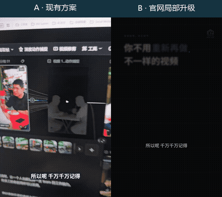

左侧为现有方案，右侧为用户已认可的官网重点文字局部升级。此处是同一源区间的4秒静音节选，保持各版本的正常播放速度；没有把一个片段的认可扩大为所有模板或全片认可。[查看B版本较完整局部Demo](docs/template-gallery/demos/case-studies/approved-b-highlight.mp4)。

<!-- HOMEPAGE_COMPARISON:END -->

<!-- HOMEPAGE_SHOWCASE:START -->

<!-- Generated by scripts/build_homepage_showcase.py; insert only inside HOMEPAGE_SHOWCASE markers. -->
216 条目录分为 **72 项官网模板与片段、70 个控件、55 个代码注册项、19 个真人口播特效**，不同层级不合并成 216 套独立模板。另有 10 条本片接入记录，不重复计为模板。按分类展开，点击画面或 Demo 链接查看完整演示。

本地 GIF 是 **最多 3 秒、原速度、无声节选**，不是完整视频。官网项目使用官方预览图；演示、可下载状态、实际运行和本条成片验收分别核对。

<details open>
<summary><strong>官网模板与片段 · 72 项</strong></summary>

<details open>
<summary>口播与讲解 · 21 项</summary>

<table>
<tr>
<td width="50%" align="center" valign="top">
<strong>现代图文 · 口播讲解 · 竖屏</strong><br>
<a href="docs/template-gallery/demos/integrated/owner-native-20261028/modern/portrait.mp4">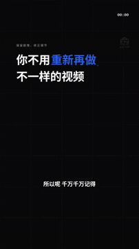</a><br>
<sub>原速节选 · 3.0 秒 · 无声 GIF</sub><br>
<p><sub>当前本人Demo版本：2.7.18-alpha.4 · 本片QA：verified_demo（已解码与抽帧检查）</sub></p><a href="docs/template-gallery/demos/integrated/owner-native-20261028/modern/portrait.mp4">完整本地 Demo</a> · <a href="docs/template-gallery/demos/integrated/owner-native-20261028/modern/landscape.mp4">完整本地 Demo</a> · <a href="docs/template-gallery/demos/case-studies/approved-b-highlight.mp4">完整本地 Demo</a> · <a href="https://media.openaicut.com/previews/606/draft-zh-9086d86d6129.mp4">官方 Demo · 9:16</a> · <a href="https://motiongit.com/@adunext/template-01-integrated-portrait">来源</a>
<details><summary>本片接入与复用边界</summary><p>owner-native-demo-20261028 · template-01-integrated-portrait · 2.7.18-alpha.4</p><p>输入：本人真实口播与同源原声，源4.75—26.95秒相对原片绝对1.2倍一次，形成18.5秒标准输入；三风格使用同一内容与原始词时。；词时来自已有原片转写并按同一时钟换算；“一人公司”“景深”沿用用户已确认术语，不按字数伪造时间，不使用AI配音。；brief.schema=adu-auto-brief/1；layout=portrait；narrationDuration=18.5；allowedStyles=[01-D]；presenterLabel=Isaac。；正文讲AI短视频质量不错但有瑕疵、一人公司字样缺失且剧情应保留、接着尝试景深功能；只使用已讲到的主张，不补写效果承诺。；本包竖屏输出。本例只验证01-D的basic-keyword与basic-summary基础图文路线；不表示01-A至01-C或官网整套动画已接入。</p><p>调用：<code>.\.venv\Scripts\python.exe scripts/motiongit_adapter.py run --instance &lt;instance&gt; render &lt;reviewed-project&gt; --out &lt;native-demo.mp4&gt; --language zh</code></p><p>本片检查：现代图文 01-D 9:16 本人独立小样：720×1280、30fps、555帧、18.5秒、无音轨，完整解码通过；每版11个官方原生预览样本与本条最终静音编码4.0秒海报已实际查看。本人身份与中文输入已核对，抽样未见示例人物或客户资料。仅验证本版本/此输入/列出的两个scene，不代表全帧人工审阅、连续观看、完整听审、用户审美认可、整个官网库或其他电脑通过。原片11.65—12.25秒镜头朝衣服移动；保留真实本人镜头，不以生成头像替换。</p><p>登记基线版本：2.7.17-alpha.2。仅此版本与Demo；不扩展原条目或全部变体的验证状态，不代表用户审美认可。</p></details></td>
<td width="50%" align="center" valign="top">
<strong>现代图文 · 口播讲解</strong><br>
<a href="https://media.openaicut.com/previews/605/draft-zh-99e0d21cfdd9.mp4"></a><br>
<sub>官方预览图 · 点击查看完整 Demo</sub><br>
<a href="https://media.openaicut.com/previews/605/draft-zh-99e0d21cfdd9.mp4">官方 Demo · 16:9</a> · <a href="https://motiongit.com/@adunext/template-01-integrated">来源</a>
</td>
</tr>
<tr>
<td width="50%" align="center" valign="top">
<strong>纸面透视 · 口播讲解</strong><br>
<a href="https://media.openaicut.com/previews/607/draft-zh-613d68ad449f.mp4"></a><br>
<sub>官方预览图 · 点击查看完整 Demo</sub><br>
<a href="https://media.openaicut.com/previews/607/draft-zh-613d68ad449f.mp4">官方 Demo · 16:9</a> · <a href="https://motiongit.com/@adunext/template-02-expanded">来源</a>
</td>
<td width="50%" align="center" valign="top">
<strong>纸面透视 · 口播讲解 · 竖屏</strong><br>
<a href="docs/template-gallery/demos/integrated/owner-native-20261028/paper/portrait.mp4"></a><br>
<sub>原速节选 · 3.0 秒 · 无声 GIF</sub><br>
<p><sub>当前本人Demo版本：2.7.18-alpha.5 · 本片QA：verified_demo（已解码与抽帧检查）</sub></p><a href="docs/template-gallery/demos/integrated/owner-native-20261028/paper/portrait.mp4">完整本地 Demo</a> · <a href="docs/template-gallery/demos/integrated/owner-native-20261028/paper/landscape.mp4">完整本地 Demo</a> · <a href="https://media.openaicut.com/previews/608/draft-zh-927e16779f16.mp4">官方 Demo · 9:16</a> · <a href="https://motiongit.com/@adunext/template-02-expanded-portrait">来源</a>
<details><summary>本片接入与复用边界</summary><p>owner-native-demo-20261028 · template-02-expanded-portrait · 2.7.18-alpha.5</p><p>输入：本人真实口播与同源原声，源4.75—26.95秒相对原片绝对1.2倍一次，形成18.5秒标准输入；三风格使用同一内容与原始词时。；词时来自已有原片转写并按同一时钟换算；“一人公司”“景深”沿用用户已确认术语，不按字数伪造时间，不使用AI配音。；brief.schema=adu-auto-brief/1；layout=portrait；narrationDuration=18.5；allowedStyles=[02-X]；presenterLabel=Isaac。；正文讲AI短视频质量不错但有瑕疵、一人公司字样缺失且剧情应保留、接着尝试景深功能；只使用已讲到的主张，不补写效果承诺。；本包竖屏输出。本例是02-X扩展候选fold-pin-opinion与glyph-thread-keyword；不是历史模板完整编舞复原，也不代表整个纸面模板库通过。</p><p>调用：<code>.\.venv\Scripts\python.exe scripts/motiongit_adapter.py run --instance &lt;instance&gt; render &lt;reviewed-project&gt; --out &lt;native-demo.mp4&gt; --language zh</code></p><p>本片检查：纸面透视 02-X 9:16 本人独立小样：720×1280、30fps、555帧、18.5秒、无音轨，完整解码通过；每版11个官方原生预览样本与本条最终静音编码4.0秒海报已实际查看。本人身份与中文输入已核对，抽样未见示例人物或客户资料。仅验证本版本/此输入/列出的两个scene，不代表全帧人工审阅、连续观看、完整听审、用户审美认可、整个官网库或其他电脑通过。原片11.65—12.25秒镜头朝衣服移动；保留真实本人镜头，不以生成头像替换。</p><p>登记基线版本：2.7.17-alpha.2。仅此版本与Demo；不扩展原条目或全部变体的验证状态，不代表用户审美认可。</p></details></td>
</tr>
<tr>
<td width="50%" align="center" valign="top">
<strong>深色立体 · 多屏展陈</strong><br>
<a href="https://media.openaicut.com/previews/609/draft-zh-a33d6dc67131.mp4"></a><br>
<sub>官方预览图 · 点击查看完整 Demo</sub><br>
<a href="https://media.openaicut.com/previews/609/draft-zh-a33d6dc67131.mp4">官方 Demo · 16:9</a> · <a href="https://motiongit.com/@adunext/template-03-native">来源</a>
</td>
<td width="50%" align="center" valign="top">
<strong>深色立体 · 多屏展陈 · 竖屏</strong><br>
<a href="docs/template-gallery/demos/integrated/owner-native-20261028/dark/portrait.mp4">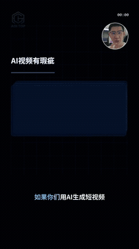</a><br>
<sub>原速节选 · 3.0 秒 · 无声 GIF</sub><br>
<p><sub>当前本人Demo版本：2.7.18-alpha.4 · 本片QA：verified_demo（已解码与抽帧检查）</sub></p><a href="docs/template-gallery/demos/integrated/owner-native-20261028/dark/portrait.mp4">完整本地 Demo</a> · <a href="docs/template-gallery/demos/integrated/owner-native-20261028/dark/landscape.mp4">完整本地 Demo</a> · <a href="https://media.openaicut.com/previews/610/draft-zh-3200b44b2818.mp4">官方 Demo · 9:16</a> · <a href="https://motiongit.com/@adunext/template-03-native-portrait">来源</a>
<details><summary>本片接入与复用边界</summary><p>owner-native-demo-20261028 · template-03-native-portrait · 2.7.18-alpha.4</p><p>输入：本人真实口播与同源原声，源4.75—26.95秒相对原片绝对1.2倍一次，形成18.5秒标准输入；三风格使用同一内容与原始词时。；词时来自已有原片转写并按同一时钟换算；“一人公司”“景深”沿用用户已确认术语，不按字数伪造时间，不使用AI配音。；brief.schema=adu-auto-brief/1；layout=portrait；narrationDuration=18.5；allowedStyles=[03-X]；presenterLabel=Isaac。；正文讲AI短视频质量不错但有瑕疵、一人公司字样缺失且剧情应保留、接着尝试景深功能；只使用已讲到的主张，不补写效果承诺。；本包竖屏输出。本例只验证03-X通用重点与总结扩展；不是03-A/03-B完整多屏大场景，也不代表所有深色立体模板已接入。</p><p>调用：<code>.\.venv\Scripts\python.exe scripts/motiongit_adapter.py run --instance &lt;instance&gt; render &lt;reviewed-project&gt; --out &lt;native-demo.mp4&gt; --language zh</code></p><p>本片检查：深色立体 03-X 9:16 本人独立小样：720×1280、30fps、555帧、18.5秒、无音轨，完整解码通过；每版11个官方原生预览样本与本条最终静音编码4.0秒海报已实际查看。本人身份与中文输入已核对，抽样未见示例人物或客户资料。仅验证本版本/此输入/列出的两个scene，不代表全帧人工审阅、连续观看、完整听审、用户审美认可、整个官网库或其他电脑通过。约11.65—12.25秒官方圆窗局部裁到头发/上额，眼鼻口仍可见；公开native合同未提供可核实的人脸中心或裁切参数，因此保留原布局，审美待用户确认。</p><p>登记基线版本：2.7.17-alpha.2。仅此版本与Demo；不扩展原条目或全部变体的验证状态，不代表用户审美认可。</p></details></td>
</tr>
<tr>
<td width="50%" align="center" valign="top">
<strong>科技控制台 · 口播讲解</strong><br>
<a href="https://media.openaicut.com/previews/611/2.5.7-zh-96b144413879.mp4"></a><br>
<sub>官方预览图 · 点击查看完整 Demo</sub><br>
<a href="https://media.openaicut.com/previews/611/2.5.7-zh-96b144413879.mp4">官方 Demo · 16:9</a> · <a href="https://motiongit.com/@adunext/template-04-dark-console">来源</a>
</td>
<td width="50%" align="center" valign="top">
<strong>科技控制台 · 口播讲解 · 竖屏</strong><br>
<a href="https://media.openaicut.com/previews/612/2.5.7-zh-a93efdfb29ba.mp4"></a><br>
<sub>官方预览图 · 点击查看完整 Demo</sub><br>
<a href="https://media.openaicut.com/previews/612/2.5.7-zh-a93efdfb29ba.mp4">官方 Demo · 9:16</a> · <a href="https://motiongit.com/@adunext/template-04-dark-console-portrait">来源</a>
</td>
</tr>
<tr>
<td width="50%" align="center" valign="top">
<strong>鲜色角色 · 叙事讲解</strong><br>
<a href="https://media.openaicut.com/previews/613/draft-zh-9454c905098e.mp4"></a><br>
<sub>官方预览图 · 点击查看完整 Demo</sub><br>
<a href="https://media.openaicut.com/previews/613/draft-zh-9454c905098e.mp4">官方 Demo · 16:9</a> · <a href="https://motiongit.com/@adunext/template-05-native">来源</a>
</td>
<td width="50%" align="center" valign="top">
<strong>鲜色角色 · 叙事讲解 · 竖屏</strong><br>
<a href="https://media.openaicut.com/previews/614/draft-zh-6382724d35a0.mp4"></a><br>
<sub>官方预览图 · 点击查看完整 Demo</sub><br>
<a href="https://media.openaicut.com/previews/614/draft-zh-6382724d35a0.mp4">官方 Demo · 9:16</a> · <a href="https://motiongit.com/@adunext/template-05-native-portrait">来源</a>
</td>
</tr>
<tr>
<td width="50%" align="center" valign="top">
<strong>活力海报 · 口播讲解</strong><br>
<a href="https://media.openaicut.com/previews/623/draft-zh-e8e43fce1aae.mp4"></a><br>
<sub>官方预览图 · 点击查看完整 Demo</sub><br>
<a href="https://media.openaicut.com/previews/623/draft-zh-e8e43fce1aae.mp4">官方 Demo · 16:9</a> · <a href="https://motiongit.com/@adunext/vibrant-poster">来源</a>
</td>
<td width="50%" align="center" valign="top">
<strong>活力海报 · 口播讲解 · 竖屏</strong><br>
<a href="https://media.openaicut.com/previews/624/draft-zh-11cf23913cdd.mp4"></a><br>
<sub>官方预览图 · 点击查看完整 Demo</sub><br>
<a href="https://media.openaicut.com/previews/624/draft-zh-11cf23913cdd.mp4">官方 Demo · 9:16</a> · <a href="https://motiongit.com/@adunext/vibrant-poster-portrait">来源</a>
</td>
</tr>
<tr>
<td width="50%" align="center" valign="top">
<strong>口播宣传动效 10 秒</strong><br>
<a href="https://media.openaicut.com/previews/870/1.0.0-6dcf8b7863ca.mp4"></a><br>
<sub>官方预览图 · 点击查看完整 Demo</sub><br>
<a href="https://media.openaicut.com/previews/870/1.0.0-6dcf8b7863ca.mp4">官方 Demo · 16:9</a> · <a href="https://motiongit.com/@thepandaq/kouboo-motion">来源</a>
</td>
<td width="50%" align="center" valign="top">
<strong>3D 口播开场</strong><br>
<a href="https://media.openaicut.com/previews/871/draft-40ddede10a69.mp4"></a><br>
<sub>官方预览图 · 点击查看完整 Demo</sub><br>
<a href="https://media.openaicut.com/previews/871/draft-40ddede10a69.mp4">官方 Demo · 16:9</a> · <a href="https://motiongit.com/@thepandaq/cool-3d-intro">来源</a>
</td>
</tr>
<tr>
<td width="50%" align="center" valign="top">
<strong>DEEP STAGE 口播主舞台</strong><br>
<a href="https://media.openaicut.com/previews/880/1.0.0-2c8e89fea7a8.mp4"></a><br>
<sub>官方预览图 · 点击查看完整 Demo</sub><br>
<a href="https://media.openaicut.com/previews/880/1.0.0-2c8e89fea7a8.mp4">官方 Demo · 16:9</a> · <a href="https://motiongit.com/@thepandaq/deep-stage-host-stage">来源</a>
</td>
<td width="50%" align="center" valign="top">
<strong>DEEP STAGE 深境舞台完整版</strong><br>
<a href="https://media.openaicut.com/previews/885/1.0.0-1d0d4dc1ea23.mp4"></a><br>
<sub>官方预览图 · 点击查看完整 Demo</sub><br>
<a href="https://media.openaicut.com/previews/885/1.0.0-1d0d4dc1ea23.mp4">官方 Demo · 16:9</a> · <a href="https://motiongit.com/@thepandaq/deep-stage-full-video">来源</a>
</td>
</tr>
<tr>
<td width="50%" align="center" valign="top">
<strong>Kit 2 · 口播动效包装（竖屏）</strong><br>
<a href="https://media.openaicut.com/previews/890/1.0.0-a07dfe35eea8.mp4"></a><br>
<sub>官方预览图 · 点击查看完整 Demo</sub><br>
<a href="https://media.openaicut.com/previews/890/1.0.0-a07dfe35eea8.mp4">官方 Demo · 9:16</a> · <a href="https://motiongit.com/@chenyutao0417/kit2-koubo-wrap">来源</a>
</td>
<td width="50%" align="center" valign="top">
<strong>突破边界</strong><br>
<a href="https://media.openaicut.com/previews/896/draft-zh-995fe8c7aa31.mp4"></a><br>
<sub>官方预览图 · 点击查看完整 Demo</sub><br>
<a href="https://media.openaicut.com/previews/896/draft-zh-995fe8c7aa31.mp4">官方 Demo · 3:4</a> · <a href="https://motiongit.com/@adunext/break-boundaries">来源</a>
</td>
</tr>
<tr>
<td width="50%" align="center" valign="top">
<strong>字符剧场</strong><br>
<a href="https://media.openaicut.com/previews/897/draft-zh-1bc9e79516df.mp4"></a><br>
<sub>官方预览图 · 点击查看完整 Demo</sub><br>
<a href="https://media.openaicut.com/previews/897/draft-zh-1bc9e79516df.mp4">官方 Demo · 16:9</a> · <a href="https://motiongit.com/@adunext/character-theater">来源</a>
</td>
<td width="50%" align="center" valign="top">
<strong>卡通讲解风</strong><br>
<a href="https://media.openaicut.com/previews/898/draft-zh-07d37803544c.mp4"></a><br>
<sub>官方预览图 · 点击查看完整 Demo</sub><br>
<a href="https://media.openaicut.com/previews/898/draft-zh-07d37803544c.mp4">官方 Demo · 16:9</a> · <a href="https://motiongit.com/@adunext/cartoon-explainer">来源</a>
</td>
</tr>
<tr>
<td width="50%" align="center" valign="top">
<strong>像素海洋</strong><br>
<a href="https://media.openaicut.com/previews/899/draft-zh-e97c782669c1.mp4"></a><br>
<sub>官方预览图 · 点击查看完整 Demo</sub><br>
<a href="https://media.openaicut.com/previews/899/draft-zh-e97c782669c1.mp4">官方 Demo · 4:3</a> · <a href="https://motiongit.com/@adunext/pixel-ocean">来源</a>
</td>
<td width="50%"></td>
</tr>
</table>

</details>

<details>
<summary>科技视觉（非口播默认） · 1 项</summary>

<table>
<tr>
<td width="50%" align="center" valign="top">
<strong>酷炫科技风</strong><br>
<a href="https://motiontemplates.github.io/385712/assets/demo.mp4"></a><br>
<sub>官方预览图 · 点击查看完整 Demo</sub><br>
<a href="https://motiontemplates.github.io/385712/assets/demo.mp4">官方 Demo · 16:9</a> · <a href="https://media.openaicut.com/previews/626/0.2.9-open-beta-zh-11eae4868d37.mp4">官方 Demo · 9:16</a> · <a href="https://motiongit.com/@adunext/385712">来源</a>
</td>
<td width="50%"></td>
</tr>
</table>

</details>

<details>
<summary>知识解说与流程图 · 19 项</summary>

<table>
<tr>
<td width="50%" align="center" valign="top">
<strong>量价图表：K线突破与分时动画</strong><br>
<a href="https://media.openaicut.com/previews/869/1.0.0-zh-d5fd83bc28a8.mp4"></a><br>
<sub>官方预览图 · 点击查看完整 Demo</sub><br>
<a href="https://media.openaicut.com/previews/869/1.0.0-zh-d5fd83bc28a8.mp4">官方 Demo · 1:1</a> · <a href="https://motiongit.com/@oubaba95128/volume-price-kline-charts">来源</a>
</td>
<td width="50%" align="center" valign="top">
<strong>流程与时间线 · FLOW / TIMELINE</strong><br>
<a href="https://media.openaicut.com/previews/876/1.0.0-zh-294b6a370e6d.mp4"></a><br>
<sub>官方预览图 · 点击查看完整 Demo</sub><br>
<a href="https://media.openaicut.com/previews/876/1.0.0-zh-294b6a370e6d.mp4">官方 Demo · 16:9</a> · <a href="https://motiongit.com/@thepandaq/collage-flow">来源</a>
</td>
</tr>
<tr>
<td width="50%" align="center" valign="top">
<strong>DEEP STAGE 案例数据</strong><br>
<a href="https://media.openaicut.com/previews/882/1.0.0-5df639825460.mp4"></a><br>
<sub>官方预览图 · 点击查看完整 Demo</sub><br>
<a href="https://media.openaicut.com/previews/882/1.0.0-5df639825460.mp4">官方 Demo · 16:9</a> · <a href="https://motiongit.com/@thepandaq/deep-stage-case-data">来源</a>
</td>
<td width="50%" align="center" valign="top">
<strong>目标与证据 · 17类语义动效</strong><br>
<a href="https://media.openaicut.com/previews/886/0.4.0-rc.4-7ab29961149d.mp4"></a><br>
<sub>官方预览图 · 点击查看完整 Demo</sub><br>
<a href="https://media.openaicut.com/previews/886/0.4.0-rc.4-7ab29961149d.mp4">官方 Demo · 16:9</a> · <a href="https://motiongit.com/@frankye1211/product-update-story">来源</a>
</td>
</tr>
<tr>
<td width="50%" align="center" valign="top">
<strong>图解口播与图片展示</strong><br>
<a href="https://media.openaicut.com/previews/888/0.8.0-rc.2-6971ec2770b7.mp4"></a><br>
<sub>官方预览图 · 点击查看完整 Demo</sub><br>
<a href="https://media.openaicut.com/previews/888/0.8.0-rc.2-6971ec2770b7.mp4">官方 Demo · 16:9</a> · <a href="https://motiongit.com/@frankye1211/moonwhite-robot-unified">来源</a>
</td>
<td width="50%" align="center" valign="top">
<strong>Kit 1 · 人文纪录片知识短片</strong><br>
<a href="https://media.openaicut.com/previews/889/1.0.0-c28fac802c50.mp4"></a><br>
<sub>官方预览图 · 点击查看完整 Demo</sub><br>
<a href="https://media.openaicut.com/previews/889/1.0.0-c28fac802c50.mp4">官方 Demo · 16:9</a> · <a href="https://motiongit.com/@chenyutao0417/kit1-doc-shortfilm">来源</a>
</td>
</tr>
<tr>
<td width="50%" align="center" valign="top">
<strong>水墨人物志 · 一个人的故事</strong><br>
<a href="https://media.openaicut.com/previews/892/1.0.0-zh-1f9aa1a124de.mp4"></a><br>
<sub>官方预览图 · 点击查看完整 Demo</sub><br>
<a href="https://media.openaicut.com/previews/892/1.0.0-zh-1f9aa1a124de.mp4">官方 Demo · 16:9</a> · <a href="https://motiongit.com/@chenyutao0417/ink-saga">来源</a>
</td>
<td width="50%" align="center" valign="top">
<strong>瑞士信息设计 · 知识讲解模板</strong><br>
<a href="https://media.openaicut.com/previews/900/2.5.3-zh-5df29820b59b.mp4"></a><br>
<sub>官方预览图 · 点击查看完整 Demo</sub><br>
<a href="https://media.openaicut.com/previews/900/2.5.3-zh-5df29820b59b.mp4">官方 Demo · 16:9</a> · <a href="https://motiongit.com/@adunext/knowledge-explainer-swiss">来源</a>
</td>
</tr>
<tr>
<td width="50%" align="center" valign="top">
<strong>黏土实验台 · 知识讲解模板</strong><br>
<a href="https://media.openaicut.com/previews/901/2.5.3-zh-8f8876c01431.mp4"></a><br>
<sub>官方预览图 · 点击查看完整 Demo</sub><br>
<a href="https://media.openaicut.com/previews/901/2.5.3-zh-8f8876c01431.mp4">官方 Demo · 16:9</a> · <a href="https://motiongit.com/@adunext/knowledge-explainer-clay">来源</a>
</td>
<td width="50%" align="center" valign="top">
<strong>粉笔黑板 · 知识讲解模板</strong><br>
<a href="https://media.openaicut.com/previews/902/2.5.3-zh-3d0943b9524d.mp4"></a><br>
<sub>官方预览图 · 点击查看完整 Demo</sub><br>
<a href="https://media.openaicut.com/previews/902/2.5.3-zh-3d0943b9524d.mp4">官方 Demo · 16:9</a> · <a href="https://motiongit.com/@adunext/knowledge-explainer-chalkboard">来源</a>
</td>
</tr>
<tr>
<td width="50%" align="center" valign="top">
<strong>生长导图 · 知识讲解模板</strong><br>
<a href="https://media.openaicut.com/previews/903/2.5.3-zh-fe14805ea913.mp4"></a><br>
<sub>官方预览图 · 点击查看完整 Demo</sub><br>
<a href="https://media.openaicut.com/previews/903/2.5.3-zh-fe14805ea913.mp4">官方 Demo · 16:9</a> · <a href="https://motiongit.com/@adunext/knowledge-explainer-mindmap">来源</a>
</td>
<td width="50%" align="center" valign="top">
<strong>博物馆展墙 · 知识讲解模板</strong><br>
<a href="https://media.openaicut.com/previews/904/2.5.3-zh-12ca8272b15b.mp4"></a><br>
<sub>官方预览图 · 点击查看完整 Demo</sub><br>
<a href="https://media.openaicut.com/previews/904/2.5.3-zh-12ca8272b15b.mp4">官方 Demo · 16:9</a> · <a href="https://motiongit.com/@adunext/knowledge-explainer-timeline">来源</a>
</td>
</tr>
<tr>
<td width="50%" align="center" valign="top">
<strong>发光玻璃板 · 知识讲解模板</strong><br>
<a href="https://media.openaicut.com/previews/905/2.5.3-zh-90f1d36b5c30.mp4"></a><br>
<sub>官方预览图 · 点击查看完整 Demo</sub><br>
<a href="https://media.openaicut.com/previews/905/2.5.3-zh-90f1d36b5c30.mp4">官方 Demo · 16:9</a> · <a href="https://motiongit.com/@adunext/knowledge-explainer-lightboard">来源</a>
</td>
<td width="50%" align="center" valign="top">
<strong>等距系统图 · 知识讲解模板</strong><br>
<a href="https://media.openaicut.com/previews/906/2.5.3-zh-f7f712d44ade.mp4"></a><br>
<sub>官方预览图 · 点击查看完整 Demo</sub><br>
<a href="https://media.openaicut.com/previews/906/2.5.3-zh-f7f712d44ade.mp4">官方 Demo · 16:9</a> · <a href="https://motiongit.com/@adunext/knowledge-explainer-isometric">来源</a>
</td>
</tr>
<tr>
<td width="50%" align="center" valign="top">
<strong>纸雕层叠 · 知识讲解模板</strong><br>
<a href="https://media.openaicut.com/previews/907/2.5.3-zh-66b986377f2a.mp4"></a><br>
<sub>官方预览图 · 点击查看完整 Demo</sub><br>
<a href="https://media.openaicut.com/previews/907/2.5.3-zh-66b986377f2a.mp4">官方 Demo · 16:9</a> · <a href="https://motiongit.com/@adunext/knowledge-explainer-papercut">来源</a>
</td>
<td width="50%" align="center" valign="top">
<strong>地铁线路图 · 知识讲解模板</strong><br>
<a href="https://media.openaicut.com/previews/908/2.5.3-zh-fd8d9dc5ae03.mp4"></a><br>
<sub>官方预览图 · 点击查看完整 Demo</sub><br>
<a href="https://media.openaicut.com/previews/908/2.5.3-zh-fd8d9dc5ae03.mp4">官方 Demo · 16:9</a> · <a href="https://motiongit.com/@adunext/knowledge-explainer-metro">来源</a>
</td>
</tr>
<tr>
<td width="50%" align="center" valign="top">
<strong>双色孔版 · 知识讲解模板</strong><br>
<a href="https://media.openaicut.com/previews/909/2.5.3-zh-15d6f65e42f3.mp4"></a><br>
<sub>官方预览图 · 点击查看完整 Demo</sub><br>
<a href="https://media.openaicut.com/previews/909/2.5.3-zh-15d6f65e42f3.mp4">官方 Demo · 16:9</a> · <a href="https://motiongit.com/@adunext/knowledge-explainer-riso">来源</a>
</td>
<td width="50%" align="center" valign="top">
<strong>点阵手账 · 知识讲解模板</strong><br>
<a href="https://media.openaicut.com/previews/910/2.5.3-zh-5ebc896f6930.mp4"></a><br>
<sub>官方预览图 · 点击查看完整 Demo</sub><br>
<a href="https://media.openaicut.com/previews/910/2.5.3-zh-5ebc896f6930.mp4">官方 Demo · 16:9</a> · <a href="https://motiongit.com/@adunext/knowledge-explainer-sketchnote">来源</a>
</td>
</tr>
<tr>
<td width="50%" align="center" valign="top">
<strong>彩色几何 · 知识讲解模板</strong><br>
<a href="https://media.openaicut.com/previews/911/2.5.3-zh-b27b76c06f66.mp4"></a><br>
<sub>官方预览图 · 点击查看完整 Demo</sub><br>
<a href="https://media.openaicut.com/previews/911/2.5.3-zh-b27b76c06f66.mp4">官方 Demo · 16:9</a> · <a href="https://motiongit.com/@adunext/knowledge-explainer-byrne">来源</a>
</td>
<td width="50%"></td>
</tr>
</table>

</details>

<details>
<summary>产品宣传与教程 · 14 项</summary>

<table>
<tr>
<td width="50%" align="center" valign="top">
<strong>多屏拼贴 · 品牌宣传</strong><br>
<a href="https://media.openaicut.com/previews/585/draft-zh-78bba5fd21f6.mp4"></a><br>
<sub>官方预览图 · 点击查看完整 Demo</sub><br>
<a href="https://media.openaicut.com/previews/585/draft-zh-78bba5fd21f6.mp4">官方 Demo · 16:9</a> · <a href="https://motiongit.com/@motiongit/motiongit-promo-main">来源</a>
</td>
<td width="50%" align="center" valign="top">
<strong>像素闯关 · 产品宣传</strong><br>
<a href="https://media.openaicut.com/previews/586/draft-zh-b8792f9887ad.mp4"></a><br>
<sub>官方预览图 · 点击查看完整 Demo</sub><br>
<a href="https://media.openaicut.com/previews/586/draft-zh-b8792f9887ad.mp4">官方 Demo · 16:9</a> · <a href="https://motiongit.com/@motiongit/motiongit-promo-pixel">来源</a>
</td>
</tr>
<tr>
<td width="50%" align="center" valign="top">
<strong>明暗快切 · 产品宣传</strong><br>
<a href="https://media.openaicut.com/previews/587/draft-zh-89b65ccfd5ce.mp4"></a><br>
<sub>官方预览图 · 点击查看完整 Demo</sub><br>
<a href="https://media.openaicut.com/previews/587/draft-zh-89b65ccfd5ce.mp4">官方 Demo · 16:9</a> · <a href="https://motiongit.com/@motiongit/motiongit-promo-velocity">来源</a>
</td>
<td width="50%" align="center" valign="top">
<strong>流程演示 · 产品教程</strong><br>
<a href="https://media.openaicut.com/previews/588/draft-zh-ca08bac0650e.mp4"></a><br>
<sub>官方预览图 · 点击查看完整 Demo</sub><br>
<a href="https://media.openaicut.com/previews/588/draft-zh-ca08bac0650e.mp4">官方 Demo · 16:9</a> · <a href="https://motiongit.com/@motiongit/motiongit-promo-user">来源</a>
</td>
</tr>
<tr>
<td width="50%" align="center" valign="top">
<strong>模块拼贴 · 创作者宣传</strong><br>
<a href="https://media.openaicut.com/previews/589/draft-zh-4d806a380523.mp4"></a><br>
<sub>官方预览图 · 点击查看完整 Demo</sub><br>
<a href="https://media.openaicut.com/previews/589/draft-zh-4d806a380523.mp4">官方 Demo · 16:9</a> · <a href="https://motiongit.com/@motiongit/motiongit-promo-creator">来源</a>
</td>
<td width="50%" align="center" valign="top">
<strong>工程蓝图 · 产品拆解</strong><br>
<a href="https://media.openaicut.com/previews/590/draft-zh-308a5a69232f.mp4"></a><br>
<sub>官方预览图 · 点击查看完整 Demo</sub><br>
<a href="https://media.openaicut.com/previews/590/draft-zh-308a5a69232f.mp4">官方 Demo · 16:9</a> · <a href="https://motiongit.com/@motiongit/motiongit-promo-blueprint">来源</a>
</td>
</tr>
<tr>
<td width="50%" align="center" valign="top">
<strong>发布会舞台 · 产品演示</strong><br>
<a href="https://media.openaicut.com/previews/591/draft-zh-958b2690a669.mp4"></a><br>
<sub>官方预览图 · 点击查看完整 Demo</sub><br>
<a href="https://media.openaicut.com/previews/591/draft-zh-958b2690a669.mp4">官方 Demo · 16:9</a> · <a href="https://motiongit.com/@motiongit/motiongit-promo-keynote">来源</a>
</td>
<td width="50%" align="center" valign="top">
<strong>宣纸手卷 · 品牌叙事</strong><br>
<a href="https://media.openaicut.com/previews/592/draft-zh-eba2e4e6f671.mp4"></a><br>
<sub>官方预览图 · 点击查看完整 Demo</sub><br>
<a href="https://media.openaicut.com/previews/592/draft-zh-eba2e4e6f671.mp4">官方 Demo · 16:9</a> · <a href="https://motiongit.com/@motiongit/motiongit-promo-ink">来源</a>
</td>
</tr>
<tr>
<td width="50%" align="center" valign="top">
<strong>拼贴出场 · COLLAGE OPEN</strong><br>
<a href="https://media.openaicut.com/previews/873/1.0.0-zh-6b7b749b3dc5.mp4"></a><br>
<sub>官方预览图 · 点击查看完整 Demo</sub><br>
<a href="https://media.openaicut.com/previews/873/1.0.0-zh-6b7b749b3dc5.mp4">官方 Demo · 16:9</a> · <a href="https://motiongit.com/@thepandaq/collage-open">来源</a>
</td>
<td width="50%" align="center" valign="top">
<strong>多屏墙换版 · WALL SWAP</strong><br>
<a href="https://media.openaicut.com/previews/874/1.0.0-zh-7831dd69bc6b.mp4"></a><br>
<sub>官方预览图 · 点击查看完整 Demo</sub><br>
<a href="https://media.openaicut.com/previews/874/1.0.0-zh-7831dd69bc6b.mp4">官方 Demo · 16:9</a> · <a href="https://motiongit.com/@thepandaq/collage-wall">来源</a>
</td>
</tr>
<tr>
<td width="50%" align="center" valign="top">
<strong>四种看法与片格 · VIEWS / STRIP</strong><br>
<a href="https://media.openaicut.com/previews/875/1.0.0-zh-cd8ad1570460.mp4"></a><br>
<sub>官方预览图 · 点击查看完整 Demo</sub><br>
<a href="https://media.openaicut.com/previews/875/1.0.0-zh-cd8ad1570460.mp4">官方 Demo · 16:9</a> · <a href="https://motiongit.com/@thepandaq/collage-views">来源</a>
</td>
<td width="50%" align="center" valign="top">
<strong>产品与品牌 · PRODUCT → BRAND</strong><br>
<a href="https://media.openaicut.com/previews/877/1.0.0-zh-97910ee13592.mp4"></a><br>
<sub>官方预览图 · 点击查看完整 Demo</sub><br>
<a href="https://media.openaicut.com/previews/877/1.0.0-zh-97910ee13592.mp4">官方 Demo · 16:9</a> · <a href="https://motiongit.com/@thepandaq/collage-product">来源</a>
</td>
</tr>
<tr>
<td width="50%" align="center" valign="top">
<strong>DEEP STAGE 产品讲解</strong><br>
<a href="https://media.openaicut.com/previews/881/1.0.0-bf4d2ce8953d.mp4"></a><br>
<sub>官方预览图 · 点击查看完整 Demo</sub><br>
<a href="https://media.openaicut.com/previews/881/1.0.0-bf4d2ce8953d.mp4">官方 Demo · 16:9</a> · <a href="https://motiongit.com/@thepandaq/deep-stage-product-focus">来源</a>
</td>
<td width="50%" align="center" valign="top">
<strong>多屏商务 · 动态图表</strong><br>
<a href="https://media.openaicut.com/previews/891/0.1.1-candidate-zh-a43ff10687ec.mp4"></a><br>
<sub>官方预览图 · 点击查看完整 Demo</sub><br>
<a href="https://media.openaicut.com/previews/891/0.1.1-candidate-zh-a43ff10687ec.mp4">官方 Demo · 16:9</a> · <a href="https://motiongit.com/@frankye1211/corporate-multiscreen-charts">来源</a>
</td>
</tr>
</table>

</details>

<details>
<summary>视觉与场景动效（非口播默认） · 17 项</summary>

<table>
<tr>
<td width="50%" align="center" valign="top">
<strong>半调网点 · 人像标题</strong><br>
<a href="https://media.openaicut.com/previews/615/draft-zh-87b41df4a38a.mp4"></a><br>
<sub>官方预览图 · 点击查看完整 Demo</sub><br>
<a href="https://media.openaicut.com/previews/615/draft-zh-87b41df4a38a.mp4">官方 Demo · 16:9</a> · <a href="https://motiongit.com/@prism-studio/visual-art-a-halftone">来源</a>
</td>
<td width="50%" align="center" valign="top">
<strong>照片马赛克 · 拼图揭幕</strong><br>
<a href="https://media.openaicut.com/previews/616/draft-zh-3c3bc74e9591.mp4"></a><br>
<sub>官方预览图 · 点击查看完整 Demo</sub><br>
<a href="https://media.openaicut.com/previews/616/draft-zh-3c3bc74e9591.mp4">官方 Demo · 16:9</a> · <a href="https://motiongit.com/@prism-studio/visual-art-b-mosaic">来源</a>
</td>
</tr>
<tr>
<td width="50%" align="center" valign="top">
<strong>几何拼贴 · 动态海报</strong><br>
<a href="https://media.openaicut.com/previews/617/draft-zh-d014a696e0ba.mp4"></a><br>
<sub>官方预览图 · 点击查看完整 Demo</sub><br>
<a href="https://media.openaicut.com/previews/617/draft-zh-d014a696e0ba.mp4">官方 Demo · 16:9</a> · <a href="https://motiongit.com/@prism-studio/visual-art-c-collage">来源</a>
</td>
<td width="50%" align="center" valign="top">
<strong>笔触重绘 · 艺术照片</strong><br>
<a href="https://media.openaicut.com/previews/618/draft-zh-9a122d6aac1e.mp4"></a><br>
<sub>官方预览图 · 点击查看完整 Demo</sub><br>
<a href="https://media.openaicut.com/previews/618/draft-zh-9a122d6aac1e.mp4">官方 Demo · 16:9</a> · <a href="https://motiongit.com/@prism-studio/visual-art-d-brushwork">来源</a>
</td>
</tr>
<tr>
<td width="50%" align="center" valign="top">
<strong>信号故障 · 照片转场</strong><br>
<a href="https://media.openaicut.com/previews/619/draft-zh-567d566f31a3.mp4"></a><br>
<sub>官方预览图 · 点击查看完整 Demo</sub><br>
<a href="https://media.openaicut.com/previews/619/draft-zh-567d566f31a3.mp4">官方 Demo · 16:9</a> · <a href="https://motiongit.com/@prism-studio/visual-art-e-glitch">来源</a>
</td>
<td width="50%" align="center" valign="top">
<strong>双重曝光 · 人像叠影</strong><br>
<a href="https://media.openaicut.com/previews/620/draft-zh-eb40eb882b43.mp4"></a><br>
<sub>官方预览图 · 点击查看完整 Demo</sub><br>
<a href="https://media.openaicut.com/previews/620/draft-zh-eb40eb882b43.mp4">官方 Demo · 16:9</a> · <a href="https://motiongit.com/@prism-studio/visual-art-f-double">来源</a>
</td>
</tr>
<tr>
<td width="50%" align="center" valign="top">
<strong>空间画廊 · 回忆相册</strong><br>
<a href="https://media.openaicut.com/previews/621/draft-zh-13dffcc71ff3.mp4"></a><br>
<sub>官方预览图 · 点击查看完整 Demo</sub><br>
<a href="https://media.openaicut.com/previews/621/draft-zh-13dffcc71ff3.mp4">官方 Demo · 16:9</a> · <a href="https://motiongit.com/@prism-studio/visual-art-g-gallery">来源</a>
</td>
<td width="50%" align="center" valign="top">
<strong>镜像万花筒 · 照片变幻</strong><br>
<a href="https://media.openaicut.com/previews/622/draft-zh-3a7bf4639a39.mp4"></a><br>
<sub>官方预览图 · 点击查看完整 Demo</sub><br>
<a href="https://media.openaicut.com/previews/622/draft-zh-3a7bf4639a39.mp4">官方 Demo · 16:9</a> · <a href="https://motiongit.com/@prism-studio/visual-art-h-kaleido">来源</a>
</td>
</tr>
<tr>
<td width="50%" align="center" valign="top">
<strong>DeepSeek 鲸鱼粒子聚合</strong><br>
<a href="https://media.openaicut.com/previews/628/1.1.0-e0d9c9e4a5b8.mp4"></a><br>
<sub>官方预览图 · 点击查看完整 Demo</sub><br>
<a href="https://media.openaicut.com/previews/628/1.1.0-e0d9c9e4a5b8.mp4">官方 Demo · 16:9</a> · <a href="https://motiongit.com/@thepandaq/deepseek-whale-assemble">来源</a>
</td>
<td width="50%" align="center" valign="top">
<strong>DeepSeek 粒子形变</strong><br>
<a href="https://media.openaicut.com/previews/629/1.1.0-0892fa4bf82d.mp4"></a><br>
<sub>官方预览图 · 点击查看完整 Demo</sub><br>
<a href="https://media.openaicut.com/previews/629/1.1.0-0892fa4bf82d.mp4">官方 Demo · 16:9</a> · <a href="https://motiongit.com/@thepandaq/deepseek-form-morph">来源</a>
</td>
</tr>
<tr>
<td width="50%" align="center" valign="top">
<strong>DeepSeek 词语粒子</strong><br>
<a href="https://media.openaicut.com/previews/630/1.1.0-7b16186bd6b2.mp4"></a><br>
<sub>官方预览图 · 点击查看完整 Demo</sub><br>
<a href="https://media.openaicut.com/previews/630/1.1.0-7b16186bd6b2.mp4">官方 Demo · 16:9</a> · <a href="https://motiongit.com/@thepandaq/deepseek-word-morph">来源</a>
</td>
<td width="50%" align="center" valign="top">
<strong>光带文字</strong><br>
<a href="https://media.openaicut.com/previews/872/1.0.0-08a812711d78.mp4"></a><br>
<sub>官方预览图 · 点击查看完整 Demo</sub><br>
<a href="https://media.openaicut.com/previews/872/1.0.0-08a812711d78.mp4">官方 Demo · 16:9</a> · <a href="https://motiongit.com/@thepandaq/light-ribbon-word">来源</a>
</td>
</tr>
<tr>
<td width="50%" align="center" valign="top">
<strong>面板擦除 · WIPE PACK</strong><br>
<a href="https://media.openaicut.com/previews/878/1.0.0-zh-be7dc794ab1a.mp4"></a><br>
<sub>官方预览图 · 点击查看完整 Demo</sub><br>
<a href="https://media.openaicut.com/previews/878/1.0.0-zh-be7dc794ab1a.mp4">官方 Demo · 16:9</a> · <a href="https://motiongit.com/@thepandaq/collage-wipe">来源</a>
</td>
<td width="50%" align="center" valign="top">
<strong>DEEP STAGE 开场点火标题</strong><br>
<a href="https://media.openaicut.com/previews/879/1.0.0-8e74030d1901.mp4"></a><br>
<sub>官方预览图 · 点击查看完整 Demo</sub><br>
<a href="https://media.openaicut.com/previews/879/1.0.0-8e74030d1901.mp4">官方 Demo · 16:9</a> · <a href="https://motiongit.com/@thepandaq/deep-stage-title-ignition">来源</a>
</td>
</tr>
<tr>
<td width="50%" align="center" valign="top">
<strong>DEEP STAGE 媒体素材墙</strong><br>
<a href="https://media.openaicut.com/previews/883/1.0.0-a30bac716f4b.mp4"></a><br>
<sub>官方预览图 · 点击查看完整 Demo</sub><br>
<a href="https://media.openaicut.com/previews/883/1.0.0-a30bac716f4b.mp4">官方 Demo · 16:9</a> · <a href="https://motiongit.com/@thepandaq/deep-stage-media-wall">来源</a>
</td>
<td width="50%" align="center" valign="top">
<strong>DEEP STAGE 收尾锁版</strong><br>
<a href="https://media.openaicut.com/previews/884/1.0.0-651f2839086d.mp4"></a><br>
<sub>官方预览图 · 点击查看完整 Demo</sub><br>
<a href="https://media.openaicut.com/previews/884/1.0.0-651f2839086d.mp4">官方 Demo · 16:9</a> · <a href="https://motiongit.com/@thepandaq/deep-stage-outro-lockup">来源</a>
</td>
</tr>
<tr>
<td width="50%" align="center" valign="top">
<strong>3D 吉祥物手把手教程</strong><br>
<a href="https://media.openaicut.com/previews/895/1.0.0-zh-a15d0b9cfbab.mp4"></a><br>
<sub>官方预览图 · 点击查看完整 Demo</sub><br>
<a href="https://media.openaicut.com/previews/895/1.0.0-zh-a15d0b9cfbab.mp4">官方 Demo · 16:9</a> · <a href="https://motiongit.com/@xkkiss12/mascot-tutorial-3d">来源</a>
</td>
<td width="50%"></td>
</tr>
</table>

</details>

</details>

<details>
<summary><strong>动画控件 · 70 项</strong></summary>

<details>
<summary>基础讲解 · 12 项</summary>

<table>
<tr>
<td width="50%" align="center" valign="top">
<strong>两行标题</strong><br>
<a href="docs/template-gallery/demos/motiongit/title.mp4">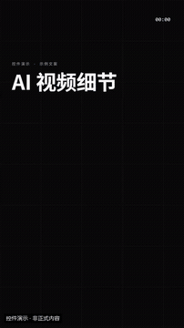</a><br>
<sub>原速节选 · 3.0 秒 · 无声 GIF</sub><br>
<a href="docs/template-gallery/demos/motiongit/title.mp4">完整本地 Demo</a> · <a href="https://motiongit.com/@adunext/template-01-integrated-portrait">来源</a>
</td>
<td width="50%" align="center" valign="top">
<strong>关键词砸入</strong><br>
<a href="docs/template-gallery/demos/motiongit/keyword.mp4">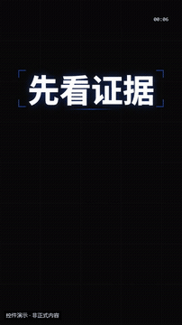</a><br>
<sub>原速节选 · 3.0 秒 · 无声 GIF</sub><br>
<a href="docs/template-gallery/demos/motiongit/keyword.mp4">完整本地 Demo</a> · <a href="https://motiongit.com/@adunext/template-01-integrated-portrait">来源</a>
</td>
</tr>
<tr>
<td width="50%" align="center" valign="top">
<strong>数字滚动</strong><br>
<a href="docs/template-gallery/demos/motiongit/number.mp4">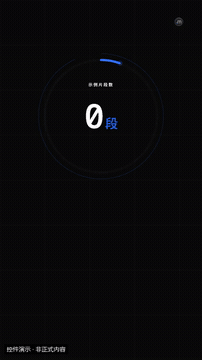</a><br>
<sub>原速节选 · 3.0 秒 · 无声 GIF</sub><br>
<a href="docs/template-gallery/demos/motiongit/number.mp4">完整本地 Demo</a> · <a href="https://motiongit.com/@adunext/template-01-integrated-portrait">来源</a>
</td>
<td width="50%" align="center" valign="top">
<strong>要点列表</strong><br>
<a href="docs/template-gallery/demos/motiongit/list.mp4">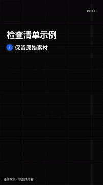</a><br>
<sub>原速节选 · 3.0 秒 · 无声 GIF</sub><br>
<a href="docs/template-gallery/demos/motiongit/list.mp4">完整本地 Demo</a> · <a href="https://motiongit.com/@adunext/template-01-integrated-portrait">来源</a>
</td>
</tr>
<tr>
<td width="50%" align="center" valign="top">
<strong>左右对比</strong><br>
<a href="docs/template-gallery/demos/motiongit/compare.mp4">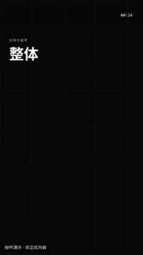</a><br>
<sub>原速节选 · 3.0 秒 · 无声 GIF</sub><br>
<a href="docs/template-gallery/demos/motiongit/compare.mp4">完整本地 Demo</a> · <a href="https://motiongit.com/@adunext/template-01-integrated-portrait">来源</a>
</td>
<td width="50%" align="center" valign="top">
<strong>步骤流程</strong><br>
<a href="docs/template-gallery/demos/integrated/aivd-10/2.7.17-alpha.2/steps-track-owner-v1.mp4">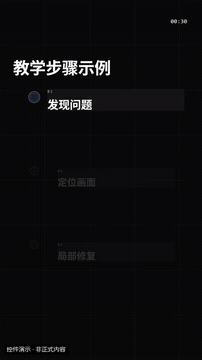</a><br>
<sub>原速节选 · 3.0 秒 · 无声 GIF</sub><br>
<p><sub>当前本人Demo版本：2.7.17-alpha.2 · 本片QA：verified_demo（已解码与抽帧检查）</sub></p><a href="docs/template-gallery/demos/integrated/aivd-10/2.7.17-alpha.2/steps-track-owner-v1.mp4">完整本地 Demo</a> · <a href="docs/template-gallery/demos/motiongit/steps.mp4">完整本地 Demo</a> · <a href="https://motiongit.com/@adunext/template-01-integrated-portrait">来源</a>
<details><summary>本片接入与复用边界</summary><p>AIVD 10 · template-01-integrated-portrait · 2.7.17-alpha.2</p><p>输入：workflow=motion-kit；layout=landscape；原生动画按剪后时钟1.0倍使用；voiceover/music为空、captions=[]，模板原声音轨从Demo移除。；知识库与 AI 员工手册两项前提，保留完整条件，轨道依次点亮。；使用本片原始时钟上的同源本人176px人像源，从376.83秒开始绝对1.2倍一次；先裁去窗口边缘/姓名条再做透明圆窗。；素材源时间与本片最终帧显式映射，不能按字数估计词时；圆窗不遮概念文字，非模板原生自动抠像能力。</p><p>调用：<code>.\.venv\Scripts\python.exe scripts/motiongit_adapter.py run --instance &lt;instance&gt; render &lt;reviewed-project&gt; --out &lt;scene.mp4&gt; --language zh</code></p><p>本片检查：本片横屏steps/track：1280×720、30fps、398帧、无音轨，完整解码通过；实际查看编码帧6,199,270,397及同帧圆窗放大联系表。源参数仅概念文字/图标；抽检未见客户资料或网址；圆窗头脸完整、透明角无黑方块、不遮概念正文。保留原生时码、.m标与出场淡出。仅本版本/此输入/此变体；不等于全帧人工审阅、连续观看、用户美学确认、全部变体或另一台机器通过。</p><p>登记基线版本：0.3.0 (package2.7.17-alpha.2)。仅此版本与Demo；不扩展原条目或全部变体的验证状态，不代表用户审美认可。</p></details></td>
</tr>
<tr>
<td width="50%" align="center" valign="top">
<strong>金句 / 引用</strong><br>
<a href="docs/template-gallery/demos/motiongit/quote.mp4">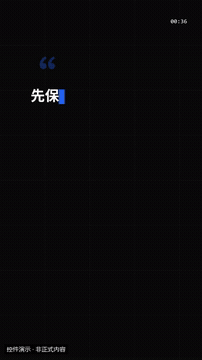</a><br>
<sub>原速节选 · 3.0 秒 · 无声 GIF</sub><br>
<a href="docs/template-gallery/demos/motiongit/quote.mp4">完整本地 Demo</a> · <a href="https://motiongit.com/@adunext/template-01-integrated-portrait">来源</a>
</td>
<td width="50%" align="center" valign="top">
<strong>数据条</strong><br>
<a href="docs/template-gallery/demos/motiongit/bars.mp4">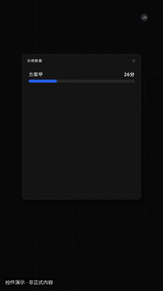</a><br>
<sub>原速节选 · 3.0 秒 · 无声 GIF</sub><br>
<a href="docs/template-gallery/demos/motiongit/bars.mp4">完整本地 Demo</a> · <a href="https://motiongit.com/@adunext/template-01-integrated-portrait">来源</a>
</td>
</tr>
<tr>
<td width="50%" align="center" valign="top">
<strong>录屏 / 图片窗</strong><br>
<a href="docs/template-gallery/demos/motiongit/media.mp4">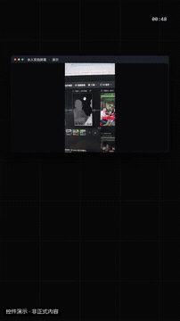</a><br>
<sub>原速节选 · 3.0 秒 · 无声 GIF</sub><br>
<a href="docs/template-gallery/demos/motiongit/media.mp4">完整本地 Demo</a> · <a href="https://motiongit.com/@adunext/template-01-integrated-portrait">来源</a>
</td>
<td width="50%" align="center" valign="top">
<strong>印章强调</strong><br>
<a href="docs/template-gallery/demos/motiongit/stamp.mp4">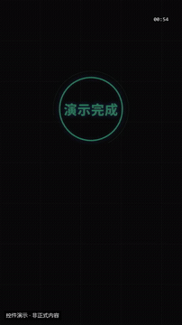</a><br>
<sub>原速节选 · 3.0 秒 · 无声 GIF</sub><br>
<a href="docs/template-gallery/demos/motiongit/stamp.mp4">完整本地 Demo</a> · <a href="https://motiongit.com/@adunext/template-01-integrated-portrait">来源</a>
</td>
</tr>
<tr>
<td width="50%" align="center" valign="top">
<strong>章节卡</strong><br>
<a href="docs/template-gallery/demos/motiongit/chapter.mp4">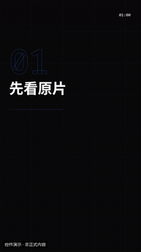</a><br>
<sub>原速节选 · 3.0 秒 · 无声 GIF</sub><br>
<a href="docs/template-gallery/demos/motiongit/chapter.mp4">完整本地 Demo</a> · <a href="https://motiongit.com/@adunext/template-01-integrated-portrait">来源</a>
</td>
<td width="50%" align="center" valign="top">
<strong>光球合成</strong><br>
<a href="docs/template-gallery/demos/motiongit/fusion.mp4">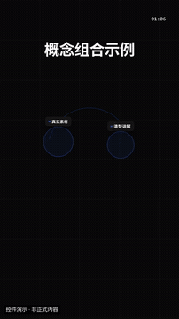</a><br>
<sub>原速节选 · 3.0 秒 · 无声 GIF</sub><br>
<a href="docs/template-gallery/demos/motiongit/fusion.mp4">完整本地 Demo</a> · <a href="https://motiongit.com/@adunext/template-01-integrated-portrait">来源</a>
</td>
</tr>
</table>

</details>

<details>
<summary>品牌与行动 · 8 项</summary>

<table>
<tr>
<td width="50%" align="center" valign="top">
<strong>Logo 揭示</strong><br>
<a href="docs/template-gallery/demos/motiongit/logo.mp4">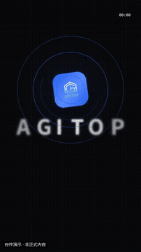</a><br>
<sub>原速节选 · 3.0 秒 · 无声 GIF</sub><br>
<a href="docs/template-gallery/demos/motiongit/logo.mp4">完整本地 Demo</a> · <a href="https://motiongit.com/@adunext/template-01-integrated-portrait">来源</a>
</td>
<td width="50%" align="center" valign="top">
<strong>片头</strong><br>
<a href="docs/template-gallery/demos/motiongit/intro.mp4">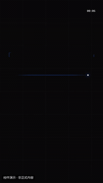</a><br>
<sub>原速节选 · 3.0 秒 · 无声 GIF</sub><br>
<a href="docs/template-gallery/demos/motiongit/intro.mp4">完整本地 Demo</a> · <a href="https://motiongit.com/@adunext/template-01-integrated-portrait">来源</a>
</td>
</tr>
<tr>
<td width="50%" align="center" valign="top">
<strong>片尾</strong><br>
<a href="docs/template-gallery/demos/motiongit/outro.mp4">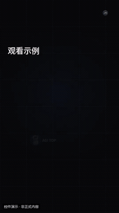</a><br>
<sub>原速节选 · 3.0 秒 · 无声 GIF</sub><br>
<a href="docs/template-gallery/demos/motiongit/outro.mp4">完整本地 Demo</a> · <a href="https://motiongit.com/@adunext/template-01-integrated-portrait">来源</a>
</td>
<td width="50%" align="center" valign="top">
<strong>行动号召</strong><br>
<a href="docs/template-gallery/demos/motiongit/cta.mp4">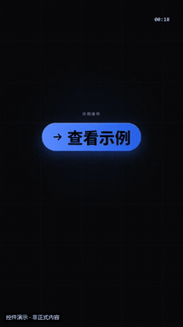</a><br>
<sub>原速节选 · 3.0 秒 · 无声 GIF</sub><br>
<a href="docs/template-gallery/demos/motiongit/cta.mp4">完整本地 Demo</a> · <a href="https://motiongit.com/@adunext/template-01-integrated-portrait">来源</a>
</td>
</tr>
<tr>
<td width="50%" align="center" valign="top">
<strong>关注 / 三连</strong><br>
<a href="docs/template-gallery/demos/motiongit/subscribe.mp4">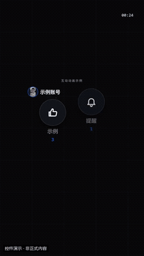</a><br>
<sub>原速节选 · 3.0 秒 · 无声 GIF</sub><br>
<a href="docs/template-gallery/demos/motiongit/subscribe.mp4">完整本地 Demo</a> · <a href="https://motiongit.com/@adunext/template-01-integrated-portrait">来源</a>
</td>
<td width="50%" align="center" valign="top">
<strong>倒计时</strong><br>
<a href="docs/template-gallery/demos/motiongit/countdown.mp4">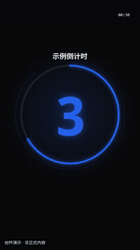</a><br>
<sub>原速节选 · 3.0 秒 · 无声 GIF</sub><br>
<a href="docs/template-gallery/demos/motiongit/countdown.mp4">完整本地 Demo</a> · <a href="https://motiongit.com/@adunext/template-01-integrated-portrait">来源</a>
</td>
</tr>
<tr>
<td width="50%" align="center" valign="top">
<strong>价格 / 优惠</strong><br>
<a href="docs/template-gallery/demos/motiongit/price.mp4">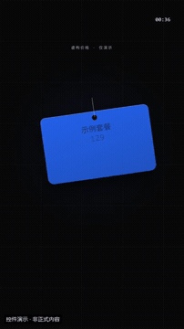</a><br>
<sub>原速节选 · 3.0 秒 · 无声 GIF</sub><br>
<a href="docs/template-gallery/demos/motiongit/price.mp4">完整本地 Demo</a> · <a href="https://motiongit.com/@adunext/template-01-integrated-portrait">来源</a>
</td>
<td width="50%" align="center" valign="top">
<strong>揭晓 / 抽奖</strong><br>
<a href="docs/template-gallery/demos/motiongit/reveal.mp4">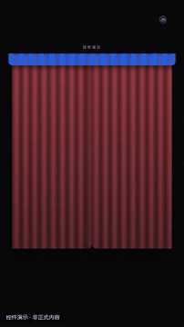</a><br>
<sub>原速节选 · 3.0 秒 · 无声 GIF</sub><br>
<a href="docs/template-gallery/demos/motiongit/reveal.mp4">完整本地 Demo</a> · <a href="https://motiongit.com/@adunext/template-01-integrated-portrait">来源</a>
</td>
</tr>
</table>

</details>

<details>
<summary>概念教学 · 8 项</summary>

<table>
<tr>
<td width="50%" align="center" valign="top">
<strong>图标要点卡</strong><br>
<a href="docs/template-gallery/demos/motiongit/iconcards.mp4">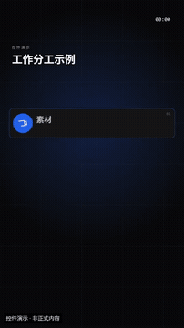</a><br>
<sub>原速节选 · 3.0 秒 · 无声 GIF</sub><br>
<a href="docs/template-gallery/demos/motiongit/iconcards.mp4">完整本地 Demo</a> · <a href="https://motiongit.com/@adunext/template-01-integrated-portrait">来源</a>
</td>
<td width="50%" align="center" valign="top">
<strong>问答</strong><br>
<a href="docs/template-gallery/demos/motiongit/qa.mp4">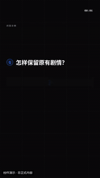</a><br>
<sub>原速节选 · 3.0 秒 · 无声 GIF</sub><br>
<a href="docs/template-gallery/demos/motiongit/qa.mp4">完整本地 Demo</a> · <a href="https://motiongit.com/@adunext/template-01-integrated-portrait">来源</a>
</td>
</tr>
<tr>
<td width="50%" align="center" valign="top">
<strong>误区与真相</strong><br>
<a href="docs/template-gallery/demos/motiongit/myth.mp4">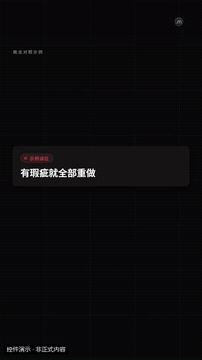</a><br>
<sub>原速节选 · 3.0 秒 · 无声 GIF</sub><br>
<a href="docs/template-gallery/demos/motiongit/myth.mp4">完整本地 Demo</a> · <a href="https://motiongit.com/@adunext/template-01-integrated-portrait">来源</a>
</td>
<td width="50%" align="center" valign="top">
<strong>优缺点</strong><br>
<a href="docs/template-gallery/demos/motiongit/prosCons.mp4">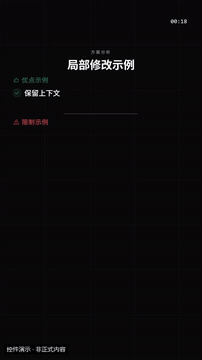</a><br>
<sub>原速节选 · 3.0 秒 · 无声 GIF</sub><br>
<a href="docs/template-gallery/demos/motiongit/prosCons.mp4">完整本地 Demo</a> · <a href="https://motiongit.com/@adunext/template-01-integrated-portrait">来源</a>
</td>
</tr>
<tr>
<td width="50%" align="center" valign="top">
<strong>名词解释</strong><br>
<a href="docs/template-gallery/demos/motiongit/definition.mp4">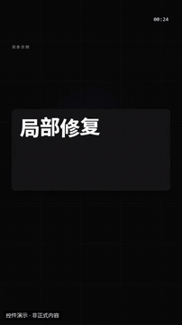</a><br>
<sub>原速节选 · 3.0 秒 · 无声 GIF</sub><br>
<a href="docs/template-gallery/demos/motiongit/definition.mp4">完整本地 Demo</a> · <a href="https://motiongit.com/@adunext/template-01-integrated-portrait">来源</a>
</td>
<td width="50%" align="center" valign="top">
<strong>小贴士 / 警告</strong><br>
<a href="docs/template-gallery/demos/motiongit/tip.mp4">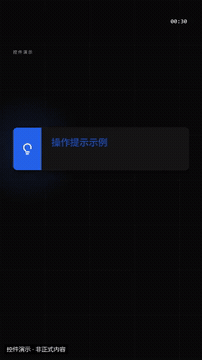</a><br>
<sub>原速节选 · 3.0 秒 · 无声 GIF</sub><br>
<a href="docs/template-gallery/demos/motiongit/tip.mp4">完整本地 Demo</a> · <a href="https://motiongit.com/@adunext/template-01-integrated-portrait">来源</a>
</td>
</tr>
<tr>
<td width="50%" align="center" valign="top">
<strong>待办清单</strong><br>
<a href="docs/template-gallery/demos/motiongit/checklist.mp4">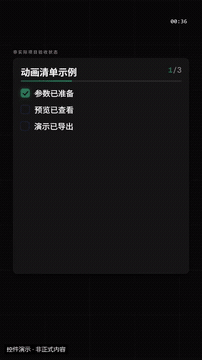</a><br>
<sub>原速节选 · 3.0 秒 · 无声 GIF</sub><br>
<a href="docs/template-gallery/demos/motiongit/checklist.mp4">完整本地 Demo</a> · <a href="https://motiongit.com/@adunext/template-01-integrated-portrait">来源</a>
</td>
<td width="50%" align="center" valign="top">
<strong>两方对决</strong><br>
<a href="docs/template-gallery/demos/motiongit/vs.mp4">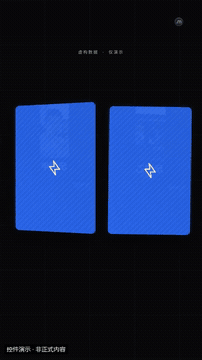</a><br>
<sub>原速节选 · 3.0 秒 · 无声 GIF</sub><br>
<a href="docs/template-gallery/demos/motiongit/vs.mp4">完整本地 Demo</a> · <a href="https://motiongit.com/@adunext/template-01-integrated-portrait">来源</a>
</td>
</tr>
</table>

</details>

<details>
<summary>数据与进度 · 7 项</summary>

<table>
<tr>
<td width="50%" align="center" valign="top">
<strong>环形占比</strong><br>
<a href="docs/template-gallery/demos/motiongit/donut.mp4">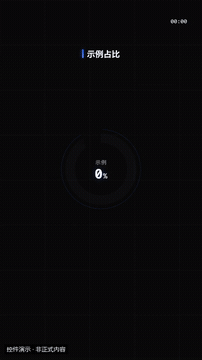</a><br>
<sub>原速节选 · 3.0 秒 · 无声 GIF</sub><br>
<a href="docs/template-gallery/demos/motiongit/donut.mp4">完整本地 Demo</a> · <a href="https://motiongit.com/@adunext/template-01-integrated-portrait">来源</a>
</td>
<td width="50%" align="center" valign="top">
<strong>折线趋势</strong><br>
<a href="docs/template-gallery/demos/motiongit/linechart.mp4">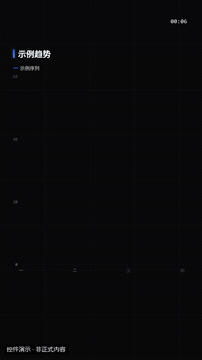</a><br>
<sub>原速节选 · 3.0 秒 · 无声 GIF</sub><br>
<a href="docs/template-gallery/demos/motiongit/linechart.mp4">完整本地 Demo</a> · <a href="https://motiongit.com/@adunext/template-01-integrated-portrait">来源</a>
</td>
</tr>
<tr>
<td width="50%" align="center" valign="top">
<strong>KPI 数字卡</strong><br>
<a href="docs/template-gallery/demos/motiongit/counter.mp4">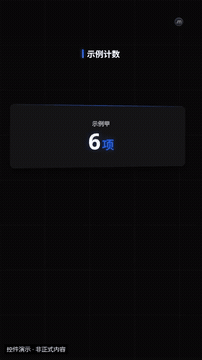</a><br>
<sub>原速节选 · 3.0 秒 · 无声 GIF</sub><br>
<a href="docs/template-gallery/demos/motiongit/counter.mp4">完整本地 Demo</a> · <a href="https://motiongit.com/@adunext/template-01-integrated-portrait">来源</a>
</td>
<td width="50%" align="center" valign="top">
<strong>进度 / 完成度</strong><br>
<a href="docs/template-gallery/demos/motiongit/progress.mp4">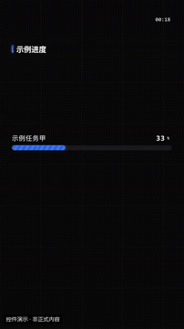</a><br>
<sub>原速节选 · 3.0 秒 · 无声 GIF</sub><br>
<a href="docs/template-gallery/demos/motiongit/progress.mp4">完整本地 Demo</a> · <a href="https://motiongit.com/@adunext/template-01-integrated-portrait">来源</a>
</td>
</tr>
<tr>
<td width="50%" align="center" valign="top">
<strong>时间线 / 里程碑</strong><br>
<a href="docs/template-gallery/demos/motiongit/timeline.mp4">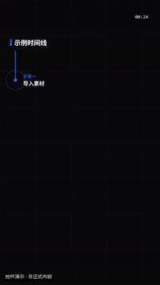</a><br>
<sub>原速节选 · 3.0 秒 · 无声 GIF</sub><br>
<a href="docs/template-gallery/demos/motiongit/timeline.mp4">完整本地 Demo</a> · <a href="https://motiongit.com/@adunext/template-01-integrated-portrait">来源</a>
</td>
<td width="50%" align="center" valign="top">
<strong>对比表 / 功能矩阵</strong><br>
<a href="docs/template-gallery/demos/motiongit/table.mp4">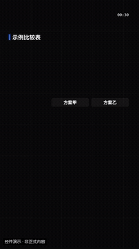</a><br>
<sub>原速节选 · 3.0 秒 · 无声 GIF</sub><br>
<a href="docs/template-gallery/demos/motiongit/table.mp4">完整本地 Demo</a> · <a href="https://motiongit.com/@adunext/template-01-integrated-portrait">来源</a>
</td>
</tr>
<tr>
<td width="50%" align="center" valign="top">
<strong>排行榜</strong><br>
<a href="docs/template-gallery/demos/motiongit/ranking.mp4">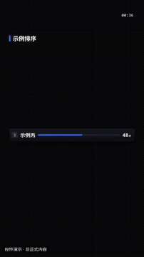</a><br>
<sub>原速节选 · 3.0 秒 · 无声 GIF</sub><br>
<a href="docs/template-gallery/demos/motiongit/ranking.mp4">完整本地 Demo</a> · <a href="https://motiongit.com/@adunext/template-01-integrated-portrait">来源</a>
</td>
<td width="50%"></td>
</tr>
</table>

</details>

<details>
<summary>关系与系统结构 · 7 项</summary>

<table>
<tr>
<td width="50%" align="center" valign="top">
<strong>流程图</strong><br>
<a href="docs/template-gallery/demos/integrated/aivd-10/2.7.17-alpha.2/flow-chain-owner-v1.mp4">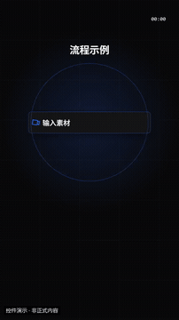</a><br>
<sub>原速节选 · 3.0 秒 · 无声 GIF</sub><br>
<p><sub>当前本人Demo版本：2.7.17-alpha.2 · 本片QA：verified_demo（已解码与抽帧检查）</sub></p><a href="docs/template-gallery/demos/integrated/aivd-10/2.7.17-alpha.2/flow-chain-owner-v1.mp4">完整本地 Demo</a> · <a href="docs/template-gallery/demos/motiongit/flow.mp4">完整本地 Demo</a> · <a href="https://motiongit.com/@adunext/template-01-integrated-portrait">来源</a>
<details><summary>本片接入与复用边界</summary><p>AIVD 10 · template-01-integrated-portrait · 2.7.17-alpha.2</p><p>输入：workflow=motion-kit；layout=landscape；原生动画按剪后时钟1.0倍使用；voiceover/music为空、captions=[]，模板原声音轨从Demo移除。；自动回复→客户未回→自动跟进，按本片实际语义节拍依次出现。；使用本片原始时钟上的同源本人176px人像源，从332.94秒开始绝对1.2倍一次；先裁去窗口边缘/姓名条再做透明圆窗。；素材源时间与本片最终帧显式映射，不能按字数估计词时；圆窗不遮概念文字，非模板原生自动抠像能力。</p><p>调用：<code>.\.venv\Scripts\python.exe scripts/motiongit_adapter.py run --instance &lt;instance&gt; render &lt;reviewed-project&gt; --out &lt;scene.mp4&gt; --language zh</code></p><p>本片检查：本片横屏flow/chain：1280×720、30fps、419帧、无音轨，完整解码通过；实际查看编码帧6,209,345,418及同帧圆窗放大联系表。源参数仅概念文字/图标；抽检未见客户资料或网址；圆窗头脸完整、透明角无黑方块、不遮概念正文。保留原生时码、.m标与出场淡出。仅本版本/此输入/此变体；不等于全帧人工审阅、连续观看、用户美学确认、全部变体或另一台机器通过。</p><p>登记基线版本：0.3.0 (package2.7.17-alpha.2)。仅此版本与Demo；不扩展原条目或全部变体的验证状态，不代表用户审美认可。</p></details></td>
<td width="50%" align="center" valign="top">
<strong>循环图</strong><br>
<a href="docs/template-gallery/demos/motiongit/cycle.mp4">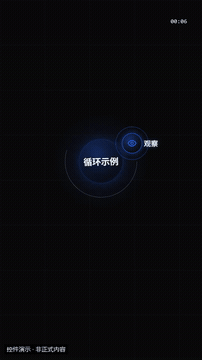</a><br>
<sub>原速节选 · 3.0 秒 · 无声 GIF</sub><br>
<a href="docs/template-gallery/demos/motiongit/cycle.mp4">完整本地 Demo</a> · <a href="https://motiongit.com/@adunext/template-01-integrated-portrait">来源</a>
</td>
</tr>
<tr>
<td width="50%" align="center" valign="top">
<strong>漏斗 / 层级</strong><br>
<a href="docs/template-gallery/demos/motiongit/funnel.mp4">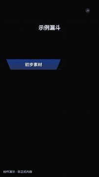</a><br>
<sub>原速节选 · 3.0 秒 · 无声 GIF</sub><br>
<a href="docs/template-gallery/demos/motiongit/funnel.mp4">完整本地 Demo</a> · <a href="https://motiongit.com/@adunext/template-01-integrated-portrait">来源</a>
</td>
<td width="50%" align="center" valign="top">
<strong>交集图</strong><br>
<a href="docs/template-gallery/demos/motiongit/venn.mp4">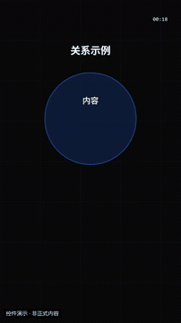</a><br>
<sub>原速节选 · 3.0 秒 · 无声 GIF</sub><br>
<a href="docs/template-gallery/demos/motiongit/venn.mp4">完整本地 Demo</a> · <a href="https://motiongit.com/@adunext/template-01-integrated-portrait">来源</a>
</td>
</tr>
<tr>
<td width="50%" align="center" valign="top">
<strong>思维导图</strong><br>
<a href="docs/template-gallery/demos/motiongit/mindmap.mp4">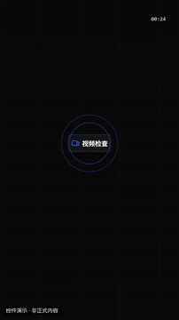</a><br>
<sub>原速节选 · 3.0 秒 · 无声 GIF</sub><br>
<a href="docs/template-gallery/demos/motiongit/mindmap.mp4">完整本地 Demo</a> · <a href="https://motiongit.com/@adunext/template-01-integrated-portrait">来源</a>
</td>
<td width="50%" align="center" valign="top">
<strong>2×2 象限</strong><br>
<a href="docs/template-gallery/demos/motiongit/matrix.mp4">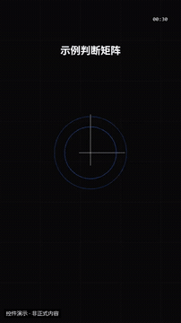</a><br>
<sub>原速节选 · 3.0 秒 · 无声 GIF</sub><br>
<a href="docs/template-gallery/demos/motiongit/matrix.mp4">完整本地 Demo</a> · <a href="https://motiongit.com/@adunext/template-01-integrated-portrait">来源</a>
</td>
</tr>
<tr>
<td width="50%" align="center" valign="top">
<strong>中心辐射</strong><br>
<a href="docs/template-gallery/demos/integrated/aivd-10/2.7.17-alpha.2/hub-constellation-owner-v1.mp4">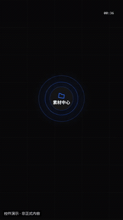</a><br>
<sub>原速节选 · 3.0 秒 · 无声 GIF</sub><br>
<p><sub>当前本人Demo版本：2.7.17-alpha.2 · 本片QA：verified_demo（已解码与抽帧检查）</sub></p><a href="docs/template-gallery/demos/integrated/aivd-10/2.7.17-alpha.2/hub-constellation-owner-v1.mp4">完整本地 Demo</a> · <a href="docs/template-gallery/demos/motiongit/hub.mp4">完整本地 Demo</a> · <a href="https://motiongit.com/@adunext/template-01-integrated-portrait">来源</a>
<details><summary>本片接入与复用边界</summary><p>AIVD 10 · template-01-integrated-portrait · 2.7.17-alpha.2</p><p>输入：workflow=motion-kit；layout=landscape；原生动画按剪后时钟1.0倍使用；voiceover/music为空、captions=[]，模板原声音轨从Demo移除。；预约入口连接表格可选、日历与报名页；展示入口关系，不声称已完成预约。；使用本片原始时钟上的同源本人176px人像源，从695.04秒开始绝对1.2倍一次；先裁去窗口边缘/姓名条再做透明圆窗。；素材源时间与本片最终帧显式映射，不能按字数估计词时；圆窗不遮概念文字，非模板原生自动抠像能力。</p><p>调用：<code>.\.venv\Scripts\python.exe scripts/motiongit_adapter.py run --instance &lt;instance&gt; render &lt;reviewed-project&gt; --out &lt;scene.mp4&gt; --language zh</code></p><p>本片检查：本片横屏hub/constellation：1280×720、30fps、384帧、无音轨，完整解码通过；实际查看编码帧6,192,300,383及同帧圆窗放大联系表。源参数仅概念文字/图标；抽检未见客户资料或网址；圆窗头脸完整、透明角无黑方块、不遮概念正文。保留原生时码、.m标与出场淡出。仅本版本/此输入/此变体；不等于全帧人工审阅、连续观看、用户美学确认、全部变体或另一台机器通过。</p><p>登记基线版本：0.3.0 (package2.7.17-alpha.2)。仅此版本与Demo；不扩展原条目或全部变体的验证状态，不代表用户审美认可。</p></details></td>
<td width="50%"></td>
</tr>
</table>

</details>

<details>
<summary>真实素材展示 · 7 项</summary>

<table>
<tr>
<td width="50%" align="center" valign="top">
<strong>图集</strong><br>
<a href="docs/template-gallery/demos/motiongit/gallery.mp4">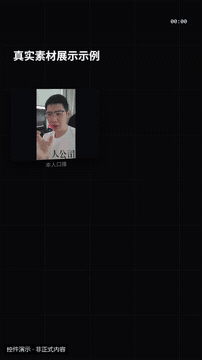</a><br>
<sub>原速节选 · 3.0 秒 · 无声 GIF</sub><br>
<a href="docs/template-gallery/demos/motiongit/gallery.mp4">完整本地 Demo</a> · <a href="https://motiongit.com/@adunext/template-01-integrated-portrait">来源</a>
</td>
<td width="50%" align="center" valign="top">
<strong>前后对比</strong><br>
<a href="docs/template-gallery/demos/motiongit/beforeafter.mp4">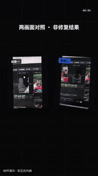</a><br>
<sub>原速节选 · 3.0 秒 · 无声 GIF</sub><br>
<a href="docs/template-gallery/demos/motiongit/beforeafter.mp4">完整本地 Demo</a> · <a href="https://motiongit.com/@adunext/template-01-integrated-portrait">来源</a>
</td>
</tr>
<tr>
<td width="50%" align="center" valign="top">
<strong>纪录片推拉</strong><br>
<a href="docs/template-gallery/demos/motiongit/kenburns.mp4">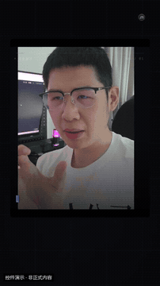</a><br>
<sub>原速节选 · 3.0 秒 · 无声 GIF</sub><br>
<a href="docs/template-gallery/demos/motiongit/kenburns.mp4">完整本地 Demo</a> · <a href="https://motiongit.com/@adunext/template-01-integrated-portrait">来源</a>
</td>
<td width="50%" align="center" valign="top">
<strong>拍立得</strong><br>
<a href="docs/template-gallery/demos/motiongit/polaroid.mp4">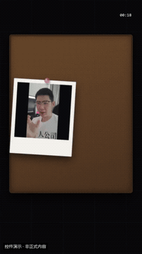</a><br>
<sub>原速节选 · 3.0 秒 · 无声 GIF</sub><br>
<a href="docs/template-gallery/demos/motiongit/polaroid.mp4">完整本地 Demo</a> · <a href="https://motiongit.com/@adunext/template-01-integrated-portrait">来源</a>
</td>
</tr>
<tr>
<td width="50%" align="center" valign="top">
<strong>设备样机</strong><br>
<a href="docs/template-gallery/demos/motiongit/device.mp4">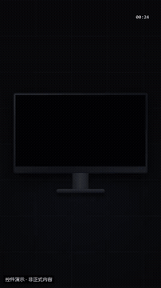</a><br>
<sub>原速节选 · 3.0 秒 · 无声 GIF</sub><br>
<a href="docs/template-gallery/demos/motiongit/device.mp4">完整本地 Demo</a> · <a href="https://motiongit.com/@adunext/template-01-integrated-portrait">来源</a>
</td>
<td width="50%" align="center" valign="top">
<strong>拼贴墙</strong><br>
<a href="docs/template-gallery/demos/motiongit/collage.mp4"></a><br>
<sub>原速节选 · 3.0 秒 · 无声 GIF</sub><br>
<a href="docs/template-gallery/demos/motiongit/collage.mp4">完整本地 Demo</a> · <a href="https://motiongit.com/@adunext/template-01-integrated-portrait">来源</a>
</td>
</tr>
<tr>
<td width="50%" align="center" valign="top">
<strong>聚光放大</strong><br>
<a href="docs/template-gallery/demos/motiongit/spotlight.mp4"></a><br>
<sub>原速节选 · 3.0 秒 · 无声 GIF</sub><br>
<a href="docs/template-gallery/demos/motiongit/spotlight.mp4">完整本地 Demo</a> · <a href="https://motiongit.com/@adunext/template-01-integrated-portrait">来源</a>
</td>
<td width="50%"></td>
</tr>
</table>

</details>

<details>
<summary>文字动态 · 6 项</summary>

<table>
<tr>
<td width="50%" align="center" valign="top">
<strong>逐行动态排版</strong><br>
<a href="docs/template-gallery/demos/integrated/aivd-10/2.7.17-alpha.2/kinetic-stack-owner-v1.mp4"></a><br>
<sub>原速节选 · 3.0 秒 · 无声 GIF</sub><br>
<p><sub>当前本人Demo版本：2.7.17-alpha.2 · 本片QA：verified_demo（已解码与抽帧检查）</sub></p><a href="docs/template-gallery/demos/integrated/aivd-10/2.7.17-alpha.2/kinetic-stack-owner-v1.mp4">完整本地 Demo</a> · <a href="docs/template-gallery/demos/motiongit/kinetic.mp4">完整本地 Demo</a> · <a href="https://motiongit.com/@adunext/template-01-integrated-portrait">来源</a>
<details><summary>本片接入与复用边界</summary><p>AIVD 10 · template-01-integrated-portrait · 2.7.17-alpha.2</p><p>输入：workflow=motion-kit；layout=landscape；原生动画按剪后时钟1.0倍使用；voiceover/music为空、captions=[]，模板原声音轨从Demo移除。；Reply、Follow up、AI 三行动态归纳，与本片结尾同期本人圆窗结合。；使用同源结尾800px方形人像，源2104.56–2115.44秒已经绝对1.2倍一次，本Demo圆窗按1.0倍使用，不重复加速。；素材源时间与本片最终帧显式映射，不能按字数估计词时；圆窗不遮概念文字，非模板原生自动抠像能力。</p><p>调用：<code>.\.venv\Scripts\python.exe scripts/motiongit_adapter.py run --instance &lt;instance&gt; render &lt;reviewed-project&gt; --out &lt;scene.mp4&gt; --language zh</code></p><p>本片检查：本片横屏kinetic/stack：1280×720、30fps、272帧、无音轨，完整解码通过；实际查看编码帧6,136,195,271及同帧圆窗放大联系表。源参数仅概念文字/图标；抽检未见客户资料或网址；圆窗头脸完整、透明角无黑方块、不遮概念正文。保留原生时码、.m标与出场淡出。仅本版本/此输入/此变体；不等于全帧人工审阅、连续观看、用户美学确认、全部变体或另一台机器通过。</p><p>登记基线版本：0.3.0 (package2.7.17-alpha.2)。仅此版本与Demo；不扩展原条目或全部变体的验证状态，不代表用户审美认可。</p></details></td>
<td width="50%" align="center" valign="top">
<strong>重点词标记</strong><br>
<a href="docs/template-gallery/demos/motiongit/highlight.mp4"></a><br>
<sub>原速节选 · 3.0 秒 · 无声 GIF</sub><br>
<a href="docs/template-gallery/demos/motiongit/highlight.mp4">完整本地 Demo</a> · <a href="https://motiongit.com/@adunext/template-01-integrated-portrait">来源</a>
</td>
</tr>
<tr>
<td width="50%" align="center" valign="top">
<strong>乱码解码</strong><br>
<a href="docs/template-gallery/demos/motiongit/scramble.mp4"></a><br>
<sub>原速节选 · 3.0 秒 · 无声 GIF</sub><br>
<a href="docs/template-gallery/demos/motiongit/scramble.mp4">完整本地 Demo</a> · <a href="https://motiongit.com/@adunext/template-01-integrated-portrait">来源</a>
</td>
<td width="50%" align="center" valign="top">
<strong>轮换词</strong><br>
<a href="docs/template-gallery/demos/motiongit/rotator.mp4"></a><br>
<sub>原速节选 · 3.0 秒 · 无声 GIF</sub><br>
<a href="docs/template-gallery/demos/motiongit/rotator.mp4">完整本地 Demo</a> · <a href="https://motiongit.com/@adunext/template-01-integrated-portrait">来源</a>
</td>
</tr>
<tr>
<td width="50%" align="center" valign="top">
<strong>滚动横幅</strong><br>
<a href="docs/template-gallery/demos/motiongit/marquee.mp4"></a><br>
<sub>原速节选 · 3.0 秒 · 无声 GIF</sub><br>
<a href="docs/template-gallery/demos/motiongit/marquee.mp4">完整本地 Demo</a> · <a href="https://motiongit.com/@adunext/template-01-integrated-portrait">来源</a>
</td>
<td width="50%" align="center" valign="top">
<strong>巨字</strong><br>
<a href="docs/template-gallery/demos/motiongit/bigtype.mp4"></a><br>
<sub>原速节选 · 3.0 秒 · 无声 GIF</sub><br>
<a href="docs/template-gallery/demos/motiongit/bigtype.mp4">完整本地 Demo</a> · <a href="https://motiongit.com/@adunext/template-01-integrated-portrait">来源</a>
</td>
</tr>
</table>

</details>

<details>
<summary>界面与交互演示 · 7 项</summary>

<table>
<tr>
<td width="50%" align="center" valign="top">
<strong>聊天对话</strong><br>
<a href="docs/template-gallery/demos/motiongit/chat.mp4"></a><br>
<sub>原速节选 · 3.0 秒 · 无声 GIF</sub><br>
<a href="docs/template-gallery/demos/motiongit/chat.mp4">完整本地 Demo</a> · <a href="https://motiongit.com/@adunext/template-01-integrated-portrait">来源</a>
</td>
<td width="50%" align="center" valign="top">
<strong>评论 / 弹幕</strong><br>
<a href="docs/template-gallery/demos/motiongit/comment.mp4"></a><br>
<sub>原速节选 · 3.0 秒 · 无声 GIF</sub><br>
<a href="docs/template-gallery/demos/motiongit/comment.mp4">完整本地 Demo</a> · <a href="https://motiongit.com/@adunext/template-01-integrated-portrait">来源</a>
</td>
</tr>
<tr>
<td width="50%" align="center" valign="top">
<strong>通知横幅</strong><br>
<a href="docs/template-gallery/demos/motiongit/notify.mp4"></a><br>
<sub>原速节选 · 3.0 秒 · 无声 GIF</sub><br>
<a href="docs/template-gallery/demos/motiongit/notify.mp4">完整本地 Demo</a> · <a href="https://motiongit.com/@adunext/template-01-integrated-portrait">来源</a>
</td>
<td width="50%" align="center" valign="top">
<strong>搜索框</strong><br>
<a href="docs/template-gallery/demos/motiongit/search.mp4"></a><br>
<sub>原速节选 · 3.0 秒 · 无声 GIF</sub><br>
<a href="docs/template-gallery/demos/motiongit/search.mp4">完整本地 Demo</a> · <a href="https://motiongit.com/@adunext/template-01-integrated-portrait">来源</a>
</td>
</tr>
<tr>
<td width="50%" align="center" valign="top">
<strong>浏览器 / 应用窗口</strong><br>
<a href="docs/template-gallery/demos/motiongit/browser.mp4"></a><br>
<sub>原速节选 · 3.0 秒 · 无声 GIF</sub><br>
<a href="docs/template-gallery/demos/motiongit/browser.mp4">完整本地 Demo</a> · <a href="https://motiongit.com/@adunext/template-01-integrated-portrait">来源</a>
</td>
<td width="50%" align="center" valign="top">
<strong>社交数据卡</strong><br>
<a href="docs/template-gallery/demos/motiongit/social.mp4"></a><br>
<sub>原速节选 · 3.0 秒 · 无声 GIF</sub><br>
<a href="docs/template-gallery/demos/motiongit/social.mp4">完整本地 Demo</a> · <a href="https://motiongit.com/@adunext/template-01-integrated-portrait">来源</a>
</td>
</tr>
<tr>
<td width="50%" align="center" valign="top">
<strong>鼠标点击演示</strong><br>
<a href="docs/template-gallery/demos/motiongit/cursor.mp4"></a><br>
<sub>原速节选 · 3.0 秒 · 无声 GIF</sub><br>
<a href="docs/template-gallery/demos/motiongit/cursor.mp4">完整本地 Demo</a> · <a href="https://motiongit.com/@adunext/template-01-integrated-portrait">来源</a>
</td>
<td width="50%"></td>
</tr>
</table>

</details>

<details>
<summary>叠加标注与装饰 · 8 项</summary>

<table>
<tr>
<td width="50%" align="center" valign="top">
<strong>人名条</strong><br>
<a href="docs/template-gallery/demos/motiongit/lowerthird.mp4"></a><br>
<sub>原速节选 · 3.0 秒 · 无声 GIF</sub><br>
<a href="docs/template-gallery/demos/motiongit/lowerthird.mp4">完整本地 Demo</a> · <a href="https://motiongit.com/@adunext/template-01-integrated-portrait">来源</a>
</td>
<td width="50%" align="center" valign="top">
<strong>箭头标注</strong><br>
<a href="docs/template-gallery/demos/motiongit/callout.mp4"></a><br>
<sub>原速节选 · 3.0 秒 · 无声 GIF</sub><br>
<a href="docs/template-gallery/demos/motiongit/callout.mp4">完整本地 Demo</a> · <a href="https://motiongit.com/@adunext/template-01-integrated-portrait">来源</a>
</td>
</tr>
<tr>
<td width="50%" align="center" valign="top">
<strong>贴纸</strong><br>
<a href="docs/template-gallery/demos/motiongit/sticker.mp4"></a><br>
<sub>原速节选 · 3.0 秒 · 无声 GIF</sub><br>
<a href="docs/template-gallery/demos/motiongit/sticker.mp4">完整本地 Demo</a> · <a href="https://motiongit.com/@adunext/template-01-integrated-portrait">来源</a>
</td>
<td width="50%" align="center" valign="top">
<strong>表情飘赞</strong><br>
<a href="docs/template-gallery/demos/motiongit/emoji.mp4"></a><br>
<sub>原速节选 · 3.0 秒 · 无声 GIF</sub><br>
<a href="docs/template-gallery/demos/motiongit/emoji.mp4">完整本地 Demo</a> · <a href="https://motiongit.com/@adunext/template-01-integrated-portrait">来源</a>
</td>
</tr>
<tr>
<td width="50%" align="center" valign="top">
<strong>章节进度条</strong><br>
<a href="docs/template-gallery/demos/motiongit/progressbar.mp4"></a><br>
<sub>原速节选 · 3.0 秒 · 无声 GIF</sub><br>
<a href="docs/template-gallery/demos/motiongit/progressbar.mp4">完整本地 Demo</a> · <a href="https://motiongit.com/@adunext/template-01-integrated-portrait">来源</a>
</td>
<td width="50%" align="center" valign="top">
<strong>角标</strong><br>
<a href="docs/template-gallery/demos/motiongit/tag.mp4"></a><br>
<sub>原速节选 · 3.0 秒 · 无声 GIF</sub><br>
<a href="docs/template-gallery/demos/motiongit/tag.mp4">完整本地 Demo</a> · <a href="https://motiongit.com/@adunext/template-01-integrated-portrait">来源</a>
</td>
</tr>
<tr>
<td width="50%" align="center" valign="top">
<strong>庆祝特效</strong><br>
<a href="docs/template-gallery/demos/motiongit/confetti.mp4"></a><br>
<sub>原速节选 · 3.0 秒 · 无声 GIF</sub><br>
<a href="docs/template-gallery/demos/motiongit/confetti.mp4">完整本地 Demo</a> · <a href="https://motiongit.com/@adunext/template-01-integrated-portrait">来源</a>
</td>
<td width="50%" align="center" valign="top">
<strong>画面装饰框</strong><br>
<a href="docs/template-gallery/demos/motiongit/frame.mp4"></a><br>
<sub>原速节选 · 3.0 秒 · 无声 GIF</sub><br>
<a href="docs/template-gallery/demos/motiongit/frame.mp4">完整本地 Demo</a> · <a href="https://motiongit.com/@adunext/template-01-integrated-portrait">来源</a>
</td>
</tr>
</table>

</details>

</details>

<details>
<summary><strong>Remotion 代码注册项 · 55 项</strong></summary>

<details>
<summary>Logo与品牌 · 8 项</summary>

<table>
<tr>
<td width="50%" align="center" valign="top">
<strong>笔刷揭示</strong><br>
<a href="docs/template-gallery/demos/remotion/brush-stroke-reveal.mp4"></a><br>
<sub>原速节选 · 3.0 秒 · 无声 GIF</sub><br>
<a href="docs/template-gallery/demos/remotion/brush-stroke-reveal.mp4">完整本地 Demo</a> · <a href="https://github.com/RenderComp/free-remotion-templates/tree/f648980e528defb7594e24c6447055f0540f340b">来源</a>
</td>
<td width="50%" align="center" valign="top">
<strong>Logo由模糊变清晰</strong><br>
<a href="docs/template-gallery/demos/remotion/logo-blur-reveal.mp4"></a><br>
<sub>原速节选 · 3.0 秒 · 无声 GIF</sub><br>
<a href="docs/template-gallery/demos/remotion/logo-blur-reveal.mp4">完整本地 Demo</a> · <a href="https://github.com/RenderComp/free-remotion-templates/tree/f648980e528defb7594e24c6447055f0540f340b">来源</a>
</td>
</tr>
<tr>
<td width="50%" align="center" valign="top">
<strong>Logo弹落</strong><br>
<a href="docs/template-gallery/demos/remotion/logo-bounce-drop.mp4"></a><br>
<sub>原速节选 · 3.0 秒 · 无声 GIF</sub><br>
<a href="docs/template-gallery/demos/remotion/logo-bounce-drop.mp4">完整本地 Demo</a> · <a href="https://github.com/RenderComp/free-remotion-templates/tree/f648980e528defb7594e24c6447055f0540f340b">来源</a>
</td>
<td width="50%" align="center" valign="top">
<strong>Logo遮罩擦入</strong><br>
<a href="docs/template-gallery/demos/remotion/logo-mask-wipe.mp4"></a><br>
<sub>原速节选 · 3.0 秒 · 无声 GIF</sub><br>
<a href="docs/template-gallery/demos/remotion/logo-mask-wipe.mp4">完整本地 Demo</a> · <a href="https://github.com/RenderComp/free-remotion-templates/tree/f648980e528defb7594e24c6447055f0540f340b">来源</a>
</td>
</tr>
<tr>
<td width="50%" align="center" valign="top">
<strong>Logo分裂揭示</strong><br>
<a href="docs/template-gallery/demos/remotion/logo-split-reveal.mp4"></a><br>
<sub>原速节选 · 3.0 秒 · 无声 GIF</sub><br>
<a href="docs/template-gallery/demos/remotion/logo-split-reveal.mp4">完整本地 Demo</a> · <a href="https://github.com/RenderComp/free-remotion-templates/tree/f648980e528defb7594e24c6447055f0540f340b">来源</a>
</td>
<td width="50%" align="center" valign="top">
<strong>Logo描边绘制</strong><br>
<a href="docs/template-gallery/demos/remotion/logo-stroke-draw.mp4"></a><br>
<sub>原速节选 · 3.0 秒 · 无声 GIF</sub><br>
<a href="docs/template-gallery/demos/remotion/logo-stroke-draw.mp4">完整本地 Demo</a> · <a href="https://github.com/RenderComp/free-remotion-templates/tree/f648980e528defb7594e24c6447055f0540f340b">来源</a>
</td>
</tr>
<tr>
<td width="50%" align="center" valign="top">
<strong>霓虹文字闪烁</strong><br>
<a href="docs/template-gallery/demos/remotion/neon-sign.mp4"></a><br>
<sub>原速节选 · 3.0 秒 · 无声 GIF</sub><br>
<a href="docs/template-gallery/demos/remotion/neon-sign.mp4">完整本地 Demo</a> · <a href="https://github.com/RenderComp/free-remotion-templates/tree/f648980e528defb7594e24c6447055f0540f340b">来源</a>
</td>
<td width="50%" align="center" valign="top">
<strong>碎片揭示</strong><br>
<a href="docs/template-gallery/demos/remotion/shatter-reveal.mp4"></a><br>
<sub>原速节选 · 3.0 秒 · 无声 GIF</sub><br>
<a href="docs/template-gallery/demos/remotion/shatter-reveal.mp4">完整本地 Demo</a> · <a href="https://github.com/RenderComp/free-remotion-templates/tree/f648980e528defb7594e24c6447055f0540f340b">来源</a>
</td>
</tr>
</table>

</details>

<details>
<summary>文字与标题 · 11 项</summary>

<table>
<tr>
<td width="50%" align="center" valign="top">
<strong>标题弹入</strong><br>
<a href="docs/template-gallery/demos/remotion/bounce-in-headline.mp4"></a><br>
<sub>原速节选 · 3.0 秒 · 无声 GIF</sub><br>
<a href="docs/template-gallery/demos/remotion/bounce-in-headline.mp4">完整本地 Demo</a> · <a href="https://github.com/RenderComp/free-remotion-templates/tree/f648980e528defb7594e24c6447055f0540f340b">来源</a>
</td>
<td width="50%" align="center" valign="top">
<strong>章节标题卡</strong><br>
<a href="docs/template-gallery/demos/remotion/chapter-title.mp4"></a><br>
<sub>原速节选 · 3.0 秒 · 无声 GIF</sub><br>
<a href="docs/template-gallery/demos/remotion/chapter-title.mp4">完整本地 Demo</a> · <a href="https://github.com/RenderComp/free-remotion-templates/tree/f648980e528defb7594e24c6447055f0540f340b">来源</a>
</td>
</tr>
<tr>
<td width="50%" align="center" valign="top">
<strong>四色标题切换</strong><br>
<a href="docs/template-gallery/demos/remotion/four-tone-mono-titler.mp4"></a><br>
<sub>原速节选 · 3.0 秒 · 无声 GIF</sub><br>
<a href="docs/template-gallery/demos/remotion/four-tone-mono-titler.mp4">完整本地 Demo</a> · <a href="https://github.com/RenderComp/free-remotion-templates/tree/f648980e528defb7594e24c6447055f0540f340b">来源</a>
</td>
<td width="50%" align="center" valign="top">
<strong>故障文字</strong><br>
<a href="docs/template-gallery/demos/remotion/glitch-text.mp4"></a><br>
<sub>原速节选 · 3.0 秒 · 无声 GIF</sub><br>
<a href="docs/template-gallery/demos/remotion/glitch-text.mp4">完整本地 Demo</a> · <a href="https://github.com/RenderComp/free-remotion-templates/tree/f648980e528defb7594e24c6447055f0540f340b">来源</a>
</td>
</tr>
<tr>
<td width="50%" align="center" valign="top">
<strong>文字渐变扫过</strong><br>
<a href="docs/template-gallery/demos/remotion/gradient-text-sweep.mp4"></a><br>
<sub>原速节选 · 3.0 秒 · 无声 GIF</sub><br>
<a href="docs/template-gallery/demos/remotion/gradient-text-sweep.mp4">完整本地 Demo</a> · <a href="https://github.com/RenderComp/free-remotion-templates/tree/f648980e528defb7594e24c6447055f0540f340b">来源</a>
</td>
<td width="50%" align="center" valign="top">
<strong>动态词语堆叠</strong><br>
<a href="docs/template-gallery/demos/remotion/kinetic-word-stack.mp4"></a><br>
<sub>原速节选 · 3.0 秒 · 无声 GIF</sub><br>
<a href="docs/template-gallery/demos/remotion/kinetic-word-stack.mp4">完整本地 Demo</a> · <a href="https://github.com/RenderComp/free-remotion-templates/tree/f648980e528defb7594e24c6447055f0540f340b">来源</a>
</td>
</tr>
<tr>
<td width="50%" align="center" valign="top">
<strong>像素打字引语</strong><br>
<a href="docs/template-gallery/demos/remotion/pixel-typewriter-quote.mp4"></a><br>
<sub>原速节选 · 3.0 秒 · 无声 GIF</sub><br>
<a href="docs/template-gallery/demos/remotion/pixel-typewriter-quote.mp4">完整本地 Demo</a> · <a href="https://github.com/RenderComp/free-remotion-templates/tree/f648980e528defb7594e24c6447055f0540f340b">来源</a>
</td>
<td width="50%" align="center" valign="top">
<strong>乱序文字归位</strong><br>
<a href="docs/template-gallery/demos/remotion/scramble-text.mp4"></a><br>
<sub>原速节选 · 3.0 秒 · 无声 GIF</sub><br>
<a href="docs/template-gallery/demos/remotion/scramble-text.mp4">完整本地 Demo</a> · <a href="https://github.com/RenderComp/free-remotion-templates/tree/f648980e528defb7594e24c6447055f0540f340b">来源</a>
</td>
</tr>
<tr>
<td width="50%" align="center" valign="top">
<strong>文字遮罩揭示</strong><br>
<a href="docs/template-gallery/demos/remotion/text-mask-reveal.mp4"></a><br>
<sub>原速节选 · 3.0 秒 · 无声 GIF</sub><br>
<a href="docs/template-gallery/demos/remotion/text-mask-reveal.mp4">完整本地 Demo</a> · <a href="https://github.com/RenderComp/free-remotion-templates/tree/f648980e528defb7594e24c6447055f0540f340b">来源</a>
</td>
<td width="50%" align="center" valign="top">
<strong>打字机</strong><br>
<a href="docs/template-gallery/demos/remotion/typewriter.mp4"></a><br>
<sub>原速节选 · 3.0 秒 · 无声 GIF</sub><br>
<a href="docs/template-gallery/demos/remotion/typewriter.mp4">完整本地 Demo</a> · <a href="https://github.com/RenderComp/free-remotion-templates/tree/f648980e528defb7594e24c6447055f0540f340b">来源</a>
</td>
</tr>
<tr>
<td width="50%" align="center" valign="top">
<strong>波浪文字</strong><br>
<a href="docs/template-gallery/demos/remotion/wave-text.mp4"></a><br>
<sub>原速节选 · 3.0 秒 · 无声 GIF</sub><br>
<a href="docs/template-gallery/demos/remotion/wave-text.mp4">完整本地 Demo</a> · <a href="https://github.com/RenderComp/free-remotion-templates/tree/f648980e528defb7594e24c6447055f0540f340b">来源</a>
</td>
<td width="50%"></td>
</tr>
</table>

</details>

<details>
<summary>转场 · 8 项</summary>

<table>
<tr>
<td width="50%" align="center" valign="top">
<strong>镜头震动</strong><br>
<a href="docs/template-gallery/demos/remotion/camera-shake.mp4"></a><br>
<sub>原速节选 · 3.0 秒 · 无声 GIF</sub><br>
<a href="docs/template-gallery/demos/remotion/camera-shake.mp4">完整本地 Demo</a> · <a href="https://github.com/RenderComp/free-remotion-templates/tree/f648980e528defb7594e24c6447055f0540f340b">来源</a>
</td>
<td width="50%" align="center" valign="top">
<strong>卡片翻面转场</strong><br>
<a href="docs/template-gallery/demos/remotion/card-flip-transition.mp4"></a><br>
<sub>原速节选 · 3.0 秒 · 无声 GIF</sub><br>
<a href="docs/template-gallery/demos/remotion/card-flip-transition.mp4">完整本地 Demo</a> · <a href="https://github.com/RenderComp/free-remotion-templates/tree/f648980e528defb7594e24c6447055f0540f340b">来源</a>
</td>
</tr>
<tr>
<td width="50%" align="center" valign="top">
<strong>圆形擦除转场</strong><br>
<a href="docs/template-gallery/demos/remotion/transition-circle-wipe.mp4"></a><br>
<sub>原速节选 · 3.0 秒 · 无声 GIF</sub><br>
<a href="docs/template-gallery/demos/remotion/transition-circle-wipe.mp4">完整本地 Demo</a> · <a href="https://github.com/RenderComp/free-remotion-templates/tree/f648980e528defb7594e24c6447055f0540f340b">来源</a>
</td>
<td width="50%" align="center" valign="top">
<strong>墨迹扩散转场</strong><br>
<a href="docs/template-gallery/demos/remotion/ink-spread-transition.mp4"></a><br>
<sub>原速节选 · 3.0 秒 · 无声 GIF</sub><br>
<a href="docs/template-gallery/demos/remotion/ink-spread-transition.mp4">完整本地 Demo</a> · <a href="https://github.com/RenderComp/free-remotion-templates/tree/f648980e528defb7594e24c6447055f0540f340b">来源</a>
</td>
</tr>
<tr>
<td width="50%" align="center" valign="top">
<strong>翻页转场</strong><br>
<a href="docs/template-gallery/demos/remotion/flip-page-transition.mp4"></a><br>
<sub>原速节选 · 3.0 秒 · 无声 GIF</sub><br>
<a href="docs/template-gallery/demos/remotion/flip-page-transition.mp4">完整本地 Demo</a> · <a href="https://github.com/RenderComp/free-remotion-templates/tree/f648980e528defb7594e24c6447055f0540f340b">来源</a>
</td>
<td width="50%" align="center" valign="top">
<strong>像素马赛克转场</strong><br>
<a href="docs/template-gallery/demos/remotion/pixel-mosaic-transition.mp4"></a><br>
<sub>原速节选 · 3.0 秒 · 无声 GIF</sub><br>
<a href="docs/template-gallery/demos/remotion/pixel-mosaic-transition.mp4">完整本地 Demo</a> · <a href="https://github.com/RenderComp/free-remotion-templates/tree/f648980e528defb7594e24c6447055f0540f340b">来源</a>
</td>
</tr>
<tr>
<td width="50%" align="center" valign="top">
<strong>滑动擦除转场</strong><br>
<a href="docs/template-gallery/demos/remotion/slide-wipe.mp4"></a><br>
<sub>原速节选 · 3.0 秒 · 无声 GIF</sub><br>
<a href="docs/template-gallery/demos/remotion/slide-wipe.mp4">完整本地 Demo</a> · <a href="https://github.com/RenderComp/free-remotion-templates/tree/f648980e528defb7594e24c6447055f0540f340b">来源</a>
</td>
<td width="50%" align="center" valign="top">
<strong>快速甩镜</strong><br>
<a href="docs/template-gallery/demos/remotion/whip-pan.mp4"></a><br>
<sub>原速节选 · 3.0 秒 · 无声 GIF</sub><br>
<a href="docs/template-gallery/demos/remotion/whip-pan.mp4">完整本地 Demo</a> · <a href="https://github.com/RenderComp/free-remotion-templates/tree/f648980e528defb7594e24c6447055f0540f340b">来源</a>
</td>
</tr>
</table>

</details>

<details>
<summary>数据与图表 · 6 项</summary>

<table>
<tr>
<td width="50%" align="center" valign="top">
<strong>长条图成长</strong><br>
<a href="docs/template-gallery/demos/remotion/bar-chart-anim.mp4"></a><br>
<sub>原速节选 · 3.0 秒 · 无声 GIF</sub><br>
<a href="docs/template-gallery/demos/remotion/bar-chart-anim.mp4">完整本地 Demo</a> · <a href="https://github.com/RenderComp/free-remotion-templates/tree/f648980e528defb7594e24c6447055f0540f340b">来源</a>
</td>
<td width="50%" align="center" valign="top">
<strong>折线图绘制</strong><br>
<a href="docs/template-gallery/demos/remotion/line-chart-anim.mp4"></a><br>
<sub>原速节选 · 3.0 秒 · 无声 GIF</sub><br>
<a href="docs/template-gallery/demos/remotion/line-chart-anim.mp4">完整本地 Demo</a> · <a href="https://github.com/RenderComp/free-remotion-templates/tree/f648980e528defb7594e24c6447055f0540f340b">来源</a>
</td>
</tr>
<tr>
<td width="50%" align="center" valign="top">
<strong>滴入式填充计量</strong><br>
<a href="docs/template-gallery/demos/remotion/pourover-drip-fill-gauge.mp4"></a><br>
<sub>原速节选 · 3.0 秒 · 无声 GIF</sub><br>
<a href="docs/template-gallery/demos/remotion/pourover-drip-fill-gauge.mp4">完整本地 Demo</a> · <a href="https://github.com/RenderComp/free-remotion-templates/tree/f648980e528defb7594e24c6447055f0540f340b">来源</a>
</td>
<td width="50%" align="center" valign="top">
<strong>数字计数器</strong><br>
<a href="docs/template-gallery/demos/remotion/kpi-counter.mp4"></a><br>
<sub>原速节选 · 3.0 秒 · 无声 GIF</sub><br>
<a href="docs/template-gallery/demos/remotion/kpi-counter.mp4">完整本地 Demo</a> · <a href="https://github.com/RenderComp/free-remotion-templates/tree/f648980e528defb7594e24c6447055f0540f340b">来源</a>
</td>
</tr>
<tr>
<td width="50%" align="center" valign="top">
<strong>像素蜡烛图</strong><br>
<a href="docs/template-gallery/demos/remotion/pixel-candlestick-ohlc.mp4"></a><br>
<sub>原速节选 · 3.0 秒 · 无声 GIF</sub><br>
<a href="docs/template-gallery/demos/remotion/pixel-candlestick-ohlc.mp4">完整本地 Demo</a> · <a href="https://github.com/RenderComp/free-remotion-templates/tree/f648980e528defb7594e24c6447055f0540f340b">来源</a>
</td>
<td width="50%" align="center" valign="top">
<strong>排名竞速长条图</strong><br>
<a href="docs/template-gallery/demos/remotion/racing-chart.mp4"></a><br>
<sub>原速节选 · 3.0 秒 · 无声 GIF</sub><br>
<a href="docs/template-gallery/demos/remotion/racing-chart.mp4">完整本地 Demo</a> · <a href="https://github.com/RenderComp/free-remotion-templates/tree/f648980e528defb7594e24c6447055f0540f340b">来源</a>
</td>
</tr>
</table>

</details>

<details>
<summary>社交与界面 · 9 项</summary>

<table>
<tr>
<td width="50%" align="center" valign="top">
<strong>聊天界面</strong><br>
<a href="docs/template-gallery/demos/remotion/community-chat.mp4"></a><br>
<sub>原速节选 · 3.0 秒 · 无声 GIF</sub><br>
<a href="docs/template-gallery/demos/remotion/community-chat.mp4">完整本地 Demo</a> · <a href="https://github.com/RenderComp/free-remotion-templates/tree/f648980e528defb7594e24c6447055f0540f340b">来源</a>
</td>
<td width="50%" align="center" valign="top">
<strong>通用结束卡</strong><br>
<a href="docs/template-gallery/demos/remotion/end-card.mp4"></a><br>
<sub>原速节选 · 3.0 秒 · 无声 GIF</sub><br>
<a href="docs/template-gallery/demos/remotion/end-card.mp4">完整本地 Demo</a> · <a href="https://github.com/RenderComp/free-remotion-templates/tree/f648980e528defb7594e24c6447055f0540f340b">来源</a>
</td>
</tr>
<tr>
<td width="50%" align="center" valign="top">
<strong>眼睛揭示动画</strong><br>
<a href="docs/template-gallery/demos/remotion/eye-reveal.mp4"></a><br>
<sub>原速节选 · 3.0 秒 · 无声 GIF</sub><br>
<a href="docs/template-gallery/demos/remotion/eye-reveal.mp4">完整本地 Demo</a> · <a href="https://github.com/RenderComp/free-remotion-templates/tree/f648980e528defb7594e24c6447055f0540f340b">来源</a>
</td>
<td width="50%" align="center" valign="top">
<strong>玻璃信息卡</strong><br>
<a href="docs/template-gallery/demos/remotion/lower-third-glass-card.mp4"></a><br>
<sub>原速节选 · 3.0 秒 · 无声 GIF</sub><br>
<a href="docs/template-gallery/demos/remotion/lower-third-glass-card.mp4">完整本地 Demo</a> · <a href="https://github.com/RenderComp/free-remotion-templates/tree/f648980e528defb7594e24c6447055f0540f340b">来源</a>
</td>
</tr>
<tr>
<td width="50%" align="center" valign="top">
<strong>角色跳动</strong><br>
<a href="docs/template-gallery/demos/remotion/character-jumping.mp4"></a><br>
<sub>原速节选 · 3.0 秒 · 无声 GIF</sub><br>
<a href="docs/template-gallery/demos/remotion/character-jumping.mp4">完整本地 Demo</a> · <a href="https://github.com/RenderComp/free-remotion-templates/tree/f648980e528defb7594e24c6447055f0540f340b">来源</a>
</td>
<td width="50%" align="center" valign="top">
<strong>短视频播放器界面</strong><br>
<a href="docs/template-gallery/demos/remotion/social-reel.mp4"></a><br>
<sub>原速节选 · 3.0 秒 · 无声 GIF</sub><br>
<a href="docs/template-gallery/demos/remotion/social-reel.mp4">完整本地 Demo</a> · <a href="https://github.com/RenderComp/free-remotion-templates/tree/f648980e528defb7594e24c6447055f0540f340b">来源</a>
</td>
</tr>
<tr>
<td width="50%" align="center" valign="top">
<strong>分屏布局</strong><br>
<a href="docs/template-gallery/demos/remotion/split-screen.mp4"></a><br>
<sub>原速节选 · 3.0 秒 · 无声 GIF</sub><br>
<a href="docs/template-gallery/demos/remotion/split-screen.mp4">完整本地 Demo</a> · <a href="https://github.com/RenderComp/free-remotion-templates/tree/f648980e528defb7594e24c6447055f0540f340b">来源</a>
</td>
<td width="50%" align="center" valign="top">
<strong>思考气泡</strong><br>
<a href="docs/template-gallery/demos/remotion/thinking-bubble.mp4"></a><br>
<sub>原速节选 · 3.0 秒 · 无声 GIF</sub><br>
<a href="docs/template-gallery/demos/remotion/thinking-bubble.mp4">完整本地 Demo</a> · <a href="https://github.com/RenderComp/free-remotion-templates/tree/f648980e528defb7594e24c6447055f0540f340b">来源</a>
</td>
</tr>
<tr>
<td width="50%" align="center" valign="top">
<strong>角色招手</strong><br>
<a href="docs/template-gallery/demos/remotion/wave-hello.mp4"></a><br>
<sub>原速节选 · 3.0 秒 · 无声 GIF</sub><br>
<a href="docs/template-gallery/demos/remotion/wave-hello.mp4">完整本地 Demo</a> · <a href="https://github.com/RenderComp/free-remotion-templates/tree/f648980e528defb7594e24c6447055f0540f340b">来源</a>
</td>
<td width="50%"></td>
</tr>
</table>

</details>

<details>
<summary>循环与背景 · 8 项</summary>

<table>
<tr>
<td width="50%" align="center" valign="top">
<strong>散景光圈背景</strong><br>
<a href="docs/template-gallery/demos/remotion/bokeh-circles.mp4"></a><br>
<sub>原速节选 · 3.0 秒 · 无声 GIF</sub><br>
<a href="docs/template-gallery/demos/remotion/bokeh-circles.mp4">完整本地 Demo</a> · <a href="https://github.com/RenderComp/free-remotion-templates/tree/f648980e528defb7594e24c6447055f0540f340b">来源</a>
</td>
<td width="50%" align="center" valign="top">
<strong>烟花爆开</strong><br>
<a href="docs/template-gallery/demos/remotion/fireworks-burst.mp4"></a><br>
<sub>原速节选 · 3.0 秒 · 无声 GIF</sub><br>
<a href="docs/template-gallery/demos/remotion/fireworks-burst.mp4">完整本地 Demo</a> · <a href="https://github.com/RenderComp/free-remotion-templates/tree/f648980e528defb7594e24c6447055f0540f340b">来源</a>
</td>
</tr>
<tr>
<td width="50%" align="center" valign="top">
<strong>网格波浪循环</strong><br>
<a href="docs/template-gallery/demos/remotion/loop-grid-wave.mp4"></a><br>
<sub>原速节选 · 3.0 秒 · 无声 GIF</sub><br>
<a href="docs/template-gallery/demos/remotion/loop-grid-wave.mp4">完整本地 Demo</a> · <a href="https://github.com/RenderComp/free-remotion-templates/tree/f648980e528defb7594e24c6447055f0540f340b">来源</a>
</td>
<td width="50%" align="center" valign="top">
<strong>视差平移</strong><br>
<a href="docs/template-gallery/demos/remotion/parallax-pan.mp4"></a><br>
<sub>原速节选 · 3.0 秒 · 无声 GIF</sub><br>
<a href="docs/template-gallery/demos/remotion/parallax-pan.mp4">完整本地 Demo</a> · <a href="https://github.com/RenderComp/free-remotion-templates/tree/f648980e528defb7594e24c6447055f0540f340b">来源</a>
</td>
</tr>
<tr>
<td width="50%" align="center" valign="top">
<strong>铅笔绘制</strong><br>
<a href="docs/template-gallery/demos/remotion/pencil-draw.mp4"></a><br>
<sub>原速节选 · 3.0 秒 · 无声 GIF</sub><br>
<a href="docs/template-gallery/demos/remotion/pencil-draw.mp4">完整本地 Demo</a> · <a href="https://github.com/RenderComp/free-remotion-templates/tree/f648980e528defb7594e24c6447055f0540f340b">来源</a>
</td>
<td width="50%" align="center" valign="top">
<strong>像素瀑布循环</strong><br>
<a href="docs/template-gallery/demos/remotion/pixel-waterfall-cycle.mp4"></a><br>
<sub>原速节选 · 3.0 秒 · 无声 GIF</sub><br>
<a href="docs/template-gallery/demos/remotion/pixel-waterfall-cycle.mp4">完整本地 Demo</a> · <a href="https://github.com/RenderComp/free-remotion-templates/tree/f648980e528defb7594e24c6447055f0540f340b">来源</a>
</td>
</tr>
<tr>
<td width="50%" align="center" valign="top">
<strong>粒子雪花</strong><br>
<a href="docs/template-gallery/demos/remotion/particle-snow.mp4"></a><br>
<sub>原速节选 · 3.0 秒 · 无声 GIF</sub><br>
<a href="docs/template-gallery/demos/remotion/particle-snow.mp4">完整本地 Demo</a> · <a href="https://github.com/RenderComp/free-remotion-templates/tree/f648980e528defb7594e24c6447055f0540f340b">来源</a>
</td>
<td width="50%" align="center" valign="top">
<strong>星空穿行背景</strong><br>
<a href="docs/template-gallery/demos/remotion/starfield.mp4"></a><br>
<sub>原速节选 · 3.0 秒 · 无声 GIF</sub><br>
<a href="docs/template-gallery/demos/remotion/starfield.mp4">完整本地 Demo</a> · <a href="https://github.com/RenderComp/free-remotion-templates/tree/f648980e528defb7594e24c6447055f0540f340b">来源</a>
</td>
</tr>
</table>

</details>

<details>
<summary>RemotionUI本地适配 · 2 项</summary>

<table>
<tr>
<td width="50%" align="center" valign="top">
<strong>前后环绕卡片演示</strong><br>
<a href="docs/template-gallery/demos/remotion/library-orbit.mp4"></a><br>
<sub>原速节选 · 3.0 秒 · 无声 GIF</sub><br>
<a href="docs/template-gallery/demos/remotion/library-orbit.mp4">完整本地 Demo</a> · <a href="https://github.com/riaz37/remotion-ui/tree/0aecaca2b61a167992e1205d10e4da16d8a71331">来源</a>
</td>
<td width="50%" align="center" valign="top">
<strong>文字镂空媒体演示</strong><br>
<a href="docs/template-gallery/demos/remotion/library-text-mask.mp4"></a><br>
<sub>原速节选 · 3.0 秒 · 无声 GIF</sub><br>
<a href="docs/template-gallery/demos/remotion/library-text-mask.mp4">完整本地 Demo</a> · <a href="https://github.com/riaz37/remotion-ui/tree/0aecaca2b61a167992e1205d10e4da16d8a71331">来源</a>
</td>
</tr>
</table>

</details>

<details>
<summary>中文示例 · 3 项</summary>

<table>
<tr>
<td width="50%" align="center" valign="top">
<strong>中文长条成长示例</strong><br>
<a href="docs/template-gallery/demos/remotion/library-bar-zh.mp4"></a><br>
<sub>原速节选 · 3.0 秒 · 无声 GIF</sub><br>
<a href="docs/template-gallery/demos/remotion/library-bar-zh.mp4">完整本地 Demo</a> · <a href="https://github.com/RenderComp/free-remotion-templates/tree/f648980e528defb7594e24c6447055f0540f340b">来源</a>
</td>
<td width="50%" align="center" valign="top">
<strong>中文玻璃卡片示例</strong><br>
<a href="docs/template-gallery/demos/remotion/library-glass-zh.mp4"></a><br>
<sub>原速节选 · 3.0 秒 · 无声 GIF</sub><br>
<a href="docs/template-gallery/demos/remotion/library-glass-zh.mp4">完整本地 Demo</a> · <a href="https://github.com/RenderComp/free-remotion-templates/tree/f648980e528defb7594e24c6447055f0540f340b">来源</a>
</td>
</tr>
<tr>
<td width="50%" align="center" valign="top">
<strong>中文播放器界面示例</strong><br>
<a href="docs/template-gallery/demos/remotion/library-player-zh.mp4"></a><br>
<sub>原速节选 · 3.0 秒 · 无声 GIF</sub><br>
<a href="docs/template-gallery/demos/remotion/library-player-zh.mp4">完整本地 Demo</a> · <a href="https://github.com/RenderComp/free-remotion-templates/tree/f648980e528defb7594e24c6447055f0540f340b">来源</a>
</td>
<td width="50%"></td>
</tr>
</table>

</details>

</details>

<details>
<summary><strong>真人口播特效 · 19 项</strong></summary>

<details>
<summary>数据与图表 · 1 项</summary>

<table>
<tr>
<td width="50%" align="center" valign="top">
<strong>条形增长</strong><br>
<a href="docs/template-gallery/demos/presenter/presenter-effect-01.mp4"></a><br>
<sub>原速节选 · 1.4 秒 · 无声 GIF</sub><br>
<a href="docs/template-gallery/demos/presenter/presenter-effect-01.mp4">完整本地 Demo</a> · <a href="https://github.com/Isaac3113/talking-head-editor/tree/main/extensions/remotion-vd44/src/template-library/talking-head-effects">来源</a>
</td>
<td width="50%"></td>
</tr>
</table>

</details>

<details>
<summary>文字与标题 · 3 项</summary>

<table>
<tr>
<td width="50%" align="center" valign="top">
<strong>玻璃标签</strong><br>
<a href="docs/template-gallery/demos/presenter/presenter-effect-02.mp4"></a><br>
<sub>原速节选 · 1.0 秒 · 无声 GIF</sub><br>
<a href="docs/template-gallery/demos/presenter/presenter-effect-02.mp4">完整本地 Demo</a> · <a href="https://github.com/Isaac3113/talking-head-editor/tree/main/extensions/remotion-vd44/src/template-library/talking-head-effects">来源</a>
</td>
<td width="50%" align="center" valign="top">
<strong>视频镂空字</strong><br>
<a href="docs/template-gallery/demos/presenter/presenter-effect-11.mp4"></a><br>
<sub>原速节选 · 1.0 秒 · 无声 GIF</sub><br>
<a href="docs/template-gallery/demos/presenter/presenter-effect-11.mp4">完整本地 Demo</a> · <a href="https://github.com/Isaac3113/talking-head-editor/tree/main/extensions/remotion-vd44/src/template-library/talking-head-effects">来源</a>
</td>
</tr>
<tr>
<td width="50%" align="center" valign="top">
<strong>标题墙</strong><br>
<a href="docs/template-gallery/demos/presenter/presenter-effect-13.mp4"></a><br>
<sub>原速节选 · 1.1 秒 · 无声 GIF</sub><br>
<a href="docs/template-gallery/demos/presenter/presenter-effect-13.mp4">完整本地 Demo</a> · <a href="https://github.com/Isaac3113/talking-head-editor/tree/main/extensions/remotion-vd44/src/template-library/talking-head-effects">来源</a>
</td>
<td width="50%"></td>
</tr>
</table>

</details>

<details>
<summary>镜头与转场 · 3 项</summary>

<table>
<tr>
<td width="50%" align="center" valign="top">
<strong>冲击缩放</strong><br>
<a href="docs/template-gallery/demos/presenter/presenter-effect-03.mp4"></a><br>
<sub>原速节选 · 1.6 秒 · 无声 GIF</sub><br>
<a href="docs/template-gallery/demos/presenter/presenter-effect-03.mp4">完整本地 Demo</a> · <a href="https://github.com/Isaac3113/talking-head-editor/tree/main/extensions/remotion-vd44/src/template-library/talking-head-effects">来源</a>
</td>
<td width="50%" align="center" valign="top">
<strong>拉远揭幕</strong><br>
<a href="docs/template-gallery/demos/presenter/presenter-effect-06.mp4"></a><br>
<sub>原速节选 · 1.2 秒 · 无声 GIF</sub><br>
<a href="docs/template-gallery/demos/presenter/presenter-effect-06.mp4">完整本地 Demo</a> · <a href="https://github.com/Isaac3113/talking-head-editor/tree/main/extensions/remotion-vd44/src/template-library/talking-head-effects">来源</a>
</td>
</tr>
<tr>
<td width="50%" align="center" valign="top">
<strong>数字推近</strong><br>
<a href="docs/template-gallery/demos/presenter/presenter-effect-17.mp4"></a><br>
<sub>原速节选 · 1.3 秒 · 无声 GIF</sub><br>
<a href="docs/template-gallery/demos/presenter/presenter-effect-17.mp4">完整本地 Demo</a> · <a href="https://github.com/Isaac3113/talking-head-editor/tree/main/extensions/remotion-vd44/src/template-library/talking-head-effects">来源</a>
</td>
<td width="50%"></td>
</tr>
</table>

</details>

<details>
<summary>人物与背景 · 5 项</summary>

<table>
<tr>
<td width="50%" align="center" valign="top">
<strong>剪纸描边</strong><br>
<a href="docs/template-gallery/demos/presenter/presenter-effect-04.mp4"></a><br>
<sub>原速节选 · 0.7 秒 · 无声 GIF</sub><br>
<a href="docs/template-gallery/demos/presenter/presenter-effect-04.mp4">完整本地 Demo</a> · <a href="https://github.com/Isaac3113/talking-head-editor/tree/main/extensions/remotion-vd44/src/template-library/talking-head-effects">来源</a>
</td>
<td width="50%" align="center" valign="top">
<strong>照片墙</strong><br>
<a href="docs/template-gallery/demos/presenter/presenter-effect-05.mp4"></a><br>
<sub>原速节选 · 1.0 秒 · 无声 GIF</sub><br>
<a href="docs/template-gallery/demos/presenter/presenter-effect-05.mp4">完整本地 Demo</a> · <a href="https://github.com/Isaac3113/talking-head-editor/tree/main/extensions/remotion-vd44/src/template-library/talking-head-effects">来源</a>
</td>
</tr>
<tr>
<td width="50%" align="center" valign="top">
<strong>杂志封面</strong><br>
<a href="docs/template-gallery/demos/presenter/presenter-effect-08.mp4"></a><br>
<sub>原速节选 · 1.2 秒 · 无声 GIF</sub><br>
<a href="docs/template-gallery/demos/presenter/presenter-effect-08.mp4">完整本地 Demo</a> · <a href="https://github.com/Isaac3113/talking-head-editor/tree/main/extensions/remotion-vd44/src/template-library/talking-head-effects">来源</a>
</td>
<td width="50%" align="center" valign="top">
<strong>抠像换景</strong><br>
<a href="docs/template-gallery/demos/presenter/presenter-effect-09.mp4"></a><br>
<sub>原速节选 · 1.5 秒 · 无声 GIF</sub><br>
<a href="docs/template-gallery/demos/presenter/presenter-effect-09.mp4">完整本地 Demo</a> · <a href="https://github.com/Isaac3113/talking-head-editor/tree/main/extensions/remotion-vd44/src/template-library/talking-head-effects">来源</a>
</td>
</tr>
<tr>
<td width="50%" align="center" valign="top">
<strong>人物破框</strong><br>
<a href="docs/template-gallery/demos/presenter/presenter-effect-15.mp4"></a><br>
<sub>原速节选 · 1.4 秒 · 无声 GIF</sub><br>
<a href="docs/template-gallery/demos/presenter/presenter-effect-15.mp4">完整本地 Demo</a> · <a href="https://github.com/Isaac3113/talking-head-editor/tree/main/extensions/remotion-vd44/src/template-library/talking-head-effects">来源</a>
</td>
<td width="50%"></td>
</tr>
</table>

</details>

<details>
<summary>界面与设备 · 2 项</summary>

<table>
<tr>
<td width="50%" align="center" valign="top">
<strong>界面窗框</strong><br>
<a href="docs/template-gallery/demos/presenter/presenter-effect-07.mp4"></a><br>
<sub>原速节选 · 1.1 秒 · 无声 GIF</sub><br>
<a href="docs/template-gallery/demos/presenter/presenter-effect-07.mp4">完整本地 Demo</a> · <a href="https://github.com/Isaac3113/talking-head-editor/tree/main/extensions/remotion-vd44/src/template-library/talking-head-effects">来源</a>
</td>
<td width="50%" align="center" valign="top">
<strong>手机画面</strong><br>
<a href="docs/template-gallery/demos/presenter/presenter-effect-14.mp4"></a><br>
<sub>原速节选 · 1.3 秒 · 无声 GIF</sub><br>
<a href="docs/template-gallery/demos/presenter/presenter-effect-14.mp4">完整本地 Demo</a> · <a href="https://github.com/Isaac3113/talking-head-editor/tree/main/extensions/remotion-vd44/src/template-library/talking-head-effects">来源</a>
</td>
</tr>
</table>

</details>

<details>
<summary>列表与步骤 · 2 项</summary>

<table>
<tr>
<td width="50%" align="center" valign="top">
<strong>打勾清单</strong><br>
<a href="docs/template-gallery/demos/presenter/presenter-effect-10.mp4"></a><br>
<sub>原速节选 · 1.5 秒 · 无声 GIF</sub><br>
<a href="docs/template-gallery/demos/presenter/presenter-effect-10.mp4">完整本地 Demo</a> · <a href="https://github.com/Isaac3113/talking-head-editor/tree/main/extensions/remotion-vd44/src/template-library/talking-head-effects">来源</a>
</td>
<td width="50%" align="center" valign="top">
<strong>收据列表</strong><br>
<a href="docs/template-gallery/demos/presenter/presenter-effect-18.mp4"></a><br>
<sub>原速节选 · 1.1 秒 · 无声 GIF</sub><br>
<a href="docs/template-gallery/demos/presenter/presenter-effect-18.mp4">完整本地 Demo</a> · <a href="https://github.com/Isaac3113/talking-head-editor/tree/main/extensions/remotion-vd44/src/template-library/talking-head-effects">来源</a>
</td>
</tr>
</table>

</details>

<details>
<summary>装饰与强调 · 3 项</summary>

<table>
<tr>
<td width="50%" align="center" valign="top">
<strong>手绘涂鸦</strong><br>
<a href="docs/template-gallery/demos/presenter/presenter-effect-12.mp4"></a><br>
<sub>原速节选 · 1.3 秒 · 无声 GIF</sub><br>
<a href="docs/template-gallery/demos/presenter/presenter-effect-12.mp4">完整本地 Demo</a> · <a href="https://github.com/Isaac3113/talking-head-editor/tree/main/extensions/remotion-vd44/src/template-library/talking-head-effects">来源</a>
</td>
<td width="50%" align="center" valign="top">
<strong>环绕文字</strong><br>
<a href="docs/template-gallery/demos/presenter/presenter-effect-16.mp4"></a><br>
<sub>原速节选 · 1.0 秒 · 无声 GIF</sub><br>
<a href="docs/template-gallery/demos/presenter/presenter-effect-16.mp4">完整本地 Demo</a> · <a href="https://github.com/Isaac3113/talking-head-editor/tree/main/extensions/remotion-vd44/src/template-library/talking-head-effects">来源</a>
</td>
</tr>
<tr>
<td width="50%" align="center" valign="top">
<strong>贴纸轮播</strong><br>
<a href="docs/template-gallery/demos/presenter/presenter-effect-19.mp4"></a><br>
<sub>原速节选 · 1.3 秒 · 无声 GIF</sub><br>
<a href="docs/template-gallery/demos/presenter/presenter-effect-19.mp4">完整本地 Demo</a> · <a href="https://github.com/Isaac3113/talking-head-editor/tree/main/extensions/remotion-vd44/src/template-library/talking-head-effects">来源</a>
</td>
<td width="50%"></td>
</tr>
</table>

</details>

</details>

<details>
<summary><strong>额外官方预告 · 不计入上述 216 项</strong></summary>

<p>官方标记 <code>previewOnly</code>／<code>coming-soon</code>，当前仅效果预告，不视为已开放下载或已在本机运行。</p>

<table>
<tr>
<td width="50%" align="center" valign="top">
<strong>3D书 · 阿杜和那个影响了</strong><br>
<a href="https://github.com/motiontemplates/all/releases/download/demo-batch-two-2026-10-21/3d-book-demo-6dc0bd1a0e5bc9e8.mp4"></a><br>
<sub>官方预览图 · 点击查看完整 Demo</sub><br>
<a href="https://github.com/motiontemplates/all/releases/download/demo-batch-two-2026-10-21/3d-book-demo-6dc0bd1a0e5bc9e8.mp4">官方 Demo · 16:9</a> · <a href="https://github.com/motiontemplates/all/tree/21537c6f49aa9504496d20c14bf597f7eac229f4">来源</a>
</td>
<td width="50%"></td>
</tr>
</table>

</details>

<!-- HOMEPAGE_SHOWCASE:END -->

## 按新视频持续积累官方模板

每条新片会同时评估已接入库与官方未接入候选；免费可取得且符合输入和许可时，沿既有授权直接核验、试做和接入，把真实本人Demo、版本、调用与QA同步私人库和首页。官网目录展示不等于所有模板已可执行。更新监测只通知，不自动改旧包或旧工程。[长期接入规则](skill/talking-head-editor/references/template-lifecycle.md) · [更新通知说明](docs/MOTIONGIT_UPDATES.md)。

## 适合剪什么

| 路线 | 主要任务 | 当前范围 |
|---|---|---|
| 真人知识口播 | 保留论点、条件和原声，配合字幕、例子和重点句 | 主职责 |
| AI／系统实操教学 | 显示真实步骤、按钮与证据，配合放大、标注和同步轻音效 | 已有实操模式 |
| 长访谈／Zoom 切片 | 先按独立主题保留完整观点，再做画面包装 | 已有分支 |
| 旅行／生活 Vlog、剧情多场景 | 地点、事件、环境声、镜头连续性和故事节奏 | 专用自动流程尚未实现 |

先判断剪辑路线，再选模板。同一条知识口播可以插入 B-roll；不能因此把整片套成旅行 Vlog。完整边界见[剪辑路线](skill/talking-head-editor/references/editing-routes.md)。

## 在自己的电脑打开 HTML

不需要购买域名。取得完整仓库或完整模板中心目录后，在仓库根目录运行：

```powershell
python scripts/serve_template_gallery.py
```

打开终端显示的地址，默认是 `http://127.0.0.1:8768/index.html`。这个地址只指向运行服务的那台电脑；把地址发给别人，不会把你的页面和视频一起发过去。HTML 必须与相对路径的 `demos/` 一起保留。只看目录需要 Python，不需要先安装 Node、ChatCut、ASR 或取得 MotionGit 包。官方在线预览仍需联网。

本机目录、GitHub 源码和对外网站是三个不同入口。具体文件位置、Windows 命令和常见问题见[中文新手入门](docs/GETTING_STARTED.zh-CN.md)。

## 从素材到成片

原片与本条比例 → 转写及术语核对 → 语义粗剪 → 冻结最终时间 → 选择相关动画 → 唯一主时间轴合成 → 实际导出、观看和听审 → 封面与发布素材 → 用户确认。

本仓库创作者默认由 ChatCut 管理唯一主时间轴；Remotion、HyperFrames 和 MotionGit 按需制作外部画面素材。语音、音乐与音效分开，不能把静音动画 Demo 当成完整视频。

## 想实际剪辑，先准备运行环境

Windows 使用 Git 和 Python 3.11／3.12。先在非 OneDrive 的源码目录取得仓库；当前私人仓库需要访问权限。

```powershell
New-Item -ItemType Directory -Force -Path "C:\Codex Workspace" | Out-Null
Set-Location "C:\Codex Workspace"
git clone https://github.com/Isaac3113/talking-head-editor.git
Set-Location talking-head-editor
.\scripts\bootstrap.ps1
.\.venv\Scripts\python.exe scripts/install_skill.py
.\.venv\Scripts\python.exe -m talking_head_editor.cli doctor
```

只浏览模板的人不用执行这组安装命令。需要本地语音识别时，才考虑 `scripts/bootstrap.ps1 -ASR`；它会增加模型及依赖。ChatCut 插件、账号和额度使用自己的授权，不能由 clone 推断已经具备。

| 组件 | 用途 | 继续阅读 |
|---|---|---|
| talking-head-editor | 剪辑判断、规则与流程总入口 | [完整调用顺序](skill/talking-head-editor/references/approved-workflow.md) |
| Remotion 4.0.523／React | 帧驱动动画、图表和真人效果 | [已有模板库](extensions/remotion-vd44/TEMPLATE_LIBRARY.md) |
| HyperFrames 0.8.35／HTML | 短状态卡和 HTML 动画 | [动画与小 Skill 安装](docs/INSTALL_SKILLS.md) |
| MotionGit 官方入口 | 按各包的公开合同制作所选控件 | [模板选择与适配器](skill/talking-head-editor/references/template-selection.md) |
| ChatCut | 当前默认在线主时间轴与最终导出 | [工具及工程说明](docs/WORKFLOW_AND_TOOLS.md) |

动画运行时还可能需要 Node 22+、npm、浏览器、FFmpeg 和字体，按所选引擎安装；不要求每条视频都运行所有引擎。目录、运行环境、真实合成和新片验收分别核对。

19 项真人效果仍含原样片的时间映射与人像遮罩依赖；换原片需适配，见[对应 README](extensions/remotion-vd44/src/template-library/talking-head-effects/README.md)。MotionGit 的个人 `.motion`、Key 和保护内核不在本仓库，使用者须准备自己的包及本机配置。

## 给 Codex 的启动消息

```text
使用 $talking-head-editor 处理我的真人知识口播。
先读取仓库规则、中文新手入门和总 Skill，核对实际工具、素材与已有主时间轴。
原片：<我的原片路径>。
主题：<我提供或授权你看完命名>。
请确认本条视频比例、术语、品牌和交付要求，已有明确确认不要重复问。
保留原声原意，先做语义粗剪，再按内容选择模板，不能为了模板补造步骤、数据或评价。
用我自己的账号和有权使用的素材；不要把他人的个人包、预设、原片或验收状态当成我的。
实际导出后检查完整字音、接缝、字幕、动画和声音，再展示成品给我确认。
```

## 文件位置、交付与维护

- `skill/talking-head-editor/`：总 Skill、按需规则和辅助脚本。
- `templates/`：四层登记、来源与中文清单；`docs/template-gallery/`：HTML 及经授权的精简演示。
- `extensions/`：可分发的动画源码及其许可证；`scripts/`：执行、安装、目录与验收工具。
- `03_Documentation/Knowledge_Base/`：技术知识库。`work/`、依赖和缓存留在本机，不随 Git 提交。

本仓库所有者当前的 `05_成片/最新版` 只放一个最新 MP4、16:9／9:16 两张封面，以及发布素材内三份 TXT（Facebook 文案、小红书文案、固定第一评论）。字幕、检查记录、ZIP 和旧版不混入该入口；其他创作者使用自己的明确交付约定。完整规则见[精简交付](skill/talking-head-editor/references/final-delivery.md)。

换电脑先保护本地工作并安全 pull，再分别核对 Skill、依赖、媒体和在线工程，见[换电脑说明](docs/CROSS_COMPUTER_UPDATE.md)。学习阅读顺序：[总 Skill](skill/talking-head-editor/SKILL.md) → [完整流程](skill/talking-head-editor/references/approved-workflow.md) → [质量检查](skill/talking-head-editor/references/quality.md)。

维护者更新模板登记与演示后，可以重建目录和首页；首页生成器只更新SHOWCASE区块，保留独立A/B比较与正文。需已有FFmpeg/ffprobe；默认只生成片段，显式参数才写首页。

```powershell
python scripts/build_template_gallery.py --strict
python scripts/build_homepage_showcase.py --write-readme
```

[来源与中文化](templates/PROVENANCE.zh-CN.md) · [第三方许可](THIRD_PARTY.md) · [实际验证状态](docs/VALIDATION.md)。程序通过、抽帧、连续观看、完整听审与用户风格认可分别记录。当前演示不证明另一台电脑或新视频已通过。
