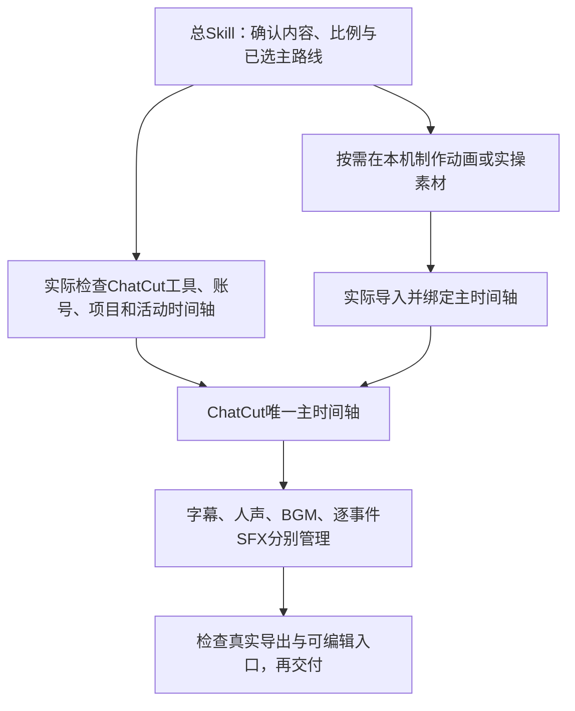

# 工具分工、换电脑与可编辑工程

2026-09-21整合说明。总Skill入口为skill/ai-cut/SKILL.md；此页说明执行分工，不替代其中的现行规则。

## 唯一主工程

本仓库创作者默认使用ChatCut管理主时间轴、在线手改与最终导出；其他使用者先明确自己的主路线。只有用户明确选择本机或剪映时才切换。所有字幕、音效、速度及外部素材锚点最终对齐同一主时间轴，不并列维护会独立变化的两套工程。

| 层次 | 负责什么 | 不代表什么 |
|---|---|---|
| ai-cut总Skill | 剪辑判断、规则、分工、验收与交付 | 安装文字规则不等于插件已登录 |
| ChatCut | 主时间轴、原生字幕/重点字、分轨声音、在线手改与导出 | 上传MP4不会自动拆出里面的字幕和音效 |
| HyperFrames / Remotion | 按场景制作短状态或多步动画素材 | 外部渲染素材内部文字不一定能在ChatCut原生改 |
| Python/Pillow实操helper | 从同一源帧做局部放大、框选、聚光、下划线、脉冲、真实路径及步骤条 | 无声图层不是最终视频，也不会自动导入ChatCut |
| FFmpeg/FFprobe | 素材处理、合成和技术检查；明确选择本机路线时可作为执行器 | 本地ZIP不是ChatCut原生可编辑工程 |
| imagegen与图片提示词规则 | 基于真实人物/口播制作封面 | 不负责建立视频主工程 |
| skill-creator | 维护规则与复用工具 | 不剪视频或提供账号登录 |

## 换电脑先核对什么

GitHub同步代码与规则。插件、授权、登录、本机运行时、私人素材和已有云项目分别核对，不会仅凭git pull自动就绪。

1. 从仓库取得最新代码，先保护未提交修改；已有总Skill比较归属与哈希后同步，不叠装同名入口。
2. 检查本会话实际可调用的ChatCut工具；核对用户账号及已有projectId、主timelineId与浏览器当前选择。旧文档里的“已安装/已登录”仅是历史证据。
3. 新视频先确认视频比例，默认原片直接1.2倍一次；同片不重复提问或重复加速。
4. 缺连接时先明确说明，可以完成资料检查和方案准备；不能悄悄把整条改成本机最终工程。主路线改变必须是用户的明确选择。

仓库不携带账号或私人云工程，不自动安装或购买第三方服务。查到已有项目时继续原项目，不能因为换电脑重复创建。

## 本次纳入的制作要求

- 有真实电脑实操时约每3秒一个与讲解相关的屏幕变化；字幕换句不计数。六类效果按内容选用，不要求每个短段塞齐全部手法。
- 当前源帧局部放大，移动画面实际跟踪；不补造UI、点击或被遮挡的信息。重要短词放大，基础字幕保持可读。
- 每个重点实操事件配同步轻音效，在最终导出中实际试听；无实操就沿用普通口播。
- 人声/BGM/SFX独立。当前音乐默认是2026-09-21用户认可的AIVD4 R6极轻配乐：参考BGM比人声低约39 LU，新曲按实际响度和同等听感校准；已处理R6音乐保持100%/0dB，不重复套历史30%、50%或75%衰减。详细标准集中在总Skill user-preferences.md。
- 本用户项目采用AIVD连续编号加用户确认主题。兼容读取AIVD3和AIVD 3，避免重号；同片修改保留编号，缺主题先询问。
- 完整片保留既有字幕、封面、工程和检查交付，并包含两平台两篇文案、Facebook封面、小红书竖版及4:3横版封面。

## 怎样保证用户能自己改音效

要改单个音效，ChatCut中应保存对应的独立音效片段、起点和增益，并提供正确项目及时间轴入口。把所有音效合成一整条WAV，只能方便地整轨调音量，不能冒称每个声音仍可独立点击替换。原声只播放一次，导入已处理音乐保持既有基准，避免自动响度将轻声轨重新放大。

外部特效素材也要明确编辑范围：素材的位置/时长与内部放大镜、文字、路径参数不同；内部修改可能需要重渲染源码再替换主轨。不能承诺扁平素材可以自动拆成原生层。

## 工具与示例边界

render_practical_demo.py目前实测布局是1080方形、30fps、16:9方形像素原片；其他比例须适配并检查，不据此默认所有视频方形。它只生成无声图形层，音效、字幕、品牌与主时间轴须另行实际完成。

保留的FollowupCalendar、FollowupCalendarSquare、SalesmanSquare等Remotion文件是独立registerRoot示例入口，并非都注册进旧Root.tsx/run.ps1默认列表。SalesmanSquare片尾所需本人肖像不随源码分发，必须换成自己有权使用的素材。HyperFrames字体/GSAP仍按原安装及许可规则配置。

仓库历史上的ChatCut、本机Python、FunASR、faster-whisper、Remotion等记录各属于具体案例，不能把能力目录当本条实际调用清单。每次交付报告真正使用的工具及工程格式；代码测试、真实渲染、实际观看/试听、用户反馈分别记录。本次整合代码与规则，不等于创建了任何新ChatCut工程或已把历史本机案例迁入云端。
