# 分类动画预览

每个分类都有演示入口：23类提供真实本地Demo的动画小样，4类链接官方原片。逐项演示及适用条件见[完整中文清单](../../templates/README.zh-CN.md)。静音演示不代表本条成片已验收。

## Logo与品牌

来源条目：`remotion-brush-stroke-reveal`。

## RemotionUI本地适配

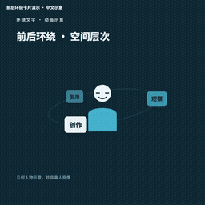

来源条目：`remotion-library-orbit`。

## 中文示例

来源条目：`remotion-library-bar-zh`。

## 产品宣传与教程

[多屏拼贴 · 品牌宣传：官方在线分类演示](https://media.openaicut.com/previews/585/draft-zh-78bba5fd21f6.mp4)

官方视频保留原样，在线播放需要联网。

来源条目：`mg-style-128610`。

## 人物与背景

来源条目：`presenter-effect-04`。

## 关系与系统结构

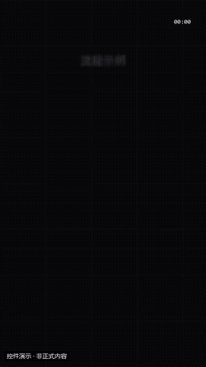

来源条目：`mg-control-flow`。

## 列表与步骤

来源条目：`presenter-effect-10`。

## 叠加标注与装饰

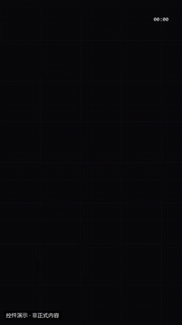

来源条目：`mg-control-lowerthird`。

## 口播与讲解

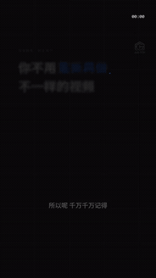

来源条目：`mg-style-314486`。

## 品牌与行动

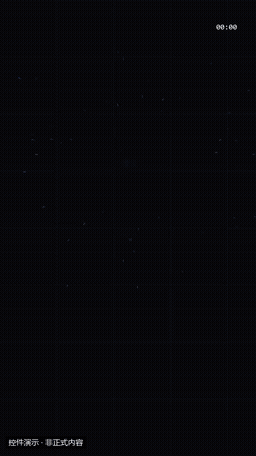

来源条目：`mg-control-logo`。

## 基础讲解

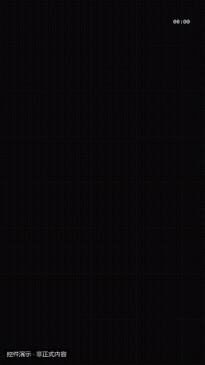

来源条目：`mg-control-title`。

## 循环与背景

来源条目：`remotion-bokeh-circles`。

## 数据与图表

来源条目：`remotion-bar-chart-anim`。

## 数据与进度

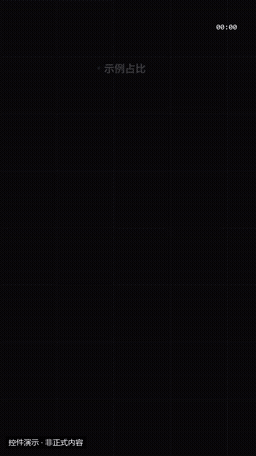

来源条目：`mg-control-donut`。

## 文字与标题

来源条目：`remotion-bounce-in-headline`。

## 文字动态

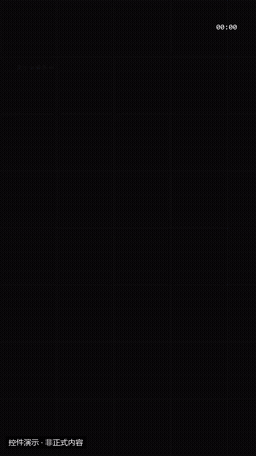

来源条目：`mg-control-kinetic`。

## 概念教学

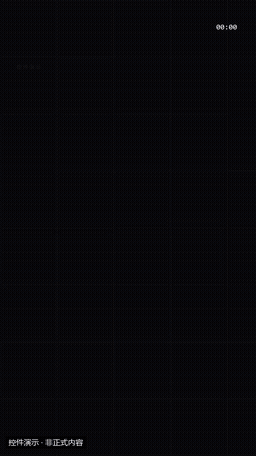

来源条目：`mg-control-iconcards`。

## 界面与交互演示

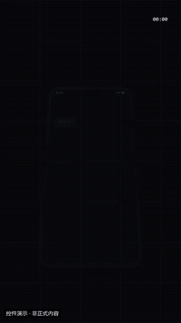

来源条目：`mg-control-chat`。

## 界面与设备

来源条目：`presenter-effect-07`。

## 真实素材展示

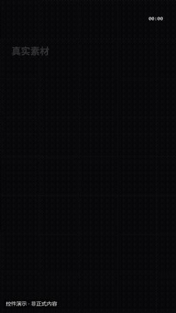

来源条目：`mg-control-gallery`。

## 知识解说与流程图

[量价图表：K线突破与分时动画：官方在线分类演示](https://media.openaicut.com/previews/869/1.0.0-zh-d5fd83bc28a8.mp4)

官方视频保留原样，在线播放需要联网。

来源条目：`mg-style-287792`。

## 社交与界面

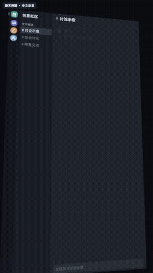

来源条目：`remotion-community-chat`。

## 科技视觉（非口播默认）

[酷炫科技风：官方在线分类演示](https://motiontemplates.github.io/385712/assets/demo.mp4)

官方视频保留原样，在线播放需要联网。

来源条目：`mg-style-385712`。

## 装饰与强调

来源条目：`presenter-effect-12`。

## 视觉与场景动效（非口播默认）

[半调网点 · 人像标题：官方在线分类演示](https://media.openaicut.com/previews/615/draft-zh-87b41df4a38a.mp4)

官方视频保留原样，在线播放需要联网。

来源条目：`mg-style-381814`。

## 转场

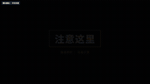

来源条目：`remotion-camera-shake`。

## 镜头与转场

来源条目：`presenter-effect-03`。
