# 数据与对比 · 特效模板详细说明

[返回全部分类](../README.zh-CN.md) · [学习自动剪辑](../../docs/NOTION_GUIDE.zh-CN.md) · [在线筛选与播放](https://aicut.agi-top.com)

本页 26 个目录条目；每项固定七段，参数依据与使用状态独立标注。先准备自己的合法素材，再按对应版本检查依赖和预览。

[量价图表：K线突破与分时动画](#mg-style-287792) · [DEEP STAGE 案例数据](#mg-style-587362) · [瑞士信息设计 · 知识讲解模板](#mg-style-257987) · [双色孔版 · 知识讲解模板](#mg-style-808349) · [数字滚动](#mg-control-number) · [左右对比](#mg-control-compare) · [数据条](#mg-control-bars) · [价格 / 优惠](#mg-control-price) · [优缺点](#mg-control-prosCons) · [两方对决](#mg-control-vs) · [环形占比](#mg-control-donut) · [折线趋势](#mg-control-linechart) · [KPI 数字卡](#mg-control-counter) · [进度 / 完成度](#mg-control-progress) · [对比表 / 功能矩阵](#mg-control-table) · [排行榜](#mg-control-ranking) · [前后对比](#mg-control-beforeafter) · [长条图成长](#remotion-bar-chart-anim) · [折线图绘制](#remotion-line-chart-anim) · [滴入式填充计量](#remotion-pourover-drip-fill-gauge) · [数字计数器](#remotion-kpi-counter) · [像素蜡烛图](#remotion-pixel-candlestick-ohlc) · [排名竞速长条图](#remotion-racing-chart) · [分屏布局](#remotion-split-screen) · [中文长条成长示例](#remotion-library-bar-zh) · [条形增长](#presenter-effect-01)

<a id="mg-style-287792"></a>

### 量价图表：K线突破与分时动画

`mg-style-287792` · 数据与对比 · 知识解说与流程图 · **官方参考 · 先取得并核对原包**

量价教学图表独立组件，包含两组日K与一组分时动画。

**1. 效果预览**

[](https://media.openaicut.com/previews/869/1.0.0-zh-d5fd83bc28a8.mp4)

- [官方示例 1 · 1:1](https://media.openaicut.com/previews/869/1.0.0-zh-d5fd83bc28a8.mp4)：官方目录演示；文件不保证对应所列最新版本，未逐条播放验收。

**2. 适用内容**

- 量价关系、日 K 与分时变化的教学图表

- 图示须对应真实文稿、条件与数据；示意动画不能冒充实测证据或实际系统操作。
- 图表示例只用于教学，不代表真实行情、预测或收益承诺。

**3. 所需素材**

- 公开目录未列具体输入；制作前须读取本条包的 guide、素材槽和运行契约，不能从 Demo 猜参数。

**4. 可改参数与限制**

按已核对的字段与限制修改；尚未核对的能力会明确标注。

<details>
<summary>查看参数、限制与来源依据</summary>

- 尚未核对可替换参数合同；请先读原模板的 guide/schema 或源码。不能根据 Demo 推断能任意换颜色、数量、比例或时长。

- 文字容量、素材数量、颜色、时长和画幅的可调范围，按对应版本的实际合同核对；演示规格不等于任意规格都受支持。

</details>

**5. 怎样交给 AI 使用**

<details>
<summary>复制本模板的使用提示词</summary>

```text
请使用 AI Cut 模板目录中的「量价图表：K线突破与分时动画」（编号 mg-style-287792）。
我的内容或原片：[填写]；输出比例：[填写]；需要强调的内容：[填写]。
先核对本条来源、当前状态、素材和参数合同；使用我自己的获授权素材，保留原声原意。
按照本条已支持的参数范围做短预览，确认文字、动作和声音的时间一致，再放入剪辑工程。
若原包、依赖或素材缺失，说明缺什么；遇到费用先告诉我。不要将示例人物或示例数据当成我的内容。
```

</details>

**6. 当前能否使用**

- 官方参考 · 先取得并核对原包
- 可取得状态：以官网当前页面为准
- 登记基线版本：1.0.0。新输入、新电脑和其他变体须另行验证。

<details>
<summary>查看原始检查范围与接入记录</summary>

- 官方目录提供 Demo 链接；本次核对了来源字段与链接完整性，未逐条播放、验证下载权限、运行或整套成片。

</details>

**7. 来源与许可**

- 目录声明开源；代码、字体与素材许可须逐包核对，本索引未逐包审定。

[原始来源](https://motiongit.com/@oubaba95128/volume-price-kline-charts) · [上游技术资料](https://github.com/motiontemplates/287792)

---

<a id="mg-style-587362"></a>

### DEEP STAGE 案例数据

`mg-style-587362` · 数据与对比 · 知识解说与流程图 · **官方参考 · 先取得并核对原包**

案例讲解动效：数据仪表盘推入，3 个 KPI 数字滚动，6 根柱图从底部逐根生长（最高值自动主色高亮），前后对比副屏滑入。13 秒，适合案例复盘与成果汇报。

**1. 效果预览**

[](https://media.openaicut.com/previews/882/1.0.0-5df639825460.mp4)

- [官方示例 1 · 16:9](https://media.openaicut.com/previews/882/1.0.0-5df639825460.mp4)：官方目录演示；文件不保证对应所列最新版本，未逐条播放验收。

**2. 适用内容**

- 有来源的 KPI、柱图与前后比较的案例复盘

- 图示须对应真实文稿、条件与数据；示意动画不能冒充实测证据或实际系统操作。

**3. 所需素材**

- 公开目录未列具体输入；制作前须读取本条包的 guide、素材槽和运行契约，不能从 Demo 猜参数。

**4. 可改参数与限制**

按已核对的字段与限制修改；尚未核对的能力会明确标注。

<details>
<summary>查看参数、限制与来源依据</summary>

- 尚未核对可替换参数合同；请先读原模板的 guide/schema 或源码。不能根据 Demo 推断能任意换颜色、数量、比例或时长。

- 文字容量、素材数量、颜色、时长和画幅的可调范围，按对应版本的实际合同核对；演示规格不等于任意规格都受支持。

</details>

**5. 怎样交给 AI 使用**

<details>
<summary>复制本模板的使用提示词</summary>

```text
请使用 AI Cut 模板目录中的「DEEP STAGE 案例数据」（编号 mg-style-587362）。
我的内容或原片：[填写]；输出比例：[填写]；需要强调的内容：[填写]。
先核对本条来源、当前状态、素材和参数合同；使用我自己的获授权素材，保留原声原意。
按照本条已支持的参数范围做短预览，确认文字、动作和声音的时间一致，再放入剪辑工程。
若原包、依赖或素材缺失，说明缺什么；遇到费用先告诉我。不要将示例人物或示例数据当成我的内容。
```

</details>

**6. 当前能否使用**

- 官方参考 · 先取得并核对原包
- 可取得状态：以官网当前页面为准
- 登记基线版本：1.0.0。新输入、新电脑和其他变体须另行验证。

<details>
<summary>查看原始检查范围与接入记录</summary>

- 官方目录提供 Demo 链接；本次核对了来源字段与链接完整性，未逐条播放、验证下载权限、运行或整套成片。

</details>

**7. 来源与许可**

- 目录声明开源；代码、字体与素材许可须逐包核对，本索引未逐包审定。

[原始来源](https://motiongit.com/@thepandaq/deep-stage-case-data)

---

<a id="mg-style-257987"></a>

### 瑞士信息设计 · 知识讲解模板

`mg-style-257987` · 数据与对比 · 知识解说与流程图 · **官方参考 · 先取得并核对原包**

用清晰网格、对象计数和比例变化讲明白“百分比在除什么”。适合分母、权重与统计比较，可由AI助手按本期文稿选择图示，支持可选真人开场。

**1. 效果预览**

[](https://media.openaicut.com/previews/900/2.5.3-zh-5df29820b59b.mp4)

- [官方示例 1 · 16:9](https://media.openaicut.com/previews/900/2.5.3-zh-5df29820b59b.mp4)：官方目录演示；文件不保证对应所列最新版本，未逐条播放验收。

**2. 适用内容**

- 百分比、分母、权重和统计比较

- 图示须对应真实文稿、条件与数据；示意动画不能冒充实测证据或实际系统操作。

**3. 所需素材**

- 公开目录未列具体输入；制作前须读取本条包的 guide、素材槽和运行契约，不能从 Demo 猜参数。

**4. 可改参数与限制**

按已核对的字段与限制修改；尚未核对的能力会明确标注。

<details>
<summary>查看参数、限制与来源依据</summary>

- 尚未核对可替换参数合同；请先读原模板的 guide/schema 或源码。不能根据 Demo 推断能任意换颜色、数量、比例或时长。

- 文字容量、素材数量、颜色、时长和画幅的可调范围，按对应版本的实际合同核对；演示规格不等于任意规格都受支持。

</details>

**5. 怎样交给 AI 使用**

<details>
<summary>复制本模板的使用提示词</summary>

```text
请使用 AI Cut 模板目录中的「瑞士信息设计 · 知识讲解模板」（编号 mg-style-257987）。
我的内容或原片：[填写]；输出比例：[填写]；需要强调的内容：[填写]。
先核对本条来源、当前状态、素材和参数合同；使用我自己的获授权素材，保留原声原意。
按照本条已支持的参数范围做短预览，确认文字、动作和声音的时间一致，再放入剪辑工程。
若原包、依赖或素材缺失，说明缺什么；遇到费用先告诉我。不要将示例人物或示例数据当成我的内容。
```

</details>

**6. 当前能否使用**

- 官方参考 · 先取得并核对原包
- 可取得状态：以官网当前页面为准
- 登记基线版本：2.7.2。新输入、新电脑和其他变体须另行验证。

<details>
<summary>查看原始检查范围与接入记录</summary>

- 官方目录提供 Demo 链接；本次核对了来源字段与链接完整性，未逐条播放、验证下载权限、运行或整套成片。

</details>

**7. 来源与许可**

- 目录声明开源；代码、字体与素材许可须逐包核对，本索引未逐包审定。

[原始来源](https://motiongit.com/@adunext/knowledge-explainer-swiss)

---

<a id="mg-style-808349"></a>

### 双色孔版 · 知识讲解模板

`mg-style-808349` · 数据与对比 · 知识解说与流程图 · **官方参考 · 先取得并核对原包**

用双色套印看清复制、增长和基数差异。适合固定增量与固定比例、谱系和指数规则的解释，提供图示选择引导，可选真人开场后圆窗陪讲。

**1. 效果预览**

[](https://media.openaicut.com/previews/909/2.5.3-zh-15d6f65e42f3.mp4)

- [官方示例 1 · 16:9](https://media.openaicut.com/previews/909/2.5.3-zh-15d6f65e42f3.mp4)：官方目录演示；文件不保证对应所列最新版本，未逐条播放验收。

**2. 适用内容**

- 固定增量与比例、谱系、复制和指数规则的解释

- 图示须对应真实文稿、条件与数据；示意动画不能冒充实测证据或实际系统操作。

**3. 所需素材**

- 公开目录未列具体输入；制作前须读取本条包的 guide、素材槽和运行契约，不能从 Demo 猜参数。

**4. 可改参数与限制**

按已核对的字段与限制修改；尚未核对的能力会明确标注。

<details>
<summary>查看参数、限制与来源依据</summary>

- 尚未核对可替换参数合同；请先读原模板的 guide/schema 或源码。不能根据 Demo 推断能任意换颜色、数量、比例或时长。

- 文字容量、素材数量、颜色、时长和画幅的可调范围，按对应版本的实际合同核对；演示规格不等于任意规格都受支持。

</details>

**5. 怎样交给 AI 使用**

<details>
<summary>复制本模板的使用提示词</summary>

```text
请使用 AI Cut 模板目录中的「双色孔版 · 知识讲解模板」（编号 mg-style-808349）。
我的内容或原片：[填写]；输出比例：[填写]；需要强调的内容：[填写]。
先核对本条来源、当前状态、素材和参数合同；使用我自己的获授权素材，保留原声原意。
按照本条已支持的参数范围做短预览，确认文字、动作和声音的时间一致，再放入剪辑工程。
若原包、依赖或素材缺失，说明缺什么；遇到费用先告诉我。不要将示例人物或示例数据当成我的内容。
```

</details>

**6. 当前能否使用**

- 官方参考 · 先取得并核对原包
- 可取得状态：以官网当前页面为准
- 登记基线版本：2.7.2。新输入、新电脑和其他变体须另行验证。

<details>
<summary>查看原始检查范围与接入记录</summary>

- 官方目录提供 Demo 链接；本次核对了来源字段与链接完整性，未逐条播放、验证下载权限、运行或整套成片。

</details>

**7. 来源与许可**

- 目录声明开源；代码、字体与素材许可须逐包核对，本索引未逐包审定。

[原始来源](https://motiongit.com/@adunext/knowledge-explainer-riso)

---

<a id="mg-control-number"></a>

### 数字滚动

`mg-control-number` · 数据与对比 · 基础讲解 · **已有控件演示 · 需自备授权原包**

一个关键数字：时长、数量、百分比、价格。可带 1–3 句注释

**1. 效果预览**

[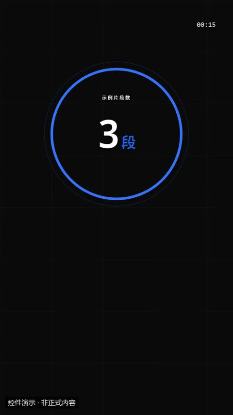](../../docs/template-gallery/demos/motiongit/number.mp4)

- [本地效果演示 1 · 规格见演示](../../docs/template-gallery/demos/motiongit/number.mp4)：官方控件真实渲染；使用中文示例文案或示例数据。6秒静音控件演示；保留模板原生标记与组内时码，角标不是本文件播放计时。低位演示身份标为本目录后处理添加。

**2. 适用内容**

- 一个关键数字：时长、数量、百分比、价格。可带 1–3 句注释

- 不替代原始证据；重点字不能改变原话的限定条件。

**3. 所需素材**

- 短标题或重点词
- 清楚的解释关系
- 真实数值或标明示例的数据

**4. 可改参数与限制**

按已核对的字段与限制修改；尚未核对的能力会明确标注。

<details>
<summary>查看参数、限制与来源依据</summary>

- 标签（label）：文字，必填；最短长度 1；最多可见字符 20。
- value（value）：数字，必填。
- from（from）：数字，可选。
- decimals（decimals）：integer，可选；最小 0；最大 2。
- prefix（prefix）：文字，可选；最多可见字符 3。
- unit（unit）：文字，可选；最多可见字符 6。
- 说明（note）：列表，可选；至少项数 0；最多项数 3。
- 动画变体（variant）：ring / gauge / flip。
- 段落时间（t0、t1）与动作提示时间（cues）按剪后的真实讲解设置；主题色由时间轴 theme 配置，不是每个控件任意独立的配色合同。

- 这些范围来自已登记版本的公开参数合同；更换个人包或版本后须重新核对，不自动沿用到所有官网模板。
- 每个控件目前只展示一个代表变体；可选枚举、允许数量和颜色参数不等于所有组合都已实测。
- 导出前仍需校验参数、真实素材、语音时长与排版；不从示例数据推断实际业务结果。

参数依据：[motiongit-controls.json](../../templates/motiongit-controls.json) · [render_motiongit_gallery.py](../../scripts/render_motiongit_gallery.py) · [render_motiongit_gallery_data.py](../../scripts/render_motiongit_gallery_data.py)

</details>

**5. 怎样交给 AI 使用**

<details>
<summary>复制本模板的使用提示词</summary>

```text
请使用 AI Cut 模板目录中的「数字滚动」（编号 mg-control-number）。
我的内容或原片：[填写]；输出比例：[填写]；需要强调的内容：[填写]。
先核对本条来源、当前状态、素材和参数合同；使用我自己的获授权素材，保留原声原意。
按照本条已支持的参数范围做短预览，确认文字、动作和声音的时间一致，再放入剪辑工程。
若原包、依赖或素材缺失，说明缺什么；遇到费用先告诉我。不要将示例人物或示例数据当成我的内容。
```

</details>

**6. 当前能否使用**

- 已有控件演示 · 需自备授权原包
- 本仓库提供目录与已渲染演示，未附送个人 .motion 原包；学员须使用自己合法取得的对应包。
- 登记基线版本：0.3.0 (package2.7.17-alpha.2)。新输入、新电脑和其他变体须另行验证。

<details>
<summary>查看原始检查范围与接入记录</summary>

- 一个代表变体已由官方 helper 渲染；静音小样完整解码，并已查看实际导出抽帧。其他两个变体仅登记，未渲染；不代表连续观看或用户审美认可。

</details>

**7. 来源与许可**

- MotionGit 个人授权模板包，以原包授权为准；仅包含自有素材及明确示例数据的渲染演示，不分发受保护代码。

[原始来源](https://motiongit.com/@adunext/template-01-integrated-portrait)

---

<a id="mg-control-compare"></a>

### 左右对比

`mg-control-compare` · 数据与对比 · 基础讲解 · **已有控件演示 · 需自备授权原包**

两种做法、前后变化、A 和 B 的差别；可给结论并标出胜者

**1. 效果预览**

[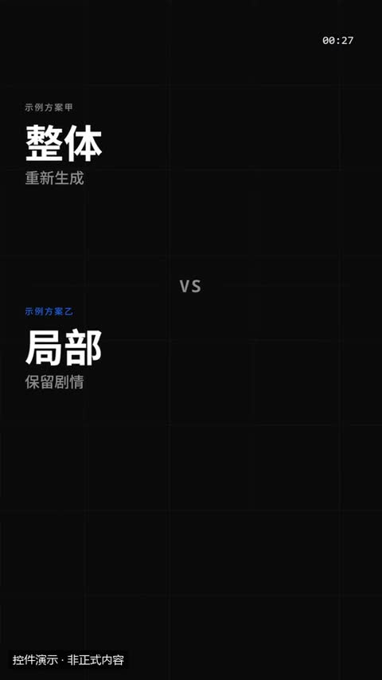](../../docs/template-gallery/demos/motiongit/compare.mp4)

- [本地效果演示 1 · 规格见演示](../../docs/template-gallery/demos/motiongit/compare.mp4)：官方控件真实渲染；使用中文示例文案或示例数据。6秒静音控件演示；保留模板原生标记与组内时码，角标不是本文件播放计时。低位演示身份标为本目录后处理添加。

**2. 适用内容**

- 两种做法、前后变化、A 和 B 的差别；可给结论并标出胜者

- 不替代原始证据；重点字不能改变原话的限定条件。

**3. 所需素材**

- 短标题或重点词
- 清楚的解释关系
- 真实数值或标明示例的数据

**4. 可改参数与限制**

按已核对的字段与限制修改；尚未核对的能力会明确标注。

<details>
<summary>查看参数、限制与来源依据</summary>

- left（left）：一组字段，必填。
- 标签（left.label）：文字，可选；最多可见字符 12。
- big（left.big）：文字，必填；最短长度 1；最多可见字符 10。
- 文字行（left.lines）：列表，可选；最多项数 3。
- right（right）：一组字段，必填。
- 标签（right.label）：文字，可选；最多可见字符 12。
- big（right.big）：文字，必填；最短长度 1；最多可见字符 10。
- 文字行（right.lines）：列表，可选；最多项数 3。
- verdict（verdict）：文字，可选；最多可见字符 16。
- winner（winner）：文字，可选；可选 left/right/none。
- 动画变体（variant）：split / panels / flip。
- 段落时间（t0、t1）与动作提示时间（cues）按剪后的真实讲解设置；主题色由时间轴 theme 配置，不是每个控件任意独立的配色合同。

- 这些范围来自已登记版本的公开参数合同；更换个人包或版本后须重新核对，不自动沿用到所有官网模板。
- 每个控件目前只展示一个代表变体；可选枚举、允许数量和颜色参数不等于所有组合都已实测。
- 导出前仍需校验参数、真实素材、语音时长与排版；不从示例数据推断实际业务结果。

参数依据：[motiongit-controls.json](../../templates/motiongit-controls.json) · [render_motiongit_gallery.py](../../scripts/render_motiongit_gallery.py) · [render_motiongit_gallery_data.py](../../scripts/render_motiongit_gallery_data.py)

</details>

**5. 怎样交给 AI 使用**

<details>
<summary>复制本模板的使用提示词</summary>

```text
请使用 AI Cut 模板目录中的「左右对比」（编号 mg-control-compare）。
我的内容或原片：[填写]；输出比例：[填写]；需要强调的内容：[填写]。
先核对本条来源、当前状态、素材和参数合同；使用我自己的获授权素材，保留原声原意。
按照本条已支持的参数范围做短预览，确认文字、动作和声音的时间一致，再放入剪辑工程。
若原包、依赖或素材缺失，说明缺什么；遇到费用先告诉我。不要将示例人物或示例数据当成我的内容。
```

</details>

**6. 当前能否使用**

- 已有控件演示 · 需自备授权原包
- 本仓库提供目录与已渲染演示，未附送个人 .motion 原包；学员须使用自己合法取得的对应包。
- 登记基线版本：0.3.0 (package2.7.17-alpha.2)。新输入、新电脑和其他变体须另行验证。

<details>
<summary>查看原始检查范围与接入记录</summary>

- 一个代表变体已由官方 helper 渲染；静音小样完整解码，并已查看实际导出抽帧。其他两个变体仅登记，未渲染；不代表连续观看或用户审美认可。

</details>

**7. 来源与许可**

- MotionGit 个人授权模板包，以原包授权为准；仅包含自有素材及明确示例数据的渲染演示，不分发受保护代码。

[原始来源](https://motiongit.com/@adunext/template-01-integrated-portrait)

---

<a id="mg-control-bars"></a>

### 数据条

`mg-control-bars` · 数据与对比 · 基础讲解 · **已有控件演示 · 需自备授权原包**

2–5 项数值比较；数值必须来自真实数据

**1. 效果预览**

[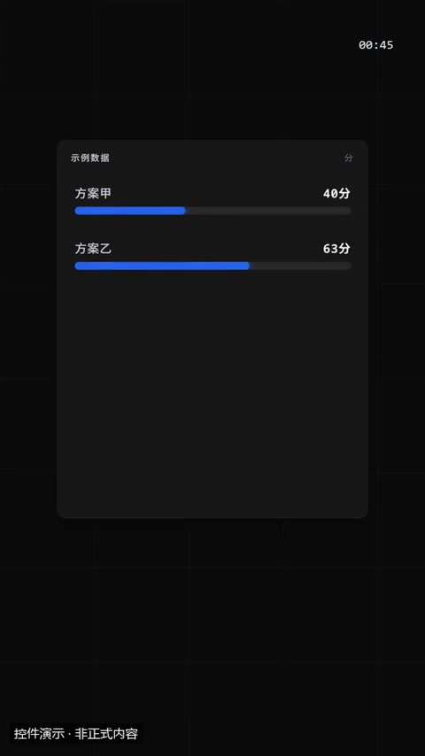](../../docs/template-gallery/demos/motiongit/bars.mp4)

- [本地效果演示 1 · 规格见演示](../../docs/template-gallery/demos/motiongit/bars.mp4)：官方控件真实渲染；使用中文示例文案或示例数据。6秒静音控件演示；保留模板原生标记与组内时码，角标不是本文件播放计时。低位演示身份标为本目录后处理添加。

**2. 适用内容**

- 2–5 项数值比较；数值必须来自真实数据

- 不替代原始证据；重点字不能改变原话的限定条件。

**3. 所需素材**

- 短标题或重点词
- 清楚的解释关系
- 真实数值或标明示例的数据

**4. 可改参数与限制**

按已核对的字段与限制修改；尚未核对的能力会明确标注。

<details>
<summary>查看参数、限制与来源依据</summary>

- 标题（title）：文字，必填；最短长度 1；最多可见字符 18。
- unit（unit）：文字，可选；最多可见字符 6。
- items（items）：列表，必填；至少项数 1；最多项数 5。
- 标签（items[].label）：文字，必填；最短长度 1；最多可见字符 12。
- value（items[].value）：数字，必填。
- max（max）：数字，可选。
- 动画变体（variant）：rows / columns / rank。
- 段落时间（t0、t1）与动作提示时间（cues）按剪后的真实讲解设置；主题色由时间轴 theme 配置，不是每个控件任意独立的配色合同。

- 这些范围来自已登记版本的公开参数合同；更换个人包或版本后须重新核对，不自动沿用到所有官网模板。
- 每个控件目前只展示一个代表变体；可选枚举、允许数量和颜色参数不等于所有组合都已实测。
- 导出前仍需校验参数、真实素材、语音时长与排版；不从示例数据推断实际业务结果。

参数依据：[motiongit-controls.json](../../templates/motiongit-controls.json) · [render_motiongit_gallery.py](../../scripts/render_motiongit_gallery.py) · [render_motiongit_gallery_data.py](../../scripts/render_motiongit_gallery_data.py)

</details>

**5. 怎样交给 AI 使用**

<details>
<summary>复制本模板的使用提示词</summary>

```text
请使用 AI Cut 模板目录中的「数据条」（编号 mg-control-bars）。
我的内容或原片：[填写]；输出比例：[填写]；需要强调的内容：[填写]。
先核对本条来源、当前状态、素材和参数合同；使用我自己的获授权素材，保留原声原意。
按照本条已支持的参数范围做短预览，确认文字、动作和声音的时间一致，再放入剪辑工程。
若原包、依赖或素材缺失，说明缺什么；遇到费用先告诉我。不要将示例人物或示例数据当成我的内容。
```

</details>

**6. 当前能否使用**

- 已有控件演示 · 需自备授权原包
- 本仓库提供目录与已渲染演示，未附送个人 .motion 原包；学员须使用自己合法取得的对应包。
- 登记基线版本：0.3.0 (package2.7.17-alpha.2)。新输入、新电脑和其他变体须另行验证。

<details>
<summary>查看原始检查范围与接入记录</summary>

- 一个代表变体已由官方 helper 渲染；静音小样完整解码，并已查看实际导出抽帧。其他两个变体仅登记，未渲染；不代表连续观看或用户审美认可。

</details>

**7. 来源与许可**

- MotionGit 个人授权模板包，以原包授权为准；仅包含自有素材及明确示例数据的渲染演示，不分发受保护代码。

[原始来源](https://motiongit.com/@adunext/template-01-integrated-portrait)

---

<a id="mg-control-price"></a>

### 价格 / 优惠

`mg-control-price` · 数据与对比 · 品牌与行动 · **已有控件演示 · 需自备授权原包**

亮出价格与优惠：原价划掉、新价砸入、标签盖章；可带 1–3 个卖点

**1. 效果预览**

[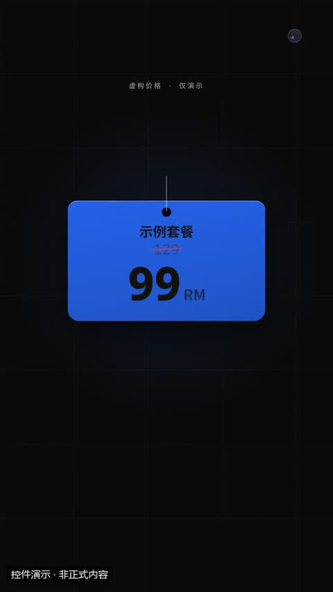](../../docs/template-gallery/demos/motiongit/price.mp4)

- [本地效果演示 1 · 规格见演示](../../docs/template-gallery/demos/motiongit/price.mp4)：官方控件真实渲染；使用中文示例文案或示例数据。6秒静音控件演示；保留模板原生标记与组内时码，角标不是本文件播放计时。低位演示身份标为本目录后处理添加。

**2. 适用内容**

- 亮出价格与优惠：原价划掉、新价砸入、标签盖章；可带 1–3 个卖点

- 只在需要品牌开场或行动引导时使用；示例价格与互动数不能当成事实。

**3. 所需素材**

- 品牌名称或有权使用的 Logo
- 明确的行动引导或章节信息

**4. 可改参数与限制**

按已核对的字段与限制修改；尚未核对的能力会明确标注。

<details>
<summary>查看参数、限制与来源依据</summary>

- kicker（kicker）：文字，可选；最多可见字符 20。
- 商品/套餐名（name）：文字，可选；最多可见字符 14。
- 新价（如 ¥99、$19.9）（price）：文字，必填；最短长度 1；最多可见字符 8。
- 原价（会被划掉）（was）：文字，可选；最多可见字符 10。
- 单位（/月、起）（unit）：文字，可选；最多可见字符 4。
- 标签（限时、立减）（tag）：文字，可选；最多可见字符 4。
- 卖点（feats）：列表，可选；最多项数 3。
- 动画变体（variant）：tag / card / sale。
- 段落时间（t0、t1）与动作提示时间（cues）按剪后的真实讲解设置；主题色由时间轴 theme 配置，不是每个控件任意独立的配色合同。

- 这些范围来自已登记版本的公开参数合同；更换个人包或版本后须重新核对，不自动沿用到所有官网模板。
- 每个控件目前只展示一个代表变体；可选枚举、允许数量和颜色参数不等于所有组合都已实测。
- 导出前仍需校验参数、真实素材、语音时长与排版；不从示例数据推断实际业务结果。

参数依据：[motiongit-controls.json](../../templates/motiongit-controls.json) · [render_motiongit_gallery.py](../../scripts/render_motiongit_gallery.py) · [render_motiongit_gallery_data.py](../../scripts/render_motiongit_gallery_data.py)

</details>

**5. 怎样交给 AI 使用**

<details>
<summary>复制本模板的使用提示词</summary>

```text
请使用 AI Cut 模板目录中的「价格 / 优惠」（编号 mg-control-price）。
我的内容或原片：[填写]；输出比例：[填写]；需要强调的内容：[填写]。
先核对本条来源、当前状态、素材和参数合同；使用我自己的获授权素材，保留原声原意。
按照本条已支持的参数范围做短预览，确认文字、动作和声音的时间一致，再放入剪辑工程。
若原包、依赖或素材缺失，说明缺什么；遇到费用先告诉我。不要将示例人物或示例数据当成我的内容。
```

</details>

**6. 当前能否使用**

- 已有控件演示 · 需自备授权原包
- 本仓库提供目录与已渲染演示，未附送个人 .motion 原包；学员须使用自己合法取得的对应包。
- 登记基线版本：0.3.0 (package2.7.17-alpha.2)。新输入、新电脑和其他变体须另行验证。

<details>
<summary>查看原始检查范围与接入记录</summary>

- 一个代表变体已由官方 helper 渲染；静音小样完整解码，并已查看实际导出抽帧。其他两个变体仅登记，未渲染；不代表连续观看或用户审美认可。

</details>

**7. 来源与许可**

- MotionGit 个人授权模板包，以原包授权为准；仅包含自有素材及明确示例数据的渲染演示，不分发受保护代码。

[原始来源](https://motiongit.com/@adunext/template-01-integrated-portrait)

---

<a id="mg-control-prosCons"></a>

### 优缺点

`mg-control-prosCons` · 数据与对比 · 概念教学 · **已有控件演示 · 需自备授权原包**

权衡一件事的好处与代价，最后给结论（偏向哪边）。选购、方案评估、利弊分析

**1. 效果预览**

[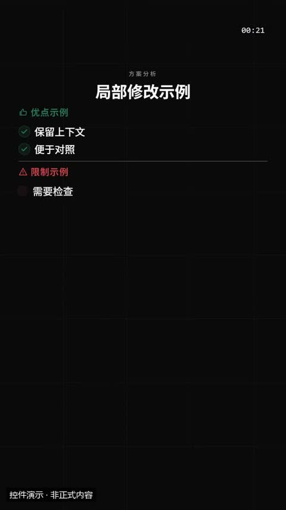](../../docs/template-gallery/demos/motiongit/prosCons.mp4)

- [本地效果演示 1 · 规格见演示](../../docs/template-gallery/demos/motiongit/prosCons.mp4)：官方控件真实渲染；使用中文示例文案或示例数据。6秒静音控件演示；保留模板原生标记与组内时码，角标不是本文件播放计时。低位演示身份标为本目录后处理添加。

**2. 适用内容**

- 权衡一件事的好处与代价，最后给结论（偏向哪边）。选购、方案评估、利弊分析

- 简化概念不能省略关键前提；完成章和勾选不能冒充实际验收。

**3. 所需素材**

- 定义、问题、对比或清单文案
- 关键限定条件

**4. 可改参数与限制**

按已核对的字段与限制修改；尚未核对的能力会明确标注。

<details>
<summary>查看参数、限制与来源依据</summary>

- kicker（kicker）：文字，可选；最多可见字符 28。
- 标题（title）：文字，可选；最多可见字符 20。
- 优点（pros）：列表，必填；至少项数 1；最多项数 4。
- 缺点（cons）：列表，必填；至少项数 1；最多项数 4。
- 默认 优点（proLabel）：文字，可选；最多可见字符 6。
- 默认 缺点（conLabel）：文字，可选；最多可见字符 6。
- 结论一句（可省略）（verdict）：文字，可选；最多可见字符 16。
- 结论偏向（缺省按条数）（lean）：文字，可选；可选 pros/cons/even。
- 动画变体（variant）：columns / scale / cards。
- 段落时间（t0、t1）与动作提示时间（cues）按剪后的真实讲解设置；主题色由时间轴 theme 配置，不是每个控件任意独立的配色合同。

- 这些范围来自已登记版本的公开参数合同；更换个人包或版本后须重新核对，不自动沿用到所有官网模板。
- 每个控件目前只展示一个代表变体；可选枚举、允许数量和颜色参数不等于所有组合都已实测。
- 导出前仍需校验参数、真实素材、语音时长与排版；不从示例数据推断实际业务结果。

参数依据：[motiongit-controls.json](../../templates/motiongit-controls.json) · [render_motiongit_gallery.py](../../scripts/render_motiongit_gallery.py) · [render_motiongit_gallery_data.py](../../scripts/render_motiongit_gallery_data.py)

</details>

**5. 怎样交给 AI 使用**

<details>
<summary>复制本模板的使用提示词</summary>

```text
请使用 AI Cut 模板目录中的「优缺点」（编号 mg-control-prosCons）。
我的内容或原片：[填写]；输出比例：[填写]；需要强调的内容：[填写]。
先核对本条来源、当前状态、素材和参数合同；使用我自己的获授权素材，保留原声原意。
按照本条已支持的参数范围做短预览，确认文字、动作和声音的时间一致，再放入剪辑工程。
若原包、依赖或素材缺失，说明缺什么；遇到费用先告诉我。不要将示例人物或示例数据当成我的内容。
```

</details>

**6. 当前能否使用**

- 已有控件演示 · 需自备授权原包
- 本仓库提供目录与已渲染演示，未附送个人 .motion 原包；学员须使用自己合法取得的对应包。
- 登记基线版本：0.3.0 (package2.7.17-alpha.2)。新输入、新电脑和其他变体须另行验证。

<details>
<summary>查看原始检查范围与接入记录</summary>

- 一个代表变体已由官方 helper 渲染；静音小样完整解码，并已查看实际导出抽帧。其他两个变体仅登记，未渲染；不代表连续观看或用户审美认可。

</details>

**7. 来源与许可**

- MotionGit 个人授权模板包，以原包授权为准；仅包含自有素材及明确示例数据的渲染演示，不分发受保护代码。

[原始来源](https://motiongit.com/@adunext/template-01-integrated-portrait)

---

<a id="mg-control-vs"></a>

### 两方对决

`mg-control-vs` · 数据与对比 · 概念教学 · **已有控件演示 · 需自备授权原包**

两个对象正面比拼 1–3 项数值并分出胜负：产品 A/B、方案、两个人或团队。只比观点不比数值时用 compare

**1. 效果预览**

[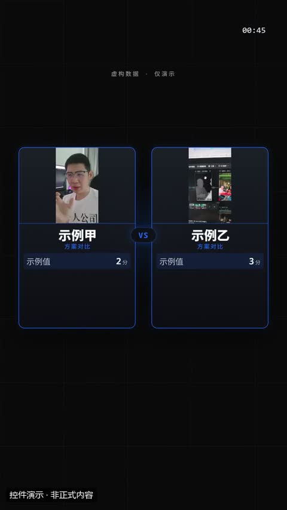](../../docs/template-gallery/demos/motiongit/vs.mp4)

- [本地效果演示 1 · 规格见演示](../../docs/template-gallery/demos/motiongit/vs.mp4)：官方控件真实渲染；使用本人授权素材。6秒静音控件演示；保留模板原生标记与组内时码，角标不是本文件播放计时。低位演示身份标为本目录后处理添加。

**2. 适用内容**

- 两个对象正面比拼 1–3 项数值并分出胜负：产品 A/B、方案、两个人或团队。只比观点不比数值时用 compare

- 简化概念不能省略关键前提；完成章和勾选不能冒充实际验收。

**3. 所需素材**

- 定义、问题、对比或清单文案
- 关键限定条件

**4. 可改参数与限制**

按已核对的字段与限制修改；尚未核对的能力会明确标注。

<details>
<summary>查看参数、限制与来源依据</summary>

- kicker（kicker）：文字，可选；最多可见字符 28。
- a（a）：一组字段，必填。
- name（a.name）：文字，必填；最短长度 1；最多可见字符 8。
- 小字身份（a.tag）：文字，可选；最多可见字符 14。
- 头像/图片（可省略，省略时显示首字）（a.src）：文字，可选。
- b（b）：一组字段，必填。
- name（b.name）：文字，必填；最短长度 1；最多可见字符 8。
- tag（b.tag）：文字，可选；最多可见字符 14。
- 媒体文件（b.src）：文字，可选。
- stats（stats）：列表，必填；至少项数 1；最多项数 3。
- 标签（stats[].label）：文字，必填；最短长度 1；最多可见字符 6。
- a（stats[].a）：数字，必填；最小 0。
- b（stats[].b）：数字，必填；最小 0。
- unit（stats[].unit）：文字，可选；最多可见字符 3。
- true 表示越小越好（价格、耗时）（stats[].low）：开关，可选。
- 缺省按胜项数（winner）：文字，可选；可选 a/b/none。
- 动画变体（variant）：fight / scale / cards。
- 段落时间（t0、t1）与动作提示时间（cues）按剪后的真实讲解设置；主题色由时间轴 theme 配置，不是每个控件任意独立的配色合同。

- 这些范围来自已登记版本的公开参数合同；更换个人包或版本后须重新核对，不自动沿用到所有官网模板。
- 每个控件目前只展示一个代表变体；可选枚举、允许数量和颜色参数不等于所有组合都已实测。
- 导出前仍需校验参数、真实素材、语音时长与排版；不从示例数据推断实际业务结果。

参数依据：[motiongit-controls.json](../../templates/motiongit-controls.json) · [render_motiongit_gallery.py](../../scripts/render_motiongit_gallery.py) · [render_motiongit_gallery_data.py](../../scripts/render_motiongit_gallery_data.py)

</details>

**5. 怎样交给 AI 使用**

<details>
<summary>复制本模板的使用提示词</summary>

```text
请使用 AI Cut 模板目录中的「两方对决」（编号 mg-control-vs）。
我的内容或原片：[填写]；输出比例：[填写]；需要强调的内容：[填写]。
先核对本条来源、当前状态、素材和参数合同；使用我自己的获授权素材，保留原声原意。
按照本条已支持的参数范围做短预览，确认文字、动作和声音的时间一致，再放入剪辑工程。
若原包、依赖或素材缺失，说明缺什么；遇到费用先告诉我。不要将示例人物或示例数据当成我的内容。
```

</details>

**6. 当前能否使用**

- 已有控件演示 · 需自备授权原包
- 本仓库提供目录与已渲染演示，未附送个人 .motion 原包；学员须使用自己合法取得的对应包。
- 登记基线版本：0.3.0 (package2.7.17-alpha.2)。新输入、新电脑和其他变体须另行验证。

<details>
<summary>查看原始检查范围与接入记录</summary>

- 一个代表变体已由官方 helper 渲染；静音小样完整解码，并已查看实际导出抽帧。其他两个变体仅登记，未渲染；不代表连续观看或用户审美认可。

</details>

**7. 来源与许可**

- MotionGit 个人授权模板包，以原包授权为准；仅包含自有素材及明确示例数据的渲染演示，不分发受保护代码。

[原始来源](https://motiongit.com/@adunext/template-01-integrated-portrait)

---

<a id="mg-control-donut"></a>

### 环形占比

`mg-control-donut` · 数据与对比 · 数据与进度 · **已有控件演示 · 需自备授权原包**

几个部分占整体多少：构成、份额、预算分配、用户来源（2–5 项）。数值按占比换算成百分比

**1. 效果预览**

[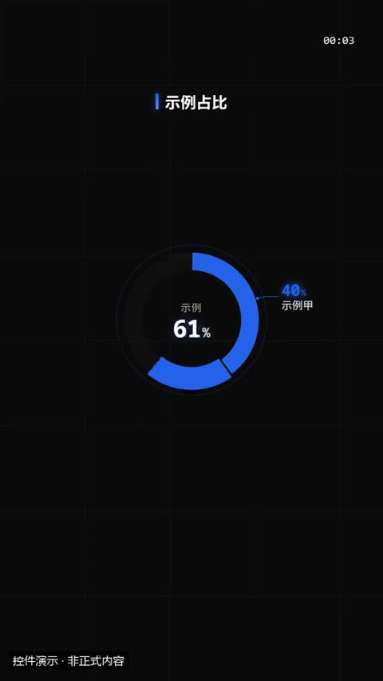](../../docs/template-gallery/demos/motiongit/donut.mp4)

- [本地效果演示 1 · 规格见演示](../../docs/template-gallery/demos/motiongit/donut.mp4)：官方控件真实渲染；使用中文示例文案或示例数据。6秒静音控件演示；保留模板原生标记与组内时码，角标不是本文件播放计时。低位演示身份标为本目录后处理添加。

**2. 适用内容**

- 几个部分占整体多少：构成、份额、预算分配、用户来源（2–5 项）。数值按占比换算成百分比

- 正式视频必须绑定真实数据及单位；本演示数字全部为示例。

**3. 所需素材**

- 有来源的数值、标签和单位

**4. 可改参数与限制**

按已核对的字段与限制修改；尚未核对的能力会明确标注。

<details>
<summary>查看参数、限制与来源依据</summary>

- 标题（title）：文字，可选；最多可见字符 18。
- ring 变体：中心合计上方小字（如「总计」）（center）：文字，可选；最多可见字符 8。
- 数值单位（unit）：文字，可选；最多可见字符 4。
- 各部分（items）：列表，必填；至少项数 2；最多项数 5。
- 标签（items[].label）：文字，必填；最短长度 1；最多可见字符 8。
- value（items[].value）：数字，必填；最小 0。
- 动画变体（variant）：ring / pie / split。
- 段落时间（t0、t1）与动作提示时间（cues）按剪后的真实讲解设置；主题色由时间轴 theme 配置，不是每个控件任意独立的配色合同。

- 这些范围来自已登记版本的公开参数合同；更换个人包或版本后须重新核对，不自动沿用到所有官网模板。
- 每个控件目前只展示一个代表变体；可选枚举、允许数量和颜色参数不等于所有组合都已实测。
- 导出前仍需校验参数、真实素材、语音时长与排版；不从示例数据推断实际业务结果。

参数依据：[motiongit-controls.json](../../templates/motiongit-controls.json) · [render_motiongit_gallery.py](../../scripts/render_motiongit_gallery.py) · [render_motiongit_gallery_data.py](../../scripts/render_motiongit_gallery_data.py)

</details>

**5. 怎样交给 AI 使用**

<details>
<summary>复制本模板的使用提示词</summary>

```text
请使用 AI Cut 模板目录中的「环形占比」（编号 mg-control-donut）。
我的内容或原片：[填写]；输出比例：[填写]；需要强调的内容：[填写]。
先核对本条来源、当前状态、素材和参数合同；使用我自己的获授权素材，保留原声原意。
按照本条已支持的参数范围做短预览，确认文字、动作和声音的时间一致，再放入剪辑工程。
若原包、依赖或素材缺失，说明缺什么；遇到费用先告诉我。不要将示例人物或示例数据当成我的内容。
```

</details>

**6. 当前能否使用**

- 已有控件演示 · 需自备授权原包
- 本仓库提供目录与已渲染演示，未附送个人 .motion 原包；学员须使用自己合法取得的对应包。
- 登记基线版本：0.3.0 (package2.7.17-alpha.2)。新输入、新电脑和其他变体须另行验证。

<details>
<summary>查看原始检查范围与接入记录</summary>

- 一个代表变体已由官方 helper 渲染；静音小样完整解码，并已查看实际导出抽帧。其他两个变体仅登记，未渲染；不代表连续观看或用户审美认可。

</details>

**7. 来源与许可**

- MotionGit 个人授权模板包，以原包授权为准；仅包含自有素材及明确示例数据的渲染演示，不分发受保护代码。

[原始来源](https://motiongit.com/@adunext/template-01-integrated-portrait)

---

<a id="mg-control-linechart"></a>

### 折线趋势

`mg-control-linechart` · 数据与对比 · 数据与进度 · **已有控件演示 · 需自备授权原包**

随时间的变化：增长、下降、波动、两条对比（4–12 个点）。终点标注最后一个值

**1. 效果预览**

[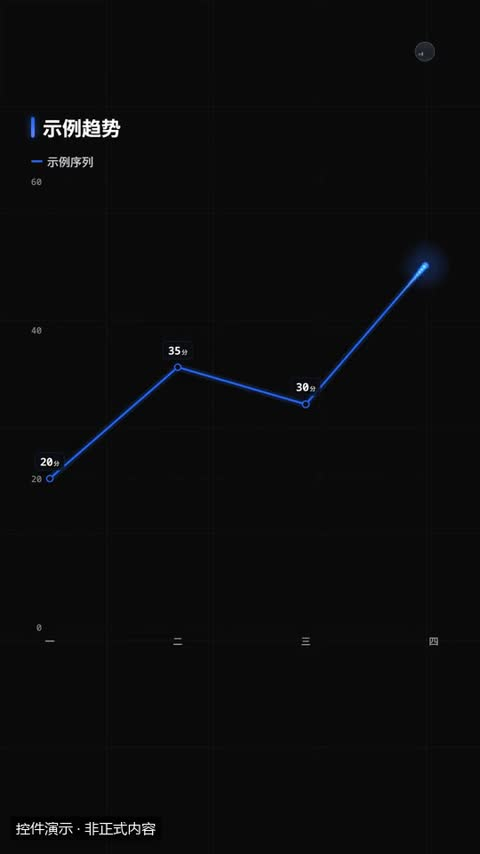](../../docs/template-gallery/demos/motiongit/linechart.mp4)

- [本地效果演示 1 · 规格见演示](../../docs/template-gallery/demos/motiongit/linechart.mp4)：官方控件真实渲染；使用中文示例文案或示例数据。6秒静音控件演示；保留模板原生标记与组内时码，角标不是本文件播放计时。低位演示身份标为本目录后处理添加。

**2. 适用内容**

- 随时间的变化：增长、下降、波动、两条对比（4–12 个点）。终点标注最后一个值

- 正式视频必须绑定真实数据及单位；本演示数字全部为示例。

**3. 所需素材**

- 有来源的数值、标签和单位

**4. 可改参数与限制**

按已核对的字段与限制修改；尚未核对的能力会明确标注。

<details>
<summary>查看参数、限制与来源依据</summary>

- 标题（title）：文字，可选；最多可见字符 18。
- 数值单位（unit）：文字，可选；最多可见字符 4。
- 系列名（第二个对应 value2）（series）：列表，可选；最多项数 2。
- 终点标注补充（如「创新高」）（note）：文字，可选；最多可见字符 12。
- 数据点（points）：列表，必填；至少项数 4；最多项数 12。
- 横轴标签（points[].label）：文字，必填；最短长度 1；最多可见字符 6。
- value（points[].value）：数字，必填。
- 第二条线（每个点都填才画）（points[].value2）：数字，可选。
- 动画变体（variant）：line / area / spark。
- 段落时间（t0、t1）与动作提示时间（cues）按剪后的真实讲解设置；主题色由时间轴 theme 配置，不是每个控件任意独立的配色合同。

- 这些范围来自已登记版本的公开参数合同；更换个人包或版本后须重新核对，不自动沿用到所有官网模板。
- 每个控件目前只展示一个代表变体；可选枚举、允许数量和颜色参数不等于所有组合都已实测。
- 导出前仍需校验参数、真实素材、语音时长与排版；不从示例数据推断实际业务结果。

参数依据：[motiongit-controls.json](../../templates/motiongit-controls.json) · [render_motiongit_gallery.py](../../scripts/render_motiongit_gallery.py) · [render_motiongit_gallery_data.py](../../scripts/render_motiongit_gallery_data.py)

</details>

**5. 怎样交给 AI 使用**

<details>
<summary>复制本模板的使用提示词</summary>

```text
请使用 AI Cut 模板目录中的「折线趋势」（编号 mg-control-linechart）。
我的内容或原片：[填写]；输出比例：[填写]；需要强调的内容：[填写]。
先核对本条来源、当前状态、素材和参数合同；使用我自己的获授权素材，保留原声原意。
按照本条已支持的参数范围做短预览，确认文字、动作和声音的时间一致，再放入剪辑工程。
若原包、依赖或素材缺失，说明缺什么；遇到费用先告诉我。不要将示例人物或示例数据当成我的内容。
```

</details>

**6. 当前能否使用**

- 已有控件演示 · 需自备授权原包
- 本仓库提供目录与已渲染演示，未附送个人 .motion 原包；学员须使用自己合法取得的对应包。
- 登记基线版本：0.3.0 (package2.7.17-alpha.2)。新输入、新电脑和其他变体须另行验证。

<details>
<summary>查看原始检查范围与接入记录</summary>

- 一个代表变体已由官方 helper 渲染；静音小样完整解码，并已查看实际导出抽帧。其他两个变体仅登记，未渲染；不代表连续观看或用户审美认可。

</details>

**7. 来源与许可**

- MotionGit 个人授权模板包，以原包授权为准；仅包含自有素材及明确示例数据的渲染演示，不分发受保护代码。

[原始来源](https://motiongit.com/@adunext/template-01-integrated-portrait)

---

<a id="mg-control-counter"></a>

### KPI 数字卡

`mg-control-counter` · 数据与对比 · 数据与进度 · **已有控件演示 · 需自备授权原包**

2–4 个关键数字并排：用户数、营收、增长率、时长；可带涨跌

**1. 效果预览**

[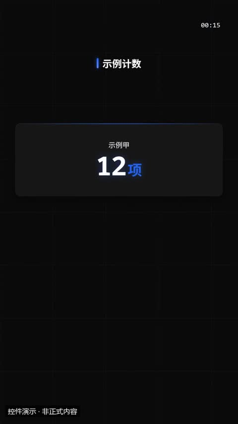](../../docs/template-gallery/demos/motiongit/counter.mp4)

- [本地效果演示 1 · 规格见演示](../../docs/template-gallery/demos/motiongit/counter.mp4)：官方控件真实渲染；使用中文示例文案或示例数据。6秒静音控件演示；保留模板原生标记与组内时码，角标不是本文件播放计时。低位演示身份标为本目录后处理添加。

**2. 适用内容**

- 2–4 个关键数字并排：用户数、营收、增长率、时长；可带涨跌

- 正式视频必须绑定真实数据及单位；本演示数字全部为示例。

**3. 所需素材**

- 有来源的数值、标签和单位

**4. 可改参数与限制**

按已核对的字段与限制修改；尚未核对的能力会明确标注。

<details>
<summary>查看参数、限制与来源依据</summary>

- 标题（title）：文字，可选；最多可见字符 18。
- 数字卡（items）：列表，必填；至少项数 2；最多项数 4。
- 标签（items[].label）：文字，必填；最短长度 1；最多可见字符 8。
- value（items[].value）：数字，必填；最小 0；最大 99999999。
- 前缀（¥ $）（items[].prefix）：文字，可选；最多可见字符 2。
- 单位（万 % 人）（items[].unit）：文字，可选；最多可见字符 3。
- 涨跌（百分点，正涨负跌）（items[].delta）：数字，可选；最小 -999；最大 999。
- 动画变体（variant）：cards / odometer / ticker。
- 段落时间（t0、t1）与动作提示时间（cues）按剪后的真实讲解设置；主题色由时间轴 theme 配置，不是每个控件任意独立的配色合同。

- 这些范围来自已登记版本的公开参数合同；更换个人包或版本后须重新核对，不自动沿用到所有官网模板。
- 每个控件目前只展示一个代表变体；可选枚举、允许数量和颜色参数不等于所有组合都已实测。
- 导出前仍需校验参数、真实素材、语音时长与排版；不从示例数据推断实际业务结果。

参数依据：[motiongit-controls.json](../../templates/motiongit-controls.json) · [render_motiongit_gallery.py](../../scripts/render_motiongit_gallery.py) · [render_motiongit_gallery_data.py](../../scripts/render_motiongit_gallery_data.py)

</details>

**5. 怎样交给 AI 使用**

<details>
<summary>复制本模板的使用提示词</summary>

```text
请使用 AI Cut 模板目录中的「KPI 数字卡」（编号 mg-control-counter）。
我的内容或原片：[填写]；输出比例：[填写]；需要强调的内容：[填写]。
先核对本条来源、当前状态、素材和参数合同；使用我自己的获授权素材，保留原声原意。
按照本条已支持的参数范围做短预览，确认文字、动作和声音的时间一致，再放入剪辑工程。
若原包、依赖或素材缺失，说明缺什么；遇到费用先告诉我。不要将示例人物或示例数据当成我的内容。
```

</details>

**6. 当前能否使用**

- 已有控件演示 · 需自备授权原包
- 本仓库提供目录与已渲染演示，未附送个人 .motion 原包；学员须使用自己合法取得的对应包。
- 登记基线版本：0.3.0 (package2.7.17-alpha.2)。新输入、新电脑和其他变体须另行验证。

<details>
<summary>查看原始检查范围与接入记录</summary>

- 一个代表变体已由官方 helper 渲染；静音小样完整解码，并已查看实际导出抽帧。其他两个变体仅登记，未渲染；不代表连续观看或用户审美认可。

</details>

**7. 来源与许可**

- MotionGit 个人授权模板包，以原包授权为准；仅包含自有素材及明确示例数据的渲染演示，不分发受保护代码。

[原始来源](https://motiongit.com/@adunext/template-01-integrated-portrait)

---

<a id="mg-control-progress"></a>

### 进度 / 完成度

`mg-control-progress` · 数据与对比 · 数据与进度 · **已有控件演示 · 需自备授权原包**

完成了多少：项目进度、目标达成、技能熟练度、电量式的程度（1–4 条，百分比）

**1. 效果预览**

[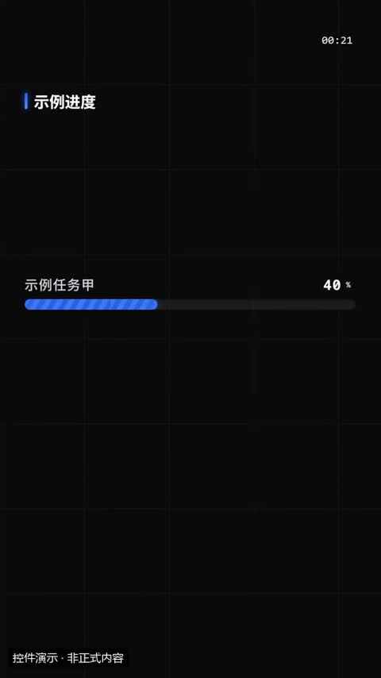](../../docs/template-gallery/demos/motiongit/progress.mp4)

- [本地效果演示 1 · 规格见演示](../../docs/template-gallery/demos/motiongit/progress.mp4)：官方控件真实渲染；使用中文示例文案或示例数据。6秒静音控件演示；保留模板原生标记与组内时码，角标不是本文件播放计时。低位演示身份标为本目录后处理添加。

**2. 适用内容**

- 完成了多少：项目进度、目标达成、技能熟练度、电量式的程度（1–4 条，百分比）

- 正式视频必须绑定真实数据及单位；本演示数字全部为示例。

**3. 所需素材**

- 有来源的数值、标签和单位

**4. 可改参数与限制**

按已核对的字段与限制修改；尚未核对的能力会明确标注。

<details>
<summary>查看参数、限制与来源依据</summary>

- 标题（title）：文字，可选；最多可见字符 18。
- 进度条（items）：列表，必填；至少项数 1；最多项数 4。
- 标签（items[].label）：文字，必填；最短长度 1；最多可见字符 10。
- percent（items[].percent）：数字，必填；最小 0；最大 100。
- 动画变体（variant）：bars / rings / battery。
- 段落时间（t0、t1）与动作提示时间（cues）按剪后的真实讲解设置；主题色由时间轴 theme 配置，不是每个控件任意独立的配色合同。

- 这些范围来自已登记版本的公开参数合同；更换个人包或版本后须重新核对，不自动沿用到所有官网模板。
- 每个控件目前只展示一个代表变体；可选枚举、允许数量和颜色参数不等于所有组合都已实测。
- 导出前仍需校验参数、真实素材、语音时长与排版；不从示例数据推断实际业务结果。

参数依据：[motiongit-controls.json](../../templates/motiongit-controls.json) · [render_motiongit_gallery.py](../../scripts/render_motiongit_gallery.py) · [render_motiongit_gallery_data.py](../../scripts/render_motiongit_gallery_data.py)

</details>

**5. 怎样交给 AI 使用**

<details>
<summary>复制本模板的使用提示词</summary>

```text
请使用 AI Cut 模板目录中的「进度 / 完成度」（编号 mg-control-progress）。
我的内容或原片：[填写]；输出比例：[填写]；需要强调的内容：[填写]。
先核对本条来源、当前状态、素材和参数合同；使用我自己的获授权素材，保留原声原意。
按照本条已支持的参数范围做短预览，确认文字、动作和声音的时间一致，再放入剪辑工程。
若原包、依赖或素材缺失，说明缺什么；遇到费用先告诉我。不要将示例人物或示例数据当成我的内容。
```

</details>

**6. 当前能否使用**

- 已有控件演示 · 需自备授权原包
- 本仓库提供目录与已渲染演示，未附送个人 .motion 原包；学员须使用自己合法取得的对应包。
- 登记基线版本：0.3.0 (package2.7.17-alpha.2)。新输入、新电脑和其他变体须另行验证。

<details>
<summary>查看原始检查范围与接入记录</summary>

- 一个代表变体已由官方 helper 渲染；静音小样完整解码，并已查看实际导出抽帧。其他两个变体仅登记，未渲染；不代表连续观看或用户审美认可。

</details>

**7. 来源与许可**

- MotionGit 个人授权模板包，以原包授权为准；仅包含自有素材及明确示例数据的渲染演示，不分发受保护代码。

[原始来源](https://motiongit.com/@adunext/template-01-integrated-portrait)

---

<a id="mg-control-table"></a>

### 对比表 / 功能矩阵

`mg-control-table` · 数据与对比 · 数据与进度 · **已有控件演示 · 需自备授权原包**

2–3 个方案在 2–5 项上逐项比较；单元格写 ✓ / ✗ 或短文字；赢家列高亮

**1. 效果预览**

[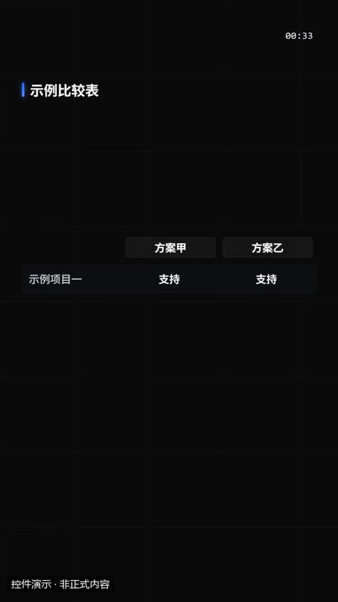](../../docs/template-gallery/demos/motiongit/table.mp4)

- [本地效果演示 1 · 规格见演示](../../docs/template-gallery/demos/motiongit/table.mp4)：官方控件真实渲染；使用中文示例文案或示例数据。6秒静音控件演示；保留模板原生标记与组内时码，角标不是本文件播放计时。低位演示身份标为本目录后处理添加。

**2. 适用内容**

- 2–3 个方案在 2–5 项上逐项比较；单元格写 ✓ / ✗ 或短文字；赢家列高亮

- 正式视频必须绑定真实数据及单位；本演示数字全部为示例。

**3. 所需素材**

- 有来源的数值、标签和单位

**4. 可改参数与限制**

按已核对的字段与限制修改；尚未核对的能力会明确标注。

<details>
<summary>查看参数、限制与来源依据</summary>

- 标题（title）：文字，可选；最多可见字符 18。
- 方案名（cols）：列表，必填；至少项数 2；最多项数 3。
- 比较项（rows）：列表，必填；至少项数 2；最多项数 5。
- 标签（rows[].label）：文字，必填；最短长度 1；最多可见字符 8。
- 各方案的值（与 cols 同序；✓ ✗ 画成图标）（rows[].cells）：列表，必填；至少项数 2；最多项数 3。
- 赢家列序号（1 起；不写时取 ✓ 最多的唯一一列）（win）：integer，可选；最小 1；最大 3。
- 动画变体（variant）：grid / scorecard / checklist。
- 段落时间（t0、t1）与动作提示时间（cues）按剪后的真实讲解设置；主题色由时间轴 theme 配置，不是每个控件任意独立的配色合同。

- 这些范围来自已登记版本的公开参数合同；更换个人包或版本后须重新核对，不自动沿用到所有官网模板。
- 每个控件目前只展示一个代表变体；可选枚举、允许数量和颜色参数不等于所有组合都已实测。
- 导出前仍需校验参数、真实素材、语音时长与排版；不从示例数据推断实际业务结果。

参数依据：[motiongit-controls.json](../../templates/motiongit-controls.json) · [render_motiongit_gallery.py](../../scripts/render_motiongit_gallery.py) · [render_motiongit_gallery_data.py](../../scripts/render_motiongit_gallery_data.py)

</details>

**5. 怎样交给 AI 使用**

<details>
<summary>复制本模板的使用提示词</summary>

```text
请使用 AI Cut 模板目录中的「对比表 / 功能矩阵」（编号 mg-control-table）。
我的内容或原片：[填写]；输出比例：[填写]；需要强调的内容：[填写]。
先核对本条来源、当前状态、素材和参数合同；使用我自己的获授权素材，保留原声原意。
按照本条已支持的参数范围做短预览，确认文字、动作和声音的时间一致，再放入剪辑工程。
若原包、依赖或素材缺失，说明缺什么；遇到费用先告诉我。不要将示例人物或示例数据当成我的内容。
```

</details>

**6. 当前能否使用**

- 已有控件演示 · 需自备授权原包
- 本仓库提供目录与已渲染演示，未附送个人 .motion 原包；学员须使用自己合法取得的对应包。
- 登记基线版本：0.3.0 (package2.7.17-alpha.2)。新输入、新电脑和其他变体须另行验证。

<details>
<summary>查看原始检查范围与接入记录</summary>

- 一个代表变体已由官方 helper 渲染；静音小样完整解码，并已查看实际导出抽帧。其他两个变体仅登记，未渲染；不代表连续观看或用户审美认可。

</details>

**7. 来源与许可**

- MotionGit 个人授权模板包，以原包授权为准；仅包含自有素材及明确示例数据的渲染演示，不分发受保护代码。

[原始来源](https://motiongit.com/@adunext/template-01-integrated-portrait)

---

<a id="mg-control-ranking"></a>

### 排行榜

`mg-control-ranking` · 数据与对比 · 数据与进度 · **已有控件演示 · 需自备授权原包**

3–6 项按数值排名：榜单、名次、Top N；自动按 value 从大到小排序

**1. 效果预览**

[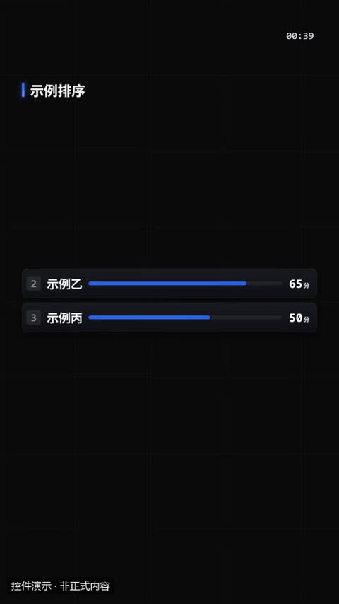](../../docs/template-gallery/demos/motiongit/ranking.mp4)

- [本地效果演示 1 · 规格见演示](../../docs/template-gallery/demos/motiongit/ranking.mp4)：官方控件真实渲染；使用中文示例文案或示例数据。6秒静音控件演示；保留模板原生标记与组内时码，角标不是本文件播放计时。低位演示身份标为本目录后处理添加。

**2. 适用内容**

- 3–6 项按数值排名：榜单、名次、Top N；自动按 value 从大到小排序

- 正式视频必须绑定真实数据及单位；本演示数字全部为示例。

**3. 所需素材**

- 有来源的数值、标签和单位

**4. 可改参数与限制**

按已核对的字段与限制修改；尚未核对的能力会明确标注。

<details>
<summary>查看参数、限制与来源依据</summary>

- 标题（title）：文字，可选；最多可见字符 18。
- 数值单位（unit）：文字，可选；最多可见字符 4。
- 参与项（顺序任意）（items）：列表，必填；至少项数 3；最多项数 6。
- 标签（items[].label）：文字，必填；最短长度 1；最多可见字符 8。
- value（items[].value）：数字，必填；最小 0；最大 99999999。
- 动画变体（variant）：race / podium / list。
- 段落时间（t0、t1）与动作提示时间（cues）按剪后的真实讲解设置；主题色由时间轴 theme 配置，不是每个控件任意独立的配色合同。

- 这些范围来自已登记版本的公开参数合同；更换个人包或版本后须重新核对，不自动沿用到所有官网模板。
- 每个控件目前只展示一个代表变体；可选枚举、允许数量和颜色参数不等于所有组合都已实测。
- 导出前仍需校验参数、真实素材、语音时长与排版；不从示例数据推断实际业务结果。

参数依据：[motiongit-controls.json](../../templates/motiongit-controls.json) · [render_motiongit_gallery.py](../../scripts/render_motiongit_gallery.py) · [render_motiongit_gallery_data.py](../../scripts/render_motiongit_gallery_data.py)

</details>

**5. 怎样交给 AI 使用**

<details>
<summary>复制本模板的使用提示词</summary>

```text
请使用 AI Cut 模板目录中的「排行榜」（编号 mg-control-ranking）。
我的内容或原片：[填写]；输出比例：[填写]；需要强调的内容：[填写]。
先核对本条来源、当前状态、素材和参数合同；使用我自己的获授权素材，保留原声原意。
按照本条已支持的参数范围做短预览，确认文字、动作和声音的时间一致，再放入剪辑工程。
若原包、依赖或素材缺失，说明缺什么；遇到费用先告诉我。不要将示例人物或示例数据当成我的内容。
```

</details>

**6. 当前能否使用**

- 已有控件演示 · 需自备授权原包
- 本仓库提供目录与已渲染演示，未附送个人 .motion 原包；学员须使用自己合法取得的对应包。
- 登记基线版本：0.3.0 (package2.7.17-alpha.2)。新输入、新电脑和其他变体须另行验证。

<details>
<summary>查看原始检查范围与接入记录</summary>

- 一个代表变体已由官方 helper 渲染；静音小样完整解码，并已查看实际导出抽帧。其他两个变体仅登记，未渲染；不代表连续观看或用户审美认可。

</details>

**7. 来源与许可**

- MotionGit 个人授权模板包，以原包授权为准；仅包含自有素材及明确示例数据的渲染演示，不分发受保护代码。

[原始来源](https://motiongit.com/@adunext/template-01-integrated-portrait)

---

<a id="mg-control-beforeafter"></a>

### 前后对比

`mg-control-beforeafter` · 数据与对比 · 真实素材展示 · **已有控件演示 · 需自备授权原包**

同一对象改造前后、修图前后、旧版新版：两张素材对照，第二个 cue 揭示 after

**1. 效果预览**

[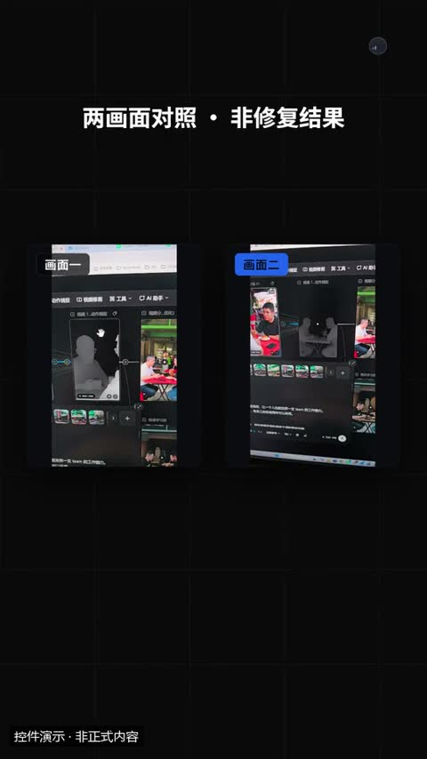](../../docs/template-gallery/demos/motiongit/beforeafter.mp4)

- [本地效果演示 1 · 规格见演示](../../docs/template-gallery/demos/motiongit/beforeafter.mp4)：官方控件真实渲染；使用本人授权素材。6秒静音控件演示；保留模板原生标记与组内时码，角标不是本文件播放计时。低位演示身份标为本目录后处理添加。

**2. 适用内容**

- 同一对象改造前后、修图前后、旧版新版：两张素材对照，第二个 cue 揭示 after

- 必须使用有权使用的真实素材；对照动画不能冒充真实修复结果。

**3. 所需素材**

- 本人视频帧、照片、产品图或真实截图
- 需要强调的区域

**4. 可改参数与限制**

按已核对的字段与限制修改；尚未核对的能力会明确标注。

<details>
<summary>查看参数、限制与来源依据</summary>

- 标题（title）：文字，可选；最多可见字符 20。
- 之前（图片或视频）（before）：文字，可选。
- 之后（图片或视频）（after）：文字，可选。
- 之前标签（默认「之前」）（beforeLabel）：文字，可选；最多可见字符 8。
- 之后标签（默认「之后」）（afterLabel）：文字，可选；最多可见字符 8。
- sourceStart（sourceStart）：数字，可选；最小 0。
- 动画变体（variant）：slider / flip / split。
- 段落时间（t0、t1）与动作提示时间（cues）按剪后的真实讲解设置；主题色由时间轴 theme 配置，不是每个控件任意独立的配色合同。

- 这些范围来自已登记版本的公开参数合同；更换个人包或版本后须重新核对，不自动沿用到所有官网模板。
- 每个控件目前只展示一个代表变体；可选枚举、允许数量和颜色参数不等于所有组合都已实测。
- 导出前仍需校验参数、真实素材、语音时长与排版；不从示例数据推断实际业务结果。

参数依据：[motiongit-controls.json](../../templates/motiongit-controls.json) · [render_motiongit_gallery.py](../../scripts/render_motiongit_gallery.py) · [render_motiongit_gallery_data.py](../../scripts/render_motiongit_gallery_data.py)

</details>

**5. 怎样交给 AI 使用**

<details>
<summary>复制本模板的使用提示词</summary>

```text
请使用 AI Cut 模板目录中的「前后对比」（编号 mg-control-beforeafter）。
我的内容或原片：[填写]；输出比例：[填写]；需要强调的内容：[填写]。
先核对本条来源、当前状态、素材和参数合同；使用我自己的获授权素材，保留原声原意。
按照本条已支持的参数范围做短预览，确认文字、动作和声音的时间一致，再放入剪辑工程。
若原包、依赖或素材缺失，说明缺什么；遇到费用先告诉我。不要将示例人物或示例数据当成我的内容。
```

</details>

**6. 当前能否使用**

- 已有控件演示 · 需自备授权原包
- 本仓库提供目录与已渲染演示，未附送个人 .motion 原包；学员须使用自己合法取得的对应包。
- 登记基线版本：0.3.0 (package2.7.17-alpha.2)。新输入、新电脑和其他变体须另行验证。

<details>
<summary>查看原始检查范围与接入记录</summary>

- 一个代表变体已由官方 helper 渲染；静音小样完整解码，并已查看实际导出抽帧。其他两个变体仅登记，未渲染；不代表连续观看或用户审美认可。

</details>

**7. 来源与许可**

- MotionGit 个人授权模板包，以原包授权为准；仅包含自有素材及明确示例数据的渲染演示，不分发受保护代码。

[原始来源](https://motiongit.com/@adunext/template-01-integrated-portrait)

---

<a id="remotion-bar-chart-anim"></a>

### 长条图成长

`remotion-bar-chart-anim` · 数据与对比 · 数据与图表 · **代码已入库 · 准备环境后适配**

柱状图按数值依次增长

**1. 效果预览**

[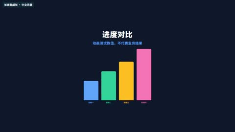](../../docs/template-gallery/demos/remotion/bar-chart-anim.mp4)

- [本地效果演示 1 · 16:9](../../docs/template-gallery/demos/remotion/bar-chart-anim.mp4)：原注册动画的中文参数演示；静音；示例文字与数值不是实际业务结果

**2. 适用内容**

- 有来源的数据比较
- 步骤进度与指标解释

- 示意数据不能当成真实业绩或改善结果
- 无可靠数据时不用图表暗示结论

**3. 所需素材**

- 中文文案与颜色参数
- 按本条素材确认的时间长度
- 对应画幅的安全区检查

**4. 可改参数与限制**

按已核对的字段与限制修改；尚未核对的能力会明确标注。

<details>
<summary>查看参数、限制与来源依据</summary>

- 标题（title）：文字，有默认值或须提供。
- 副标题（subtitle）：文字，可省略。
- 柱条数据（bars）：BarItem[]，有默认值或须提供。
- 背景（background）：文字，有默认值或须提供。
- 标题色（titleColor）：文字，有默认值或须提供。
- 强调色（accentColor）：文字，有默认值或须提供。
- 标签（bars[].label）：文字，有默认值或须提供。
- value（bars[].value）：数字，有默认值或须提供。
- 颜色（bars[].color）：文字，可省略。

- 以上是源码实际暴露的输入，不代表文字长度、列表数量和所有参数组合已完成测试；换内容后须检查排版与完整动画。
- 当前目录演示画幅为 16:9；尺寸与总帧数由 Composition 注册项控制，不能把效果内部 duration 等输入当作自动更改导出长度。

参数依据：[BarChartAnim.tsx](../../extensions/remotion-vd44/src/vendor/rendercomp/components/bar-chart-anim/BarChartAnim.tsx) · [Root.tsx](../../extensions/remotion-vd44/src/vendor/rendercomp/Root.tsx)

</details>

**5. 怎样交给 AI 使用**

<details>
<summary>复制本模板的使用提示词</summary>

```text
请使用 AI Cut 模板目录中的「长条图成长」（编号 remotion-bar-chart-anim）。
我的内容或原片：[填写]；输出比例：[填写]；需要强调的内容：[填写]。
先核对本条来源、当前状态、素材和参数合同；使用我自己的获授权素材，保留原声原意。
按照本条已支持的参数范围做短预览，确认文字、动作和声音的时间一致，再放入剪辑工程。
若原包、依赖或素材缺失，说明缺什么；遇到费用先告诉我。不要将示例人物或示例数据当成我的内容。
```

</details>

**6. 当前能否使用**

- 代码已入库 · 准备环境后适配
- 本仓库包含相应代码；需准备 Remotion 运行环境及本条素材，参数修改后重新预览检查。
- 登记基线版本：f648980e528defb7594e24c6447055f0540f340b+zh-gallery.1。新输入、新电脑和其他变体须另行验证。

<details>
<summary>查看原始检查范围与接入记录</summary>

- 55项真实Remotion渲染；每项完整解码、帧数、比例、静音及2 MB限额通过；实际查看每项18%/52%/82%编码帧联系表。不是逐帧连续观看，不代表其他画幅、真人合成、用户审美认可或最终视频QA。

</details>

**7. 来源与许可**

- MIT（模板源码）；Remotion 运行时与字体许可分别适用

[原始来源](https://github.com/RenderComp/free-remotion-templates/tree/f648980e528defb7594e24c6447055f0540f340b)

---

<a id="remotion-line-chart-anim"></a>

### 折线图绘制

`remotion-line-chart-anim` · 数据与对比 · 数据与图表 · **代码已入库 · 准备环境后适配**

折线沿横轴逐步绘出

**1. 效果预览**

[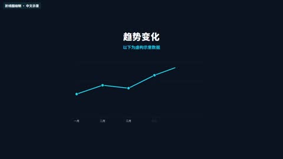](../../docs/template-gallery/demos/remotion/line-chart-anim.mp4)

- [本地效果演示 1 · 16:9](../../docs/template-gallery/demos/remotion/line-chart-anim.mp4)：原注册动画的中文参数演示；静音；示例文字与数值不是实际业务结果

**2. 适用内容**

- 有来源的数据比较
- 步骤进度与指标解释

- 示意数据不能当成真实业绩或改善结果
- 无可靠数据时不用图表暗示结论

**3. 所需素材**

- 中文文案与颜色参数
- 按本条素材确认的时间长度
- 对应画幅的安全区检查

**4. 可改参数与限制**

按已核对的字段与限制修改；尚未核对的能力会明确标注。

<details>
<summary>查看参数、限制与来源依据</summary>

- 标题（title）：文字，有默认值或须提供。
- 副标题（subtitle）：文字，可省略。
- 折线数据点（points）：LinePoint[]，有默认值或须提供。
- 背景（background）：文字，有默认值或须提供。
- 标题色（titleColor）：文字，有默认值或须提供。
- 线条颜色（lineColor）：文字，有默认值或须提供。
- 网格颜色（gridColor）：文字，有默认值或须提供。
- 标签（points[].label）：文字，有默认值或须提供。
- value（points[].value）：数字，有默认值或须提供。

- 以上是源码实际暴露的输入，不代表文字长度、列表数量和所有参数组合已完成测试；换内容后须检查排版与完整动画。
- 当前目录演示画幅为 16:9；尺寸与总帧数由 Composition 注册项控制，不能把效果内部 duration 等输入当作自动更改导出长度。

参数依据：[LineChartAnim.tsx](../../extensions/remotion-vd44/src/vendor/rendercomp/components/line-chart-anim/LineChartAnim.tsx) · [Root.tsx](../../extensions/remotion-vd44/src/vendor/rendercomp/Root.tsx)

</details>

**5. 怎样交给 AI 使用**

<details>
<summary>复制本模板的使用提示词</summary>

```text
请使用 AI Cut 模板目录中的「折线图绘制」（编号 remotion-line-chart-anim）。
我的内容或原片：[填写]；输出比例：[填写]；需要强调的内容：[填写]。
先核对本条来源、当前状态、素材和参数合同；使用我自己的获授权素材，保留原声原意。
按照本条已支持的参数范围做短预览，确认文字、动作和声音的时间一致，再放入剪辑工程。
若原包、依赖或素材缺失，说明缺什么；遇到费用先告诉我。不要将示例人物或示例数据当成我的内容。
```

</details>

**6. 当前能否使用**

- 代码已入库 · 准备环境后适配
- 本仓库包含相应代码；需准备 Remotion 运行环境及本条素材，参数修改后重新预览检查。
- 登记基线版本：f648980e528defb7594e24c6447055f0540f340b+zh-gallery.1。新输入、新电脑和其他变体须另行验证。

<details>
<summary>查看原始检查范围与接入记录</summary>

- 55项真实Remotion渲染；每项完整解码、帧数、比例、静音及2 MB限额通过；实际查看每项18%/52%/82%编码帧联系表。不是逐帧连续观看，不代表其他画幅、真人合成、用户审美认可或最终视频QA。

</details>

**7. 来源与许可**

- MIT（模板源码）；Remotion 运行时与字体许可分别适用

[原始来源](https://github.com/RenderComp/free-remotion-templates/tree/f648980e528defb7594e24c6447055f0540f340b)

---

<a id="remotion-pourover-drip-fill-gauge"></a>

### 滴入式填充计量

`remotion-pourover-drip-fill-gauge` · 数据与对比 · 数据与图表 · **代码已入库 · 准备环境后适配**

滴落式动画填满目标比例；中文演示层使用 NotoSansSC 补字，保留原动画时序；原版像素字库只覆盖英文。

**1. 效果预览**

[](../../docs/template-gallery/demos/remotion/pourover-drip-fill-gauge.mp4)

- [本地效果演示 1 · 16:9](../../docs/template-gallery/demos/remotion/pourover-drip-fill-gauge.mp4)：原注册动画的中文参数演示；静音；示例文字与数值不是实际业务结果

**2. 适用内容**

- 有来源的数据比较
- 步骤进度与指标解释

- 示意数据不能当成真实业绩或改善结果
- 无可靠数据时不用图表暗示结论

**3. 所需素材**

- 中文文案与颜色参数
- 按本条素材确认的时间长度
- 对应画幅的安全区检查

**4. 可改参数与限制**

按已核对的字段与限制修改；尚未核对的能力会明确标注。

<details>
<summary>查看参数、限制与来源依据</summary>

- 色阶Bg（toneBg）：文字，有默认值或须提供。
- 色阶Dark（toneDark）：文字，有默认值或须提供。
- 色阶Mid（toneMid）：文字，有默认值或须提供。
- 色阶Light（toneLight）：文字，有默认值或须提供。
- 填充速度（fillSpeed）：数字，有默认值或须提供。
- 水滴开关（showDrips）：开关，有默认值或须提供。
- 真实节拍事件（beats）：BeatEvent[]，可省略。
- 波形幅度列表（waveform）：数字列表，可省略。

- 以上是源码实际暴露的输入，不代表文字长度、列表数量和所有参数组合已完成测试；换内容后须检查排版与完整动画。
- 当前目录演示画幅为 16:9；尺寸与总帧数由 Composition 注册项控制，不能把效果内部 duration 等输入当作自动更改导出长度。

参数依据：[PouroverDripFillGauge.tsx](../../extensions/remotion-vd44/src/vendor/rendercomp/components/pourover-drip-fill-gauge/PouroverDripFillGauge.tsx) · [Root.tsx](../../extensions/remotion-vd44/src/vendor/rendercomp/Root.tsx)

</details>

**5. 怎样交给 AI 使用**

<details>
<summary>复制本模板的使用提示词</summary>

```text
请使用 AI Cut 模板目录中的「滴入式填充计量」（编号 remotion-pourover-drip-fill-gauge）。
我的内容或原片：[填写]；输出比例：[填写]；需要强调的内容：[填写]。
先核对本条来源、当前状态、素材和参数合同；使用我自己的获授权素材，保留原声原意。
按照本条已支持的参数范围做短预览，确认文字、动作和声音的时间一致，再放入剪辑工程。
若原包、依赖或素材缺失，说明缺什么；遇到费用先告诉我。不要将示例人物或示例数据当成我的内容。
```

</details>

**6. 当前能否使用**

- 代码已入库 · 准备环境后适配
- 本仓库包含相应代码；需准备 Remotion 运行环境及本条素材，参数修改后重新预览检查。
- 登记基线版本：f648980e528defb7594e24c6447055f0540f340b+zh-gallery.1。新输入、新电脑和其他变体须另行验证。

<details>
<summary>查看原始检查范围与接入记录</summary>

- 55项真实Remotion渲染；每项完整解码、帧数、比例、静音及2 MB限额通过；实际查看每项18%/52%/82%编码帧联系表。不是逐帧连续观看，不代表其他画幅、真人合成、用户审美认可或最终视频QA。

</details>

**7. 来源与许可**

- MIT（模板源码）；Remotion 运行时与字体许可分别适用

[原始来源](https://github.com/RenderComp/free-remotion-templates/tree/f648980e528defb7594e24c6447055f0540f340b)

---

<a id="remotion-kpi-counter"></a>

### 数字计数器

`remotion-kpi-counter` · 数据与对比 · 数据与图表 · **代码已入库 · 准备环境后适配**

数字递增到目标值

**1. 效果预览**

[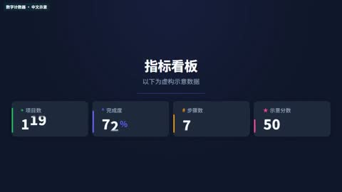](../../docs/template-gallery/demos/remotion/kpi-counter.mp4)

- [本地效果演示 1 · 16:9](../../docs/template-gallery/demos/remotion/kpi-counter.mp4)：原注册动画的中文参数演示；静音；示例文字与数值不是实际业务结果

**2. 适用内容**

- 有来源的数据比较
- 步骤进度与指标解释

- 示意数据不能当成真实业绩或改善结果
- 无可靠数据时不用图表暗示结论

**3. 所需素材**

- 中文文案与颜色参数
- 按本条素材确认的时间长度
- 对应画幅的安全区检查

**4. 可改参数与限制**

按已核对的字段与限制修改；尚未核对的能力会明确标注。

<details>
<summary>查看参数、限制与来源依据</summary>

- 背景色（backgroundColor）：文字，有默认值或须提供。
- card颜色（cardColor）：文字，有默认值或须提供。
- 文字色（textColor）：文字，有默认值或须提供。
- subtext颜色（subtextColor）：文字，有默认值或须提供。
- 强调色（accentColor）：文字，有默认值或须提供。
- 标题（title）：文字，有默认值或须提供。
- 副标题（subtitle）：文字，有默认值或须提供。
- 指标列表（metrics）：KpiMetric[]，有默认值或须提供。
- 标签（metrics[].label）：文字，有默认值或须提供。
- value（metrics[].value）：数字，有默认值或须提供。
- prefix（metrics[].prefix）：文字，有默认值或须提供。
- suffix（metrics[].suffix）：文字，有默认值或须提供。
- decimals（metrics[].decimals）：数字，有默认值或须提供。
- 颜色（metrics[].color）：文字，有默认值或须提供。
- icon（metrics[].icon）：文字，有默认值或须提供。

- 以上是源码实际暴露的输入，不代表文字长度、列表数量和所有参数组合已完成测试；换内容后须检查排版与完整动画。
- 当前目录演示画幅为 16:9；尺寸与总帧数由 Composition 注册项控制，不能把效果内部 duration 等输入当作自动更改导出长度。

参数依据：[KpiCounter.tsx](../../extensions/remotion-vd44/src/vendor/rendercomp/components/kpi-counter/KpiCounter.tsx) · [Root.tsx](../../extensions/remotion-vd44/src/vendor/rendercomp/Root.tsx)

</details>

**5. 怎样交给 AI 使用**

<details>
<summary>复制本模板的使用提示词</summary>

```text
请使用 AI Cut 模板目录中的「数字计数器」（编号 remotion-kpi-counter）。
我的内容或原片：[填写]；输出比例：[填写]；需要强调的内容：[填写]。
先核对本条来源、当前状态、素材和参数合同；使用我自己的获授权素材，保留原声原意。
按照本条已支持的参数范围做短预览，确认文字、动作和声音的时间一致，再放入剪辑工程。
若原包、依赖或素材缺失，说明缺什么；遇到费用先告诉我。不要将示例人物或示例数据当成我的内容。
```

</details>

**6. 当前能否使用**

- 代码已入库 · 准备环境后适配
- 本仓库包含相应代码；需准备 Remotion 运行环境及本条素材，参数修改后重新预览检查。
- 登记基线版本：f648980e528defb7594e24c6447055f0540f340b+zh-gallery.1。新输入、新电脑和其他变体须另行验证。

<details>
<summary>查看原始检查范围与接入记录</summary>

- 55项真实Remotion渲染；每项完整解码、帧数、比例、静音及2 MB限额通过；实际查看每项18%/52%/82%编码帧联系表。不是逐帧连续观看，不代表其他画幅、真人合成、用户审美认可或最终视频QA。

</details>

**7. 来源与许可**

- MIT（模板源码）；Remotion 运行时与字体许可分别适用

[原始来源](https://github.com/RenderComp/free-remotion-templates/tree/f648980e528defb7594e24c6447055f0540f340b)

---

<a id="remotion-pixel-candlestick-ohlc"></a>

### 像素蜡烛图

`remotion-pixel-candlestick-ohlc` · 数据与对比 · 数据与图表 · **代码已入库 · 准备环境后适配**

像素风格OHLC数据演示；中文演示层使用 NotoSansSC 补字，保留原动画时序；原版像素字库只覆盖英文。

**1. 效果预览**

[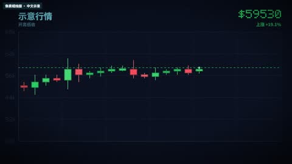](../../docs/template-gallery/demos/remotion/pixel-candlestick-ohlc.mp4)

- [本地效果演示 1 · 16:9](../../docs/template-gallery/demos/remotion/pixel-candlestick-ohlc.mp4)：原注册动画的中文参数演示；静音；示例文字与数值不是实际业务结果

**2. 适用内容**

- 有来源的数据比较
- 步骤进度与指标解释

- 示意数据不能当成真实业绩或改善结果
- 无可靠数据时不用图表暗示结论

**3. 所需素材**

- 中文文案与颜色参数
- 按本条素材确认的时间长度
- 对应画幅的安全区检查

**4. 可改参数与限制**

按已核对的字段与限制修改；尚未核对的能力会明确标注。

<details>
<summary>查看参数、限制与来源依据</summary>

- 背景色（backgroundColor）：文字，有默认值或须提供。
- 网格颜色（gridColor）：文字，有默认值或须提供。
- bull颜色（bullColor）：文字，有默认值或须提供。
- bear颜色（bearColor）：文字，有默认值或须提供。
- 强调色（accentColor）：文字，有默认值或须提供。
- K线数量（candleCount）：数字，有默认值或须提供。
- 示意波动量（volatility）：数字，有默认值或须提供。
- 循环速度（cycleSpeed）：数字，有默认值或须提供。
- 标的标签（ticker）：文字，有默认值或须提供。

- 以上是源码实际暴露的输入，不代表文字长度、列表数量和所有参数组合已完成测试；换内容后须检查排版与完整动画。
- 当前目录演示画幅为 16:9；尺寸与总帧数由 Composition 注册项控制，不能把效果内部 duration 等输入当作自动更改导出长度。
- 此实现使用确定性的示意行情；ticker 与 volatility 可改不代表已经接入真实证券价格。

参数依据：[PixelCandlestickOhlc.tsx](../../extensions/remotion-vd44/src/vendor/rendercomp/components/pixel-candlestick-ohlc/PixelCandlestickOhlc.tsx) · [Root.tsx](../../extensions/remotion-vd44/src/vendor/rendercomp/Root.tsx)

</details>

**5. 怎样交给 AI 使用**

<details>
<summary>复制本模板的使用提示词</summary>

```text
请使用 AI Cut 模板目录中的「像素蜡烛图」（编号 remotion-pixel-candlestick-ohlc）。
我的内容或原片：[填写]；输出比例：[填写]；需要强调的内容：[填写]。
先核对本条来源、当前状态、素材和参数合同；使用我自己的获授权素材，保留原声原意。
按照本条已支持的参数范围做短预览，确认文字、动作和声音的时间一致，再放入剪辑工程。
若原包、依赖或素材缺失，说明缺什么；遇到费用先告诉我。不要将示例人物或示例数据当成我的内容。
```

</details>

**6. 当前能否使用**

- 代码已入库 · 准备环境后适配
- 本仓库包含相应代码；需准备 Remotion 运行环境及本条素材，参数修改后重新预览检查。
- 登记基线版本：f648980e528defb7594e24c6447055f0540f340b+zh-gallery.1。新输入、新电脑和其他变体须另行验证。

<details>
<summary>查看原始检查范围与接入记录</summary>

- 55项真实Remotion渲染；每项完整解码、帧数、比例、静音及2 MB限额通过；实际查看每项18%/52%/82%编码帧联系表。不是逐帧连续观看，不代表其他画幅、真人合成、用户审美认可或最终视频QA。

</details>

**7. 来源与许可**

- MIT（模板源码）；Remotion 运行时与字体许可分别适用

[原始来源](https://github.com/RenderComp/free-remotion-templates/tree/f648980e528defb7594e24c6447055f0540f340b)

---

<a id="remotion-racing-chart"></a>

### 排名竞速长条图

`remotion-racing-chart` · 数据与对比 · 数据与图表 · **代码已入库 · 准备环境后适配**

长条随数据变化交换排名

**1. 效果预览**

[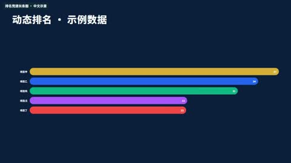](../../docs/template-gallery/demos/remotion/racing-chart.mp4)

- [本地效果演示 1 · 16:9](../../docs/template-gallery/demos/remotion/racing-chart.mp4)：原注册动画的中文参数演示；静音；示例文字与数值不是实际业务结果

**2. 适用内容**

- 有来源的数据比较
- 步骤进度与指标解释

- 示意数据不能当成真实业绩或改善结果
- 无可靠数据时不用图表暗示结论

**3. 所需素材**

- 中文文案与颜色参数
- 按本条素材确认的时间长度
- 对应画幅的安全区检查

**4. 可改参数与限制**

按已核对的字段与限制修改；尚未核对的能力会明确标注。

<details>
<summary>查看参数、限制与来源依据</summary>

- 数据序列（data）：RacingChartDatum[]，有默认值或须提供。
- 步骤过渡帧数（frames）：数字，有默认值或须提供。
- 标题（title）：文字，有默认值或须提供。
- 背景（background）：文字，可省略。
- 标题色（titleColor）：文字，可省略。
- 标签（data[].label）：文字，有默认值或须提供。
- values（data[].values）：数字列表，有默认值或须提供。
- 颜色（data[].color）：文字，有默认值或须提供。

- 以上是源码实际暴露的输入，不代表文字长度、列表数量和所有参数组合已完成测试；换内容后须检查排版与完整动画。
- 当前目录演示画幅为 16:9；尺寸与总帧数由 Composition 注册项控制，不能把效果内部 duration 等输入当作自动更改导出长度。

参数依据：[RacingChart.tsx](../../extensions/remotion-vd44/src/vendor/rendercomp/components/racing-chart/RacingChart.tsx) · [Root.tsx](../../extensions/remotion-vd44/src/vendor/rendercomp/Root.tsx)

</details>

**5. 怎样交给 AI 使用**

<details>
<summary>复制本模板的使用提示词</summary>

```text
请使用 AI Cut 模板目录中的「排名竞速长条图」（编号 remotion-racing-chart）。
我的内容或原片：[填写]；输出比例：[填写]；需要强调的内容：[填写]。
先核对本条来源、当前状态、素材和参数合同；使用我自己的获授权素材，保留原声原意。
按照本条已支持的参数范围做短预览，确认文字、动作和声音的时间一致，再放入剪辑工程。
若原包、依赖或素材缺失，说明缺什么；遇到费用先告诉我。不要将示例人物或示例数据当成我的内容。
```

</details>

**6. 当前能否使用**

- 代码已入库 · 准备环境后适配
- 本仓库包含相应代码；需准备 Remotion 运行环境及本条素材，参数修改后重新预览检查。
- 登记基线版本：f648980e528defb7594e24c6447055f0540f340b+zh-gallery.1。新输入、新电脑和其他变体须另行验证。

<details>
<summary>查看原始检查范围与接入记录</summary>

- 55项真实Remotion渲染；每项完整解码、帧数、比例、静音及2 MB限额通过；实际查看每项18%/52%/82%编码帧联系表。不是逐帧连续观看，不代表其他画幅、真人合成、用户审美认可或最终视频QA。

</details>

**7. 来源与许可**

- MIT（模板源码）；Remotion 运行时与字体许可分别适用

[原始来源](https://github.com/RenderComp/free-remotion-templates/tree/f648980e528defb7594e24c6447055f0540f340b)

---

<a id="remotion-split-screen"></a>

### 分屏布局

`remotion-split-screen` · 数据与对比 · 社交与界面 · **代码已入库 · 准备环境后适配**

两个画面区域进入并排布局

**1. 效果预览**

[](../../docs/template-gallery/demos/remotion/split-screen.mp4)

- [本地效果演示 1 · 16:9](../../docs/template-gallery/demos/remotion/split-screen.mp4)：原注册动画的中文参数演示；静音；示例文字与数值不是实际业务结果

**2. 适用内容**

- 人物介绍与界面示意
- 对比、对话或行动提示

- 虚构对话与界面不能当成客户见证
- 未接入真人的图形人物不得冒充用户

**3. 所需素材**

- 中文文案与颜色参数
- 按本条素材确认的时间长度
- 对应画幅的安全区检查

**4. 可改参数与限制**

按已核对的字段与限制修改；尚未核对的能力会明确标注。

<details>
<summary>查看参数、限制与来源依据</summary>

- 方向（direction）："horizontal" | "vertical"，有默认值或须提供。
- 第一面板（panelA）：SplitScreenPanel，有默认值或须提供。
- 第二面板（panelB）：SplitScreenPanel，有默认值或须提供。
- 分隔线颜色（dividerColor）：文字，有默认值或须提供。
- 分隔线宽度（dividerWidth）：数字，有默认值或须提供。
- 转场底色（backdropColor）：文字，可省略。
- heading（panelA.heading）：文字，有默认值或须提供。
- sub（panelA.sub）：文字，可省略。
- bg（panelA.bg）：文字，有默认值或须提供。
- 文字色（panelA.textColor）：文字，有默认值或须提供。
- heading（panelB.heading）：文字，有默认值或须提供。
- sub（panelB.sub）：文字，可省略。
- bg（panelB.bg）：文字，有默认值或须提供。
- 文字色（panelB.textColor）：文字，有默认值或须提供。

- 以上是源码实际暴露的输入，不代表文字长度、列表数量和所有参数组合已完成测试；换内容后须检查排版与完整动画。
- 当前目录演示画幅为 16:9；尺寸与总帧数由 Composition 注册项控制，不能把效果内部 duration 等输入当作自动更改导出长度。

参数依据：[SplitScreen.tsx](../../extensions/remotion-vd44/src/vendor/rendercomp/components/split-screen/SplitScreen.tsx) · [Root.tsx](../../extensions/remotion-vd44/src/vendor/rendercomp/Root.tsx)

</details>

**5. 怎样交给 AI 使用**

<details>
<summary>复制本模板的使用提示词</summary>

```text
请使用 AI Cut 模板目录中的「分屏布局」（编号 remotion-split-screen）。
我的内容或原片：[填写]；输出比例：[填写]；需要强调的内容：[填写]。
先核对本条来源、当前状态、素材和参数合同；使用我自己的获授权素材，保留原声原意。
按照本条已支持的参数范围做短预览，确认文字、动作和声音的时间一致，再放入剪辑工程。
若原包、依赖或素材缺失，说明缺什么；遇到费用先告诉我。不要将示例人物或示例数据当成我的内容。
```

</details>

**6. 当前能否使用**

- 代码已入库 · 准备环境后适配
- 本仓库包含相应代码；需准备 Remotion 运行环境及本条素材，参数修改后重新预览检查。
- 登记基线版本：f648980e528defb7594e24c6447055f0540f340b+zh-gallery.1。新输入、新电脑和其他变体须另行验证。

<details>
<summary>查看原始检查范围与接入记录</summary>

- 55项真实Remotion渲染；每项完整解码、帧数、比例、静音及2 MB限额通过；实际查看每项18%/52%/82%编码帧联系表。不是逐帧连续观看，不代表其他画幅、真人合成、用户审美认可或最终视频QA。

</details>

**7. 来源与许可**

- MIT（模板源码）；Remotion 运行时与字体许可分别适用

[原始来源](https://github.com/RenderComp/free-remotion-templates/tree/f648980e528defb7594e24c6447055f0540f340b)

---

<a id="remotion-library-bar-zh"></a>

### 中文长条成长示例

`remotion-library-bar-zh` · 数据与对比 · 中文示例 · **代码已入库 · 准备环境后适配**

柱状图按数值依次增长；已有基础模板的中文参数示例，不新增模板家族。

**1. 效果预览**

[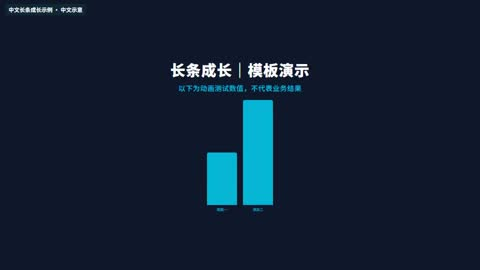](../../docs/template-gallery/demos/remotion/library-bar-zh.mp4)

- [本地效果演示 1 · 16:9](../../docs/template-gallery/demos/remotion/library-bar-zh.mp4)：原注册动画的中文参数演示；静音；示例文字与数值不是实际业务结果

**2. 适用内容**

- 可参数化的图形动画
- 按表达任务选择局部使用

- 真实素材合成与其他比例须另测
- 不声称演示等同于本条成片验收

**3. 所需素材**

- 中文文案与颜色参数
- 按本条素材确认的时间长度
- 对应画幅的安全区检查

**4. 可改参数与限制**

按已核对的字段与限制修改；尚未核对的能力会明确标注。

<details>
<summary>查看参数、限制与来源依据</summary>

- 标题（title）：文字，有默认值或须提供。
- 副标题（subtitle）：文字，可省略。
- 柱条数据（bars）：BarItem[]，有默认值或须提供。
- 背景（background）：文字，有默认值或须提供。
- 标题色（titleColor）：文字，有默认值或须提供。
- 强调色（accentColor）：文字，有默认值或须提供。
- 标签（bars[].label）：文字，有默认值或须提供。
- value（bars[].value）：数字，有默认值或须提供。
- 颜色（bars[].color）：文字，可省略。

- 以上是源码实际暴露的输入，不代表文字长度、列表数量和所有参数组合已完成测试；换内容后须检查排版与完整动画。
- 当前目录演示画幅为 16:9；尺寸与总帧数由 Composition 注册项控制，不能把效果内部 duration 等输入当作自动更改导出长度。

参数依据：[BarChartAnim.tsx](../../extensions/remotion-vd44/src/vendor/rendercomp/components/bar-chart-anim/BarChartAnim.tsx) · [LibraryRoot.tsx](../../extensions/remotion-vd44/src/template-library/LibraryRoot.tsx)

</details>

**5. 怎样交给 AI 使用**

<details>
<summary>复制本模板的使用提示词</summary>

```text
请使用 AI Cut 模板目录中的「中文长条成长示例」（编号 remotion-library-bar-zh）。
我的内容或原片：[填写]；输出比例：[填写]；需要强调的内容：[填写]。
先核对本条来源、当前状态、素材和参数合同；使用我自己的获授权素材，保留原声原意。
按照本条已支持的参数范围做短预览，确认文字、动作和声音的时间一致，再放入剪辑工程。
若原包、依赖或素材缺失，说明缺什么；遇到费用先告诉我。不要将示例人物或示例数据当成我的内容。
```

</details>

**6. 当前能否使用**

- 代码已入库 · 准备环境后适配
- 本仓库包含相应代码；需准备 Remotion 运行环境及本条素材，参数修改后重新预览检查。
- 登记基线版本：f648980e528defb7594e24c6447055f0540f340b+zh-gallery.1。新输入、新电脑和其他变体须另行验证。

<details>
<summary>查看原始检查范围与接入记录</summary>

- 55项真实Remotion渲染；每项完整解码、帧数、比例、静音及2 MB限额通过；实际查看每项18%/52%/82%编码帧联系表。不是逐帧连续观看，不代表其他画幅、真人合成、用户审美认可或最终视频QA。

</details>

**7. 来源与许可**

- MIT（模板源码）；Remotion 运行时与字体许可分别适用

[原始来源](https://github.com/RenderComp/free-remotion-templates/tree/f648980e528defb7594e24c6447055f0540f340b)

---

<a id="presenter-effect-01"></a>

### 条形增长

`presenter-effect-01` · 数据与对比 · 数据与图表 · **样片效果 · 需要源码适配**

三条横向示意条按顺序增长，叠在口播画面上。

**1. 效果预览**

[](../../docs/template-gallery/demos/presenter/presenter-effect-01.mp4)

- [本人案例 1 · 9:16](../../docs/template-gallery/demos/presenter/presenter-effect-01.mp4)：本人素材中文无声演示，来自已渲染母版的对应效果片段。

**2. 适用内容**

- 比较选项或说明阶段进展

- 示意长度不能当作真实业绩数据

**3. 所需素材**

- 口播视频
- 真实标签与数值

**4. 可改参数与限制**

按已核对的字段与限制修改；尚未核对的能力会明确标注。

<details>
<summary>查看参数、限制与来源依据</summary>

- 共同工程输入 sourceFile / alphaFile：原视频与严格同步的透明人像视频文件；透明人像按具体分支需要使用。
- clips：每段的 fromFrame、durationInFrames、sourceStart、playbackRate、kind、title；totalFrames：总帧数。
- 本条效果选择 kind=1；标题可由该段 title 提供，其余效果内容不能假定已参数化。

- 当前是样片效果分支，需要按新片适配；没有独立的通用 .motion 参数合同。
- 母版固定 1080×1920、30fps；品牌色 INK/ACCENT、Logo、小窗位置和部分文案在源码中固定，修改需调整代码并重新验证。
- 三条示意数据条及绘制布局需要按新片数据改代码；现有条长不代表可直接传任意真实数据。

参数依据：[Showcase.tsx](../../extensions/remotion-vd44/src/template-library/talking-head-effects/Showcase.tsx) · [GraphicLayers.tsx](../../extensions/remotion-vd44/src/template-library/talking-head-effects/GraphicLayers.tsx) · [index.tsx](../../extensions/remotion-vd44/src/template-library/talking-head-effects/index.tsx)

</details>

**5. 怎样交给 AI 使用**

<details>
<summary>复制本模板的使用提示词</summary>

```text
请使用 AI Cut 模板目录中的「条形增长」（编号 presenter-effect-01）。
我的内容或原片：[填写]；输出比例：[填写]；需要强调的内容：[填写]。
先核对本条来源、当前状态、素材和参数合同；使用我自己的获授权素材，保留原声原意。
按照本条已支持的参数范围做短预览，确认文字、动作和声音的时间一致，再放入剪辑工程。
若原包、依赖或素材缺失，说明缺什么；遇到费用先告诉我。不要将示例人物或示例数据当成我的内容。
```

</details>

**6. 当前能否使用**

- 样片效果 · 需要源码适配
- 当前为特定样片的效果分支，颜色、素材与时间逻辑尚有固定实现；不视为已通用化 .motion 包。
- 登记基线版本：1.0.0。新输入、新电脑和其他变体须另行验证。

<details>
<summary>查看原始检查范围与接入记录</summary>

- 已核对实际效果编号及母版帧区间，完整解码，检查尺寸、帧数、文件大小，并实际审看起中末联系表；无新音频，不代表逐帧连续观看或完整参考复刻。

</details>

**7. 来源与许可**

- MIT（原创代码）；演示肖像仅按本人本次授权展示，非素材再分发授权；Remotion 引擎另有许可

[原始来源](https://github.com/Isaac3113/ai-cut/tree/main/extensions/remotion-vd44/src/template-library/talking-head-effects)

---
