# 流程与时间线 · 特效模板详细说明

[返回全部分类](../README.zh-CN.md) · [学习自动剪辑](../../docs/NOTION_GUIDE.zh-CN.md) · [在线筛选与播放](https://aicut.agi-top.com)

本页 25 个目录条目；每项固定七段，参数依据与使用状态独立标注。先准备自己的合法素材，再按对应版本检查依赖和预览。

[流程与时间线 · FLOW / TIMELINE](#mg-style-876) · [目标与证据 · 17类语义动效](#mg-style-509099) · [黏土实验台 · 知识讲解模板](#mg-style-517652) · [粉笔黑板 · 知识讲解模板](#mg-style-173723) · [生长导图 · 知识讲解模板](#mg-style-880856) · [博物馆展墙 · 知识讲解模板](#mg-style-949192) · [发光玻璃板 · 知识讲解模板](#mg-style-803150) · [等距系统图 · 知识讲解模板](#mg-style-106531) · [纸雕层叠 · 知识讲解模板](#mg-style-546070) · [地铁线路图 · 知识讲解模板](#mg-style-447390) · [点阵手账 · 知识讲解模板](#mg-style-968813) · [彩色几何 · 知识讲解模板](#mg-style-118272) · [要点列表](#mg-control-list) · [步骤流程](#mg-control-steps) · [待办清单](#mg-control-checklist) · [时间线 / 里程碑](#mg-control-timeline) · [流程图](#mg-control-flow) · [循环图](#mg-control-cycle) · [漏斗 / 层级](#mg-control-funnel) · [交集图](#mg-control-venn) · [思维导图](#mg-control-mindmap) · [2×2 象限](#mg-control-matrix) · [中心辐射](#mg-control-hub) · [打勾清单](#presenter-effect-10) · [收据列表](#presenter-effect-18)

<a id="mg-style-876"></a>

### 流程与时间线 · FLOW / TIMELINE

`mg-style-876` · 流程与时间线 · 知识解说与流程图 · **尚未接入 · 先取得并核对原包**

四步创作流程（说戏→分镜→画面→成片）推进到一条时间线，四轨片段铺开、播放头扫过、统计落位；9.8 秒，适合 AIGC/创作工具的能力说明。

**1. 效果预览**

[](https://media.openaicut.com/previews/876/1.0.0-zh-294b6a370e6d.mp4)

- [官方示例 1 · 16:9](https://media.openaicut.com/previews/876/1.0.0-zh-294b6a370e6d.mp4)：官方来源演示；公开登记版本 1.0.0，演示文件未必对应最新包，未本机实测。

**2. 适用内容**

- 创作流程、步骤推进与时间线结构的短说明
- 官方分类与行业：实验与创新、explainer。用途导航仅帮助查找，不会隐藏其他行业的模板。

- 图示须对应真实文稿、条件与数据；示意动画不能冒充实测证据或实际系统操作。

**3. 所需素材**

- 要沿用随包预览音乐，还是换成你自己的音乐？ · 随包提供一段与成片同源的预览音乐，导出时可作为 music 输入绑定；不绑定则输出无声。 · 导出无声，画面不受影响。 品牌名 · 片头 HUD / 时间线窗口 / 片尾字标中的品牌名。 长度 1–18 个字符。

**4. 可改参数与限制**

按已核对的字段与限制修改；尚未核对的能力会明确标注。

<details>
<summary>查看参数、限制与来源依据</summary>

- 尚未核对可替换参数合同；请先读原模板的 guide/schema 或源码。不能根据 Demo 推断能任意换颜色、数量、比例或时长。

- 文字容量、素材数量、颜色、时长和画幅的可调范围，按对应版本的实际合同核对；演示规格不等于任意规格都受支持。

</details>

**5. 怎样交给 AI 使用**

<details>
<summary>复制本模板的使用提示词</summary>

```text
请使用 AI Cut 模板目录中的「流程与时间线 · FLOW / TIMELINE」（编号 mg-style-876）。
我的内容或原片：[填写]；输出比例：[填写]；需要强调的内容：[填写]。
先核对本条来源、当前状态、素材和参数合同；使用我自己的获授权素材，保留原声原意。
按照本条已支持的参数范围做短预览，确认文字、动作和声音的时间一致，再放入剪辑工程。
若原包、依赖或素材缺失，说明缺什么；遇到费用先告诉我。不要将示例人物或示例数据当成我的内容。
```

</details>

**6. 当前能否使用**

- 尚未接入 · 先取得并核对原包
- 可取得状态：官网：免费 个人使用；需登录；未验证下载或运行
- 公开 GitHub 合集当前版本：1.0.0；这是目录元数据，不代表本机已安装或验证这个版本。
- 官网独立核对版本：1.0.0
- 尚未接入 AI Cut：可以交给 AI 选型，但须先合法取得原包、核对依赖与参数并做短样，才能确认可用于自己的内容。

<details>
<summary>查看原始检查范围与接入记录</summary>

- 官方目录提供 Demo 链接；本次核对了来源字段与链接完整性，未逐条播放、验证下载权限、运行或整套成片。

</details>

**7. 来源与许可**

- 目录声明开源；代码、字体与素材许可须逐包核对，本索引未逐包审定。

[原始来源](https://motiongit.com/@thepandaq/collage-flow)

---

<a id="mg-style-509099"></a>

### 目标与证据 · 17类语义动效

`mg-style-509099` · 流程与时间线 · 知识解说与流程图 · **尚未接入 · 先取得并核对原包**

暖灰米白与绿色的17类语义动效，适用于知识讲解、产品说明、指标比较与观点表达。

**1. 效果预览**

[](https://media.openaicut.com/previews/886/0.4.0-rc.4-7ab29961149d.mp4)

- [官方示例 1 · 16:9](https://media.openaicut.com/previews/886/0.4.0-rc.4-7ab29961149d.mp4)：官方来源演示；公开登记版本 0.4.0-rc.5，演示文件未必对应最新包，未本机实测。

**2. 适用内容**

- 知识解释、产品说明、指标比较与观点表达的语义动效
- 官方分类与行业：实验与创新、explainer。用途导航仅帮助查找，不会隐藏其他行业的模板。

- 图示须对应真实文稿、条件与数据；示意动画不能冒充实测证据或实际系统操作。

**3. 所需素材**

- 提供已有音频或带原声的视频 · 保留完整原声，不变速不裁短；每个输出使用同一全局时钟 · 只执行显式content模式，不能冒充真实口播验证 提供对应原视频的SRT字幕 · 句级对齐、全文归属和步骤触发依据，不猜句内词时间 · voiceover模式阻塞，补齐真实时间；content模式不需要字幕 是否保留原视频人物窗口 · 与口播同源等比显示，不裁人脸、不变速、不循环；仅帧网格允许最多一个输出帧尾补 · 不显示人物窗口，原声处理独立 沿用用户指定音乐；明确不另加时设none · track需完整覆盖输出，offset显式；不足不循环；独立动作音效按计划生成 · pending状态仅允许诊断输出，不冒充最终混音 时长来源 · 实际口播用voiceover；无口播技术样例才用content 项目名称 · 来自用户内容，最多24字 内容样例时长 · 仅无口播时显式填写；有口播从原声推导 镜头方案 · 助手先理解全文和语义再选择catalog；保留否定条件数量和实体，填写真实sourceRefs与cueRefs 产品演示内容 · 新产品表达合同：固定4张证据、六阶段前后值、三项百分比；不用时不填design。0.4动作窗不同，不重放旧38秒固定片。

**4. 可改参数与限制**

按已核对的字段与限制修改；尚未核对的能力会明确标注。

<details>
<summary>查看参数、限制与来源依据</summary>

- 尚未核对可替换参数合同；请先读原模板的 guide/schema 或源码。不能根据 Demo 推断能任意换颜色、数量、比例或时长。

- 文字容量、素材数量、颜色、时长和画幅的可调范围，按对应版本的实际合同核对；演示规格不等于任意规格都受支持。

</details>

**5. 怎样交给 AI 使用**

<details>
<summary>复制本模板的使用提示词</summary>

```text
请使用 AI Cut 模板目录中的「目标与证据 · 17类语义动效」（编号 mg-style-509099）。
我的内容或原片：[填写]；输出比例：[填写]；需要强调的内容：[填写]。
先核对本条来源、当前状态、素材和参数合同；使用我自己的获授权素材，保留原声原意。
按照本条已支持的参数范围做短预览，确认文字、动作和声音的时间一致，再放入剪辑工程。
若原包、依赖或素材缺失，说明缺什么；遇到费用先告诉我。不要将示例人物或示例数据当成我的内容。
```

</details>

**6. 当前能否使用**

- 尚未接入 · 先取得并核对原包
- 可取得状态：官网：免费 MIT 开放许可；需登录；未验证下载或运行
- 公开 GitHub 合集当前版本：0.4.0-rc.5；这是目录元数据，不代表本机已安装或验证这个版本。
- 官网独立核对版本：0.4.0-rc.5
- 尚未接入 AI Cut：可以交给 AI 选型，但须先合法取得原包、核对依赖与参数并做短样，才能确认可用于自己的内容。

<details>
<summary>查看原始检查范围与接入记录</summary>

- 官方目录提供 Demo 链接；本次核对了来源字段与链接完整性，未逐条播放、验证下载权限、运行或整套成片。

</details>

**7. 来源与许可**

- 目录声明开源；代码、字体与素材许可须逐包核对，本索引未逐包审定。

[原始来源](https://motiongit.com/@frankye1211/product-update-story) · [上游技术资料](https://github.com/motiontemplates/509099)

---

<a id="mg-style-517652"></a>

### 黏土实验台 · 知识讲解模板

`mg-style-517652` · 流程与时间线 · 知识解说与流程图 · **尚未接入 · 先取得并核对原包**

把拆分、附着和搬运变成可追踪的黏土实验。适合对象变化与过程解释，由AI助手选择图标和图示，可选真人全屏开头后缩成圆窗。

**1. 效果预览**

[](https://media.openaicut.com/previews/901/2.5.3-zh-8f8876c01431.mp4)

- [官方示例 1 · 16:9](https://media.openaicut.com/previews/901/2.5.3-zh-8f8876c01431.mp4)：官方来源演示；公开登记版本 2.7.4，演示文件未必对应最新包，未本机实测。

**2. 适用内容**

- 对象拆分、附着、搬运与过程变化的教学
- 官方分类与行业：知识解说与流程图、explainer。用途导航仅帮助查找，不会隐藏其他行业的模板。

- 图示须对应真实文稿、条件与数据；示意动画不能冒充实测证据或实际系统操作。
- 原始证据图片无法在当前原生镜头中直接嵌入；纯图示不能替代需要看清的实际 UI。

**3. 所需素材**

- 这条视频想讲清楚什么问题？已有稿件可以直接发来。 · 完整文稿与观点，不删否定、条件、数字、单位和限定词。 · 只有主题或提纲时，由助手核对来源并整理完整文稿；制作前需要确定文本，不拿示例当用户内容，不编造声音或实测时刻。 有必须保留的数据、材料或来源吗？ · 本期数据、出处、原始记录及假设/示意边界。 · 先建立事实表；虚构数据须明确illustration，事实须补可追溯来源。 使用已有配音、真人原声，还是按文稿配音？ · 原速旁白；或直接采用真人视频原声。 · 明确无配音才选none；其余保持needs-binding，由助手按当前MotionGit API获取实际语音。 需要真人出镜时，直接提供完整口播视频。 · 真人开头大画面，随后同一载体连续缩小并成为圆形小窗。 · 默认无人物，不放示例头像或卡通人。 如有字幕文件可一起提供。 · 保留全文的实测句级字幕；词级动作另需真实词证据。 · 助手从真实音频测量句边界并保存证据；只给文案时不能伪称实测。 有指定配乐可一并提供。 · 优先通过当前MotionGit音乐API匹配本期配乐并保留授权与SHA；也可绑定用户已授权曲目。 · 先匹配许可明确的曲目；未选曲保持needs-binding。用户明确无配乐才设none，不回退作者旧BGM。 有原始记录、实物照片或证据图可一起提供，供核对知识依据。 · 供助手核对和提取原始材料中的事实；本版没有原图嵌入镜头，必须展示原图时需另行扩展。 · 根据本期已核实数据选择纯图示机制，不伪造证据图片。 完整文稿 · 保留原意、否定、条件、程度、数字单位及论证顺序；短标签不代替完整命题。 命题与知识依据 · 先标事实、假设、示例或类比，数据与图示必须来自同一模型。 画面变化与推理 · 相关线、因果箭头、条件门和完成状态各有不同含义，不混用。；用对象ID维持前后状态与来源；拆分合并应守恒，不能凭空增减。；容量不足换组或拆镜头，不悄悄删句、压小字或把所有内容塞进总图。；数量运算先区分数学引用记录与显式可加物料。输入、运算、图形尺度和结果来自同一模型；同单位才可加减与求比，乘除常数无量纲，不自动换算单位。派生分数保留真值，不能把显示小数当作精确结果；跨镜使用公开完整模型时钟，不重置对象。；静态value类别和formula的已知输入读数保留声明事实，公式结果由这些真值求得；条形/文字入场只是揭示。真实前后变化、来源累计、逐件到达与物料转移使用既有显式模型，不把decimals=0或取整当离散事件；隐藏presentation-only字段不是可见计数或语义进展。；数字须完整显示，不能把截断前缀当临时读数；experiment只呈现已给出的前后快照，不把几何插值当中间测量，固定折线观测按真实坐标显示。；secondBeat默认关闭，仅文案确有两项比较、相邻观测变化或前后差量时选择；绑定本段稳定对象ID、同单位真实数据及实测局部focus/result/end，不能为凑运动重复比较。容量与阅读窗不足保留全部内容并拆段。；快照第二拍的高亮、条件条和差量统一引用当前显式步骤的同一对象ID，结束后保留最后对象。；含数字的整段关系标签和条件以完整字段淡入，避免出现错误数字前缀。； 主体优先的可选版式 · 基础图示按需要选择content-first；原生机制仍保留原版式，不把全片标题压过解释主体。 跨段保留的已知条件 · 最多3条显式claim绑定条件，通过segments的contextFactIds引用；保持前后同位置，不提前显示未来结果，availableFrom只使用已测句起点。容量不足换组或拆段。 制作路线 · 新主题用knowledge-story/1；source-performance仅复现明确绑定的原修订，不能替代新稿。 源演出绑定 · 必须提供当前源演出声明的原时钟、实测句/词证据、全部显示文本和原模型；逐词路线使用真实词区间，固定动作路线分别绑定实测句边界与原动作事件，不推算词时。缺项拒绝。 知识问题 · 简洁概括这条视频要回答的问题，保留条件和限定，不把结论改写成夸张标题。 画幅 · 按发布位置选择横屏或独立竖屏布局；固定源演出路线只保留原画幅。 语言 · 使用本期文稿与音频相同的语言；中英文独立检查完整字形和阅读容量。

**4. 可改参数与限制**

按已核对的字段与限制修改；尚未核对的能力会明确标注。

<details>
<summary>查看参数、限制与来源依据</summary>

- 尚未核对可替换参数合同；请先读原模板的 guide/schema 或源码。不能根据 Demo 推断能任意换颜色、数量、比例或时长。

- 文字容量、素材数量、颜色、时长和画幅的可调范围，按对应版本的实际合同核对；演示规格不等于任意规格都受支持。

</details>

**5. 怎样交给 AI 使用**

<details>
<summary>复制本模板的使用提示词</summary>

```text
请使用 AI Cut 模板目录中的「黏土实验台 · 知识讲解模板」（编号 mg-style-517652）。
我的内容或原片：[填写]；输出比例：[填写]；需要强调的内容：[填写]。
先核对本条来源、当前状态、素材和参数合同；使用我自己的获授权素材，保留原声原意。
按照本条已支持的参数范围做短预览，确认文字、动作和声音的时间一致，再放入剪辑工程。
若原包、依赖或素材缺失，说明缺什么；遇到费用先告诉我。不要将示例人物或示例数据当成我的内容。
```

</details>

**6. 当前能否使用**

- 尚未接入 · 先取得并核对原包
- 可取得状态：官网：免费 商业使用；需登录；未验证下载或运行
- 公开 GitHub 合集当前版本：2.7.4；这是目录元数据，不代表本机已安装或验证这个版本。
- 官网独立核对版本：2.7.4
- 原检查记录对应版本：2.7.2；原有 Demo、包与检查记录保持原版，新版尚未因目录更新而通过验证。
- 尚未接入 AI Cut：可以交给 AI 选型，但须先合法取得原包、核对依赖与参数并做短样，才能确认可用于自己的内容。

<details>
<summary>查看原始检查范围与接入记录</summary>

- 官方目录提供 Demo 链接；本次核对了来源字段与链接完整性，未逐条播放、验证下载权限、运行或整套成片。

</details>

**7. 来源与许可**

- 目录声明开源；代码、字体与素材许可须逐包核对，本索引未逐包审定。

[原始来源](https://motiongit.com/@adunext/knowledge-explainer-clay)

---

<a id="mg-style-173723"></a>

### 粉笔黑板 · 知识讲解模板

`mg-style-173723` · 流程与时间线 · 知识解说与流程图 · **尚未接入 · 先取得并核对原包**

用粉笔线条把光线、视角与遮挡条件逐步画清。适合轨道、投影和几何原因辨析，提供图标图示选择引导，可选真人开场后圆窗陪讲。

**1. 效果预览**

[](https://media.openaicut.com/previews/902/2.5.3-zh-3d0943b9524d.mp4)

- [官方示例 1 · 16:9](https://media.openaicut.com/previews/902/2.5.3-zh-3d0943b9524d.mp4)：官方来源演示；公开登记版本 2.7.4，演示文件未必对应最新包，未本机实测。

**2. 适用内容**

- 轨道、投影、视角、遮挡和几何原因的解释
- 官方分类与行业：知识解说与流程图、explainer。用途导航仅帮助查找，不会隐藏其他行业的模板。

- 图示须对应真实文稿、条件与数据；示意动画不能冒充实测证据或实际系统操作。

**3. 所需素材**

- 这条视频想讲清楚什么问题？已有稿件可以直接发来。 · 完整文稿与观点，不删否定、条件、数字、单位和限定词。 · 只有主题或提纲时，由助手核对来源并整理完整文稿；制作前需要确定文本，不拿示例当用户内容，不编造声音或实测时刻。 有必须保留的数据、材料或来源吗？ · 本期数据、出处、原始记录及假设/示意边界。 · 先建立事实表；虚构数据须明确illustration，事实须补可追溯来源。 使用已有配音、真人原声，还是按文稿配音？ · 原速旁白；或直接采用真人视频原声。 · 明确无配音才选none；其余保持needs-binding，由助手按当前MotionGit API获取实际语音。 需要真人出镜时，直接提供完整口播视频。 · 真人开头大画面，随后同一载体连续缩小并成为圆形小窗。 · 默认无人物，不放示例头像或卡通人。 如有字幕文件可一起提供。 · 保留全文的实测句级字幕；词级动作另需真实词证据。 · 助手从真实音频测量句边界并保存证据；只给文案时不能伪称实测。 有指定配乐可一并提供。 · 优先通过当前MotionGit音乐API匹配本期配乐并保留授权与SHA；也可绑定用户已授权曲目。 · 先匹配许可明确的曲目；未选曲保持needs-binding。用户明确无配乐才设none，不回退作者旧BGM。 有原始记录、实物照片或证据图可一起提供，供核对知识依据。 · 供助手核对和提取原始材料中的事实；本版没有原图嵌入镜头，必须展示原图时需另行扩展。 · 根据本期已核实数据选择纯图示机制，不伪造证据图片。 完整文稿 · 保留原意、否定、条件、程度、数字单位及论证顺序；短标签不代替完整命题。 命题与知识依据 · 先标事实、假设、示例或类比，数据与图示必须来自同一模型。 画面变化与推理 · 相关线、因果箭头、条件门和完成状态各有不同含义，不混用。；用对象ID维持前后状态与来源；拆分合并应守恒，不能凭空增减。；容量不足换组或拆镜头，不悄悄删句、压小字或把所有内容塞进总图。；数量运算先区分数学引用记录与显式可加物料。输入、运算、图形尺度和结果来自同一模型；同单位才可加减与求比，乘除常数无量纲，不自动换算单位。派生分数保留真值，不能把显示小数当作精确结果；跨镜使用公开完整模型时钟，不重置对象。；静态value类别和formula的已知输入读数保留声明事实，公式结果由这些真值求得；条形/文字入场只是揭示。真实前后变化、来源累计、逐件到达与物料转移使用既有显式模型，不把decimals=0或取整当离散事件；隐藏presentation-only字段不是可见计数或语义进展。；数字须完整显示，不能把截断前缀当临时读数；experiment只呈现已给出的前后快照，不把几何插值当中间测量，固定折线观测按真实坐标显示。；secondBeat默认关闭，仅文案确有两项比较、相邻观测变化或前后差量时选择；绑定本段稳定对象ID、同单位真实数据及实测局部focus/result/end，不能为凑运动重复比较。容量与阅读窗不足保留全部内容并拆段。；快照第二拍的高亮、条件条和差量统一引用当前显式步骤的同一对象ID，结束后保留最后对象。；含数字的整段关系标签和条件以完整字段淡入，避免出现错误数字前缀。； 主体优先的可选版式 · 基础图示按需要选择content-first；原生机制仍保留原版式，不把全片标题压过解释主体。 跨段保留的已知条件 · 最多3条显式claim绑定条件，通过segments的contextFactIds引用；保持前后同位置，不提前显示未来结果，availableFrom只使用已测句起点。容量不足换组或拆段。 制作路线 · 新主题用knowledge-story/1；source-performance仅复现明确绑定的原修订，不能替代新稿。 源演出绑定 · 必须提供当前源演出声明的原时钟、实测句/词证据、全部显示文本和原模型；逐词路线使用真实词区间，固定动作路线分别绑定实测句边界与原动作事件，不推算词时。缺项拒绝。 知识问题 · 简洁概括这条视频要回答的问题，保留条件和限定，不把结论改写成夸张标题。 画幅 · 按发布位置选择横屏或独立竖屏布局；固定源演出路线只保留原画幅。 语言 · 使用本期文稿与音频相同的语言；中英文独立检查完整字形和阅读容量。

**4. 可改参数与限制**

按已核对的字段与限制修改；尚未核对的能力会明确标注。

<details>
<summary>查看参数、限制与来源依据</summary>

- 尚未核对可替换参数合同；请先读原模板的 guide/schema 或源码。不能根据 Demo 推断能任意换颜色、数量、比例或时长。

- 文字容量、素材数量、颜色、时长和画幅的可调范围，按对应版本的实际合同核对；演示规格不等于任意规格都受支持。

</details>

**5. 怎样交给 AI 使用**

<details>
<summary>复制本模板的使用提示词</summary>

```text
请使用 AI Cut 模板目录中的「粉笔黑板 · 知识讲解模板」（编号 mg-style-173723）。
我的内容或原片：[填写]；输出比例：[填写]；需要强调的内容：[填写]。
先核对本条来源、当前状态、素材和参数合同；使用我自己的获授权素材，保留原声原意。
按照本条已支持的参数范围做短预览，确认文字、动作和声音的时间一致，再放入剪辑工程。
若原包、依赖或素材缺失，说明缺什么；遇到费用先告诉我。不要将示例人物或示例数据当成我的内容。
```

</details>

**6. 当前能否使用**

- 尚未接入 · 先取得并核对原包
- 可取得状态：官网：免费 商业使用；需登录；未验证下载或运行
- 公开 GitHub 合集当前版本：2.7.4；这是目录元数据，不代表本机已安装或验证这个版本。
- 官网独立核对版本：2.7.4
- 原检查记录对应版本：2.7.2；原有 Demo、包与检查记录保持原版，新版尚未因目录更新而通过验证。
- 尚未接入 AI Cut：可以交给 AI 选型，但须先合法取得原包、核对依赖与参数并做短样，才能确认可用于自己的内容。

<details>
<summary>查看原始检查范围与接入记录</summary>

- 官方目录提供 Demo 链接；本次核对了来源字段与链接完整性，未逐条播放、验证下载权限、运行或整套成片。

</details>

**7. 来源与许可**

- 目录声明开源；代码、字体与素材许可须逐包核对，本索引未逐包审定。

[原始来源](https://motiongit.com/@adunext/knowledge-explainer-chalkboard)

---

<a id="mg-style-880856"></a>

### 生长导图 · 知识讲解模板

`mg-style-880856` · 流程与时间线 · 知识解说与流程图 · **尚未接入 · 先取得并核对原包**

让关系沿分支生长，让对象沿路径前进。适合层级、分流、局部放大与不同时间尺度的解释，配有图示选择引导，可选真人开场后缩圆窗。

**1. 效果预览**

[](https://media.openaicut.com/previews/903/2.5.3-zh-fe14805ea913.mp4)

- [官方示例 1 · 16:9](https://media.openaicut.com/previews/903/2.5.3-zh-fe14805ea913.mp4)：官方来源演示；公开登记版本 2.7.4，演示文件未必对应最新包，未本机实测。

**2. 适用内容**

- 层级分支、分流、路径和时间尺度的流程图教学
- 官方分类与行业：知识解说与流程图、explainer。用途导航仅帮助查找，不会隐藏其他行业的模板。

- 图示须对应真实文稿、条件与数据；示意动画不能冒充实测证据或实际系统操作。

**3. 所需素材**

- 这条视频想讲清楚什么问题？已有稿件可以直接发来。 · 完整文稿与观点，不删否定、条件、数字、单位和限定词。 · 只有主题或提纲时，由助手核对来源并整理完整文稿；制作前需要确定文本，不拿示例当用户内容，不编造声音或实测时刻。 有必须保留的数据、材料或来源吗？ · 本期数据、出处、原始记录及假设/示意边界。 · 先建立事实表；虚构数据须明确illustration，事实须补可追溯来源。 使用已有配音、真人原声，还是按文稿配音？ · 原速旁白；或直接采用真人视频原声。 · 明确无配音才选none；其余保持needs-binding，由助手按当前MotionGit API获取实际语音。 需要真人出镜时，直接提供完整口播视频。 · 真人开头大画面，随后同一载体连续缩小并成为圆形小窗。 · 默认无人物，不放示例头像或卡通人。 如有字幕文件可一起提供。 · 保留全文的实测句级字幕；词级动作另需真实词证据。 · 助手从真实音频测量句边界并保存证据；只给文案时不能伪称实测。 有指定配乐可一并提供。 · 优先通过当前MotionGit音乐API匹配本期配乐并保留授权与SHA；也可绑定用户已授权曲目。 · 先匹配许可明确的曲目；未选曲保持needs-binding。用户明确无配乐才设none，不回退作者旧BGM。 有原始记录、实物照片或证据图可一起提供，供核对知识依据。 · 供助手核对和提取原始材料中的事实；本版没有原图嵌入镜头，必须展示原图时需另行扩展。 · 根据本期已核实数据选择纯图示机制，不伪造证据图片。 完整文稿 · 保留原意、否定、条件、程度、数字单位及论证顺序；短标签不代替完整命题。 命题与知识依据 · 先标事实、假设、示例或类比，数据与图示必须来自同一模型。 画面变化与推理 · 相关线、因果箭头、条件门和完成状态各有不同含义，不混用。；用对象ID维持前后状态与来源；拆分合并应守恒，不能凭空增减。；容量不足换组或拆镜头，不悄悄删句、压小字或把所有内容塞进总图。；数量运算先区分数学引用记录与显式可加物料。输入、运算、图形尺度和结果来自同一模型；同单位才可加减与求比，乘除常数无量纲，不自动换算单位。派生分数保留真值，不能把显示小数当作精确结果；跨镜使用公开完整模型时钟，不重置对象。；静态value类别和formula的已知输入读数保留声明事实，公式结果由这些真值求得；条形/文字入场只是揭示。真实前后变化、来源累计、逐件到达与物料转移使用既有显式模型，不把decimals=0或取整当离散事件；隐藏presentation-only字段不是可见计数或语义进展。；数字须完整显示，不能把截断前缀当临时读数；experiment只呈现已给出的前后快照，不把几何插值当中间测量，固定折线观测按真实坐标显示。；secondBeat默认关闭，仅文案确有两项比较、相邻观测变化或前后差量时选择；绑定本段稳定对象ID、同单位真实数据及实测局部focus/result/end，不能为凑运动重复比较。容量与阅读窗不足保留全部内容并拆段。；快照第二拍的高亮、条件条和差量统一引用当前显式步骤的同一对象ID，结束后保留最后对象。；含数字的整段关系标签和条件以完整字段淡入，避免出现错误数字前缀。； 主体优先的可选版式 · 基础图示按需要选择content-first；原生机制仍保留原版式，不把全片标题压过解释主体。 跨段保留的已知条件 · 最多3条显式claim绑定条件，通过segments的contextFactIds引用；保持前后同位置，不提前显示未来结果，availableFrom只使用已测句起点。容量不足换组或拆段。 制作路线 · 新主题用knowledge-story/1；source-performance仅复现明确绑定的原修订，不能替代新稿。 源演出绑定 · 必须提供当前源演出声明的原时钟、实测句/词证据、全部显示文本和原模型；逐词路线使用真实词区间，固定动作路线分别绑定实测句边界与原动作事件，不推算词时。缺项拒绝。 知识问题 · 简洁概括这条视频要回答的问题，保留条件和限定，不把结论改写成夸张标题。 画幅 · 按发布位置选择横屏或独立竖屏布局；固定源演出路线只保留原画幅。 语言 · 使用本期文稿与音频相同的语言；中英文独立检查完整字形和阅读容量。

**4. 可改参数与限制**

按已核对的字段与限制修改；尚未核对的能力会明确标注。

<details>
<summary>查看参数、限制与来源依据</summary>

- 尚未核对可替换参数合同；请先读原模板的 guide/schema 或源码。不能根据 Demo 推断能任意换颜色、数量、比例或时长。

- 文字容量、素材数量、颜色、时长和画幅的可调范围，按对应版本的实际合同核对；演示规格不等于任意规格都受支持。

</details>

**5. 怎样交给 AI 使用**

<details>
<summary>复制本模板的使用提示词</summary>

```text
请使用 AI Cut 模板目录中的「生长导图 · 知识讲解模板」（编号 mg-style-880856）。
我的内容或原片：[填写]；输出比例：[填写]；需要强调的内容：[填写]。
先核对本条来源、当前状态、素材和参数合同；使用我自己的获授权素材，保留原声原意。
按照本条已支持的参数范围做短预览，确认文字、动作和声音的时间一致，再放入剪辑工程。
若原包、依赖或素材缺失，说明缺什么；遇到费用先告诉我。不要将示例人物或示例数据当成我的内容。
```

</details>

**6. 当前能否使用**

- 尚未接入 · 先取得并核对原包
- 可取得状态：官网：免费 商业使用；需登录；未验证下载或运行
- 公开 GitHub 合集当前版本：2.7.4；这是目录元数据，不代表本机已安装或验证这个版本。
- 官网独立核对版本：2.7.4
- 原检查记录对应版本：2.7.2；原有 Demo、包与检查记录保持原版，新版尚未因目录更新而通过验证。
- 尚未接入 AI Cut：可以交给 AI 选型，但须先合法取得原包、核对依赖与参数并做短样，才能确认可用于自己的内容。

<details>
<summary>查看原始检查范围与接入记录</summary>

- 官方目录提供 Demo 链接；本次核对了来源字段与链接完整性，未逐条播放、验证下载权限、运行或整套成片。

</details>

**7. 来源与许可**

- 目录声明开源；代码、字体与素材许可须逐包核对，本索引未逐包审定。

[原始来源](https://motiongit.com/@adunext/knowledge-explainer-mindmap)

---

<a id="mg-style-949192"></a>

### 博物馆展墙 · 知识讲解模板

`mg-style-949192` · 流程与时间线 · 知识解说与流程图 · **尚未接入 · 先取得并核对原包**

以展墙与展品机制串起一段知识历程。适合日影、液位、齿轮、摆动、分频与共振的解释，由AI助手选图示，可选真人开场后圆窗陪讲。

**1. 效果预览**

[](https://media.openaicut.com/previews/904/2.5.3-zh-12ca8272b15b.mp4)

- [官方示例 1 · 16:9](https://media.openaicut.com/previews/904/2.5.3-zh-12ca8272b15b.mp4)：官方来源演示；公开登记版本 2.7.4，演示文件未必对应最新包，未本机实测。

**2. 适用内容**

- 日影、液位、齿轮、摆动等机制的展陈式解释
- 官方分类与行业：知识解说与流程图、explainer。用途导航仅帮助查找，不会隐藏其他行业的模板。

- 图示须对应真实文稿、条件与数据；示意动画不能冒充实测证据或实际系统操作。

**3. 所需素材**

- 这条视频想讲清楚什么问题？已有稿件可以直接发来。 · 完整文稿与观点，不删否定、条件、数字、单位和限定词。 · 只有主题或提纲时，由助手核对来源并整理完整文稿；制作前需要确定文本，不拿示例当用户内容，不编造声音或实测时刻。 有必须保留的数据、材料或来源吗？ · 本期数据、出处、原始记录及假设/示意边界。 · 先建立事实表；虚构数据须明确illustration，事实须补可追溯来源。 使用已有配音、真人原声，还是按文稿配音？ · 原速旁白；或直接采用真人视频原声。 · 明确无配音才选none；其余保持needs-binding，由助手按当前MotionGit API获取实际语音。 需要真人出镜时，直接提供完整口播视频。 · 真人开头大画面，随后同一载体连续缩小并成为圆形小窗。 · 默认无人物，不放示例头像或卡通人。 如有字幕文件可一起提供。 · 保留全文的实测句级字幕；词级动作另需真实词证据。 · 助手从真实音频测量句边界并保存证据；只给文案时不能伪称实测。 有指定配乐可一并提供。 · 优先通过当前MotionGit音乐API匹配本期配乐并保留授权与SHA；也可绑定用户已授权曲目。 · 先匹配许可明确的曲目；未选曲保持needs-binding。用户明确无配乐才设none，不回退作者旧BGM。 有原始记录、实物照片或证据图可一起提供，供核对知识依据。 · 供助手核对和提取原始材料中的事实；本版没有原图嵌入镜头，必须展示原图时需另行扩展。 · 根据本期已核实数据选择纯图示机制，不伪造证据图片。 完整文稿 · 保留原意、否定、条件、程度、数字单位及论证顺序；短标签不代替完整命题。 命题与知识依据 · 先标事实、假设、示例或类比，数据与图示必须来自同一模型。 画面变化与推理 · 相关线、因果箭头、条件门和完成状态各有不同含义，不混用。；用对象ID维持前后状态与来源；拆分合并应守恒，不能凭空增减。；容量不足换组或拆镜头，不悄悄删句、压小字或把所有内容塞进总图。；数量运算先区分数学引用记录与显式可加物料。输入、运算、图形尺度和结果来自同一模型；同单位才可加减与求比，乘除常数无量纲，不自动换算单位。派生分数保留真值，不能把显示小数当作精确结果；跨镜使用公开完整模型时钟，不重置对象。；静态value类别和formula的已知输入读数保留声明事实，公式结果由这些真值求得；条形/文字入场只是揭示。真实前后变化、来源累计、逐件到达与物料转移使用既有显式模型，不把decimals=0或取整当离散事件；隐藏presentation-only字段不是可见计数或语义进展。；数字须完整显示，不能把截断前缀当临时读数；experiment只呈现已给出的前后快照，不把几何插值当中间测量，固定折线观测按真实坐标显示。；secondBeat默认关闭，仅文案确有两项比较、相邻观测变化或前后差量时选择；绑定本段稳定对象ID、同单位真实数据及实测局部focus/result/end，不能为凑运动重复比较。容量与阅读窗不足保留全部内容并拆段。；快照第二拍的高亮、条件条和差量统一引用当前显式步骤的同一对象ID，结束后保留最后对象。；含数字的整段关系标签和条件以完整字段淡入，避免出现错误数字前缀。； 主体优先的可选版式 · 基础图示按需要选择content-first；原生机制仍保留原版式，不把全片标题压过解释主体。 跨段保留的已知条件 · 最多3条显式claim绑定条件，通过segments的contextFactIds引用；保持前后同位置，不提前显示未来结果，availableFrom只使用已测句起点。容量不足换组或拆段。 制作路线 · 新主题用knowledge-story/1；source-performance仅复现明确绑定的原修订，不能替代新稿。 源演出绑定 · 必须提供当前源演出声明的原时钟、实测句/词证据、全部显示文本和原模型；逐词路线使用真实词区间，固定动作路线分别绑定实测句边界与原动作事件，不推算词时。缺项拒绝。 知识问题 · 简洁概括这条视频要回答的问题，保留条件和限定，不把结论改写成夸张标题。 画幅 · 按发布位置选择横屏或独立竖屏布局；固定源演出路线只保留原画幅。 语言 · 使用本期文稿与音频相同的语言；中英文独立检查完整字形和阅读容量。

**4. 可改参数与限制**

按已核对的字段与限制修改；尚未核对的能力会明确标注。

<details>
<summary>查看参数、限制与来源依据</summary>

- 尚未核对可替换参数合同；请先读原模板的 guide/schema 或源码。不能根据 Demo 推断能任意换颜色、数量、比例或时长。

- 文字容量、素材数量、颜色、时长和画幅的可调范围，按对应版本的实际合同核对；演示规格不等于任意规格都受支持。

</details>

**5. 怎样交给 AI 使用**

<details>
<summary>复制本模板的使用提示词</summary>

```text
请使用 AI Cut 模板目录中的「博物馆展墙 · 知识讲解模板」（编号 mg-style-949192）。
我的内容或原片：[填写]；输出比例：[填写]；需要强调的内容：[填写]。
先核对本条来源、当前状态、素材和参数合同；使用我自己的获授权素材，保留原声原意。
按照本条已支持的参数范围做短预览，确认文字、动作和声音的时间一致，再放入剪辑工程。
若原包、依赖或素材缺失，说明缺什么；遇到费用先告诉我。不要将示例人物或示例数据当成我的内容。
```

</details>

**6. 当前能否使用**

- 尚未接入 · 先取得并核对原包
- 可取得状态：官网：免费 商业使用；需登录；未验证下载或运行
- 公开 GitHub 合集当前版本：2.7.4；这是目录元数据，不代表本机已安装或验证这个版本。
- 官网独立核对版本：2.7.4
- 原检查记录对应版本：2.7.2；原有 Demo、包与检查记录保持原版，新版尚未因目录更新而通过验证。
- 尚未接入 AI Cut：可以交给 AI 选型，但须先合法取得原包、核对依赖与参数并做短样，才能确认可用于自己的内容。

<details>
<summary>查看原始检查范围与接入记录</summary>

- 官方目录提供 Demo 链接；本次核对了来源字段与链接完整性，未逐条播放、验证下载权限、运行或整套成片。

</details>

**7. 来源与许可**

- 目录声明开源；代码、字体与素材许可须逐包核对，本索引未逐包审定。

[原始来源](https://motiongit.com/@adunext/knowledge-explainer-timeline)

---

<a id="mg-style-803150"></a>

### 发光玻璃板 · 知识讲解模板

`mg-style-803150` · 流程与时间线 · 知识解说与流程图 · **尚未接入 · 先取得并核对原包**

在发光线条中看见波形怎样相遇、延时怎样留下残余。适合信号叠加、相位与反馈解释，提供图标图示引导，可选真人开头后缩圆窗。

**1. 效果预览**

[](https://media.openaicut.com/previews/905/2.5.3-zh-90f1d36b5c30.mp4)

- [官方示例 1 · 16:9](https://media.openaicut.com/previews/905/2.5.3-zh-90f1d36b5c30.mp4)：官方来源演示；公开登记版本 2.7.5，演示文件未必对应最新包，未本机实测。

**2. 适用内容**

- 波形、叠加、延时、相位与反馈的信号教学
- 官方分类与行业：知识解说与流程图、explainer。用途导航仅帮助查找，不会隐藏其他行业的模板。

- 图示须对应真实文稿、条件与数据；示意动画不能冒充实测证据或实际系统操作。

**3. 所需素材**

- 这条视频想讲清楚什么问题？已有稿件可以直接发来。 · 完整文稿与观点，不删否定、条件、数字、单位和限定词。 · 只有主题或提纲时，由助手核对来源并整理完整文稿；制作前需要确定文本，不拿示例当用户内容，不编造声音或实测时刻。 有必须保留的数据、材料或来源吗？ · 本期数据、出处、原始记录及假设/示意边界。 · 先建立事实表；虚构数据须明确illustration，事实须补可追溯来源。 使用已有配音、真人原声，还是按文稿配音？ · 原速旁白；或直接采用真人视频原声。 · 明确无配音才选none；其余保持needs-binding，由助手按当前MotionGit API获取实际语音。 需要真人出镜时，直接提供完整口播视频。 · 真人开头大画面，随后同一载体连续缩小并成为圆形小窗。 · 默认无人物，不放示例头像或卡通人。 如有字幕文件可一起提供。 · 保留全文的实测句级字幕；词级动作另需真实词证据。 · 助手从真实音频测量句边界并保存证据；只给文案时不能伪称实测。 有指定配乐可一并提供。 · 优先通过当前MotionGit音乐API匹配本期配乐并保留授权与SHA；也可绑定用户已授权曲目。 · 先匹配许可明确的曲目；未选曲保持needs-binding。用户明确无配乐才设none，不回退作者旧BGM。 有原始记录、实物照片或证据图可一起提供，供核对知识依据。 · 供助手核对和提取原始材料中的事实；本版没有原图嵌入镜头，必须展示原图时需另行扩展。 · 根据本期已核实数据选择纯图示机制，不伪造证据图片。 完整文稿 · 保留原意、否定、条件、程度、数字单位及论证顺序；短标签不代替完整命题。 命题与知识依据 · 先标事实、假设、示例或类比，数据与图示必须来自同一模型。 画面变化与推理 · 相关线、因果箭头、条件门和完成状态各有不同含义，不混用。；用对象ID维持前后状态与来源；拆分合并应守恒，不能凭空增减。；容量不足换组或拆镜头，不悄悄删句、压小字或把所有内容塞进总图。；数量运算先区分数学引用记录与显式可加物料。输入、运算、图形尺度和结果来自同一模型；同单位才可加减与求比，乘除常数无量纲，不自动换算单位。派生分数保留真值，不能把显示小数当作精确结果；跨镜使用公开完整模型时钟，不重置对象。；静态value类别和formula的已知输入读数保留声明事实，公式结果由这些真值求得；条形/文字入场只是揭示。真实前后变化、来源累计、逐件到达与物料转移使用既有显式模型，不把decimals=0或取整当离散事件；隐藏presentation-only字段不是可见计数或语义进展。；数字须完整显示，不能把截断前缀当临时读数；experiment只呈现已给出的前后快照，不把几何插值当中间测量，固定折线观测按真实坐标显示。；secondBeat默认关闭，仅文案确有两项比较、相邻观测变化或前后差量时选择；绑定本段稳定对象ID、同单位真实数据及实测局部focus/result/end，不能为凑运动重复比较。容量与阅读窗不足保留全部内容并拆段。；快照第二拍的高亮、条件条和差量统一引用当前显式步骤的同一对象ID，结束后保留最后对象。；含数字的整段关系标签和条件以完整字段淡入，避免出现错误数字前缀。； 主体优先的可选版式 · 基础图示按需要选择content-first；原生机制仍保留原版式，不把全片标题压过解释主体。 跨段保留的已知条件 · 最多3条显式claim绑定条件，通过segments的contextFactIds引用；保持前后同位置，不提前显示未来结果，availableFrom只使用已测句起点。容量不足换组或拆段。 制作路线 · 新主题用knowledge-story/1；source-performance仅复现明确绑定的原修订，不能替代新稿。 源演出绑定 · 必须提供当前源演出声明的原时钟、实测句/词证据、全部显示文本和原模型；逐词路线使用真实词区间，固定动作路线分别绑定实测句边界与原动作事件，不推算词时。缺项拒绝。 知识问题 · 简洁概括这条视频要回答的问题，保留条件和限定，不把结论改写成夸张标题。 画幅 · 按发布位置选择横屏或独立竖屏布局；固定源演出路线只保留原画幅。 语言 · 使用本期文稿与音频相同的语言；中英文独立检查完整字形和阅读容量。

**4. 可改参数与限制**

按已核对的字段与限制修改；尚未核对的能力会明确标注。

<details>
<summary>查看参数、限制与来源依据</summary>

- 尚未核对可替换参数合同；请先读原模板的 guide/schema 或源码。不能根据 Demo 推断能任意换颜色、数量、比例或时长。

- 文字容量、素材数量、颜色、时长和画幅的可调范围，按对应版本的实际合同核对；演示规格不等于任意规格都受支持。

</details>

**5. 怎样交给 AI 使用**

<details>
<summary>复制本模板的使用提示词</summary>

```text
请使用 AI Cut 模板目录中的「发光玻璃板 · 知识讲解模板」（编号 mg-style-803150）。
我的内容或原片：[填写]；输出比例：[填写]；需要强调的内容：[填写]。
先核对本条来源、当前状态、素材和参数合同；使用我自己的获授权素材，保留原声原意。
按照本条已支持的参数范围做短预览，确认文字、动作和声音的时间一致，再放入剪辑工程。
若原包、依赖或素材缺失，说明缺什么；遇到费用先告诉我。不要将示例人物或示例数据当成我的内容。
```

</details>

**6. 当前能否使用**

- 尚未接入 · 先取得并核对原包
- 可取得状态：官网：免费 商业使用；需登录；未验证下载或运行
- 公开 GitHub 合集当前版本：2.7.5；这是目录元数据，不代表本机已安装或验证这个版本。
- 官网独立核对版本：2.7.5
- 原检查记录对应版本：2.7.2；原有 Demo、包与检查记录保持原版，新版尚未因目录更新而通过验证。
- 尚未接入 AI Cut：可以交给 AI 选型，但须先合法取得原包、核对依赖与参数并做短样，才能确认可用于自己的内容。

<details>
<summary>查看原始检查范围与接入记录</summary>

- 官方目录提供 Demo 链接；本次核对了来源字段与链接完整性，未逐条播放、验证下载权限、运行或整套成片。

</details>

**7. 来源与许可**

- 目录声明开源；代码、字体与素材许可须逐包核对，本索引未逐包审定。

[原始来源](https://motiongit.com/@adunext/knowledge-explainer-lightboard)

---

<a id="mg-style-106531"></a>

### 等距系统图 · 知识讲解模板

`mg-style-106531` · 流程与时间线 · 知识解说与流程图 · **尚未接入 · 先取得并核对原包**

用等距剖切把内部结构、物质通路与能量关系分开讲清。适合换热、压缩和能量核算，提供图示选择引导，可选真人开场后缩圆窗。

**1. 效果预览**

[](https://media.openaicut.com/previews/906/2.5.3-zh-f7f712d44ade.mp4)

- [官方示例 1 · 16:9](https://media.openaicut.com/previews/906/2.5.3-zh-f7f712d44ade.mp4)：官方来源演示；公开登记版本 2.7.4，演示文件未必对应最新包，未本机实测。

**2. 适用内容**

- 内部结构、物质通路与能量关系的系统图解
- 官方分类与行业：知识解说与流程图、explainer。用途导航仅帮助查找，不会隐藏其他行业的模板。

- 图示须对应真实文稿、条件与数据；示意动画不能冒充实测证据或实际系统操作。

**3. 所需素材**

- 这条视频想讲清楚什么问题？已有稿件可以直接发来。 · 完整文稿与观点，不删否定、条件、数字、单位和限定词。 · 只有主题或提纲时，由助手核对来源并整理完整文稿；制作前需要确定文本，不拿示例当用户内容，不编造声音或实测时刻。 有必须保留的数据、材料或来源吗？ · 本期数据、出处、原始记录及假设/示意边界。 · 先建立事实表；虚构数据须明确illustration，事实须补可追溯来源。 使用已有配音、真人原声，还是按文稿配音？ · 原速旁白；或直接采用真人视频原声。 · 明确无配音才选none；其余保持needs-binding，由助手按当前MotionGit API获取实际语音。 需要真人出镜时，直接提供完整口播视频。 · 真人开头大画面，随后同一载体连续缩小并成为圆形小窗。 · 默认无人物，不放示例头像或卡通人。 如有字幕文件可一起提供。 · 保留全文的实测句级字幕；词级动作另需真实词证据。 · 助手从真实音频测量句边界并保存证据；只给文案时不能伪称实测。 有指定配乐可一并提供。 · 优先通过当前MotionGit音乐API匹配本期配乐并保留授权与SHA；也可绑定用户已授权曲目。 · 先匹配许可明确的曲目；未选曲保持needs-binding。用户明确无配乐才设none，不回退作者旧BGM。 有原始记录、实物照片或证据图可一起提供，供核对知识依据。 · 供助手核对和提取原始材料中的事实；本版没有原图嵌入镜头，必须展示原图时需另行扩展。 · 根据本期已核实数据选择纯图示机制，不伪造证据图片。 完整文稿 · 保留原意、否定、条件、程度、数字单位及论证顺序；短标签不代替完整命题。 命题与知识依据 · 先标事实、假设、示例或类比，数据与图示必须来自同一模型。 画面变化与推理 · 相关线、因果箭头、条件门和完成状态各有不同含义，不混用。；用对象ID维持前后状态与来源；拆分合并应守恒，不能凭空增减。；容量不足换组或拆镜头，不悄悄删句、压小字或把所有内容塞进总图。；数量运算先区分数学引用记录与显式可加物料。输入、运算、图形尺度和结果来自同一模型；同单位才可加减与求比，乘除常数无量纲，不自动换算单位。派生分数保留真值，不能把显示小数当作精确结果；跨镜使用公开完整模型时钟，不重置对象。；静态value类别和formula的已知输入读数保留声明事实，公式结果由这些真值求得；条形/文字入场只是揭示。真实前后变化、来源累计、逐件到达与物料转移使用既有显式模型，不把decimals=0或取整当离散事件；隐藏presentation-only字段不是可见计数或语义进展。；数字须完整显示，不能把截断前缀当临时读数；experiment只呈现已给出的前后快照，不把几何插值当中间测量，固定折线观测按真实坐标显示。；secondBeat默认关闭，仅文案确有两项比较、相邻观测变化或前后差量时选择；绑定本段稳定对象ID、同单位真实数据及实测局部focus/result/end，不能为凑运动重复比较。容量与阅读窗不足保留全部内容并拆段。；快照第二拍的高亮、条件条和差量统一引用当前显式步骤的同一对象ID，结束后保留最后对象。；含数字的整段关系标签和条件以完整字段淡入，避免出现错误数字前缀。； 主体优先的可选版式 · 基础图示按需要选择content-first；原生机制仍保留原版式，不把全片标题压过解释主体。 跨段保留的已知条件 · 最多3条显式claim绑定条件，通过segments的contextFactIds引用；保持前后同位置，不提前显示未来结果，availableFrom只使用已测句起点。容量不足换组或拆段。 制作路线 · 新主题用knowledge-story/1；source-performance仅复现明确绑定的原修订，不能替代新稿。 源演出绑定 · 必须提供当前源演出声明的原时钟、实测句/词证据、全部显示文本和原模型；逐词路线使用真实词区间，固定动作路线分别绑定实测句边界与原动作事件，不推算词时。缺项拒绝。 知识问题 · 简洁概括这条视频要回答的问题，保留条件和限定，不把结论改写成夸张标题。 画幅 · 按发布位置选择横屏或独立竖屏布局；固定源演出路线只保留原画幅。 语言 · 使用本期文稿与音频相同的语言；中英文独立检查完整字形和阅读容量。

**4. 可改参数与限制**

按已核对的字段与限制修改；尚未核对的能力会明确标注。

<details>
<summary>查看参数、限制与来源依据</summary>

- 尚未核对可替换参数合同；请先读原模板的 guide/schema 或源码。不能根据 Demo 推断能任意换颜色、数量、比例或时长。

- 文字容量、素材数量、颜色、时长和画幅的可调范围，按对应版本的实际合同核对；演示规格不等于任意规格都受支持。

</details>

**5. 怎样交给 AI 使用**

<details>
<summary>复制本模板的使用提示词</summary>

```text
请使用 AI Cut 模板目录中的「等距系统图 · 知识讲解模板」（编号 mg-style-106531）。
我的内容或原片：[填写]；输出比例：[填写]；需要强调的内容：[填写]。
先核对本条来源、当前状态、素材和参数合同；使用我自己的获授权素材，保留原声原意。
按照本条已支持的参数范围做短预览，确认文字、动作和声音的时间一致，再放入剪辑工程。
若原包、依赖或素材缺失，说明缺什么；遇到费用先告诉我。不要将示例人物或示例数据当成我的内容。
```

</details>

**6. 当前能否使用**

- 尚未接入 · 先取得并核对原包
- 可取得状态：官网：免费 商业使用；需登录；未验证下载或运行
- 公开 GitHub 合集当前版本：2.7.4；这是目录元数据，不代表本机已安装或验证这个版本。
- 官网独立核对版本：2.7.4
- 原检查记录对应版本：2.7.2；原有 Demo、包与检查记录保持原版，新版尚未因目录更新而通过验证。
- 尚未接入 AI Cut：可以交给 AI 选型，但须先合法取得原包、核对依赖与参数并做短样，才能确认可用于自己的内容。

<details>
<summary>查看原始检查范围与接入记录</summary>

- 官方目录提供 Demo 链接；本次核对了来源字段与链接完整性，未逐条播放、验证下载权限、运行或整套成片。

</details>

**7. 来源与许可**

- 目录声明开源；代码、字体与素材许可须逐包核对，本索引未逐包审定。

[原始来源](https://motiongit.com/@adunext/knowledge-explainer-isometric)

---

<a id="mg-style-546070"></a>

### 纸雕层叠 · 知识讲解模板

`mg-style-546070` · 流程与时间线 · 知识解说与流程图 · **尚未接入 · 先取得并核对原包**

用层叠纸片看见内部、压缩与搬运。适合层序、褶皱、切面和错动的教学解释，提供图标图示选择引导，可选真人开场后缩成圆窗。

**1. 效果预览**

[](https://media.openaicut.com/previews/907/2.5.3-zh-66b986377f2a.mp4)

- [官方示例 1 · 16:9](https://media.openaicut.com/previews/907/2.5.3-zh-66b986377f2a.mp4)：官方来源演示；公开登记版本 2.7.4，演示文件未必对应最新包，未本机实测。

**2. 适用内容**

- 层序、褶皱、切面与错动的分层教学
- 官方分类与行业：知识解说与流程图、explainer。用途导航仅帮助查找，不会隐藏其他行业的模板。

- 图示须对应真实文稿、条件与数据；示意动画不能冒充实测证据或实际系统操作。

**3. 所需素材**

- 这条视频想讲清楚什么问题？已有稿件可以直接发来。 · 完整文稿与观点，不删否定、条件、数字、单位和限定词。 · 只有主题或提纲时，由助手核对来源并整理完整文稿；制作前需要确定文本，不拿示例当用户内容，不编造声音或实测时刻。 有必须保留的数据、材料或来源吗？ · 本期数据、出处、原始记录及假设/示意边界。 · 先建立事实表；虚构数据须明确illustration，事实须补可追溯来源。 使用已有配音、真人原声，还是按文稿配音？ · 原速旁白；或直接采用真人视频原声。 · 明确无配音才选none；其余保持needs-binding，由助手按当前MotionGit API获取实际语音。 需要真人出镜时，直接提供完整口播视频。 · 真人开头大画面，随后同一载体连续缩小并成为圆形小窗。 · 默认无人物，不放示例头像或卡通人。 如有字幕文件可一起提供。 · 保留全文的实测句级字幕；词级动作另需真实词证据。 · 助手从真实音频测量句边界并保存证据；只给文案时不能伪称实测。 有指定配乐可一并提供。 · 优先通过当前MotionGit音乐API匹配本期配乐并保留授权与SHA；也可绑定用户已授权曲目。 · 先匹配许可明确的曲目；未选曲保持needs-binding。用户明确无配乐才设none，不回退作者旧BGM。 有原始记录、实物照片或证据图可一起提供，供核对知识依据。 · 供助手核对和提取原始材料中的事实；本版没有原图嵌入镜头，必须展示原图时需另行扩展。 · 根据本期已核实数据选择纯图示机制，不伪造证据图片。 完整文稿 · 保留原意、否定、条件、程度、数字单位及论证顺序；短标签不代替完整命题。 命题与知识依据 · 先标事实、假设、示例或类比，数据与图示必须来自同一模型。 画面变化与推理 · 相关线、因果箭头、条件门和完成状态各有不同含义，不混用。；用对象ID维持前后状态与来源；拆分合并应守恒，不能凭空增减。；容量不足换组或拆镜头，不悄悄删句、压小字或把所有内容塞进总图。；数量运算先区分数学引用记录与显式可加物料。输入、运算、图形尺度和结果来自同一模型；同单位才可加减与求比，乘除常数无量纲，不自动换算单位。派生分数保留真值，不能把显示小数当作精确结果；跨镜使用公开完整模型时钟，不重置对象。；静态value类别和formula的已知输入读数保留声明事实，公式结果由这些真值求得；条形/文字入场只是揭示。真实前后变化、来源累计、逐件到达与物料转移使用既有显式模型，不把decimals=0或取整当离散事件；隐藏presentation-only字段不是可见计数或语义进展。；数字须完整显示，不能把截断前缀当临时读数；experiment只呈现已给出的前后快照，不把几何插值当中间测量，固定折线观测按真实坐标显示。；secondBeat默认关闭，仅文案确有两项比较、相邻观测变化或前后差量时选择；绑定本段稳定对象ID、同单位真实数据及实测局部focus/result/end，不能为凑运动重复比较。容量与阅读窗不足保留全部内容并拆段。；快照第二拍的高亮、条件条和差量统一引用当前显式步骤的同一对象ID，结束后保留最后对象。；含数字的整段关系标签和条件以完整字段淡入，避免出现错误数字前缀。； 主体优先的可选版式 · 基础图示按需要选择content-first；原生机制仍保留原版式，不把全片标题压过解释主体。 跨段保留的已知条件 · 最多3条显式claim绑定条件，通过segments的contextFactIds引用；保持前后同位置，不提前显示未来结果，availableFrom只使用已测句起点。容量不足换组或拆段。 制作路线 · 新主题用knowledge-story/1；source-performance仅复现明确绑定的原修订，不能替代新稿。 源演出绑定 · 必须提供当前源演出声明的原时钟、实测句/词证据、全部显示文本和原模型；逐词路线使用真实词区间，固定动作路线分别绑定实测句边界与原动作事件，不推算词时。缺项拒绝。 知识问题 · 简洁概括这条视频要回答的问题，保留条件和限定，不把结论改写成夸张标题。 画幅 · 按发布位置选择横屏或独立竖屏布局；固定源演出路线只保留原画幅。 语言 · 使用本期文稿与音频相同的语言；中英文独立检查完整字形和阅读容量。

**4. 可改参数与限制**

按已核对的字段与限制修改；尚未核对的能力会明确标注。

<details>
<summary>查看参数、限制与来源依据</summary>

- 尚未核对可替换参数合同；请先读原模板的 guide/schema 或源码。不能根据 Demo 推断能任意换颜色、数量、比例或时长。

- 文字容量、素材数量、颜色、时长和画幅的可调范围，按对应版本的实际合同核对；演示规格不等于任意规格都受支持。

</details>

**5. 怎样交给 AI 使用**

<details>
<summary>复制本模板的使用提示词</summary>

```text
请使用 AI Cut 模板目录中的「纸雕层叠 · 知识讲解模板」（编号 mg-style-546070）。
我的内容或原片：[填写]；输出比例：[填写]；需要强调的内容：[填写]。
先核对本条来源、当前状态、素材和参数合同；使用我自己的获授权素材，保留原声原意。
按照本条已支持的参数范围做短预览，确认文字、动作和声音的时间一致，再放入剪辑工程。
若原包、依赖或素材缺失，说明缺什么；遇到费用先告诉我。不要将示例人物或示例数据当成我的内容。
```

</details>

**6. 当前能否使用**

- 尚未接入 · 先取得并核对原包
- 可取得状态：官网：免费 商业使用；需登录；未验证下载或运行
- 公开 GitHub 合集当前版本：2.7.4；这是目录元数据，不代表本机已安装或验证这个版本。
- 官网独立核对版本：2.7.4
- 原检查记录对应版本：2.7.2；原有 Demo、包与检查记录保持原版，新版尚未因目录更新而通过验证。
- 尚未接入 AI Cut：可以交给 AI 选型，但须先合法取得原包、核对依赖与参数并做短样，才能确认可用于自己的内容。

<details>
<summary>查看原始检查范围与接入记录</summary>

- 官方目录提供 Demo 链接；本次核对了来源字段与链接完整性，未逐条播放、验证下载权限、运行或整套成片。

</details>

**7. 来源与许可**

- 目录声明开源；代码、字体与素材许可须逐包核对，本索引未逐包审定。

[原始来源](https://motiongit.com/@adunext/knowledge-explainer-papercut)

---

<a id="mg-style-447390"></a>

### 地铁线路图 · 知识讲解模板

`mg-style-447390` · 流程与时间线 · 知识解说与流程图 · **尚未接入 · 先取得并核对原包**

沿着线路追踪占用、停车与队列变化。适合安全间隔、状态读数和有限服务流程的教学表达，配有图标图示引导，可选真人开头后缩圆窗。

**1. 效果预览**

[](https://media.openaicut.com/previews/908/2.5.3-zh-fd8d9dc5ae03.mp4)

- [官方示例 1 · 16:9](https://media.openaicut.com/previews/908/2.5.3-zh-fd8d9dc5ae03.mp4)：官方来源演示；公开登记版本 2.7.4，演示文件未必对应最新包，未本机实测。

**2. 适用内容**

- 队列、占用、安全间隔与有限服务流程的说明
- 官方分类与行业：知识解说与流程图、explainer。用途导航仅帮助查找，不会隐藏其他行业的模板。

- 图示须对应真实文稿、条件与数据；示意动画不能冒充实测证据或实际系统操作。

**3. 所需素材**

- 这条视频想讲清楚什么问题？已有稿件可以直接发来。 · 完整文稿与观点，不删否定、条件、数字、单位和限定词。 · 只有主题或提纲时，由助手核对来源并整理完整文稿；制作前需要确定文本，不拿示例当用户内容，不编造声音或实测时刻。 有必须保留的数据、材料或来源吗？ · 本期数据、出处、原始记录及假设/示意边界。 · 先建立事实表；虚构数据须明确illustration，事实须补可追溯来源。 使用已有配音、真人原声，还是按文稿配音？ · 原速旁白；或直接采用真人视频原声。 · 明确无配音才选none；其余保持needs-binding，由助手按当前MotionGit API获取实际语音。 需要真人出镜时，直接提供完整口播视频。 · 真人开头大画面，随后同一载体连续缩小并成为圆形小窗。 · 默认无人物，不放示例头像或卡通人。 如有字幕文件可一起提供。 · 保留全文的实测句级字幕；词级动作另需真实词证据。 · 助手从真实音频测量句边界并保存证据；只给文案时不能伪称实测。 有指定配乐可一并提供。 · 优先通过当前MotionGit音乐API匹配本期配乐并保留授权与SHA；也可绑定用户已授权曲目。 · 先匹配许可明确的曲目；未选曲保持needs-binding。用户明确无配乐才设none，不回退作者旧BGM。 有原始记录、实物照片或证据图可一起提供，供核对知识依据。 · 供助手核对和提取原始材料中的事实；本版没有原图嵌入镜头，必须展示原图时需另行扩展。 · 根据本期已核实数据选择纯图示机制，不伪造证据图片。 完整文稿 · 保留原意、否定、条件、程度、数字单位及论证顺序；短标签不代替完整命题。 命题与知识依据 · 先标事实、假设、示例或类比，数据与图示必须来自同一模型。 画面变化与推理 · 相关线、因果箭头、条件门和完成状态各有不同含义，不混用。；用对象ID维持前后状态与来源；拆分合并应守恒，不能凭空增减。；容量不足换组或拆镜头，不悄悄删句、压小字或把所有内容塞进总图。；数量运算先区分数学引用记录与显式可加物料。输入、运算、图形尺度和结果来自同一模型；同单位才可加减与求比，乘除常数无量纲，不自动换算单位。派生分数保留真值，不能把显示小数当作精确结果；跨镜使用公开完整模型时钟，不重置对象。；静态value类别和formula的已知输入读数保留声明事实，公式结果由这些真值求得；条形/文字入场只是揭示。真实前后变化、来源累计、逐件到达与物料转移使用既有显式模型，不把decimals=0或取整当离散事件；隐藏presentation-only字段不是可见计数或语义进展。；数字须完整显示，不能把截断前缀当临时读数；experiment只呈现已给出的前后快照，不把几何插值当中间测量，固定折线观测按真实坐标显示。；secondBeat默认关闭，仅文案确有两项比较、相邻观测变化或前后差量时选择；绑定本段稳定对象ID、同单位真实数据及实测局部focus/result/end，不能为凑运动重复比较。容量与阅读窗不足保留全部内容并拆段。；快照第二拍的高亮、条件条和差量统一引用当前显式步骤的同一对象ID，结束后保留最后对象。；含数字的整段关系标签和条件以完整字段淡入，避免出现错误数字前缀。； 主体优先的可选版式 · 基础图示按需要选择content-first；原生机制仍保留原版式，不把全片标题压过解释主体。 跨段保留的已知条件 · 最多3条显式claim绑定条件，通过segments的contextFactIds引用；保持前后同位置，不提前显示未来结果，availableFrom只使用已测句起点。容量不足换组或拆段。 制作路线 · 新主题用knowledge-story/1；source-performance仅复现明确绑定的原修订，不能替代新稿。 源演出绑定 · 必须提供当前源演出声明的原时钟、实测句/词证据、全部显示文本和原模型；逐词路线使用真实词区间，固定动作路线分别绑定实测句边界与原动作事件，不推算词时。缺项拒绝。 知识问题 · 简洁概括这条视频要回答的问题，保留条件和限定，不把结论改写成夸张标题。 画幅 · 按发布位置选择横屏或独立竖屏布局；固定源演出路线只保留原画幅。 语言 · 使用本期文稿与音频相同的语言；中英文独立检查完整字形和阅读容量。

**4. 可改参数与限制**

按已核对的字段与限制修改；尚未核对的能力会明确标注。

<details>
<summary>查看参数、限制与来源依据</summary>

- 尚未核对可替换参数合同；请先读原模板的 guide/schema 或源码。不能根据 Demo 推断能任意换颜色、数量、比例或时长。

- 文字容量、素材数量、颜色、时长和画幅的可调范围，按对应版本的实际合同核对；演示规格不等于任意规格都受支持。

</details>

**5. 怎样交给 AI 使用**

<details>
<summary>复制本模板的使用提示词</summary>

```text
请使用 AI Cut 模板目录中的「地铁线路图 · 知识讲解模板」（编号 mg-style-447390）。
我的内容或原片：[填写]；输出比例：[填写]；需要强调的内容：[填写]。
先核对本条来源、当前状态、素材和参数合同；使用我自己的获授权素材，保留原声原意。
按照本条已支持的参数范围做短预览，确认文字、动作和声音的时间一致，再放入剪辑工程。
若原包、依赖或素材缺失，说明缺什么；遇到费用先告诉我。不要将示例人物或示例数据当成我的内容。
```

</details>

**6. 当前能否使用**

- 尚未接入 · 先取得并核对原包
- 可取得状态：官网：免费 商业使用；需登录；未验证下载或运行
- 公开 GitHub 合集当前版本：2.7.4；这是目录元数据，不代表本机已安装或验证这个版本。
- 官网独立核对版本：2.7.4
- 原检查记录对应版本：2.7.2；原有 Demo、包与检查记录保持原版，新版尚未因目录更新而通过验证。
- 尚未接入 AI Cut：可以交给 AI 选型，但须先合法取得原包、核对依赖与参数并做短样，才能确认可用于自己的内容。

<details>
<summary>查看原始检查范围与接入记录</summary>

- 官方目录提供 Demo 链接；本次核对了来源字段与链接完整性，未逐条播放、验证下载权限、运行或整套成片。

</details>

**7. 来源与许可**

- 目录声明开源；代码、字体与素材许可须逐包核对，本索引未逐包审定。

[原始来源](https://motiongit.com/@adunext/knowledge-explainer-metro)

---

<a id="mg-style-968813"></a>

### 点阵手账 · 知识讲解模板

`mg-style-968813` · 流程与时间线 · 知识解说与流程图 · **尚未接入 · 先取得并核对原包**

把步骤、关键词和修订留在同一本点阵手账里。适合方法拆解与学习回顾，提供图标图示选择引导；页面为19.95秒早期风格短样。

**1. 效果预览**

[](https://media.openaicut.com/previews/910/2.5.3-zh-5ebc896f6930.mp4)

- [官方示例 1 · 16:9](https://media.openaicut.com/previews/910/2.5.3-zh-5ebc896f6930.mp4)：官方来源演示；公开登记版本 2.7.4-alpha.2，演示文件未必对应最新包，未本机实测。

**2. 适用内容**

- 方法步骤、关键词与学习回顾的手账风格参考
- 官方分类与行业：知识解说与流程图、explainer。用途导航仅帮助查找，不会隐藏其他行业的模板。

- 图示须对应真实文稿、条件与数据；示意动画不能冒充实测证据或实际系统操作。
- 当前 Demo 是 19.95 秒早期短样，不代表新版任意主题已验证。

**3. 所需素材**

- 这条视频想讲清楚什么问题？已有稿件可以直接发来。 · 完整文稿与观点，不删否定、条件、数字、单位和限定词。 · 只有主题或提纲时，由助手核对来源并整理完整文稿；制作前需要确定文本，不拿示例当用户内容，不编造声音或实测时刻。 有必须保留的数据、材料或来源吗？ · 本期数据、出处、原始记录及假设/示意边界。 · 先建立事实表；虚构数据须明确illustration，事实须补可追溯来源。 使用已有配音、真人原声，还是按文稿配音？ · 原速旁白；或直接采用真人视频原声。 · 明确无配音才选none；其余保持needs-binding，由助手按当前MotionGit API获取实际语音。 需要真人出镜时，直接提供完整口播视频。 · 真人开头大画面，随后同一载体连续缩小并成为圆形小窗。 · 默认无人物，不放示例头像或卡通人。 如有字幕文件可一起提供。 · 保留全文的实测句级字幕；词级动作另需真实词证据。 · 助手从真实音频测量句边界并保存证据；只给文案时不能伪称实测。 有指定配乐可一并提供。 · 优先通过当前MotionGit音乐API匹配本期配乐并保留授权与SHA；也可绑定用户已授权曲目。 · 先匹配许可明确的曲目；未选曲保持needs-binding。用户明确无配乐才设none，不回退作者旧BGM。 有原始记录、实物照片或证据图可一起提供，供核对知识依据。 · 供助手核对和提取原始材料中的事实；本版没有原图嵌入镜头，必须展示原图时需另行扩展。 · 根据本期已核实数据选择纯图示机制，不伪造证据图片。 完整文稿 · 保留原意、否定、条件、程度、数字单位及论证顺序；短标签不代替完整命题。 命题与知识依据 · 先标事实、假设、示例或类比，数据与图示必须来自同一模型。 画面变化与推理 · 相关线、因果箭头、条件门和完成状态各有不同含义，不混用。；用对象ID维持前后状态与来源；拆分合并应守恒，不能凭空增减。；容量不足换组或拆镜头，不悄悄删句、压小字或把所有内容塞进总图。；数量运算先区分数学引用记录与显式可加物料。输入、运算、图形尺度和结果来自同一模型；同单位才可加减与求比，乘除常数无量纲，不自动换算单位。派生分数保留真值，不能把显示小数当作精确结果；跨镜使用公开完整模型时钟，不重置对象。；静态value类别和formula的已知输入读数保留声明事实，公式结果由这些真值求得；条形/文字入场只是揭示。真实前后变化、来源累计、逐件到达与物料转移使用既有显式模型，不把decimals=0或取整当离散事件；隐藏presentation-only字段不是可见计数或语义进展。；数字须完整显示，不能把截断前缀当临时读数；experiment只呈现已给出的前后快照，不把几何插值当中间测量，固定折线观测按真实坐标显示。；secondBeat默认关闭，仅文案确有两项比较、相邻观测变化或前后差量时选择；绑定本段稳定对象ID、同单位真实数据及实测局部focus/result/end，不能为凑运动重复比较。容量与阅读窗不足保留全部内容并拆段。；快照第二拍的高亮、条件条和差量统一引用当前显式步骤的同一对象ID，结束后保留最后对象。；含数字的整段关系标签和条件以完整字段淡入，避免出现错误数字前缀。； 主体优先的可选版式 · 基础图示按需要选择content-first；原生机制仍保留原版式，不把全片标题压过解释主体。 跨段保留的已知条件 · 最多3条显式claim绑定条件，通过segments的contextFactIds引用；保持前后同位置，不提前显示未来结果，availableFrom只使用已测句起点。容量不足换组或拆段。 制作路线 · 新主题用knowledge-story/1；source-performance仅复现明确绑定的原修订，不能替代新稿。 源演出绑定 · 必须提供当前源演出声明的原时钟、实测句/词证据、全部显示文本和原模型；逐词路线使用真实词区间，固定动作路线分别绑定实测句边界与原动作事件，不推算词时。缺项拒绝。 知识问题 · 简洁概括这条视频要回答的问题，保留条件和限定，不把结论改写成夸张标题。 画幅 · 按发布位置选择横屏或独立竖屏布局；固定源演出路线只保留原画幅。 语言 · 使用本期文稿与音频相同的语言；中英文独立检查完整字形和阅读容量。

**4. 可改参数与限制**

按已核对的字段与限制修改；尚未核对的能力会明确标注。

<details>
<summary>查看参数、限制与来源依据</summary>

- 尚未核对可替换参数合同；请先读原模板的 guide/schema 或源码。不能根据 Demo 推断能任意换颜色、数量、比例或时长。

- 文字容量、素材数量、颜色、时长和画幅的可调范围，按对应版本的实际合同核对；演示规格不等于任意规格都受支持。

</details>

**5. 怎样交给 AI 使用**

<details>
<summary>复制本模板的使用提示词</summary>

```text
请使用 AI Cut 模板目录中的「点阵手账 · 知识讲解模板」（编号 mg-style-968813）。
我的内容或原片：[填写]；输出比例：[填写]；需要强调的内容：[填写]。
先核对本条来源、当前状态、素材和参数合同；使用我自己的获授权素材，保留原声原意。
按照本条已支持的参数范围做短预览，确认文字、动作和声音的时间一致，再放入剪辑工程。
若原包、依赖或素材缺失，说明缺什么；遇到费用先告诉我。不要将示例人物或示例数据当成我的内容。
```

</details>

**6. 当前能否使用**

- 尚未接入 · 先取得并核对原包
- 可取得状态：官网：免费 商业使用；需登录；未验证下载或运行
- 公开 GitHub 合集当前版本：2.7.4-alpha.2；这是目录元数据，不代表本机已安装或验证这个版本。
- 官网独立核对版本：2.7.4-alpha.2
- 原检查记录对应版本：2.7.2；原有 Demo、包与检查记录保持原版，新版尚未因目录更新而通过验证。
- 尚未接入 AI Cut：可以交给 AI 选型，但须先合法取得原包、核对依赖与参数并做短样，才能确认可用于自己的内容。

<details>
<summary>查看原始检查范围与接入记录</summary>

- 官方目录提供 Demo 链接；本次核对了来源字段与链接完整性，未逐条播放、验证下载权限、运行或整套成片。

</details>

**7. 来源与许可**

- 目录声明开源；代码、字体与素材许可须逐包核对，本索引未逐包审定。

[原始来源](https://motiongit.com/@adunext/knowledge-explainer-sketchnote)

---

<a id="mg-style-118272"></a>

### 彩色几何 · 知识讲解模板

`mg-style-118272` · 流程与时间线 · 知识解说与流程图 · **尚未接入 · 先取得并核对原包**

用彩色边、面积与刚体拼图讲清几何等量关系。原生新稿围绕直角三角形模型，提供图示选择引导；页面为23.8667秒早期风格短样。

**1. 效果预览**

[](https://media.openaicut.com/previews/911/2.5.3-zh-b27b76c06f66.mp4)

- [官方示例 1 · 16:9](https://media.openaicut.com/previews/911/2.5.3-zh-b27b76c06f66.mp4)：官方来源演示；公开登记版本 2.7.4，演示文件未必对应最新包，未本机实测。

**2. 适用内容**

- 面积、边长与刚体拼图的几何教学参考
- 官方分类与行业：知识解说与流程图、explainer。用途导航仅帮助查找，不会隐藏其他行业的模板。

- 图示须对应真实文稿、条件与数据；示意动画不能冒充实测证据或实际系统操作。
- 当前 Demo 是 23.8667 秒早期短样，不代表新版任意主题已验证。

**3. 所需素材**

- 这条视频想讲清楚什么问题？已有稿件可以直接发来。 · 完整文稿与观点，不删否定、条件、数字、单位和限定词。 · 只有主题或提纲时，由助手核对来源并整理完整文稿；制作前需要确定文本，不拿示例当用户内容，不编造声音或实测时刻。 有必须保留的数据、材料或来源吗？ · 本期数据、出处、原始记录及假设/示意边界。 · 先建立事实表；虚构数据须明确illustration，事实须补可追溯来源。 使用已有配音、真人原声，还是按文稿配音？ · 原速旁白；或直接采用真人视频原声。 · 明确无配音才选none；其余保持needs-binding，由助手按当前MotionGit API获取实际语音。 需要真人出镜时，直接提供完整口播视频。 · 真人开头大画面，随后同一载体连续缩小并成为圆形小窗。 · 默认无人物，不放示例头像或卡通人。 如有字幕文件可一起提供。 · 保留全文的实测句级字幕；词级动作另需真实词证据。 · 助手从真实音频测量句边界并保存证据；只给文案时不能伪称实测。 有指定配乐可一并提供。 · 优先通过当前MotionGit音乐API匹配本期配乐并保留授权与SHA；也可绑定用户已授权曲目。 · 先匹配许可明确的曲目；未选曲保持needs-binding。用户明确无配乐才设none，不回退作者旧BGM。 有原始记录、实物照片或证据图可一起提供，供核对知识依据。 · 供助手核对和提取原始材料中的事实；本版没有原图嵌入镜头，必须展示原图时需另行扩展。 · 根据本期已核实数据选择纯图示机制，不伪造证据图片。 完整文稿 · 保留原意、否定、条件、程度、数字单位及论证顺序；短标签不代替完整命题。 命题与知识依据 · 先标事实、假设、示例或类比，数据与图示必须来自同一模型。 画面变化与推理 · 相关线、因果箭头、条件门和完成状态各有不同含义，不混用。；用对象ID维持前后状态与来源；拆分合并应守恒，不能凭空增减。；容量不足换组或拆镜头，不悄悄删句、压小字或把所有内容塞进总图。；数量运算先区分数学引用记录与显式可加物料。输入、运算、图形尺度和结果来自同一模型；同单位才可加减与求比，乘除常数无量纲，不自动换算单位。派生分数保留真值，不能把显示小数当作精确结果；跨镜使用公开完整模型时钟，不重置对象。；静态value类别和formula的已知输入读数保留声明事实，公式结果由这些真值求得；条形/文字入场只是揭示。真实前后变化、来源累计、逐件到达与物料转移使用既有显式模型，不把decimals=0或取整当离散事件；隐藏presentation-only字段不是可见计数或语义进展。；数字须完整显示，不能把截断前缀当临时读数；experiment只呈现已给出的前后快照，不把几何插值当中间测量，固定折线观测按真实坐标显示。；secondBeat默认关闭，仅文案确有两项比较、相邻观测变化或前后差量时选择；绑定本段稳定对象ID、同单位真实数据及实测局部focus/result/end，不能为凑运动重复比较。容量与阅读窗不足保留全部内容并拆段。；快照第二拍的高亮、条件条和差量统一引用当前显式步骤的同一对象ID，结束后保留最后对象。；含数字的整段关系标签和条件以完整字段淡入，避免出现错误数字前缀。； 主体优先的可选版式 · 基础图示按需要选择content-first；原生机制仍保留原版式，不把全片标题压过解释主体。 跨段保留的已知条件 · 最多3条显式claim绑定条件，通过segments的contextFactIds引用；保持前后同位置，不提前显示未来结果，availableFrom只使用已测句起点。容量不足换组或拆段。 制作路线 · 新主题用knowledge-story/1；source-performance仅复现明确绑定的原修订，不能替代新稿。 源演出绑定 · 必须提供当前源演出声明的原时钟、实测句/词证据、全部显示文本和原模型；逐词路线使用真实词区间，固定动作路线分别绑定实测句边界与原动作事件，不推算词时。缺项拒绝。 知识问题 · 简洁概括这条视频要回答的问题，保留条件和限定，不把结论改写成夸张标题。 画幅 · 按发布位置选择横屏或独立竖屏布局；固定源演出路线只保留原画幅。 语言 · 使用本期文稿与音频相同的语言；中英文独立检查完整字形和阅读容量。

**4. 可改参数与限制**

按已核对的字段与限制修改；尚未核对的能力会明确标注。

<details>
<summary>查看参数、限制与来源依据</summary>

- 尚未核对可替换参数合同；请先读原模板的 guide/schema 或源码。不能根据 Demo 推断能任意换颜色、数量、比例或时长。

- 文字容量、素材数量、颜色、时长和画幅的可调范围，按对应版本的实际合同核对；演示规格不等于任意规格都受支持。

</details>

**5. 怎样交给 AI 使用**

<details>
<summary>复制本模板的使用提示词</summary>

```text
请使用 AI Cut 模板目录中的「彩色几何 · 知识讲解模板」（编号 mg-style-118272）。
我的内容或原片：[填写]；输出比例：[填写]；需要强调的内容：[填写]。
先核对本条来源、当前状态、素材和参数合同；使用我自己的获授权素材，保留原声原意。
按照本条已支持的参数范围做短预览，确认文字、动作和声音的时间一致，再放入剪辑工程。
若原包、依赖或素材缺失，说明缺什么；遇到费用先告诉我。不要将示例人物或示例数据当成我的内容。
```

</details>

**6. 当前能否使用**

- 尚未接入 · 先取得并核对原包
- 可取得状态：官网：免费 商业使用；需登录；未验证下载或运行
- 公开 GitHub 合集当前版本：2.7.4；这是目录元数据，不代表本机已安装或验证这个版本。
- 官网独立核对版本：2.7.4
- 原检查记录对应版本：2.7.2；原有 Demo、包与检查记录保持原版，新版尚未因目录更新而通过验证。
- 尚未接入 AI Cut：可以交给 AI 选型，但须先合法取得原包、核对依赖与参数并做短样，才能确认可用于自己的内容。

<details>
<summary>查看原始检查范围与接入记录</summary>

- 官方目录提供 Demo 链接；本次核对了来源字段与链接完整性，未逐条播放、验证下载权限、运行或整套成片。

</details>

**7. 来源与许可**

- 目录声明开源；代码、字体与素材许可须逐包核对，本索引未逐包审定。

[原始来源](https://motiongit.com/@adunext/knowledge-explainer-byrne)

---

<a id="mg-control-list"></a>

### 要点列表

`mg-control-list` · 流程与时间线 · 基础讲解 · **已有控件演示 · 需自备授权原包**

1–6 个并列要点，逐条出现；全部出现后高亮依次轮转

**1. 效果预览**

[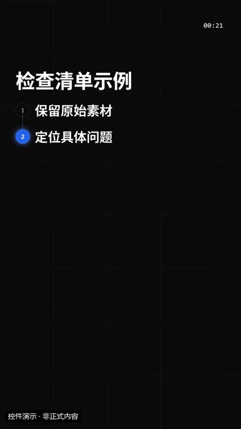](../../docs/template-gallery/demos/motiongit/list.mp4)

- [本地效果演示 1 · 规格见演示](../../docs/template-gallery/demos/motiongit/list.mp4)：官方控件真实渲染；使用中文示例文案或示例数据。6秒静音控件演示；保留模板原生标记与组内时码，角标不是本文件播放计时。低位演示身份标为本目录后处理添加。

**2. 适用内容**

- 1–6 个并列要点，逐条出现；全部出现后高亮依次轮转

- 不替代原始证据；重点字不能改变原话的限定条件。

**3. 所需素材**

- 短标题或重点词
- 清楚的解释关系
- 真实数值或标明示例的数据

**4. 可改参数与限制**

按已核对的字段与限制修改；尚未核对的能力会明确标注。

<details>
<summary>查看参数、限制与来源依据</summary>

- 标题（title）：文字，必填；最短长度 1；最多可见字符 18。
- items（items）：列表，必填；至少项数 1；最多项数 6。
- 动画变体（variant）：rail / cards / check。
- 段落时间（t0、t1）与动作提示时间（cues）按剪后的真实讲解设置；主题色由时间轴 theme 配置，不是每个控件任意独立的配色合同。

- 这些范围来自已登记版本的公开参数合同；更换个人包或版本后须重新核对，不自动沿用到所有官网模板。
- 每个控件目前只展示一个代表变体；可选枚举、允许数量和颜色参数不等于所有组合都已实测。
- 导出前仍需校验参数、真实素材、语音时长与排版；不从示例数据推断实际业务结果。

参数依据：[motiongit-controls.json](../../templates/motiongit-controls.json) · [render_motiongit_gallery.py](../../scripts/render_motiongit_gallery.py) · [render_motiongit_gallery_data.py](../../scripts/render_motiongit_gallery_data.py)

</details>

**5. 怎样交给 AI 使用**

<details>
<summary>复制本模板的使用提示词</summary>

```text
请使用 AI Cut 模板目录中的「要点列表」（编号 mg-control-list）。
我的内容或原片：[填写]；输出比例：[填写]；需要强调的内容：[填写]。
先核对本条来源、当前状态、素材和参数合同；使用我自己的获授权素材，保留原声原意。
按照本条已支持的参数范围做短预览，确认文字、动作和声音的时间一致，再放入剪辑工程。
若原包、依赖或素材缺失，说明缺什么；遇到费用先告诉我。不要将示例人物或示例数据当成我的内容。
```

</details>

**6. 当前能否使用**

- 已有控件演示 · 需自备授权原包
- 本仓库提供目录与已渲染演示，未附送个人 .motion 原包；学员须使用自己合法取得的对应包。
- 本库登记版本：0.3.0 (package2.7.17-alpha.2)。新输入、新电脑和其他变体须另行验证。

<details>
<summary>查看原始检查范围与接入记录</summary>

- 一个代表变体已由官方 helper 渲染；静音小样完整解码，并已查看实际导出抽帧。其他两个变体仅登记，未渲染；不代表连续观看或用户审美认可。

</details>

**7. 来源与许可**

- MotionGit 个人授权模板包，以原包授权为准；仅包含自有素材及明确示例数据的渲染演示，不分发受保护代码。

[原始来源](https://motiongit.com/@adunext/template-01-integrated-portrait)

---

<a id="mg-control-steps"></a>

### 步骤流程

`mg-control-steps` · 流程与时间线 · 基础讲解 · **已接入历史版 · 当前公开版尚未验证**

2–5 个先后步骤；光点沿轨道依次点亮

**1. 效果预览**

[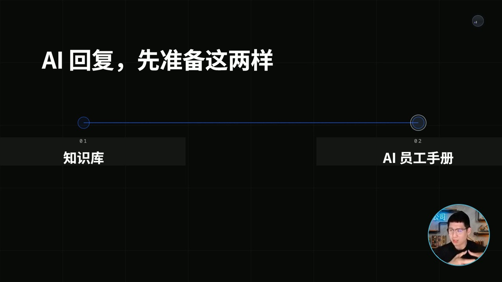](../../docs/template-gallery/demos/integrated/aivd-10/2.7.17-alpha.2/steps-track-owner-v1.mp4)

- [本人案例 1 · 规格见演示](../../docs/template-gallery/demos/integrated/aivd-10/2.7.17-alpha.2/steps-track-owner-v1.mp4)：AIVD 10 本人同期圆窗＋官方 steps/track 横屏概念讲解节选；静音；不含客户画面。知识库与 AI 员工手册两项前提，保留完整条件，轨道依次点亮。
- [本地效果演示 2 · 规格见演示](../../docs/template-gallery/demos/motiongit/steps.mp4)：官方控件真实渲染；使用中文示例文案或示例数据。6秒静音控件演示；保留模板原生标记与组内时码，角标不是本文件播放计时。低位演示身份标为本目录后处理添加。

**2. 适用内容**

- 2–5 个先后步骤；光点沿轨道依次点亮

- 不替代原始证据；重点字不能改变原话的限定条件。

**3. 所需素材**

- 短标题或重点词
- 清楚的解释关系
- 真实数值或标明示例的数据

**4. 可改参数与限制**

按已核对的字段与限制修改；尚未核对的能力会明确标注。

<details>
<summary>查看参数、限制与来源依据</summary>

- 标题（title）：文字，可选；最多可见字符 18。
- steps（steps）：列表，必填；至少项数 2；最多项数 5。
- 动画变体（variant）：track / ladder / cards。
- 段落时间（t0、t1）与动作提示时间（cues）按剪后的真实讲解设置；主题色由时间轴 theme 配置，不是每个控件任意独立的配色合同。

- 这些范围来自已登记版本的公开参数合同；更换个人包或版本后须重新核对，不自动沿用到所有官网模板。
- 每个控件目前只展示一个代表变体；可选枚举、允许数量和颜色参数不等于所有组合都已实测。
- 导出前仍需校验参数、真实素材、语音时长与排版；不从示例数据推断实际业务结果。

参数依据：[motiongit-controls.json](../../templates/motiongit-controls.json) · [render_motiongit_gallery.py](../../scripts/render_motiongit_gallery.py) · [render_motiongit_gallery_data.py](../../scripts/render_motiongit_gallery_data.py)

</details>

**5. 怎样交给 AI 使用**

<details>
<summary>复制本模板的使用提示词</summary>

```text
请使用 AI Cut 模板目录中的「步骤流程」（编号 mg-control-steps）。
我的内容或原片：[填写]；输出比例：[填写]；需要强调的内容：[填写]。
先核对本条来源、当前状态、素材和参数合同；使用我自己的获授权素材，保留原声原意。
按照本条已支持的参数范围做短预览，确认文字、动作和声音的时间一致，再放入剪辑工程。
若原包、依赖或素材缺失，说明缺什么；遇到费用先告诉我。不要将示例人物或示例数据当成我的内容。
```

</details>

**6. 当前能否使用**

- 已接入历史版 · 当前公开版尚未验证
- 本仓库提供目录与已渲染演示，未附送个人 .motion 原包；学员须使用自己合法取得的对应包。
- 目录默认本人Demo版本：2.7.17-alpha.2；本片QA：verified_demo。只对应已登记版本与输入；切换其他演示时，以播放器下方显示的该版本说明为准。
- 本库登记版本：0.3.0 (package2.7.17-alpha.2)。新输入、新电脑和其他变体须另行验证。

<details>
<summary>查看原始检查范围与接入记录</summary>

- 一个代表变体已由官方 helper 渲染；静音小样完整解码，并已查看实际导出抽帧。其他两个变体仅登记，未渲染；不代表连续观看或用户审美认可。

本片接入：aivd-10-mg-control-steps-2.7.17-alpha.2-v1

本片横屏steps/track：1280×720、30fps、398帧、无音轨，完整解码通过；实际查看编码帧6,199,270,397及同帧圆窗放大联系表。源参数仅概念文字/图标；抽检未见客户资料或网址；圆窗头脸完整、透明角无黑方块、不遮概念正文。保留原生时码、.m标与出场淡出。仅本版本/此输入/此变体；不等于全帧人工审阅、连续观看、用户美学确认、全部变体或另一台机器通过。

```text
.\.venv\Scripts\python.exe scripts/motiongit_adapter.py run --instance <instance> render <reviewed-project> --out <scene.mp4> --language zh
```

不改变原条目验证范围，不代表用户审美认可。

</details>

**7. 来源与许可**

- MotionGit 个人授权模板包，以原包授权为准；仅包含自有素材及明确示例数据的渲染演示，不分发受保护代码。

[原始来源](https://motiongit.com/@adunext/template-01-integrated-portrait)

---

<a id="mg-control-checklist"></a>

### 待办清单

`mg-control-checklist` · 流程与时间线 · 概念教学 · **已有控件演示 · 需自备授权原包**

逐项完成的清单：准备步骤、检查项、已做到的事。和 list 的区别是有打勾过程、进度计数和最后的完成章

**1. 效果预览**

[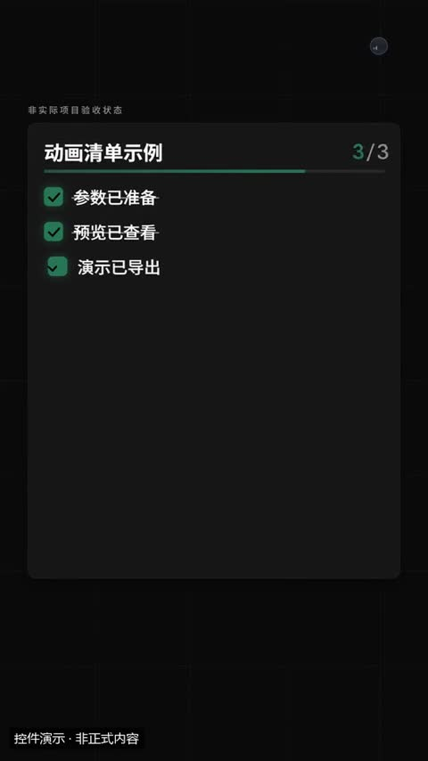](../../docs/template-gallery/demos/motiongit/checklist.mp4)

- [本地效果演示 1 · 规格见演示](../../docs/template-gallery/demos/motiongit/checklist.mp4)：官方控件真实渲染；使用中文示例文案或示例数据。6秒静音控件演示；保留模板原生标记与组内时码，角标不是本文件播放计时。低位演示身份标为本目录后处理添加。

**2. 适用内容**

- 逐项完成的清单：准备步骤、检查项、已做到的事。和 list 的区别是有打勾过程、进度计数和最后的完成章

- 简化概念不能省略关键前提；完成章和勾选不能冒充实际验收。

**3. 所需素材**

- 定义、问题、对比或清单文案
- 关键限定条件

**4. 可改参数与限制**

按已核对的字段与限制修改；尚未核对的能力会明确标注。

<details>
<summary>查看参数、限制与来源依据</summary>

- kicker（kicker）：文字，可选；最多可见字符 28。
- 标题（title）：文字，可选；最多可见字符 16。
- items（items）：列表，必填；至少项数 2；最多项数 6。
- 完成章文字（默认 完成）（done）：文字，可选；最多可见字符 4。
- 动画变体（variant）：todo / clipboard / progress。
- 段落时间（t0、t1）与动作提示时间（cues）按剪后的真实讲解设置；主题色由时间轴 theme 配置，不是每个控件任意独立的配色合同。

- 这些范围来自已登记版本的公开参数合同；更换个人包或版本后须重新核对，不自动沿用到所有官网模板。
- 每个控件目前只展示一个代表变体；可选枚举、允许数量和颜色参数不等于所有组合都已实测。
- 导出前仍需校验参数、真实素材、语音时长与排版；不从示例数据推断实际业务结果。

参数依据：[motiongit-controls.json](../../templates/motiongit-controls.json) · [render_motiongit_gallery.py](../../scripts/render_motiongit_gallery.py) · [render_motiongit_gallery_data.py](../../scripts/render_motiongit_gallery_data.py)

</details>

**5. 怎样交给 AI 使用**

<details>
<summary>复制本模板的使用提示词</summary>

```text
请使用 AI Cut 模板目录中的「待办清单」（编号 mg-control-checklist）。
我的内容或原片：[填写]；输出比例：[填写]；需要强调的内容：[填写]。
先核对本条来源、当前状态、素材和参数合同；使用我自己的获授权素材，保留原声原意。
按照本条已支持的参数范围做短预览，确认文字、动作和声音的时间一致，再放入剪辑工程。
若原包、依赖或素材缺失，说明缺什么；遇到费用先告诉我。不要将示例人物或示例数据当成我的内容。
```

</details>

**6. 当前能否使用**

- 已有控件演示 · 需自备授权原包
- 本仓库提供目录与已渲染演示，未附送个人 .motion 原包；学员须使用自己合法取得的对应包。
- 本库登记版本：0.3.0 (package2.7.17-alpha.2)。新输入、新电脑和其他变体须另行验证。

<details>
<summary>查看原始检查范围与接入记录</summary>

- 一个代表变体已由官方 helper 渲染；静音小样完整解码，并已查看实际导出抽帧。其他两个变体仅登记，未渲染；不代表连续观看或用户审美认可。

</details>

**7. 来源与许可**

- MotionGit 个人授权模板包，以原包授权为准；仅包含自有素材及明确示例数据的渲染演示，不分发受保护代码。

[原始来源](https://motiongit.com/@adunext/template-01-integrated-portrait)

---

<a id="mg-control-timeline"></a>

### 时间线 / 里程碑

`mg-control-timeline` · 流程与时间线 · 数据与进度 · **已有控件演示 · 需自备授权原包**

按时间顺序的 3–6 个节点：发展历程、计划路线图、事件经过；current 标出「现在」

**1. 效果预览**

[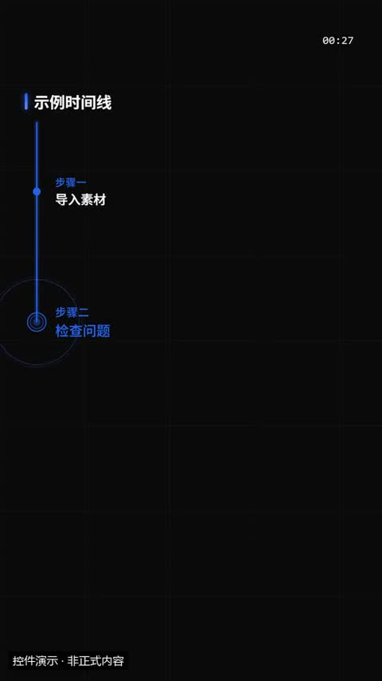](../../docs/template-gallery/demos/motiongit/timeline.mp4)

- [本地效果演示 1 · 规格见演示](../../docs/template-gallery/demos/motiongit/timeline.mp4)：官方控件真实渲染；使用中文示例文案或示例数据。6秒静音控件演示；保留模板原生标记与组内时码，角标不是本文件播放计时。低位演示身份标为本目录后处理添加。

**2. 适用内容**

- 按时间顺序的 3–6 个节点：发展历程、计划路线图、事件经过；current 标出「现在」

- 正式视频必须绑定真实数据及单位；本演示数字全部为示例。

**3. 所需素材**

- 有来源的数值、标签和单位

**4. 可改参数与限制**

按已核对的字段与限制修改；尚未核对的能力会明确标注。

<details>
<summary>查看参数、限制与来源依据</summary>

- 标题（title）：文字，可选；最多可见字符 18。
- 当前节点序号（1 起，默认最后一个；之后的节点显示为计划中）（current）：integer，可选；最小 1；最大 6。
- 节点（items）：列表，必填；至少项数 3；最多项数 6。
- 时间（items[].date）：文字，必填；最短长度 1；最多可见字符 8。
- 事件（items[].text）：文字，必填；最短长度 1；最多可见字符 14。
- 动画变体（variant）：horizontal / vertical / zigzag。
- 段落时间（t0、t1）与动作提示时间（cues）按剪后的真实讲解设置；主题色由时间轴 theme 配置，不是每个控件任意独立的配色合同。

- 这些范围来自已登记版本的公开参数合同；更换个人包或版本后须重新核对，不自动沿用到所有官网模板。
- 每个控件目前只展示一个代表变体；可选枚举、允许数量和颜色参数不等于所有组合都已实测。
- 导出前仍需校验参数、真实素材、语音时长与排版；不从示例数据推断实际业务结果。

参数依据：[motiongit-controls.json](../../templates/motiongit-controls.json) · [render_motiongit_gallery.py](../../scripts/render_motiongit_gallery.py) · [render_motiongit_gallery_data.py](../../scripts/render_motiongit_gallery_data.py)

</details>

**5. 怎样交给 AI 使用**

<details>
<summary>复制本模板的使用提示词</summary>

```text
请使用 AI Cut 模板目录中的「时间线 / 里程碑」（编号 mg-control-timeline）。
我的内容或原片：[填写]；输出比例：[填写]；需要强调的内容：[填写]。
先核对本条来源、当前状态、素材和参数合同；使用我自己的获授权素材，保留原声原意。
按照本条已支持的参数范围做短预览，确认文字、动作和声音的时间一致，再放入剪辑工程。
若原包、依赖或素材缺失，说明缺什么；遇到费用先告诉我。不要将示例人物或示例数据当成我的内容。
```

</details>

**6. 当前能否使用**

- 已有控件演示 · 需自备授权原包
- 本仓库提供目录与已渲染演示，未附送个人 .motion 原包；学员须使用自己合法取得的对应包。
- 本库登记版本：0.3.0 (package2.7.17-alpha.2)。新输入、新电脑和其他变体须另行验证。

<details>
<summary>查看原始检查范围与接入记录</summary>

- 一个代表变体已由官方 helper 渲染；静音小样完整解码，并已查看实际导出抽帧。其他两个变体仅登记，未渲染；不代表连续观看或用户审美认可。

</details>

**7. 来源与许可**

- MotionGit 个人授权模板包，以原包授权为准；仅包含自有素材及明确示例数据的渲染演示，不分发受保护代码。

[原始来源](https://motiongit.com/@adunext/template-01-integrated-portrait)

---

<a id="mg-control-flow"></a>

### 流程图

`mg-control-flow` · 流程与时间线 · 关系与系统结构 · **已接入历史版 · 当前公开版尚未验证**

3–6 个有先后顺序的环节（步骤、流水线、因果链），或一个起点分出多个去向（branch）；节点可带图标

**1. 效果预览**

[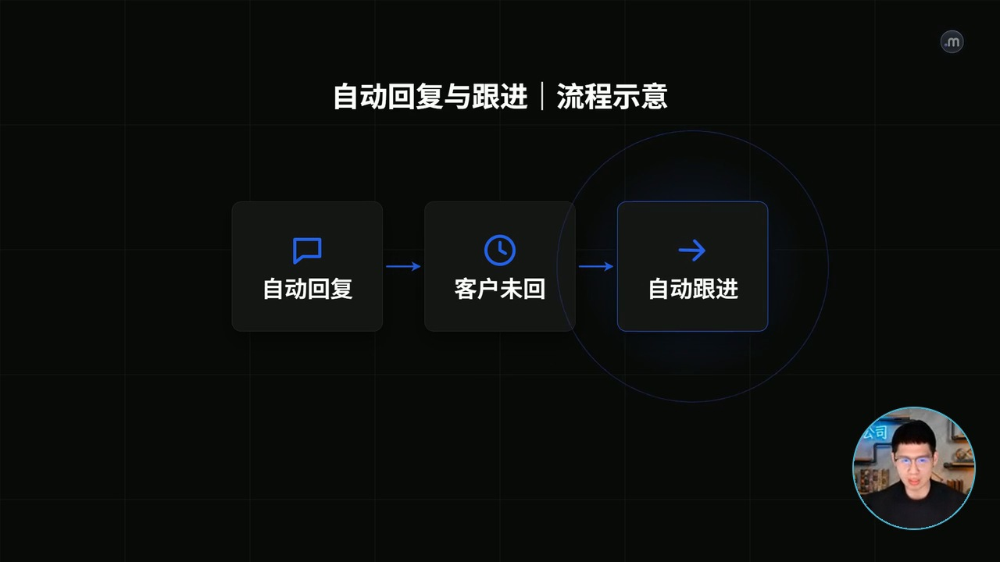](../../docs/template-gallery/demos/integrated/aivd-10/2.7.17-alpha.2/flow-chain-owner-v1.mp4)

- [本人案例 1 · 规格见演示](../../docs/template-gallery/demos/integrated/aivd-10/2.7.17-alpha.2/flow-chain-owner-v1.mp4)：AIVD 10 本人同期圆窗＋官方 flow/chain 横屏概念讲解节选；静音；不含客户画面。自动回复→客户未回→自动跟进，按本片实际语义节拍依次出现。
- [本地效果演示 2 · 规格见演示](../../docs/template-gallery/demos/motiongit/flow.mp4)：官方控件真实渲染；使用中文示例文案或示例数据。6秒静音控件演示；保留模板原生标记与组内时码，角标不是本文件播放计时。低位演示身份标为本目录后处理添加。

**2. 适用内容**

- 3–6 个有先后顺序的环节（步骤、流水线、因果链），或一个起点分出多个去向（branch）；节点可带图标

- 关系图须反映实际流程；不能把假设关系写成已实现功能。

**3. 所需素材**

- 真实节点、顺序、层级或关系

**4. 可改参数与限制**

按已核对的字段与限制修改；尚未核对的能力会明确标注。

<details>
<summary>查看参数、限制与来源依据</summary>

- 上方标题（title）：文字，可选；最多可见字符 18。
- 节点（branch 变体：第一个是起点，其余是分支）（nodes）：列表，必填；至少项数 3；最多项数 6。
- 正文（nodes[].text）：文字，必填；最短长度 1；最多可见字符 10。
- icon（nodes[].icon）：文字，可选；使用合同规定的 82 个枚举值之一。
- 动画变体（variant）：chain / snake / branch。
- 段落时间（t0、t1）与动作提示时间（cues）按剪后的真实讲解设置；主题色由时间轴 theme 配置，不是每个控件任意独立的配色合同。

- 这些范围来自已登记版本的公开参数合同；更换个人包或版本后须重新核对，不自动沿用到所有官网模板。
- 每个控件目前只展示一个代表变体；可选枚举、允许数量和颜色参数不等于所有组合都已实测。
- 导出前仍需校验参数、真实素材、语音时长与排版；不从示例数据推断实际业务结果。

参数依据：[motiongit-controls.json](../../templates/motiongit-controls.json) · [render_motiongit_gallery.py](../../scripts/render_motiongit_gallery.py) · [render_motiongit_gallery_data.py](../../scripts/render_motiongit_gallery_data.py)

</details>

**5. 怎样交给 AI 使用**

<details>
<summary>复制本模板的使用提示词</summary>

```text
请使用 AI Cut 模板目录中的「流程图」（编号 mg-control-flow）。
我的内容或原片：[填写]；输出比例：[填写]；需要强调的内容：[填写]。
先核对本条来源、当前状态、素材和参数合同；使用我自己的获授权素材，保留原声原意。
按照本条已支持的参数范围做短预览，确认文字、动作和声音的时间一致，再放入剪辑工程。
若原包、依赖或素材缺失，说明缺什么；遇到费用先告诉我。不要将示例人物或示例数据当成我的内容。
```

</details>

**6. 当前能否使用**

- 已接入历史版 · 当前公开版尚未验证
- 本仓库提供目录与已渲染演示，未附送个人 .motion 原包；学员须使用自己合法取得的对应包。
- 目录默认本人Demo版本：2.7.17-alpha.2；本片QA：verified_demo。只对应已登记版本与输入；切换其他演示时，以播放器下方显示的该版本说明为准。
- 本库登记版本：0.3.0 (package2.7.17-alpha.2)。新输入、新电脑和其他变体须另行验证。

<details>
<summary>查看原始检查范围与接入记录</summary>

- 一个代表变体已由官方 helper 渲染；静音小样完整解码，并已查看实际导出抽帧。其他两个变体仅登记，未渲染；不代表连续观看或用户审美认可。

本片接入：aivd-10-mg-control-flow-2.7.17-alpha.2-v1

本片横屏flow/chain：1280×720、30fps、419帧、无音轨，完整解码通过；实际查看编码帧6,209,345,418及同帧圆窗放大联系表。源参数仅概念文字/图标；抽检未见客户资料或网址；圆窗头脸完整、透明角无黑方块、不遮概念正文。保留原生时码、.m标与出场淡出。仅本版本/此输入/此变体；不等于全帧人工审阅、连续观看、用户美学确认、全部变体或另一台机器通过。

```text
.\.venv\Scripts\python.exe scripts/motiongit_adapter.py run --instance <instance> render <reviewed-project> --out <scene.mp4> --language zh
```

不改变原条目验证范围，不代表用户审美认可。

</details>

**7. 来源与许可**

- MotionGit 个人授权模板包，以原包授权为准；仅包含自有素材及明确示例数据的渲染演示，不分发受保护代码。

[原始来源](https://motiongit.com/@adunext/template-01-integrated-portrait)

---

<a id="mg-control-cycle"></a>

### 循环图

`mg-control-cycle` · 流程与时间线 · 关系与系统结构 · **已有控件演示 · 需自备授权原包**

首尾相接、周而复始的 3–6 个环节：飞轮、迭代闭环、生命周期；中心可写主题

**1. 效果预览**

[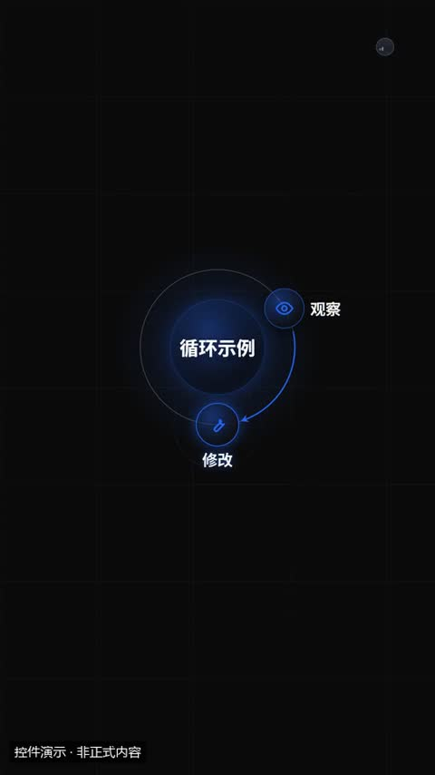](../../docs/template-gallery/demos/motiongit/cycle.mp4)

- [本地效果演示 1 · 规格见演示](../../docs/template-gallery/demos/motiongit/cycle.mp4)：官方控件真实渲染；使用中文示例文案或示例数据。6秒静音控件演示；保留模板原生标记与组内时码，角标不是本文件播放计时。低位演示身份标为本目录后处理添加。

**2. 适用内容**

- 首尾相接、周而复始的 3–6 个环节：飞轮、迭代闭环、生命周期；中心可写主题

- 关系图须反映实际流程；不能把假设关系写成已实现功能。

**3. 所需素材**

- 真实节点、顺序、层级或关系

**4. 可改参数与限制**

按已核对的字段与限制修改；尚未核对的能力会明确标注。

<details>
<summary>查看参数、限制与来源依据</summary>

- 中心文字（title）：文字，可选；最多可见字符 8。
- nodes（nodes）：列表，必填；至少项数 3；最多项数 6。
- 正文（nodes[].text）：文字，必填；最短长度 1；最多可见字符 8。
- icon（nodes[].icon）：文字，可选；使用合同规定的 82 个枚举值之一。
- 动画变体（variant）：ring / orbit / wheel。
- 段落时间（t0、t1）与动作提示时间（cues）按剪后的真实讲解设置；主题色由时间轴 theme 配置，不是每个控件任意独立的配色合同。

- 这些范围来自已登记版本的公开参数合同；更换个人包或版本后须重新核对，不自动沿用到所有官网模板。
- 每个控件目前只展示一个代表变体；可选枚举、允许数量和颜色参数不等于所有组合都已实测。
- 导出前仍需校验参数、真实素材、语音时长与排版；不从示例数据推断实际业务结果。

参数依据：[motiongit-controls.json](../../templates/motiongit-controls.json) · [render_motiongit_gallery.py](../../scripts/render_motiongit_gallery.py) · [render_motiongit_gallery_data.py](../../scripts/render_motiongit_gallery_data.py)

</details>

**5. 怎样交给 AI 使用**

<details>
<summary>复制本模板的使用提示词</summary>

```text
请使用 AI Cut 模板目录中的「循环图」（编号 mg-control-cycle）。
我的内容或原片：[填写]；输出比例：[填写]；需要强调的内容：[填写]。
先核对本条来源、当前状态、素材和参数合同；使用我自己的获授权素材，保留原声原意。
按照本条已支持的参数范围做短预览，确认文字、动作和声音的时间一致，再放入剪辑工程。
若原包、依赖或素材缺失，说明缺什么；遇到费用先告诉我。不要将示例人物或示例数据当成我的内容。
```

</details>

**6. 当前能否使用**

- 已有控件演示 · 需自备授权原包
- 本仓库提供目录与已渲染演示，未附送个人 .motion 原包；学员须使用自己合法取得的对应包。
- 本库登记版本：0.3.0 (package2.7.17-alpha.2)。新输入、新电脑和其他变体须另行验证。

<details>
<summary>查看原始检查范围与接入记录</summary>

- 一个代表变体已由官方 helper 渲染；静音小样完整解码，并已查看实际导出抽帧。其他两个变体仅登记，未渲染；不代表连续观看或用户审美认可。

</details>

**7. 来源与许可**

- MotionGit 个人授权模板包，以原包授权为准；仅包含自有素材及明确示例数据的渲染演示，不分发受保护代码。

[原始来源](https://motiongit.com/@adunext/template-01-integrated-portrait)

---

<a id="mg-control-funnel"></a>

### 漏斗 / 层级

`mg-control-funnel` · 流程与时间线 · 关系与系统结构 · **已有控件演示 · 需自备授权原包**

逐层收窄的转化、筛选（funnel），或自下而上的层级、金字塔、技术栈（pyramid / layers）；每层可带一个数值

**1. 效果预览**

[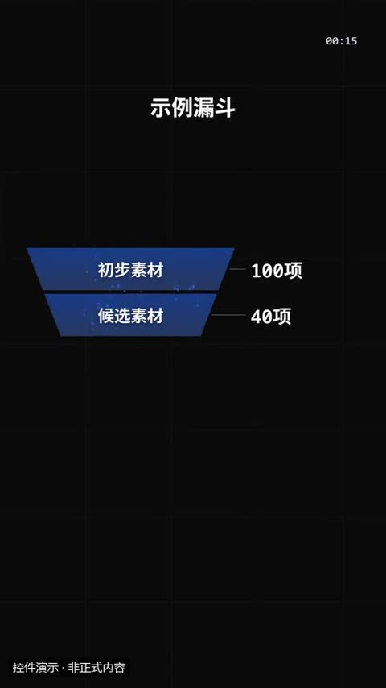](../../docs/template-gallery/demos/motiongit/funnel.mp4)

- [本地效果演示 1 · 规格见演示](../../docs/template-gallery/demos/motiongit/funnel.mp4)：官方控件真实渲染；使用中文示例文案或示例数据。6秒静音控件演示；保留模板原生标记与组内时码，角标不是本文件播放计时。低位演示身份标为本目录后处理添加。

**2. 适用内容**

- 逐层收窄的转化、筛选（funnel），或自下而上的层级、金字塔、技术栈（pyramid / layers）；每层可带一个数值

- 关系图须反映实际流程；不能把假设关系写成已实现功能。

**3. 所需素材**

- 真实节点、顺序、层级或关系

**4. 可改参数与限制**

按已核对的字段与限制修改；尚未核对的能力会明确标注。

<details>
<summary>查看参数、限制与来源依据</summary>

- 标题（title）：文字，可选；最多可见字符 18。
- 从上到下（金字塔从塔尖到塔底）（layers）：列表，必填；至少项数 3；最多项数 5。
- 标签（layers[].label）：文字，必填；最短长度 1；最多可见字符 8。
- 数值，如 100% / 3.2万（示意）（layers[].value）：文字，可选；最多可见字符 8。
- 动画变体（variant）：funnel / pyramid / layers。
- 段落时间（t0、t1）与动作提示时间（cues）按剪后的真实讲解设置；主题色由时间轴 theme 配置，不是每个控件任意独立的配色合同。

- 这些范围来自已登记版本的公开参数合同；更换个人包或版本后须重新核对，不自动沿用到所有官网模板。
- 每个控件目前只展示一个代表变体；可选枚举、允许数量和颜色参数不等于所有组合都已实测。
- 导出前仍需校验参数、真实素材、语音时长与排版；不从示例数据推断实际业务结果。

参数依据：[motiongit-controls.json](../../templates/motiongit-controls.json) · [render_motiongit_gallery.py](../../scripts/render_motiongit_gallery.py) · [render_motiongit_gallery_data.py](../../scripts/render_motiongit_gallery_data.py)

</details>

**5. 怎样交给 AI 使用**

<details>
<summary>复制本模板的使用提示词</summary>

```text
请使用 AI Cut 模板目录中的「漏斗 / 层级」（编号 mg-control-funnel）。
我的内容或原片：[填写]；输出比例：[填写]；需要强调的内容：[填写]。
先核对本条来源、当前状态、素材和参数合同；使用我自己的获授权素材，保留原声原意。
按照本条已支持的参数范围做短预览，确认文字、动作和声音的时间一致，再放入剪辑工程。
若原包、依赖或素材缺失，说明缺什么；遇到费用先告诉我。不要将示例人物或示例数据当成我的内容。
```

</details>

**6. 当前能否使用**

- 已有控件演示 · 需自备授权原包
- 本仓库提供目录与已渲染演示，未附送个人 .motion 原包；学员须使用自己合法取得的对应包。
- 本库登记版本：0.3.0 (package2.7.17-alpha.2)。新输入、新电脑和其他变体须另行验证。

<details>
<summary>查看原始检查范围与接入记录</summary>

- 一个代表变体已由官方 helper 渲染；静音小样完整解码，并已查看实际导出抽帧。其他两个变体仅登记，未渲染；不代表连续观看或用户审美认可。

</details>

**7. 来源与许可**

- MotionGit 个人授权模板包，以原包授权为准；仅包含自有素材及明确示例数据的渲染演示，不分发受保护代码。

[原始来源](https://motiongit.com/@adunext/template-01-integrated-portrait)

---

<a id="mg-control-venn"></a>

### 交集图

`mg-control-venn` · 流程与时间线 · 关系与系统结构 · **已有控件演示 · 需自备授权原包**

两三个概念的交集或合成：A + B 的重叠点、三者兼得；merge 变体表示合而为一

**1. 效果预览**

[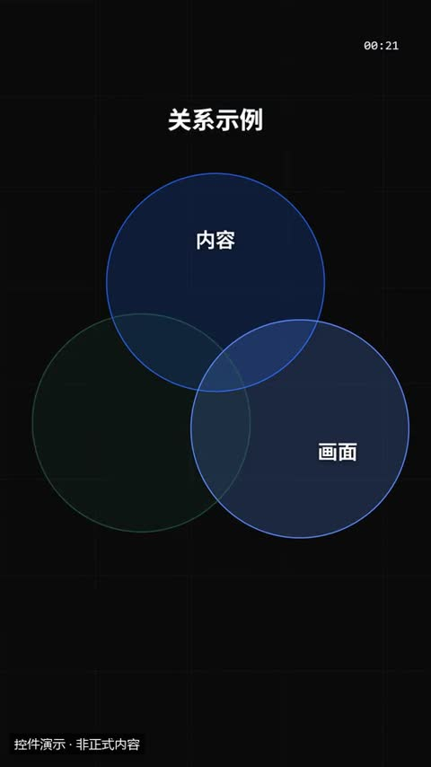](../../docs/template-gallery/demos/motiongit/venn.mp4)

- [本地效果演示 1 · 规格见演示](../../docs/template-gallery/demos/motiongit/venn.mp4)：官方控件真实渲染；使用中文示例文案或示例数据。6秒静音控件演示；保留模板原生标记与组内时码，角标不是本文件播放计时。低位演示身份标为本目录后处理添加。

**2. 适用内容**

- 两三个概念的交集或合成：A + B 的重叠点、三者兼得；merge 变体表示合而为一

- 关系图须反映实际流程；不能把假设关系写成已实现功能。

**3. 所需素材**

- 真实节点、顺序、层级或关系

**4. 可改参数与限制**

按已核对的字段与限制修改；尚未核对的能力会明确标注。

<details>
<summary>查看参数、限制与来源依据</summary>

- 标题（title）：文字，可选；最多可见字符 18。
- 每个圆的名字（sets）：列表，必填；至少项数 2；最多项数 3。
- 交集 / 合成后的文字（center）：文字，可选；最多可见字符 6。
- 动画变体（variant）：overlap / outline / merge。
- 段落时间（t0、t1）与动作提示时间（cues）按剪后的真实讲解设置；主题色由时间轴 theme 配置，不是每个控件任意独立的配色合同。

- 这些范围来自已登记版本的公开参数合同；更换个人包或版本后须重新核对，不自动沿用到所有官网模板。
- 每个控件目前只展示一个代表变体；可选枚举、允许数量和颜色参数不等于所有组合都已实测。
- 导出前仍需校验参数、真实素材、语音时长与排版；不从示例数据推断实际业务结果。

参数依据：[motiongit-controls.json](../../templates/motiongit-controls.json) · [render_motiongit_gallery.py](../../scripts/render_motiongit_gallery.py) · [render_motiongit_gallery_data.py](../../scripts/render_motiongit_gallery_data.py)

</details>

**5. 怎样交给 AI 使用**

<details>
<summary>复制本模板的使用提示词</summary>

```text
请使用 AI Cut 模板目录中的「交集图」（编号 mg-control-venn）。
我的内容或原片：[填写]；输出比例：[填写]；需要强调的内容：[填写]。
先核对本条来源、当前状态、素材和参数合同；使用我自己的获授权素材，保留原声原意。
按照本条已支持的参数范围做短预览，确认文字、动作和声音的时间一致，再放入剪辑工程。
若原包、依赖或素材缺失，说明缺什么；遇到费用先告诉我。不要将示例人物或示例数据当成我的内容。
```

</details>

**6. 当前能否使用**

- 已有控件演示 · 需自备授权原包
- 本仓库提供目录与已渲染演示，未附送个人 .motion 原包；学员须使用自己合法取得的对应包。
- 本库登记版本：0.3.0 (package2.7.17-alpha.2)。新输入、新电脑和其他变体须另行验证。

<details>
<summary>查看原始检查范围与接入记录</summary>

- 一个代表变体已由官方 helper 渲染；静音小样完整解码，并已查看实际导出抽帧。其他两个变体仅登记，未渲染；不代表连续观看或用户审美认可。

</details>

**7. 来源与许可**

- MotionGit 个人授权模板包，以原包授权为准；仅包含自有素材及明确示例数据的渲染演示，不分发受保护代码。

[原始来源](https://motiongit.com/@adunext/template-01-integrated-portrait)

---

<a id="mg-control-mindmap"></a>

### 思维导图

`mg-control-mindmap` · 流程与时间线 · 关系与系统结构 · **已有控件演示 · 需自备授权原包**

一个主题展开 3–6 个方面，每个方面可再列 0–2 个要点：知识框架、话题拆解

**1. 效果预览**

[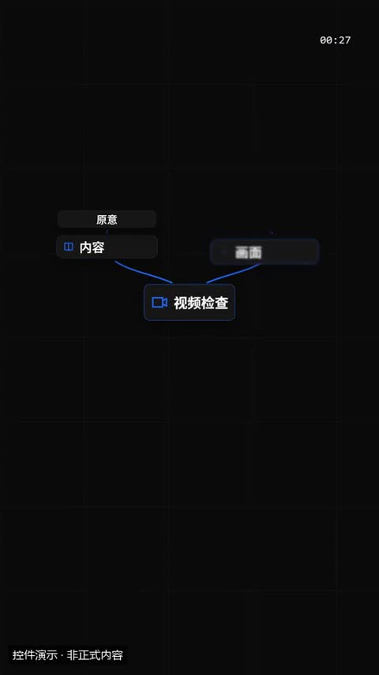](../../docs/template-gallery/demos/motiongit/mindmap.mp4)

- [本地效果演示 1 · 规格见演示](../../docs/template-gallery/demos/motiongit/mindmap.mp4)：官方控件真实渲染；使用中文示例文案或示例数据。6秒静音控件演示；保留模板原生标记与组内时码，角标不是本文件播放计时。低位演示身份标为本目录后处理添加。

**2. 适用内容**

- 一个主题展开 3–6 个方面，每个方面可再列 0–2 个要点：知识框架、话题拆解

- 关系图须反映实际流程；不能把假设关系写成已实现功能。

**3. 所需素材**

- 真实节点、顺序、层级或关系

**4. 可改参数与限制**

按已核对的字段与限制修改；尚未核对的能力会明确标注。

<details>
<summary>查看参数、限制与来源依据</summary>

- 中心主题（center）：文字，必填；最短长度 1；最多可见字符 8。
- 中心图标（icon）：文字，可选；使用合同规定的 82 个枚举值之一。
- branches（branches）：列表，必填；至少项数 3；最多项数 6。
- 正文（branches[].text）：文字，必填；最短长度 1；最多可见字符 6。
- icon（branches[].icon）：文字，可选；使用合同规定的 82 个枚举值之一。
- 子项（branches[].children）：列表，可选；至少项数 0；最多项数 2。
- 动画变体（variant）：radial / tree / bubbles。
- 段落时间（t0、t1）与动作提示时间（cues）按剪后的真实讲解设置；主题色由时间轴 theme 配置，不是每个控件任意独立的配色合同。

- 这些范围来自已登记版本的公开参数合同；更换个人包或版本后须重新核对，不自动沿用到所有官网模板。
- 每个控件目前只展示一个代表变体；可选枚举、允许数量和颜色参数不等于所有组合都已实测。
- 导出前仍需校验参数、真实素材、语音时长与排版；不从示例数据推断实际业务结果。

参数依据：[motiongit-controls.json](../../templates/motiongit-controls.json) · [render_motiongit_gallery.py](../../scripts/render_motiongit_gallery.py) · [render_motiongit_gallery_data.py](../../scripts/render_motiongit_gallery_data.py)

</details>

**5. 怎样交给 AI 使用**

<details>
<summary>复制本模板的使用提示词</summary>

```text
请使用 AI Cut 模板目录中的「思维导图」（编号 mg-control-mindmap）。
我的内容或原片：[填写]；输出比例：[填写]；需要强调的内容：[填写]。
先核对本条来源、当前状态、素材和参数合同；使用我自己的获授权素材，保留原声原意。
按照本条已支持的参数范围做短预览，确认文字、动作和声音的时间一致，再放入剪辑工程。
若原包、依赖或素材缺失，说明缺什么；遇到费用先告诉我。不要将示例人物或示例数据当成我的内容。
```

</details>

**6. 当前能否使用**

- 已有控件演示 · 需自备授权原包
- 本仓库提供目录与已渲染演示，未附送个人 .motion 原包；学员须使用自己合法取得的对应包。
- 本库登记版本：0.3.0 (package2.7.17-alpha.2)。新输入、新电脑和其他变体须另行验证。

<details>
<summary>查看原始检查范围与接入记录</summary>

- 一个代表变体已由官方 helper 渲染；静音小样完整解码，并已查看实际导出抽帧。其他两个变体仅登记，未渲染；不代表连续观看或用户审美认可。

</details>

**7. 来源与许可**

- MotionGit 个人授权模板包，以原包授权为准；仅包含自有素材及明确示例数据的渲染演示，不分发受保护代码。

[原始来源](https://motiongit.com/@adunext/template-01-integrated-portrait)

---

<a id="mg-control-matrix"></a>

### 2×2 象限

`mg-control-matrix` · 流程与时间线 · 关系与系统结构 · **已有控件演示 · 需自备授权原包**

两个维度把事物分成四类：重要/紧急、投入/回报、定位分析；可在象限里落几个点，priority 变体突出一个象限

**1. 效果预览**

[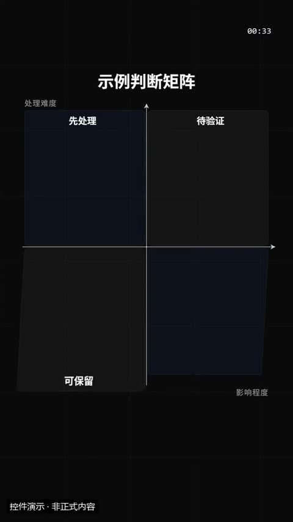](../../docs/template-gallery/demos/motiongit/matrix.mp4)

- [本地效果演示 1 · 规格见演示](../../docs/template-gallery/demos/motiongit/matrix.mp4)：官方控件真实渲染；使用中文示例文案或示例数据。6秒静音控件演示；保留模板原生标记与组内时码，角标不是本文件播放计时。低位演示身份标为本目录后处理添加。

**2. 适用内容**

- 两个维度把事物分成四类：重要/紧急、投入/回报、定位分析；可在象限里落几个点，priority 变体突出一个象限

- 关系图须反映实际流程；不能把假设关系写成已实现功能。

**3. 所需素材**

- 真实节点、顺序、层级或关系

**4. 可改参数与限制**

按已核对的字段与限制修改；尚未核对的能力会明确标注。

<details>
<summary>查看参数、限制与来源依据</summary>

- 标题（title）：文字，可选；最多可见字符 18。
- 横轴（向右增大）（xLabel）：文字，可选；最多可见字符 10。
- 纵轴（向上增大）（yLabel）：文字，可选；最多可见字符 10。
- 四个象限：左上、右上、左下、右下（quads）：列表，必填；至少项数 4；最多项数 4。
- 落入的点（points）：列表，可选；至少项数 0；最多项数 6。
- 标签（points[].label）：文字，必填；最短长度 1；最多可见字符 6。
- x（points[].x）：数字，必填；最小 0；最大 1。
- y（points[].y）：数字，必填；最小 0；最大 1。
- priority 变体突出的象限（1–4，默认 2 右上）（pick）：integer，可选；最小 1；最大 4。
- 动画变体（variant）：quadrant / scatter / priority。
- 段落时间（t0、t1）与动作提示时间（cues）按剪后的真实讲解设置；主题色由时间轴 theme 配置，不是每个控件任意独立的配色合同。

- 这些范围来自已登记版本的公开参数合同；更换个人包或版本后须重新核对，不自动沿用到所有官网模板。
- 每个控件目前只展示一个代表变体；可选枚举、允许数量和颜色参数不等于所有组合都已实测。
- 导出前仍需校验参数、真实素材、语音时长与排版；不从示例数据推断实际业务结果。

参数依据：[motiongit-controls.json](../../templates/motiongit-controls.json) · [render_motiongit_gallery.py](../../scripts/render_motiongit_gallery.py) · [render_motiongit_gallery_data.py](../../scripts/render_motiongit_gallery_data.py)

</details>

**5. 怎样交给 AI 使用**

<details>
<summary>复制本模板的使用提示词</summary>

```text
请使用 AI Cut 模板目录中的「2×2 象限」（编号 mg-control-matrix）。
我的内容或原片：[填写]；输出比例：[填写]；需要强调的内容：[填写]。
先核对本条来源、当前状态、素材和参数合同；使用我自己的获授权素材，保留原声原意。
按照本条已支持的参数范围做短预览，确认文字、动作和声音的时间一致，再放入剪辑工程。
若原包、依赖或素材缺失，说明缺什么；遇到费用先告诉我。不要将示例人物或示例数据当成我的内容。
```

</details>

**6. 当前能否使用**

- 已有控件演示 · 需自备授权原包
- 本仓库提供目录与已渲染演示，未附送个人 .motion 原包；学员须使用自己合法取得的对应包。
- 本库登记版本：0.3.0 (package2.7.17-alpha.2)。新输入、新电脑和其他变体须另行验证。

<details>
<summary>查看原始检查范围与接入记录</summary>

- 一个代表变体已由官方 helper 渲染；静音小样完整解码，并已查看实际导出抽帧。其他两个变体仅登记，未渲染；不代表连续观看或用户审美认可。

</details>

**7. 来源与许可**

- MotionGit 个人授权模板包，以原包授权为准；仅包含自有素材及明确示例数据的渲染演示，不分发受保护代码。

[原始来源](https://motiongit.com/@adunext/template-01-integrated-portrait)

---

<a id="mg-control-hub"></a>

### 中心辐射

`mg-control-hub` · 流程与时间线 · 关系与系统结构 · **已接入历史版 · 当前公开版尚未验证**

一个核心连接 3–8 个周边：平台与生态、能力清单、一个工具对接多个场景

**1. 效果预览**

[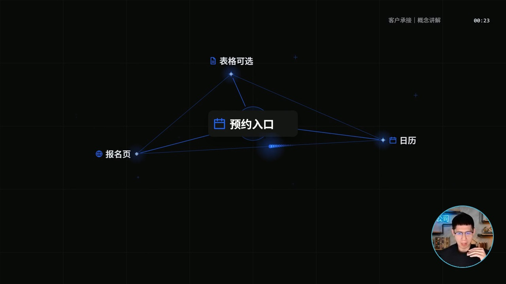](../../docs/template-gallery/demos/integrated/aivd-10/2.7.17-alpha.2/hub-constellation-owner-v1.mp4)

- [本人案例 1 · 规格见演示](../../docs/template-gallery/demos/integrated/aivd-10/2.7.17-alpha.2/hub-constellation-owner-v1.mp4)：AIVD 10 本人同期圆窗＋官方 hub/constellation 横屏概念讲解节选；静音；不含客户画面。预约入口连接表格可选、日历与报名页；展示入口关系，不声称已完成预约。
- [本地效果演示 2 · 规格见演示](../../docs/template-gallery/demos/motiongit/hub.mp4)：官方控件真实渲染；使用中文示例文案或示例数据。6秒静音控件演示；保留模板原生标记与组内时码，角标不是本文件播放计时。低位演示身份标为本目录后处理添加。

**2. 适用内容**

- 一个核心连接 3–8 个周边：平台与生态、能力清单、一个工具对接多个场景

- 关系图须反映实际流程；不能把假设关系写成已实现功能。

**3. 所需素材**

- 真实节点、顺序、层级或关系

**4. 可改参数与限制**

按已核对的字段与限制修改；尚未核对的能力会明确标注。

<details>
<summary>查看参数、限制与来源依据</summary>

- 中心（center）：一组字段，必填。
- 正文（center.text）：文字，必填；最短长度 1；最多可见字符 8。
- icon（center.icon）：文字，可选；使用合同规定的 82 个枚举值之一。
- items（items）：列表，必填；至少项数 3；最多项数 8。
- 正文（items[].text）：文字，必填；最短长度 1；最多可见字符 6。
- icon（items[].icon）：文字，可选；使用合同规定的 82 个枚举值之一。
- 动画变体（variant）：star / grid / constellation。
- 段落时间（t0、t1）与动作提示时间（cues）按剪后的真实讲解设置；主题色由时间轴 theme 配置，不是每个控件任意独立的配色合同。

- 这些范围来自已登记版本的公开参数合同；更换个人包或版本后须重新核对，不自动沿用到所有官网模板。
- 每个控件目前只展示一个代表变体；可选枚举、允许数量和颜色参数不等于所有组合都已实测。
- 导出前仍需校验参数、真实素材、语音时长与排版；不从示例数据推断实际业务结果。

参数依据：[motiongit-controls.json](../../templates/motiongit-controls.json) · [render_motiongit_gallery.py](../../scripts/render_motiongit_gallery.py) · [render_motiongit_gallery_data.py](../../scripts/render_motiongit_gallery_data.py)

</details>

**5. 怎样交给 AI 使用**

<details>
<summary>复制本模板的使用提示词</summary>

```text
请使用 AI Cut 模板目录中的「中心辐射」（编号 mg-control-hub）。
我的内容或原片：[填写]；输出比例：[填写]；需要强调的内容：[填写]。
先核对本条来源、当前状态、素材和参数合同；使用我自己的获授权素材，保留原声原意。
按照本条已支持的参数范围做短预览，确认文字、动作和声音的时间一致，再放入剪辑工程。
若原包、依赖或素材缺失，说明缺什么；遇到费用先告诉我。不要将示例人物或示例数据当成我的内容。
```

</details>

**6. 当前能否使用**

- 已接入历史版 · 当前公开版尚未验证
- 本仓库提供目录与已渲染演示，未附送个人 .motion 原包；学员须使用自己合法取得的对应包。
- 目录默认本人Demo版本：2.7.17-alpha.2；本片QA：verified_demo。只对应已登记版本与输入；切换其他演示时，以播放器下方显示的该版本说明为准。
- 本库登记版本：0.3.0 (package2.7.17-alpha.2)。新输入、新电脑和其他变体须另行验证。

<details>
<summary>查看原始检查范围与接入记录</summary>

- 一个代表变体已由官方 helper 渲染；静音小样完整解码，并已查看实际导出抽帧。其他两个变体仅登记，未渲染；不代表连续观看或用户审美认可。

本片接入：aivd-10-mg-control-hub-2.7.17-alpha.2-v1

本片横屏hub/constellation：1280×720、30fps、384帧、无音轨，完整解码通过；实际查看编码帧6,192,300,383及同帧圆窗放大联系表。源参数仅概念文字/图标；抽检未见客户资料或网址；圆窗头脸完整、透明角无黑方块、不遮概念正文。保留原生时码、.m标与出场淡出。仅本版本/此输入/此变体；不等于全帧人工审阅、连续观看、用户美学确认、全部变体或另一台机器通过。

```text
.\.venv\Scripts\python.exe scripts/motiongit_adapter.py run --instance <instance> render <reviewed-project> --out <scene.mp4> --language zh
```

不改变原条目验证范围，不代表用户审美认可。

</details>

**7. 来源与许可**

- MotionGit 个人授权模板包，以原包授权为准；仅包含自有素材及明确示例数据的渲染演示，不分发受保护代码。

[原始来源](https://motiongit.com/@adunext/template-01-integrated-portrait)

---

<a id="presenter-effect-10"></a>

### 打勾清单

`presenter-effect-10` · 流程与时间线 · 列表与步骤 · **样片效果 · 需要源码适配**

清单项依次打勾，顶部进度随演示推进。

**1. 效果预览**

[](../../docs/template-gallery/demos/presenter/presenter-effect-10.mp4)

- [本人案例 1 · 9:16](../../docs/template-gallery/demos/presenter/presenter-effect-10.mp4)：本人素材中文无声演示，来自已渲染母版的对应效果片段。

**2. 适用内容**

- 步骤总结或完成项确认

- 不能把演示勾选当作真实任务完成

**3. 所需素材**

- 口播视频
- 清单文字
- 逐项时间

**4. 可改参数与限制**

按已核对的字段与限制修改；尚未核对的能力会明确标注。

<details>
<summary>查看参数、限制与来源依据</summary>

- 共同工程输入 sourceFile / alphaFile：原视频与严格同步的透明人像视频文件；透明人像按具体分支需要使用。
- clips：每段的 fromFrame、durationInFrames、sourceStart、playbackRate、kind、title；totalFrames：总帧数。
- 本条效果选择 kind=10；标题可由该段 title 提供，其余效果内容不能假定已参数化。

- 当前是样片效果分支，需要按新片适配；没有独立的通用 .motion 参数合同。
- 母版固定 1080×1920、30fps；品牌色 INK/ACCENT、Logo、小窗位置和部分文案在源码中固定，修改需调整代码并重新验证。
- 打勾清单的条目与出现时间需按新片讲解重排；本样片通过固定源时间分界进入。

参数依据：[Showcase.tsx](../../extensions/remotion-vd44/src/template-library/talking-head-effects/Showcase.tsx) · [GraphicLayers.tsx](../../extensions/remotion-vd44/src/template-library/talking-head-effects/GraphicLayers.tsx) · [index.tsx](../../extensions/remotion-vd44/src/template-library/talking-head-effects/index.tsx)

</details>

**5. 怎样交给 AI 使用**

<details>
<summary>复制本模板的使用提示词</summary>

```text
请使用 AI Cut 模板目录中的「打勾清单」（编号 presenter-effect-10）。
我的内容或原片：[填写]；输出比例：[填写]；需要强调的内容：[填写]。
先核对本条来源、当前状态、素材和参数合同；使用我自己的获授权素材，保留原声原意。
按照本条已支持的参数范围做短预览，确认文字、动作和声音的时间一致，再放入剪辑工程。
若原包、依赖或素材缺失，说明缺什么；遇到费用先告诉我。不要将示例人物或示例数据当成我的内容。
```

</details>

**6. 当前能否使用**

- 样片效果 · 需要源码适配
- 当前为特定样片的效果分支，颜色、素材与时间逻辑尚有固定实现；不视为已通用化 .motion 包。
- 本库登记版本：1.0.0。新输入、新电脑和其他变体须另行验证。

<details>
<summary>查看原始检查范围与接入记录</summary>

- 已核对实际效果编号及母版帧区间，完整解码，检查尺寸、帧数、文件大小，并实际审看起中末联系表；无新音频，不代表逐帧连续观看或完整参考复刻。

</details>

**7. 来源与许可**

- MIT（原创代码）；演示肖像仅按本人本次授权展示，非素材再分发授权；Remotion 引擎另有许可

[原始来源](https://github.com/Isaac3113/ai-cut/tree/main/extensions/remotion-vd44/src/template-library/talking-head-effects)

---

<a id="presenter-effect-18"></a>

### 收据列表

`presenter-effect-18` · 流程与时间线 · 列表与步骤 · **样片效果 · 需要源码适配**

纸张从打印口逐步出现，列出三项内容并打勾。

**1. 效果预览**

[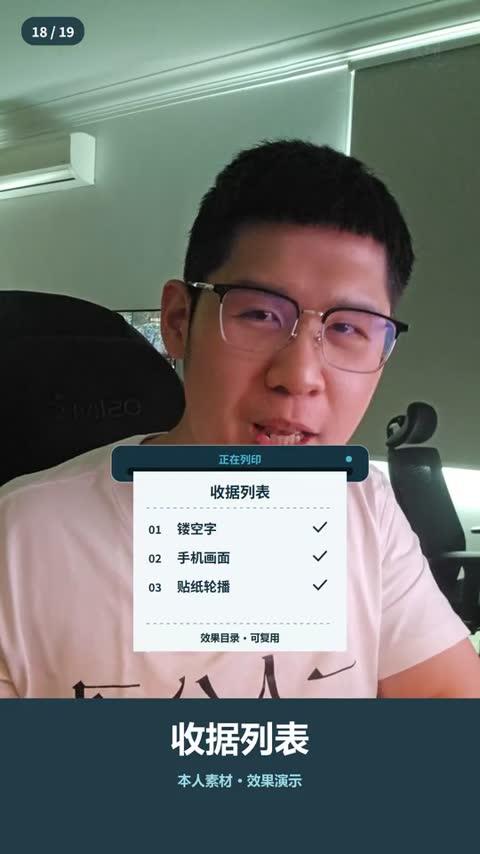](../../docs/template-gallery/demos/presenter/presenter-effect-18.mp4)

- [本人案例 1 · 9:16](../../docs/template-gallery/demos/presenter/presenter-effect-18.mp4)：本人素材中文无声演示，来自已渲染母版的对应效果片段。

**2. 适用内容**

- 总结清单或展示内容目录

- 示意收据不能冒充真实交易凭据

**3. 所需素材**

- 口播视频
- 列表文字
- 出现时间

**4. 可改参数与限制**

按已核对的字段与限制修改；尚未核对的能力会明确标注。

<details>
<summary>查看参数、限制与来源依据</summary>

- 共同工程输入 sourceFile / alphaFile：原视频与严格同步的透明人像视频文件；透明人像按具体分支需要使用。
- clips：每段的 fromFrame、durationInFrames、sourceStart、playbackRate、kind、title；totalFrames：总帧数。
- 本条效果选择 kind=18；标题可由该段 title 提供，其余效果内容不能假定已参数化。

- 当前是样片效果分支，需要按新片适配；没有独立的通用 .motion 参数合同。
- 母版固定 1080×1920、30fps；品牌色 INK/ACCENT、Logo、小窗位置和部分文案在源码中固定，修改需调整代码并重新验证。
- 收据内“镂空字/手机画面/贴纸轮播”三项文字固定在源码；换清单及项数需修改版面与出纸节奏。

参数依据：[Showcase.tsx](../../extensions/remotion-vd44/src/template-library/talking-head-effects/Showcase.tsx) · [GraphicLayers.tsx](../../extensions/remotion-vd44/src/template-library/talking-head-effects/GraphicLayers.tsx) · [index.tsx](../../extensions/remotion-vd44/src/template-library/talking-head-effects/index.tsx)

</details>

**5. 怎样交给 AI 使用**

<details>
<summary>复制本模板的使用提示词</summary>

```text
请使用 AI Cut 模板目录中的「收据列表」（编号 presenter-effect-18）。
我的内容或原片：[填写]；输出比例：[填写]；需要强调的内容：[填写]。
先核对本条来源、当前状态、素材和参数合同；使用我自己的获授权素材，保留原声原意。
按照本条已支持的参数范围做短预览，确认文字、动作和声音的时间一致，再放入剪辑工程。
若原包、依赖或素材缺失，说明缺什么；遇到费用先告诉我。不要将示例人物或示例数据当成我的内容。
```

</details>

**6. 当前能否使用**

- 样片效果 · 需要源码适配
- 当前为特定样片的效果分支，颜色、素材与时间逻辑尚有固定实现；不视为已通用化 .motion 包。
- 本库登记版本：1.0.0。新输入、新电脑和其他变体须另行验证。

<details>
<summary>查看原始检查范围与接入记录</summary>

- 已核对实际效果编号及母版帧区间，完整解码，检查尺寸、帧数、文件大小，并实际审看起中末联系表；无新音频，不代表逐帧连续观看或完整参考复刻。

</details>

**7. 来源与许可**

- MIT（原创代码）；演示肖像仅按本人本次授权展示，非素材再分发授权；Remotion 引擎另有许可

[原始来源](https://github.com/Isaac3113/ai-cut/tree/main/extensions/remotion-vd44/src/template-library/talking-head-effects)

---
