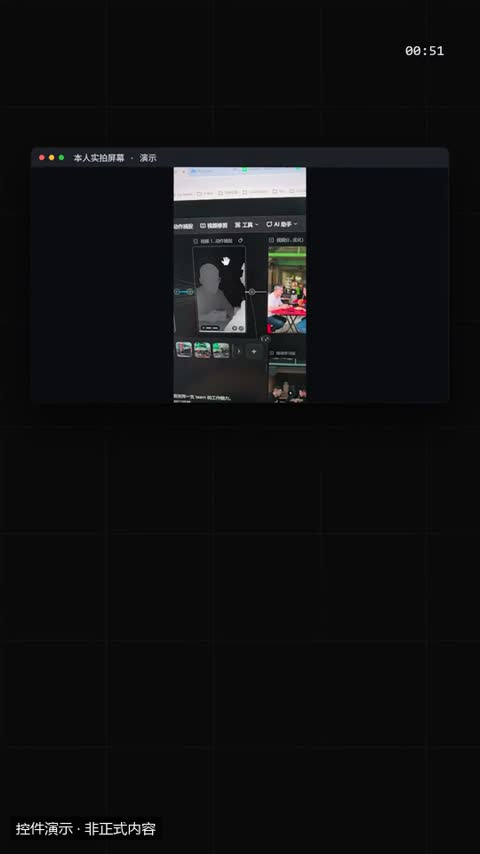
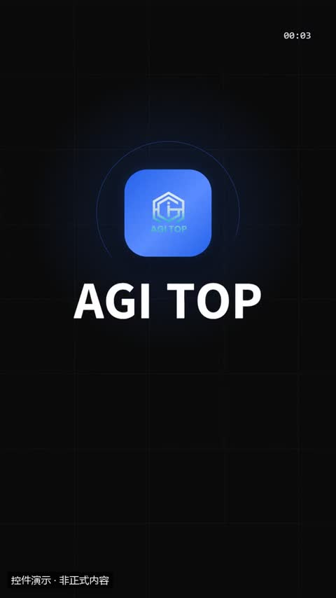
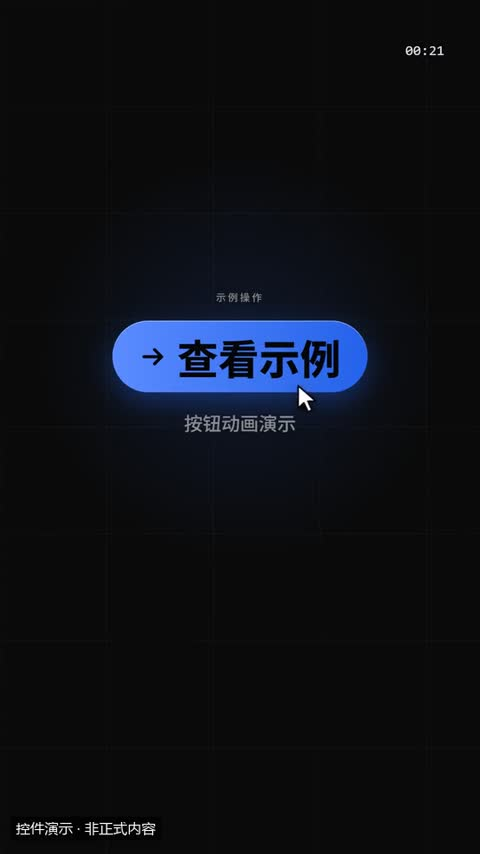
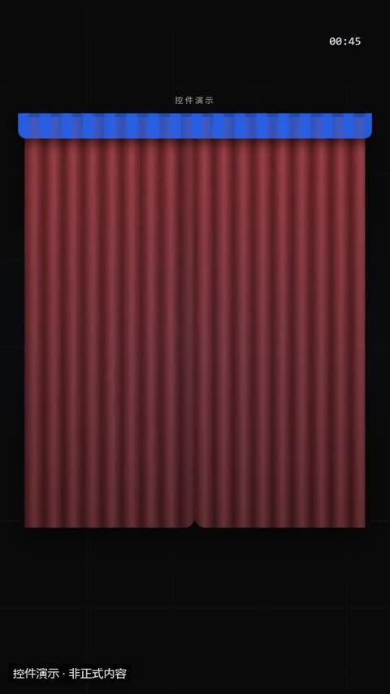
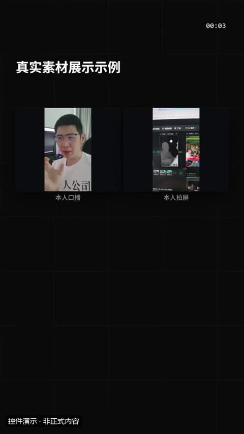
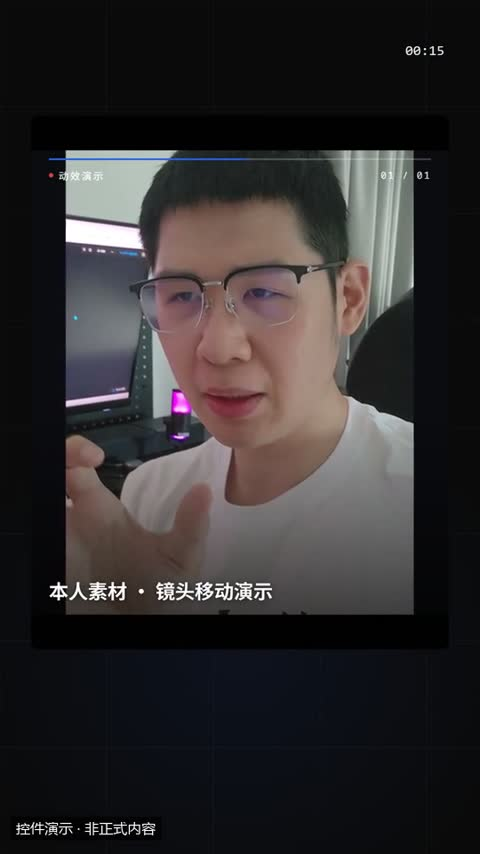
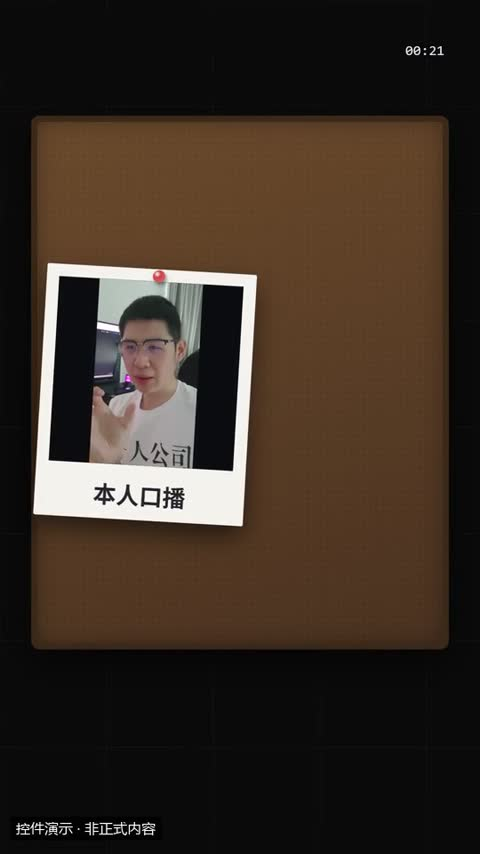
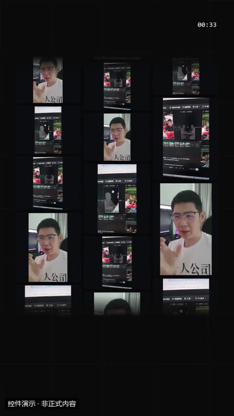
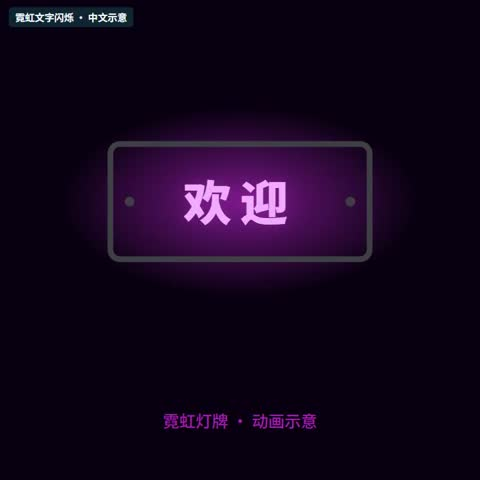
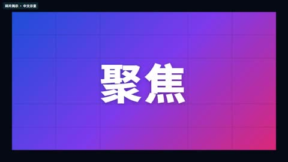

# 产品与案例展示 · 特效模板详细说明

[返回全部分类](../README.zh-CN.md) · [学习自动剪辑](../../docs/NOTION_GUIDE.zh-CN.md) · [在线筛选与播放](https://aicut.agi-top.com)

本页 29 个目录条目；每项固定七段，参数依据与使用状态独立标注。先准备自己的合法素材，再按对应版本检查依赖和预览。

[多屏拼贴 · 品牌宣传](#mg-style-128610) · [像素闯关 · 产品宣传](#mg-style-252912) · [明暗快切 · 产品宣传](#mg-style-867595) · [模块拼贴 · 创作者宣传](#mg-style-452365) · [工程蓝图 · 产品拆解](#mg-style-213827) · [发布会舞台 · 产品演示](#mg-style-667934) · [宣纸手卷 · 品牌叙事](#mg-style-394243) · [拼贴出场 · COLLAGE OPEN](#mg-style-873) · [多屏墙换版 · WALL SWAP](#mg-style-874) · [四种看法与片格 · VIEWS / STRIP](#mg-style-875) · [产品与品牌 · PRODUCT → BRAND](#mg-style-877) · [DEEP STAGE 产品讲解](#mg-style-648878) · [多屏商务 · 动态图表](#mg-style-640261) · [录屏 / 图片窗](#mg-control-media) · [Logo 揭示](#mg-control-logo) · [行动号召](#mg-control-cta) · [揭晓 / 抽奖](#mg-control-reveal) · [图集](#mg-control-gallery) · [纪录片推拉](#mg-control-kenburns) · [拍立得](#mg-control-polaroid) · [拼贴墙](#mg-control-collage) · [笔刷揭示](#remotion-brush-stroke-reveal) · [Logo由模糊变清晰](#remotion-logo-blur-reveal) · [Logo弹落](#remotion-logo-bounce-drop) · [Logo遮罩擦入](#remotion-logo-mask-wipe) · [Logo分裂揭示](#remotion-logo-split-reveal) · [Logo描边绘制](#remotion-logo-stroke-draw) · [霓虹文字闪烁](#remotion-neon-sign) · [碎片揭示](#remotion-shatter-reveal)

<a id="mg-style-128610"></a>

### 多屏拼贴 · 品牌宣传

`mg-style-128610` · 产品与案例展示 · 产品宣传与教程 · **官方参考 · 先取得并核对原包**

用多屏拼贴、版面切换和品牌收尾展示产品与创作流程，适合品牌介绍和工具宣传。

**1. 效果预览**

[](https://media.openaicut.com/previews/585/draft-zh-78bba5fd21f6.mp4)

- [官方示例 1 · 16:9](https://media.openaicut.com/previews/585/draft-zh-78bba5fd21f6.mp4)：官方目录演示；文件不保证对应所列最新版本，未逐条播放验收。

**2. 适用内容**

- 品牌介绍、工具宣传与多个作品画面的并置

- 宣传镜头不能替代真实操作证据；不编造功能、收益、案例数据或素材授权。

**3. 所需素材**

- 提供产品名称、准确的功能与主张、短标题、网址，以及有权使用的品牌素材。改写了有声内容时，提供对应的新配音或授权制作配音，并重新核对配乐、音效与画面同步。

**4. 可改参数与限制**

按已核对的字段与限制修改；尚未核对的能力会明确标注。

<details>
<summary>查看参数、限制与来源依据</summary>

- 尚未核对可替换参数合同；请先读原模板的 guide/schema 或源码。不能根据 Demo 推断能任意换颜色、数量、比例或时长。

- 文字容量、素材数量、颜色、时长和画幅的可调范围，按对应版本的实际合同核对；演示规格不等于任意规格都受支持。

</details>

**5. 怎样交给 AI 使用**

<details>
<summary>复制本模板的使用提示词</summary>

```text
请使用 AI Cut 模板目录中的「多屏拼贴 · 品牌宣传」（编号 mg-style-128610）。
我的内容或原片：[填写]；输出比例：[填写]；需要强调的内容：[填写]。
先核对本条来源、当前状态、素材和参数合同；使用我自己的获授权素材，保留原声原意。
按照本条已支持的参数范围做短预览，确认文字、动作和声音的时间一致，再放入剪辑工程。
若原包、依赖或素材缺失，说明缺什么；遇到费用先告诉我。不要将示例人物或示例数据当成我的内容。
```

</details>

**6. 当前能否使用**

- 官方参考 · 先取得并核对原包
- 可取得状态：以官网当前页面为准
- 登记基线版本：2.6.4。新输入、新电脑和其他变体须另行验证。

<details>
<summary>查看原始检查范围与接入记录</summary>

- 官方目录提供 Demo 链接；本次核对了来源字段与链接完整性，未逐条播放、验证下载权限、运行或整套成片。

</details>

**7. 来源与许可**

- 目录声明开源；代码、字体与素材许可须逐包核对，本索引未逐包审定。

[原始来源](https://motiongit.com/@motiongit/motiongit-promo-main) · [上游技术资料](https://github.com/motiontemplates/128610)

---

<a id="mg-style-252912"></a>

### 像素闯关 · 产品宣传

`mg-style-252912` · 产品与案例展示 · 产品宣传与教程 · **官方参考 · 先取得并核对原包**

像素城市、角色闯关和复古游戏音色组成产品介绍，适合数字工具与功能说明。

**1. 效果预览**

[](https://media.openaicut.com/previews/586/draft-zh-b8792f9887ad.mp4)

- [官方示例 1 · 16:9](https://media.openaicut.com/previews/586/draft-zh-b8792f9887ad.mp4)：官方目录演示；文件不保证对应所列最新版本，未逐条播放验收。

**2. 适用内容**

- 数字工具和功能说明的复古闯关式宣传

- 宣传镜头不能替代真实操作证据；不编造功能、收益、案例数据或素材授权。

**3. 所需素材**

- 提供产品名称、准确的功能与主张、短标题、网址，以及有权使用的品牌素材。改写了有声内容时，提供对应的新配音或授权制作配音，并重新核对配乐、音效与画面同步。 像素场景中的小屏标题有字符与长度限制；保留像素风格时，按包内指南使用短标题并检查实际显示。

**4. 可改参数与限制**

按已核对的字段与限制修改；尚未核对的能力会明确标注。

<details>
<summary>查看参数、限制与来源依据</summary>

- 尚未核对可替换参数合同；请先读原模板的 guide/schema 或源码。不能根据 Demo 推断能任意换颜色、数量、比例或时长。

- 文字容量、素材数量、颜色、时长和画幅的可调范围，按对应版本的实际合同核对；演示规格不等于任意规格都受支持。

</details>

**5. 怎样交给 AI 使用**

<details>
<summary>复制本模板的使用提示词</summary>

```text
请使用 AI Cut 模板目录中的「像素闯关 · 产品宣传」（编号 mg-style-252912）。
我的内容或原片：[填写]；输出比例：[填写]；需要强调的内容：[填写]。
先核对本条来源、当前状态、素材和参数合同；使用我自己的获授权素材，保留原声原意。
按照本条已支持的参数范围做短预览，确认文字、动作和声音的时间一致，再放入剪辑工程。
若原包、依赖或素材缺失，说明缺什么；遇到费用先告诉我。不要将示例人物或示例数据当成我的内容。
```

</details>

**6. 当前能否使用**

- 官方参考 · 先取得并核对原包
- 可取得状态：以官网当前页面为准
- 登记基线版本：2.6.6。新输入、新电脑和其他变体须另行验证。

<details>
<summary>查看原始检查范围与接入记录</summary>

- 官方目录提供 Demo 链接；本次核对了来源字段与链接完整性，未逐条播放、验证下载权限、运行或整套成片。

</details>

**7. 来源与许可**

- 目录声明开源；代码、字体与素材许可须逐包核对，本索引未逐包审定。

[原始来源](https://motiongit.com/@motiongit/motiongit-promo-pixel) · [上游技术资料](https://github.com/motiontemplates/252912)

---

<a id="mg-style-867595"></a>

### 明暗快切 · 产品宣传

`mg-style-867595` · 产品与案例展示 · 产品宣传与教程 · **官方参考 · 先取得并核对原包**

明暗画面快速切换，结合大字和界面展示突出产品功能，适合节奏鲜明的宣传片。

**1. 效果预览**

[](https://media.openaicut.com/previews/587/draft-zh-89b65ccfd5ce.mp4)

- [官方示例 1 · 16:9](https://media.openaicut.com/previews/587/draft-zh-89b65ccfd5ce.mp4)：官方目录演示；文件不保证对应所列最新版本，未逐条播放验收。

**2. 适用内容**

- 突出单一产品功能的快节奏宣传

- 宣传镜头不能替代真实操作证据；不编造功能、收益、案例数据或素材授权。

**3. 所需素材**

- 提供产品名称、准确的功能与主张、短标题、网址，以及有权使用的品牌素材。改写了有声内容时，提供对应的新配音或授权制作配音，并重新核对配乐、音效与画面同步。

**4. 可改参数与限制**

按已核对的字段与限制修改；尚未核对的能力会明确标注。

<details>
<summary>查看参数、限制与来源依据</summary>

- 尚未核对可替换参数合同；请先读原模板的 guide/schema 或源码。不能根据 Demo 推断能任意换颜色、数量、比例或时长。

- 文字容量、素材数量、颜色、时长和画幅的可调范围，按对应版本的实际合同核对；演示规格不等于任意规格都受支持。

</details>

**5. 怎样交给 AI 使用**

<details>
<summary>复制本模板的使用提示词</summary>

```text
请使用 AI Cut 模板目录中的「明暗快切 · 产品宣传」（编号 mg-style-867595）。
我的内容或原片：[填写]；输出比例：[填写]；需要强调的内容：[填写]。
先核对本条来源、当前状态、素材和参数合同；使用我自己的获授权素材，保留原声原意。
按照本条已支持的参数范围做短预览，确认文字、动作和声音的时间一致，再放入剪辑工程。
若原包、依赖或素材缺失，说明缺什么；遇到费用先告诉我。不要将示例人物或示例数据当成我的内容。
```

</details>

**6. 当前能否使用**

- 官方参考 · 先取得并核对原包
- 可取得状态：以官网当前页面为准
- 登记基线版本：2.6.4。新输入、新电脑和其他变体须另行验证。

<details>
<summary>查看原始检查范围与接入记录</summary>

- 官方目录提供 Demo 链接；本次核对了来源字段与链接完整性，未逐条播放、验证下载权限、运行或整套成片。

</details>

**7. 来源与许可**

- 目录声明开源；代码、字体与素材许可须逐包核对，本索引未逐包审定。

[原始来源](https://motiongit.com/@motiongit/motiongit-promo-velocity) · [上游技术资料](https://github.com/motiontemplates/867595)

---

<a id="mg-style-452365"></a>

### 模块拼贴 · 创作者宣传

`mg-style-452365` · 产品与案例展示 · 产品宣传与教程 · **官方参考 · 先取得并核对原包**

以模块拼贴呈现内容、素材和动画的组合关系，适合创作者工具与工作方式介绍。

**1. 效果预览**

[](https://media.openaicut.com/previews/589/draft-zh-4d806a380523.mp4)

- [官方示例 1 · 16:9](https://media.openaicut.com/previews/589/draft-zh-4d806a380523.mp4)：官方目录演示；文件不保证对应所列最新版本，未逐条播放验收。

**2. 适用内容**

- 创作者工作方式、内容和素材组合关系的展示

- 宣传镜头不能替代真实操作证据；不编造功能、收益、案例数据或素材授权。

**3. 所需素材**

- 提供产品名称、准确的功能与主张、短标题、网址，以及有权使用的品牌素材。改写了有声内容时，提供对应的新配音或授权制作配音，并重新核对配乐、音效与画面同步。

**4. 可改参数与限制**

按已核对的字段与限制修改；尚未核对的能力会明确标注。

<details>
<summary>查看参数、限制与来源依据</summary>

- 尚未核对可替换参数合同；请先读原模板的 guide/schema 或源码。不能根据 Demo 推断能任意换颜色、数量、比例或时长。

- 文字容量、素材数量、颜色、时长和画幅的可调范围，按对应版本的实际合同核对；演示规格不等于任意规格都受支持。

</details>

**5. 怎样交给 AI 使用**

<details>
<summary>复制本模板的使用提示词</summary>

```text
请使用 AI Cut 模板目录中的「模块拼贴 · 创作者宣传」（编号 mg-style-452365）。
我的内容或原片：[填写]；输出比例：[填写]；需要强调的内容：[填写]。
先核对本条来源、当前状态、素材和参数合同；使用我自己的获授权素材，保留原声原意。
按照本条已支持的参数范围做短预览，确认文字、动作和声音的时间一致，再放入剪辑工程。
若原包、依赖或素材缺失，说明缺什么；遇到费用先告诉我。不要将示例人物或示例数据当成我的内容。
```

</details>

**6. 当前能否使用**

- 官方参考 · 先取得并核对原包
- 可取得状态：以官网当前页面为准
- 登记基线版本：2.6.4。新输入、新电脑和其他变体须另行验证。

<details>
<summary>查看原始检查范围与接入记录</summary>

- 官方目录提供 Demo 链接；本次核对了来源字段与链接完整性，未逐条播放、验证下载权限、运行或整套成片。

</details>

**7. 来源与许可**

- 目录声明开源；代码、字体与素材许可须逐包核对，本索引未逐包审定。

[原始来源](https://motiongit.com/@motiongit/motiongit-promo-creator) · [上游技术资料](https://github.com/motiontemplates/452365)

---

<a id="mg-style-213827"></a>

### 工程蓝图 · 产品拆解

`mg-style-213827` · 产品与案例展示 · 产品宣传与教程 · **官方参考 · 先取得并核对原包**

以工程蓝图、结构示意和模块拆解展示产品组成，适合技术产品与工作流讲解。

**1. 效果预览**

[](https://media.openaicut.com/previews/590/draft-zh-308a5a69232f.mp4)

- [官方示例 1 · 16:9](https://media.openaicut.com/previews/590/draft-zh-308a5a69232f.mp4)：官方目录演示；文件不保证对应所列最新版本，未逐条播放验收。

**2. 适用内容**

- 技术产品组成、模块关系和工作流拆解

- 宣传镜头不能替代真实操作证据；不编造功能、收益、案例数据或素材授权。

**3. 所需素材**

- 提供产品名称、准确的功能与主张、短标题、网址，以及有权使用的品牌素材。改写了有声内容时，提供对应的新配音或授权制作配音，并重新核对配乐、音效与画面同步。

**4. 可改参数与限制**

按已核对的字段与限制修改；尚未核对的能力会明确标注。

<details>
<summary>查看参数、限制与来源依据</summary>

- 尚未核对可替换参数合同；请先读原模板的 guide/schema 或源码。不能根据 Demo 推断能任意换颜色、数量、比例或时长。

- 文字容量、素材数量、颜色、时长和画幅的可调范围，按对应版本的实际合同核对；演示规格不等于任意规格都受支持。

</details>

**5. 怎样交给 AI 使用**

<details>
<summary>复制本模板的使用提示词</summary>

```text
请使用 AI Cut 模板目录中的「工程蓝图 · 产品拆解」（编号 mg-style-213827）。
我的内容或原片：[填写]；输出比例：[填写]；需要强调的内容：[填写]。
先核对本条来源、当前状态、素材和参数合同；使用我自己的获授权素材，保留原声原意。
按照本条已支持的参数范围做短预览，确认文字、动作和声音的时间一致，再放入剪辑工程。
若原包、依赖或素材缺失，说明缺什么；遇到费用先告诉我。不要将示例人物或示例数据当成我的内容。
```

</details>

**6. 当前能否使用**

- 官方参考 · 先取得并核对原包
- 可取得状态：以官网当前页面为准
- 登记基线版本：2.6.4。新输入、新电脑和其他变体须另行验证。

<details>
<summary>查看原始检查范围与接入记录</summary>

- 官方目录提供 Demo 链接；本次核对了来源字段与链接完整性，未逐条播放、验证下载权限、运行或整套成片。

</details>

**7. 来源与许可**

- 目录声明开源；代码、字体与素材许可须逐包核对，本索引未逐包审定。

[原始来源](https://motiongit.com/@motiongit/motiongit-promo-blueprint) · [上游技术资料](https://github.com/motiontemplates/213827)

---

<a id="mg-style-667934"></a>

### 发布会舞台 · 产品演示

`mg-style-667934` · 产品与案例展示 · 产品宣传与教程 · **官方参考 · 先取得并核对原包**

以发布会舞台和大屏展示组织产品演示，适合新品介绍、功能发布与品牌展示。

**1. 效果预览**

[](https://media.openaicut.com/previews/591/draft-zh-958b2690a669.mp4)

- [官方示例 1 · 16:9](https://media.openaicut.com/previews/591/draft-zh-958b2690a669.mp4)：官方目录演示；文件不保证对应所列最新版本，未逐条播放验收。

**2. 适用内容**

- 新品介绍、功能发布与大屏产品演示

- 宣传镜头不能替代真实操作证据；不编造功能、收益、案例数据或素材授权。

**3. 所需素材**

- 提供产品名称、准确的功能与主张、短标题、网址，以及有权使用的品牌素材。改写了有声内容时，提供对应的新配音或授权制作配音，并重新核对配乐、音效与画面同步。

**4. 可改参数与限制**

按已核对的字段与限制修改；尚未核对的能力会明确标注。

<details>
<summary>查看参数、限制与来源依据</summary>

- 尚未核对可替换参数合同；请先读原模板的 guide/schema 或源码。不能根据 Demo 推断能任意换颜色、数量、比例或时长。

- 文字容量、素材数量、颜色、时长和画幅的可调范围，按对应版本的实际合同核对；演示规格不等于任意规格都受支持。

</details>

**5. 怎样交给 AI 使用**

<details>
<summary>复制本模板的使用提示词</summary>

```text
请使用 AI Cut 模板目录中的「发布会舞台 · 产品演示」（编号 mg-style-667934）。
我的内容或原片：[填写]；输出比例：[填写]；需要强调的内容：[填写]。
先核对本条来源、当前状态、素材和参数合同；使用我自己的获授权素材，保留原声原意。
按照本条已支持的参数范围做短预览，确认文字、动作和声音的时间一致，再放入剪辑工程。
若原包、依赖或素材缺失，说明缺什么；遇到费用先告诉我。不要将示例人物或示例数据当成我的内容。
```

</details>

**6. 当前能否使用**

- 官方参考 · 先取得并核对原包
- 可取得状态：以官网当前页面为准
- 登记基线版本：2.6.4。新输入、新电脑和其他变体须另行验证。

<details>
<summary>查看原始检查范围与接入记录</summary>

- 官方目录提供 Demo 链接；本次核对了来源字段与链接完整性，未逐条播放、验证下载权限、运行或整套成片。

</details>

**7. 来源与许可**

- 目录声明开源；代码、字体与素材许可须逐包核对，本索引未逐包审定。

[原始来源](https://motiongit.com/@motiongit/motiongit-promo-keynote) · [上游技术资料](https://github.com/motiontemplates/667934)

---

<a id="mg-style-394243"></a>

### 宣纸手卷 · 品牌叙事

`mg-style-394243` · 产品与案例展示 · 产品宣传与教程 · **官方参考 · 先取得并核对原包**

沿宣纸手卷展开品牌故事，以水墨意象和卷轴转场营造东方叙事。

**1. 效果预览**

[](https://media.openaicut.com/previews/592/draft-zh-eba2e4e6f671.mp4)

- [官方示例 1 · 16:9](https://media.openaicut.com/previews/592/draft-zh-eba2e4e6f671.mp4)：官方目录演示；文件不保证对应所列最新版本，未逐条播放验收。

**2. 适用内容**

- 品牌经历与东方视觉叙事

- 宣传镜头不能替代真实操作证据；不编造功能、收益、案例数据或素材授权。

**3. 所需素材**

- 提供产品名称、准确的功能与主张、短标题、网址，以及有权使用的品牌素材。改写了有声内容时，提供对应的新配音或授权制作配音，并重新核对配乐、音效与画面同步。

**4. 可改参数与限制**

按已核对的字段与限制修改；尚未核对的能力会明确标注。

<details>
<summary>查看参数、限制与来源依据</summary>

- 尚未核对可替换参数合同；请先读原模板的 guide/schema 或源码。不能根据 Demo 推断能任意换颜色、数量、比例或时长。

- 文字容量、素材数量、颜色、时长和画幅的可调范围，按对应版本的实际合同核对；演示规格不等于任意规格都受支持。

</details>

**5. 怎样交给 AI 使用**

<details>
<summary>复制本模板的使用提示词</summary>

```text
请使用 AI Cut 模板目录中的「宣纸手卷 · 品牌叙事」（编号 mg-style-394243）。
我的内容或原片：[填写]；输出比例：[填写]；需要强调的内容：[填写]。
先核对本条来源、当前状态、素材和参数合同；使用我自己的获授权素材，保留原声原意。
按照本条已支持的参数范围做短预览，确认文字、动作和声音的时间一致，再放入剪辑工程。
若原包、依赖或素材缺失，说明缺什么；遇到费用先告诉我。不要将示例人物或示例数据当成我的内容。
```

</details>

**6. 当前能否使用**

- 官方参考 · 先取得并核对原包
- 可取得状态：以官网当前页面为准
- 登记基线版本：2.6.6。新输入、新电脑和其他变体须另行验证。

<details>
<summary>查看原始检查范围与接入记录</summary>

- 官方目录提供 Demo 链接；本次核对了来源字段与链接完整性，未逐条播放、验证下载权限、运行或整套成片。

</details>

**7. 来源与许可**

- 目录声明开源；代码、字体与素材许可须逐包核对，本索引未逐包审定。

[原始来源](https://motiongit.com/@motiongit/motiongit-promo-ink) · [上游技术资料](https://github.com/motiontemplates/394243)

---

<a id="mg-style-873"></a>

### 拼贴出场 · COLLAGE OPEN

`mg-style-873` · 产品与案例展示 · 产品宣传与教程 · **官方参考 · 先取得并核对原包**

8.5 秒拼贴出场：9 块创作样张依次飞入拼贴墙，主张版块落位。可换品牌名、片头编号、强调色与两行标题。

**1. 效果预览**

[](https://media.openaicut.com/previews/873/1.0.0-zh-6b7b749b3dc5.mp4)

- [官方示例 1 · 16:9](https://media.openaicut.com/previews/873/1.0.0-zh-6b7b749b3dc5.mp4)：官方目录演示；文件不保证对应所列最新版本，未逐条播放验收。

**2. 适用内容**

- 作品样张拼贴和品牌主张的短开场

- 宣传镜头不能替代真实操作证据；不编造功能、收益、案例数据或素材授权。

**3. 所需素材**

- 公开目录未列具体输入；制作前须读取本条包的 guide、素材槽和运行契约，不能从 Demo 猜参数。

**4. 可改参数与限制**

按已核对的字段与限制修改；尚未核对的能力会明确标注。

<details>
<summary>查看参数、限制与来源依据</summary>

- 尚未核对可替换参数合同；请先读原模板的 guide/schema 或源码。不能根据 Demo 推断能任意换颜色、数量、比例或时长。

- 文字容量、素材数量、颜色、时长和画幅的可调范围，按对应版本的实际合同核对；演示规格不等于任意规格都受支持。

</details>

**5. 怎样交给 AI 使用**

<details>
<summary>复制本模板的使用提示词</summary>

```text
请使用 AI Cut 模板目录中的「拼贴出场 · COLLAGE OPEN」（编号 mg-style-873）。
我的内容或原片：[填写]；输出比例：[填写]；需要强调的内容：[填写]。
先核对本条来源、当前状态、素材和参数合同；使用我自己的获授权素材，保留原声原意。
按照本条已支持的参数范围做短预览，确认文字、动作和声音的时间一致，再放入剪辑工程。
若原包、依赖或素材缺失，说明缺什么；遇到费用先告诉我。不要将示例人物或示例数据当成我的内容。
```

</details>

**6. 当前能否使用**

- 官方参考 · 先取得并核对原包
- 可取得状态：以官网当前页面为准
- 登记基线版本：1.0.0。新输入、新电脑和其他变体须另行验证。

<details>
<summary>查看原始检查范围与接入记录</summary>

- 官方目录提供 Demo 链接；本次核对了来源字段与链接完整性，未逐条播放、验证下载权限、运行或整套成片。

</details>

**7. 来源与许可**

- 目录声明开源；代码、字体与素材许可须逐包核对，本索引未逐包审定。

[原始来源](https://motiongit.com/@thepandaq/collage-open)

---

<a id="mg-style-874"></a>

### 多屏墙换版 · WALL SWAP

`mg-style-874` · 产品与案例展示 · 产品宣传与教程 · **官方参考 · 先取得并核对原包**

从面板擦除进入多屏拼贴墙，再切到「一个想法，四种看法」的分屏版面；8.6 秒展示多素材并置与版面切换。可换品牌名、片头编号、强调色与两行标题。

**1. 效果预览**

[](https://media.openaicut.com/previews/874/1.0.0-zh-7831dd69bc6b.mp4)

- [官方示例 1 · 16:9](https://media.openaicut.com/previews/874/1.0.0-zh-7831dd69bc6b.mp4)：官方目录演示；文件不保证对应所列最新版本，未逐条播放验收。

**2. 适用内容**

- 多素材并置及分屏版面的切换

- 宣传镜头不能替代真实操作证据；不编造功能、收益、案例数据或素材授权。

**3. 所需素材**

- 公开目录未列具体输入；制作前须读取本条包的 guide、素材槽和运行契约，不能从 Demo 猜参数。

**4. 可改参数与限制**

按已核对的字段与限制修改；尚未核对的能力会明确标注。

<details>
<summary>查看参数、限制与来源依据</summary>

- 尚未核对可替换参数合同；请先读原模板的 guide/schema 或源码。不能根据 Demo 推断能任意换颜色、数量、比例或时长。

- 文字容量、素材数量、颜色、时长和画幅的可调范围，按对应版本的实际合同核对；演示规格不等于任意规格都受支持。

</details>

**5. 怎样交给 AI 使用**

<details>
<summary>复制本模板的使用提示词</summary>

```text
请使用 AI Cut 模板目录中的「多屏墙换版 · WALL SWAP」（编号 mg-style-874）。
我的内容或原片：[填写]；输出比例：[填写]；需要强调的内容：[填写]。
先核对本条来源、当前状态、素材和参数合同；使用我自己的获授权素材，保留原声原意。
按照本条已支持的参数范围做短预览，确认文字、动作和声音的时间一致，再放入剪辑工程。
若原包、依赖或素材缺失，说明缺什么；遇到费用先告诉我。不要将示例人物或示例数据当成我的内容。
```

</details>

**6. 当前能否使用**

- 官方参考 · 先取得并核对原包
- 可取得状态：以官网当前页面为准
- 登记基线版本：1.0.0。新输入、新电脑和其他变体须另行验证。

<details>
<summary>查看原始检查范围与接入记录</summary>

- 官方目录提供 Demo 链接；本次核对了来源字段与链接完整性，未逐条播放、验证下载权限、运行或整套成片。

</details>

**7. 来源与许可**

- 目录声明开源；代码、字体与素材许可须逐包核对，本索引未逐包审定。

[原始来源](https://motiongit.com/@thepandaq/collage-wall)

---

<a id="mg-style-875"></a>

### 四种看法与片格 · VIEWS / STRIP

`mg-style-875` · 产品与案例展示 · 产品宣传与教程 · **官方参考 · 先取得并核对原包**

「一个想法，四种看法」分屏版面切到横滚片格，真实晚霞树影与创作样张横向滚动；8.2 秒，适合多镜头并置与作品条带展示。

**1. 效果预览**

[](https://media.openaicut.com/previews/875/1.0.0-zh-cd8ad1570460.mp4)

- [官方示例 1 · 16:9](https://media.openaicut.com/previews/875/1.0.0-zh-cd8ad1570460.mp4)：官方目录演示；文件不保证对应所列最新版本，未逐条播放验收。

**2. 适用内容**

- 同一主题的多镜头比较和作品条带展示

- 宣传镜头不能替代真实操作证据；不编造功能、收益、案例数据或素材授权。

**3. 所需素材**

- 公开目录未列具体输入；制作前须读取本条包的 guide、素材槽和运行契约，不能从 Demo 猜参数。

**4. 可改参数与限制**

按已核对的字段与限制修改；尚未核对的能力会明确标注。

<details>
<summary>查看参数、限制与来源依据</summary>

- 尚未核对可替换参数合同；请先读原模板的 guide/schema 或源码。不能根据 Demo 推断能任意换颜色、数量、比例或时长。

- 文字容量、素材数量、颜色、时长和画幅的可调范围，按对应版本的实际合同核对；演示规格不等于任意规格都受支持。

</details>

**5. 怎样交给 AI 使用**

<details>
<summary>复制本模板的使用提示词</summary>

```text
请使用 AI Cut 模板目录中的「四种看法与片格 · VIEWS / STRIP」（编号 mg-style-875）。
我的内容或原片：[填写]；输出比例：[填写]；需要强调的内容：[填写]。
先核对本条来源、当前状态、素材和参数合同；使用我自己的获授权素材，保留原声原意。
按照本条已支持的参数范围做短预览，确认文字、动作和声音的时间一致，再放入剪辑工程。
若原包、依赖或素材缺失，说明缺什么；遇到费用先告诉我。不要将示例人物或示例数据当成我的内容。
```

</details>

**6. 当前能否使用**

- 官方参考 · 先取得并核对原包
- 可取得状态：以官网当前页面为准
- 登记基线版本：1.0.0。新输入、新电脑和其他变体须另行验证。

<details>
<summary>查看原始检查范围与接入记录</summary>

- 官方目录提供 Demo 链接；本次核对了来源字段与链接完整性，未逐条播放、验证下载权限、运行或整套成片。

</details>

**7. 来源与许可**

- 目录声明开源；代码、字体与素材许可须逐包核对，本索引未逐包审定。

[原始来源](https://motiongit.com/@thepandaq/collage-views)

---

<a id="mg-style-877"></a>

### 产品与品牌 · PRODUCT → BRAND

`mg-style-877` · 产品与案例展示 · 产品宣传与教程 · **官方参考 · 先取得并核对原包**

从面板擦除进入产品工作台（分镜/画布/调色/时间线同窗联动），再以墨色擦除收进棱镜标志、字标、主张与 CTA；14.4 秒，适合产品演示与品牌落版。

**1. 效果预览**

[](https://media.openaicut.com/previews/877/1.0.0-zh-97910ee13592.mp4)

- [官方示例 1 · 16:9](https://media.openaicut.com/previews/877/1.0.0-zh-97910ee13592.mp4)：官方目录演示；文件不保证对应所列最新版本，未逐条播放验收。

**2. 适用内容**

- 产品工作台流程展示与品牌 CTA 收束

- 宣传镜头不能替代真实操作证据；不编造功能、收益、案例数据或素材授权。

**3. 所需素材**

- 公开目录未列具体输入；制作前须读取本条包的 guide、素材槽和运行契约，不能从 Demo 猜参数。

**4. 可改参数与限制**

按已核对的字段与限制修改；尚未核对的能力会明确标注。

<details>
<summary>查看参数、限制与来源依据</summary>

- 尚未核对可替换参数合同；请先读原模板的 guide/schema 或源码。不能根据 Demo 推断能任意换颜色、数量、比例或时长。

- 文字容量、素材数量、颜色、时长和画幅的可调范围，按对应版本的实际合同核对；演示规格不等于任意规格都受支持。

</details>

**5. 怎样交给 AI 使用**

<details>
<summary>复制本模板的使用提示词</summary>

```text
请使用 AI Cut 模板目录中的「产品与品牌 · PRODUCT → BRAND」（编号 mg-style-877）。
我的内容或原片：[填写]；输出比例：[填写]；需要强调的内容：[填写]。
先核对本条来源、当前状态、素材和参数合同；使用我自己的获授权素材，保留原声原意。
按照本条已支持的参数范围做短预览，确认文字、动作和声音的时间一致，再放入剪辑工程。
若原包、依赖或素材缺失，说明缺什么；遇到费用先告诉我。不要将示例人物或示例数据当成我的内容。
```

</details>

**6. 当前能否使用**

- 官方参考 · 先取得并核对原包
- 可取得状态：以官网当前页面为准
- 登记基线版本：1.0.0。新输入、新电脑和其他变体须另行验证。

<details>
<summary>查看原始检查范围与接入记录</summary>

- 官方目录提供 Demo 链接；本次核对了来源字段与链接完整性，未逐条播放、验证下载权限、运行或整套成片。

</details>

**7. 来源与许可**

- 目录声明开源；代码、字体与素材许可须逐包核对，本索引未逐包审定。

[原始来源](https://motiongit.com/@thepandaq/collage-product)

---

<a id="mg-style-648878"></a>

### DEEP STAGE 产品讲解

`mg-style-648878` · 产品与案例展示 · 产品宣传与教程 · **官方参考 · 先取得并核对原包**

产品讲解动效：产品主屏推入并持续推近，3 个参数切片从 3D 空间错峰浮出、数字从 0 滚到终值，右下角人物小画中画入位。12 秒，适合产品卖点与参数讲解。

**1. 效果预览**

[](https://media.openaicut.com/previews/881/1.0.0-bf4d2ce8953d.mp4)

- [官方示例 1 · 16:9](https://media.openaicut.com/previews/881/1.0.0-bf4d2ce8953d.mp4)：官方目录演示；文件不保证对应所列最新版本，未逐条播放验收。

**2. 适用内容**

- 产品卖点、参数与人物解说的短场景

- 宣传镜头不能替代真实操作证据；不编造功能、收益、案例数据或素材授权。

**3. 所需素材**

- 公开目录未列具体输入；制作前须读取本条包的 guide、素材槽和运行契约，不能从 Demo 猜参数。

**4. 可改参数与限制**

按已核对的字段与限制修改；尚未核对的能力会明确标注。

<details>
<summary>查看参数、限制与来源依据</summary>

- 尚未核对可替换参数合同；请先读原模板的 guide/schema 或源码。不能根据 Demo 推断能任意换颜色、数量、比例或时长。

- 文字容量、素材数量、颜色、时长和画幅的可调范围，按对应版本的实际合同核对；演示规格不等于任意规格都受支持。

</details>

**5. 怎样交给 AI 使用**

<details>
<summary>复制本模板的使用提示词</summary>

```text
请使用 AI Cut 模板目录中的「DEEP STAGE 产品讲解」（编号 mg-style-648878）。
我的内容或原片：[填写]；输出比例：[填写]；需要强调的内容：[填写]。
先核对本条来源、当前状态、素材和参数合同；使用我自己的获授权素材，保留原声原意。
按照本条已支持的参数范围做短预览，确认文字、动作和声音的时间一致，再放入剪辑工程。
若原包、依赖或素材缺失，说明缺什么；遇到费用先告诉我。不要将示例人物或示例数据当成我的内容。
```

</details>

**6. 当前能否使用**

- 官方参考 · 先取得并核对原包
- 可取得状态：以官网当前页面为准
- 登记基线版本：1.0.0。新输入、新电脑和其他变体须另行验证。

<details>
<summary>查看原始检查范围与接入记录</summary>

- 官方目录提供 Demo 链接；本次核对了来源字段与链接完整性，未逐条播放、验证下载权限、运行或整套成片。

</details>

**7. 来源与许可**

- 目录声明开源；代码、字体与素材许可须逐包核对，本索引未逐包审定。

[原始来源](https://motiongit.com/@thepandaq/deep-stage-product-focus)

---

<a id="mg-style-640261"></a>

### 多屏商务 · 动态图表

`mg-style-640261` · 产品与案例展示 · 产品宣传与教程 · **官方参考 · 先取得并核对原包**

固定20秒横屏商务短片，以多屏重排呈现团队、比较、趋势、构成与行动。

**1. 效果预览**

[](https://media.openaicut.com/previews/891/0.1.1-candidate-zh-a43ff10687ec.mp4)

- [官方示例 1 · 16:9](https://media.openaicut.com/previews/891/0.1.1-candidate-zh-a43ff10687ec.mp4)：官方目录演示；文件不保证对应所列最新版本，未逐条播放验收。

**2. 适用内容**

- 有来源的团队、比较、趋势、构成和排行数据的商务短片

- 宣传镜头不能替代真实操作证据；不编造功能、收益、案例数据或素材授权。

**3. 所需素材**

- 三张有使用权的 JPG/PNG 照片，以及有来源的比较、趋势、构成和排行数据。
- 六段标题与说明、品牌角标、六色配色；固定 20 秒合同与容量需按包内说明核对。
- 官方说明默认仅动作音效；如需另加音乐，须明确选择并绑定有授权的文件。

**4. 可改参数与限制**

按已核对的字段与限制修改；尚未核对的能力会明确标注。

<details>
<summary>查看参数、限制与来源依据</summary>

- 尚未核对可替换参数合同；请先读原模板的 guide/schema 或源码。不能根据 Demo 推断能任意换颜色、数量、比例或时长。

- 文字容量、素材数量、颜色、时长和画幅的可调范围，按对应版本的实际合同核对；演示规格不等于任意规格都受支持。

</details>

**5. 怎样交给 AI 使用**

<details>
<summary>复制本模板的使用提示词</summary>

```text
请使用 AI Cut 模板目录中的「多屏商务 · 动态图表」（编号 mg-style-640261）。
我的内容或原片：[填写]；输出比例：[填写]；需要强调的内容：[填写]。
先核对本条来源、当前状态、素材和参数合同；使用我自己的获授权素材，保留原声原意。
按照本条已支持的参数范围做短预览，确认文字、动作和声音的时间一致，再放入剪辑工程。
若原包、依赖或素材缺失，说明缺什么；遇到费用先告诉我。不要将示例人物或示例数据当成我的内容。
```

</details>

**6. 当前能否使用**

- 官方参考 · 先取得并核对原包
- 可取得状态：以官网当前页面为准
- 登记基线版本：0.1.1-candidate。新输入、新电脑和其他变体须另行验证。

<details>
<summary>查看原始检查范围与接入记录</summary>

- 官方目录提供 Demo 链接；本次核对了来源字段与链接完整性，未逐条播放、验证下载权限、运行或整套成片。

</details>

**7. 来源与许可**

- 目录声明开源；代码、字体与素材许可须逐包核对，本索引未逐包审定。

[原始来源](https://motiongit.com/@frankye1211/corporate-multiscreen-charts)

---

<a id="mg-control-media"></a>

### 录屏 / 图片窗

`mg-control-media` · 产品与案例展示 · 基础讲解 · **已有控件演示 · 需自备授权原包**

展示用户的录屏、截图、产品图；可在画面上标出 1–3 处重点

**1. 效果预览**

[](../../docs/template-gallery/demos/motiongit/media.mp4)

- [本地效果演示 1 · 规格见演示](../../docs/template-gallery/demos/motiongit/media.mp4)：官方控件真实渲染；使用本人授权素材。6秒静音控件演示；保留模板原生标记与组内时码，角标不是本文件播放计时。低位演示身份标为本目录后处理添加。

**2. 适用内容**

- 展示用户的录屏、截图、产品图；可在画面上标出 1–3 处重点

- 不替代原始证据；重点字不能改变原话的限定条件。

**3. 所需素材**

- 短标题或重点词
- 清楚的解释关系
- 真实数值或标明示例的数据

**4. 可改参数与限制**

按已核对的字段与限制修改；尚未核对的能力会明确标注。

<details>
<summary>查看参数、限制与来源依据</summary>

- 窗口标题（title）：文字，可选；最多可见字符 24。
- 视频、图片或 %05d 图片序列（相对时间轴文件）（src）：文字，可选。
- 视频从第几秒开始（sourceStart）：数字，可选；最小 0。
- callouts（callouts）：列表，可选；最多项数 3。
- 正文（callouts[].text）：文字，必填；最短长度 1；最多可见字符 16。
- x（callouts[].x）：数字，必填；最小 0；最大 1。
- y（callouts[].y）：数字，必填；最小 0；最大 1。
- 动画变体（variant）：tilt / zoom / scan。
- 段落时间（t0、t1）与动作提示时间（cues）按剪后的真实讲解设置；主题色由时间轴 theme 配置，不是每个控件任意独立的配色合同。

- 这些范围来自已登记版本的公开参数合同；更换个人包或版本后须重新核对，不自动沿用到所有官网模板。
- 每个控件目前只展示一个代表变体；可选枚举、允许数量和颜色参数不等于所有组合都已实测。
- 导出前仍需校验参数、真实素材、语音时长与排版；不从示例数据推断实际业务结果。

参数依据：[motiongit-controls.json](../../templates/motiongit-controls.json) · [render_motiongit_gallery.py](../../scripts/render_motiongit_gallery.py) · [render_motiongit_gallery_data.py](../../scripts/render_motiongit_gallery_data.py)

</details>

**5. 怎样交给 AI 使用**

<details>
<summary>复制本模板的使用提示词</summary>

```text
请使用 AI Cut 模板目录中的「录屏 / 图片窗」（编号 mg-control-media）。
我的内容或原片：[填写]；输出比例：[填写]；需要强调的内容：[填写]。
先核对本条来源、当前状态、素材和参数合同；使用我自己的获授权素材，保留原声原意。
按照本条已支持的参数范围做短预览，确认文字、动作和声音的时间一致，再放入剪辑工程。
若原包、依赖或素材缺失，说明缺什么；遇到费用先告诉我。不要将示例人物或示例数据当成我的内容。
```

</details>

**6. 当前能否使用**

- 已有控件演示 · 需自备授权原包
- 本仓库提供目录与已渲染演示，未附送个人 .motion 原包；学员须使用自己合法取得的对应包。
- 登记基线版本：0.3.0 (package2.7.17-alpha.2)。新输入、新电脑和其他变体须另行验证。

<details>
<summary>查看原始检查范围与接入记录</summary>

- 一个代表变体已由官方 helper 渲染；静音小样完整解码，并已查看实际导出抽帧。其他两个变体仅登记，未渲染；不代表连续观看或用户审美认可。

</details>

**7. 来源与许可**

- MotionGit 个人授权模板包，以原包授权为准；仅包含自有素材及明确示例数据的渲染演示，不分发受保护代码。

[原始来源](https://motiongit.com/@adunext/template-01-integrated-portrait)

---

<a id="mg-control-logo"></a>

### Logo 揭示

`mg-control-logo` · 产品与案例展示 · 品牌与行动 · **已有控件演示 · 需自备授权原包**

片头或片尾亮出品牌/频道标志：有 logo 图片就用图片，没有就用名字首字或图标生成字标；下方可带一句标语

**1. 效果预览**

[](../../docs/template-gallery/demos/motiongit/logo.mp4)

- [本地效果演示 1 · 规格见演示](../../docs/template-gallery/demos/motiongit/logo.mp4)：官方控件真实渲染；使用本人授权素材。6秒静音控件演示；保留模板原生标记与组内时码，角标不是本文件播放计时。低位演示身份标为本目录后处理添加。

**2. 适用内容**

- 片头或片尾亮出品牌/频道标志：有 logo 图片就用图片，没有就用名字首字或图标生成字标；下方可带一句标语

- 只在需要品牌开场或行动引导时使用；示例价格与互动数不能当成事实。

**3. 所需素材**

- 品牌名称或有权使用的 Logo
- 明确的行动引导或章节信息

**4. 可改参数与限制**

按已核对的字段与限制修改；尚未核对的能力会明确标注。

<details>
<summary>查看参数、限制与来源依据</summary>

- 品牌/频道名（字标）（name）：文字，必填；最短长度 1；最多可见字符 16。
- 标语（tagline）：文字，可选；最多可见字符 24。
- logo 图片（方形最佳，可省略）（src）：文字，可选。
- 无图片时的标志图标（省略则用名字首字）（icon）：文字，可选；使用合同规定的 82 个枚举值之一。
- 动画变体（variant）：burst / draw / glitch。
- 段落时间（t0、t1）与动作提示时间（cues）按剪后的真实讲解设置；主题色由时间轴 theme 配置，不是每个控件任意独立的配色合同。

- 这些范围来自已登记版本的公开参数合同；更换个人包或版本后须重新核对，不自动沿用到所有官网模板。
- 每个控件目前只展示一个代表变体；可选枚举、允许数量和颜色参数不等于所有组合都已实测。
- 导出前仍需校验参数、真实素材、语音时长与排版；不从示例数据推断实际业务结果。

参数依据：[motiongit-controls.json](../../templates/motiongit-controls.json) · [render_motiongit_gallery.py](../../scripts/render_motiongit_gallery.py) · [render_motiongit_gallery_data.py](../../scripts/render_motiongit_gallery_data.py)

</details>

**5. 怎样交给 AI 使用**

<details>
<summary>复制本模板的使用提示词</summary>

```text
请使用 AI Cut 模板目录中的「Logo 揭示」（编号 mg-control-logo）。
我的内容或原片：[填写]；输出比例：[填写]；需要强调的内容：[填写]。
先核对本条来源、当前状态、素材和参数合同；使用我自己的获授权素材，保留原声原意。
按照本条已支持的参数范围做短预览，确认文字、动作和声音的时间一致，再放入剪辑工程。
若原包、依赖或素材缺失，说明缺什么；遇到费用先告诉我。不要将示例人物或示例数据当成我的内容。
```

</details>

**6. 当前能否使用**

- 已有控件演示 · 需自备授权原包
- 本仓库提供目录与已渲染演示，未附送个人 .motion 原包；学员须使用自己合法取得的对应包。
- 登记基线版本：0.3.0 (package2.7.17-alpha.2)。新输入、新电脑和其他变体须另行验证。

<details>
<summary>查看原始检查范围与接入记录</summary>

- 一个代表变体已由官方 helper 渲染；静音小样完整解码，并已查看实际导出抽帧。其他两个变体仅登记，未渲染；不代表连续观看或用户审美认可。

</details>

**7. 来源与许可**

- MotionGit 个人授权模板包，以原包授权为准；仅包含自有素材及明确示例数据的渲染演示，不分发受保护代码。

[原始来源](https://motiongit.com/@adunext/template-01-integrated-portrait)

---

<a id="mg-control-cta"></a>

### 行动号召

`mg-control-cta` · 产品与案例展示 · 品牌与行动 · **已有控件演示 · 需自备授权原包**

引导观众做一个动作：点链接、领取、评论、往下看、上滑。一个按钮文字 + 一句补充

**1. 效果预览**

[](../../docs/template-gallery/demos/motiongit/cta.mp4)

- [本地效果演示 1 · 规格见演示](../../docs/template-gallery/demos/motiongit/cta.mp4)：官方控件真实渲染；使用中文示例文案或示例数据。6秒静音控件演示；保留模板原生标记与组内时码，角标不是本文件播放计时。低位演示身份标为本目录后处理添加。

**2. 适用内容**

- 引导观众做一个动作：点链接、领取、评论、往下看、上滑。一个按钮文字 + 一句补充

- 只在需要品牌开场或行动引导时使用；示例价格与互动数不能当成事实。

**3. 所需素材**

- 品牌名称或有权使用的 Logo
- 明确的行动引导或章节信息

**4. 可改参数与限制**

按已核对的字段与限制修改；尚未核对的能力会明确标注。

<details>
<summary>查看参数、限制与来源依据</summary>

- kicker（kicker）：文字，可选；最多可见字符 20。
- 按钮/号召文字（text）：文字，必填；最短长度 1；最多可见字符 10。
- 补充一句（sub）：文字，可选；最多可见字符 24。
- 按钮图标（button / swipe）（icon）：文字，可选；使用合同规定的 82 个枚举值之一。
- arrow 变体箭头方向（默认 down）（dir）：文字，可选；可选 down/up/left/right。
- 动画变体（variant）：button / arrow / swipe。
- 段落时间（t0、t1）与动作提示时间（cues）按剪后的真实讲解设置；主题色由时间轴 theme 配置，不是每个控件任意独立的配色合同。

- 这些范围来自已登记版本的公开参数合同；更换个人包或版本后须重新核对，不自动沿用到所有官网模板。
- 每个控件目前只展示一个代表变体；可选枚举、允许数量和颜色参数不等于所有组合都已实测。
- 导出前仍需校验参数、真实素材、语音时长与排版；不从示例数据推断实际业务结果。

参数依据：[motiongit-controls.json](../../templates/motiongit-controls.json) · [render_motiongit_gallery.py](../../scripts/render_motiongit_gallery.py) · [render_motiongit_gallery_data.py](../../scripts/render_motiongit_gallery_data.py)

</details>

**5. 怎样交给 AI 使用**

<details>
<summary>复制本模板的使用提示词</summary>

```text
请使用 AI Cut 模板目录中的「行动号召」（编号 mg-control-cta）。
我的内容或原片：[填写]；输出比例：[填写]；需要强调的内容：[填写]。
先核对本条来源、当前状态、素材和参数合同；使用我自己的获授权素材，保留原声原意。
按照本条已支持的参数范围做短预览，确认文字、动作和声音的时间一致，再放入剪辑工程。
若原包、依赖或素材缺失，说明缺什么；遇到费用先告诉我。不要将示例人物或示例数据当成我的内容。
```

</details>

**6. 当前能否使用**

- 已有控件演示 · 需自备授权原包
- 本仓库提供目录与已渲染演示，未附送个人 .motion 原包；学员须使用自己合法取得的对应包。
- 登记基线版本：0.3.0 (package2.7.17-alpha.2)。新输入、新电脑和其他变体须另行验证。

<details>
<summary>查看原始检查范围与接入记录</summary>

- 一个代表变体已由官方 helper 渲染；静音小样完整解码，并已查看实际导出抽帧。其他两个变体仅登记，未渲染；不代表连续观看或用户审美认可。

</details>

**7. 来源与许可**

- MotionGit 个人授权模板包，以原包授权为准；仅包含自有素材及明确示例数据的渲染演示，不分发受保护代码。

[原始来源](https://motiongit.com/@adunext/template-01-integrated-portrait)

---

<a id="mg-control-reveal"></a>

### 揭晓 / 抽奖

`mg-control-reveal` · 产品与案例展示 · 品牌与行动 · **已有控件演示 · 需自备授权原包**

悬念揭晓：抽奖结果、答案、排名第一、新品名。鼓点悬念 → 打开 → 彩纸

**1. 效果预览**

[](../../docs/template-gallery/demos/motiongit/reveal.mp4)

- [本地效果演示 1 · 规格见演示](../../docs/template-gallery/demos/motiongit/reveal.mp4)：官方控件真实渲染；使用中文示例文案或示例数据。6秒静音控件演示；保留模板原生标记与组内时码，角标不是本文件播放计时。低位演示身份标为本目录后处理添加。

**2. 适用内容**

- 悬念揭晓：抽奖结果、答案、排名第一、新品名。鼓点悬念 → 打开 → 彩纸

- 只在需要品牌开场或行动引导时使用；示例价格与互动数不能当成事实。

**3. 所需素材**

- 品牌名称或有权使用的 Logo
- 明确的行动引导或章节信息

**4. 可改参数与限制**

按已核对的字段与限制修改；尚未核对的能力会明确标注。

<details>
<summary>查看参数、限制与来源依据</summary>

- kicker（kicker）：文字，可选；最多可见字符 20。
- 揭晓的结果（text）：文字，必填；最短长度 1；最多可见字符 10。
- 补充一句（sub）：文字，可选；最多可见字符 24。
- 结果上方图标（icon）：文字，可选；使用合同规定的 82 个枚举值之一。
- 动画变体（variant）：curtain / card / box。
- 段落时间（t0、t1）与动作提示时间（cues）按剪后的真实讲解设置；主题色由时间轴 theme 配置，不是每个控件任意独立的配色合同。

- 这些范围来自已登记版本的公开参数合同；更换个人包或版本后须重新核对，不自动沿用到所有官网模板。
- 每个控件目前只展示一个代表变体；可选枚举、允许数量和颜色参数不等于所有组合都已实测。
- 导出前仍需校验参数、真实素材、语音时长与排版；不从示例数据推断实际业务结果。

参数依据：[motiongit-controls.json](../../templates/motiongit-controls.json) · [render_motiongit_gallery.py](../../scripts/render_motiongit_gallery.py) · [render_motiongit_gallery_data.py](../../scripts/render_motiongit_gallery_data.py)

</details>

**5. 怎样交给 AI 使用**

<details>
<summary>复制本模板的使用提示词</summary>

```text
请使用 AI Cut 模板目录中的「揭晓 / 抽奖」（编号 mg-control-reveal）。
我的内容或原片：[填写]；输出比例：[填写]；需要强调的内容：[填写]。
先核对本条来源、当前状态、素材和参数合同；使用我自己的获授权素材，保留原声原意。
按照本条已支持的参数范围做短预览，确认文字、动作和声音的时间一致，再放入剪辑工程。
若原包、依赖或素材缺失，说明缺什么；遇到费用先告诉我。不要将示例人物或示例数据当成我的内容。
```

</details>

**6. 当前能否使用**

- 已有控件演示 · 需自备授权原包
- 本仓库提供目录与已渲染演示，未附送个人 .motion 原包；学员须使用自己合法取得的对应包。
- 登记基线版本：0.3.0 (package2.7.17-alpha.2)。新输入、新电脑和其他变体须另行验证。

<details>
<summary>查看原始检查范围与接入记录</summary>

- 一个代表变体已由官方 helper 渲染；静音小样完整解码，并已查看实际导出抽帧。其他两个变体仅登记，未渲染；不代表连续观看或用户审美认可。

</details>

**7. 来源与许可**

- MotionGit 个人授权模板包，以原包授权为准；仅包含自有素材及明确示例数据的渲染演示，不分发受保护代码。

[原始来源](https://motiongit.com/@adunext/template-01-integrated-portrait)

---

<a id="mg-control-gallery"></a>

### 图集

`mg-control-gallery` · 产品与案例展示 · 真实素材展示 · **已有控件演示 · 需自备授权原包**

3–8 张图片/视频一起亮相：作品集、案例合集、活动照片、产品多角度；每个 cue 出一张（carousel/stack 是每个 cue 转到下一张）

**1. 效果预览**

[](../../docs/template-gallery/demos/motiongit/gallery.mp4)

- [本地效果演示 1 · 规格见演示](../../docs/template-gallery/demos/motiongit/gallery.mp4)：官方控件真实渲染；使用本人授权素材。6秒静音控件演示；保留模板原生标记与组内时码，角标不是本文件播放计时。低位演示身份标为本目录后处理添加。

**2. 适用内容**

- 3–8 张图片/视频一起亮相：作品集、案例合集、活动照片、产品多角度；每个 cue 出一张（carousel/stack 是每个 cue 转到下一张）

- 必须使用有权使用的真实素材；对照动画不能冒充真实修复结果。

**3. 所需素材**

- 本人视频帧、照片、产品图或真实截图
- 需要强调的区域

**4. 可改参数与限制**

按已核对的字段与限制修改；尚未核对的能力会明确标注。

<details>
<summary>查看参数、限制与来源依据</summary>

- 标题（可省略）（title）：文字，可选；最多可见字符 20。
- 图片（items）：列表，必填；至少项数 3；最多项数 8。
- 图片或视频（省略时为中性占位）（items[].src）：文字，可选。
- 说明（items[].caption）：文字，可选；最多可见字符 12。
- sourceStart（items[].sourceStart）：数字，可选；最小 0。
- 动画变体（variant）：grid / carousel / stack。
- 段落时间（t0、t1）与动作提示时间（cues）按剪后的真实讲解设置；主题色由时间轴 theme 配置，不是每个控件任意独立的配色合同。

- 这些范围来自已登记版本的公开参数合同；更换个人包或版本后须重新核对，不自动沿用到所有官网模板。
- 每个控件目前只展示一个代表变体；可选枚举、允许数量和颜色参数不等于所有组合都已实测。
- 导出前仍需校验参数、真实素材、语音时长与排版；不从示例数据推断实际业务结果。

参数依据：[motiongit-controls.json](../../templates/motiongit-controls.json) · [render_motiongit_gallery.py](../../scripts/render_motiongit_gallery.py) · [render_motiongit_gallery_data.py](../../scripts/render_motiongit_gallery_data.py)

</details>

**5. 怎样交给 AI 使用**

<details>
<summary>复制本模板的使用提示词</summary>

```text
请使用 AI Cut 模板目录中的「图集」（编号 mg-control-gallery）。
我的内容或原片：[填写]；输出比例：[填写]；需要强调的内容：[填写]。
先核对本条来源、当前状态、素材和参数合同；使用我自己的获授权素材，保留原声原意。
按照本条已支持的参数范围做短预览，确认文字、动作和声音的时间一致，再放入剪辑工程。
若原包、依赖或素材缺失，说明缺什么；遇到费用先告诉我。不要将示例人物或示例数据当成我的内容。
```

</details>

**6. 当前能否使用**

- 已有控件演示 · 需自备授权原包
- 本仓库提供目录与已渲染演示，未附送个人 .motion 原包；学员须使用自己合法取得的对应包。
- 登记基线版本：0.3.0 (package2.7.17-alpha.2)。新输入、新电脑和其他变体须另行验证。

<details>
<summary>查看原始检查范围与接入记录</summary>

- 一个代表变体已由官方 helper 渲染；静音小样完整解码，并已查看实际导出抽帧。其他两个变体仅登记，未渲染；不代表连续观看或用户审美认可。

</details>

**7. 来源与许可**

- MotionGit 个人授权模板包，以原包授权为准；仅包含自有素材及明确示例数据的渲染演示，不分发受保护代码。

[原始来源](https://motiongit.com/@adunext/template-01-integrated-portrait)

---

<a id="mg-control-kenburns"></a>

### 纪录片推拉

`mg-control-kenburns` · 产品与案例展示 · 真实素材展示 · **已有控件演示 · 需自备授权原包**

讲故事、回顾、旅程、案例背景：1–4 张图片纪录片式慢推慢移、交叉溶解，底部逐字打出说明；每个 cue 换一张

**1. 效果预览**

[](../../docs/template-gallery/demos/motiongit/kenburns.mp4)

- [本地效果演示 1 · 规格见演示](../../docs/template-gallery/demos/motiongit/kenburns.mp4)：官方控件真实渲染；使用本人授权素材。6秒静音控件演示；保留模板原生标记与组内时码，角标不是本文件播放计时。低位演示身份标为本目录后处理添加。

**2. 适用内容**

- 讲故事、回顾、旅程、案例背景：1–4 张图片纪录片式慢推慢移、交叉溶解，底部逐字打出说明；每个 cue 换一张

- 必须使用有权使用的真实素材；对照动画不能冒充真实修复结果。

**3. 所需素材**

- 本人视频帧、照片、产品图或真实截图
- 需要强调的区域

**4. 可改参数与限制**

按已核对的字段与限制修改；尚未核对的能力会明确标注。

<details>
<summary>查看参数、限制与来源依据</summary>

- 左上角小标签（kicker）：文字，可选；最多可见字符 16。
- items（items）：列表，必填；至少项数 1；最多项数 4。
- 图片或视频（items[].src）：文字，可选。
- 底部说明（逐字打出）（items[].caption）：文字，可选；最多可见字符 20。
- sourceStart（items[].sourceStart）：数字，可选；最小 0。
- 动画变体（variant）：pan / zoom / parallax。
- 段落时间（t0、t1）与动作提示时间（cues）按剪后的真实讲解设置；主题色由时间轴 theme 配置，不是每个控件任意独立的配色合同。

- 这些范围来自已登记版本的公开参数合同；更换个人包或版本后须重新核对，不自动沿用到所有官网模板。
- 每个控件目前只展示一个代表变体；可选枚举、允许数量和颜色参数不等于所有组合都已实测。
- 导出前仍需校验参数、真实素材、语音时长与排版；不从示例数据推断实际业务结果。

参数依据：[motiongit-controls.json](../../templates/motiongit-controls.json) · [render_motiongit_gallery.py](../../scripts/render_motiongit_gallery.py) · [render_motiongit_gallery_data.py](../../scripts/render_motiongit_gallery_data.py)

</details>

**5. 怎样交给 AI 使用**

<details>
<summary>复制本模板的使用提示词</summary>

```text
请使用 AI Cut 模板目录中的「纪录片推拉」（编号 mg-control-kenburns）。
我的内容或原片：[填写]；输出比例：[填写]；需要强调的内容：[填写]。
先核对本条来源、当前状态、素材和参数合同；使用我自己的获授权素材，保留原声原意。
按照本条已支持的参数范围做短预览，确认文字、动作和声音的时间一致，再放入剪辑工程。
若原包、依赖或素材缺失，说明缺什么；遇到费用先告诉我。不要将示例人物或示例数据当成我的内容。
```

</details>

**6. 当前能否使用**

- 已有控件演示 · 需自备授权原包
- 本仓库提供目录与已渲染演示，未附送个人 .motion 原包；学员须使用自己合法取得的对应包。
- 登记基线版本：0.3.0 (package2.7.17-alpha.2)。新输入、新电脑和其他变体须另行验证。

<details>
<summary>查看原始检查范围与接入记录</summary>

- 一个代表变体已由官方 helper 渲染；静音小样完整解码，并已查看实际导出抽帧。其他两个变体仅登记，未渲染；不代表连续观看或用户审美认可。

</details>

**7. 来源与许可**

- MotionGit 个人授权模板包，以原包授权为准；仅包含自有素材及明确示例数据的渲染演示，不分发受保护代码。

[原始来源](https://motiongit.com/@adunext/template-01-integrated-portrait)

---

<a id="mg-control-polaroid"></a>

### 拍立得

`mg-control-polaroid` · 产品与案例展示 · 真实素材展示 · **已有控件演示 · 需自备授权原包**

生活感、回忆、幕后花絮、团队/人物照片：1–4 张照片卡 + 手写说明；每个 cue 出一张

**1. 效果预览**

[](../../docs/template-gallery/demos/motiongit/polaroid.mp4)

- [本地效果演示 1 · 规格见演示](../../docs/template-gallery/demos/motiongit/polaroid.mp4)：官方控件真实渲染；使用本人授权素材。6秒静音控件演示；保留模板原生标记与组内时码，角标不是本文件播放计时。低位演示身份标为本目录后处理添加。

**2. 适用内容**

- 生活感、回忆、幕后花絮、团队/人物照片：1–4 张照片卡 + 手写说明；每个 cue 出一张

- 必须使用有权使用的真实素材；对照动画不能冒充真实修复结果。

**3. 所需素材**

- 本人视频帧、照片、产品图或真实截图
- 需要强调的区域

**4. 可改参数与限制**

按已核对的字段与限制修改；尚未核对的能力会明确标注。

<details>
<summary>查看参数、限制与来源依据</summary>

- items（items）：列表，必填；至少项数 1；最多项数 4。
- 照片或视频（items[].src）：文字，可选。
- 手写说明（items[].caption）：文字，可选；最多可见字符 10。
- sourceStart（items[].sourceStart）：数字，可选；最小 0。
- 动画变体（variant）：drop / pin / film。
- 段落时间（t0、t1）与动作提示时间（cues）按剪后的真实讲解设置；主题色由时间轴 theme 配置，不是每个控件任意独立的配色合同。

- 这些范围来自已登记版本的公开参数合同；更换个人包或版本后须重新核对，不自动沿用到所有官网模板。
- 每个控件目前只展示一个代表变体；可选枚举、允许数量和颜色参数不等于所有组合都已实测。
- 导出前仍需校验参数、真实素材、语音时长与排版；不从示例数据推断实际业务结果。

参数依据：[motiongit-controls.json](../../templates/motiongit-controls.json) · [render_motiongit_gallery.py](../../scripts/render_motiongit_gallery.py) · [render_motiongit_gallery_data.py](../../scripts/render_motiongit_gallery_data.py)

</details>

**5. 怎样交给 AI 使用**

<details>
<summary>复制本模板的使用提示词</summary>

```text
请使用 AI Cut 模板目录中的「拍立得」（编号 mg-control-polaroid）。
我的内容或原片：[填写]；输出比例：[填写]；需要强调的内容：[填写]。
先核对本条来源、当前状态、素材和参数合同；使用我自己的获授权素材，保留原声原意。
按照本条已支持的参数范围做短预览，确认文字、动作和声音的时间一致，再放入剪辑工程。
若原包、依赖或素材缺失，说明缺什么；遇到费用先告诉我。不要将示例人物或示例数据当成我的内容。
```

</details>

**6. 当前能否使用**

- 已有控件演示 · 需自备授权原包
- 本仓库提供目录与已渲染演示，未附送个人 .motion 原包；学员须使用自己合法取得的对应包。
- 登记基线版本：0.3.0 (package2.7.17-alpha.2)。新输入、新电脑和其他变体须另行验证。

<details>
<summary>查看原始检查范围与接入记录</summary>

- 一个代表变体已由官方 helper 渲染；静音小样完整解码，并已查看实际导出抽帧。其他两个变体仅登记，未渲染；不代表连续观看或用户审美认可。

</details>

**7. 来源与许可**

- MotionGit 个人授权模板包，以原包授权为准；仅包含自有素材及明确示例数据的渲染演示，不分发受保护代码。

[原始来源](https://motiongit.com/@adunext/template-01-integrated-portrait)

---

<a id="mg-control-collage"></a>

### 拼贴墙

`mg-control-collage` · 产品与案例展示 · 真实素材展示 · **已有控件演示 · 需自备授权原包**

大量作品/截图/用户照片的气势感：作品墙、社区、合集封面。masonry / wall 用 4–9 张（不够会循环）；mosaic 只用第一张，碎片拼成整图

**1. 效果预览**

[](../../docs/template-gallery/demos/motiongit/collage.mp4)

- [本地效果演示 1 · 规格见演示](../../docs/template-gallery/demos/motiongit/collage.mp4)：官方控件真实渲染；使用本人授权素材。6秒静音控件演示；保留模板原生标记与组内时码，角标不是本文件播放计时。低位演示身份标为本目录后处理添加。

**2. 适用内容**

- 大量作品/截图/用户照片的气势感：作品墙、社区、合集封面。masonry / wall 用 4–9 张（不够会循环）；mosaic 只用第一张，碎片拼成整图

- 必须使用有权使用的真实素材；对照动画不能冒充真实修复结果。

**3. 所需素材**

- 本人视频帧、照片、产品图或真实截图
- 需要强调的区域

**4. 可改参数与限制**

按已核对的字段与限制修改；尚未核对的能力会明确标注。

<details>
<summary>查看参数、限制与来源依据</summary>

- 标题（title）：文字，可选；最多可见字符 16。
- items（items）：列表，必填；至少项数 1；最多项数 9。
- 图片或视频（items[].src）：文字，可选。
- sourceStart（items[].sourceStart）：数字，可选；最小 0。
- 动画变体（variant）：masonry / mosaic / wall。
- 段落时间（t0、t1）与动作提示时间（cues）按剪后的真实讲解设置；主题色由时间轴 theme 配置，不是每个控件任意独立的配色合同。

- 这些范围来自已登记版本的公开参数合同；更换个人包或版本后须重新核对，不自动沿用到所有官网模板。
- 每个控件目前只展示一个代表变体；可选枚举、允许数量和颜色参数不等于所有组合都已实测。
- 导出前仍需校验参数、真实素材、语音时长与排版；不从示例数据推断实际业务结果。

参数依据：[motiongit-controls.json](../../templates/motiongit-controls.json) · [render_motiongit_gallery.py](../../scripts/render_motiongit_gallery.py) · [render_motiongit_gallery_data.py](../../scripts/render_motiongit_gallery_data.py)

</details>

**5. 怎样交给 AI 使用**

<details>
<summary>复制本模板的使用提示词</summary>

```text
请使用 AI Cut 模板目录中的「拼贴墙」（编号 mg-control-collage）。
我的内容或原片：[填写]；输出比例：[填写]；需要强调的内容：[填写]。
先核对本条来源、当前状态、素材和参数合同；使用我自己的获授权素材，保留原声原意。
按照本条已支持的参数范围做短预览，确认文字、动作和声音的时间一致，再放入剪辑工程。
若原包、依赖或素材缺失，说明缺什么；遇到费用先告诉我。不要将示例人物或示例数据当成我的内容。
```

</details>

**6. 当前能否使用**

- 已有控件演示 · 需自备授权原包
- 本仓库提供目录与已渲染演示，未附送个人 .motion 原包；学员须使用自己合法取得的对应包。
- 登记基线版本：0.3.0 (package2.7.17-alpha.2)。新输入、新电脑和其他变体须另行验证。

<details>
<summary>查看原始检查范围与接入记录</summary>

- 一个代表变体已由官方 helper 渲染；静音小样完整解码，并已查看实际导出抽帧。其他两个变体仅登记，未渲染；不代表连续观看或用户审美认可。

</details>

**7. 来源与许可**

- MotionGit 个人授权模板包，以原包授权为准；仅包含自有素材及明确示例数据的渲染演示，不分发受保护代码。

[原始来源](https://motiongit.com/@adunext/template-01-integrated-portrait)

---

<a id="remotion-brush-stroke-reveal"></a>

### 笔刷揭示

`remotion-brush-stroke-reveal` · 产品与案例展示 · Logo与品牌 · **代码已入库 · 准备环境后适配**

笔刷扫过后显现标记

**1. 效果预览**

[](../../docs/template-gallery/demos/remotion/brush-stroke-reveal.mp4)

- [本地效果演示 1 · 16:9](../../docs/template-gallery/demos/remotion/brush-stroke-reveal.mp4)：原注册动画的中文参数演示；静音；示例文字与数值不是实际业务结果

**2. 适用内容**

- 品牌标记登场
- 活动或栏目开场

- 不要代替本用户已确定的固定片尾
- 不应遮挡证据或频繁打断口播

**3. 所需素材**

- 中文文案与颜色参数
- 按本条素材确认的时间长度
- 对应画幅的安全区检查

**4. 可改参数与限制**

按已核对的字段与限制修改；尚未核对的能力会明确标注。

<details>
<summary>查看参数、限制与来源依据</summary>

- 标题（title）：文字，有默认值或须提供。
- 说明文字（description）：文字，可省略。
- 笔刷条数（strokes）：数字，可省略。
- 方向（direction）："left" | "right"，可省略。
- 文字色（textColor）：文字，可省略。
- 背景（background）：文字，可省略。
- 强调色（accentColor）：文字，可省略。

- 以上是源码实际暴露的输入，不代表文字长度、列表数量和所有参数组合已完成测试；换内容后须检查排版与完整动画。
- 当前目录演示画幅为 16:9；尺寸与总帧数由 Composition 注册项控制，不能把效果内部 duration 等输入当作自动更改导出长度。

参数依据：[BrushStrokeReveal.tsx](../../extensions/remotion-vd44/src/vendor/rendercomp/components/brush-stroke-reveal/BrushStrokeReveal.tsx) · [Root.tsx](../../extensions/remotion-vd44/src/vendor/rendercomp/Root.tsx)

</details>

**5. 怎样交给 AI 使用**

<details>
<summary>复制本模板的使用提示词</summary>

```text
请使用 AI Cut 模板目录中的「笔刷揭示」（编号 remotion-brush-stroke-reveal）。
我的内容或原片：[填写]；输出比例：[填写]；需要强调的内容：[填写]。
先核对本条来源、当前状态、素材和参数合同；使用我自己的获授权素材，保留原声原意。
按照本条已支持的参数范围做短预览，确认文字、动作和声音的时间一致，再放入剪辑工程。
若原包、依赖或素材缺失，说明缺什么；遇到费用先告诉我。不要将示例人物或示例数据当成我的内容。
```

</details>

**6. 当前能否使用**

- 代码已入库 · 准备环境后适配
- 本仓库包含相应代码；需准备 Remotion 运行环境及本条素材，参数修改后重新预览检查。
- 登记基线版本：f648980e528defb7594e24c6447055f0540f340b+zh-gallery.1。新输入、新电脑和其他变体须另行验证。

<details>
<summary>查看原始检查范围与接入记录</summary>

- 55项真实Remotion渲染；每项完整解码、帧数、比例、静音及2 MB限额通过；实际查看每项18%/52%/82%编码帧联系表。不是逐帧连续观看，不代表其他画幅、真人合成、用户审美认可或最终视频QA。

</details>

**7. 来源与许可**

- MIT（模板源码）；Remotion 运行时与字体许可分别适用

[原始来源](https://github.com/RenderComp/free-remotion-templates/tree/f648980e528defb7594e24c6447055f0540f340b)

---

<a id="remotion-logo-blur-reveal"></a>

### Logo由模糊变清晰

`remotion-logo-blur-reveal` · 产品与案例展示 · Logo与品牌 · **代码已入库 · 准备环境后适配**

由虚焦过渡到清晰

**1. 效果预览**

[](../../docs/template-gallery/demos/remotion/logo-blur-reveal.mp4)

- [本地效果演示 1 · 16:9](../../docs/template-gallery/demos/remotion/logo-blur-reveal.mp4)：原注册动画的中文参数演示；静音；示例文字与数值不是实际业务结果

**2. 适用内容**

- 品牌标记登场
- 活动或栏目开场

- 不要代替本用户已确定的固定片尾
- 不应遮挡证据或频繁打断口播

**3. 所需素材**

- 中文文案与颜色参数
- 按本条素材确认的时间长度
- 对应画幅的安全区检查

**4. 可改参数与限制**

按已核对的字段与限制修改；尚未核对的能力会明确标注。

<details>
<summary>查看参数、限制与来源依据</summary>

- Logo文字（logoText）：文字，有默认值或须提供。
- 模糊量（blurAmount）：数字，有默认值或须提供。
- 显现时长（revealDuration）：数字，有默认值或须提供。
- Logo颜色（logoColor）：文字，有默认值或须提供。
- 背景色（backgroundColor）：文字，有默认值或须提供。
- 字号（fontSize）：数字，有默认值或须提供。
- 效果时长（duration）：数字，有默认值或须提供。

- 以上是源码实际暴露的输入，不代表文字长度、列表数量和所有参数组合已完成测试；换内容后须检查排版与完整动画。
- 当前目录演示画幅为 16:9；尺寸与总帧数由 Composition 注册项控制，不能把效果内部 duration 等输入当作自动更改导出长度。

参数依据：[LogoBlurReveal.tsx](../../extensions/remotion-vd44/src/vendor/rendercomp/components/logo-blur-reveal/LogoBlurReveal.tsx) · [Root.tsx](../../extensions/remotion-vd44/src/vendor/rendercomp/Root.tsx)

</details>

**5. 怎样交给 AI 使用**

<details>
<summary>复制本模板的使用提示词</summary>

```text
请使用 AI Cut 模板目录中的「Logo由模糊变清晰」（编号 remotion-logo-blur-reveal）。
我的内容或原片：[填写]；输出比例：[填写]；需要强调的内容：[填写]。
先核对本条来源、当前状态、素材和参数合同；使用我自己的获授权素材，保留原声原意。
按照本条已支持的参数范围做短预览，确认文字、动作和声音的时间一致，再放入剪辑工程。
若原包、依赖或素材缺失，说明缺什么；遇到费用先告诉我。不要将示例人物或示例数据当成我的内容。
```

</details>

**6. 当前能否使用**

- 代码已入库 · 准备环境后适配
- 本仓库包含相应代码；需准备 Remotion 运行环境及本条素材，参数修改后重新预览检查。
- 登记基线版本：f648980e528defb7594e24c6447055f0540f340b+zh-gallery.1。新输入、新电脑和其他变体须另行验证。

<details>
<summary>查看原始检查范围与接入记录</summary>

- 55项真实Remotion渲染；每项完整解码、帧数、比例、静音及2 MB限额通过；实际查看每项18%/52%/82%编码帧联系表。不是逐帧连续观看，不代表其他画幅、真人合成、用户审美认可或最终视频QA。

</details>

**7. 来源与许可**

- MIT（模板源码）；Remotion 运行时与字体许可分别适用

[原始来源](https://github.com/RenderComp/free-remotion-templates/tree/f648980e528defb7594e24c6447055f0540f340b)

---

<a id="remotion-logo-bounce-drop"></a>

### Logo弹落

`remotion-logo-bounce-drop` · 产品与案例展示 · Logo与品牌 · **代码已入库 · 准备环境后适配**

标记下落后弹性停稳

**1. 效果预览**

[](../../docs/template-gallery/demos/remotion/logo-bounce-drop.mp4)

- [本地效果演示 1 · 16:9](../../docs/template-gallery/demos/remotion/logo-bounce-drop.mp4)：原注册动画的中文参数演示；静音；示例文字与数值不是实际业务结果

**2. 适用内容**

- 品牌标记登场
- 活动或栏目开场

- 不要代替本用户已确定的固定片尾
- 不应遮挡证据或频繁打断口播

**3. 所需素材**

- 中文文案与颜色参数
- 按本条素材确认的时间长度
- 对应画幅的安全区检查

**4. 可改参数与限制**

按已核对的字段与限制修改；尚未核对的能力会明确标注。

<details>
<summary>查看参数、限制与来源依据</summary>

- Logo文字（logoText）：文字，有默认值或须提供。
- SVG路径（svgPath）：文字，有默认值或须提供。
- SVG画布范围（viewBox）：文字，有默认值或须提供。
- 落下高度（dropHeight）：数字，有默认值或须提供。
- 弹跳强度（bounceStrength）：数字，有默认值或须提供。
- Logo颜色（logoColor）：文字，有默认值或须提供。
- 背景色（backgroundColor）：文字，有默认值或须提供。
- 字号（fontSize）：数字，有默认值或须提供。
- 效果时长（duration）：数字，有默认值或须提供。

- 以上是源码实际暴露的输入，不代表文字长度、列表数量和所有参数组合已完成测试；换内容后须检查排版与完整动画。
- 当前目录演示画幅为 16:9；尺寸与总帧数由 Composition 注册项控制，不能把效果内部 duration 等输入当作自动更改导出长度。

参数依据：[LogoBounceDrop.tsx](../../extensions/remotion-vd44/src/vendor/rendercomp/components/logo-bounce-drop/LogoBounceDrop.tsx) · [Root.tsx](../../extensions/remotion-vd44/src/vendor/rendercomp/Root.tsx)

</details>

**5. 怎样交给 AI 使用**

<details>
<summary>复制本模板的使用提示词</summary>

```text
请使用 AI Cut 模板目录中的「Logo弹落」（编号 remotion-logo-bounce-drop）。
我的内容或原片：[填写]；输出比例：[填写]；需要强调的内容：[填写]。
先核对本条来源、当前状态、素材和参数合同；使用我自己的获授权素材，保留原声原意。
按照本条已支持的参数范围做短预览，确认文字、动作和声音的时间一致，再放入剪辑工程。
若原包、依赖或素材缺失，说明缺什么；遇到费用先告诉我。不要将示例人物或示例数据当成我的内容。
```

</details>

**6. 当前能否使用**

- 代码已入库 · 准备环境后适配
- 本仓库包含相应代码；需准备 Remotion 运行环境及本条素材，参数修改后重新预览检查。
- 登记基线版本：f648980e528defb7594e24c6447055f0540f340b+zh-gallery.1。新输入、新电脑和其他变体须另行验证。

<details>
<summary>查看原始检查范围与接入记录</summary>

- 55项真实Remotion渲染；每项完整解码、帧数、比例、静音及2 MB限额通过；实际查看每项18%/52%/82%编码帧联系表。不是逐帧连续观看，不代表其他画幅、真人合成、用户审美认可或最终视频QA。

</details>

**7. 来源与许可**

- MIT（模板源码）；Remotion 运行时与字体许可分别适用

[原始来源](https://github.com/RenderComp/free-remotion-templates/tree/f648980e528defb7594e24c6447055f0540f340b)

---

<a id="remotion-logo-mask-wipe"></a>

### Logo遮罩擦入

`remotion-logo-mask-wipe` · 产品与案例展示 · Logo与品牌 · **代码已入库 · 准备环境后适配**

斜向遮罩显现标记

**1. 效果预览**

[](../../docs/template-gallery/demos/remotion/logo-mask-wipe.mp4)

- [本地效果演示 1 · 16:9](../../docs/template-gallery/demos/remotion/logo-mask-wipe.mp4)：原注册动画的中文参数演示；静音；示例文字与数值不是实际业务结果

**2. 适用内容**

- 品牌标记登场
- 活动或栏目开场

- 不要代替本用户已确定的固定片尾
- 不应遮挡证据或频繁打断口播

**3. 所需素材**

- 中文文案与颜色参数
- 按本条素材确认的时间长度
- 对应画幅的安全区检查

**4. 可改参数与限制**

按已核对的字段与限制修改；尚未核对的能力会明确标注。

<details>
<summary>查看参数、限制与来源依据</summary>

- 背景色（backgroundColor）：文字，有默认值或须提供。
- 强调色（accentColor）：文字，有默认值或须提供。
- 文字色（textColor）：文字，有默认值或须提供。
- 字母标记（monogram）：文字，有默认值或须提供。
- 品牌文字（brandText）：文字，有默认值或须提供。

- 以上是源码实际暴露的输入，不代表文字长度、列表数量和所有参数组合已完成测试；换内容后须检查排版与完整动画。
- 当前目录演示画幅为 16:9；尺寸与总帧数由 Composition 注册项控制，不能把效果内部 duration 等输入当作自动更改导出长度。

参数依据：[LogoMaskWipe.tsx](../../extensions/remotion-vd44/src/vendor/rendercomp/components/logo-mask-wipe/LogoMaskWipe.tsx) · [Root.tsx](../../extensions/remotion-vd44/src/vendor/rendercomp/Root.tsx)

</details>

**5. 怎样交给 AI 使用**

<details>
<summary>复制本模板的使用提示词</summary>

```text
请使用 AI Cut 模板目录中的「Logo遮罩擦入」（编号 remotion-logo-mask-wipe）。
我的内容或原片：[填写]；输出比例：[填写]；需要强调的内容：[填写]。
先核对本条来源、当前状态、素材和参数合同；使用我自己的获授权素材，保留原声原意。
按照本条已支持的参数范围做短预览，确认文字、动作和声音的时间一致，再放入剪辑工程。
若原包、依赖或素材缺失，说明缺什么；遇到费用先告诉我。不要将示例人物或示例数据当成我的内容。
```

</details>

**6. 当前能否使用**

- 代码已入库 · 准备环境后适配
- 本仓库包含相应代码；需准备 Remotion 运行环境及本条素材，参数修改后重新预览检查。
- 登记基线版本：f648980e528defb7594e24c6447055f0540f340b+zh-gallery.1。新输入、新电脑和其他变体须另行验证。

<details>
<summary>查看原始检查范围与接入记录</summary>

- 55项真实Remotion渲染；每项完整解码、帧数、比例、静音及2 MB限额通过；实际查看每项18%/52%/82%编码帧联系表。不是逐帧连续观看，不代表其他画幅、真人合成、用户审美认可或最终视频QA。

</details>

**7. 来源与许可**

- MIT（模板源码）；Remotion 运行时与字体许可分别适用

[原始来源](https://github.com/RenderComp/free-remotion-templates/tree/f648980e528defb7594e24c6447055f0540f340b)

---

<a id="remotion-logo-split-reveal"></a>

### Logo分裂揭示

`remotion-logo-split-reveal` · 产品与案例展示 · Logo与品牌 · **代码已入库 · 准备环境后适配**

左右面板分开显现标记

**1. 效果预览**

[](../../docs/template-gallery/demos/remotion/logo-split-reveal.mp4)

- [本地效果演示 1 · 16:9](../../docs/template-gallery/demos/remotion/logo-split-reveal.mp4)：原注册动画的中文参数演示；静音；示例文字与数值不是实际业务结果

**2. 适用内容**

- 品牌标记登场
- 活动或栏目开场

- 不要代替本用户已确定的固定片尾
- 不应遮挡证据或频繁打断口播

**3. 所需素材**

- 中文文案与颜色参数
- 按本条素材确认的时间长度
- 对应画幅的安全区检查

**4. 可改参数与限制**

按已核对的字段与限制修改；尚未核对的能力会明确标注。

<details>
<summary>查看参数、限制与来源依据</summary>

- Logo文字（logoText）：文字，有默认值或须提供。
- 分离距离（splitOffset）：数字，有默认值或须提供。
- 显现时长（revealDuration）：数字，有默认值或须提供。
- Logo颜色（logoColor）：文字，有默认值或须提供。
- 背景色（backgroundColor）：文字，有默认值或须提供。
- 字号（fontSize）：数字，有默认值或须提供。
- 效果时长（duration）：数字，有默认值或须提供。

- 以上是源码实际暴露的输入，不代表文字长度、列表数量和所有参数组合已完成测试；换内容后须检查排版与完整动画。
- 当前目录演示画幅为 16:9；尺寸与总帧数由 Composition 注册项控制，不能把效果内部 duration 等输入当作自动更改导出长度。

参数依据：[LogoSplitReveal.tsx](../../extensions/remotion-vd44/src/vendor/rendercomp/components/logo-split-reveal/LogoSplitReveal.tsx) · [Root.tsx](../../extensions/remotion-vd44/src/vendor/rendercomp/Root.tsx)

</details>

**5. 怎样交给 AI 使用**

<details>
<summary>复制本模板的使用提示词</summary>

```text
请使用 AI Cut 模板目录中的「Logo分裂揭示」（编号 remotion-logo-split-reveal）。
我的内容或原片：[填写]；输出比例：[填写]；需要强调的内容：[填写]。
先核对本条来源、当前状态、素材和参数合同；使用我自己的获授权素材，保留原声原意。
按照本条已支持的参数范围做短预览，确认文字、动作和声音的时间一致，再放入剪辑工程。
若原包、依赖或素材缺失，说明缺什么；遇到费用先告诉我。不要将示例人物或示例数据当成我的内容。
```

</details>

**6. 当前能否使用**

- 代码已入库 · 准备环境后适配
- 本仓库包含相应代码；需准备 Remotion 运行环境及本条素材，参数修改后重新预览检查。
- 登记基线版本：f648980e528defb7594e24c6447055f0540f340b+zh-gallery.1。新输入、新电脑和其他变体须另行验证。

<details>
<summary>查看原始检查范围与接入记录</summary>

- 55项真实Remotion渲染；每项完整解码、帧数、比例、静音及2 MB限额通过；实际查看每项18%/52%/82%编码帧联系表。不是逐帧连续观看，不代表其他画幅、真人合成、用户审美认可或最终视频QA。

</details>

**7. 来源与许可**

- MIT（模板源码）；Remotion 运行时与字体许可分别适用

[原始来源](https://github.com/RenderComp/free-remotion-templates/tree/f648980e528defb7594e24c6447055f0540f340b)

---

<a id="remotion-logo-stroke-draw"></a>

### Logo描边绘制

`remotion-logo-stroke-draw` · 产品与案例展示 · Logo与品牌 · **代码已入库 · 准备环境后适配**

轮廓逐段描绘后填充

**1. 效果预览**

[](../../docs/template-gallery/demos/remotion/logo-stroke-draw.mp4)

- [本地效果演示 1 · 16:9](../../docs/template-gallery/demos/remotion/logo-stroke-draw.mp4)：原注册动画的中文参数演示；静音；示例文字与数值不是实际业务结果

**2. 适用内容**

- 品牌标记登场
- 活动或栏目开场

- 不要代替本用户已确定的固定片尾
- 不应遮挡证据或频繁打断口播

**3. 所需素材**

- 中文文案与颜色参数
- 按本条素材确认的时间长度
- 对应画幅的安全区检查

**4. 可改参数与限制**

按已核对的字段与限制修改；尚未核对的能力会明确标注。

<details>
<summary>查看参数、限制与来源依据</summary>

- 背景色（backgroundColor）：文字，有默认值或须提供。
- 强调色（accentColor）：文字，有默认值或须提供。
- 文字色（textColor）：文字，有默认值或须提供。
- 字母标记（monogram）：文字，有默认值或须提供。
- 品牌文字（brandText）：文字，有默认值或须提供。

- 以上是源码实际暴露的输入，不代表文字长度、列表数量和所有参数组合已完成测试；换内容后须检查排版与完整动画。
- 当前目录演示画幅为 16:9；尺寸与总帧数由 Composition 注册项控制，不能把效果内部 duration 等输入当作自动更改导出长度。

参数依据：[LogoStrokeDraw.tsx](../../extensions/remotion-vd44/src/vendor/rendercomp/components/logo-stroke-draw/LogoStrokeDraw.tsx) · [Root.tsx](../../extensions/remotion-vd44/src/vendor/rendercomp/Root.tsx)

</details>

**5. 怎样交给 AI 使用**

<details>
<summary>复制本模板的使用提示词</summary>

```text
请使用 AI Cut 模板目录中的「Logo描边绘制」（编号 remotion-logo-stroke-draw）。
我的内容或原片：[填写]；输出比例：[填写]；需要强调的内容：[填写]。
先核对本条来源、当前状态、素材和参数合同；使用我自己的获授权素材，保留原声原意。
按照本条已支持的参数范围做短预览，确认文字、动作和声音的时间一致，再放入剪辑工程。
若原包、依赖或素材缺失，说明缺什么；遇到费用先告诉我。不要将示例人物或示例数据当成我的内容。
```

</details>

**6. 当前能否使用**

- 代码已入库 · 准备环境后适配
- 本仓库包含相应代码；需准备 Remotion 运行环境及本条素材，参数修改后重新预览检查。
- 登记基线版本：f648980e528defb7594e24c6447055f0540f340b+zh-gallery.1。新输入、新电脑和其他变体须另行验证。

<details>
<summary>查看原始检查范围与接入记录</summary>

- 55项真实Remotion渲染；每项完整解码、帧数、比例、静音及2 MB限额通过；实际查看每项18%/52%/82%编码帧联系表。不是逐帧连续观看，不代表其他画幅、真人合成、用户审美认可或最终视频QA。

</details>

**7. 来源与许可**

- MIT（模板源码）；Remotion 运行时与字体许可分别适用

[原始来源](https://github.com/RenderComp/free-remotion-templates/tree/f648980e528defb7594e24c6447055f0540f340b)

---

<a id="remotion-neon-sign"></a>

### 霓虹文字闪烁

`remotion-neon-sign` · 产品与案例展示 · Logo与品牌 · **代码已入库 · 准备环境后适配**

霓虹文字闪动后亮起

**1. 效果预览**

[](../../docs/template-gallery/demos/remotion/neon-sign.mp4)

- [本地效果演示 1 · 1:1](../../docs/template-gallery/demos/remotion/neon-sign.mp4)：原注册动画的中文参数演示；静音；示例文字与数值不是实际业务结果

**2. 适用内容**

- 品牌标记登场
- 活动或栏目开场

- 不要代替本用户已确定的固定片尾
- 不应遮挡证据或频繁打断口播

**3. 所需素材**

- 中文文案与颜色参数
- 按本条素材确认的时间长度
- 对应画幅的安全区检查

**4. 可改参数与限制**

按已核对的字段与限制修改；尚未核对的能力会明确标注。

<details>
<summary>查看参数、限制与来源依据</summary>

- 背景色（backgroundColor）：文字，有默认值或须提供。
- neon颜色（neonColor）：文字，有默认值或须提供。
- glow颜色（glowColor）：文字，有默认值或须提供。
- flicker颜色（flickerColor）：文字，有默认值或须提供。
- frame颜色（frameColor）：文字，有默认值或须提供。
- 文字色（textColor）：文字，有默认值或须提供。
- sub颜色（subColor）：文字，有默认值或须提供。
- signText（signText）：文字，有默认值或须提供。
- 辅助文字（subText）：文字，有默认值或须提供。

- 以上是源码实际暴露的输入，不代表文字长度、列表数量和所有参数组合已完成测试；换内容后须检查排版与完整动画。
- 当前目录演示画幅为 1:1；尺寸与总帧数由 Composition 注册项控制，不能把效果内部 duration 等输入当作自动更改导出长度。

参数依据：[NeonSign.tsx](../../extensions/remotion-vd44/src/vendor/rendercomp/components/neon-sign/NeonSign.tsx) · [Root.tsx](../../extensions/remotion-vd44/src/vendor/rendercomp/Root.tsx)

</details>

**5. 怎样交给 AI 使用**

<details>
<summary>复制本模板的使用提示词</summary>

```text
请使用 AI Cut 模板目录中的「霓虹文字闪烁」（编号 remotion-neon-sign）。
我的内容或原片：[填写]；输出比例：[填写]；需要强调的内容：[填写]。
先核对本条来源、当前状态、素材和参数合同；使用我自己的获授权素材，保留原声原意。
按照本条已支持的参数范围做短预览，确认文字、动作和声音的时间一致，再放入剪辑工程。
若原包、依赖或素材缺失，说明缺什么；遇到费用先告诉我。不要将示例人物或示例数据当成我的内容。
```

</details>

**6. 当前能否使用**

- 代码已入库 · 准备环境后适配
- 本仓库包含相应代码；需准备 Remotion 运行环境及本条素材，参数修改后重新预览检查。
- 登记基线版本：f648980e528defb7594e24c6447055f0540f340b+zh-gallery.1。新输入、新电脑和其他变体须另行验证。

<details>
<summary>查看原始检查范围与接入记录</summary>

- 55项真实Remotion渲染；每项完整解码、帧数、比例、静音及2 MB限额通过；实际查看每项18%/52%/82%编码帧联系表。不是逐帧连续观看，不代表其他画幅、真人合成、用户审美认可或最终视频QA。

</details>

**7. 来源与许可**

- MIT（模板源码）；Remotion 运行时与字体许可分别适用

[原始来源](https://github.com/RenderComp/free-remotion-templates/tree/f648980e528defb7594e24c6447055f0540f340b)

---

<a id="remotion-shatter-reveal"></a>

### 碎片揭示

`remotion-shatter-reveal` · 产品与案例展示 · Logo与品牌 · **代码已入库 · 准备环境后适配**

覆盖层碎裂并显现后层

**1. 效果预览**

[](../../docs/template-gallery/demos/remotion/shatter-reveal.mp4)

- [本地效果演示 1 · 16:9](../../docs/template-gallery/demos/remotion/shatter-reveal.mp4)：原注册动画的中文参数演示；静音；示例文字与数值不是实际业务结果

**2. 适用内容**

- 品牌标记登场
- 活动或栏目开场

- 不要代替本用户已确定的固定片尾
- 不应遮挡证据或频繁打断口播

**3. 所需素材**

- 中文文案与颜色参数
- 按本条素材确认的时间长度
- 对应画幅的安全区检查

**4. 可改参数与限制**

按已核对的字段与限制修改；尚未核对的能力会明确标注。

<details>
<summary>查看参数、限制与来源依据</summary>

- 标题（title）：文字，有默认值或须提供。
- 副标题（subtitle）：文字，有默认值或须提供。
- 碎片数（pieces）：数字，有默认值或须提供。
- 散开距离（spread）：数字，有默认值或须提供。
- 文字色（textColor）：文字，有默认值或须提供。
- 背景（background）：文字，有默认值或须提供。
- 卡片背景（tileBackground）：文字，有默认值或须提供。
- 强调色（accentColor）：文字，有默认值或须提供。

- 以上是源码实际暴露的输入，不代表文字长度、列表数量和所有参数组合已完成测试；换内容后须检查排版与完整动画。
- 当前目录演示画幅为 16:9；尺寸与总帧数由 Composition 注册项控制，不能把效果内部 duration 等输入当作自动更改导出长度。

参数依据：[ShatterReveal.tsx](../../extensions/remotion-vd44/src/vendor/rendercomp/components/shatter-reveal/ShatterReveal.tsx) · [Root.tsx](../../extensions/remotion-vd44/src/vendor/rendercomp/Root.tsx)

</details>

**5. 怎样交给 AI 使用**

<details>
<summary>复制本模板的使用提示词</summary>

```text
请使用 AI Cut 模板目录中的「碎片揭示」（编号 remotion-shatter-reveal）。
我的内容或原片：[填写]；输出比例：[填写]；需要强调的内容：[填写]。
先核对本条来源、当前状态、素材和参数合同；使用我自己的获授权素材，保留原声原意。
按照本条已支持的参数范围做短预览，确认文字、动作和声音的时间一致，再放入剪辑工程。
若原包、依赖或素材缺失，说明缺什么；遇到费用先告诉我。不要将示例人物或示例数据当成我的内容。
```

</details>

**6. 当前能否使用**

- 代码已入库 · 准备环境后适配
- 本仓库包含相应代码；需准备 Remotion 运行环境及本条素材，参数修改后重新预览检查。
- 登记基线版本：f648980e528defb7594e24c6447055f0540f340b+zh-gallery.1。新输入、新电脑和其他变体须另行验证。

<details>
<summary>查看原始检查范围与接入记录</summary>

- 55项真实Remotion渲染；每项完整解码、帧数、比例、静音及2 MB限额通过；实际查看每项18%/52%/82%编码帧联系表。不是逐帧连续观看，不代表其他画幅、真人合成、用户审美认可或最终视频QA。

</details>

**7. 来源与许可**

- MIT（模板源码）；Remotion 运行时与字体许可分别适用

[原始来源](https://github.com/RenderComp/free-remotion-templates/tree/f648980e528defb7594e24c6447055f0540f340b)

---
