# 录屏与操作教学 · 特效模板详细说明

[返回全部分类](../README.zh-CN.md) · [学习自动剪辑](../../docs/NOTION_GUIDE.zh-CN.md) · [在线筛选与播放](https://aicut.agi-top.com)

本页 22 个目录条目；每项固定七段，参数依据与使用状态独立标注。先准备自己的合法素材，再按对应版本检查依赖和预览。

[流程演示 · 产品教程](#mg-style-670021) · [设备样机](#mg-control-device) · [聚光放大](#mg-control-spotlight) · [聊天对话](#mg-control-chat) · [评论 / 弹幕](#mg-control-comment) · [通知横幅](#mg-control-notify) · [搜索框](#mg-control-search) · [浏览器 / 应用窗口](#mg-control-browser) · [社交数据卡](#mg-control-social) · [鼠标点击演示](#mg-control-cursor) · [箭头标注](#mg-control-callout) · [章节进度条](#mg-control-progressbar) · [聊天界面](#remotion-community-chat) · [眼睛揭示动画](#remotion-eye-reveal) · [玻璃信息卡](#remotion-lower-third-glass-card) · [角色跳动](#remotion-character-jumping) · [短视频播放器界面](#remotion-social-reel) · [思考气泡](#remotion-thinking-bubble) · [角色招手](#remotion-wave-hello) · [中文播放器界面示例](#remotion-library-player-zh) · [界面窗框](#presenter-effect-07) · [手机画面](#presenter-effect-14)

<a id="mg-style-670021"></a>

### 流程演示 · 产品教程

`mg-style-670021` · 录屏与操作教学 · 产品宣传与教程 · **官方参考 · 先取得并核对原包**

沿着选择模板、提供内容、生成视频的流程讲解产品使用，适合工具教程和上手演示。

**1. 效果预览**

[](https://media.openaicut.com/previews/588/draft-zh-ca08bac0650e.mp4)

- [官方示例 1 · 16:9](https://media.openaicut.com/previews/588/draft-zh-ca08bac0650e.mp4)：官方目录演示；文件不保证对应所列最新版本，未逐条播放验收。

**2. 适用内容**

- 按真实步骤讲解工具使用与上手流程

- 宣传镜头不能替代真实操作证据；不编造功能、收益、案例数据或素材授权。

**3. 所需素材**

- 提供产品名称、准确的功能与主张、短标题、网址，以及有权使用的品牌素材。改写了有声内容时，提供对应的新配音或授权制作配音，并重新核对配乐、音效与画面同步。

**4. 可改参数与限制**

按已核对的字段与限制修改；尚未核对的能力会明确标注。

<details>
<summary>查看参数、限制与来源依据</summary>

- 尚未核对可替换参数合同；请先读原模板的 guide/schema 或源码。不能根据 Demo 推断能任意换颜色、数量、比例或时长。

- 文字容量、素材数量、颜色、时长和画幅的可调范围，按对应版本的实际合同核对；演示规格不等于任意规格都受支持。

</details>

**5. 怎样交给 AI 使用**

<details>
<summary>复制本模板的使用提示词</summary>

```text
请使用 AI Cut 模板目录中的「流程演示 · 产品教程」（编号 mg-style-670021）。
我的内容或原片：[填写]；输出比例：[填写]；需要强调的内容：[填写]。
先核对本条来源、当前状态、素材和参数合同；使用我自己的获授权素材，保留原声原意。
按照本条已支持的参数范围做短预览，确认文字、动作和声音的时间一致，再放入剪辑工程。
若原包、依赖或素材缺失，说明缺什么；遇到费用先告诉我。不要将示例人物或示例数据当成我的内容。
```

</details>

**6. 当前能否使用**

- 官方参考 · 先取得并核对原包
- 可取得状态：以官网当前页面为准
- 登记基线版本：2.6.4。新输入、新电脑和其他变体须另行验证。

<details>
<summary>查看原始检查范围与接入记录</summary>

- 官方目录提供 Demo 链接；本次核对了来源字段与链接完整性，未逐条播放、验证下载权限、运行或整套成片。

</details>

**7. 来源与许可**

- 目录声明开源；代码、字体与素材许可须逐包核对，本索引未逐包审定。

[原始来源](https://motiongit.com/@motiongit/motiongit-promo-user) · [上游技术资料](https://github.com/motiontemplates/670021)

---

<a id="mg-control-device"></a>

### 设备样机

`mg-control-device` · 录屏与操作教学 · 真实素材展示 · **已有控件演示 · 需自备授权原包**

展示 App、网页、录屏、作品画面：素材放进手机 / 平板 / 显示器屏幕里，视频按成片时钟播放；可配标题

**1. 效果预览**

[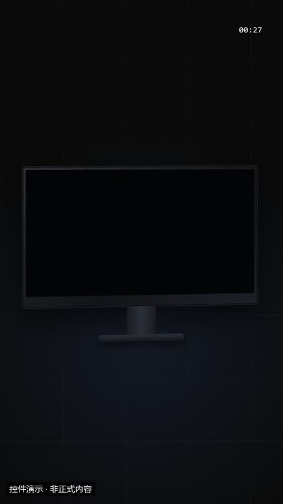](../../docs/template-gallery/demos/motiongit/device.mp4)

- [本地效果演示 1 · 规格见演示](../../docs/template-gallery/demos/motiongit/device.mp4)：官方控件真实渲染；使用本人授权素材。6秒静音控件演示；保留模板原生标记与组内时码，角标不是本文件播放计时。低位演示身份标为本目录后处理添加。

**2. 适用内容**

- 展示 App、网页、录屏、作品画面：素材放进手机 / 平板 / 显示器屏幕里，视频按成片时钟播放；可配标题

- 必须使用有权使用的真实素材；对照动画不能冒充真实修复结果。

**3. 所需素材**

- 本人视频帧、照片、产品图或真实截图
- 需要强调的区域

**4. 可改参数与限制**

按已核对的字段与限制修改；尚未核对的能力会明确标注。

<details>
<summary>查看参数、限制与来源依据</summary>

- 屏幕内容（图片或视频，省略时为占位）（src）：文字，可选。
- 标题（横屏在右、竖屏在上）（title）：文字，可选；最多可见字符 16。
- 副标题（sub）：文字，可选；最多可见字符 20。
- sourceStart（sourceStart）：数字，可选；最小 0。
- 动画变体（variant）：phone / tablet / monitor。
- 段落时间（t0、t1）与动作提示时间（cues）按剪后的真实讲解设置；主题色由时间轴 theme 配置，不是每个控件任意独立的配色合同。

- 这些范围来自已登记版本的公开参数合同；更换个人包或版本后须重新核对，不自动沿用到所有官网模板。
- 每个控件目前只展示一个代表变体；可选枚举、允许数量和颜色参数不等于所有组合都已实测。
- 导出前仍需校验参数、真实素材、语音时长与排版；不从示例数据推断实际业务结果。

参数依据：[motiongit-controls.json](../../templates/motiongit-controls.json) · [render_motiongit_gallery.py](../../scripts/render_motiongit_gallery.py) · [render_motiongit_gallery_data.py](../../scripts/render_motiongit_gallery_data.py)

</details>

**5. 怎样交给 AI 使用**

<details>
<summary>复制本模板的使用提示词</summary>

```text
请使用 AI Cut 模板目录中的「设备样机」（编号 mg-control-device）。
我的内容或原片：[填写]；输出比例：[填写]；需要强调的内容：[填写]。
先核对本条来源、当前状态、素材和参数合同；使用我自己的获授权素材，保留原声原意。
按照本条已支持的参数范围做短预览，确认文字、动作和声音的时间一致，再放入剪辑工程。
若原包、依赖或素材缺失，说明缺什么；遇到费用先告诉我。不要将示例人物或示例数据当成我的内容。
```

</details>

**6. 当前能否使用**

- 已有控件演示 · 需自备授权原包
- 本仓库提供目录与已渲染演示，未附送个人 .motion 原包；学员须使用自己合法取得的对应包。
- 登记基线版本：0.3.0 (package2.7.17-alpha.2)。新输入、新电脑和其他变体须另行验证。

<details>
<summary>查看原始检查范围与接入记录</summary>

- 一个代表变体已由官方 helper 渲染；静音小样完整解码，并已查看实际导出抽帧。其他两个变体仅登记，未渲染；不代表连续观看或用户审美认可。

</details>

**7. 来源与许可**

- MotionGit 个人授权模板包，以原包授权为准；仅包含自有素材及明确示例数据的渲染演示，不分发受保护代码。

[原始来源](https://motiongit.com/@adunext/template-01-integrated-portrait)

---

<a id="mg-control-spotlight"></a>

### 聚光放大

`mg-control-spotlight` · 录屏与操作教学 · 真实素材展示 · **已有控件演示 · 需自备授权原包**

在一张截图/照片/视频画面里依次指出 1–3 个关注点（x、y 为 0–1 的相对位置），每个点带一个短标签

**1. 效果预览**

[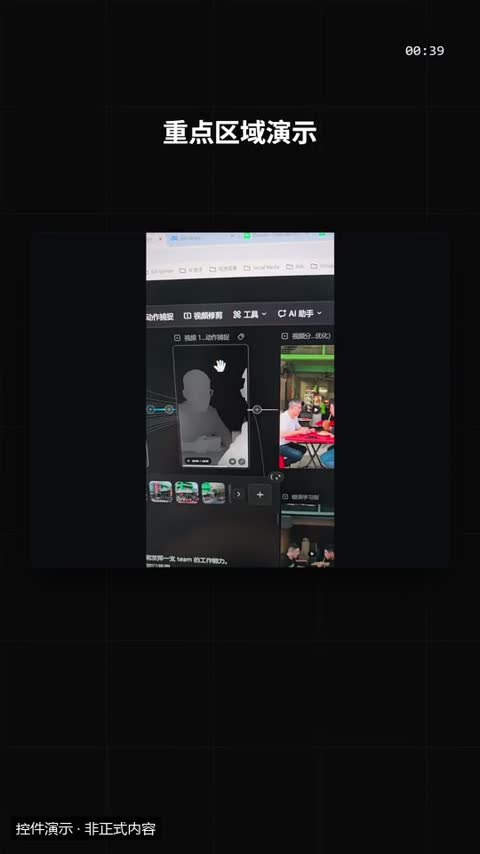](../../docs/template-gallery/demos/motiongit/spotlight.mp4)

- [本地效果演示 1 · 规格见演示](../../docs/template-gallery/demos/motiongit/spotlight.mp4)：官方控件真实渲染；使用本人授权素材。6秒静音控件演示；保留模板原生标记与组内时码，角标不是本文件播放计时。低位演示身份标为本目录后处理添加。

**2. 适用内容**

- 在一张截图/照片/视频画面里依次指出 1–3 个关注点（x、y 为 0–1 的相对位置），每个点带一个短标签

- 必须使用有权使用的真实素材；对照动画不能冒充真实修复结果。

**3. 所需素材**

- 本人视频帧、照片、产品图或真实截图
- 需要强调的区域

**4. 可改参数与限制**

按已核对的字段与限制修改；尚未核对的能力会明确标注。

<details>
<summary>查看参数、限制与来源依据</summary>

- 标题（title）：文字，可选；最多可见字符 20。
- 图片或视频（src）：文字，可选。
- sourceStart（sourceStart）：数字，可选；最小 0。
- 折线数据点（points）：列表，必填；至少项数 1；最多项数 3。
- 横向位置 0–1（points[].x）：数字，必填；最小 0；最大 1。
- 纵向位置 0–1（points[].y）：数字，必填；最小 0；最大 1。
- 标签（points[].label）：文字，可选；最多可见字符 10。
- 动画变体（variant）：spotlight / magnifier / blur。
- 段落时间（t0、t1）与动作提示时间（cues）按剪后的真实讲解设置；主题色由时间轴 theme 配置，不是每个控件任意独立的配色合同。

- 这些范围来自已登记版本的公开参数合同；更换个人包或版本后须重新核对，不自动沿用到所有官网模板。
- 每个控件目前只展示一个代表变体；可选枚举、允许数量和颜色参数不等于所有组合都已实测。
- 导出前仍需校验参数、真实素材、语音时长与排版；不从示例数据推断实际业务结果。

参数依据：[motiongit-controls.json](../../templates/motiongit-controls.json) · [render_motiongit_gallery.py](../../scripts/render_motiongit_gallery.py) · [render_motiongit_gallery_data.py](../../scripts/render_motiongit_gallery_data.py)

</details>

**5. 怎样交给 AI 使用**

<details>
<summary>复制本模板的使用提示词</summary>

```text
请使用 AI Cut 模板目录中的「聚光放大」（编号 mg-control-spotlight）。
我的内容或原片：[填写]；输出比例：[填写]；需要强调的内容：[填写]。
先核对本条来源、当前状态、素材和参数合同；使用我自己的获授权素材，保留原声原意。
按照本条已支持的参数范围做短预览，确认文字、动作和声音的时间一致，再放入剪辑工程。
若原包、依赖或素材缺失，说明缺什么；遇到费用先告诉我。不要将示例人物或示例数据当成我的内容。
```

</details>

**6. 当前能否使用**

- 已有控件演示 · 需自备授权原包
- 本仓库提供目录与已渲染演示，未附送个人 .motion 原包；学员须使用自己合法取得的对应包。
- 登记基线版本：0.3.0 (package2.7.17-alpha.2)。新输入、新电脑和其他变体须另行验证。

<details>
<summary>查看原始检查范围与接入记录</summary>

- 一个代表变体已由官方 helper 渲染；静音小样完整解码，并已查看实际导出抽帧。其他两个变体仅登记，未渲染；不代表连续观看或用户审美认可。

</details>

**7. 来源与许可**

- MotionGit 个人授权模板包，以原包授权为准；仅包含自有素材及明确示例数据的渲染演示，不分发受保护代码。

[原始来源](https://motiongit.com/@adunext/template-01-integrated-portrait)

---

<a id="mg-control-chat"></a>

### 聊天对话

`mg-control-chat` · 录屏与操作教学 · 界面与交互演示 · **已有控件演示 · 需自备授权原包**

把一段对话演出来：用户与客服/朋友的聊天、群里的讨论、向 AI 助手提问并得到回答；2–6 条消息逐条出现

**1. 效果预览**

[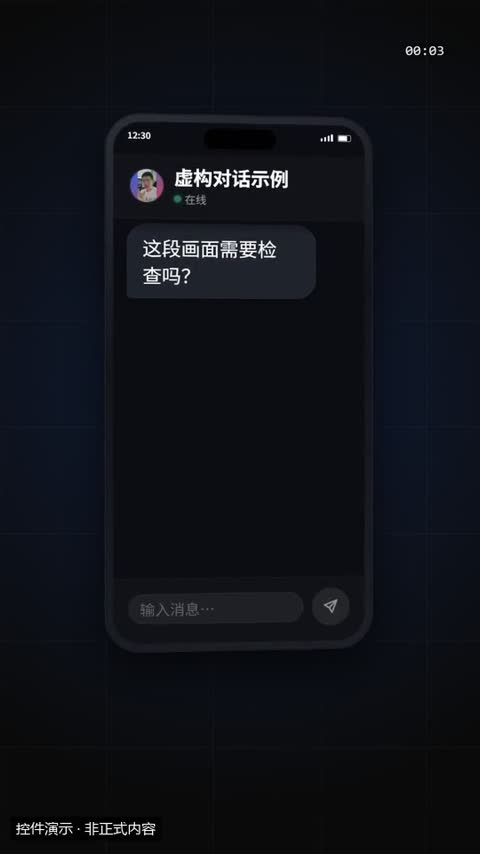](../../docs/template-gallery/demos/motiongit/chat.mp4)

- [本地效果演示 1 · 规格见演示](../../docs/template-gallery/demos/motiongit/chat.mp4)：官方控件真实渲染；使用本人授权素材。6秒静音控件演示；保留模板原生标记与组内时码，角标不是本文件播放计时。低位演示身份标为本目录后处理添加。

**2. 适用内容**

- 把一段对话演出来：用户与客服/朋友的聊天、群里的讨论、向 AI 助手提问并得到回答；2–6 条消息逐条出现

- 模拟界面必须标明示例；不能冒充真实操作、通知或用户反馈。

**3. 所需素材**

- 明确标示的模拟文案或真实界面截图

**4. 可改参数与限制**

按已核对的字段与限制修改；尚未核对的能力会明确标注。

<details>
<summary>查看参数、限制与来源依据</summary>

- 顶栏名字（默认取对方名字 / 群聊 / AI 助手）（title）：文字，可选；最多可见字符 12。
- 消息（按顺序）（messages）：列表，必填；至少项数 2；最多项数 6。
- left 对方 / right 自己（messages[].who）：文字，必填；可选 left/right。
- 消息文字，*重点* 用星号；ai 变体的回答（left）可到 40 字（messages[].text）：文字，必填；最短长度 1；最多可见字符 40。
- 发送者名字（thread 变体显示）（messages[].name）：文字，可选；最多可见字符 8。
- 头像图片（可省略，省略时显示首字母圆）（messages[].avatar）：文字，可选。
- 动画变体（variant）：bubbles / thread / ai。
- 段落时间（t0、t1）与动作提示时间（cues）按剪后的真实讲解设置；主题色由时间轴 theme 配置，不是每个控件任意独立的配色合同。

- 这些范围来自已登记版本的公开参数合同；更换个人包或版本后须重新核对，不自动沿用到所有官网模板。
- 每个控件目前只展示一个代表变体；可选枚举、允许数量和颜色参数不等于所有组合都已实测。
- 导出前仍需校验参数、真实素材、语音时长与排版；不从示例数据推断实际业务结果。

参数依据：[motiongit-controls.json](../../templates/motiongit-controls.json) · [render_motiongit_gallery.py](../../scripts/render_motiongit_gallery.py) · [render_motiongit_gallery_data.py](../../scripts/render_motiongit_gallery_data.py)

</details>

**5. 怎样交给 AI 使用**

<details>
<summary>复制本模板的使用提示词</summary>

```text
请使用 AI Cut 模板目录中的「聊天对话」（编号 mg-control-chat）。
我的内容或原片：[填写]；输出比例：[填写]；需要强调的内容：[填写]。
先核对本条来源、当前状态、素材和参数合同；使用我自己的获授权素材，保留原声原意。
按照本条已支持的参数范围做短预览，确认文字、动作和声音的时间一致，再放入剪辑工程。
若原包、依赖或素材缺失，说明缺什么；遇到费用先告诉我。不要将示例人物或示例数据当成我的内容。
```

</details>

**6. 当前能否使用**

- 已有控件演示 · 需自备授权原包
- 本仓库提供目录与已渲染演示，未附送个人 .motion 原包；学员须使用自己合法取得的对应包。
- 登记基线版本：0.3.0 (package2.7.17-alpha.2)。新输入、新电脑和其他变体须另行验证。

<details>
<summary>查看原始检查范围与接入记录</summary>

- 一个代表变体已由官方 helper 渲染；静音小样完整解码，并已查看实际导出抽帧。其他两个变体仅登记，未渲染；不代表连续观看或用户审美认可。

</details>

**7. 来源与许可**

- MotionGit 个人授权模板包，以原包授权为准；仅包含自有素材及明确示例数据的渲染演示，不分发受保护代码。

[原始来源](https://motiongit.com/@adunext/template-01-integrated-portrait)

---

<a id="mg-control-comment"></a>

### 评论 / 弹幕

`mg-control-comment` · 录屏与操作教学 · 界面与交互演示 · **已有控件演示 · 需自备授权原包**

展示观众反馈、网友评论、热评、弹幕刷屏：2–5 条评论逐条浮现，点赞数上涨，最高赞那条被强调（热评 / 置顶 / 放大停住）

**1. 效果预览**

[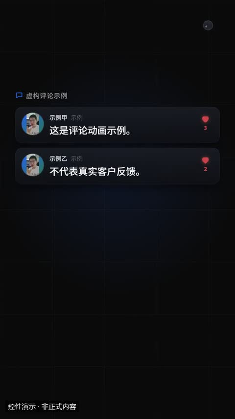](../../docs/template-gallery/demos/motiongit/comment.mp4)

- [本地效果演示 1 · 规格见演示](../../docs/template-gallery/demos/motiongit/comment.mp4)：官方控件真实渲染；使用本人授权素材。6秒静音控件演示；保留模板原生标记与组内时码，角标不是本文件播放计时。低位演示身份标为本目录后处理添加。

**2. 适用内容**

- 展示观众反馈、网友评论、热评、弹幕刷屏：2–5 条评论逐条浮现，点赞数上涨，最高赞那条被强调（热评 / 置顶 / 放大停住）

- 模拟界面必须标明示例；不能冒充真实操作、通知或用户反馈。

**3. 所需素材**

- 明确标示的模拟文案或真实界面截图

**4. 可改参数与限制**

按已核对的字段与限制修改；尚未核对的能力会明确标注。

<details>
<summary>查看参数、限制与来源依据</summary>

- 评论区标题（cards / pinned，可省略）（title）：文字，可选；最多可见字符 14。
- 评论（最高赞的一条会被强调）（items）：列表，必填；至少项数 2；最多项数 5。
- 用户名（示意）（items[].user）：文字，必填；最短长度 1；最多可见字符 10。
- 评论文字，*重点* 用星号（items[].text）：文字，必填；最短长度 1；最多可见字符 30。
- 点赞数（示意）（items[].likes）：integer，可选；最小 0；最大 99999999。
- 时间，如「2 小时前」（items[].time）：文字，可选；最多可见字符 8。
- 头像（可省略，省略时显示首字母圆）（items[].avatar）：文字，可选。
- danmaku 变体：弹幕下面的播放画面（图片/视频，可省略）（src）：文字，可选。
- sourceStart（sourceStart）：数字，可选；最小 0。
- 动画变体（variant）：cards / danmaku / pinned。
- 段落时间（t0、t1）与动作提示时间（cues）按剪后的真实讲解设置；主题色由时间轴 theme 配置，不是每个控件任意独立的配色合同。

- 这些范围来自已登记版本的公开参数合同；更换个人包或版本后须重新核对，不自动沿用到所有官网模板。
- 每个控件目前只展示一个代表变体；可选枚举、允许数量和颜色参数不等于所有组合都已实测。
- 导出前仍需校验参数、真实素材、语音时长与排版；不从示例数据推断实际业务结果。

参数依据：[motiongit-controls.json](../../templates/motiongit-controls.json) · [render_motiongit_gallery.py](../../scripts/render_motiongit_gallery.py) · [render_motiongit_gallery_data.py](../../scripts/render_motiongit_gallery_data.py)

</details>

**5. 怎样交给 AI 使用**

<details>
<summary>复制本模板的使用提示词</summary>

```text
请使用 AI Cut 模板目录中的「评论 / 弹幕」（编号 mg-control-comment）。
我的内容或原片：[填写]；输出比例：[填写]；需要强调的内容：[填写]。
先核对本条来源、当前状态、素材和参数合同；使用我自己的获授权素材，保留原声原意。
按照本条已支持的参数范围做短预览，确认文字、动作和声音的时间一致，再放入剪辑工程。
若原包、依赖或素材缺失，说明缺什么；遇到费用先告诉我。不要将示例人物或示例数据当成我的内容。
```

</details>

**6. 当前能否使用**

- 已有控件演示 · 需自备授权原包
- 本仓库提供目录与已渲染演示，未附送个人 .motion 原包；学员须使用自己合法取得的对应包。
- 登记基线版本：0.3.0 (package2.7.17-alpha.2)。新输入、新电脑和其他变体须另行验证。

<details>
<summary>查看原始检查范围与接入记录</summary>

- 一个代表变体已由官方 helper 渲染；静音小样完整解码，并已查看实际导出抽帧。其他两个变体仅登记，未渲染；不代表连续观看或用户审美认可。

</details>

**7. 来源与许可**

- MotionGit 个人授权模板包，以原包授权为准；仅包含自有素材及明确示例数据的渲染演示，不分发受保护代码。

[原始来源](https://motiongit.com/@adunext/template-01-integrated-portrait)

---

<a id="mg-control-notify"></a>

### 通知横幅

`mg-control-notify` · 录屏与操作教学 · 界面与交互演示 · **已有控件演示 · 需自备授权原包**

表现「消息来了」：订单、提醒、私信、系统通知一条接一条弹出；也可做锁屏收到通知的画面

**1. 效果预览**

[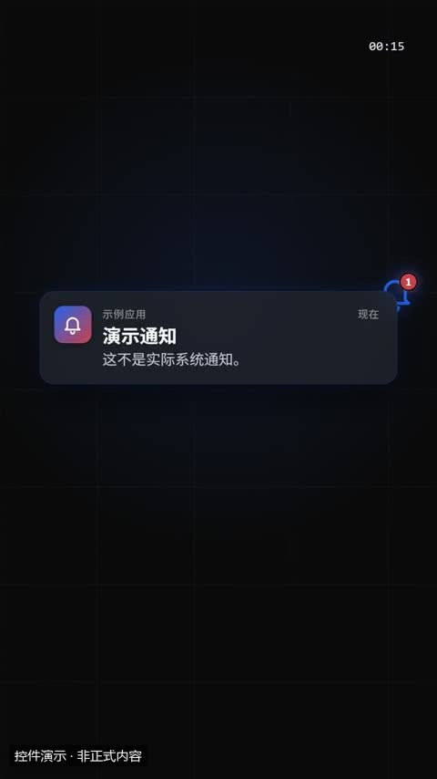](../../docs/template-gallery/demos/motiongit/notify.mp4)

- [本地效果演示 1 · 规格见演示](../../docs/template-gallery/demos/motiongit/notify.mp4)：官方控件真实渲染；使用中文示例文案或示例数据。6秒静音控件演示；保留模板原生标记与组内时码，角标不是本文件播放计时。低位演示身份标为本目录后处理添加。

**2. 适用内容**

- 表现「消息来了」：订单、提醒、私信、系统通知一条接一条弹出；也可做锁屏收到通知的画面

- 模拟界面必须标明示例；不能冒充真实操作、通知或用户反馈。

**3. 所需素材**

- 明确标示的模拟文案或真实界面截图

**4. 可改参数与限制**

按已核对的字段与限制修改；尚未核对的能力会明确标注。

<details>
<summary>查看参数、限制与来源依据</summary>

- 通知（按到达顺序）（items）：列表，必填；至少项数 1；最多项数 4。
- 来源名称（中性，如「日程」「消息」）（items[].app）：文字，必填；最短长度 1；最多可见字符 8。
- 标题（items[].title）：文字，必填；最短长度 1；最多可见字符 16。
- 正文（最多两行）（items[].text）：文字，可选；最多可见字符 30。
- 图标（默认 bell）（items[].icon）：文字，可选；使用合同规定的 82 个枚举值之一。
- 时间（默认「刚刚」）（items[].time）：文字，可选；最多可见字符 6。
- lock 变体：锁屏时间，如 08:30（time）：文字，可选；最多可见字符 5。
- lock 变体：锁屏日期，如「10 月 12 日 星期一」（date）：文字，可选；最多可见字符 12。
- 动画变体（variant）：stack / toast / lock。
- 段落时间（t0、t1）与动作提示时间（cues）按剪后的真实讲解设置；主题色由时间轴 theme 配置，不是每个控件任意独立的配色合同。

- 这些范围来自已登记版本的公开参数合同；更换个人包或版本后须重新核对，不自动沿用到所有官网模板。
- 每个控件目前只展示一个代表变体；可选枚举、允许数量和颜色参数不等于所有组合都已实测。
- 导出前仍需校验参数、真实素材、语音时长与排版；不从示例数据推断实际业务结果。

参数依据：[motiongit-controls.json](../../templates/motiongit-controls.json) · [render_motiongit_gallery.py](../../scripts/render_motiongit_gallery.py) · [render_motiongit_gallery_data.py](../../scripts/render_motiongit_gallery_data.py)

</details>

**5. 怎样交给 AI 使用**

<details>
<summary>复制本模板的使用提示词</summary>

```text
请使用 AI Cut 模板目录中的「通知横幅」（编号 mg-control-notify）。
我的内容或原片：[填写]；输出比例：[填写]；需要强调的内容：[填写]。
先核对本条来源、当前状态、素材和参数合同；使用我自己的获授权素材，保留原声原意。
按照本条已支持的参数范围做短预览，确认文字、动作和声音的时间一致，再放入剪辑工程。
若原包、依赖或素材缺失，说明缺什么；遇到费用先告诉我。不要将示例人物或示例数据当成我的内容。
```

</details>

**6. 当前能否使用**

- 已有控件演示 · 需自备授权原包
- 本仓库提供目录与已渲染演示，未附送个人 .motion 原包；学员须使用自己合法取得的对应包。
- 登记基线版本：0.3.0 (package2.7.17-alpha.2)。新输入、新电脑和其他变体须另行验证。

<details>
<summary>查看原始检查范围与接入记录</summary>

- 一个代表变体已由官方 helper 渲染；静音小样完整解码，并已查看实际导出抽帧。其他两个变体仅登记，未渲染；不代表连续观看或用户审美认可。

</details>

**7. 来源与许可**

- MotionGit 个人授权模板包，以原包授权为准；仅包含自有素材及明确示例数据的渲染演示，不分发受保护代码。

[原始来源](https://motiongit.com/@adunext/template-01-integrated-portrait)

---

<a id="mg-control-search"></a>

### 搜索框

`mg-control-search` · 录屏与操作教学 · 界面与交互演示 · **已有控件演示 · 需自备授权原包**

演示「搜一下」：输入关键词 → 回车 → 联想/结果出现、命中词高亮；适合讲搜索热度、怎么找资料、工具里的命令面板

**1. 效果预览**

[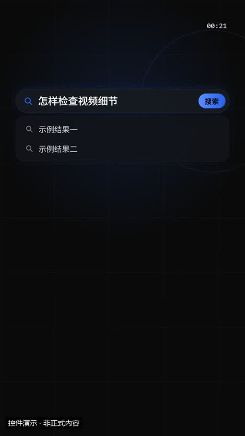](../../docs/template-gallery/demos/motiongit/search.mp4)

- [本地效果演示 1 · 规格见演示](../../docs/template-gallery/demos/motiongit/search.mp4)：官方控件真实渲染；使用中文示例文案或示例数据。6秒静音控件演示；保留模板原生标记与组内时码，角标不是本文件播放计时。低位演示身份标为本目录后处理添加。

**2. 适用内容**

- 演示「搜一下」：输入关键词 → 回车 → 联想/结果出现、命中词高亮；适合讲搜索热度、怎么找资料、工具里的命令面板

- 模拟界面必须标明示例；不能冒充真实操作、通知或用户反馈。

**3. 所需素材**

- 明确标示的模拟文案或真实界面截图

**4. 可改参数与限制**

按已核对的字段与限制修改；尚未核对的能力会明确标注。

<details>
<summary>查看参数、限制与来源依据</summary>

- 输入的搜索词（query）：文字，必填；最短长度 1；最多可见字符 20。
- 输入前的占位文字（默认「搜索」）（placeholder）：文字，可选；最多可见字符 12。
- 联想词 / 结果（命中搜索词的部分自动高亮）（items）：列表，可选；至少项数 0；最多项数 5。
- 联想词 / 结果标题（items[].text）：文字，必填；最短长度 1；最多可见字符 24。
- 说明（spotlight 一行；results 最多两行）（items[].desc）：文字，可选；最多可见字符 40。
- spotlight 变体的图标（items[].icon）：文字，可选；使用合同规定的 82 个枚举值之一。
- 动画变体（variant）：bar / spotlight / results。
- 段落时间（t0、t1）与动作提示时间（cues）按剪后的真实讲解设置；主题色由时间轴 theme 配置，不是每个控件任意独立的配色合同。

- 这些范围来自已登记版本的公开参数合同；更换个人包或版本后须重新核对，不自动沿用到所有官网模板。
- 每个控件目前只展示一个代表变体；可选枚举、允许数量和颜色参数不等于所有组合都已实测。
- 导出前仍需校验参数、真实素材、语音时长与排版；不从示例数据推断实际业务结果。

参数依据：[motiongit-controls.json](../../templates/motiongit-controls.json) · [render_motiongit_gallery.py](../../scripts/render_motiongit_gallery.py) · [render_motiongit_gallery_data.py](../../scripts/render_motiongit_gallery_data.py)

</details>

**5. 怎样交给 AI 使用**

<details>
<summary>复制本模板的使用提示词</summary>

```text
请使用 AI Cut 模板目录中的「搜索框」（编号 mg-control-search）。
我的内容或原片：[填写]；输出比例：[填写]；需要强调的内容：[填写]。
先核对本条来源、当前状态、素材和参数合同；使用我自己的获授权素材，保留原声原意。
按照本条已支持的参数范围做短预览，确认文字、动作和声音的时间一致，再放入剪辑工程。
若原包、依赖或素材缺失，说明缺什么；遇到费用先告诉我。不要将示例人物或示例数据当成我的内容。
```

</details>

**6. 当前能否使用**

- 已有控件演示 · 需自备授权原包
- 本仓库提供目录与已渲染演示，未附送个人 .motion 原包；学员须使用自己合法取得的对应包。
- 登记基线版本：0.3.0 (package2.7.17-alpha.2)。新输入、新电脑和其他变体须另行验证。

<details>
<summary>查看原始检查范围与接入记录</summary>

- 一个代表变体已由官方 helper 渲染；静音小样完整解码，并已查看实际导出抽帧。其他两个变体仅登记，未渲染；不代表连续观看或用户审美认可。

</details>

**7. 来源与许可**

- MotionGit 个人授权模板包，以原包授权为准；仅包含自有素材及明确示例数据的渲染演示，不分发受保护代码。

[原始来源](https://motiongit.com/@adunext/template-01-integrated-portrait)

---

<a id="mg-control-browser"></a>

### 浏览器 / 应用窗口

`mg-control-browser` · 录屏与操作教学 · 界面与交互演示 · **已有控件演示 · 需自备授权原包**

演示「打开一个网页 / 网站 / 应用」：地址栏输入网址、加载、页面滚动，再用 1–3 个高亮框标出重点区域。只需要静态录屏展示用 0.2.0 的 media

**1. 效果预览**

[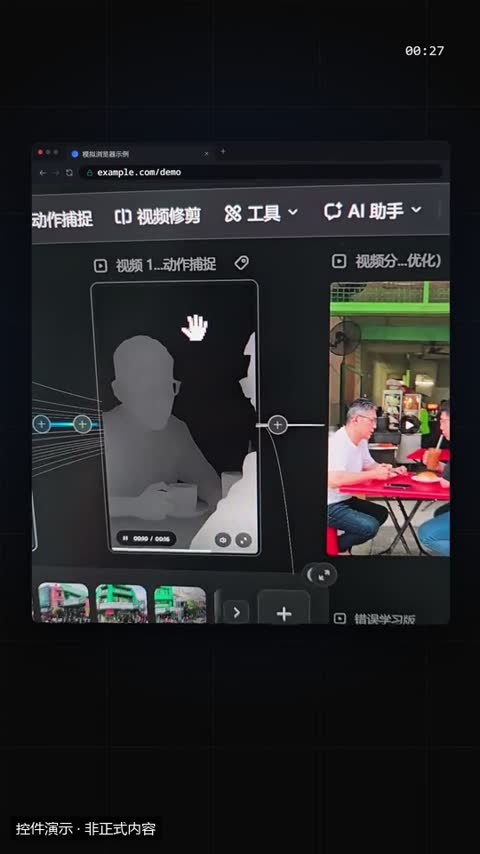](../../docs/template-gallery/demos/motiongit/browser.mp4)

- [本地效果演示 1 · 规格见演示](../../docs/template-gallery/demos/motiongit/browser.mp4)：官方控件真实渲染；使用本人授权素材。6秒静音控件演示；保留模板原生标记与组内时码，角标不是本文件播放计时。低位演示身份标为本目录后处理添加。

**2. 适用内容**

- 演示「打开一个网页 / 网站 / 应用」：地址栏输入网址、加载、页面滚动，再用 1–3 个高亮框标出重点区域。只需要静态录屏展示用 0.2.0 的 media

- 模拟界面必须标明示例；不能冒充真实操作、通知或用户反馈。

**3. 所需素材**

- 明确标示的模拟文案或真实界面截图

**4. 可改参数与限制**

按已核对的字段与限制修改；尚未核对的能力会明确标注。

<details>
<summary>查看参数、限制与来源依据</summary>

- 网址（示意，如 example.com/docs）（url）：文字，必填；最短长度 1；最多可见字符 32。
- 标签页标题（title）：文字，可选；最多可见字符 16。
- 网页截图 / 录屏（可省略，省略时显示占位）（src）：文字，可选。
- sourceStart（sourceStart）：数字，可选；最小 0。
- 高亮框（坐标为视口比例 0–1）（callouts）：列表，可选；至少项数 0；最多项数 3。
- 左（callouts[].x）：数字，可选；最小 0；最大 1。
- 上（callouts[].y）：数字，可选；最小 0；最大 1。
- 宽（callouts[].w）：数字，可选；最小 0.05；最大 1。
- 高（callouts[].h）：数字，可选；最小 0.05；最大 1。
- 标注文字（callouts[].text）：文字，必填；最短长度 1；最多可见字符 14。
- 动画变体（variant）：browser / phone / laptop。
- 段落时间（t0、t1）与动作提示时间（cues）按剪后的真实讲解设置；主题色由时间轴 theme 配置，不是每个控件任意独立的配色合同。

- 这些范围来自已登记版本的公开参数合同；更换个人包或版本后须重新核对，不自动沿用到所有官网模板。
- 每个控件目前只展示一个代表变体；可选枚举、允许数量和颜色参数不等于所有组合都已实测。
- 导出前仍需校验参数、真实素材、语音时长与排版；不从示例数据推断实际业务结果。

参数依据：[motiongit-controls.json](../../templates/motiongit-controls.json) · [render_motiongit_gallery.py](../../scripts/render_motiongit_gallery.py) · [render_motiongit_gallery_data.py](../../scripts/render_motiongit_gallery_data.py)

</details>

**5. 怎样交给 AI 使用**

<details>
<summary>复制本模板的使用提示词</summary>

```text
请使用 AI Cut 模板目录中的「浏览器 / 应用窗口」（编号 mg-control-browser）。
我的内容或原片：[填写]；输出比例：[填写]；需要强调的内容：[填写]。
先核对本条来源、当前状态、素材和参数合同；使用我自己的获授权素材，保留原声原意。
按照本条已支持的参数范围做短预览，确认文字、动作和声音的时间一致，再放入剪辑工程。
若原包、依赖或素材缺失，说明缺什么；遇到费用先告诉我。不要将示例人物或示例数据当成我的内容。
```

</details>

**6. 当前能否使用**

- 已有控件演示 · 需自备授权原包
- 本仓库提供目录与已渲染演示，未附送个人 .motion 原包；学员须使用自己合法取得的对应包。
- 登记基线版本：0.3.0 (package2.7.17-alpha.2)。新输入、新电脑和其他变体须另行验证。

<details>
<summary>查看原始检查范围与接入记录</summary>

- 一个代表变体已由官方 helper 渲染；静音小样完整解码，并已查看实际导出抽帧。其他两个变体仅登记，未渲染；不代表连续观看或用户审美认可。

</details>

**7. 来源与许可**

- MotionGit 个人授权模板包，以原包授权为准；仅包含自有素材及明确示例数据的渲染演示，不分发受保护代码。

[原始来源](https://motiongit.com/@adunext/template-01-integrated-portrait)

---

<a id="mg-control-social"></a>

### 社交数据卡

`mg-control-social` · 录屏与操作教学 · 界面与交互演示 · **已有控件演示 · 需自备授权原包**

展示一条内容的反响：帖子被点赞、主页涨粉、三项互动数据；数字滚动上涨。数字请标注示意

**1. 效果预览**

[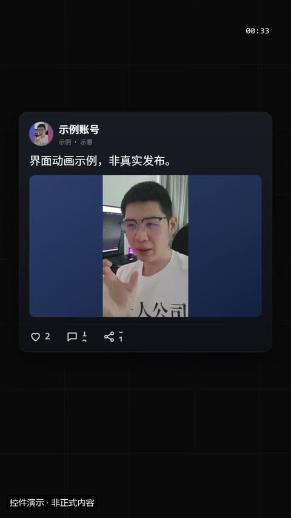](../../docs/template-gallery/demos/motiongit/social.mp4)

- [本地效果演示 1 · 规格见演示](../../docs/template-gallery/demos/motiongit/social.mp4)：官方控件真实渲染；使用本人授权素材。6秒静音控件演示；保留模板原生标记与组内时码，角标不是本文件播放计时。低位演示身份标为本目录后处理添加。

**2. 适用内容**

- 展示一条内容的反响：帖子被点赞、主页涨粉、三项互动数据；数字滚动上涨。数字请标注示意

- 模拟界面必须标明示例；不能冒充真实操作、通知或用户反馈。

**3. 所需素材**

- 明确标示的模拟文案或真实界面截图

**4. 可改参数与限制**

按已核对的字段与限制修改；尚未核对的能力会明确标注。

<details>
<summary>查看参数、限制与来源依据</summary>

- 账号名（示意）（user）：文字，必填；最短长度 1；最多可见字符 12。
- 帖子文字 / 个人简介 / 数据卡标题（stats 一行）（text）：文字，可选；最多可见字符 40。
- post 配图 / profile 封面（可省略）（src）：文字，可选。
- sourceStart（sourceStart）：数字，可选；最小 0。
- 头像（可省略，省略时显示首字母圆）（avatar）：文字，可选。
- 发布时间（time）：文字，可选；最多可见字符 8。
- 点赞 / 获赞数（likes）：integer，可选；最小 0；最大 9999999999。
- 评论数（comments）：integer，可选；最小 0；最大 9999999999。
- 转发数（shares）：integer，可选；最小 0；最大 9999999999。
- profile 变体：粉丝数（默认用 likes）（followers）：integer，可选；最小 0；最大 9999999999。
- 动画变体（variant）：post / profile / stats。
- 段落时间（t0、t1）与动作提示时间（cues）按剪后的真实讲解设置；主题色由时间轴 theme 配置，不是每个控件任意独立的配色合同。

- 这些范围来自已登记版本的公开参数合同；更换个人包或版本后须重新核对，不自动沿用到所有官网模板。
- 每个控件目前只展示一个代表变体；可选枚举、允许数量和颜色参数不等于所有组合都已实测。
- 导出前仍需校验参数、真实素材、语音时长与排版；不从示例数据推断实际业务结果。

参数依据：[motiongit-controls.json](../../templates/motiongit-controls.json) · [render_motiongit_gallery.py](../../scripts/render_motiongit_gallery.py) · [render_motiongit_gallery_data.py](../../scripts/render_motiongit_gallery_data.py)

</details>

**5. 怎样交给 AI 使用**

<details>
<summary>复制本模板的使用提示词</summary>

```text
请使用 AI Cut 模板目录中的「社交数据卡」（编号 mg-control-social）。
我的内容或原片：[填写]；输出比例：[填写]；需要强调的内容：[填写]。
先核对本条来源、当前状态、素材和参数合同；使用我自己的获授权素材，保留原声原意。
按照本条已支持的参数范围做短预览，确认文字、动作和声音的时间一致，再放入剪辑工程。
若原包、依赖或素材缺失，说明缺什么；遇到费用先告诉我。不要将示例人物或示例数据当成我的内容。
```

</details>

**6. 当前能否使用**

- 已有控件演示 · 需自备授权原包
- 本仓库提供目录与已渲染演示，未附送个人 .motion 原包；学员须使用自己合法取得的对应包。
- 登记基线版本：0.3.0 (package2.7.17-alpha.2)。新输入、新电脑和其他变体须另行验证。

<details>
<summary>查看原始检查范围与接入记录</summary>

- 一个代表变体已由官方 helper 渲染；静音小样完整解码，并已查看实际导出抽帧。其他两个变体仅登记，未渲染；不代表连续观看或用户审美认可。

</details>

**7. 来源与许可**

- MotionGit 个人授权模板包，以原包授权为准；仅包含自有素材及明确示例数据的渲染演示，不分发受保护代码。

[原始来源](https://motiongit.com/@adunext/template-01-integrated-portrait)

---

<a id="mg-control-cursor"></a>

### 鼠标点击演示

`mg-control-cursor` · 录屏与操作教学 · 界面与交互演示 · **已有控件演示 · 需自备授权原包**

演示软件操作步骤：依次点几个按钮、把文件拖进某个区域、打开菜单选一项。可以放截图作为背景

**1. 效果预览**

[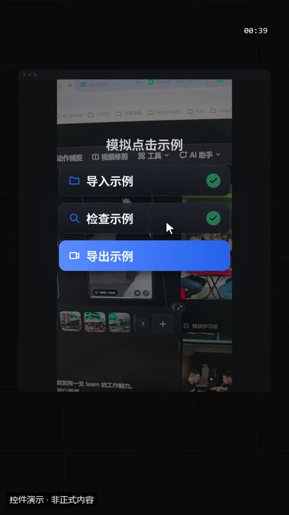](../../docs/template-gallery/demos/motiongit/cursor.mp4)

- [本地效果演示 1 · 规格见演示](../../docs/template-gallery/demos/motiongit/cursor.mp4)：官方控件真实渲染；使用本人授权素材。6秒静音控件演示；保留模板原生标记与组内时码，角标不是本文件播放计时。低位演示身份标为本目录后处理添加。

**2. 适用内容**

- 演示软件操作步骤：依次点几个按钮、把文件拖进某个区域、打开菜单选一项。可以放截图作为背景

- 模拟界面必须标明示例；不能冒充真实操作、通知或用户反馈。

**3. 所需素材**

- 明确标示的模拟文案或真实界面截图

**4. 可改参数与限制**

按已核对的字段与限制修改；尚未核对的能力会明确标注。

<details>
<summary>查看参数、限制与来源依据</summary>

- click 标题 / drag 放置区文字 / menu 选择前的按钮文字（title）：文字，可选；最多可见字符 14。
- 按钮 / 卡片 / 菜单项（items）：列表，必填；至少项数 1；最多项数 4。
- 标签（items[].label）：文字，必填；最短长度 1；最多可见字符 10。
- icon（items[].icon）：文字，可选；使用合同规定的 82 个枚举值之一。
- menu 变体：最后选中第几项（默认最后一项）（pick）：integer，可选；最小 1；最大 4。
- 背景截图（可省略，压暗显示）（src）：文字，可选。
- sourceStart（sourceStart）：数字，可选；最小 0。
- 动画变体（variant）：click / drag / menu。
- 段落时间（t0、t1）与动作提示时间（cues）按剪后的真实讲解设置；主题色由时间轴 theme 配置，不是每个控件任意独立的配色合同。

- 这些范围来自已登记版本的公开参数合同；更换个人包或版本后须重新核对，不自动沿用到所有官网模板。
- 每个控件目前只展示一个代表变体；可选枚举、允许数量和颜色参数不等于所有组合都已实测。
- 导出前仍需校验参数、真实素材、语音时长与排版；不从示例数据推断实际业务结果。

参数依据：[motiongit-controls.json](../../templates/motiongit-controls.json) · [render_motiongit_gallery.py](../../scripts/render_motiongit_gallery.py) · [render_motiongit_gallery_data.py](../../scripts/render_motiongit_gallery_data.py)

</details>

**5. 怎样交给 AI 使用**

<details>
<summary>复制本模板的使用提示词</summary>

```text
请使用 AI Cut 模板目录中的「鼠标点击演示」（编号 mg-control-cursor）。
我的内容或原片：[填写]；输出比例：[填写]；需要强调的内容：[填写]。
先核对本条来源、当前状态、素材和参数合同；使用我自己的获授权素材，保留原声原意。
按照本条已支持的参数范围做短预览，确认文字、动作和声音的时间一致，再放入剪辑工程。
若原包、依赖或素材缺失，说明缺什么；遇到费用先告诉我。不要将示例人物或示例数据当成我的内容。
```

</details>

**6. 当前能否使用**

- 已有控件演示 · 需自备授权原包
- 本仓库提供目录与已渲染演示，未附送个人 .motion 原包；学员须使用自己合法取得的对应包。
- 登记基线版本：0.3.0 (package2.7.17-alpha.2)。新输入、新电脑和其他变体须另行验证。

<details>
<summary>查看原始检查范围与接入记录</summary>

- 一个代表变体已由官方 helper 渲染；静音小样完整解码，并已查看实际导出抽帧。其他两个变体仅登记，未渲染；不代表连续观看或用户审美认可。

</details>

**7. 来源与许可**

- MotionGit 个人授权模板包，以原包授权为准；仅包含自有素材及明确示例数据的渲染演示，不分发受保护代码。

[原始来源](https://motiongit.com/@adunext/template-01-integrated-portrait)

---

<a id="mg-control-callout"></a>

### 箭头标注

`mg-control-callout` · 录屏与操作教学 · 叠加标注与装饰 · **已有控件演示 · 需自备授权原包**

指出画面里的某个位置（录屏按钮、图片细节、口播卡外的内容）：给目标点 x/y（0–1 画面比例）和一句短标注

**1. 效果预览**

[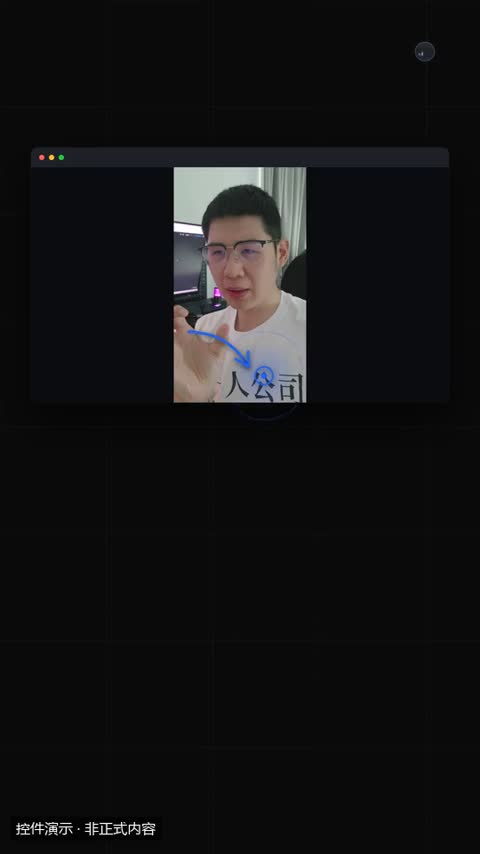](../../docs/template-gallery/demos/motiongit/callout.mp4)

- [本地效果演示 1 · 规格见演示](../../docs/template-gallery/demos/motiongit/callout.mp4)：官方控件真实渲染；使用本人授权素材。6秒静音控件演示；保留模板原生标记与组内时码，角标不是本文件播放计时。低位演示身份标为本目录后处理添加。

**2. 适用内容**

- 指出画面里的某个位置（录屏按钮、图片细节、口播卡外的内容）：给目标点 x/y（0–1 画面比例）和一句短标注

- 避开脸部、字幕与关键证据；装饰不应抢走讲解重点。

**3. 所需素材**

- 叠加底图或视频
- 短标签及标注位置

**4. 可改参数与限制**

按已核对的字段与限制修改；尚未核对的能力会明确标注。

<details>
<summary>查看参数、限制与来源依据</summary>

- 标注文字，*重点* 用星号（text）：文字，必填；最短长度 1；最多可见字符 14。
- 目标点横向位置（画面比例）（x）：数字，必填；最小 0；最大 1。
- 目标点纵向位置（画面比例）（y）：数字，必填；最小 0；最大 1。
- box 变体：框宽（画面比例）（w）：数字，可选；最小 0.05；最大 0.8。
- box 变体：框高（画面比例）（h）：数字，可选；最小 0.05；最大 0.8。
- 动画变体（variant）：arrow / circle / box。
- 段落时间（t0、t1）与动作提示时间（cues）按剪后的真实讲解设置；主题色由时间轴 theme 配置，不是每个控件任意独立的配色合同。

- 这些范围来自已登记版本的公开参数合同；更换个人包或版本后须重新核对，不自动沿用到所有官网模板。
- 每个控件目前只展示一个代表变体；可选枚举、允许数量和颜色参数不等于所有组合都已实测。
- 导出前仍需校验参数、真实素材、语音时长与排版；不从示例数据推断实际业务结果。

参数依据：[motiongit-controls.json](../../templates/motiongit-controls.json) · [render_motiongit_gallery.py](../../scripts/render_motiongit_gallery.py) · [render_motiongit_gallery_data.py](../../scripts/render_motiongit_gallery_data.py)

</details>

**5. 怎样交给 AI 使用**

<details>
<summary>复制本模板的使用提示词</summary>

```text
请使用 AI Cut 模板目录中的「箭头标注」（编号 mg-control-callout）。
我的内容或原片：[填写]；输出比例：[填写]；需要强调的内容：[填写]。
先核对本条来源、当前状态、素材和参数合同；使用我自己的获授权素材，保留原声原意。
按照本条已支持的参数范围做短预览，确认文字、动作和声音的时间一致，再放入剪辑工程。
若原包、依赖或素材缺失，说明缺什么；遇到费用先告诉我。不要将示例人物或示例数据当成我的内容。
```

</details>

**6. 当前能否使用**

- 已有控件演示 · 需自备授权原包
- 本仓库提供目录与已渲染演示，未附送个人 .motion 原包；学员须使用自己合法取得的对应包。
- 登记基线版本：0.3.0 (package2.7.17-alpha.2)。新输入、新电脑和其他变体须另行验证。

<details>
<summary>查看原始检查范围与接入记录</summary>

- 一个代表变体已由官方 helper 渲染；静音小样完整解码，并已查看实际导出抽帧。其他两个变体仅登记，未渲染；不代表连续观看或用户审美认可。

</details>

**7. 来源与许可**

- MotionGit 个人授权模板包，以原包授权为准；仅包含自有素材及明确示例数据的渲染演示，不分发受保护代码。

[原始来源](https://motiongit.com/@adunext/template-01-integrated-portrait)

---

<a id="mg-control-progressbar"></a>

### 章节进度条

`mg-control-progressbar` · 录屏与操作教学 · 叠加标注与装饰 · **已有控件演示 · 需自备授权原包**

告诉观众「现在讲到第几部分」：2–6 个章节名 + 当前章节序号。放在章节切换处，停留 2–6 秒

**1. 效果预览**

[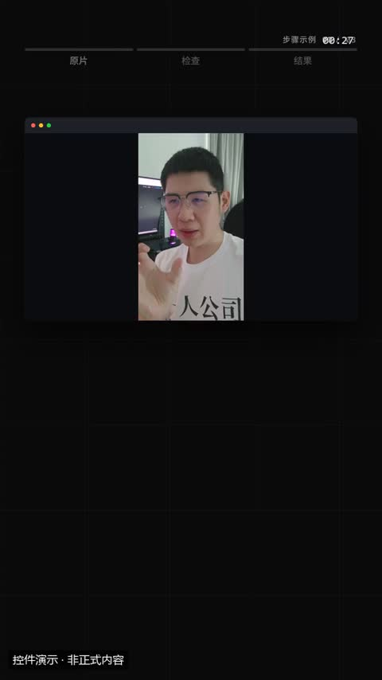](../../docs/template-gallery/demos/motiongit/progressbar.mp4)

- [本地效果演示 1 · 规格见演示](../../docs/template-gallery/demos/motiongit/progressbar.mp4)：官方控件真实渲染；使用本人授权素材。6秒静音控件演示；保留模板原生标记与组内时码，角标不是本文件播放计时。低位演示身份标为本目录后处理添加。

**2. 适用内容**

- 告诉观众「现在讲到第几部分」：2–6 个章节名 + 当前章节序号。放在章节切换处，停留 2–6 秒

- 避开脸部、字幕与关键证据；装饰不应抢走讲解重点。

**3. 所需素材**

- 叠加底图或视频
- 短标签及标注位置

**4. 可改参数与限制**

按已核对的字段与限制修改；尚未核对的能力会明确标注。

<details>
<summary>查看参数、限制与来源依据</summary>

- 左侧 / 上方小标题（可省略）（title）：文字，可选；最多可见字符 12。
- 章节名（短）（chapters）：列表，必填；至少项数 2；最多项数 6。
- 当前第几章（从 1 起）（current）：integer，必填；最小 1；最大 6。
- 动画变体（variant）：top / bottom / dots。
- 段落时间（t0、t1）与动作提示时间（cues）按剪后的真实讲解设置；主题色由时间轴 theme 配置，不是每个控件任意独立的配色合同。

- 这些范围来自已登记版本的公开参数合同；更换个人包或版本后须重新核对，不自动沿用到所有官网模板。
- 每个控件目前只展示一个代表变体；可选枚举、允许数量和颜色参数不等于所有组合都已实测。
- 导出前仍需校验参数、真实素材、语音时长与排版；不从示例数据推断实际业务结果。

参数依据：[motiongit-controls.json](../../templates/motiongit-controls.json) · [render_motiongit_gallery.py](../../scripts/render_motiongit_gallery.py) · [render_motiongit_gallery_data.py](../../scripts/render_motiongit_gallery_data.py)

</details>

**5. 怎样交给 AI 使用**

<details>
<summary>复制本模板的使用提示词</summary>

```text
请使用 AI Cut 模板目录中的「章节进度条」（编号 mg-control-progressbar）。
我的内容或原片：[填写]；输出比例：[填写]；需要强调的内容：[填写]。
先核对本条来源、当前状态、素材和参数合同；使用我自己的获授权素材，保留原声原意。
按照本条已支持的参数范围做短预览，确认文字、动作和声音的时间一致，再放入剪辑工程。
若原包、依赖或素材缺失，说明缺什么；遇到费用先告诉我。不要将示例人物或示例数据当成我的内容。
```

</details>

**6. 当前能否使用**

- 已有控件演示 · 需自备授权原包
- 本仓库提供目录与已渲染演示，未附送个人 .motion 原包；学员须使用自己合法取得的对应包。
- 登记基线版本：0.3.0 (package2.7.17-alpha.2)。新输入、新电脑和其他变体须另行验证。

<details>
<summary>查看原始检查范围与接入记录</summary>

- 一个代表变体已由官方 helper 渲染；静音小样完整解码，并已查看实际导出抽帧。其他两个变体仅登记，未渲染；不代表连续观看或用户审美认可。

</details>

**7. 来源与许可**

- MotionGit 个人授权模板包，以原包授权为准；仅包含自有素材及明确示例数据的渲染演示，不分发受保护代码。

[原始来源](https://motiongit.com/@adunext/template-01-integrated-portrait)

---

<a id="remotion-community-chat"></a>

### 聊天界面

`remotion-community-chat` · 录屏与操作教学 · 社交与界面 · **代码已入库 · 准备环境后适配**

竖屏聊天消息逐条展示；独立演示层把桌面尺寸字体放大，方便阅读竖版中文界面。

**1. 效果预览**

[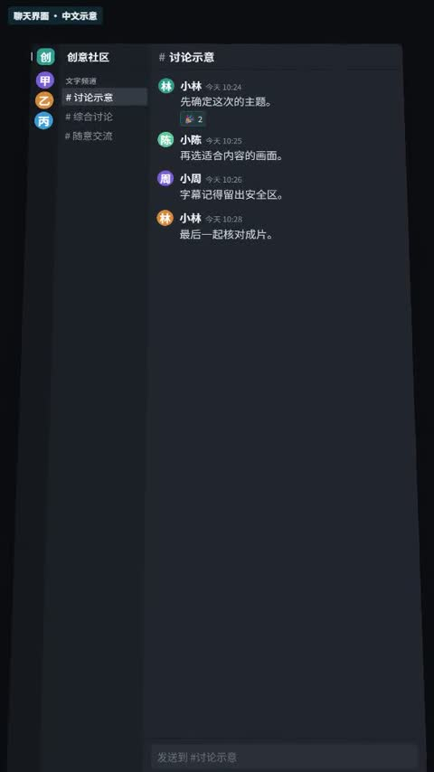](../../docs/template-gallery/demos/remotion/community-chat.mp4)

- [本地效果演示 1 · 9:16](../../docs/template-gallery/demos/remotion/community-chat.mp4)：原注册动画的中文参数演示；静音；示例文字与数值不是实际业务结果

**2. 适用内容**

- 人物介绍与界面示意
- 对比、对话或行动提示

- 虚构对话与界面不能当成客户见证
- 未接入真人的图形人物不得冒充用户

**3. 所需素材**

- 中文文案与颜色参数
- 按本条素材确认的时间长度
- 对应画幅的安全区检查

**4. 可改参数与限制**

按已核对的字段与限制修改；尚未核对的能力会明确标注。

<details>
<summary>查看参数、限制与来源依据</summary>

- 工作区名称（workspaceName）：文字，有默认值或须提供。
- 频道名称（channelName）：文字，有默认值或须提供。
- 消息列表（messages）：CommunityChatMessage[]，有默认值或须提供。
- authorName（messages[].authorName）：文字，有默认值或须提供。
- avatarLabel（messages[].avatarLabel）：文字，有默认值或须提供。
- avatar颜色（messages[].avatarColor）：文字，可省略。
- time（messages[].time）：文字，有默认值或须提供。
- 正文（messages[].text）：文字，有默认值或须提供。
- reactions（messages[].reactions）：{ emoji: string，可省略。
- 数量（messages[].count）：number }[]，有默认值或须提供。

- 以上是源码实际暴露的输入，不代表文字长度、列表数量和所有参数组合已完成测试；换内容后须检查排版与完整动画。
- 当前目录演示画幅为 9:16；尺寸与总帧数由 Composition 注册项控制，不能把效果内部 duration 等输入当作自动更改导出长度。

参数依据：[CommunityChat.tsx](../../extensions/remotion-vd44/src/vendor/rendercomp/components/community-chat/CommunityChat.tsx) · [Root.tsx](../../extensions/remotion-vd44/src/vendor/rendercomp/Root.tsx)

</details>

**5. 怎样交给 AI 使用**

<details>
<summary>复制本模板的使用提示词</summary>

```text
请使用 AI Cut 模板目录中的「聊天界面」（编号 remotion-community-chat）。
我的内容或原片：[填写]；输出比例：[填写]；需要强调的内容：[填写]。
先核对本条来源、当前状态、素材和参数合同；使用我自己的获授权素材，保留原声原意。
按照本条已支持的参数范围做短预览，确认文字、动作和声音的时间一致，再放入剪辑工程。
若原包、依赖或素材缺失，说明缺什么；遇到费用先告诉我。不要将示例人物或示例数据当成我的内容。
```

</details>

**6. 当前能否使用**

- 代码已入库 · 准备环境后适配
- 本仓库包含相应代码；需准备 Remotion 运行环境及本条素材，参数修改后重新预览检查。
- 登记基线版本：f648980e528defb7594e24c6447055f0540f340b+zh-gallery.1。新输入、新电脑和其他变体须另行验证。

<details>
<summary>查看原始检查范围与接入记录</summary>

- 55项真实Remotion渲染；每项完整解码、帧数、比例、静音及2 MB限额通过；实际查看每项18%/52%/82%编码帧联系表。不是逐帧连续观看，不代表其他画幅、真人合成、用户审美认可或最终视频QA。

</details>

**7. 来源与许可**

- MIT（模板源码）；Remotion 运行时与字体许可分别适用

[原始来源](https://github.com/RenderComp/free-remotion-templates/tree/f648980e528defb7594e24c6447055f0540f340b)

---

<a id="remotion-eye-reveal"></a>

### 眼睛揭示动画

`remotion-eye-reveal` · 录屏与操作教学 · 社交与界面 · **代码已入库 · 准备环境后适配**

代码图形的眼睛开合揭示

**1. 效果预览**

[](../../docs/template-gallery/demos/remotion/eye-reveal.mp4)

- [本地效果演示 1 · 1:1](../../docs/template-gallery/demos/remotion/eye-reveal.mp4)：原注册动画的中文参数演示；静音；示例文字与数值不是实际业务结果

**2. 适用内容**

- 人物介绍与界面示意
- 对比、对话或行动提示

- 虚构对话与界面不能当成客户见证
- 未接入真人的图形人物不得冒充用户

**3. 所需素材**

- 中文文案与颜色参数
- 按本条素材确认的时间长度
- 对应画幅的安全区检查

**4. 可改参数与限制**

按已核对的字段与限制修改；尚未核对的能力会明确标注。

<details>
<summary>查看参数、限制与来源依据</summary>

- 背景色（backgroundColor）：文字，有默认值或须提供。
- sclera颜色（scleraColor）：文字，有默认值或须提供。
- iris颜色（irisColor）：文字，有默认值或须提供。
- pupil颜色（pupilColor）：文字，有默认值或须提供。
- lid颜色（lidColor）：文字，有默认值或须提供。
- 文字色（textColor）：文字，有默认值或须提供。
- sub颜色（subColor）：文字，有默认值或须提供。
- 显示文字（messageText）：文字，有默认值或须提供。
- 辅助文字（subText）：文字，有默认值或须提供。

- 以上是源码实际暴露的输入，不代表文字长度、列表数量和所有参数组合已完成测试；换内容后须检查排版与完整动画。
- 当前目录演示画幅为 1:1；尺寸与总帧数由 Composition 注册项控制，不能把效果内部 duration 等输入当作自动更改导出长度。

参数依据：[EyeReveal.tsx](../../extensions/remotion-vd44/src/vendor/rendercomp/components/eye-reveal/EyeReveal.tsx) · [Root.tsx](../../extensions/remotion-vd44/src/vendor/rendercomp/Root.tsx)

</details>

**5. 怎样交给 AI 使用**

<details>
<summary>复制本模板的使用提示词</summary>

```text
请使用 AI Cut 模板目录中的「眼睛揭示动画」（编号 remotion-eye-reveal）。
我的内容或原片：[填写]；输出比例：[填写]；需要强调的内容：[填写]。
先核对本条来源、当前状态、素材和参数合同；使用我自己的获授权素材，保留原声原意。
按照本条已支持的参数范围做短预览，确认文字、动作和声音的时间一致，再放入剪辑工程。
若原包、依赖或素材缺失，说明缺什么；遇到费用先告诉我。不要将示例人物或示例数据当成我的内容。
```

</details>

**6. 当前能否使用**

- 代码已入库 · 准备环境后适配
- 本仓库包含相应代码；需准备 Remotion 运行环境及本条素材，参数修改后重新预览检查。
- 登记基线版本：f648980e528defb7594e24c6447055f0540f340b+zh-gallery.1。新输入、新电脑和其他变体须另行验证。

<details>
<summary>查看原始检查范围与接入记录</summary>

- 55项真实Remotion渲染；每项完整解码、帧数、比例、静音及2 MB限额通过；实际查看每项18%/52%/82%编码帧联系表。不是逐帧连续观看，不代表其他画幅、真人合成、用户审美认可或最终视频QA。

</details>

**7. 来源与许可**

- MIT（模板源码）；Remotion 运行时与字体许可分别适用

[原始来源](https://github.com/RenderComp/free-remotion-templates/tree/f648980e528defb7594e24c6447055f0540f340b)

---

<a id="remotion-lower-third-glass-card"></a>

### 玻璃信息卡

`remotion-lower-third-glass-card` · 录屏与操作教学 · 社交与界面 · **代码已入库 · 准备环境后适配**

半透明玻璃下三分之一信息卡

**1. 效果预览**

[](../../docs/template-gallery/demos/remotion/lower-third-glass-card.mp4)

- [本地效果演示 1 · 16:9](../../docs/template-gallery/demos/remotion/lower-third-glass-card.mp4)：原注册动画的中文参数演示；静音；示例文字与数值不是实际业务结果

**2. 适用内容**

- 人物介绍与界面示意
- 对比、对话或行动提示

- 虚构对话与界面不能当成客户见证
- 未接入真人的图形人物不得冒充用户

**3. 所需素材**

- 中文文案与颜色参数
- 按本条素材确认的时间长度
- 对应画幅的安全区检查

**4. 可改参数与限制**

按已核对的字段与限制修改；尚未核对的能力会明确标注。

<details>
<summary>查看参数、限制与来源依据</summary>

- 背景色（backgroundColor）：文字，有默认值或须提供。
- 强调色（accentColor）：文字，有默认值或须提供。
- 文字色（textColor）：文字，有默认值或须提供。
- 姓名文字（nameText）：文字，有默认值或须提供。
- 身份文字（titleText）：文字，有默认值或须提供。

- 以上是源码实际暴露的输入，不代表文字长度、列表数量和所有参数组合已完成测试；换内容后须检查排版与完整动画。
- 当前目录演示画幅为 16:9；尺寸与总帧数由 Composition 注册项控制，不能把效果内部 duration 等输入当作自动更改导出长度。

参数依据：[LowerThirdGlassCard.tsx](../../extensions/remotion-vd44/src/vendor/rendercomp/components/lower-third-glass-card/LowerThirdGlassCard.tsx) · [Root.tsx](../../extensions/remotion-vd44/src/vendor/rendercomp/Root.tsx)

</details>

**5. 怎样交给 AI 使用**

<details>
<summary>复制本模板的使用提示词</summary>

```text
请使用 AI Cut 模板目录中的「玻璃信息卡」（编号 remotion-lower-third-glass-card）。
我的内容或原片：[填写]；输出比例：[填写]；需要强调的内容：[填写]。
先核对本条来源、当前状态、素材和参数合同；使用我自己的获授权素材，保留原声原意。
按照本条已支持的参数范围做短预览，确认文字、动作和声音的时间一致，再放入剪辑工程。
若原包、依赖或素材缺失，说明缺什么；遇到费用先告诉我。不要将示例人物或示例数据当成我的内容。
```

</details>

**6. 当前能否使用**

- 代码已入库 · 准备环境后适配
- 本仓库包含相应代码；需准备 Remotion 运行环境及本条素材，参数修改后重新预览检查。
- 登记基线版本：f648980e528defb7594e24c6447055f0540f340b+zh-gallery.1。新输入、新电脑和其他变体须另行验证。

<details>
<summary>查看原始检查范围与接入记录</summary>

- 55项真实Remotion渲染；每项完整解码、帧数、比例、静音及2 MB限额通过；实际查看每项18%/52%/82%编码帧联系表。不是逐帧连续观看，不代表其他画幅、真人合成、用户审美认可或最终视频QA。

</details>

**7. 来源与许可**

- MIT（模板源码）；Remotion 运行时与字体许可分别适用

[原始来源](https://github.com/RenderComp/free-remotion-templates/tree/f648980e528defb7594e24c6447055f0540f340b)

---

<a id="remotion-character-jumping"></a>

### 角色跳动

`remotion-character-jumping` · 录屏与操作教学 · 社交与界面 · **代码已入库 · 准备环境后适配**

代码图形角色弹跳；独立演示层修正原版重复扣除跳跃位移并降低跳高，防止角色跳出画框；原始源码未改。

**1. 效果预览**

[](../../docs/template-gallery/demos/remotion/character-jumping.mp4)

- [本地效果演示 1 · 1:1](../../docs/template-gallery/demos/remotion/character-jumping.mp4)：原注册动画的中文参数演示；静音；示例文字与数值不是实际业务结果

**2. 适用内容**

- 人物介绍与界面示意
- 对比、对话或行动提示

- 虚构对话与界面不能当成客户见证
- 未接入真人的图形人物不得冒充用户

**3. 所需素材**

- 中文文案与颜色参数
- 按本条素材确认的时间长度
- 对应画幅的安全区检查

**4. 可改参数与限制**

按已核对的字段与限制修改；尚未核对的能力会明确标注。

<details>
<summary>查看参数、限制与来源依据</summary>

- 背景色（backgroundColor）：文字，有默认值或须提供。
- character颜色（characterColor）：文字，有默认值或须提供。
- shadow颜色（shadowColor）：文字，有默认值或须提供。
- 强调色（accentColor）：文字，有默认值或须提供。
- ground颜色（groundColor）：文字，有默认值或须提供。
- 标签（label）：文字，有默认值或须提供。
- 文字色（textColor）：文字，有默认值或须提供。
- 跳跃次数（jumpCount）：数字，有默认值或须提供。

- 以上是源码实际暴露的输入，不代表文字长度、列表数量和所有参数组合已完成测试；换内容后须检查排版与完整动画。
- 当前目录演示画幅为 1:1；尺寸与总帧数由 Composition 注册项控制，不能把效果内部 duration 等输入当作自动更改导出长度。

参数依据：[CharacterJumping.tsx](../../extensions/remotion-vd44/src/vendor/rendercomp/components/character-jumping/CharacterJumping.tsx) · [Root.tsx](../../extensions/remotion-vd44/src/vendor/rendercomp/Root.tsx)

</details>

**5. 怎样交给 AI 使用**

<details>
<summary>复制本模板的使用提示词</summary>

```text
请使用 AI Cut 模板目录中的「角色跳动」（编号 remotion-character-jumping）。
我的内容或原片：[填写]；输出比例：[填写]；需要强调的内容：[填写]。
先核对本条来源、当前状态、素材和参数合同；使用我自己的获授权素材，保留原声原意。
按照本条已支持的参数范围做短预览，确认文字、动作和声音的时间一致，再放入剪辑工程。
若原包、依赖或素材缺失，说明缺什么；遇到费用先告诉我。不要将示例人物或示例数据当成我的内容。
```

</details>

**6. 当前能否使用**

- 代码已入库 · 准备环境后适配
- 本仓库包含相应代码；需准备 Remotion 运行环境及本条素材，参数修改后重新预览检查。
- 登记基线版本：f648980e528defb7594e24c6447055f0540f340b+zh-gallery.1。新输入、新电脑和其他变体须另行验证。

<details>
<summary>查看原始检查范围与接入记录</summary>

- 55项真实Remotion渲染；每项完整解码、帧数、比例、静音及2 MB限额通过；实际查看每项18%/52%/82%编码帧联系表。不是逐帧连续观看，不代表其他画幅、真人合成、用户审美认可或最终视频QA。

</details>

**7. 来源与许可**

- MIT（模板源码）；Remotion 运行时与字体许可分别适用

[原始来源](https://github.com/RenderComp/free-remotion-templates/tree/f648980e528defb7594e24c6447055f0540f340b)

---

<a id="remotion-social-reel"></a>

### 短视频播放器界面

`remotion-social-reel` · 录屏与操作教学 · 社交与界面 · **代码已入库 · 准备环境后适配**

代码绘制竖屏播放器与信息层

**1. 效果预览**

[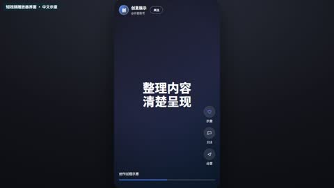](../../docs/template-gallery/demos/remotion/social-reel.mp4)

- [本地效果演示 1 · 16:9](../../docs/template-gallery/demos/remotion/social-reel.mp4)：原注册动画的中文参数演示；静音；示例文字与数值不是实际业务结果

**2. 适用内容**

- 人物介绍与界面示意
- 对比、对话或行动提示

- 虚构对话与界面不能当成客户见证
- 未接入真人的图形人物不得冒充用户

**3. 所需素材**

- 中文文案与颜色参数
- 按本条素材确认的时间长度
- 对应画幅的安全区检查

**4. 可改参数与限制**

按已核对的字段与限制修改；尚未核对的能力会明确标注。

<details>
<summary>查看参数、限制与来源依据</summary>

- 品牌名称（brandName）：文字，有默认值或须提供。
- 账号文字（handle）：文字，有默认值或须提供。
- 主标题（headline）：文字，有默认值或须提供。
- 强调标题（headlineAccent）：文字，有默认值或须提供。
- 第二段文字（secondCopy）：文字，有默认值或须提供。
- 说明行列表（infoLines）：文字列表，有默认值或须提供。
- 行动提示（ctaText）：文字，有默认值或须提供。
- 强调色（accentColor）：文字，有默认值或须提供。
- bgFrom（bgFrom）：文字，有默认值或须提供。
- bgVia（bgVia）：文字，有默认值或须提供。
- bgTo（bgTo）：文字，有默认值或须提供。
- 说明文字（caption）：文字，有默认值或须提供。
- 示例点赞文字（likeCount）：文字，有默认值或须提供。

- 以上是源码实际暴露的输入，不代表文字长度、列表数量和所有参数组合已完成测试；换内容后须检查排版与完整动画。
- 当前目录演示画幅为 16:9；尺寸与总帧数由 Composition 注册项控制，不能把效果内部 duration 等输入当作自动更改导出长度。

参数依据：[SocialReel.tsx](../../extensions/remotion-vd44/src/vendor/rendercomp/components/social-reel/SocialReel.tsx) · [Root.tsx](../../extensions/remotion-vd44/src/vendor/rendercomp/Root.tsx)

</details>

**5. 怎样交给 AI 使用**

<details>
<summary>复制本模板的使用提示词</summary>

```text
请使用 AI Cut 模板目录中的「短视频播放器界面」（编号 remotion-social-reel）。
我的内容或原片：[填写]；输出比例：[填写]；需要强调的内容：[填写]。
先核对本条来源、当前状态、素材和参数合同；使用我自己的获授权素材，保留原声原意。
按照本条已支持的参数范围做短预览，确认文字、动作和声音的时间一致，再放入剪辑工程。
若原包、依赖或素材缺失，说明缺什么；遇到费用先告诉我。不要将示例人物或示例数据当成我的内容。
```

</details>

**6. 当前能否使用**

- 代码已入库 · 准备环境后适配
- 本仓库包含相应代码；需准备 Remotion 运行环境及本条素材，参数修改后重新预览检查。
- 登记基线版本：f648980e528defb7594e24c6447055f0540f340b+zh-gallery.1。新输入、新电脑和其他变体须另行验证。

<details>
<summary>查看原始检查范围与接入记录</summary>

- 55项真实Remotion渲染；每项完整解码、帧数、比例、静音及2 MB限额通过；实际查看每项18%/52%/82%编码帧联系表。不是逐帧连续观看，不代表其他画幅、真人合成、用户审美认可或最终视频QA。

</details>

**7. 来源与许可**

- MIT（模板源码）；Remotion 运行时与字体许可分别适用

[原始来源](https://github.com/RenderComp/free-remotion-templates/tree/f648980e528defb7594e24c6447055f0540f340b)

---

<a id="remotion-thinking-bubble"></a>

### 思考气泡

`remotion-thinking-bubble` · 录屏与操作教学 · 社交与界面 · **代码已入库 · 准备环境后适配**

代码图形思考气泡

**1. 效果预览**

[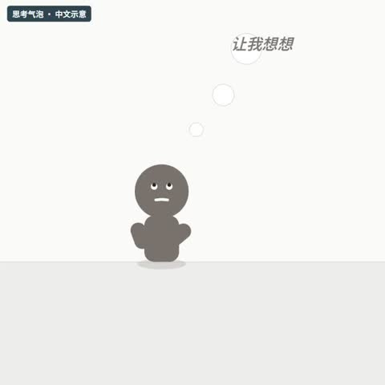](../../docs/template-gallery/demos/remotion/thinking-bubble.mp4)

- [本地效果演示 1 · 1:1](../../docs/template-gallery/demos/remotion/thinking-bubble.mp4)：原注册动画的中文参数演示；静音；示例文字与数值不是实际业务结果

**2. 适用内容**

- 人物介绍与界面示意
- 对比、对话或行动提示

- 虚构对话与界面不能当成客户见证
- 未接入真人的图形人物不得冒充用户

**3. 所需素材**

- 中文文案与颜色参数
- 按本条素材确认的时间长度
- 对应画幅的安全区检查

**4. 可改参数与限制**

按已核对的字段与限制修改；尚未核对的能力会明确标注。

<details>
<summary>查看参数、限制与来源依据</summary>

- 背景色（backgroundColor）：文字，有默认值或须提供。
- character颜色（characterColor）：文字，有默认值或须提供。
- bubble颜色（bubbleColor）：文字，有默认值或须提供。
- bubbleBorder（bubbleBorder）：文字，有默认值或须提供。
- dot颜色（dotColor）：文字，有默认值或须提供。
- 气泡文字（thoughtText）：文字，有默认值或须提供。
- 文字色（textColor）：文字，有默认值或须提供。
- 显示文字开关（showText）：开关，有默认值或须提供。

- 以上是源码实际暴露的输入，不代表文字长度、列表数量和所有参数组合已完成测试；换内容后须检查排版与完整动画。
- 当前目录演示画幅为 1:1；尺寸与总帧数由 Composition 注册项控制，不能把效果内部 duration 等输入当作自动更改导出长度。

参数依据：[ThinkingBubble.tsx](../../extensions/remotion-vd44/src/vendor/rendercomp/components/thinking-bubble/ThinkingBubble.tsx) · [Root.tsx](../../extensions/remotion-vd44/src/vendor/rendercomp/Root.tsx)

</details>

**5. 怎样交给 AI 使用**

<details>
<summary>复制本模板的使用提示词</summary>

```text
请使用 AI Cut 模板目录中的「思考气泡」（编号 remotion-thinking-bubble）。
我的内容或原片：[填写]；输出比例：[填写]；需要强调的内容：[填写]。
先核对本条来源、当前状态、素材和参数合同；使用我自己的获授权素材，保留原声原意。
按照本条已支持的参数范围做短预览，确认文字、动作和声音的时间一致，再放入剪辑工程。
若原包、依赖或素材缺失，说明缺什么；遇到费用先告诉我。不要将示例人物或示例数据当成我的内容。
```

</details>

**6. 当前能否使用**

- 代码已入库 · 准备环境后适配
- 本仓库包含相应代码；需准备 Remotion 运行环境及本条素材，参数修改后重新预览检查。
- 登记基线版本：f648980e528defb7594e24c6447055f0540f340b+zh-gallery.1。新输入、新电脑和其他变体须另行验证。

<details>
<summary>查看原始检查范围与接入记录</summary>

- 55项真实Remotion渲染；每项完整解码、帧数、比例、静音及2 MB限额通过；实际查看每项18%/52%/82%编码帧联系表。不是逐帧连续观看，不代表其他画幅、真人合成、用户审美认可或最终视频QA。

</details>

**7. 来源与许可**

- MIT（模板源码）；Remotion 运行时与字体许可分别适用

[原始来源](https://github.com/RenderComp/free-remotion-templates/tree/f648980e528defb7594e24c6447055f0540f340b)

---

<a id="remotion-wave-hello"></a>

### 角色招手

`remotion-wave-hello` · 录屏与操作教学 · 社交与界面 · **代码已入库 · 准备环境后适配**

代码图形招手动画

**1. 效果预览**

[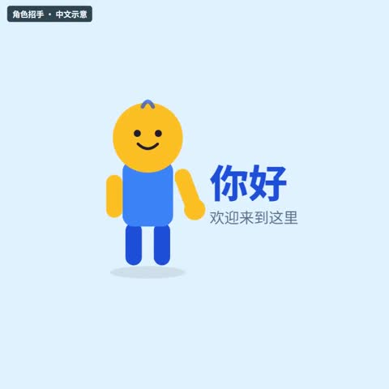](../../docs/template-gallery/demos/remotion/wave-hello.mp4)

- [本地效果演示 1 · 1:1](../../docs/template-gallery/demos/remotion/wave-hello.mp4)：原注册动画的中文参数演示；静音；示例文字与数值不是实际业务结果

**2. 适用内容**

- 人物介绍与界面示意
- 对比、对话或行动提示

- 虚构对话与界面不能当成客户见证
- 未接入真人的图形人物不得冒充用户

**3. 所需素材**

- 中文文案与颜色参数
- 按本条素材确认的时间长度
- 对应画幅的安全区检查

**4. 可改参数与限制**

按已核对的字段与限制修改；尚未核对的能力会明确标注。

<details>
<summary>查看参数、限制与来源依据</summary>

- 背景色（backgroundColor）：文字，有默认值或须提供。
- skin颜色（skinColor）：文字，有默认值或须提供。
- body颜色（bodyColor）：文字，有默认值或须提供。
- 强调色（accentColor）：文字，有默认值或须提供。
- 文字色（textColor）：文字，有默认值或须提供。
- 标题（title）：文字，有默认值或须提供。
- 副标题（subtitle）：文字，有默认值或须提供。

- 以上是源码实际暴露的输入，不代表文字长度、列表数量和所有参数组合已完成测试；换内容后须检查排版与完整动画。
- 当前目录演示画幅为 1:1；尺寸与总帧数由 Composition 注册项控制，不能把效果内部 duration 等输入当作自动更改导出长度。

参数依据：[WaveHello.tsx](../../extensions/remotion-vd44/src/vendor/rendercomp/components/wave-hello/WaveHello.tsx) · [Root.tsx](../../extensions/remotion-vd44/src/vendor/rendercomp/Root.tsx)

</details>

**5. 怎样交给 AI 使用**

<details>
<summary>复制本模板的使用提示词</summary>

```text
请使用 AI Cut 模板目录中的「角色招手」（编号 remotion-wave-hello）。
我的内容或原片：[填写]；输出比例：[填写]；需要强调的内容：[填写]。
先核对本条来源、当前状态、素材和参数合同；使用我自己的获授权素材，保留原声原意。
按照本条已支持的参数范围做短预览，确认文字、动作和声音的时间一致，再放入剪辑工程。
若原包、依赖或素材缺失，说明缺什么；遇到费用先告诉我。不要将示例人物或示例数据当成我的内容。
```

</details>

**6. 当前能否使用**

- 代码已入库 · 准备环境后适配
- 本仓库包含相应代码；需准备 Remotion 运行环境及本条素材，参数修改后重新预览检查。
- 登记基线版本：f648980e528defb7594e24c6447055f0540f340b+zh-gallery.1。新输入、新电脑和其他变体须另行验证。

<details>
<summary>查看原始检查范围与接入记录</summary>

- 55项真实Remotion渲染；每项完整解码、帧数、比例、静音及2 MB限额通过；实际查看每项18%/52%/82%编码帧联系表。不是逐帧连续观看，不代表其他画幅、真人合成、用户审美认可或最终视频QA。

</details>

**7. 来源与许可**

- MIT（模板源码）；Remotion 运行时与字体许可分别适用

[原始来源](https://github.com/RenderComp/free-remotion-templates/tree/f648980e528defb7594e24c6447055f0540f340b)

---

<a id="remotion-library-player-zh"></a>

### 中文播放器界面示例

`remotion-library-player-zh` · 录屏与操作教学 · 中文示例 · **代码已入库 · 准备环境后适配**

代码绘制竖屏播放器与信息层；已有基础模板的中文参数示例，不新增模板家族。

**1. 效果预览**

[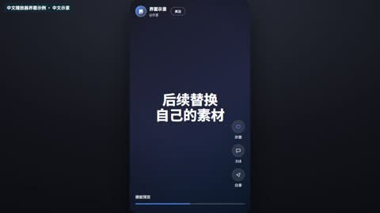](../../docs/template-gallery/demos/remotion/library-player-zh.mp4)

- [本地效果演示 1 · 16:9](../../docs/template-gallery/demos/remotion/library-player-zh.mp4)：原注册动画的中文参数演示；静音；示例文字与数值不是实际业务结果

**2. 适用内容**

- 可参数化的图形动画
- 按表达任务选择局部使用

- 真实素材合成与其他比例须另测
- 不声称演示等同于本条成片验收

**3. 所需素材**

- 中文文案与颜色参数
- 按本条素材确认的时间长度
- 对应画幅的安全区检查

**4. 可改参数与限制**

按已核对的字段与限制修改；尚未核对的能力会明确标注。

<details>
<summary>查看参数、限制与来源依据</summary>

- 品牌名称（brandName）：文字，有默认值或须提供。
- 账号文字（handle）：文字，有默认值或须提供。
- 主标题（headline）：文字，有默认值或须提供。
- 强调标题（headlineAccent）：文字，有默认值或须提供。
- 第二段文字（secondCopy）：文字，有默认值或须提供。
- 说明行列表（infoLines）：文字列表，有默认值或须提供。
- 行动提示（ctaText）：文字，有默认值或须提供。
- 强调色（accentColor）：文字，有默认值或须提供。
- bgFrom（bgFrom）：文字，有默认值或须提供。
- bgVia（bgVia）：文字，有默认值或须提供。
- bgTo（bgTo）：文字，有默认值或须提供。
- 说明文字（caption）：文字，有默认值或须提供。
- 示例点赞文字（likeCount）：文字，有默认值或须提供。

- 以上是源码实际暴露的输入，不代表文字长度、列表数量和所有参数组合已完成测试；换内容后须检查排版与完整动画。
- 当前目录演示画幅为 16:9；尺寸与总帧数由 Composition 注册项控制，不能把效果内部 duration 等输入当作自动更改导出长度。

参数依据：[SocialReel.tsx](../../extensions/remotion-vd44/src/vendor/rendercomp/components/social-reel/SocialReel.tsx) · [LibraryRoot.tsx](../../extensions/remotion-vd44/src/template-library/LibraryRoot.tsx)

</details>

**5. 怎样交给 AI 使用**

<details>
<summary>复制本模板的使用提示词</summary>

```text
请使用 AI Cut 模板目录中的「中文播放器界面示例」（编号 remotion-library-player-zh）。
我的内容或原片：[填写]；输出比例：[填写]；需要强调的内容：[填写]。
先核对本条来源、当前状态、素材和参数合同；使用我自己的获授权素材，保留原声原意。
按照本条已支持的参数范围做短预览，确认文字、动作和声音的时间一致，再放入剪辑工程。
若原包、依赖或素材缺失，说明缺什么；遇到费用先告诉我。不要将示例人物或示例数据当成我的内容。
```

</details>

**6. 当前能否使用**

- 代码已入库 · 准备环境后适配
- 本仓库包含相应代码；需准备 Remotion 运行环境及本条素材，参数修改后重新预览检查。
- 登记基线版本：f648980e528defb7594e24c6447055f0540f340b+zh-gallery.1。新输入、新电脑和其他变体须另行验证。

<details>
<summary>查看原始检查范围与接入记录</summary>

- 55项真实Remotion渲染；每项完整解码、帧数、比例、静音及2 MB限额通过；实际查看每项18%/52%/82%编码帧联系表。不是逐帧连续观看，不代表其他画幅、真人合成、用户审美认可或最终视频QA。

</details>

**7. 来源与许可**

- MIT（模板源码）；Remotion 运行时与字体许可分别适用

[原始来源](https://github.com/RenderComp/free-remotion-templates/tree/f648980e528defb7594e24c6447055f0540f340b)

---

<a id="presenter-effect-07"></a>

### 界面窗框

`presenter-effect-07` · 录屏与操作教学 · 界面与设备 · **样片效果 · 需要源码适配**

口播被放入带标题栏的悬浮窗框，形成界面容器效果。

**1. 效果预览**

[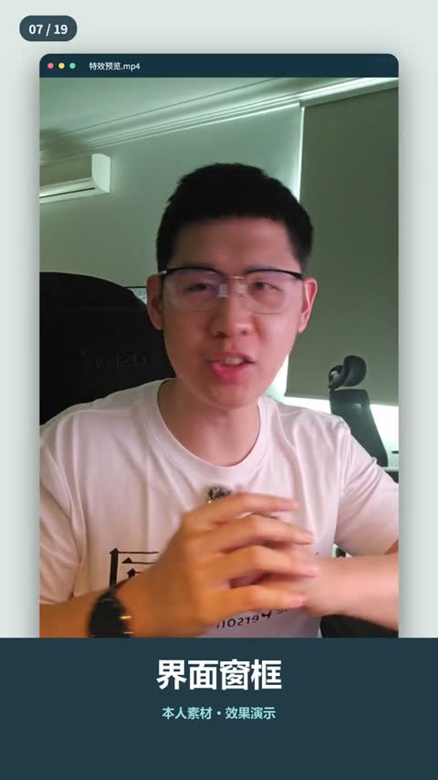](../../docs/template-gallery/demos/presenter/presenter-effect-07.mp4)

- [本人案例 1 · 9:16](../../docs/template-gallery/demos/presenter/presenter-effect-07.mp4)：本人素材中文无声演示，来自已渲染母版的对应效果片段。

**2. 适用内容**

- 介绍视频内容或界面场景

- 此演示没有真实软件操作与点击

**3. 所需素材**

- 口播视频
- 窗口标题
- 背景颜色

**4. 可改参数与限制**

按已核对的字段与限制修改；尚未核对的能力会明确标注。

<details>
<summary>查看参数、限制与来源依据</summary>

- 共同工程输入 sourceFile / alphaFile：原视频与严格同步的透明人像视频文件；透明人像按具体分支需要使用。
- clips：每段的 fromFrame、durationInFrames、sourceStart、playbackRate、kind、title；totalFrames：总帧数。
- 本条效果选择 kind=7；标题可由该段 title 提供，其余效果内容不能假定已参数化。

- 当前是样片效果分支，需要按新片适配；没有独立的通用 .motion 参数合同。
- 母版固定 1080×1920、30fps；品牌色 INK/ACCENT、Logo、小窗位置和部分文案在源码中固定，修改需调整代码并重新验证。
- 窗口外观及尺寸按当前样片设计；原画面中的必要信息仍须保持可读。

参数依据：[Showcase.tsx](../../extensions/remotion-vd44/src/template-library/talking-head-effects/Showcase.tsx) · [GraphicLayers.tsx](../../extensions/remotion-vd44/src/template-library/talking-head-effects/GraphicLayers.tsx) · [index.tsx](../../extensions/remotion-vd44/src/template-library/talking-head-effects/index.tsx)

</details>

**5. 怎样交给 AI 使用**

<details>
<summary>复制本模板的使用提示词</summary>

```text
请使用 AI Cut 模板目录中的「界面窗框」（编号 presenter-effect-07）。
我的内容或原片：[填写]；输出比例：[填写]；需要强调的内容：[填写]。
先核对本条来源、当前状态、素材和参数合同；使用我自己的获授权素材，保留原声原意。
按照本条已支持的参数范围做短预览，确认文字、动作和声音的时间一致，再放入剪辑工程。
若原包、依赖或素材缺失，说明缺什么；遇到费用先告诉我。不要将示例人物或示例数据当成我的内容。
```

</details>

**6. 当前能否使用**

- 样片效果 · 需要源码适配
- 当前为特定样片的效果分支，颜色、素材与时间逻辑尚有固定实现；不视为已通用化 .motion 包。
- 登记基线版本：1.0.0。新输入、新电脑和其他变体须另行验证。

<details>
<summary>查看原始检查范围与接入记录</summary>

- 已核对实际效果编号及母版帧区间，完整解码，检查尺寸、帧数、文件大小，并实际审看起中末联系表；无新音频，不代表逐帧连续观看或完整参考复刻。

</details>

**7. 来源与许可**

- MIT（原创代码）；演示肖像仅按本人本次授权展示，非素材再分发授权；Remotion 引擎另有许可

[原始来源](https://github.com/Isaac3113/ai-cut/tree/main/extensions/remotion-vd44/src/template-library/talking-head-effects)

---

<a id="presenter-effect-14"></a>

### 手机画面

`presenter-effect-14` · 录屏与操作教学 · 界面与设备 · **样片效果 · 需要源码适配**

口播装入带旋转动作的手机轮廓与播放信息层。

**1. 效果预览**

[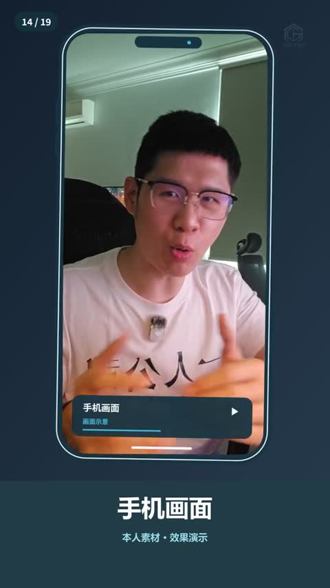](../../docs/template-gallery/demos/presenter/presenter-effect-14.mp4)

- [本人案例 1 · 9:16](../../docs/template-gallery/demos/presenter/presenter-effect-14.mp4)：本人素材中文无声演示，来自已渲染母版的对应效果片段。

**2. 适用内容**

- 展示竖屏内容或手机场景

- 这是设备示意，不是已完成真实手机实操

**3. 所需素材**

- 竖屏视频
- 设备内标题与信息

**4. 可改参数与限制**

按已核对的字段与限制修改；尚未核对的能力会明确标注。

<details>
<summary>查看参数、限制与来源依据</summary>

- 共同工程输入 sourceFile / alphaFile：原视频与严格同步的透明人像视频文件；透明人像按具体分支需要使用。
- clips：每段的 fromFrame、durationInFrames、sourceStart、playbackRate、kind、title；totalFrames：总帧数。
- 本条效果选择 kind=14；标题可由该段 title 提供，其余效果内容不能假定已参数化。

- 当前是样片效果分支，需要按新片适配；没有独立的通用 .motion 参数合同。
- 母版固定 1080×1920、30fps；品牌色 INK/ACCENT、Logo、小窗位置和部分文案在源码中固定，修改需调整代码并重新验证。
- 手机窗口为固定位置和比例；新视频需要单独检查裁切。

参数依据：[Showcase.tsx](../../extensions/remotion-vd44/src/template-library/talking-head-effects/Showcase.tsx) · [GraphicLayers.tsx](../../extensions/remotion-vd44/src/template-library/talking-head-effects/GraphicLayers.tsx) · [index.tsx](../../extensions/remotion-vd44/src/template-library/talking-head-effects/index.tsx)

</details>

**5. 怎样交给 AI 使用**

<details>
<summary>复制本模板的使用提示词</summary>

```text
请使用 AI Cut 模板目录中的「手机画面」（编号 presenter-effect-14）。
我的内容或原片：[填写]；输出比例：[填写]；需要强调的内容：[填写]。
先核对本条来源、当前状态、素材和参数合同；使用我自己的获授权素材，保留原声原意。
按照本条已支持的参数范围做短预览，确认文字、动作和声音的时间一致，再放入剪辑工程。
若原包、依赖或素材缺失，说明缺什么；遇到费用先告诉我。不要将示例人物或示例数据当成我的内容。
```

</details>

**6. 当前能否使用**

- 样片效果 · 需要源码适配
- 当前为特定样片的效果分支，颜色、素材与时间逻辑尚有固定实现；不视为已通用化 .motion 包。
- 登记基线版本：1.0.0。新输入、新电脑和其他变体须另行验证。

<details>
<summary>查看原始检查范围与接入记录</summary>

- 已核对实际效果编号及母版帧区间，完整解码，检查尺寸、帧数、文件大小，并实际审看起中末联系表；无新音频，不代表逐帧连续观看或完整参考复刻。

</details>

**7. 来源与许可**

- MIT（原创代码）；演示肖像仅按本人本次授权展示，非素材再分发授权；Remotion 引擎另有许可

[原始来源](https://github.com/Isaac3113/ai-cut/tree/main/extensions/remotion-vd44/src/template-library/talking-head-effects)

---
