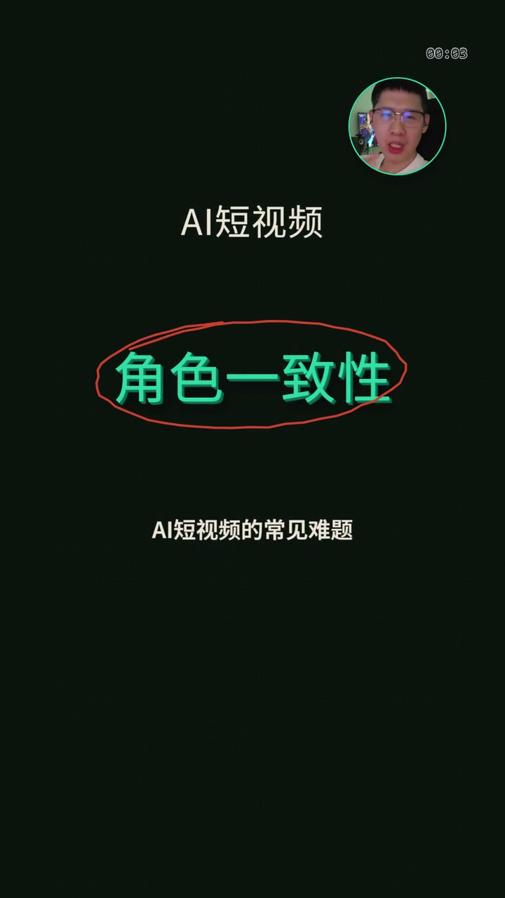
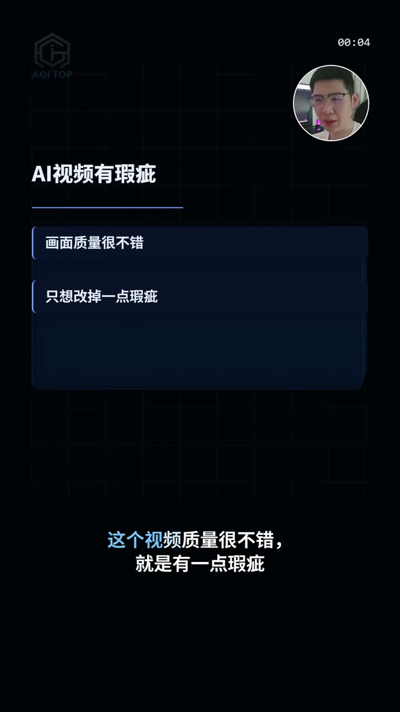
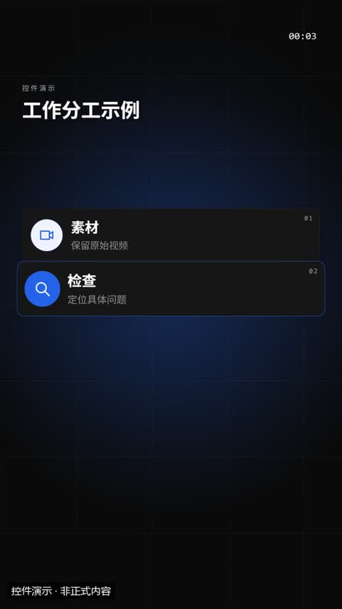
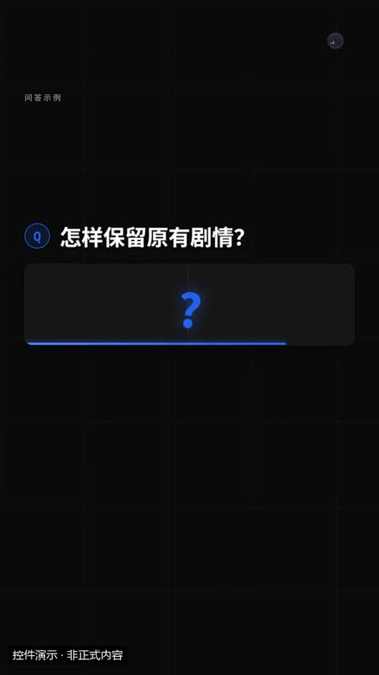
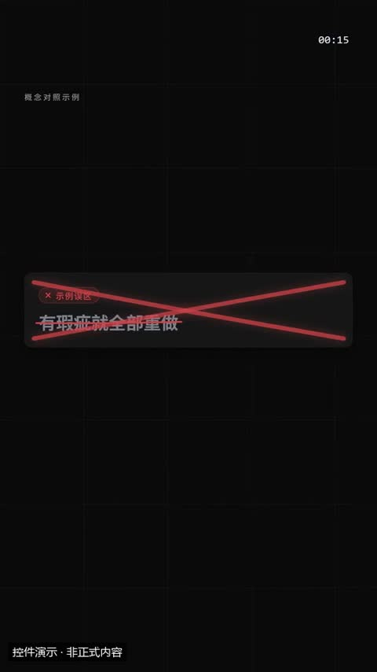
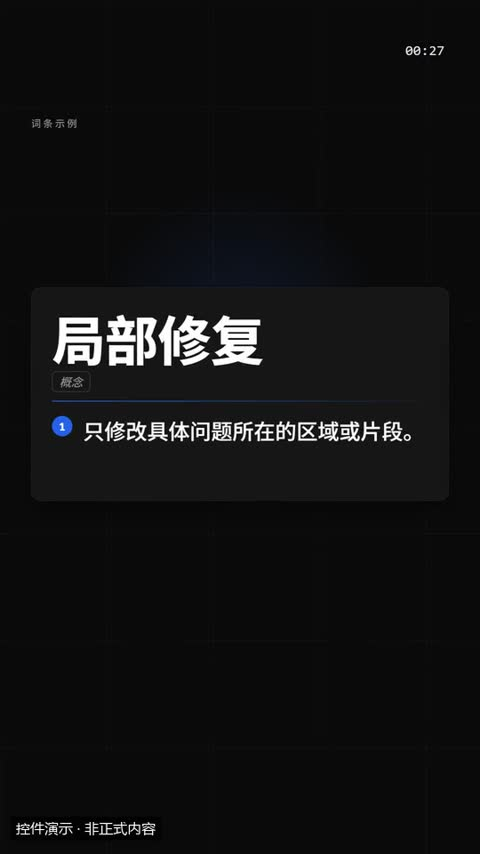
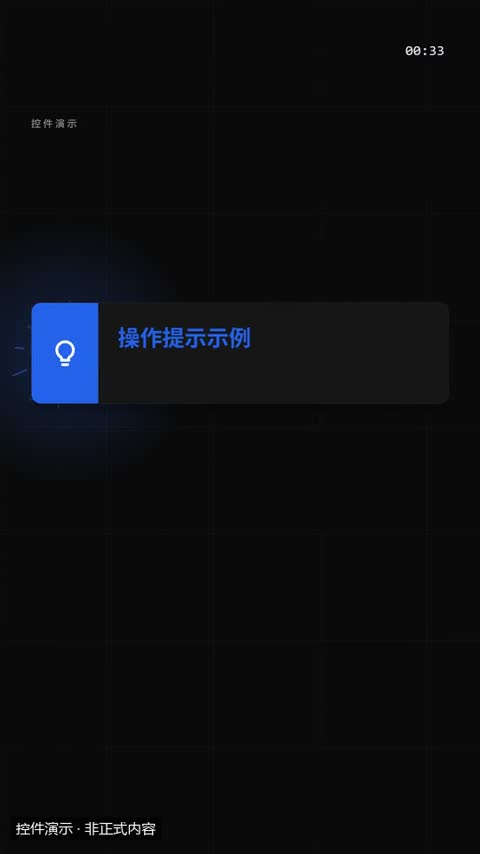

# 真人口播 · 特效模板详细说明

[返回全部分类](../README.zh-CN.md) · [学习自动剪辑](../../docs/NOTION_GUIDE.zh-CN.md) · [在线筛选与播放](https://aicut.agi-top.com)

本页 34 个目录条目；每项固定七段，参数依据与使用状态独立标注。先准备自己的合法素材，再按对应版本检查依赖和预览。

[现代图文 · 口播讲解 · 竖屏](#mg-style-314486) · [现代图文 · 口播讲解](#mg-style-336980) · [纸面透视 · 口播讲解](#mg-style-358192) · [纸面透视 · 口播讲解 · 竖屏](#mg-style-295450) · [深色立体 · 多屏展陈](#mg-style-304634) · [深色立体 · 多屏展陈 · 竖屏](#mg-style-569615) · [科技控制台 · 口播讲解](#mg-style-553346) · [科技控制台 · 口播讲解 · 竖屏](#mg-style-738182) · [鲜色角色 · 叙事讲解](#mg-style-960723) · [鲜色角色 · 叙事讲解 · 竖屏](#mg-style-293151) · [活力海报 · 口播讲解](#mg-style-762139) · [活力海报 · 口播讲解 · 竖屏](#mg-style-721489) · [口播宣传动效 10 秒](#mg-style-854836) · [3D 口播开场](#mg-style-554769) · [DEEP STAGE 口播主舞台](#mg-style-228996) · [DEEP STAGE 深境舞台完整版](#mg-style-838778) · [Kit 2 · 口播动效包装（竖屏）](#mg-style-583549) · [突破边界](#mg-style-178707) · [字符剧场](#mg-style-148294) · [卡通讲解风](#mg-style-875206) · [像素海洋](#mg-style-966597) · [图解口播与图片展示](#mg-style-643842) · [Kit 1 · 人文纪录片知识短片](#mg-style-233154) · [水墨人物志 · 一个人的故事](#mg-style-360840) · [图标要点卡](#mg-control-iconcards) · [问答](#mg-control-qa) · [误区与真相](#mg-control-myth) · [名词解释](#mg-control-definition) · [小贴士 / 警告](#mg-control-tip) · [剪纸描边](#presenter-effect-04) · [照片墙](#presenter-effect-05) · [杂志封面](#presenter-effect-08) · [抠像换景](#presenter-effect-09) · [人物破框](#presenter-effect-15)

<a id="mg-style-314486"></a>

### 现代图文 · 口播讲解 · 竖屏

`mg-style-314486` · 真人口播 · 口播与讲解 · **已有接入案例 · 新片仍需适配**

用现代图文版式、文字强调和信息拆解配合口播，适合观点、证据与步骤讲解。

**1. 效果预览**

[](../../docs/template-gallery/demos/integrated/owner-native-20261028/modern/portrait.mp4)

- [本人案例 1 · 9:16](../../docs/template-gallery/demos/integrated/owner-native-20261028/modern/portrait.mp4)：现代图文 01-D 本人Demo · 9:16 · 18.5秒静音。本包竖屏输出。本例只验证01-D的basic-keyword与basic-summary基础图文路线；不表示01-A至01-C或官网整套动画已接入。
- [本人案例 2 · 16:9](../../docs/template-gallery/demos/integrated/owner-native-20261028/modern/landscape.mp4)：现代图文 01-D 本人Demo · 16:9 · 18.5秒静音。同一竖屏个人包的16:9输出路线；不代表官网独立横屏包已验证。本例只验证01-D的basic-keyword与basic-summary基础图文路线；不表示01-A至01-C或官网整套动画已接入。
- [本人案例 3 · 9:16](../../docs/template-gallery/demos/case-studies/approved-b-highlight.mp4)：本人B版已认可的10.23秒局部画面，静音目录示例；不代表整套原生编舞或全部变体已验收。
- [官方示例 4 · 9:16](https://media.openaicut.com/previews/606/draft-zh-9086d86d6129.mp4)：官方目录演示；文件不保证对应所列最新版本，未逐条播放验收。

**2. 适用内容**

- 观点、证据、步骤与营销方法的竖屏图文讲解；可先评估局部重点强调

- 人物窗口必须来自本期合法的同期本人素材；不要把 Demo 人物、UI 内角色或占位头像当成讲师。
- 本机仅实测两段 highlight/underline 局部组合；完整 native 版式、模板声音与用户风格认可尚未验证。

**3. 所需素材**

- 本期口播视频与原声、匹配的文稿或字幕，以及本期需要引用的图片、录像和数据。可先仅提供文稿讨论画面方案；正式制作前需要真实配音时长和已确认的素材。没有提供人物素材时，不使用示例人物代替你。

**4. 可改参数与限制**

按已核对的字段与限制修改；尚未核对的能力会明确标注。

<details>
<summary>查看参数、限制与来源依据</summary>

- 接入案例曾使用字段：allowed_styles、brief_schema、caption_evidence_units、layout、narration_duration_seconds、native_fps、native_frames、ratio、scenes、workflow。这些是特定案例记录，不作为完整通用参数合同。

- 文字容量、素材数量、颜色、时长和画幅的可调范围，按对应版本的实际合同核对；演示规格不等于任意规格都受支持。

</details>

**5. 怎样交给 AI 使用**

<details>
<summary>复制本模板的使用提示词</summary>

```text
请使用 AI Cut 模板目录中的「现代图文 · 口播讲解 · 竖屏」（编号 mg-style-314486）。
我的内容或原片：[填写]；输出比例：[填写]；需要强调的内容：[填写]。
先核对本条来源、当前状态、素材和参数合同；使用我自己的获授权素材，保留原声原意。
按照本条已支持的参数范围做短预览，确认文字、动作和声音的时间一致，再放入剪辑工程。
若原包、依赖或素材缺失，说明缺什么；遇到费用先告诉我。不要将示例人物或示例数据当成我的内容。
```

</details>

**6. 当前能否使用**

- 已有接入案例 · 新片仍需适配
- 可取得状态：以官网当前页面为准
- 目录默认本人Demo版本：2.7.18-alpha.4；本片QA：verified_demo。只对应已登记版本与输入；切换其他演示时，以播放器下方显示的该版本说明为准。
- 登记基线版本：2.7.17-alpha.2。新输入、新电脑和其他变体须另行验证。

<details>
<summary>查看原始检查范围与接入记录</summary>

- 官网 2.7.17-alpha.2：仅两段 highlight/underline 用于同一 55.0333 秒 A/B 的末 10.233 秒，其余沿用原画面和整条原音轨。两版各 1651 帧/30fps、全解码成功，AAC 与 PCM 一致，已抽检最终编码画面。完整 native 排版仅预览；模板声音优势、连续观看/完整听审和用户风格认可未完成。

本片接入：owner-native-20261028-modern-portrait-2.7.18-alpha.4-v1

现代图文 01-D 9:16 本人独立小样：720×1280、30fps、555帧、18.5秒、无音轨，完整解码通过；每版11个官方原生预览样本与本条最终静音编码4.0秒海报已实际查看。本人身份与中文输入已核对，抽样未见示例人物或客户资料。仅验证本版本/此输入/列出的两个scene，不代表全帧人工审阅、连续观看、完整听审、用户审美认可、整个官网库或其他电脑通过。原片11.65—12.25秒镜头朝衣服移动；保留真实本人镜头，不以生成头像替换。

```text
.\.venv\Scripts\python.exe scripts/motiongit_adapter.py run --instance <instance> render <reviewed-project> --out <native-demo.mp4> --language zh
```

不改变原条目验证范围，不代表用户审美认可。

</details>

**7. 来源与许可**

- 目录声明开源；代码、字体与素材许可须逐包核对，本索引未逐包审定。

[原始来源](https://motiongit.com/@adunext/template-01-integrated-portrait) · [上游技术资料](https://github.com/motiontemplates/314486)

---

<a id="mg-style-336980"></a>

### 现代图文 · 口播讲解

`mg-style-336980` · 真人口播 · 口播与讲解 · **官方参考 · 先取得并核对原包**

用现代图文版式、文字强调和信息拆解配合口播，适合观点、证据与步骤讲解。

**1. 效果预览**

[](https://media.openaicut.com/previews/605/draft-zh-99e0d21cfdd9.mp4)

- [官方示例 1 · 16:9](https://media.openaicut.com/previews/605/draft-zh-99e0d21cfdd9.mp4)：官方目录演示；文件不保证对应所列最新版本，未逐条播放验收。

**2. 适用内容**

- 观点、证据、步骤与营销方法的横屏图文讲解

- 人物窗口必须来自本期合法的同期本人素材；不要把 Demo 人物、UI 内角色或占位头像当成讲师。

**3. 所需素材**

- 本期口播视频与原声、匹配的文稿或字幕，以及本期需要引用的图片、录像和数据。可先仅提供文稿讨论画面方案；正式制作前需要真实配音时长和已确认的素材。没有提供人物素材时，不使用示例人物代替你。

**4. 可改参数与限制**

按已核对的字段与限制修改；尚未核对的能力会明确标注。

<details>
<summary>查看参数、限制与来源依据</summary>

- 尚未核对可替换参数合同；请先读原模板的 guide/schema 或源码。不能根据 Demo 推断能任意换颜色、数量、比例或时长。

- 文字容量、素材数量、颜色、时长和画幅的可调范围，按对应版本的实际合同核对；演示规格不等于任意规格都受支持。

</details>

**5. 怎样交给 AI 使用**

<details>
<summary>复制本模板的使用提示词</summary>

```text
请使用 AI Cut 模板目录中的「现代图文 · 口播讲解」（编号 mg-style-336980）。
我的内容或原片：[填写]；输出比例：[填写]；需要强调的内容：[填写]。
先核对本条来源、当前状态、素材和参数合同；使用我自己的获授权素材，保留原声原意。
按照本条已支持的参数范围做短预览，确认文字、动作和声音的时间一致，再放入剪辑工程。
若原包、依赖或素材缺失，说明缺什么；遇到费用先告诉我。不要将示例人物或示例数据当成我的内容。
```

</details>

**6. 当前能否使用**

- 官方参考 · 先取得并核对原包
- 可取得状态：以官网当前页面为准
- 登记基线版本：2.7.17-alpha.4。新输入、新电脑和其他变体须另行验证。

<details>
<summary>查看原始检查范围与接入记录</summary>

- 官方目录提供 Demo 链接；本次核对了来源字段与链接完整性，未逐条播放、验证下载权限、运行或整套成片。

</details>

**7. 来源与许可**

- 目录声明开源；代码、字体与素材许可须逐包核对，本索引未逐包审定。

[原始来源](https://motiongit.com/@adunext/template-01-integrated) · [上游技术资料](https://github.com/motiontemplates/336980)

---

<a id="mg-style-358192"></a>

### 纸面透视 · 口播讲解

`mg-style-358192` · 真人口播 · 口播与讲解 · **官方参考 · 先取得并核对原包**

用纸面透视、卡片层次和图文关系配合口播，适合方法拆解与结构化知识。

**1. 效果预览**

[](https://media.openaicut.com/previews/607/draft-zh-613d68ad449f.mp4)

- [官方示例 1 · 16:9](https://media.openaicut.com/previews/607/draft-zh-613d68ad449f.mp4)：官方目录演示；文件不保证对应所列最新版本，未逐条播放验收。

**2. 适用内容**

- 方法拆解、层级关系与结构化知识的横屏表达

- 人物窗口必须来自本期合法的同期本人素材；不要把 Demo 人物、UI 内角色或占位头像当成讲师。

**3. 所需素材**

- 本期口播视频与原声、匹配的文稿或字幕，以及本期需要引用的图片、录像和数据。可先仅提供文稿讨论画面方案；正式制作前需要真实配音时长和已确认的素材。没有提供人物素材时，不使用示例人物代替你。

**4. 可改参数与限制**

按已核对的字段与限制修改；尚未核对的能力会明确标注。

<details>
<summary>查看参数、限制与来源依据</summary>

- 尚未核对可替换参数合同；请先读原模板的 guide/schema 或源码。不能根据 Demo 推断能任意换颜色、数量、比例或时长。

- 文字容量、素材数量、颜色、时长和画幅的可调范围，按对应版本的实际合同核对；演示规格不等于任意规格都受支持。

</details>

**5. 怎样交给 AI 使用**

<details>
<summary>复制本模板的使用提示词</summary>

```text
请使用 AI Cut 模板目录中的「纸面透视 · 口播讲解」（编号 mg-style-358192）。
我的内容或原片：[填写]；输出比例：[填写]；需要强调的内容：[填写]。
先核对本条来源、当前状态、素材和参数合同；使用我自己的获授权素材，保留原声原意。
按照本条已支持的参数范围做短预览，确认文字、动作和声音的时间一致，再放入剪辑工程。
若原包、依赖或素材缺失，说明缺什么；遇到费用先告诉我。不要将示例人物或示例数据当成我的内容。
```

</details>

**6. 当前能否使用**

- 官方参考 · 先取得并核对原包
- 可取得状态：以官网当前页面为准
- 登记基线版本：2.7.20-alpha.2。新输入、新电脑和其他变体须另行验证。

<details>
<summary>查看原始检查范围与接入记录</summary>

- 官方目录提供 Demo 链接；本次核对了来源字段与链接完整性，未逐条播放、验证下载权限、运行或整套成片。

</details>

**7. 来源与许可**

- 目录声明开源；代码、字体与素材许可须逐包核对，本索引未逐包审定。

[原始来源](https://motiongit.com/@adunext/template-02-expanded) · [上游技术资料](https://github.com/motiontemplates/358192)

---

<a id="mg-style-295450"></a>

### 纸面透视 · 口播讲解 · 竖屏

`mg-style-295450` · 真人口播 · 口播与讲解 · **已有接入案例 · 新片仍需适配**

用纸面透视、卡片层次和图文关系配合口播，适合方法拆解与结构化知识。

**1. 效果预览**

[](../../docs/template-gallery/demos/integrated/aivd11-paper-keyword/2.7.18-alpha.5/portrait.mp4)

- [本人案例 1 · 9:16](../../docs/template-gallery/demos/integrated/aivd11-paper-keyword/2.7.18-alpha.5/portrait.mp4)：AIVD 11本人案例 · 纸面透视 · 散字牵引成词 · 9:16 · 11秒静音；仅本片角色一致性局部输入，保留官方青绿/橙红设计，不代表整片或整个模板库通过。
- [本人案例 2 · 16:9](../../docs/template-gallery/demos/integrated/owner-native-20261028/paper/landscape.mp4)：纸面透视 02-X 本人Demo · 16:9 · 18.5秒静音。同一竖屏个人包的16:9输出路线；不代表官网独立横屏包已验证。本例是02-X扩展候选fold-pin-opinion与glyph-thread-keyword；不是历史模板完整编舞复原，也不代表整个纸面模板库通过。
- [本人案例 3 · 9:16](../../docs/template-gallery/demos/integrated/owner-native-20261028/paper/portrait.mp4)：纸面透视 02-X 本人Demo · 9:16 · 18.5秒静音。本包竖屏输出。本例是02-X扩展候选fold-pin-opinion与glyph-thread-keyword；不是历史模板完整编舞复原，也不代表整个纸面模板库通过。
- [官方示例 4 · 9:16](https://media.openaicut.com/previews/608/draft-zh-927e16779f16.mp4)：官方目录演示；文件不保证对应所列最新版本，未逐条播放验收。

**2. 适用内容**

- 方法拆解、层级关系与结构化知识的竖屏表达

- 人物窗口必须来自本期合法的同期本人素材；不要把 Demo 人物、UI 内角色或占位头像当成讲师。

**3. 所需素材**

- 本期口播视频与原声、匹配的文稿或字幕，以及本期需要引用的图片、录像和数据。可先仅提供文稿讨论画面方案；正式制作前需要真实配音时长和已确认的素材。没有提供人物素材时，不使用示例人物代替你。

**4. 可改参数与限制**

按已核对的字段与限制修改；尚未核对的能力会明确标注。

<details>
<summary>查看参数、限制与来源依据</summary>

- 接入案例曾使用字段：allowed_styles、brief_schema、caption_evidence_units、layout、music_mode、narration_duration_seconds、native_fps、native_frames、ratio、scenes、source_word_count、workflow。这些是特定案例记录，不作为完整通用参数合同。

- 文字容量、素材数量、颜色、时长和画幅的可调范围，按对应版本的实际合同核对；演示规格不等于任意规格都受支持。

</details>

**5. 怎样交给 AI 使用**

<details>
<summary>复制本模板的使用提示词</summary>

```text
请使用 AI Cut 模板目录中的「纸面透视 · 口播讲解 · 竖屏」（编号 mg-style-295450）。
我的内容或原片：[填写]；输出比例：[填写]；需要强调的内容：[填写]。
先核对本条来源、当前状态、素材和参数合同；使用我自己的获授权素材，保留原声原意。
按照本条已支持的参数范围做短预览，确认文字、动作和声音的时间一致，再放入剪辑工程。
若原包、依赖或素材缺失，说明缺什么；遇到费用先告诉我。不要将示例人物或示例数据当成我的内容。
```

</details>

**6. 当前能否使用**

- 已有接入案例 · 新片仍需适配
- 可取得状态：以官网当前页面为准
- 目录默认本人Demo版本：2.7.18-alpha.5；本片QA：verified_demo。只对应已登记版本与输入；切换其他演示时，以播放器下方显示的该版本说明为准。
- 登记基线版本：2.7.17-alpha.2。新输入、新电脑和其他变体须另行验证。

<details>
<summary>查看原始检查范围与接入记录</summary>

- 官方目录提供 Demo 链接；本次核对了来源字段与链接完整性，未逐条播放、验证下载权限、运行或整套成片。

本片接入：aivd11-paper-keyword

本片Paper 02-X:glyph-thread-keyword的9:16、11秒本人静音小样；原生1080×1920/60fps660帧完成，精选库720×1280/30fps330帧，完整解码通过。9个原生预览、9个1080编码样本及9个精选编码样本实际查看，包含散字牵引、锁定冲击、墨圈、解释拉出及退出阶段。只验证本版本/本输入/本场景；未连续观看、未做主成片声音验收、未获用户审美认可。

```text
.\.venv\Scripts\python.exe scripts/motiongit_adapter.py run --instance <instance> render <reviewed-project> --out <native-demo.mp4> --language zh
```

不改变原条目验证范围，不代表用户审美认可。

</details>

**7. 来源与许可**

- 目录声明开源；代码、字体与素材许可须逐包核对，本索引未逐包审定。

[原始来源](https://motiongit.com/@adunext/template-02-expanded-portrait) · [上游技术资料](https://github.com/motiontemplates/295450)

---

<a id="mg-style-304634"></a>

### 深色立体 · 多屏展陈

`mg-style-304634` · 真人口播 · 口播与讲解 · **官方参考 · 先取得并核对原包**

用深色立体舞台、多屏和空间层次展示口播内容，适合产品、案例与媒体素材讲解。

**1. 效果预览**

[](https://media.openaicut.com/previews/609/draft-zh-a33d6dc67131.mp4)

- [官方示例 1 · 16:9](https://media.openaicut.com/previews/609/draft-zh-a33d6dc67131.mp4)：官方目录演示；文件不保证对应所列最新版本，未逐条播放验收。

**2. 适用内容**

- 产品案例、媒体证据与多个画面的横屏并置

- 人物窗口必须来自本期合法的同期本人素材；不要把 Demo 人物、UI 内角色或占位头像当成讲师。

**3. 所需素材**

- 本期口播视频与原声、匹配的文稿或字幕，以及本期需要引用的图片、录像和数据。可先仅提供文稿讨论画面方案；正式制作前需要真实配音时长和已确认的素材。没有提供人物素材时，不使用示例人物代替你。

**4. 可改参数与限制**

按已核对的字段与限制修改；尚未核对的能力会明确标注。

<details>
<summary>查看参数、限制与来源依据</summary>

- 尚未核对可替换参数合同；请先读原模板的 guide/schema 或源码。不能根据 Demo 推断能任意换颜色、数量、比例或时长。

- 文字容量、素材数量、颜色、时长和画幅的可调范围，按对应版本的实际合同核对；演示规格不等于任意规格都受支持。

</details>

**5. 怎样交给 AI 使用**

<details>
<summary>复制本模板的使用提示词</summary>

```text
请使用 AI Cut 模板目录中的「深色立体 · 多屏展陈」（编号 mg-style-304634）。
我的内容或原片：[填写]；输出比例：[填写]；需要强调的内容：[填写]。
先核对本条来源、当前状态、素材和参数合同；使用我自己的获授权素材，保留原声原意。
按照本条已支持的参数范围做短预览，确认文字、动作和声音的时间一致，再放入剪辑工程。
若原包、依赖或素材缺失，说明缺什么；遇到费用先告诉我。不要将示例人物或示例数据当成我的内容。
```

</details>

**6. 当前能否使用**

- 官方参考 · 先取得并核对原包
- 可取得状态：以官网当前页面为准
- 登记基线版本：2.7.17-alpha.2。新输入、新电脑和其他变体须另行验证。

<details>
<summary>查看原始检查范围与接入记录</summary>

- 官方目录提供 Demo 链接；本次核对了来源字段与链接完整性，未逐条播放、验证下载权限、运行或整套成片。

</details>

**7. 来源与许可**

- 目录声明开源；代码、字体与素材许可须逐包核对，本索引未逐包审定。

[原始来源](https://motiongit.com/@adunext/template-03-native) · [上游技术资料](https://github.com/motiontemplates/304634)

---

<a id="mg-style-569615"></a>

### 深色立体 · 多屏展陈 · 竖屏

`mg-style-569615` · 真人口播 · 口播与讲解 · **已有接入案例 · 新片仍需适配**

用深色立体舞台、多屏和空间层次展示口播内容，适合产品、案例与媒体素材讲解。

**1. 效果预览**

[](../../docs/template-gallery/demos/integrated/owner-native-20261028/dark/portrait.mp4)

- [本人案例 1 · 9:16](../../docs/template-gallery/demos/integrated/owner-native-20261028/dark/portrait.mp4)：深色立体 03-X 本人Demo · 9:16 · 18.5秒静音。本包竖屏输出。本例只验证03-X通用重点与总结扩展；不是03-A/03-B完整多屏大场景，也不代表所有深色立体模板已接入。
- [本人案例 2 · 16:9](../../docs/template-gallery/demos/integrated/owner-native-20261028/dark/landscape.mp4)：深色立体 03-X 本人Demo · 16:9 · 18.5秒静音。同一竖屏个人包的16:9输出路线；不代表官网独立横屏包已验证。本例只验证03-X通用重点与总结扩展；不是03-A/03-B完整多屏大场景，也不代表所有深色立体模板已接入。
- [官方示例 3 · 9:16](https://media.openaicut.com/previews/610/draft-zh-3200b44b2818.mp4)：官方目录演示；文件不保证对应所列最新版本，未逐条播放验收。

**2. 适用内容**

- 产品案例、媒体证据与多个画面的竖屏并置；先检查小屏阅读容量

- 人物窗口必须来自本期合法的同期本人素材；不要把 Demo 人物、UI 内角色或占位头像当成讲师。

**3. 所需素材**

- 本期口播视频与原声、匹配的文稿或字幕，以及本期需要引用的图片、录像和数据。可先仅提供文稿讨论画面方案；正式制作前需要真实配音时长和已确认的素材。没有提供人物素材时，不使用示例人物代替你。

**4. 可改参数与限制**

按已核对的字段与限制修改；尚未核对的能力会明确标注。

<details>
<summary>查看参数、限制与来源依据</summary>

- 接入案例曾使用字段：allowed_styles、brief_schema、caption_evidence_units、layout、narration_duration_seconds、native_fps、native_frames、ratio、scenes、workflow。这些是特定案例记录，不作为完整通用参数合同。

- 文字容量、素材数量、颜色、时长和画幅的可调范围，按对应版本的实际合同核对；演示规格不等于任意规格都受支持。

</details>

**5. 怎样交给 AI 使用**

<details>
<summary>复制本模板的使用提示词</summary>

```text
请使用 AI Cut 模板目录中的「深色立体 · 多屏展陈 · 竖屏」（编号 mg-style-569615）。
我的内容或原片：[填写]；输出比例：[填写]；需要强调的内容：[填写]。
先核对本条来源、当前状态、素材和参数合同；使用我自己的获授权素材，保留原声原意。
按照本条已支持的参数范围做短预览，确认文字、动作和声音的时间一致，再放入剪辑工程。
若原包、依赖或素材缺失，说明缺什么；遇到费用先告诉我。不要将示例人物或示例数据当成我的内容。
```

</details>

**6. 当前能否使用**

- 已有接入案例 · 新片仍需适配
- 可取得状态：以官网当前页面为准
- 目录默认本人Demo版本：2.7.18-alpha.4；本片QA：verified_demo。只对应已登记版本与输入；切换其他演示时，以播放器下方显示的该版本说明为准。
- 登记基线版本：2.7.17-alpha.2。新输入、新电脑和其他变体须另行验证。

<details>
<summary>查看原始检查范围与接入记录</summary>

- 官方目录提供 Demo 链接；本次核对了来源字段与链接完整性，未逐条播放、验证下载权限、运行或整套成片。

本片接入：owner-native-20261028-dark-portrait-2.7.18-alpha.4-v1

深色立体 03-X 9:16 本人独立小样：720×1280、30fps、555帧、18.5秒、无音轨，完整解码通过；每版11个官方原生预览样本与本条最终静音编码4.0秒海报已实际查看。本人身份与中文输入已核对，抽样未见示例人物或客户资料。仅验证本版本/此输入/列出的两个scene，不代表全帧人工审阅、连续观看、完整听审、用户审美认可、整个官网库或其他电脑通过。约11.65—12.25秒官方圆窗局部裁到头发/上额，眼鼻口仍可见；公开native合同未提供可核实的人脸中心或裁切参数，因此保留原布局，审美待用户确认。

```text
.\.venv\Scripts\python.exe scripts/motiongit_adapter.py run --instance <instance> render <reviewed-project> --out <native-demo.mp4> --language zh
```

不改变原条目验证范围，不代表用户审美认可。

</details>

**7. 来源与许可**

- 目录声明开源；代码、字体与素材许可须逐包核对，本索引未逐包审定。

[原始来源](https://motiongit.com/@adunext/template-03-native-portrait) · [上游技术资料](https://github.com/motiontemplates/569615)

---

<a id="mg-style-553346"></a>

### 科技控制台 · 口播讲解

`mg-style-553346` · 真人口播 · 口播与讲解 · **官方参考 · 先取得并核对原包**

用科技控制台、紫色玻璃质感与动态信息组件配合口播，适合技术与数据说明。

**1. 效果预览**

[](https://media.openaicut.com/previews/611/2.5.7-zh-96b144413879.mp4)

- [官方示例 1 · 16:9](https://media.openaicut.com/previews/611/2.5.7-zh-96b144413879.mp4)：官方目录演示；文件不保证对应所列最新版本，未逐条播放验收。

**2. 适用内容**

- 技术概念、数据与控制台式信息的横屏讲解

- 人物窗口必须来自本期合法的同期本人素材；不要把 Demo 人物、UI 内角色或占位头像当成讲师。

**3. 所需素材**

- 本期口播视频与原声、匹配的文稿或字幕，以及本期需要引用的图片、录像和数据。可先仅提供文稿讨论画面方案；正式制作前需要真实配音时长和已确认的素材。没有提供人物素材时，不使用示例人物代替你。

**4. 可改参数与限制**

按已核对的字段与限制修改；尚未核对的能力会明确标注。

<details>
<summary>查看参数、限制与来源依据</summary>

- 尚未核对可替换参数合同；请先读原模板的 guide/schema 或源码。不能根据 Demo 推断能任意换颜色、数量、比例或时长。

- 文字容量、素材数量、颜色、时长和画幅的可调范围，按对应版本的实际合同核对；演示规格不等于任意规格都受支持。

</details>

**5. 怎样交给 AI 使用**

<details>
<summary>复制本模板的使用提示词</summary>

```text
请使用 AI Cut 模板目录中的「科技控制台 · 口播讲解」（编号 mg-style-553346）。
我的内容或原片：[填写]；输出比例：[填写]；需要强调的内容：[填写]。
先核对本条来源、当前状态、素材和参数合同；使用我自己的获授权素材，保留原声原意。
按照本条已支持的参数范围做短预览，确认文字、动作和声音的时间一致，再放入剪辑工程。
若原包、依赖或素材缺失，说明缺什么；遇到费用先告诉我。不要将示例人物或示例数据当成我的内容。
```

</details>

**6. 当前能否使用**

- 官方参考 · 先取得并核对原包
- 可取得状态：以官网当前页面为准
- 登记基线版本：2.7.19-alpha.3。新输入、新电脑和其他变体须另行验证。

<details>
<summary>查看原始检查范围与接入记录</summary>

- 官方目录提供 Demo 链接；本次核对了来源字段与链接完整性，未逐条播放、验证下载权限、运行或整套成片。

</details>

**7. 来源与许可**

- 目录声明开源；代码、字体与素材许可须逐包核对，本索引未逐包审定。

[原始来源](https://motiongit.com/@adunext/template-04-dark-console) · [上游技术资料](https://github.com/motiontemplates/553346)

---

<a id="mg-style-738182"></a>

### 科技控制台 · 口播讲解 · 竖屏

`mg-style-738182` · 真人口播 · 口播与讲解 · **官方参考 · 先取得并核对原包**

用科技控制台、紫色玻璃质感与动态信息组件配合口播，适合技术与数据说明。

**1. 效果预览**

[](https://media.openaicut.com/previews/612/2.5.7-zh-a93efdfb29ba.mp4)

- [官方示例 1 · 9:16](https://media.openaicut.com/previews/612/2.5.7-zh-a93efdfb29ba.mp4)：官方目录演示；文件不保证对应所列最新版本，未逐条播放验收。

**2. 适用内容**

- 技术概念、数据与控制台式信息的竖屏讲解

- 人物窗口必须来自本期合法的同期本人素材；不要把 Demo 人物、UI 内角色或占位头像当成讲师。

**3. 所需素材**

- 本期口播视频与原声、匹配的文稿或字幕，以及本期需要引用的图片、录像和数据。可先仅提供文稿讨论画面方案；正式制作前需要真实配音时长和已确认的素材。没有提供人物素材时，不使用示例人物代替你。

**4. 可改参数与限制**

按已核对的字段与限制修改；尚未核对的能力会明确标注。

<details>
<summary>查看参数、限制与来源依据</summary>

- 尚未核对可替换参数合同；请先读原模板的 guide/schema 或源码。不能根据 Demo 推断能任意换颜色、数量、比例或时长。

- 文字容量、素材数量、颜色、时长和画幅的可调范围，按对应版本的实际合同核对；演示规格不等于任意规格都受支持。

</details>

**5. 怎样交给 AI 使用**

<details>
<summary>复制本模板的使用提示词</summary>

```text
请使用 AI Cut 模板目录中的「科技控制台 · 口播讲解 · 竖屏」（编号 mg-style-738182）。
我的内容或原片：[填写]；输出比例：[填写]；需要强调的内容：[填写]。
先核对本条来源、当前状态、素材和参数合同；使用我自己的获授权素材，保留原声原意。
按照本条已支持的参数范围做短预览，确认文字、动作和声音的时间一致，再放入剪辑工程。
若原包、依赖或素材缺失，说明缺什么；遇到费用先告诉我。不要将示例人物或示例数据当成我的内容。
```

</details>

**6. 当前能否使用**

- 官方参考 · 先取得并核对原包
- 可取得状态：以官网当前页面为准
- 登记基线版本：2.7.17-alpha.3。新输入、新电脑和其他变体须另行验证。

<details>
<summary>查看原始检查范围与接入记录</summary>

- 官方目录提供 Demo 链接；本次核对了来源字段与链接完整性，未逐条播放、验证下载权限、运行或整套成片。

</details>

**7. 来源与许可**

- 目录声明开源；代码、字体与素材许可须逐包核对，本索引未逐包审定。

[原始来源](https://motiongit.com/@adunext/template-04-dark-console-portrait) · [上游技术资料](https://github.com/motiontemplates/738182)

---

<a id="mg-style-960723"></a>

### 鲜色角色 · 叙事讲解

`mg-style-960723` · 真人口播 · 口播与讲解 · **官方参考 · 先取得并核对原包**

用鲜明配色、角色素材与叙事动效配合口播，适合故事、观点和情境解释。

**1. 效果预览**

[](https://media.openaicut.com/previews/613/draft-zh-9454c905098e.mp4)

- [官方示例 1 · 16:9](https://media.openaicut.com/previews/613/draft-zh-9454c905098e.mp4)：官方目录演示；文件不保证对应所列最新版本，未逐条播放验收。

**2. 适用内容**

- 故事、观点和情境解释的横屏叙事

- 人物窗口必须来自本期合法的同期本人素材；不要把 Demo 人物、UI 内角色或占位头像当成讲师。

**3. 所需素材**

- 本期口播视频与原声、匹配的文稿或字幕，以及本期需要引用的图片、录像和数据。可先仅提供文稿讨论画面方案；正式制作前需要真实配音时长和已确认的素材。没有提供人物素材时，不使用示例人物代替你。

**4. 可改参数与限制**

按已核对的字段与限制修改；尚未核对的能力会明确标注。

<details>
<summary>查看参数、限制与来源依据</summary>

- 尚未核对可替换参数合同；请先读原模板的 guide/schema 或源码。不能根据 Demo 推断能任意换颜色、数量、比例或时长。

- 文字容量、素材数量、颜色、时长和画幅的可调范围，按对应版本的实际合同核对；演示规格不等于任意规格都受支持。

</details>

**5. 怎样交给 AI 使用**

<details>
<summary>复制本模板的使用提示词</summary>

```text
请使用 AI Cut 模板目录中的「鲜色角色 · 叙事讲解」（编号 mg-style-960723）。
我的内容或原片：[填写]；输出比例：[填写]；需要强调的内容：[填写]。
先核对本条来源、当前状态、素材和参数合同；使用我自己的获授权素材，保留原声原意。
按照本条已支持的参数范围做短预览，确认文字、动作和声音的时间一致，再放入剪辑工程。
若原包、依赖或素材缺失，说明缺什么；遇到费用先告诉我。不要将示例人物或示例数据当成我的内容。
```

</details>

**6. 当前能否使用**

- 官方参考 · 先取得并核对原包
- 可取得状态：以官网当前页面为准
- 登记基线版本：2.7.17-alpha.2。新输入、新电脑和其他变体须另行验证。

<details>
<summary>查看原始检查范围与接入记录</summary>

- 官方目录提供 Demo 链接；本次核对了来源字段与链接完整性，未逐条播放、验证下载权限、运行或整套成片。

</details>

**7. 来源与许可**

- 目录声明开源；代码、字体与素材许可须逐包核对，本索引未逐包审定。

[原始来源](https://motiongit.com/@adunext/template-05-native) · [上游技术资料](https://github.com/motiontemplates/960723)

---

<a id="mg-style-293151"></a>

### 鲜色角色 · 叙事讲解 · 竖屏

`mg-style-293151` · 真人口播 · 口播与讲解 · **官方参考 · 先取得并核对原包**

用鲜明配色、角色素材与叙事动效配合口播，适合故事、观点和情境解释。

**1. 效果预览**

[](https://media.openaicut.com/previews/614/draft-zh-6382724d35a0.mp4)

- [官方示例 1 · 9:16](https://media.openaicut.com/previews/614/draft-zh-6382724d35a0.mp4)：官方目录演示；文件不保证对应所列最新版本，未逐条播放验收。

**2. 适用内容**

- 故事、观点和情境解释的竖屏叙事

- 人物窗口必须来自本期合法的同期本人素材；不要把 Demo 人物、UI 内角色或占位头像当成讲师。

**3. 所需素材**

- 本期口播视频与原声、匹配的文稿或字幕，以及本期需要引用的图片、录像和数据。可先仅提供文稿讨论画面方案；正式制作前需要真实配音时长和已确认的素材。没有提供人物素材时，不使用示例人物代替你。

**4. 可改参数与限制**

按已核对的字段与限制修改；尚未核对的能力会明确标注。

<details>
<summary>查看参数、限制与来源依据</summary>

- 尚未核对可替换参数合同；请先读原模板的 guide/schema 或源码。不能根据 Demo 推断能任意换颜色、数量、比例或时长。

- 文字容量、素材数量、颜色、时长和画幅的可调范围，按对应版本的实际合同核对；演示规格不等于任意规格都受支持。

</details>

**5. 怎样交给 AI 使用**

<details>
<summary>复制本模板的使用提示词</summary>

```text
请使用 AI Cut 模板目录中的「鲜色角色 · 叙事讲解 · 竖屏」（编号 mg-style-293151）。
我的内容或原片：[填写]；输出比例：[填写]；需要强调的内容：[填写]。
先核对本条来源、当前状态、素材和参数合同；使用我自己的获授权素材，保留原声原意。
按照本条已支持的参数范围做短预览，确认文字、动作和声音的时间一致，再放入剪辑工程。
若原包、依赖或素材缺失，说明缺什么；遇到费用先告诉我。不要将示例人物或示例数据当成我的内容。
```

</details>

**6. 当前能否使用**

- 官方参考 · 先取得并核对原包
- 可取得状态：以官网当前页面为准
- 登记基线版本：2.7.17-alpha.2。新输入、新电脑和其他变体须另行验证。

<details>
<summary>查看原始检查范围与接入记录</summary>

- 官方目录提供 Demo 链接；本次核对了来源字段与链接完整性，未逐条播放、验证下载权限、运行或整套成片。

</details>

**7. 来源与许可**

- 目录声明开源；代码、字体与素材许可须逐包核对，本索引未逐包审定。

[原始来源](https://motiongit.com/@adunext/template-05-native-portrait) · [上游技术资料](https://github.com/motiontemplates/293151)

---

<a id="mg-style-762139"></a>

### 活力海报 · 口播讲解

`mg-style-762139` · 真人口播 · 口播与讲解 · **官方参考 · 先取得并核对原包**

用高对比海报、大字、清单和图形关系配合口播，含原生动画与新增组件，横屏独立编排。

**1. 效果预览**

[](https://media.openaicut.com/previews/623/draft-zh-e8e43fce1aae.mp4)

- [官方示例 1 · 16:9](https://media.openaicut.com/previews/623/draft-zh-e8e43fce1aae.mp4)：官方目录演示；文件不保证对应所列最新版本，未逐条播放验收。

**2. 适用内容**

- 重点观点、清单与图形关系的横屏海报式讲解

- 人物窗口必须来自本期合法的同期本人素材；不要把 Demo 人物、UI 内角色或占位头像当成讲师。

**3. 所需素材**

- 本期口播视频与原声、匹配的文稿或字幕，以及本期需要引用的图片、录像和数据。可先仅提供文稿讨论画面方案；正式制作前需要真实配音时长和已确认的素材。没有提供人物素材时，不使用示例人物代替你。

**4. 可改参数与限制**

按已核对的字段与限制修改；尚未核对的能力会明确标注。

<details>
<summary>查看参数、限制与来源依据</summary>

- 尚未核对可替换参数合同；请先读原模板的 guide/schema 或源码。不能根据 Demo 推断能任意换颜色、数量、比例或时长。

- 文字容量、素材数量、颜色、时长和画幅的可调范围，按对应版本的实际合同核对；演示规格不等于任意规格都受支持。

</details>

**5. 怎样交给 AI 使用**

<details>
<summary>复制本模板的使用提示词</summary>

```text
请使用 AI Cut 模板目录中的「活力海报 · 口播讲解」（编号 mg-style-762139）。
我的内容或原片：[填写]；输出比例：[填写]；需要强调的内容：[填写]。
先核对本条来源、当前状态、素材和参数合同；使用我自己的获授权素材，保留原声原意。
按照本条已支持的参数范围做短预览，确认文字、动作和声音的时间一致，再放入剪辑工程。
若原包、依赖或素材缺失，说明缺什么；遇到费用先告诉我。不要将示例人物或示例数据当成我的内容。
```

</details>

**6. 当前能否使用**

- 官方参考 · 先取得并核对原包
- 可取得状态：以官网当前页面为准
- 登记基线版本：2.7.17-alpha.3。新输入、新电脑和其他变体须另行验证。

<details>
<summary>查看原始检查范围与接入记录</summary>

- 官方目录提供 Demo 链接；本次核对了来源字段与链接完整性，未逐条播放、验证下载权限、运行或整套成片。

</details>

**7. 来源与许可**

- 目录声明开源；代码、字体与素材许可须逐包核对，本索引未逐包审定。

[原始来源](https://motiongit.com/@adunext/vibrant-poster) · [上游技术资料](https://github.com/motiontemplates/762139)

---

<a id="mg-style-721489"></a>

### 活力海报 · 口播讲解 · 竖屏

`mg-style-721489` · 真人口播 · 口播与讲解 · **官方参考 · 先取得并核对原包**

用高对比海报、大字、清单和图形关系配合口播，含原生动画与新增组件，竖屏独立编排。

**1. 效果预览**

[](https://media.openaicut.com/previews/624/draft-zh-11cf23913cdd.mp4)

- [官方示例 1 · 9:16](https://media.openaicut.com/previews/624/draft-zh-11cf23913cdd.mp4)：官方目录演示；文件不保证对应所列最新版本，未逐条播放验收。

**2. 适用内容**

- 重点观点、清单与图形关系的竖屏海报式讲解

- 人物窗口必须来自本期合法的同期本人素材；不要把 Demo 人物、UI 内角色或占位头像当成讲师。

**3. 所需素材**

- 本期口播视频与原声、匹配的文稿或字幕，以及本期需要引用的图片、录像和数据。可先仅提供文稿讨论画面方案；正式制作前需要真实配音时长和已确认的素材。没有提供人物素材时，不使用示例人物代替你。

**4. 可改参数与限制**

按已核对的字段与限制修改；尚未核对的能力会明确标注。

<details>
<summary>查看参数、限制与来源依据</summary>

- 尚未核对可替换参数合同；请先读原模板的 guide/schema 或源码。不能根据 Demo 推断能任意换颜色、数量、比例或时长。

- 文字容量、素材数量、颜色、时长和画幅的可调范围，按对应版本的实际合同核对；演示规格不等于任意规格都受支持。

</details>

**5. 怎样交给 AI 使用**

<details>
<summary>复制本模板的使用提示词</summary>

```text
请使用 AI Cut 模板目录中的「活力海报 · 口播讲解 · 竖屏」（编号 mg-style-721489）。
我的内容或原片：[填写]；输出比例：[填写]；需要强调的内容：[填写]。
先核对本条来源、当前状态、素材和参数合同；使用我自己的获授权素材，保留原声原意。
按照本条已支持的参数范围做短预览，确认文字、动作和声音的时间一致，再放入剪辑工程。
若原包、依赖或素材缺失，说明缺什么；遇到费用先告诉我。不要将示例人物或示例数据当成我的内容。
```

</details>

**6. 当前能否使用**

- 官方参考 · 先取得并核对原包
- 可取得状态：以官网当前页面为准
- 登记基线版本：2.7.17-alpha.3。新输入、新电脑和其他变体须另行验证。

<details>
<summary>查看原始检查范围与接入记录</summary>

- 官方目录提供 Demo 链接；本次核对了来源字段与链接完整性，未逐条播放、验证下载权限、运行或整套成片。

</details>

**7. 来源与许可**

- 目录声明开源；代码、字体与素材许可须逐包核对，本索引未逐包审定。

[原始来源](https://motiongit.com/@adunext/vibrant-poster-portrait) · [上游技术资料](https://github.com/motiontemplates/721489)

---

<a id="mg-style-854836"></a>

### 口播宣传动效 10 秒

`mg-style-854836` · 真人口播 · 口播与讲解 · **官方参考 · 先取得并核对原包**

10 秒横版宣传动效：用一个数字、一句大字和品牌收尾，做短视频开场或产品预告片头。

**1. 效果预览**

[](https://media.openaicut.com/previews/870/1.0.0-6dcf8b7863ca.mp4)

- [官方示例 1 · 16:9](https://media.openaicut.com/previews/870/1.0.0-6dcf8b7863ca.mp4)：官方目录演示；文件不保证对应所列最新版本，未逐条播放验收。

**2. 适用内容**

- 短宣传片的单一数字、主张和品牌开场；目录描述为 10 秒片段

- 人物窗口必须来自本期合法的同期本人素材；不要把 Demo 人物、UI 内角色或占位头像当成讲师。

**3. 所需素材**

- 公开目录未列具体输入；制作前须读取本条包的 guide、素材槽和运行契约，不能从 Demo 猜参数。

**4. 可改参数与限制**

按已核对的字段与限制修改；尚未核对的能力会明确标注。

<details>
<summary>查看参数、限制与来源依据</summary>

- 尚未核对可替换参数合同；请先读原模板的 guide/schema 或源码。不能根据 Demo 推断能任意换颜色、数量、比例或时长。

- 文字容量、素材数量、颜色、时长和画幅的可调范围，按对应版本的实际合同核对；演示规格不等于任意规格都受支持。

</details>

**5. 怎样交给 AI 使用**

<details>
<summary>复制本模板的使用提示词</summary>

```text
请使用 AI Cut 模板目录中的「口播宣传动效 10 秒」（编号 mg-style-854836）。
我的内容或原片：[填写]；输出比例：[填写]；需要强调的内容：[填写]。
先核对本条来源、当前状态、素材和参数合同；使用我自己的获授权素材，保留原声原意。
按照本条已支持的参数范围做短预览，确认文字、动作和声音的时间一致，再放入剪辑工程。
若原包、依赖或素材缺失，说明缺什么；遇到费用先告诉我。不要将示例人物或示例数据当成我的内容。
```

</details>

**6. 当前能否使用**

- 官方参考 · 先取得并核对原包
- 可取得状态：以官网当前页面为准
- 登记基线版本：1.0.0。新输入、新电脑和其他变体须另行验证。

<details>
<summary>查看原始检查范围与接入记录</summary>

- 官方目录提供 Demo 链接；本次核对了来源字段与链接完整性，未逐条播放、验证下载权限、运行或整套成片。

</details>

**7. 来源与许可**

- 目录声明开源；代码、字体与素材许可须逐包核对，本索引未逐包审定。

[原始来源](https://motiongit.com/@thepandaq/kouboo-motion)

---

<a id="mg-style-554769"></a>

### 3D 口播开场

`mg-style-554769` · 真人口播 · 口播与讲解 · **官方参考 · 先取得并核对原包**

3D 口播开场

**1. 效果预览**

[](https://media.openaicut.com/previews/871/draft-40ddede10a69.mp4)

- [官方示例 1 · 16:9](https://media.openaicut.com/previews/871/draft-40ddede10a69.mp4)：官方目录演示；文件不保证对应所列最新版本，未逐条播放验收。

**2. 适用内容**

- 3D 口播开场的视觉参考；目录没有详细说明完整正文能力

- 人物窗口必须来自本期合法的同期本人素材；不要把 Demo 人物、UI 内角色或占位头像当成讲师。
- 公开摘要只有标题；不能据 Demo 宣称能完成任意口播正文。

**3. 所需素材**

- 公开目录未列具体输入；制作前须读取本条包的 guide、素材槽和运行契约，不能从 Demo 猜参数。

**4. 可改参数与限制**

按已核对的字段与限制修改；尚未核对的能力会明确标注。

<details>
<summary>查看参数、限制与来源依据</summary>

- 尚未核对可替换参数合同；请先读原模板的 guide/schema 或源码。不能根据 Demo 推断能任意换颜色、数量、比例或时长。

- 文字容量、素材数量、颜色、时长和画幅的可调范围，按对应版本的实际合同核对；演示规格不等于任意规格都受支持。

</details>

**5. 怎样交给 AI 使用**

<details>
<summary>复制本模板的使用提示词</summary>

```text
请使用 AI Cut 模板目录中的「3D 口播开场」（编号 mg-style-554769）。
我的内容或原片：[填写]；输出比例：[填写]；需要强调的内容：[填写]。
先核对本条来源、当前状态、素材和参数合同；使用我自己的获授权素材，保留原声原意。
按照本条已支持的参数范围做短预览，确认文字、动作和声音的时间一致，再放入剪辑工程。
若原包、依赖或素材缺失，说明缺什么；遇到费用先告诉我。不要将示例人物或示例数据当成我的内容。
```

</details>

**6. 当前能否使用**

- 官方参考 · 先取得并核对原包
- 可取得状态：以官网当前页面为准
- 登记基线版本：1.0.0。新输入、新电脑和其他变体须另行验证。

<details>
<summary>查看原始检查范围与接入记录</summary>

- 官方目录提供 Demo 链接；本次核对了来源字段与链接完整性，未逐条播放、验证下载权限、运行或整套成片。

</details>

**7. 来源与许可**

- 目录声明开源；代码、字体与素材许可须逐包核对，本索引未逐包审定。

[原始来源](https://motiongit.com/@thepandaq/cool-3d-intro)

---

<a id="mg-style-228996"></a>

### DEEP STAGE 口播主舞台

`mg-style-228996` · 真人口播 · 口播与讲解 · **官方参考 · 先取得并核对原包**

口播主舞台动效：9:16 人物画面（CAM 01 / REC 取景标签）与主信息屏、竖向章节导航屏三层错峰入位，下三分之一人名条滑入，镜头全程缓慢横移。14 秒，适合口播正文与知识讲解。

**1. 效果预览**

[](https://media.openaicut.com/previews/880/1.0.0-2c8e89fea7a8.mp4)

- [官方示例 1 · 16:9](https://media.openaicut.com/previews/880/1.0.0-2c8e89fea7a8.mp4)：官方目录演示；文件不保证对应所列最新版本，未逐条播放验收。

**2. 适用内容**

- 人物、主信息屏和章节导航并列的知识讲解片段

- 人物窗口必须来自本期合法的同期本人素材；不要把 Demo 人物、UI 内角色或占位头像当成讲师。

**3. 所需素材**

- 公开目录未列具体输入；制作前须读取本条包的 guide、素材槽和运行契约，不能从 Demo 猜参数。

**4. 可改参数与限制**

按已核对的字段与限制修改；尚未核对的能力会明确标注。

<details>
<summary>查看参数、限制与来源依据</summary>

- 尚未核对可替换参数合同；请先读原模板的 guide/schema 或源码。不能根据 Demo 推断能任意换颜色、数量、比例或时长。

- 文字容量、素材数量、颜色、时长和画幅的可调范围，按对应版本的实际合同核对；演示规格不等于任意规格都受支持。

</details>

**5. 怎样交给 AI 使用**

<details>
<summary>复制本模板的使用提示词</summary>

```text
请使用 AI Cut 模板目录中的「DEEP STAGE 口播主舞台」（编号 mg-style-228996）。
我的内容或原片：[填写]；输出比例：[填写]；需要强调的内容：[填写]。
先核对本条来源、当前状态、素材和参数合同；使用我自己的获授权素材，保留原声原意。
按照本条已支持的参数范围做短预览，确认文字、动作和声音的时间一致，再放入剪辑工程。
若原包、依赖或素材缺失，说明缺什么；遇到费用先告诉我。不要将示例人物或示例数据当成我的内容。
```

</details>

**6. 当前能否使用**

- 官方参考 · 先取得并核对原包
- 可取得状态：以官网当前页面为准
- 登记基线版本：1.0.0。新输入、新电脑和其他变体须另行验证。

<details>
<summary>查看原始检查范围与接入记录</summary>

- 官方目录提供 Demo 链接；本次核对了来源字段与链接完整性，未逐条播放、验证下载权限、运行或整套成片。

</details>

**7. 来源与许可**

- 目录声明开源；代码、字体与素材许可须逐包核对，本索引未逐包审定。

[原始来源](https://motiongit.com/@thepandaq/deep-stage-host-stage)

---

<a id="mg-style-838778"></a>

### DEEP STAGE 深境舞台完整版

`mg-style-838778` · 真人口播 · 口播与讲解 · **官方参考 · 先取得并核对原包**

46 秒整条口播包装视频模板：深色 3D 舞台开场点火 → 口播主舞台（人物画面 + 信息屏 + 章节屏）→ 产品讲解 → 案例数据 → 媒体素材墙 → 收尾锁版，一条连续镜头运动。可替换品牌、标题、人名职务、三屏文案、产品/案例文案、10 句口播字幕与主色；随包可选音效轨（纯合

**1. 效果预览**

[](https://media.openaicut.com/previews/885/1.0.0-1d0d4dc1ea23.mp4)

- [官方示例 1 · 16:9](https://media.openaicut.com/previews/885/1.0.0-1d0d4dc1ea23.mp4)：官方目录演示；文件不保证对应所列最新版本，未逐条播放验收。

**2. 适用内容**

- 需要开场、讲解、产品、案例、素材墙和收尾的整套包装候选

- 人物窗口必须来自本期合法的同期本人素材；不要把 Demo 人物、UI 内角色或占位头像当成讲师。

**3. 所需素材**

- 公开目录未列具体输入；制作前须读取本条包的 guide、素材槽和运行契约，不能从 Demo 猜参数。

**4. 可改参数与限制**

按已核对的字段与限制修改；尚未核对的能力会明确标注。

<details>
<summary>查看参数、限制与来源依据</summary>

- 尚未核对可替换参数合同；请先读原模板的 guide/schema 或源码。不能根据 Demo 推断能任意换颜色、数量、比例或时长。

- 文字容量、素材数量、颜色、时长和画幅的可调范围，按对应版本的实际合同核对；演示规格不等于任意规格都受支持。

</details>

**5. 怎样交给 AI 使用**

<details>
<summary>复制本模板的使用提示词</summary>

```text
请使用 AI Cut 模板目录中的「DEEP STAGE 深境舞台完整版」（编号 mg-style-838778）。
我的内容或原片：[填写]；输出比例：[填写]；需要强调的内容：[填写]。
先核对本条来源、当前状态、素材和参数合同；使用我自己的获授权素材，保留原声原意。
按照本条已支持的参数范围做短预览，确认文字、动作和声音的时间一致，再放入剪辑工程。
若原包、依赖或素材缺失，说明缺什么；遇到费用先告诉我。不要将示例人物或示例数据当成我的内容。
```

</details>

**6. 当前能否使用**

- 官方参考 · 先取得并核对原包
- 可取得状态：以官网当前页面为准
- 登记基线版本：1.0.0。新输入、新电脑和其他变体须另行验证。

<details>
<summary>查看原始检查范围与接入记录</summary>

- 官方目录提供 Demo 链接；本次核对了来源字段与链接完整性，未逐条播放、验证下载权限、运行或整套成片。

</details>

**7. 来源与许可**

- 目录声明开源；代码、字体与素材许可须逐包核对，本索引未逐包审定。

[原始来源](https://motiongit.com/@thepandaq/deep-stage-full-video)

---

<a id="mg-style-583549"></a>

### Kit 2 · 口播动效包装（竖屏）

`mg-style-583549` · 真人口播 · 口播与讲解 · **官方参考 · 先取得并核对原包**

给真人出镜的口播视频套上完整动效包装：人像窗口在全屏、圆窗、卡片之间插值过渡，配 10 个段落可视化隐喻与深色药丸双语字幕（重点词橙色）。高潮锚词砸下（震屏+橙闪），片尾手写收尾。1080×1920/30fps，样例 36.5 秒，含程序化动作音效。

**1. 效果预览**

[](https://media.openaicut.com/previews/890/1.0.0-a07dfe35eea8.mp4)

- [官方示例 1 · 9:16](https://media.openaicut.com/previews/890/1.0.0-a07dfe35eea8.mp4)：官方目录演示；文件不保证对应所列最新版本，未逐条播放验收。

**2. 适用内容**

- 双语字幕、锚词与人物窗口变化的竖屏包装候选

- 人物窗口必须来自本期合法的同期本人素材；不要把 Demo 人物、UI 内角色或占位头像当成讲师。
- 当前包的占位人像不可作为用户本人交付；真人输入接入不在该包默认运行合同内。

**3. 所需素材**

- 锚词（中文 1–4 字及英文）、按真实时间排序的双语字幕和高潮位置。
- 当前包使用矢量占位人像；官方说明真人接入需作者的剪辑、抽帧管线，不能把包内窗口动画当成已接好真人。
- 动作音效可按随包脚本生成；真人原声属于后续素材和混音管线。

**4. 可改参数与限制**

按已核对的字段与限制修改；尚未核对的能力会明确标注。

<details>
<summary>查看参数、限制与来源依据</summary>

- 尚未核对可替换参数合同；请先读原模板的 guide/schema 或源码。不能根据 Demo 推断能任意换颜色、数量、比例或时长。

- 文字容量、素材数量、颜色、时长和画幅的可调范围，按对应版本的实际合同核对；演示规格不等于任意规格都受支持。

</details>

**5. 怎样交给 AI 使用**

<details>
<summary>复制本模板的使用提示词</summary>

```text
请使用 AI Cut 模板目录中的「Kit 2 · 口播动效包装（竖屏）」（编号 mg-style-583549）。
我的内容或原片：[填写]；输出比例：[填写]；需要强调的内容：[填写]。
先核对本条来源、当前状态、素材和参数合同；使用我自己的获授权素材，保留原声原意。
按照本条已支持的参数范围做短预览，确认文字、动作和声音的时间一致，再放入剪辑工程。
若原包、依赖或素材缺失，说明缺什么；遇到费用先告诉我。不要将示例人物或示例数据当成我的内容。
```

</details>

**6. 当前能否使用**

- 官方参考 · 先取得并核对原包
- 可取得状态：以官网当前页面为准
- 登记基线版本：1.0.0。新输入、新电脑和其他变体须另行验证。

<details>
<summary>查看原始检查范围与接入记录</summary>

- 官方目录提供 Demo 链接；本次核对了来源字段与链接完整性，未逐条播放、验证下载权限、运行或整套成片。

</details>

**7. 来源与许可**

- 目录声明开源；代码、字体与素材许可须逐包核对，本索引未逐包审定。

[原始来源](https://motiongit.com/@chenyutao0417/kit2-koubo-wrap)

---

<a id="mg-style-178707"></a>

### 突破边界

`mg-style-178707` · 真人口播 · 口播与讲解 · **官方参考 · 先取得并核对原包**

纸面画框、破框转场与彩蛋动效。内测版，新文案适配仍在完善。

**1. 效果预览**

[](https://media.openaicut.com/previews/896/draft-zh-995fe8c7aa31.mp4)

- [官方示例 1 · 3:4](https://media.openaicut.com/previews/896/draft-zh-995fe8c7aa31.mp4)：官方目录演示；文件不保证对应所列最新版本，未逐条播放验收。

**2. 适用内容**

- 纸面画框与破框转场的风格探索

- 人物窗口必须来自本期合法的同期本人素材；不要把 Demo 人物、UI 内角色或占位头像当成讲师。
- 目录注明内测、新文案适配仍完善；先验证本期文字与画幅。

**3. 所需素材**

- 公开目录未列具体输入；制作前须读取本条包的 guide、素材槽和运行契约，不能从 Demo 猜参数。

**4. 可改参数与限制**

按已核对的字段与限制修改；尚未核对的能力会明确标注。

<details>
<summary>查看参数、限制与来源依据</summary>

- 尚未核对可替换参数合同；请先读原模板的 guide/schema 或源码。不能根据 Demo 推断能任意换颜色、数量、比例或时长。

- 文字容量、素材数量、颜色、时长和画幅的可调范围，按对应版本的实际合同核对；演示规格不等于任意规格都受支持。

</details>

**5. 怎样交给 AI 使用**

<details>
<summary>复制本模板的使用提示词</summary>

```text
请使用 AI Cut 模板目录中的「突破边界」（编号 mg-style-178707）。
我的内容或原片：[填写]；输出比例：[填写]；需要强调的内容：[填写]。
先核对本条来源、当前状态、素材和参数合同；使用我自己的获授权素材，保留原声原意。
按照本条已支持的参数范围做短预览，确认文字、动作和声音的时间一致，再放入剪辑工程。
若原包、依赖或素材缺失，说明缺什么；遇到费用先告诉我。不要将示例人物或示例数据当成我的内容。
```

</details>

**6. 当前能否使用**

- 官方参考 · 先取得并核对原包
- 可取得状态：以官网当前页面为准
- 登记基线版本：0.1.1-alpha.2。新输入、新电脑和其他变体须另行验证。

<details>
<summary>查看原始检查范围与接入记录</summary>

- 官方目录提供 Demo 链接；本次核对了来源字段与链接完整性，未逐条播放、验证下载权限、运行或整套成片。

</details>

**7. 来源与许可**

- 目录声明开源；代码、字体与素材许可须逐包核对，本索引未逐包审定。

[原始来源](https://motiongit.com/@adunext/break-boundaries) · [上游技术资料](https://github.com/motiontemplates/178707)

---

<a id="mg-style-148294"></a>

### 字符剧场

`mg-style-148294` · 真人口播 · 口播与讲解 · **官方参考 · 先取得并核对原包**

字符角色、作品墙与剧场式动画。内测版，新文案适配仍在完善。

**1. 效果预览**

[](https://media.openaicut.com/previews/897/draft-zh-1bc9e79516df.mp4)

- [官方示例 1 · 16:9](https://media.openaicut.com/previews/897/draft-zh-1bc9e79516df.mp4)：官方目录演示；文件不保证对应所列最新版本，未逐条播放验收。

**2. 适用内容**

- 字符角色与作品墙的剧场式叙事

- 人物窗口必须来自本期合法的同期本人素材；不要把 Demo 人物、UI 内角色或占位头像当成讲师。
- 目录注明内测、新文案适配仍完善；先验证本期文字与画幅。

**3. 所需素材**

- 公开目录未列具体输入；制作前须读取本条包的 guide、素材槽和运行契约，不能从 Demo 猜参数。

**4. 可改参数与限制**

按已核对的字段与限制修改；尚未核对的能力会明确标注。

<details>
<summary>查看参数、限制与来源依据</summary>

- 尚未核对可替换参数合同；请先读原模板的 guide/schema 或源码。不能根据 Demo 推断能任意换颜色、数量、比例或时长。

- 文字容量、素材数量、颜色、时长和画幅的可调范围，按对应版本的实际合同核对；演示规格不等于任意规格都受支持。

</details>

**5. 怎样交给 AI 使用**

<details>
<summary>复制本模板的使用提示词</summary>

```text
请使用 AI Cut 模板目录中的「字符剧场」（编号 mg-style-148294）。
我的内容或原片：[填写]；输出比例：[填写]；需要强调的内容：[填写]。
先核对本条来源、当前状态、素材和参数合同；使用我自己的获授权素材，保留原声原意。
按照本条已支持的参数范围做短预览，确认文字、动作和声音的时间一致，再放入剪辑工程。
若原包、依赖或素材缺失，说明缺什么；遇到费用先告诉我。不要将示例人物或示例数据当成我的内容。
```

</details>

**6. 当前能否使用**

- 官方参考 · 先取得并核对原包
- 可取得状态：以官网当前页面为准
- 登记基线版本：0.1.0-alpha8。新输入、新电脑和其他变体须另行验证。

<details>
<summary>查看原始检查范围与接入记录</summary>

- 官方目录提供 Demo 链接；本次核对了来源字段与链接完整性，未逐条播放、验证下载权限、运行或整套成片。

</details>

**7. 来源与许可**

- 目录声明开源；代码、字体与素材许可须逐包核对，本索引未逐包审定。

[原始来源](https://motiongit.com/@adunext/character-theater) · [上游技术资料](https://github.com/motiontemplates/148294)

---

<a id="mg-style-875206"></a>

### 卡通讲解风

`mg-style-875206` · 真人口播 · 口播与讲解 · **官方参考 · 先取得并核对原包**

手绘卡通讲解、步骤演示与原生转场。内测版，新文案适配仍在完善。

**1. 效果预览**

[](https://media.openaicut.com/previews/898/draft-zh-07d37803544c.mp4)

- [官方示例 1 · 16:9](https://media.openaicut.com/previews/898/draft-zh-07d37803544c.mp4)：官方目录演示；文件不保证对应所列最新版本，未逐条播放验收。

**2. 适用内容**

- 手绘卡通的概念解释与步骤表达

- 人物窗口必须来自本期合法的同期本人素材；不要把 Demo 人物、UI 内角色或占位头像当成讲师。
- 目录注明内测、新文案适配仍完善；先验证本期文字与画幅。

**3. 所需素材**

- 公开目录未列具体输入；制作前须读取本条包的 guide、素材槽和运行契约，不能从 Demo 猜参数。

**4. 可改参数与限制**

按已核对的字段与限制修改；尚未核对的能力会明确标注。

<details>
<summary>查看参数、限制与来源依据</summary>

- 尚未核对可替换参数合同；请先读原模板的 guide/schema 或源码。不能根据 Demo 推断能任意换颜色、数量、比例或时长。

- 文字容量、素材数量、颜色、时长和画幅的可调范围，按对应版本的实际合同核对；演示规格不等于任意规格都受支持。

</details>

**5. 怎样交给 AI 使用**

<details>
<summary>复制本模板的使用提示词</summary>

```text
请使用 AI Cut 模板目录中的「卡通讲解风」（编号 mg-style-875206）。
我的内容或原片：[填写]；输出比例：[填写]；需要强调的内容：[填写]。
先核对本条来源、当前状态、素材和参数合同；使用我自己的获授权素材，保留原声原意。
按照本条已支持的参数范围做短预览，确认文字、动作和声音的时间一致，再放入剪辑工程。
若原包、依赖或素材缺失，说明缺什么；遇到费用先告诉我。不要将示例人物或示例数据当成我的内容。
```

</details>

**6. 当前能否使用**

- 官方参考 · 先取得并核对原包
- 可取得状态：以官网当前页面为准
- 登记基线版本：0.1.0-alpha8。新输入、新电脑和其他变体须另行验证。

<details>
<summary>查看原始检查范围与接入记录</summary>

- 官方目录提供 Demo 链接；本次核对了来源字段与链接完整性，未逐条播放、验证下载权限、运行或整套成片。

</details>

**7. 来源与许可**

- 目录声明开源；代码、字体与素材许可须逐包核对，本索引未逐包审定。

[原始来源](https://motiongit.com/@adunext/cartoon-explainer) · [上游技术资料](https://github.com/motiontemplates/875206)

---

<a id="mg-style-966597"></a>

### 像素海洋

`mg-style-966597` · 真人口播 · 口播与讲解 · **官方参考 · 先取得并核对原包**

像素海浪、水位上涨与过关式动画。内测版，新文案适配仍在完善。

**1. 效果预览**

[](https://media.openaicut.com/previews/899/draft-zh-e97c782669c1.mp4)

- [官方示例 1 · 4:3](https://media.openaicut.com/previews/899/draft-zh-e97c782669c1.mp4)：官方目录演示；文件不保证对应所列最新版本，未逐条播放验收。

**2. 适用内容**

- 像素海洋、状态推进与过关隐喻的主题表达

- 人物窗口必须来自本期合法的同期本人素材；不要把 Demo 人物、UI 内角色或占位头像当成讲师。
- 目录注明内测、新文案适配仍完善；先验证本期文字与画幅。

**3. 所需素材**

- 公开目录未列具体输入；制作前须读取本条包的 guide、素材槽和运行契约，不能从 Demo 猜参数。

**4. 可改参数与限制**

按已核对的字段与限制修改；尚未核对的能力会明确标注。

<details>
<summary>查看参数、限制与来源依据</summary>

- 尚未核对可替换参数合同；请先读原模板的 guide/schema 或源码。不能根据 Demo 推断能任意换颜色、数量、比例或时长。

- 文字容量、素材数量、颜色、时长和画幅的可调范围，按对应版本的实际合同核对；演示规格不等于任意规格都受支持。

</details>

**5. 怎样交给 AI 使用**

<details>
<summary>复制本模板的使用提示词</summary>

```text
请使用 AI Cut 模板目录中的「像素海洋」（编号 mg-style-966597）。
我的内容或原片：[填写]；输出比例：[填写]；需要强调的内容：[填写]。
先核对本条来源、当前状态、素材和参数合同；使用我自己的获授权素材，保留原声原意。
按照本条已支持的参数范围做短预览，确认文字、动作和声音的时间一致，再放入剪辑工程。
若原包、依赖或素材缺失，说明缺什么；遇到费用先告诉我。不要将示例人物或示例数据当成我的内容。
```

</details>

**6. 当前能否使用**

- 官方参考 · 先取得并核对原包
- 可取得状态：以官网当前页面为准
- 登记基线版本：0.1.0-alpha8。新输入、新电脑和其他变体须另行验证。

<details>
<summary>查看原始检查范围与接入记录</summary>

- 官方目录提供 Demo 链接；本次核对了来源字段与链接完整性，未逐条播放、验证下载权限、运行或整套成片。

</details>

**7. 来源与许可**

- 目录声明开源；代码、字体与素材许可须逐包核对，本索引未逐包审定。

[原始来源](https://motiongit.com/@adunext/pixel-ocean) · [上游技术资料](https://github.com/motiontemplates/966597)

---

<a id="mg-style-643842"></a>

### 图解口播与图片展示

`mg-style-643842` · 真人口播 · 知识解说与流程图 · **官方参考 · 先取得并核对原包**

月白渐变风格的图解与口播模板，支持图形讲解、图片视频展示和人物卡片；新增7种同系列食物SVG与透明PNG。

**1. 效果预览**

[](https://media.openaicut.com/previews/888/0.8.0-rc.2-6971ec2770b7.mp4)

- [官方示例 1 · 16:9](https://media.openaicut.com/previews/888/0.8.0-rc.2-6971ec2770b7.mp4)：官方目录演示；文件不保证对应所列最新版本，未逐条播放验收。

**2. 适用内容**

- 图形关系、图片视频证据、作品墙与人物卡片的讲解

- 图示须对应真实文稿、条件与数据；示意动画不能冒充实测证据或实际系统操作。

**3. 所需素材**

- 本期人物视频、原声及准确时间段；按所选场景提供 Logo、图片、截图、报告和视频。
- 图片墙分别有 6–9 张、12–60 张等输入要求，不能重复图片凑数；实际槽位按当前 guide 核对。
- 人物窗口、原声和字幕需同一时钟；短场景路线与旧演示重放路线有不同输入合同。

**4. 可改参数与限制**

按已核对的字段与限制修改；尚未核对的能力会明确标注。

<details>
<summary>查看参数、限制与来源依据</summary>

- 尚未核对可替换参数合同；请先读原模板的 guide/schema 或源码。不能根据 Demo 推断能任意换颜色、数量、比例或时长。

- 文字容量、素材数量、颜色、时长和画幅的可调范围，按对应版本的实际合同核对；演示规格不等于任意规格都受支持。

</details>

**5. 怎样交给 AI 使用**

<details>
<summary>复制本模板的使用提示词</summary>

```text
请使用 AI Cut 模板目录中的「图解口播与图片展示」（编号 mg-style-643842）。
我的内容或原片：[填写]；输出比例：[填写]；需要强调的内容：[填写]。
先核对本条来源、当前状态、素材和参数合同；使用我自己的获授权素材，保留原声原意。
按照本条已支持的参数范围做短预览，确认文字、动作和声音的时间一致，再放入剪辑工程。
若原包、依赖或素材缺失，说明缺什么；遇到费用先告诉我。不要将示例人物或示例数据当成我的内容。
```

</details>

**6. 当前能否使用**

- 官方参考 · 先取得并核对原包
- 可取得状态：以官网当前页面为准
- 登记基线版本：0.8.1-rc.1。新输入、新电脑和其他变体须另行验证。

<details>
<summary>查看原始检查范围与接入记录</summary>

- 官方目录提供 Demo 链接；本次核对了来源字段与链接完整性，未逐条播放、验证下载权限、运行或整套成片。

</details>

**7. 来源与许可**

- 目录声明开源；代码、字体与素材许可须逐包核对，本索引未逐包审定。

[原始来源](https://motiongit.com/@frankye1211/moonwhite-robot-unified)

---

<a id="mg-style-233154"></a>

### Kit 1 · 人文纪录片知识短片

`mg-style-233154` · 真人口播 · 知识解说与流程图 · **官方参考 · 先取得并核对原包**

无口播、画面+字幕叙事的人文纪录片风知识短片模板：暗场开题、锚词砸出（缩放回弹+闪白+震屏）、结尾亮背景重定义。替换锚词与双语字幕即可制作新短片，1920×1080/30fps，样例 20 秒含程序化 BGM 与音效。

**1. 效果预览**

[](https://media.openaicut.com/previews/889/1.0.0-c28fac802c50.mp4)

- [官方示例 1 · 16:9](https://media.openaicut.com/previews/889/1.0.0-c28fac802c50.mp4)：官方目录演示；文件不保证对应所列最新版本，未逐条播放验收。

**2. 适用内容**

- 无口播的人文知识短片，以画面与字幕推进叙事

- 图示须对应真实文稿、条件与数据；示意动画不能冒充实测证据或实际系统操作。
- 官方定位为无口播短片，不默认套到必须保留同期真人与原声的整条视频。

**3. 所需素材**

- 公开目录未列具体输入；制作前须读取本条包的 guide、素材槽和运行契约，不能从 Demo 猜参数。

**4. 可改参数与限制**

按已核对的字段与限制修改；尚未核对的能力会明确标注。

<details>
<summary>查看参数、限制与来源依据</summary>

- 尚未核对可替换参数合同；请先读原模板的 guide/schema 或源码。不能根据 Demo 推断能任意换颜色、数量、比例或时长。

- 文字容量、素材数量、颜色、时长和画幅的可调范围，按对应版本的实际合同核对；演示规格不等于任意规格都受支持。

</details>

**5. 怎样交给 AI 使用**

<details>
<summary>复制本模板的使用提示词</summary>

```text
请使用 AI Cut 模板目录中的「Kit 1 · 人文纪录片知识短片」（编号 mg-style-233154）。
我的内容或原片：[填写]；输出比例：[填写]；需要强调的内容：[填写]。
先核对本条来源、当前状态、素材和参数合同；使用我自己的获授权素材，保留原声原意。
按照本条已支持的参数范围做短预览，确认文字、动作和声音的时间一致，再放入剪辑工程。
若原包、依赖或素材缺失，说明缺什么；遇到费用先告诉我。不要将示例人物或示例数据当成我的内容。
```

</details>

**6. 当前能否使用**

- 官方参考 · 先取得并核对原包
- 可取得状态：以官网当前页面为准
- 登记基线版本：1.0.0。新输入、新电脑和其他变体须另行验证。

<details>
<summary>查看原始检查范围与接入记录</summary>

- 官方目录提供 Demo 链接；本次核对了来源字段与链接完整性，未逐条播放、验证下载权限、运行或整套成片。

</details>

**7. 来源与许可**

- 目录声明开源；代码、字体与素材许可须逐包核对，本索引未逐包审定。

[原始来源](https://motiongit.com/@chenyutao0417/kit1-doc-shortfilm) · [上游技术资料](https://github.com/motiontemplates/233154)

---

<a id="mg-style-360840"></a>

### 水墨人物志 · 一个人的故事

`mg-style-360840` · 真人口播 · 知识解说与流程图 · **官方参考 · 先取得并核对原包**

用汉字当角色（韩、刘、萧、项…）的水墨动画，2 分 48 秒讲完一个历史人物的一生，并用心理学解释他为什么落到这个下场。改预设里的对白、成语签、地点年份、括注和场景即可换一个新人物。1920×1080 / 30fps，样例含程序化动作音效。

**1. 效果预览**

[](https://media.openaicut.com/previews/892/1.0.0-zh-1f9aa1a124de.mp4)

- [官方示例 1 · 16:9](https://media.openaicut.com/previews/892/1.0.0-zh-1f9aa1a124de.mp4)：官方目录演示；文件不保证对应所列最新版本，未逐条播放验收。

**2. 适用内容**

- 有史料或授权文稿的人物经历、因果与概念解释

- 图示须对应真实文稿、条件与数据；示意动画不能冒充实测证据或实际系统操作。

**3. 所需素材**

- 有来源的人物史料、参考台词或用户文稿，以及要解释的概念。
- 片名、系列名、印章字、短句对白、成语签、地点年份和背景括注。
- 有使用权的背景音乐或明确的无音乐方案；保留史料、解释与示意的界限。

**4. 可改参数与限制**

按已核对的字段与限制修改；尚未核对的能力会明确标注。

<details>
<summary>查看参数、限制与来源依据</summary>

- 尚未核对可替换参数合同；请先读原模板的 guide/schema 或源码。不能根据 Demo 推断能任意换颜色、数量、比例或时长。

- 文字容量、素材数量、颜色、时长和画幅的可调范围，按对应版本的实际合同核对；演示规格不等于任意规格都受支持。

</details>

**5. 怎样交给 AI 使用**

<details>
<summary>复制本模板的使用提示词</summary>

```text
请使用 AI Cut 模板目录中的「水墨人物志 · 一个人的故事」（编号 mg-style-360840）。
我的内容或原片：[填写]；输出比例：[填写]；需要强调的内容：[填写]。
先核对本条来源、当前状态、素材和参数合同；使用我自己的获授权素材，保留原声原意。
按照本条已支持的参数范围做短预览，确认文字、动作和声音的时间一致，再放入剪辑工程。
若原包、依赖或素材缺失，说明缺什么；遇到费用先告诉我。不要将示例人物或示例数据当成我的内容。
```

</details>

**6. 当前能否使用**

- 官方参考 · 先取得并核对原包
- 可取得状态：以官网当前页面为准
- 登记基线版本：1.0.0。新输入、新电脑和其他变体须另行验证。

<details>
<summary>查看原始检查范围与接入记录</summary>

- 官方目录提供 Demo 链接；本次核对了来源字段与链接完整性，未逐条播放、验证下载权限、运行或整套成片。

</details>

**7. 来源与许可**

- 目录声明开源；代码、字体与素材许可须逐包核对，本索引未逐包审定。

[原始来源](https://motiongit.com/@chenyutao0417/ink-saga)

---

<a id="mg-control-iconcards"></a>

### 图标要点卡

`mg-control-iconcards` · 真人口播 · 概念教学 · **已有控件演示 · 需自备授权原包**

2–4 个并列要点，每个配一个图标：功能亮点、方法要素、几个理由。比 list 更有画面感；要点有顺序/因果时改用 steps

**1. 效果预览**

[](../../docs/template-gallery/demos/motiongit/iconcards.mp4)

- [本地效果演示 1 · 规格见演示](../../docs/template-gallery/demos/motiongit/iconcards.mp4)：官方控件真实渲染；使用中文示例文案或示例数据。6秒静音控件演示；保留模板原生标记与组内时码，角标不是本文件播放计时。低位演示身份标为本目录后处理添加。

**2. 适用内容**

- 2–4 个并列要点，每个配一个图标：功能亮点、方法要素、几个理由。比 list 更有画面感；要点有顺序/因果时改用 steps

- 简化概念不能省略关键前提；完成章和勾选不能冒充实际验收。

**3. 所需素材**

- 定义、问题、对比或清单文案
- 关键限定条件

**4. 可改参数与限制**

按已核对的字段与限制修改；尚未核对的能力会明确标注。

<details>
<summary>查看参数、限制与来源依据</summary>

- kicker（kicker）：文字，可选；最多可见字符 28。
- 标题（可省略）（title）：文字，可选；最多可见字符 20。
- items（items）：列表，必填；至少项数 2；最多项数 4。
- icon（items[].icon）：文字，必填；使用合同规定的 82 个枚举值之一。
- 卡片标题（items[].title）：文字，必填；最短长度 1；最多可见字符 8。
- 一句说明（可省略）（items[].text）：文字，可选；最多可见字符 24。
- 动画变体（variant）：row / grid / stack。
- 段落时间（t0、t1）与动作提示时间（cues）按剪后的真实讲解设置；主题色由时间轴 theme 配置，不是每个控件任意独立的配色合同。

- 这些范围来自已登记版本的公开参数合同；更换个人包或版本后须重新核对，不自动沿用到所有官网模板。
- 每个控件目前只展示一个代表变体；可选枚举、允许数量和颜色参数不等于所有组合都已实测。
- 导出前仍需校验参数、真实素材、语音时长与排版；不从示例数据推断实际业务结果。

参数依据：[motiongit-controls.json](../../templates/motiongit-controls.json) · [render_motiongit_gallery.py](../../scripts/render_motiongit_gallery.py) · [render_motiongit_gallery_data.py](../../scripts/render_motiongit_gallery_data.py)

</details>

**5. 怎样交给 AI 使用**

<details>
<summary>复制本模板的使用提示词</summary>

```text
请使用 AI Cut 模板目录中的「图标要点卡」（编号 mg-control-iconcards）。
我的内容或原片：[填写]；输出比例：[填写]；需要强调的内容：[填写]。
先核对本条来源、当前状态、素材和参数合同；使用我自己的获授权素材，保留原声原意。
按照本条已支持的参数范围做短预览，确认文字、动作和声音的时间一致，再放入剪辑工程。
若原包、依赖或素材缺失，说明缺什么；遇到费用先告诉我。不要将示例人物或示例数据当成我的内容。
```

</details>

**6. 当前能否使用**

- 已有控件演示 · 需自备授权原包
- 本仓库提供目录与已渲染演示，未附送个人 .motion 原包；学员须使用自己合法取得的对应包。
- 登记基线版本：0.3.0 (package2.7.17-alpha.2)。新输入、新电脑和其他变体须另行验证。

<details>
<summary>查看原始检查范围与接入记录</summary>

- 一个代表变体已由官方 helper 渲染；静音小样完整解码，并已查看实际导出抽帧。其他两个变体仅登记，未渲染；不代表连续观看或用户审美认可。

</details>

**7. 来源与许可**

- MotionGit 个人授权模板包，以原包授权为准；仅包含自有素材及明确示例数据的渲染演示，不分发受保护代码。

[原始来源](https://motiongit.com/@adunext/template-01-integrated-portrait)

---

<a id="mg-control-qa"></a>

### 问答

`mg-control-qa` · 真人口播 · 概念教学 · **已有控件演示 · 需自备授权原包**

先抛出一个问题，停顿后揭晓答案：设问、观众常问、知识小测。cue 对准口播说出答案的那一刻

**1. 效果预览**

[](../../docs/template-gallery/demos/motiongit/qa.mp4)

- [本地效果演示 1 · 规格见演示](../../docs/template-gallery/demos/motiongit/qa.mp4)：官方控件真实渲染；使用中文示例文案或示例数据。6秒静音控件演示；保留模板原生标记与组内时码，角标不是本文件播放计时。低位演示身份标为本目录后处理添加。

**2. 适用内容**

- 先抛出一个问题，停顿后揭晓答案：设问、观众常问、知识小测。cue 对准口播说出答案的那一刻

- 简化概念不能省略关键前提；完成章和勾选不能冒充实际验收。

**3. 所需素材**

- 定义、问题、对比或清单文案
- 关键限定条件

**4. 可改参数与限制**

按已核对的字段与限制修改；尚未核对的能力会明确标注。

<details>
<summary>查看参数、限制与来源依据</summary>

- kicker（kicker）：文字，可选；最多可见字符 28。
- 问题（question）：文字，必填；最短长度 1；最多可见字符 30。
- 答案，*重点* 用星号（answer）：文字，必填；最短长度 1；最多可见字符 40。
- 动画变体（variant）：reveal / flip / chat。
- 段落时间（t0、t1）与动作提示时间（cues）按剪后的真实讲解设置；主题色由时间轴 theme 配置，不是每个控件任意独立的配色合同。

- 这些范围来自已登记版本的公开参数合同；更换个人包或版本后须重新核对，不自动沿用到所有官网模板。
- 每个控件目前只展示一个代表变体；可选枚举、允许数量和颜色参数不等于所有组合都已实测。
- 导出前仍需校验参数、真实素材、语音时长与排版；不从示例数据推断实际业务结果。

参数依据：[motiongit-controls.json](../../templates/motiongit-controls.json) · [render_motiongit_gallery.py](../../scripts/render_motiongit_gallery.py) · [render_motiongit_gallery_data.py](../../scripts/render_motiongit_gallery_data.py)

</details>

**5. 怎样交给 AI 使用**

<details>
<summary>复制本模板的使用提示词</summary>

```text
请使用 AI Cut 模板目录中的「问答」（编号 mg-control-qa）。
我的内容或原片：[填写]；输出比例：[填写]；需要强调的内容：[填写]。
先核对本条来源、当前状态、素材和参数合同；使用我自己的获授权素材，保留原声原意。
按照本条已支持的参数范围做短预览，确认文字、动作和声音的时间一致，再放入剪辑工程。
若原包、依赖或素材缺失，说明缺什么；遇到费用先告诉我。不要将示例人物或示例数据当成我的内容。
```

</details>

**6. 当前能否使用**

- 已有控件演示 · 需自备授权原包
- 本仓库提供目录与已渲染演示，未附送个人 .motion 原包；学员须使用自己合法取得的对应包。
- 登记基线版本：0.3.0 (package2.7.17-alpha.2)。新输入、新电脑和其他变体须另行验证。

<details>
<summary>查看原始检查范围与接入记录</summary>

- 一个代表变体已由官方 helper 渲染；静音小样完整解码，并已查看实际导出抽帧。其他两个变体仅登记，未渲染；不代表连续观看或用户审美认可。

</details>

**7. 来源与许可**

- MotionGit 个人授权模板包，以原包授权为准；仅包含自有素材及明确示例数据的渲染演示，不分发受保护代码。

[原始来源](https://motiongit.com/@adunext/template-01-integrated-portrait)

---

<a id="mg-control-myth"></a>

### 误区与真相

`mg-control-myth` · 真人口播 · 概念教学 · **已有控件演示 · 需自备授权原包**

纠正一个常见错误说法：先摆出误区、否定它、再给出正确说法。辟谣、避坑、常见误解

**1. 效果预览**

[](../../docs/template-gallery/demos/motiongit/myth.mp4)

- [本地效果演示 1 · 规格见演示](../../docs/template-gallery/demos/motiongit/myth.mp4)：官方控件真实渲染；使用中文示例文案或示例数据。6秒静音控件演示；保留模板原生标记与组内时码，角标不是本文件播放计时。低位演示身份标为本目录后处理添加。

**2. 适用内容**

- 纠正一个常见错误说法：先摆出误区、否定它、再给出正确说法。辟谣、避坑、常见误解

- 简化概念不能省略关键前提；完成章和勾选不能冒充实际验收。

**3. 所需素材**

- 定义、问题、对比或清单文案
- 关键限定条件

**4. 可改参数与限制**

按已核对的字段与限制修改；尚未核对的能力会明确标注。

<details>
<summary>查看参数、限制与来源依据</summary>

- kicker（kicker）：文字，可选；最多可见字符 28。
- 错误说法（myth）：文字，必填；最短长度 1；最多可见字符 30。
- 正确说法，*重点* 用星号（fact）：文字，必填；最短长度 1；最多可见字符 36。
- 误区标签（默认 误区）（mythLabel）：文字，可选；最多可见字符 6。
- 真相标签（默认 真相）（factLabel）：文字，可选；最多可见字符 6。
- 动画变体（variant）：cross / shatter / swap。
- 段落时间（t0、t1）与动作提示时间（cues）按剪后的真实讲解设置；主题色由时间轴 theme 配置，不是每个控件任意独立的配色合同。

- 这些范围来自已登记版本的公开参数合同；更换个人包或版本后须重新核对，不自动沿用到所有官网模板。
- 每个控件目前只展示一个代表变体；可选枚举、允许数量和颜色参数不等于所有组合都已实测。
- 导出前仍需校验参数、真实素材、语音时长与排版；不从示例数据推断实际业务结果。

参数依据：[motiongit-controls.json](../../templates/motiongit-controls.json) · [render_motiongit_gallery.py](../../scripts/render_motiongit_gallery.py) · [render_motiongit_gallery_data.py](../../scripts/render_motiongit_gallery_data.py)

</details>

**5. 怎样交给 AI 使用**

<details>
<summary>复制本模板的使用提示词</summary>

```text
请使用 AI Cut 模板目录中的「误区与真相」（编号 mg-control-myth）。
我的内容或原片：[填写]；输出比例：[填写]；需要强调的内容：[填写]。
先核对本条来源、当前状态、素材和参数合同；使用我自己的获授权素材，保留原声原意。
按照本条已支持的参数范围做短预览，确认文字、动作和声音的时间一致，再放入剪辑工程。
若原包、依赖或素材缺失，说明缺什么；遇到费用先告诉我。不要将示例人物或示例数据当成我的内容。
```

</details>

**6. 当前能否使用**

- 已有控件演示 · 需自备授权原包
- 本仓库提供目录与已渲染演示，未附送个人 .motion 原包；学员须使用自己合法取得的对应包。
- 登记基线版本：0.3.0 (package2.7.17-alpha.2)。新输入、新电脑和其他变体须另行验证。

<details>
<summary>查看原始检查范围与接入记录</summary>

- 一个代表变体已由官方 helper 渲染；静音小样完整解码，并已查看实际导出抽帧。其他两个变体仅登记，未渲染；不代表连续观看或用户审美认可。

</details>

**7. 来源与许可**

- MotionGit 个人授权模板包，以原包授权为准；仅包含自有素材及明确示例数据的渲染演示，不分发受保护代码。

[原始来源](https://motiongit.com/@adunext/template-01-integrated-portrait)

---

<a id="mg-control-definition"></a>

### 名词解释

`mg-control-definition` · 真人口播 · 概念教学 · **已有控件演示 · 需自备授权原包**

解释一个术语/概念：词条 + 注音/英文 + 类别 + 一句定义 + 可选例句。知识科普、行业黑话、新概念

**1. 效果预览**

[](../../docs/template-gallery/demos/motiongit/definition.mp4)

- [本地效果演示 1 · 规格见演示](../../docs/template-gallery/demos/motiongit/definition.mp4)：官方控件真实渲染；使用中文示例文案或示例数据。6秒静音控件演示；保留模板原生标记与组内时码，角标不是本文件播放计时。低位演示身份标为本目录后处理添加。

**2. 适用内容**

- 解释一个术语/概念：词条 + 注音/英文 + 类别 + 一句定义 + 可选例句。知识科普、行业黑话、新概念

- 简化概念不能省略关键前提；完成章和勾选不能冒充实际验收。

**3. 所需素材**

- 定义、问题、对比或清单文案
- 关键限定条件

**4. 可改参数与限制**

按已核对的字段与限制修改；尚未核对的能力会明确标注。

<details>
<summary>查看参数、限制与来源依据</summary>

- kicker（kicker）：文字，可选；最多可见字符 28。
- 词条（term）：文字，必填；最短长度 1；最多可见字符 10。
- 拼音或英文（phonetic）：文字，可选；最多可见字符 24。
- 词性/类别，如 名词、术语（pos）：文字，可选；最多可见字符 8。
- 一句定义，*重点* 用星号（definition）：文字，必填；最短长度 1；最多可见字符 48。
- 例句（可省略）（example）：文字，可选；最多可见字符 30。
- 动画变体（variant）：dictionary / wiki / sticky。
- 段落时间（t0、t1）与动作提示时间（cues）按剪后的真实讲解设置；主题色由时间轴 theme 配置，不是每个控件任意独立的配色合同。

- 这些范围来自已登记版本的公开参数合同；更换个人包或版本后须重新核对，不自动沿用到所有官网模板。
- 每个控件目前只展示一个代表变体；可选枚举、允许数量和颜色参数不等于所有组合都已实测。
- 导出前仍需校验参数、真实素材、语音时长与排版；不从示例数据推断实际业务结果。

参数依据：[motiongit-controls.json](../../templates/motiongit-controls.json) · [render_motiongit_gallery.py](../../scripts/render_motiongit_gallery.py) · [render_motiongit_gallery_data.py](../../scripts/render_motiongit_gallery_data.py)

</details>

**5. 怎样交给 AI 使用**

<details>
<summary>复制本模板的使用提示词</summary>

```text
请使用 AI Cut 模板目录中的「名词解释」（编号 mg-control-definition）。
我的内容或原片：[填写]；输出比例：[填写]；需要强调的内容：[填写]。
先核对本条来源、当前状态、素材和参数合同；使用我自己的获授权素材，保留原声原意。
按照本条已支持的参数范围做短预览，确认文字、动作和声音的时间一致，再放入剪辑工程。
若原包、依赖或素材缺失，说明缺什么；遇到费用先告诉我。不要将示例人物或示例数据当成我的内容。
```

</details>

**6. 当前能否使用**

- 已有控件演示 · 需自备授权原包
- 本仓库提供目录与已渲染演示，未附送个人 .motion 原包；学员须使用自己合法取得的对应包。
- 登记基线版本：0.3.0 (package2.7.17-alpha.2)。新输入、新电脑和其他变体须另行验证。

<details>
<summary>查看原始检查范围与接入记录</summary>

- 一个代表变体已由官方 helper 渲染；静音小样完整解码，并已查看实际导出抽帧。其他两个变体仅登记，未渲染；不代表连续观看或用户审美认可。

</details>

**7. 来源与许可**

- MotionGit 个人授权模板包，以原包授权为准；仅包含自有素材及明确示例数据的渲染演示，不分发受保护代码。

[原始来源](https://motiongit.com/@adunext/template-01-integrated-portrait)

---

<a id="mg-control-tip"></a>

### 小贴士 / 警告

`mg-control-tip` · 真人口播 · 概念教学 · **已有控件演示 · 需自备授权原包**

插一句提醒：小技巧（tip）、注意事项（warn）、补充信息（info）、确认无误（ok）。类型决定图标与颜色

**1. 效果预览**

[](../../docs/template-gallery/demos/motiongit/tip.mp4)

- [本地效果演示 1 · 规格见演示](../../docs/template-gallery/demos/motiongit/tip.mp4)：官方控件真实渲染；使用中文示例文案或示例数据。6秒静音控件演示；保留模板原生标记与组内时码，角标不是本文件播放计时。低位演示身份标为本目录后处理添加。

**2. 适用内容**

- 插一句提醒：小技巧（tip）、注意事项（warn）、补充信息（info）、确认无误（ok）。类型决定图标与颜色

- 简化概念不能省略关键前提；完成章和勾选不能冒充实际验收。

**3. 所需素材**

- 定义、问题、对比或清单文案
- 关键限定条件

**4. 可改参数与限制**

按已核对的字段与限制修改；尚未核对的能力会明确标注。

<details>
<summary>查看参数、限制与来源依据</summary>

- kicker（kicker）：文字，可选；最多可见字符 28。
- tip 灯泡暖色 / warn 警示红 / info 信息主色 / ok 对勾绿（kind）：文字，可选；可选 tip/warn/info/ok。
- 标题（默认按类型：小贴士/注意/提示/没问题）（title）：文字，可选；最多可见字符 12。
- 正文，*重点* 用星号（text）：文字，必填；最短长度 1；最多可见字符 44。
- 动画变体（variant）：banner / card / bubble。
- 段落时间（t0、t1）与动作提示时间（cues）按剪后的真实讲解设置；主题色由时间轴 theme 配置，不是每个控件任意独立的配色合同。

- 这些范围来自已登记版本的公开参数合同；更换个人包或版本后须重新核对，不自动沿用到所有官网模板。
- 每个控件目前只展示一个代表变体；可选枚举、允许数量和颜色参数不等于所有组合都已实测。
- 导出前仍需校验参数、真实素材、语音时长与排版；不从示例数据推断实际业务结果。

参数依据：[motiongit-controls.json](../../templates/motiongit-controls.json) · [render_motiongit_gallery.py](../../scripts/render_motiongit_gallery.py) · [render_motiongit_gallery_data.py](../../scripts/render_motiongit_gallery_data.py)

</details>

**5. 怎样交给 AI 使用**

<details>
<summary>复制本模板的使用提示词</summary>

```text
请使用 AI Cut 模板目录中的「小贴士 / 警告」（编号 mg-control-tip）。
我的内容或原片：[填写]；输出比例：[填写]；需要强调的内容：[填写]。
先核对本条来源、当前状态、素材和参数合同；使用我自己的获授权素材，保留原声原意。
按照本条已支持的参数范围做短预览，确认文字、动作和声音的时间一致，再放入剪辑工程。
若原包、依赖或素材缺失，说明缺什么；遇到费用先告诉我。不要将示例人物或示例数据当成我的内容。
```

</details>

**6. 当前能否使用**

- 已有控件演示 · 需自备授权原包
- 本仓库提供目录与已渲染演示，未附送个人 .motion 原包；学员须使用自己合法取得的对应包。
- 登记基线版本：0.3.0 (package2.7.17-alpha.2)。新输入、新电脑和其他变体须另行验证。

<details>
<summary>查看原始检查范围与接入记录</summary>

- 一个代表变体已由官方 helper 渲染；静音小样完整解码，并已查看实际导出抽帧。其他两个变体仅登记，未渲染；不代表连续观看或用户审美认可。

</details>

**7. 来源与许可**

- MotionGit 个人授权模板包，以原包授权为准；仅包含自有素材及明确示例数据的渲染演示，不分发受保护代码。

[原始来源](https://motiongit.com/@adunext/template-01-integrated-portrait)

---

<a id="presenter-effect-04"></a>

### 剪纸描边

`presenter-effect-04` · 真人口播 · 人物与背景 · **样片效果 · 需要源码适配**

动态抠像人物加白色纸边和阴影，置于纸张纹理背景。

**1. 效果预览**

[](../../docs/template-gallery/demos/presenter/presenter-effect-04.mp4)

- [本人案例 1 · 9:16](../../docs/template-gallery/demos/presenter/presenter-effect-04.mp4)：本人素材中文无声演示，来自已渲染母版的对应效果片段。

**2. 适用内容**

- 人物介绍或轻松创意片段

- 抠像边缘抖动时不宜直接使用

**3. 所需素材**

- 同步人物透明视频
- 纸张背景

**4. 可改参数与限制**

按已核对的字段与限制修改；尚未核对的能力会明确标注。

<details>
<summary>查看参数、限制与来源依据</summary>

- 共同工程输入 sourceFile / alphaFile：原视频与严格同步的透明人像视频文件；透明人像按具体分支需要使用。
- clips：每段的 fromFrame、durationInFrames、sourceStart、playbackRate、kind、title；totalFrames：总帧数。
- 本条效果选择 kind=4；标题可由该段 title 提供，其余效果内容不能假定已参数化。

- 当前是样片效果分支，需要按新片适配；没有独立的通用 .motion 参数合同。
- 母版固定 1080×1920、30fps；品牌色 INK/ACCENT、Logo、小窗位置和部分文案在源码中固定，修改需调整代码并重新验证。
- 需同源透明人像；背景、轮廓和 CUT 文字当前固定在代码中。

参数依据：[Showcase.tsx](../../extensions/remotion-vd44/src/template-library/talking-head-effects/Showcase.tsx) · [GraphicLayers.tsx](../../extensions/remotion-vd44/src/template-library/talking-head-effects/GraphicLayers.tsx) · [index.tsx](../../extensions/remotion-vd44/src/template-library/talking-head-effects/index.tsx)

</details>

**5. 怎样交给 AI 使用**

<details>
<summary>复制本模板的使用提示词</summary>

```text
请使用 AI Cut 模板目录中的「剪纸描边」（编号 presenter-effect-04）。
我的内容或原片：[填写]；输出比例：[填写]；需要强调的内容：[填写]。
先核对本条来源、当前状态、素材和参数合同；使用我自己的获授权素材，保留原声原意。
按照本条已支持的参数范围做短预览，确认文字、动作和声音的时间一致，再放入剪辑工程。
若原包、依赖或素材缺失，说明缺什么；遇到费用先告诉我。不要将示例人物或示例数据当成我的内容。
```

</details>

**6. 当前能否使用**

- 样片效果 · 需要源码适配
- 当前为特定样片的效果分支，颜色、素材与时间逻辑尚有固定实现；不视为已通用化 .motion 包。
- 登记基线版本：1.0.0。新输入、新电脑和其他变体须另行验证。

<details>
<summary>查看原始检查范围与接入记录</summary>

- 已核对实际效果编号及母版帧区间，完整解码，检查尺寸、帧数、文件大小，并实际审看起中末联系表；无新音频，不代表逐帧连续观看或完整参考复刻。

</details>

**7. 来源与许可**

- MIT（原创代码）；演示肖像仅按本人本次授权展示，非素材再分发授权；Remotion 引擎另有许可

[原始来源](https://github.com/Isaac3113/ai-cut/tree/main/extensions/remotion-vd44/src/template-library/talking-head-effects)

---

<a id="presenter-effect-05"></a>

### 照片墙

`presenter-effect-05` · 真人口播 · 人物与背景 · **样片效果 · 需要源码适配**

多张照片组成错位移动墙，动态人物位于前景。

**1. 效果预览**

[](../../docs/template-gallery/demos/presenter/presenter-effect-05.mp4)

- [本人案例 1 · 9:16](../../docs/template-gallery/demos/presenter/presenter-effect-05.mp4)：本人素材中文无声演示，来自已渲染母版的对应效果片段。

**2. 适用内容**

- 展示素材集合或个人经历

- 避免无授权照片及背景信息过密

**3. 所需素材**

- 授权照片
- 同步人物透明视频

**4. 可改参数与限制**

按已核对的字段与限制修改；尚未核对的能力会明确标注。

<details>
<summary>查看参数、限制与来源依据</summary>

- 共同工程输入 sourceFile / alphaFile：原视频与严格同步的透明人像视频文件；透明人像按具体分支需要使用。
- clips：每段的 fromFrame、durationInFrames、sourceStart、playbackRate、kind、title；totalFrames：总帧数。
- 本条效果选择 kind=5；标题可由该段 title 提供，其余效果内容不能假定已参数化。

- 当前是样片效果分支，需要按新片适配；没有独立的通用 .motion 参数合同。
- 母版固定 1080×1920、30fps；品牌色 INK/ACCENT、Logo、小窗位置和部分文案在源码中固定，修改需调整代码并重新验证。
- 多层拼贴引用 portrait-01.jpg 至 portrait-08.jpg；必须提供自己的授权图片并重新检查遮挡。

参数依据：[Showcase.tsx](../../extensions/remotion-vd44/src/template-library/talking-head-effects/Showcase.tsx) · [GraphicLayers.tsx](../../extensions/remotion-vd44/src/template-library/talking-head-effects/GraphicLayers.tsx) · [index.tsx](../../extensions/remotion-vd44/src/template-library/talking-head-effects/index.tsx)

</details>

**5. 怎样交给 AI 使用**

<details>
<summary>复制本模板的使用提示词</summary>

```text
请使用 AI Cut 模板目录中的「照片墙」（编号 presenter-effect-05）。
我的内容或原片：[填写]；输出比例：[填写]；需要强调的内容：[填写]。
先核对本条来源、当前状态、素材和参数合同；使用我自己的获授权素材，保留原声原意。
按照本条已支持的参数范围做短预览，确认文字、动作和声音的时间一致，再放入剪辑工程。
若原包、依赖或素材缺失，说明缺什么；遇到费用先告诉我。不要将示例人物或示例数据当成我的内容。
```

</details>

**6. 当前能否使用**

- 样片效果 · 需要源码适配
- 当前为特定样片的效果分支，颜色、素材与时间逻辑尚有固定实现；不视为已通用化 .motion 包。
- 登记基线版本：1.0.0。新输入、新电脑和其他变体须另行验证。

<details>
<summary>查看原始检查范围与接入记录</summary>

- 已核对实际效果编号及母版帧区间，完整解码，检查尺寸、帧数、文件大小，并实际审看起中末联系表；无新音频，不代表逐帧连续观看或完整参考复刻。

</details>

**7. 来源与许可**

- MIT（原创代码）；演示肖像仅按本人本次授权展示，非素材再分发授权；Remotion 引擎另有许可

[原始来源](https://github.com/Isaac3113/ai-cut/tree/main/extensions/remotion-vd44/src/template-library/talking-head-effects)

---

<a id="presenter-effect-08"></a>

### 杂志封面

`presenter-effect-08` · 真人口播 · 人物与背景 · **样片效果 · 需要源码适配**

人物与封面标题分层，形成杂志封面式口播包装。

**1. 效果预览**

[](../../docs/template-gallery/demos/presenter/presenter-effect-08.mp4)

- [本人案例 1 · 9:16](../../docs/template-gallery/demos/presenter/presenter-effect-08.mp4)：本人素材中文无声演示，来自已渲染母版的对应效果片段。

**2. 适用内容**

- 人物专题或章节开场

- 避免把装饰标题当作真实媒体背书

**3. 所需素材**

- 口播视频
- 同步人物透明视频
- 封面文字

**4. 可改参数与限制**

按已核对的字段与限制修改；尚未核对的能力会明确标注。

<details>
<summary>查看参数、限制与来源依据</summary>

- 共同工程输入 sourceFile / alphaFile：原视频与严格同步的透明人像视频文件；透明人像按具体分支需要使用。
- clips：每段的 fromFrame、durationInFrames、sourceStart、playbackRate、kind、title；totalFrames：总帧数。
- 本条效果选择 kind=8；标题可由该段 title 提供，其余效果内容不能假定已参数化。

- 当前是样片效果分支，需要按新片适配；没有独立的通用 .motion 参数合同。
- 母版固定 1080×1920、30fps；品牌色 INK/ACCENT、Logo、小窗位置和部分文案在源码中固定，修改需调整代码并重新验证。
- 前后景穿插需要同源透明人像，不能只换 sourceFile 就得到正确遮罩。

参数依据：[Showcase.tsx](../../extensions/remotion-vd44/src/template-library/talking-head-effects/Showcase.tsx) · [GraphicLayers.tsx](../../extensions/remotion-vd44/src/template-library/talking-head-effects/GraphicLayers.tsx) · [index.tsx](../../extensions/remotion-vd44/src/template-library/talking-head-effects/index.tsx)

</details>

**5. 怎样交给 AI 使用**

<details>
<summary>复制本模板的使用提示词</summary>

```text
请使用 AI Cut 模板目录中的「杂志封面」（编号 presenter-effect-08）。
我的内容或原片：[填写]；输出比例：[填写]；需要强调的内容：[填写]。
先核对本条来源、当前状态、素材和参数合同；使用我自己的获授权素材，保留原声原意。
按照本条已支持的参数范围做短预览，确认文字、动作和声音的时间一致，再放入剪辑工程。
若原包、依赖或素材缺失，说明缺什么；遇到费用先告诉我。不要将示例人物或示例数据当成我的内容。
```

</details>

**6. 当前能否使用**

- 样片效果 · 需要源码适配
- 当前为特定样片的效果分支，颜色、素材与时间逻辑尚有固定实现；不视为已通用化 .motion 包。
- 登记基线版本：1.0.0。新输入、新电脑和其他变体须另行验证。

<details>
<summary>查看原始检查范围与接入记录</summary>

- 已核对实际效果编号及母版帧区间，完整解码，检查尺寸、帧数、文件大小，并实际审看起中末联系表；无新音频，不代表逐帧连续观看或完整参考复刻。

</details>

**7. 来源与许可**

- MIT（原创代码）；演示肖像仅按本人本次授权展示，非素材再分发授权；Remotion 引擎另有许可

[原始来源](https://github.com/Isaac3113/ai-cut/tree/main/extensions/remotion-vd44/src/template-library/talking-head-effects)

---

<a id="presenter-effect-09"></a>

### 抠像换景

`presenter-effect-09` · 真人口播 · 人物与背景 · **样片效果 · 需要源码适配**

已抠像的人物合成到原创蓝色空间背景。

**1. 效果预览**

[](../../docs/template-gallery/demos/presenter/presenter-effect-09.mp4)

- [本人案例 1 · 9:16](../../docs/template-gallery/demos/presenter/presenter-effect-09.mp4)：本人素材中文无声演示，来自已渲染母版的对应效果片段。

**2. 适用内容**

- 替换环境或建立主题场景

- 演示使用人物透明层，不代表原片拍摄了绿幕

**3. 所需素材**

- 同步人物透明视频
- 替换背景

**4. 可改参数与限制**

按已核对的字段与限制修改；尚未核对的能力会明确标注。

<details>
<summary>查看参数、限制与来源依据</summary>

- 共同工程输入 sourceFile / alphaFile：原视频与严格同步的透明人像视频文件；透明人像按具体分支需要使用。
- clips：每段的 fromFrame、durationInFrames、sourceStart、playbackRate、kind、title；totalFrames：总帧数。
- 本条效果选择 kind=9；标题可由该段 title 提供，其余效果内容不能假定已参数化。

- 当前是样片效果分支，需要按新片适配；没有独立的通用 .motion 参数合同。
- 母版固定 1080×1920、30fps；品牌色 INK/ACCENT、Logo、小窗位置和部分文案在源码中固定，修改需调整代码并重新验证。
- 源时间 21.75 秒用于本样片分到下一效果；新原片必须重建分界，不能照用。

参数依据：[Showcase.tsx](../../extensions/remotion-vd44/src/template-library/talking-head-effects/Showcase.tsx) · [GraphicLayers.tsx](../../extensions/remotion-vd44/src/template-library/talking-head-effects/GraphicLayers.tsx) · [index.tsx](../../extensions/remotion-vd44/src/template-library/talking-head-effects/index.tsx)

</details>

**5. 怎样交给 AI 使用**

<details>
<summary>复制本模板的使用提示词</summary>

```text
请使用 AI Cut 模板目录中的「抠像换景」（编号 presenter-effect-09）。
我的内容或原片：[填写]；输出比例：[填写]；需要强调的内容：[填写]。
先核对本条来源、当前状态、素材和参数合同；使用我自己的获授权素材，保留原声原意。
按照本条已支持的参数范围做短预览，确认文字、动作和声音的时间一致，再放入剪辑工程。
若原包、依赖或素材缺失，说明缺什么；遇到费用先告诉我。不要将示例人物或示例数据当成我的内容。
```

</details>

**6. 当前能否使用**

- 样片效果 · 需要源码适配
- 当前为特定样片的效果分支，颜色、素材与时间逻辑尚有固定实现；不视为已通用化 .motion 包。
- 登记基线版本：1.0.0。新输入、新电脑和其他变体须另行验证。

<details>
<summary>查看原始检查范围与接入记录</summary>

- 已核对实际效果编号及母版帧区间，完整解码，检查尺寸、帧数、文件大小，并实际审看起中末联系表；无新音频，不代表逐帧连续观看或完整参考复刻。

</details>

**7. 来源与许可**

- MIT（原创代码）；演示肖像仅按本人本次授权展示，非素材再分发授权；Remotion 引擎另有许可

[原始来源](https://github.com/Isaac3113/ai-cut/tree/main/extensions/remotion-vd44/src/template-library/talking-head-effects)

---

<a id="presenter-effect-15"></a>

### 人物破框

`presenter-effect-15` · 真人口播 · 人物与背景 · **样片效果 · 需要源码适配**

同源画面在倾斜窗口内显示，透明人物延伸到窗口外。

**1. 效果预览**

[](../../docs/template-gallery/demos/presenter/presenter-effect-15.mp4)

- [本人案例 1 · 9:16](../../docs/template-gallery/demos/presenter/presenter-effect-15.mp4)：本人素材中文无声演示，来自已渲染母版的对应效果片段。

**2. 适用内容**

- 人物登场或突出主体

- 前后两层必须同步，避免双重人物边缘

**3. 所需素材**

- 同步口播视频与人物透明视频
- 窗口位置

**4. 可改参数与限制**

按已核对的字段与限制修改；尚未核对的能力会明确标注。

<details>
<summary>查看参数、限制与来源依据</summary>

- 共同工程输入 sourceFile / alphaFile：原视频与严格同步的透明人像视频文件；透明人像按具体分支需要使用。
- clips：每段的 fromFrame、durationInFrames、sourceStart、playbackRate、kind、title；totalFrames：总帧数。
- 本条效果选择 kind=15；标题可由该段 title 提供，其余效果内容不能假定已参数化。

- 当前是样片效果分支，需要按新片适配；没有独立的通用 .motion 参数合同。
- 母版固定 1080×1920、30fps；品牌色 INK/ACCENT、Logo、小窗位置和部分文案在源码中固定，修改需调整代码并重新验证。
- 破框人像依赖普通视频与透明视频严格同步；窗口和人物层必须共用同一变换。

参数依据：[Showcase.tsx](../../extensions/remotion-vd44/src/template-library/talking-head-effects/Showcase.tsx) · [GraphicLayers.tsx](../../extensions/remotion-vd44/src/template-library/talking-head-effects/GraphicLayers.tsx) · [index.tsx](../../extensions/remotion-vd44/src/template-library/talking-head-effects/index.tsx)

</details>

**5. 怎样交给 AI 使用**

<details>
<summary>复制本模板的使用提示词</summary>

```text
请使用 AI Cut 模板目录中的「人物破框」（编号 presenter-effect-15）。
我的内容或原片：[填写]；输出比例：[填写]；需要强调的内容：[填写]。
先核对本条来源、当前状态、素材和参数合同；使用我自己的获授权素材，保留原声原意。
按照本条已支持的参数范围做短预览，确认文字、动作和声音的时间一致，再放入剪辑工程。
若原包、依赖或素材缺失，说明缺什么；遇到费用先告诉我。不要将示例人物或示例数据当成我的内容。
```

</details>

**6. 当前能否使用**

- 样片效果 · 需要源码适配
- 当前为特定样片的效果分支，颜色、素材与时间逻辑尚有固定实现；不视为已通用化 .motion 包。
- 登记基线版本：1.0.0。新输入、新电脑和其他变体须另行验证。

<details>
<summary>查看原始检查范围与接入记录</summary>

- 已核对实际效果编号及母版帧区间，完整解码，检查尺寸、帧数、文件大小，并实际审看起中末联系表；无新音频，不代表逐帧连续观看或完整参考复刻。

</details>

**7. 来源与许可**

- MIT（原创代码）；演示肖像仅按本人本次授权展示，非素材再分发授权；Remotion 引擎另有许可

[原始来源](https://github.com/Isaac3113/ai-cut/tree/main/extensions/remotion-vd44/src/template-library/talking-head-effects)

---
