# 标题与重点字 · 特效模板详细说明

[返回全部分类](../README.zh-CN.md) · [学习自动剪辑](../../docs/NOTION_GUIDE.zh-CN.md) · [在线筛选与播放](https://aicut.agi-top.com)

本页 31 个目录条目；每项固定七段，参数依据与使用状态独立标注。先准备自己的合法素材，再按对应版本检查依赖和预览。

[两行标题](#mg-control-title) · [关键词砸入](#mg-control-keyword) · [金句 / 引用](#mg-control-quote) · [印章强调](#mg-control-stamp) · [逐行动态排版](#mg-control-kinetic) · [重点词标记](#mg-control-highlight) · [乱码解码](#mg-control-scramble) · [轮换词](#mg-control-rotator) · [滚动横幅](#mg-control-marquee) · [巨字](#mg-control-bigtype) · [人名条](#mg-control-lowerthird) · [角标](#mg-control-tag) · [标题弹入](#remotion-bounce-in-headline) · [章节标题卡](#remotion-chapter-title) · [四色标题切换](#remotion-four-tone-mono-titler) · [故障文字](#remotion-glitch-text) · [文字渐变扫过](#remotion-gradient-text-sweep) · [动态词语堆叠](#remotion-kinetic-word-stack) · [像素打字引语](#remotion-pixel-typewriter-quote) · [乱序文字归位](#remotion-scramble-text) · [文字遮罩揭示](#remotion-text-mask-reveal) · [打字机](#remotion-typewriter) · [波浪文字](#remotion-wave-text) · [文字镂空媒体演示](#remotion-library-text-mask) · [中文玻璃卡片示例](#remotion-library-glass-zh) · [玻璃标签](#presenter-effect-02) · [视频镂空字](#presenter-effect-11) · [手绘涂鸦](#presenter-effect-12) · [标题墙](#presenter-effect-13) · [环绕文字](#presenter-effect-16) · [贴纸轮播](#presenter-effect-19)

<a id="mg-control-title"></a>

### 两行标题

`mg-control-title` · 标题与重点字 · 基础讲解 · **已有控件演示 · 需自备授权原包**

开场、段落开头：一行陈述 + 一行重点（重点行砸入）

**1. 效果预览**

[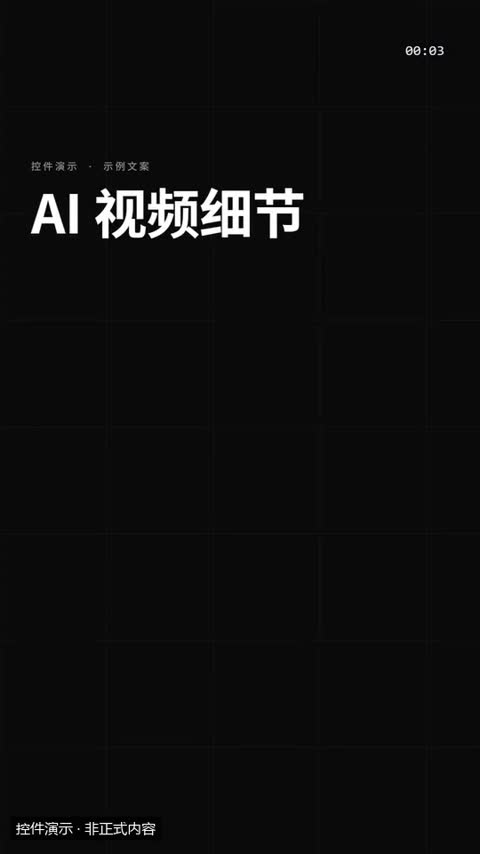](../../docs/template-gallery/demos/motiongit/title.mp4)

- [本地效果演示 1 · 规格见演示](../../docs/template-gallery/demos/motiongit/title.mp4)：官方控件真实渲染；使用中文示例文案或示例数据。6秒静音控件演示；保留模板原生标记与组内时码，角标不是本文件播放计时。低位演示身份标为本目录后处理添加。

**2. 适用内容**

- 开场、段落开头：一行陈述 + 一行重点（重点行砸入）

- 不替代原始证据；重点字不能改变原话的限定条件。

**3. 所需素材**

- 短标题或重点词
- 清楚的解释关系
- 真实数值或标明示例的数据

**4. 可改参数与限制**

按已核对的字段与限制修改；尚未核对的能力会明确标注。

<details>
<summary>查看参数、限制与来源依据</summary>

- 标题上方小字（kicker）：文字，可选；最多可见字符 32。
- 第一行（line1）：文字，必填；最短长度 1；最多可见字符 16。
- 第二行（渐变色，砸入）（line2）：文字，可选；最多可见字符 16。
- 动画变体（variant）：slam / split / type。
- 段落时间（t0、t1）与动作提示时间（cues）按剪后的真实讲解设置；主题色由时间轴 theme 配置，不是每个控件任意独立的配色合同。

- 这些范围来自已登记版本的公开参数合同；更换个人包或版本后须重新核对，不自动沿用到所有官网模板。
- 每个控件目前只展示一个代表变体；可选枚举、允许数量和颜色参数不等于所有组合都已实测。
- 导出前仍需校验参数、真实素材、语音时长与排版；不从示例数据推断实际业务结果。

参数依据：[motiongit-controls.json](../../templates/motiongit-controls.json) · [render_motiongit_gallery.py](../../scripts/render_motiongit_gallery.py) · [render_motiongit_gallery_data.py](../../scripts/render_motiongit_gallery_data.py)

</details>

**5. 怎样交给 AI 使用**

<details>
<summary>复制本模板的使用提示词</summary>

```text
请使用 AI Cut 模板目录中的「两行标题」（编号 mg-control-title）。
我的内容或原片：[填写]；输出比例：[填写]；需要强调的内容：[填写]。
先核对本条来源、当前状态、素材和参数合同；使用我自己的获授权素材，保留原声原意。
按照本条已支持的参数范围做短预览，确认文字、动作和声音的时间一致，再放入剪辑工程。
若原包、依赖或素材缺失，说明缺什么；遇到费用先告诉我。不要将示例人物或示例数据当成我的内容。
```

</details>

**6. 当前能否使用**

- 已有控件演示 · 需自备授权原包
- 本仓库提供目录与已渲染演示，未附送个人 .motion 原包；学员须使用自己合法取得的对应包。
- 登记基线版本：0.3.0 (package2.7.17-alpha.2)。新输入、新电脑和其他变体须另行验证。

<details>
<summary>查看原始检查范围与接入记录</summary>

- 一个代表变体已由官方 helper 渲染；静音小样完整解码，并已查看实际导出抽帧。其他两个变体仅登记，未渲染；不代表连续观看或用户审美认可。

</details>

**7. 来源与许可**

- MotionGit 个人授权模板包，以原包授权为准；仅包含自有素材及明确示例数据的渲染演示，不分发受保护代码。

[原始来源](https://motiongit.com/@adunext/template-01-integrated-portrait)

---

<a id="mg-control-keyword"></a>

### 关键词砸入

`mg-control-keyword` · 标题与重点字 · 基础讲解 · **已有控件演示 · 需自备授权原包**

一个词或短语是这段话的重点；后面可以补 1–3 句解释，逐句出现

**1. 效果预览**

[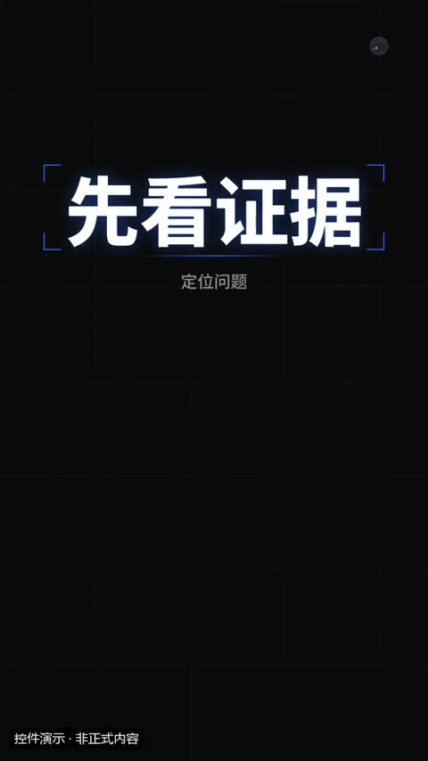](../../docs/template-gallery/demos/motiongit/keyword.mp4)

- [本地效果演示 1 · 规格见演示](../../docs/template-gallery/demos/motiongit/keyword.mp4)：官方控件真实渲染；使用中文示例文案或示例数据。6秒静音控件演示；保留模板原生标记与组内时码，角标不是本文件播放计时。低位演示身份标为本目录后处理添加。

**2. 适用内容**

- 一个词或短语是这段话的重点；后面可以补 1–3 句解释，逐句出现

- 不替代原始证据；重点字不能改变原话的限定条件。

**3. 所需素材**

- 短标题或重点词
- 清楚的解释关系
- 真实数值或标明示例的数据

**4. 可改参数与限制**

按已核对的字段与限制修改；尚未核对的能力会明确标注。

<details>
<summary>查看参数、限制与来源依据</summary>

- kicker（kicker）：文字，可选；最多可见字符 32。
- 关键词（word）：文字，必填；最短长度 1；最多可见字符 10。
- 补充说明（逐句出现）（sub）：列表，可选；至少项数 0；最多项数 3。
- 动画变体（variant）：slam / glitch / focus。
- 段落时间（t0、t1）与动作提示时间（cues）按剪后的真实讲解设置；主题色由时间轴 theme 配置，不是每个控件任意独立的配色合同。

- 这些范围来自已登记版本的公开参数合同；更换个人包或版本后须重新核对，不自动沿用到所有官网模板。
- 每个控件目前只展示一个代表变体；可选枚举、允许数量和颜色参数不等于所有组合都已实测。
- 导出前仍需校验参数、真实素材、语音时长与排版；不从示例数据推断实际业务结果。

参数依据：[motiongit-controls.json](../../templates/motiongit-controls.json) · [render_motiongit_gallery.py](../../scripts/render_motiongit_gallery.py) · [render_motiongit_gallery_data.py](../../scripts/render_motiongit_gallery_data.py)

</details>

**5. 怎样交给 AI 使用**

<details>
<summary>复制本模板的使用提示词</summary>

```text
请使用 AI Cut 模板目录中的「关键词砸入」（编号 mg-control-keyword）。
我的内容或原片：[填写]；输出比例：[填写]；需要强调的内容：[填写]。
先核对本条来源、当前状态、素材和参数合同；使用我自己的获授权素材，保留原声原意。
按照本条已支持的参数范围做短预览，确认文字、动作和声音的时间一致，再放入剪辑工程。
若原包、依赖或素材缺失，说明缺什么；遇到费用先告诉我。不要将示例人物或示例数据当成我的内容。
```

</details>

**6. 当前能否使用**

- 已有控件演示 · 需自备授权原包
- 本仓库提供目录与已渲染演示，未附送个人 .motion 原包；学员须使用自己合法取得的对应包。
- 登记基线版本：0.3.0 (package2.7.17-alpha.2)。新输入、新电脑和其他变体须另行验证。

<details>
<summary>查看原始检查范围与接入记录</summary>

- 一个代表变体已由官方 helper 渲染；静音小样完整解码，并已查看实际导出抽帧。其他两个变体仅登记，未渲染；不代表连续观看或用户审美认可。

</details>

**7. 来源与许可**

- MotionGit 个人授权模板包，以原包授权为准；仅包含自有素材及明确示例数据的渲染演示，不分发受保护代码。

[原始来源](https://motiongit.com/@adunext/template-01-integrated-portrait)

---

<a id="mg-control-quote"></a>

### 金句 / 引用

`mg-control-quote` · 标题与重点字 · 基础讲解 · **已有控件演示 · 需自备授权原包**

一句原话、观点或引用，逐字打出；*星号* 包住的词高亮

**1. 效果预览**

[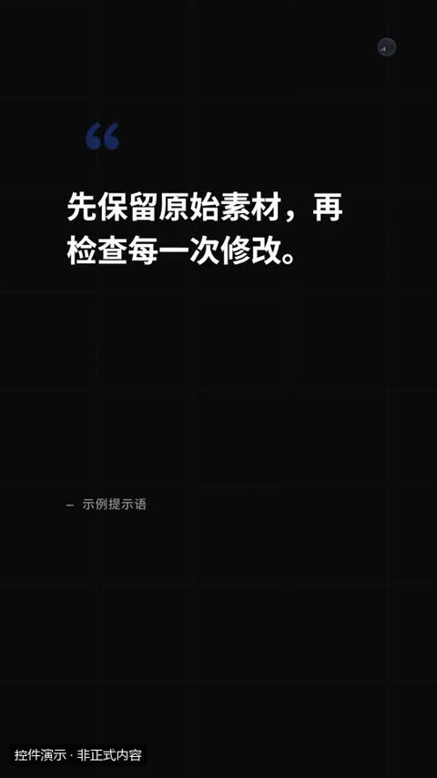](../../docs/template-gallery/demos/motiongit/quote.mp4)

- [本地效果演示 1 · 规格见演示](../../docs/template-gallery/demos/motiongit/quote.mp4)：官方控件真实渲染；使用中文示例文案或示例数据。6秒静音控件演示；保留模板原生标记与组内时码，角标不是本文件播放计时。低位演示身份标为本目录后处理添加。

**2. 适用内容**

- 一句原话、观点或引用，逐字打出；*星号* 包住的词高亮

- 不替代原始证据；重点字不能改变原话的限定条件。

**3. 所需素材**

- 短标题或重点词
- 清楚的解释关系
- 真实数值或标明示例的数据

**4. 可改参数与限制**

按已核对的字段与限制修改；尚未核对的能力会明确标注。

<details>
<summary>查看参数、限制与来源依据</summary>

- 正文（text）：文字，必填；最短长度 1；最多可见字符 60。
- who（who）：文字，可选；最多可见字符 24。
- 动画变体（variant）：type / reveal / card。
- 段落时间（t0、t1）与动作提示时间（cues）按剪后的真实讲解设置；主题色由时间轴 theme 配置，不是每个控件任意独立的配色合同。

- 这些范围来自已登记版本的公开参数合同；更换个人包或版本后须重新核对，不自动沿用到所有官网模板。
- 每个控件目前只展示一个代表变体；可选枚举、允许数量和颜色参数不等于所有组合都已实测。
- 导出前仍需校验参数、真实素材、语音时长与排版；不从示例数据推断实际业务结果。

参数依据：[motiongit-controls.json](../../templates/motiongit-controls.json) · [render_motiongit_gallery.py](../../scripts/render_motiongit_gallery.py) · [render_motiongit_gallery_data.py](../../scripts/render_motiongit_gallery_data.py)

</details>

**5. 怎样交给 AI 使用**

<details>
<summary>复制本模板的使用提示词</summary>

```text
请使用 AI Cut 模板目录中的「金句 / 引用」（编号 mg-control-quote）。
我的内容或原片：[填写]；输出比例：[填写]；需要强调的内容：[填写]。
先核对本条来源、当前状态、素材和参数合同；使用我自己的获授权素材，保留原声原意。
按照本条已支持的参数范围做短预览，确认文字、动作和声音的时间一致，再放入剪辑工程。
若原包、依赖或素材缺失，说明缺什么；遇到费用先告诉我。不要将示例人物或示例数据当成我的内容。
```

</details>

**6. 当前能否使用**

- 已有控件演示 · 需自备授权原包
- 本仓库提供目录与已渲染演示，未附送个人 .motion 原包；学员须使用自己合法取得的对应包。
- 登记基线版本：0.3.0 (package2.7.17-alpha.2)。新输入、新电脑和其他变体须另行验证。

<details>
<summary>查看原始检查范围与接入记录</summary>

- 一个代表变体已由官方 helper 渲染；静音小样完整解码，并已查看实际导出抽帧。其他两个变体仅登记，未渲染；不代表连续观看或用户审美认可。

</details>

**7. 来源与许可**

- MotionGit 个人授权模板包，以原包授权为准；仅包含自有素材及明确示例数据的渲染演示，不分发受保护代码。

[原始来源](https://motiongit.com/@adunext/template-01-integrated-portrait)

---

<a id="mg-control-stamp"></a>

### 印章强调

`mg-control-stamp` · 标题与重点字 · 基础讲解 · **已有控件演示 · 需自备授权原包**

下结论、表态：免费、已上线、不推荐

**1. 效果预览**

[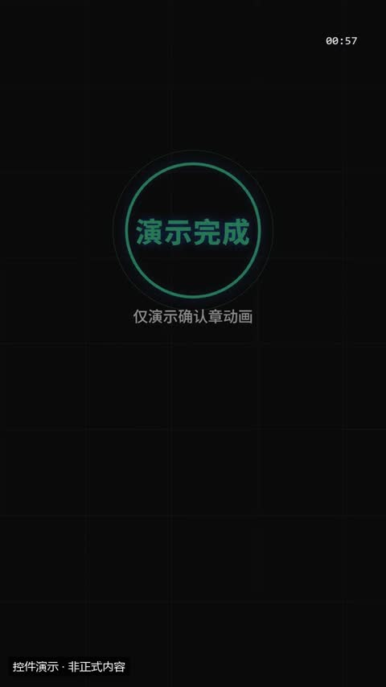](../../docs/template-gallery/demos/motiongit/stamp.mp4)

- [本地效果演示 1 · 规格见演示](../../docs/template-gallery/demos/motiongit/stamp.mp4)：官方控件真实渲染；使用中文示例文案或示例数据。6秒静音控件演示；保留模板原生标记与组内时码，角标不是本文件播放计时。低位演示身份标为本目录后处理添加。

**2. 适用内容**

- 下结论、表态：免费、已上线、不推荐

- 不替代原始证据；重点字不能改变原话的限定条件。

**3. 所需素材**

- 短标题或重点词
- 清楚的解释关系
- 真实数值或标明示例的数据

**4. 可改参数与限制**

按已核对的字段与限制修改；尚未核对的能力会明确标注。

<details>
<summary>查看参数、限制与来源依据</summary>

- 正文（text）：文字，必填；最短长度 1；最多可见字符 8。
- sub（sub）：文字，可选；最多可见字符 30。
- 色阶（tone）：文字，可选；可选 warm/ok/bad。
- 动画变体（variant）：stamp / badge / neon。
- 段落时间（t0、t1）与动作提示时间（cues）按剪后的真实讲解设置；主题色由时间轴 theme 配置，不是每个控件任意独立的配色合同。

- 这些范围来自已登记版本的公开参数合同；更换个人包或版本后须重新核对，不自动沿用到所有官网模板。
- 每个控件目前只展示一个代表变体；可选枚举、允许数量和颜色参数不等于所有组合都已实测。
- 导出前仍需校验参数、真实素材、语音时长与排版；不从示例数据推断实际业务结果。

参数依据：[motiongit-controls.json](../../templates/motiongit-controls.json) · [render_motiongit_gallery.py](../../scripts/render_motiongit_gallery.py) · [render_motiongit_gallery_data.py](../../scripts/render_motiongit_gallery_data.py)

</details>

**5. 怎样交给 AI 使用**

<details>
<summary>复制本模板的使用提示词</summary>

```text
请使用 AI Cut 模板目录中的「印章强调」（编号 mg-control-stamp）。
我的内容或原片：[填写]；输出比例：[填写]；需要强调的内容：[填写]。
先核对本条来源、当前状态、素材和参数合同；使用我自己的获授权素材，保留原声原意。
按照本条已支持的参数范围做短预览，确认文字、动作和声音的时间一致，再放入剪辑工程。
若原包、依赖或素材缺失，说明缺什么；遇到费用先告诉我。不要将示例人物或示例数据当成我的内容。
```

</details>

**6. 当前能否使用**

- 已有控件演示 · 需自备授权原包
- 本仓库提供目录与已渲染演示，未附送个人 .motion 原包；学员须使用自己合法取得的对应包。
- 登记基线版本：0.3.0 (package2.7.17-alpha.2)。新输入、新电脑和其他变体须另行验证。

<details>
<summary>查看原始检查范围与接入记录</summary>

- 一个代表变体已由官方 helper 渲染；静音小样完整解码，并已查看实际导出抽帧。其他两个变体仅登记，未渲染；不代表连续观看或用户审美认可。

</details>

**7. 来源与许可**

- MotionGit 个人授权模板包，以原包授权为准；仅包含自有素材及明确示例数据的渲染演示，不分发受保护代码。

[原始来源](https://motiongit.com/@adunext/template-01-integrated-portrait)

---

<a id="mg-control-kinetic"></a>

### 逐行动态排版

`mg-control-kinetic` · 标题与重点字 · 文字动态 · **已有接入案例 · 新片仍需适配**

一句有节奏的观点拆成 2–5 个短行，跟着口播一行一行冲出来；适合开场钩子、口号、情绪句

**1. 效果预览**

[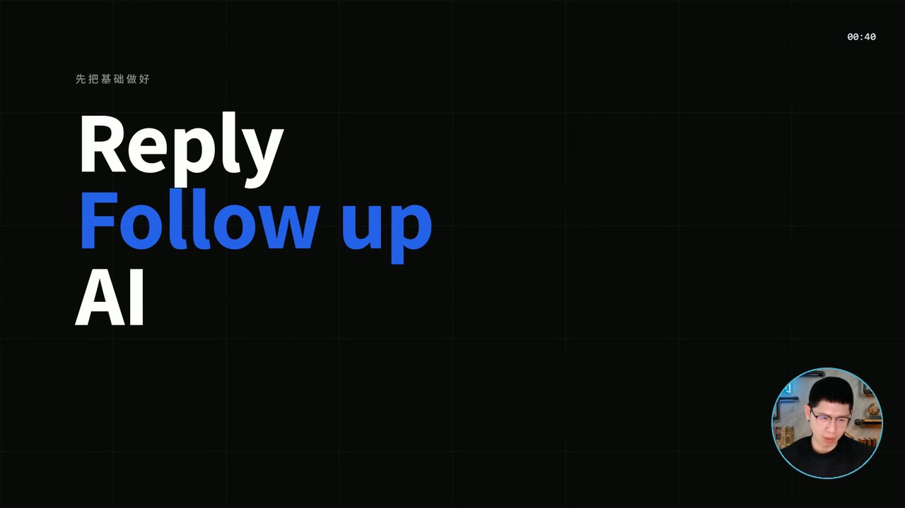](../../docs/template-gallery/demos/integrated/aivd-10/2.7.17-alpha.2/kinetic-stack-owner-v1.mp4)

- [本人案例 1 · 规格见演示](../../docs/template-gallery/demos/integrated/aivd-10/2.7.17-alpha.2/kinetic-stack-owner-v1.mp4)：AIVD 10 本人同期圆窗＋官方 kinetic/stack 横屏概念讲解节选；静音；不含客户画面。Reply、Follow up、AI 三行动态归纳，与本片结尾同期本人圆窗结合。
- [本地效果演示 2 · 规格见演示](../../docs/template-gallery/demos/motiongit/kinetic.mp4)：官方控件真实渲染；使用中文示例文案或示例数据。6秒静音控件演示；保留模板原生标记与组内时码，角标不是本文件播放计时。低位演示身份标为本目录后处理添加。

**2. 适用内容**

- 一句有节奏的观点拆成 2–5 个短行，跟着口播一行一行冲出来；适合开场钩子、口号、情绪句

- 保持可读停留时间；不宜持续堆叠或覆盖字幕。

**3. 所需素材**

- 适合阅读的短词和短句

**4. 可改参数与限制**

按已核对的字段与限制修改；尚未核对的能力会明确标注。

<details>
<summary>查看参数、限制与来源依据</summary>

- 上方小字（kicker）：文字，可选；最多可见字符 28。
- 每行文字（短，2–10 字）（lines）：列表，必填；至少项数 2；最多项数 5。
- 动画变体（variant）：stack / beat / wave。
- 段落时间（t0、t1）与动作提示时间（cues）按剪后的真实讲解设置；主题色由时间轴 theme 配置，不是每个控件任意独立的配色合同。

- 这些范围来自已登记版本的公开参数合同；更换个人包或版本后须重新核对，不自动沿用到所有官网模板。
- 每个控件目前只展示一个代表变体；可选枚举、允许数量和颜色参数不等于所有组合都已实测。
- 导出前仍需校验参数、真实素材、语音时长与排版；不从示例数据推断实际业务结果。

参数依据：[motiongit-controls.json](../../templates/motiongit-controls.json) · [render_motiongit_gallery.py](../../scripts/render_motiongit_gallery.py) · [render_motiongit_gallery_data.py](../../scripts/render_motiongit_gallery_data.py)

</details>

**5. 怎样交给 AI 使用**

<details>
<summary>复制本模板的使用提示词</summary>

```text
请使用 AI Cut 模板目录中的「逐行动态排版」（编号 mg-control-kinetic）。
我的内容或原片：[填写]；输出比例：[填写]；需要强调的内容：[填写]。
先核对本条来源、当前状态、素材和参数合同；使用我自己的获授权素材，保留原声原意。
按照本条已支持的参数范围做短预览，确认文字、动作和声音的时间一致，再放入剪辑工程。
若原包、依赖或素材缺失，说明缺什么；遇到费用先告诉我。不要将示例人物或示例数据当成我的内容。
```

</details>

**6. 当前能否使用**

- 已有接入案例 · 新片仍需适配
- 本仓库提供目录与已渲染演示，未附送个人 .motion 原包；学员须使用自己合法取得的对应包。
- 目录默认本人Demo版本：2.7.17-alpha.2；本片QA：verified_demo。只对应已登记版本与输入；切换其他演示时，以播放器下方显示的该版本说明为准。
- 登记基线版本：0.3.0 (package2.7.17-alpha.2)。新输入、新电脑和其他变体须另行验证。

<details>
<summary>查看原始检查范围与接入记录</summary>

- 一个代表变体已由官方 helper 渲染；静音小样完整解码，并已查看实际导出抽帧。其他两个变体仅登记，未渲染；不代表连续观看或用户审美认可。

本片接入：aivd-10-mg-control-kinetic-2.7.17-alpha.2-v1

本片横屏kinetic/stack：1280×720、30fps、272帧、无音轨，完整解码通过；实际查看编码帧6,136,195,271及同帧圆窗放大联系表。源参数仅概念文字/图标；抽检未见客户资料或网址；圆窗头脸完整、透明角无黑方块、不遮概念正文。保留原生时码、.m标与出场淡出。仅本版本/此输入/此变体；不等于全帧人工审阅、连续观看、用户美学确认、全部变体或另一台机器通过。

```text
.\.venv\Scripts\python.exe scripts/motiongit_adapter.py run --instance <instance> render <reviewed-project> --out <scene.mp4> --language zh
```

不改变原条目验证范围，不代表用户审美认可。

</details>

**7. 来源与许可**

- MotionGit 个人授权模板包，以原包授权为准；仅包含自有素材及明确示例数据的渲染演示，不分发受保护代码。

[原始来源](https://motiongit.com/@adunext/template-01-integrated-portrait)

---

<a id="mg-control-highlight"></a>

### 重点词标记

`mg-control-highlight` · 标题与重点字 · 文字动态 · **已有控件演示 · 需自备授权原包**

一句完整的话里有 1–2 个必须被看见的词（用 *星号* 标出）：先出整句，再在重点上画标记

**1. 效果预览**

[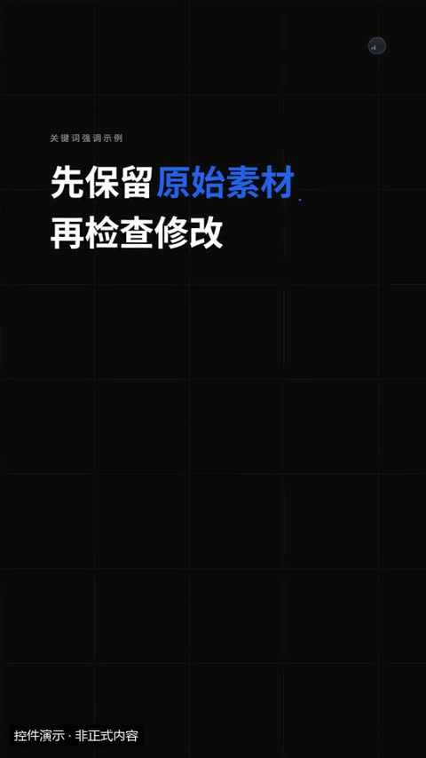](../../docs/template-gallery/demos/motiongit/highlight.mp4)

- [本地效果演示 1 · 规格见演示](../../docs/template-gallery/demos/motiongit/highlight.mp4)：官方控件真实渲染；使用中文示例文案或示例数据。6秒静音控件演示；保留模板原生标记与组内时码，角标不是本文件播放计时。低位演示身份标为本目录后处理添加。

**2. 适用内容**

- 一句完整的话里有 1–2 个必须被看见的词（用 *星号* 标出）：先出整句，再在重点上画标记

- 保持可读停留时间；不宜持续堆叠或覆盖字幕。

**3. 所需素材**

- 适合阅读的短词和短句

**4. 可改参数与限制**

按已核对的字段与限制修改；尚未核对的能力会明确标注。

<details>
<summary>查看参数、限制与来源依据</summary>

- kicker（kicker）：文字，可选；最多可见字符 28。
- 整句，*重点* 用星号包住（text）：文字，必填；最短长度 1；最多可见字符 40。
- 动画变体（variant）：marker / circle / underline。
- 段落时间（t0、t1）与动作提示时间（cues）按剪后的真实讲解设置；主题色由时间轴 theme 配置，不是每个控件任意独立的配色合同。

- 这些范围来自已登记版本的公开参数合同；更换个人包或版本后须重新核对，不自动沿用到所有官网模板。
- 每个控件目前只展示一个代表变体；可选枚举、允许数量和颜色参数不等于所有组合都已实测。
- 导出前仍需校验参数、真实素材、语音时长与排版；不从示例数据推断实际业务结果。

参数依据：[motiongit-controls.json](../../templates/motiongit-controls.json) · [render_motiongit_gallery.py](../../scripts/render_motiongit_gallery.py) · [render_motiongit_gallery_data.py](../../scripts/render_motiongit_gallery_data.py)

</details>

**5. 怎样交给 AI 使用**

<details>
<summary>复制本模板的使用提示词</summary>

```text
请使用 AI Cut 模板目录中的「重点词标记」（编号 mg-control-highlight）。
我的内容或原片：[填写]；输出比例：[填写]；需要强调的内容：[填写]。
先核对本条来源、当前状态、素材和参数合同；使用我自己的获授权素材，保留原声原意。
按照本条已支持的参数范围做短预览，确认文字、动作和声音的时间一致，再放入剪辑工程。
若原包、依赖或素材缺失，说明缺什么；遇到费用先告诉我。不要将示例人物或示例数据当成我的内容。
```

</details>

**6. 当前能否使用**

- 已有控件演示 · 需自备授权原包
- 本仓库提供目录与已渲染演示，未附送个人 .motion 原包；学员须使用自己合法取得的对应包。
- 登记基线版本：0.3.0 (package2.7.17-alpha.2)。新输入、新电脑和其他变体须另行验证。

<details>
<summary>查看原始检查范围与接入记录</summary>

- 一个代表变体已由官方 helper 渲染；静音小样完整解码，并已查看实际导出抽帧。其他两个变体仅登记，未渲染；不代表连续观看或用户审美认可。

</details>

**7. 来源与许可**

- MotionGit 个人授权模板包，以原包授权为准；仅包含自有素材及明确示例数据的渲染演示，不分发受保护代码。

[原始来源](https://motiongit.com/@adunext/template-01-integrated-portrait)

---

<a id="mg-control-scramble"></a>

### 乱码解码

`mg-control-scramble` · 标题与重点字 · 文字动态 · **已有控件演示 · 需自备授权原包**

揭晓一个名字、术语、答案、代号：乱码逐位锁定。科技、数据、揭秘类内容

**1. 效果预览**

[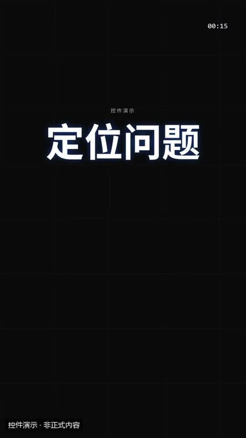](../../docs/template-gallery/demos/motiongit/scramble.mp4)

- [本地效果演示 1 · 规格见演示](../../docs/template-gallery/demos/motiongit/scramble.mp4)：官方控件真实渲染；使用中文示例文案或示例数据。6秒静音控件演示；保留模板原生标记与组内时码，角标不是本文件播放计时。低位演示身份标为本目录后处理添加。

**2. 适用内容**

- 揭晓一个名字、术语、答案、代号：乱码逐位锁定。科技、数据、揭秘类内容

- 保持可读停留时间；不宜持续堆叠或覆盖字幕。

**3. 所需素材**

- 适合阅读的短词和短句

**4. 可改参数与限制**

按已核对的字段与限制修改；尚未核对的能力会明确标注。

<details>
<summary>查看参数、限制与来源依据</summary>

- kicker（kicker）：文字，可选；最多可见字符 28。
- 揭晓的词（word）：文字，必填；最短长度 1；最多可见字符 14。
- 揭晓后补一句（sub）：文字，可选；最多可见字符 28。
- 动画变体（variant）：decode / matrix / terminal。
- 段落时间（t0、t1）与动作提示时间（cues）按剪后的真实讲解设置；主题色由时间轴 theme 配置，不是每个控件任意独立的配色合同。

- 这些范围来自已登记版本的公开参数合同；更换个人包或版本后须重新核对，不自动沿用到所有官网模板。
- 每个控件目前只展示一个代表变体；可选枚举、允许数量和颜色参数不等于所有组合都已实测。
- 导出前仍需校验参数、真实素材、语音时长与排版；不从示例数据推断实际业务结果。

参数依据：[motiongit-controls.json](../../templates/motiongit-controls.json) · [render_motiongit_gallery.py](../../scripts/render_motiongit_gallery.py) · [render_motiongit_gallery_data.py](../../scripts/render_motiongit_gallery_data.py)

</details>

**5. 怎样交给 AI 使用**

<details>
<summary>复制本模板的使用提示词</summary>

```text
请使用 AI Cut 模板目录中的「乱码解码」（编号 mg-control-scramble）。
我的内容或原片：[填写]；输出比例：[填写]；需要强调的内容：[填写]。
先核对本条来源、当前状态、素材和参数合同；使用我自己的获授权素材，保留原声原意。
按照本条已支持的参数范围做短预览，确认文字、动作和声音的时间一致，再放入剪辑工程。
若原包、依赖或素材缺失，说明缺什么；遇到费用先告诉我。不要将示例人物或示例数据当成我的内容。
```

</details>

**6. 当前能否使用**

- 已有控件演示 · 需自备授权原包
- 本仓库提供目录与已渲染演示，未附送个人 .motion 原包；学员须使用自己合法取得的对应包。
- 登记基线版本：0.3.0 (package2.7.17-alpha.2)。新输入、新电脑和其他变体须另行验证。

<details>
<summary>查看原始检查范围与接入记录</summary>

- 一个代表变体已由官方 helper 渲染；静音小样完整解码，并已查看实际导出抽帧。其他两个变体仅登记，未渲染；不代表连续观看或用户审美认可。

</details>

**7. 来源与许可**

- MotionGit 个人授权模板包，以原包授权为准；仅包含自有素材及明确示例数据的渲染演示，不分发受保护代码。

[原始来源](https://motiongit.com/@adunext/template-01-integrated-portrait)

---

<a id="mg-control-rotator"></a>

### 轮换词

`mg-control-rotator` · 标题与重点字 · 文字动态 · **已有控件演示 · 需自备授权原包**

同一句话换不同的词：「适合 学生 / 老师 / 公司」、「它能 写 / 画 / 剪」。最后一个词停住

**1. 效果预览**

[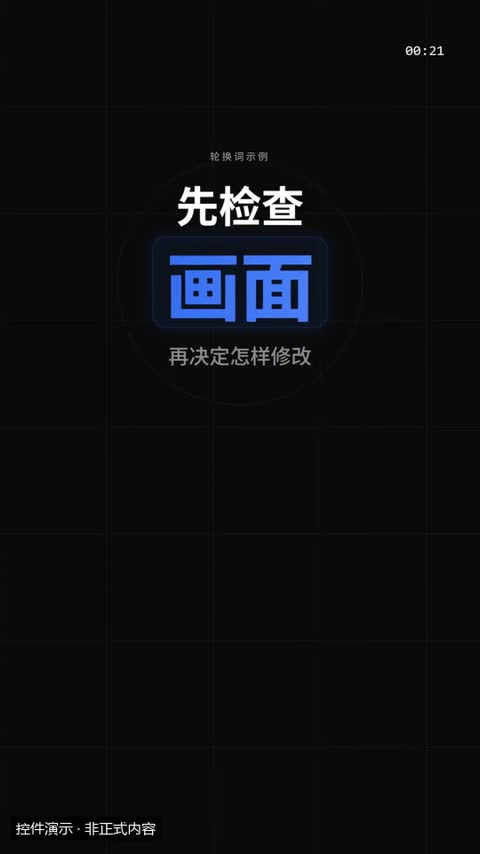](../../docs/template-gallery/demos/motiongit/rotator.mp4)

- [本地效果演示 1 · 规格见演示](../../docs/template-gallery/demos/motiongit/rotator.mp4)：官方控件真实渲染；使用中文示例文案或示例数据。6秒静音控件演示；保留模板原生标记与组内时码，角标不是本文件播放计时。低位演示身份标为本目录后处理添加。

**2. 适用内容**

- 同一句话换不同的词：「适合 学生 / 老师 / 公司」、「它能 写 / 画 / 剪」。最后一个词停住

- 保持可读停留时间；不宜持续堆叠或覆盖字幕。

**3. 所需素材**

- 适合阅读的短词和短句

**4. 可改参数与限制**

按已核对的字段与限制修改；尚未核对的能力会明确标注。

<details>
<summary>查看参数、限制与来源依据</summary>

- kicker（kicker）：文字，可选；最多可见字符 28。
- 固定的前半句（lead）：文字，必填；最短长度 1；最多可见字符 14。
- 依次轮换的词（words）：列表，必填；至少项数 2；最多项数 6。
- 下方补充（tail）：文字，可选；最多可见字符 28。
- 动画变体（variant）：slot / flip / type。
- 段落时间（t0、t1）与动作提示时间（cues）按剪后的真实讲解设置；主题色由时间轴 theme 配置，不是每个控件任意独立的配色合同。

- 这些范围来自已登记版本的公开参数合同；更换个人包或版本后须重新核对，不自动沿用到所有官网模板。
- 每个控件目前只展示一个代表变体；可选枚举、允许数量和颜色参数不等于所有组合都已实测。
- 导出前仍需校验参数、真实素材、语音时长与排版；不从示例数据推断实际业务结果。

参数依据：[motiongit-controls.json](../../templates/motiongit-controls.json) · [render_motiongit_gallery.py](../../scripts/render_motiongit_gallery.py) · [render_motiongit_gallery_data.py](../../scripts/render_motiongit_gallery_data.py)

</details>

**5. 怎样交给 AI 使用**

<details>
<summary>复制本模板的使用提示词</summary>

```text
请使用 AI Cut 模板目录中的「轮换词」（编号 mg-control-rotator）。
我的内容或原片：[填写]；输出比例：[填写]；需要强调的内容：[填写]。
先核对本条来源、当前状态、素材和参数合同；使用我自己的获授权素材，保留原声原意。
按照本条已支持的参数范围做短预览，确认文字、动作和声音的时间一致，再放入剪辑工程。
若原包、依赖或素材缺失，说明缺什么；遇到费用先告诉我。不要将示例人物或示例数据当成我的内容。
```

</details>

**6. 当前能否使用**

- 已有控件演示 · 需自备授权原包
- 本仓库提供目录与已渲染演示，未附送个人 .motion 原包；学员须使用自己合法取得的对应包。
- 登记基线版本：0.3.0 (package2.7.17-alpha.2)。新输入、新电脑和其他变体须另行验证。

<details>
<summary>查看原始检查范围与接入记录</summary>

- 一个代表变体已由官方 helper 渲染；静音小样完整解码，并已查看实际导出抽帧。其他两个变体仅登记，未渲染；不代表连续观看或用户审美认可。

</details>

**7. 来源与许可**

- MotionGit 个人授权模板包，以原包授权为准；仅包含自有素材及明确示例数据的渲染演示，不分发受保护代码。

[原始来源](https://motiongit.com/@adunext/template-01-integrated-portrait)

---

<a id="mg-control-marquee"></a>

### 滚动横幅

`mg-control-marquee` · 标题与重点字 · 文字动态 · **已有控件演示 · 需自备授权原包**

一串关键词/标签/口号持续滚动：活动、清单很长、节奏型过渡；可在横幅上砸入一个大词

**1. 效果预览**

[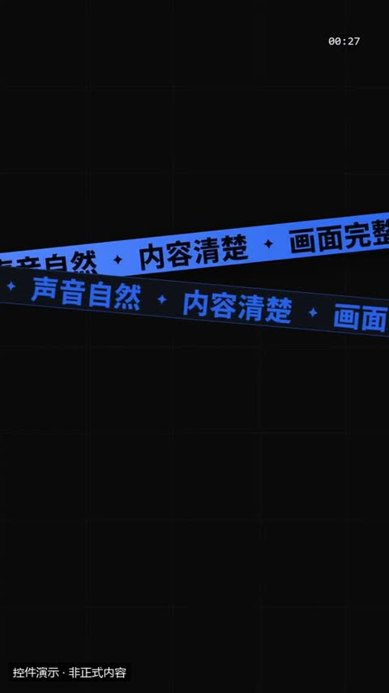](../../docs/template-gallery/demos/motiongit/marquee.mp4)

- [本地效果演示 1 · 规格见演示](../../docs/template-gallery/demos/motiongit/marquee.mp4)：官方控件真实渲染；使用中文示例文案或示例数据。6秒静音控件演示；保留模板原生标记与组内时码，角标不是本文件播放计时。低位演示身份标为本目录后处理添加。

**2. 适用内容**

- 一串关键词/标签/口号持续滚动：活动、清单很长、节奏型过渡；可在横幅上砸入一个大词

- 保持可读停留时间；不宜持续堆叠或覆盖字幕。

**3. 所需素材**

- 适合阅读的短词和短句

**4. 可改参数与限制**

按已核对的字段与限制修改；尚未核对的能力会明确标注。

<details>
<summary>查看参数、限制与来源依据</summary>

- ticker 变体左侧标签（默认 LIVE）（kicker）：文字，可选；最多可见字符 10。
- 滚动的词（items）：列表，必填；至少项数 2；最多项数 8。
- 砸在横幅上的大词（big）：文字，可选；最多可见字符 8。
- 动画变体（variant）：belt / ticker / wall。
- 段落时间（t0、t1）与动作提示时间（cues）按剪后的真实讲解设置；主题色由时间轴 theme 配置，不是每个控件任意独立的配色合同。

- 这些范围来自已登记版本的公开参数合同；更换个人包或版本后须重新核对，不自动沿用到所有官网模板。
- 每个控件目前只展示一个代表变体；可选枚举、允许数量和颜色参数不等于所有组合都已实测。
- 导出前仍需校验参数、真实素材、语音时长与排版；不从示例数据推断实际业务结果。

参数依据：[motiongit-controls.json](../../templates/motiongit-controls.json) · [render_motiongit_gallery.py](../../scripts/render_motiongit_gallery.py) · [render_motiongit_gallery_data.py](../../scripts/render_motiongit_gallery_data.py)

</details>

**5. 怎样交给 AI 使用**

<details>
<summary>复制本模板的使用提示词</summary>

```text
请使用 AI Cut 模板目录中的「滚动横幅」（编号 mg-control-marquee）。
我的内容或原片：[填写]；输出比例：[填写]；需要强调的内容：[填写]。
先核对本条来源、当前状态、素材和参数合同；使用我自己的获授权素材，保留原声原意。
按照本条已支持的参数范围做短预览，确认文字、动作和声音的时间一致，再放入剪辑工程。
若原包、依赖或素材缺失，说明缺什么；遇到费用先告诉我。不要将示例人物或示例数据当成我的内容。
```

</details>

**6. 当前能否使用**

- 已有控件演示 · 需自备授权原包
- 本仓库提供目录与已渲染演示，未附送个人 .motion 原包；学员须使用自己合法取得的对应包。
- 登记基线版本：0.3.0 (package2.7.17-alpha.2)。新输入、新电脑和其他变体须另行验证。

<details>
<summary>查看原始检查范围与接入记录</summary>

- 一个代表变体已由官方 helper 渲染；静音小样完整解码，并已查看实际导出抽帧。其他两个变体仅登记，未渲染；不代表连续观看或用户审美认可。

</details>

**7. 来源与许可**

- MotionGit 个人授权模板包，以原包授权为准；仅包含自有素材及明确示例数据的渲染演示，不分发受保护代码。

[原始来源](https://motiongit.com/@adunext/template-01-integrated-portrait)

---

<a id="mg-control-bigtype"></a>

### 巨字

`mg-control-bigtype` · 标题与重点字 · 文字动态 · **已有控件演示 · 需自备授权原包**

一个词撑满画面的冲击时刻：段落主题、结论词、品牌词；mask 变体可让图片/视频透过字显示

**1. 效果预览**

[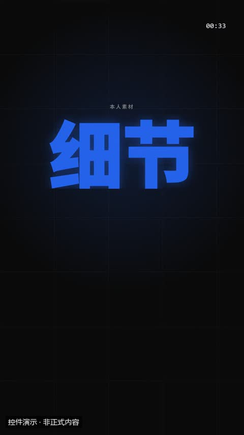](../../docs/template-gallery/demos/motiongit/bigtype.mp4)

- [本地效果演示 1 · 规格见演示](../../docs/template-gallery/demos/motiongit/bigtype.mp4)：官方控件真实渲染；使用中文示例文案或示例数据。6秒静音控件演示；保留模板原生标记与组内时码，角标不是本文件播放计时。低位演示身份标为本目录后处理添加。

**2. 适用内容**

- 一个词撑满画面的冲击时刻：段落主题、结论词、品牌词；mask 变体可让图片/视频透过字显示

- 保持可读停留时间；不宜持续堆叠或覆盖字幕。

**3. 所需素材**

- 适合阅读的短词和短句

**4. 可改参数与限制**

按已核对的字段与限制修改；尚未核对的能力会明确标注。

<details>
<summary>查看参数、限制与来源依据</summary>

- kicker（kicker）：文字，可选；最多可见字符 28。
- 巨字（1–6 字）（word）：文字，必填；最短长度 1；最多可见字符 6。
- 副标题（sub）：文字，可选；最多可见字符 28。
- mask 变体：透过字显示的图片/视频（可省略）（src）：文字，可选。
- sourceStart（sourceStart）：数字，可选；最小 0。
- 动画变体（variant）：mask / outline / split。
- 段落时间（t0、t1）与动作提示时间（cues）按剪后的真实讲解设置；主题色由时间轴 theme 配置，不是每个控件任意独立的配色合同。

- 这些范围来自已登记版本的公开参数合同；更换个人包或版本后须重新核对，不自动沿用到所有官网模板。
- 每个控件目前只展示一个代表变体；可选枚举、允许数量和颜色参数不等于所有组合都已实测。
- 导出前仍需校验参数、真实素材、语音时长与排版；不从示例数据推断实际业务结果。

参数依据：[motiongit-controls.json](../../templates/motiongit-controls.json) · [render_motiongit_gallery.py](../../scripts/render_motiongit_gallery.py) · [render_motiongit_gallery_data.py](../../scripts/render_motiongit_gallery_data.py)

</details>

**5. 怎样交给 AI 使用**

<details>
<summary>复制本模板的使用提示词</summary>

```text
请使用 AI Cut 模板目录中的「巨字」（编号 mg-control-bigtype）。
我的内容或原片：[填写]；输出比例：[填写]；需要强调的内容：[填写]。
先核对本条来源、当前状态、素材和参数合同；使用我自己的获授权素材，保留原声原意。
按照本条已支持的参数范围做短预览，确认文字、动作和声音的时间一致，再放入剪辑工程。
若原包、依赖或素材缺失，说明缺什么；遇到费用先告诉我。不要将示例人物或示例数据当成我的内容。
```

</details>

**6. 当前能否使用**

- 已有控件演示 · 需自备授权原包
- 本仓库提供目录与已渲染演示，未附送个人 .motion 原包；学员须使用自己合法取得的对应包。
- 登记基线版本：0.3.0 (package2.7.17-alpha.2)。新输入、新电脑和其他变体须另行验证。

<details>
<summary>查看原始检查范围与接入记录</summary>

- 一个代表变体已由官方 helper 渲染；静音小样完整解码，并已查看实际导出抽帧。其他两个变体仅登记，未渲染；不代表连续观看或用户审美认可。

</details>

**7. 来源与许可**

- MotionGit 个人授权模板包，以原包授权为准；仅包含自有素材及明确示例数据的渲染演示，不分发受保护代码。

[原始来源](https://motiongit.com/@adunext/template-01-integrated-portrait)

---

<a id="mg-control-lowerthird"></a>

### 人名条

`mg-control-lowerthird` · 标题与重点字 · 叠加标注与装饰 · **已有控件演示 · 需自备授权原包**

第一次出现某个人、讲者、嘉宾或角色时标出名字和身份；也可当一条短字幕条。贴在左下（或右下），横屏在口播卡左侧、字幕之上

**1. 效果预览**

[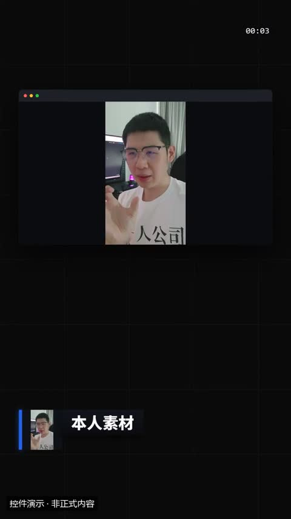](../../docs/template-gallery/demos/motiongit/lowerthird.mp4)

- [本地效果演示 1 · 规格见演示](../../docs/template-gallery/demos/motiongit/lowerthird.mp4)：官方控件真实渲染；使用本人授权素材。6秒静音控件演示；保留模板原生标记与组内时码，角标不是本文件播放计时。低位演示身份标为本目录后处理添加。

**2. 适用内容**

- 第一次出现某个人、讲者、嘉宾或角色时标出名字和身份；也可当一条短字幕条。贴在左下（或右下），横屏在口播卡左侧、字幕之上

- 避开脸部、字幕与关键证据；装饰不应抢走讲解重点。

**3. 所需素材**

- 叠加底图或视频
- 短标签及标注位置

**4. 可改参数与限制**

按已核对的字段与限制修改；尚未核对的能力会明确标注。

<details>
<summary>查看参数、限制与来源依据</summary>

- 名字（主行）（name）：文字，必填；最短长度 1；最多可见字符 16。
- 身份 / 头衔（副行）（title）：文字，可选；最多可见字符 28。
- 头像图片（可省略）（avatar）：文字，可选。
- 没有头像时用的图标（可省略）（icon）：文字，可选；使用合同规定的 82 个枚举值之一。
- 贴左还是贴右（默认 left）（side）：文字，可选；可选 left/right。
- 动画变体（variant）：bar / glass / line。
- 段落时间（t0、t1）与动作提示时间（cues）按剪后的真实讲解设置；主题色由时间轴 theme 配置，不是每个控件任意独立的配色合同。

- 这些范围来自已登记版本的公开参数合同；更换个人包或版本后须重新核对，不自动沿用到所有官网模板。
- 每个控件目前只展示一个代表变体；可选枚举、允许数量和颜色参数不等于所有组合都已实测。
- 导出前仍需校验参数、真实素材、语音时长与排版；不从示例数据推断实际业务结果。

参数依据：[motiongit-controls.json](../../templates/motiongit-controls.json) · [render_motiongit_gallery.py](../../scripts/render_motiongit_gallery.py) · [render_motiongit_gallery_data.py](../../scripts/render_motiongit_gallery_data.py)

</details>

**5. 怎样交给 AI 使用**

<details>
<summary>复制本模板的使用提示词</summary>

```text
请使用 AI Cut 模板目录中的「人名条」（编号 mg-control-lowerthird）。
我的内容或原片：[填写]；输出比例：[填写]；需要强调的内容：[填写]。
先核对本条来源、当前状态、素材和参数合同；使用我自己的获授权素材，保留原声原意。
按照本条已支持的参数范围做短预览，确认文字、动作和声音的时间一致，再放入剪辑工程。
若原包、依赖或素材缺失，说明缺什么；遇到费用先告诉我。不要将示例人物或示例数据当成我的内容。
```

</details>

**6. 当前能否使用**

- 已有控件演示 · 需自备授权原包
- 本仓库提供目录与已渲染演示，未附送个人 .motion 原包；学员须使用自己合法取得的对应包。
- 登记基线版本：0.3.0 (package2.7.17-alpha.2)。新输入、新电脑和其他变体须另行验证。

<details>
<summary>查看原始检查范围与接入记录</summary>

- 一个代表变体已由官方 helper 渲染；静音小样完整解码，并已查看实际导出抽帧。其他两个变体仅登记，未渲染；不代表连续观看或用户审美认可。

</details>

**7. 来源与许可**

- MotionGit 个人授权模板包，以原包授权为准；仅包含自有素材及明确示例数据的渲染演示，不分发受保护代码。

[原始来源](https://motiongit.com/@adunext/template-01-integrated-portrait)

---

<a id="mg-control-tag"></a>

### 角标

`mg-control-tag` · 标题与重点字 · 叠加标注与装饰 · **已有控件演示 · 需自备授权原包**

画面角落的话题标签、集数、属性：「#干货」「第 3 集」「新」，1–3 条，可整段常驻

**1. 效果预览**

[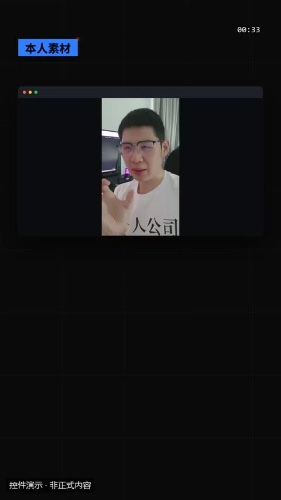](../../docs/template-gallery/demos/motiongit/tag.mp4)

- [本地效果演示 1 · 规格见演示](../../docs/template-gallery/demos/motiongit/tag.mp4)：官方控件真实渲染；使用本人授权素材。6秒静音控件演示；保留模板原生标记与组内时码，角标不是本文件播放计时。低位演示身份标为本目录后处理添加。

**2. 适用内容**

- 画面角落的话题标签、集数、属性：「#干货」「第 3 集」「新」，1–3 条，可整段常驻

- 避开脸部、字幕与关键证据；装饰不应抢走讲解重点。

**3. 所需素材**

- 叠加底图或视频
- 短标签及标注位置

**4. 可改参数与限制**

按已核对的字段与限制修改；尚未核对的能力会明确标注。

<details>
<summary>查看参数、限制与来源依据</summary>

- 标签文字（第一条为主标签）（items）：列表，必填；至少项数 1；最多项数 3。
- 左上 tl / 右上 tr（默认 tl）（pos）：文字，可选；可选 tl/tr。
- 动画变体（variant）：corner / pill / ribbon。
- 段落时间（t0、t1）与动作提示时间（cues）按剪后的真实讲解设置；主题色由时间轴 theme 配置，不是每个控件任意独立的配色合同。

- 这些范围来自已登记版本的公开参数合同；更换个人包或版本后须重新核对，不自动沿用到所有官网模板。
- 每个控件目前只展示一个代表变体；可选枚举、允许数量和颜色参数不等于所有组合都已实测。
- 导出前仍需校验参数、真实素材、语音时长与排版；不从示例数据推断实际业务结果。

参数依据：[motiongit-controls.json](../../templates/motiongit-controls.json) · [render_motiongit_gallery.py](../../scripts/render_motiongit_gallery.py) · [render_motiongit_gallery_data.py](../../scripts/render_motiongit_gallery_data.py)

</details>

**5. 怎样交给 AI 使用**

<details>
<summary>复制本模板的使用提示词</summary>

```text
请使用 AI Cut 模板目录中的「角标」（编号 mg-control-tag）。
我的内容或原片：[填写]；输出比例：[填写]；需要强调的内容：[填写]。
先核对本条来源、当前状态、素材和参数合同；使用我自己的获授权素材，保留原声原意。
按照本条已支持的参数范围做短预览，确认文字、动作和声音的时间一致，再放入剪辑工程。
若原包、依赖或素材缺失，说明缺什么；遇到费用先告诉我。不要将示例人物或示例数据当成我的内容。
```

</details>

**6. 当前能否使用**

- 已有控件演示 · 需自备授权原包
- 本仓库提供目录与已渲染演示，未附送个人 .motion 原包；学员须使用自己合法取得的对应包。
- 登记基线版本：0.3.0 (package2.7.17-alpha.2)。新输入、新电脑和其他变体须另行验证。

<details>
<summary>查看原始检查范围与接入记录</summary>

- 一个代表变体已由官方 helper 渲染；静音小样完整解码，并已查看实际导出抽帧。其他两个变体仅登记，未渲染；不代表连续观看或用户审美认可。

</details>

**7. 来源与许可**

- MotionGit 个人授权模板包，以原包授权为准；仅包含自有素材及明确示例数据的渲染演示，不分发受保护代码。

[原始来源](https://motiongit.com/@adunext/template-01-integrated-portrait)

---

<a id="remotion-bounce-in-headline"></a>

### 标题弹入

`remotion-bounce-in-headline` · 标题与重点字 · 文字与标题 · **代码已入库 · 准备环境后适配**

整段标题从上方弹入，带回弹。并非逐词分拍。

**1. 效果预览**

[](../../docs/template-gallery/demos/remotion/bounce-in-headline.mp4)

- [本地效果演示 1 · 16:9](../../docs/template-gallery/demos/remotion/bounce-in-headline.mp4)：原注册动画的中文参数演示；静音；示例文字与数值不是实际业务结果

**2. 适用内容**

- 口播重点词与章节
- 旅行视频地点或段落标题

- 长段字幕不直接塞入大标题
- 按实际画幅重新检查安全区

**3. 所需素材**

- 中文文案与颜色参数
- 按本条素材确认的时间长度
- 对应画幅的安全区检查

**4. 可改参数与限制**

按已核对的字段与限制修改；尚未核对的能力会明确标注。

<details>
<summary>查看参数、限制与来源依据</summary>

- 主标题（headline）：文字，有默认值或须提供。
- 背景（background）：文字，有默认值或须提供。
- 颜色（color）：文字，有默认值或须提供。
- 弹跳次数（bounces）：数字，有默认值或须提供。
- 高度（height）：数字，有默认值或须提供。
- 延迟帧数（delay）：数字，有默认值或须提供。
- 效果时长（duration）：数字，有默认值或须提供。

- 以上是源码实际暴露的输入，不代表文字长度、列表数量和所有参数组合已完成测试；换内容后须检查排版与完整动画。
- 当前目录演示画幅为 16:9；尺寸与总帧数由 Composition 注册项控制，不能把效果内部 duration 等输入当作自动更改导出长度。

参数依据：[BounceInHeadline.tsx](../../extensions/remotion-vd44/src/vendor/rendercomp/components/bounce-in-headline/BounceInHeadline.tsx) · [Root.tsx](../../extensions/remotion-vd44/src/vendor/rendercomp/Root.tsx)

</details>

**5. 怎样交给 AI 使用**

<details>
<summary>复制本模板的使用提示词</summary>

```text
请使用 AI Cut 模板目录中的「标题弹入」（编号 remotion-bounce-in-headline）。
我的内容或原片：[填写]；输出比例：[填写]；需要强调的内容：[填写]。
先核对本条来源、当前状态、素材和参数合同；使用我自己的获授权素材，保留原声原意。
按照本条已支持的参数范围做短预览，确认文字、动作和声音的时间一致，再放入剪辑工程。
若原包、依赖或素材缺失，说明缺什么；遇到费用先告诉我。不要将示例人物或示例数据当成我的内容。
```

</details>

**6. 当前能否使用**

- 代码已入库 · 准备环境后适配
- 本仓库包含相应代码；需准备 Remotion 运行环境及本条素材，参数修改后重新预览检查。
- 登记基线版本：f648980e528defb7594e24c6447055f0540f340b+zh-gallery.1。新输入、新电脑和其他变体须另行验证。

<details>
<summary>查看原始检查范围与接入记录</summary>

- 55项真实Remotion渲染；每项完整解码、帧数、比例、静音及2 MB限额通过；实际查看每项18%/52%/82%编码帧联系表。不是逐帧连续观看，不代表其他画幅、真人合成、用户审美认可或最终视频QA。

</details>

**7. 来源与许可**

- MIT（模板源码）；Remotion 运行时与字体许可分别适用

[原始来源](https://github.com/RenderComp/free-remotion-templates/tree/f648980e528defb7594e24c6447055f0540f340b)

---

<a id="remotion-chapter-title"></a>

### 章节标题卡

`remotion-chapter-title` · 标题与重点字 · 文字与标题 · **代码已入库 · 准备环境后适配**

编号与章节标题显现

**1. 效果预览**

[](../../docs/template-gallery/demos/remotion/chapter-title.mp4)

- [本地效果演示 1 · 16:9](../../docs/template-gallery/demos/remotion/chapter-title.mp4)：原注册动画的中文参数演示；静音；示例文字与数值不是实际业务结果

**2. 适用内容**

- 口播重点词与章节
- 旅行视频地点或段落标题

- 长段字幕不直接塞入大标题
- 按实际画幅重新检查安全区

**3. 所需素材**

- 中文文案与颜色参数
- 按本条素材确认的时间长度
- 对应画幅的安全区检查

**4. 可改参数与限制**

按已核对的字段与限制修改；尚未核对的能力会明确标注。

<details>
<summary>查看参数、限制与来源依据</summary>

- 章节标签（chapterLabel）：文字，有默认值或须提供。
- 标题（title）：文字，有默认值或须提供。
- 副标题（subtitle）：文字，可省略。
- 背景（background）：文字，有默认值或须提供。
- 章节颜色（chapterColor）：文字，有默认值或须提供。
- 标题色（titleColor）：文字，有默认值或须提供。

- 以上是源码实际暴露的输入，不代表文字长度、列表数量和所有参数组合已完成测试；换内容后须检查排版与完整动画。
- 当前目录演示画幅为 16:9；尺寸与总帧数由 Composition 注册项控制，不能把效果内部 duration 等输入当作自动更改导出长度。

参数依据：[ChapterTitle.tsx](../../extensions/remotion-vd44/src/vendor/rendercomp/components/chapter-title/ChapterTitle.tsx) · [Root.tsx](../../extensions/remotion-vd44/src/vendor/rendercomp/Root.tsx)

</details>

**5. 怎样交给 AI 使用**

<details>
<summary>复制本模板的使用提示词</summary>

```text
请使用 AI Cut 模板目录中的「章节标题卡」（编号 remotion-chapter-title）。
我的内容或原片：[填写]；输出比例：[填写]；需要强调的内容：[填写]。
先核对本条来源、当前状态、素材和参数合同；使用我自己的获授权素材，保留原声原意。
按照本条已支持的参数范围做短预览，确认文字、动作和声音的时间一致，再放入剪辑工程。
若原包、依赖或素材缺失，说明缺什么；遇到费用先告诉我。不要将示例人物或示例数据当成我的内容。
```

</details>

**6. 当前能否使用**

- 代码已入库 · 准备环境后适配
- 本仓库包含相应代码；需准备 Remotion 运行环境及本条素材，参数修改后重新预览检查。
- 登记基线版本：f648980e528defb7594e24c6447055f0540f340b+zh-gallery.1。新输入、新电脑和其他变体须另行验证。

<details>
<summary>查看原始检查范围与接入记录</summary>

- 55项真实Remotion渲染；每项完整解码、帧数、比例、静音及2 MB限额通过；实际查看每项18%/52%/82%编码帧联系表。不是逐帧连续观看，不代表其他画幅、真人合成、用户审美认可或最终视频QA。

</details>

**7. 来源与许可**

- MIT（模板源码）；Remotion 运行时与字体许可分别适用

[原始来源](https://github.com/RenderComp/free-remotion-templates/tree/f648980e528defb7594e24c6447055f0540f340b)

---

<a id="remotion-four-tone-mono-titler"></a>

### 四色标题切换

`remotion-four-tone-mono-titler` · 标题与重点字 · 文字与标题 · **代码已入库 · 准备环境后适配**

标题块切换四组颜色；中文演示层使用 NotoSansSC 补字，保留原动画时序；原版像素字库只覆盖英文。

**1. 效果预览**

[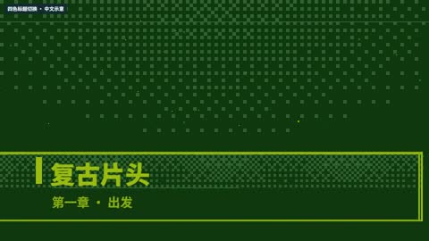](../../docs/template-gallery/demos/remotion/four-tone-mono-titler.mp4)

- [本地效果演示 1 · 16:9](../../docs/template-gallery/demos/remotion/four-tone-mono-titler.mp4)：原注册动画的中文参数演示；静音；示例文字与数值不是实际业务结果

**2. 适用内容**

- 口播重点词与章节
- 旅行视频地点或段落标题

- 长段字幕不直接塞入大标题
- 按实际画幅重新检查安全区

**3. 所需素材**

- 中文文案与颜色参数
- 按本条素材确认的时间长度
- 对应画幅的安全区检查

**4. 可改参数与限制**

按已核对的字段与限制修改；尚未核对的能力会明确标注。

<details>
<summary>查看参数、限制与来源依据</summary>

- 标题（title）：文字，有默认值或须提供。
- 副标题（subtitle）：文字，有默认值或须提供。
- 色阶0（tone0）：文字，有默认值或须提供。
- 色阶1（tone1）：文字，有默认值或须提供。
- 色阶2（tone2）：文字，有默认值或须提供。
- 色阶3（tone3）：文字，有默认值或须提供。
- 标题点阵尺寸（titleCell）：数字，有默认值或须提供。
- 副标题点阵尺寸（subtitleCell）：数字，有默认值或须提供。
- 显现帧数（wipeFrames）：数字，有默认值或须提供。
- 高光速度（shimmerSpeed）：数字，有默认值或须提供。
- ditherDensity（ditherDensity）：数字，有默认值或须提供。
- showAmbient（showAmbient）：开关，有默认值或须提供。

- 以上是源码实际暴露的输入，不代表文字长度、列表数量和所有参数组合已完成测试；换内容后须检查排版与完整动画。
- 当前目录演示画幅为 16:9；尺寸与总帧数由 Composition 注册项控制，不能把效果内部 duration 等输入当作自动更改导出长度。

参数依据：[FourToneMonoTitler.tsx](../../extensions/remotion-vd44/src/vendor/rendercomp/components/four-tone-mono-titler/FourToneMonoTitler.tsx) · [Root.tsx](../../extensions/remotion-vd44/src/vendor/rendercomp/Root.tsx)

</details>

**5. 怎样交给 AI 使用**

<details>
<summary>复制本模板的使用提示词</summary>

```text
请使用 AI Cut 模板目录中的「四色标题切换」（编号 remotion-four-tone-mono-titler）。
我的内容或原片：[填写]；输出比例：[填写]；需要强调的内容：[填写]。
先核对本条来源、当前状态、素材和参数合同；使用我自己的获授权素材，保留原声原意。
按照本条已支持的参数范围做短预览，确认文字、动作和声音的时间一致，再放入剪辑工程。
若原包、依赖或素材缺失，说明缺什么；遇到费用先告诉我。不要将示例人物或示例数据当成我的内容。
```

</details>

**6. 当前能否使用**

- 代码已入库 · 准备环境后适配
- 本仓库包含相应代码；需准备 Remotion 运行环境及本条素材，参数修改后重新预览检查。
- 登记基线版本：f648980e528defb7594e24c6447055f0540f340b+zh-gallery.1。新输入、新电脑和其他变体须另行验证。

<details>
<summary>查看原始检查范围与接入记录</summary>

- 55项真实Remotion渲染；每项完整解码、帧数、比例、静音及2 MB限额通过；实际查看每项18%/52%/82%编码帧联系表。不是逐帧连续观看，不代表其他画幅、真人合成、用户审美认可或最终视频QA。

</details>

**7. 来源与许可**

- MIT（模板源码）；Remotion 运行时与字体许可分别适用

[原始来源](https://github.com/RenderComp/free-remotion-templates/tree/f648980e528defb7594e24c6447055f0540f340b)

---

<a id="remotion-glitch-text"></a>

### 故障文字

`remotion-glitch-text` · 标题与重点字 · 文字与标题 · **代码已入库 · 准备环境后适配**

RGB错位抖动后稳定

**1. 效果预览**

[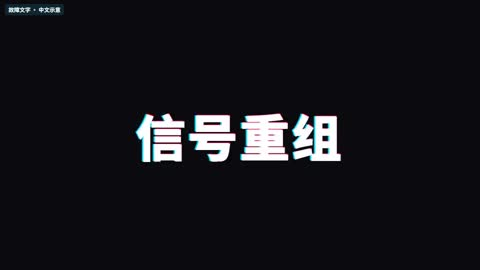](../../docs/template-gallery/demos/remotion/glitch-text.mp4)

- [本地效果演示 1 · 16:9](../../docs/template-gallery/demos/remotion/glitch-text.mp4)：原注册动画的中文参数演示；静音；示例文字与数值不是实际业务结果

**2. 适用内容**

- 口播重点词与章节
- 旅行视频地点或段落标题

- 长段字幕不直接塞入大标题
- 按实际画幅重新检查安全区

**3. 所需素材**

- 中文文案与颜色参数
- 按本条素材确认的时间长度
- 对应画幅的安全区检查

**4. 可改参数与限制**

按已核对的字段与限制修改；尚未核对的能力会明确标注。

<details>
<summary>查看参数、限制与来源依据</summary>

- 正文（text）：文字，有默认值或须提供。
- 故障文字颜色（glitchColor）：文字，有默认值或须提供。
- 强度（intensity）：数字，有默认值或须提供。
- 背景色（backgroundColor）：文字，有默认值或须提供。
- 字号（fontSize）：数字，有默认值或须提供。
- 效果时长（duration）：数字，有默认值或须提供。

- 以上是源码实际暴露的输入，不代表文字长度、列表数量和所有参数组合已完成测试；换内容后须检查排版与完整动画。
- 当前目录演示画幅为 16:9；尺寸与总帧数由 Composition 注册项控制，不能把效果内部 duration 等输入当作自动更改导出长度。

参数依据：[GlitchText.tsx](../../extensions/remotion-vd44/src/vendor/rendercomp/components/glitch-text/GlitchText.tsx) · [Root.tsx](../../extensions/remotion-vd44/src/vendor/rendercomp/Root.tsx)

</details>

**5. 怎样交给 AI 使用**

<details>
<summary>复制本模板的使用提示词</summary>

```text
请使用 AI Cut 模板目录中的「故障文字」（编号 remotion-glitch-text）。
我的内容或原片：[填写]；输出比例：[填写]；需要强调的内容：[填写]。
先核对本条来源、当前状态、素材和参数合同；使用我自己的获授权素材，保留原声原意。
按照本条已支持的参数范围做短预览，确认文字、动作和声音的时间一致，再放入剪辑工程。
若原包、依赖或素材缺失，说明缺什么；遇到费用先告诉我。不要将示例人物或示例数据当成我的内容。
```

</details>

**6. 当前能否使用**

- 代码已入库 · 准备环境后适配
- 本仓库包含相应代码；需准备 Remotion 运行环境及本条素材，参数修改后重新预览检查。
- 登记基线版本：f648980e528defb7594e24c6447055f0540f340b+zh-gallery.1。新输入、新电脑和其他变体须另行验证。

<details>
<summary>查看原始检查范围与接入记录</summary>

- 55项真实Remotion渲染；每项完整解码、帧数、比例、静音及2 MB限额通过；实际查看每项18%/52%/82%编码帧联系表。不是逐帧连续观看，不代表其他画幅、真人合成、用户审美认可或最终视频QA。

</details>

**7. 来源与许可**

- MIT（模板源码）；Remotion 运行时与字体许可分别适用

[原始来源](https://github.com/RenderComp/free-remotion-templates/tree/f648980e528defb7594e24c6447055f0540f340b)

---

<a id="remotion-gradient-text-sweep"></a>

### 文字渐变扫过

`remotion-gradient-text-sweep` · 标题与重点字 · 文字与标题 · **代码已入库 · 准备环境后适配**

颜色渐变经过标题

**1. 效果预览**

[](../../docs/template-gallery/demos/remotion/gradient-text-sweep.mp4)

- [本地效果演示 1 · 16:9](../../docs/template-gallery/demos/remotion/gradient-text-sweep.mp4)：原注册动画的中文参数演示；静音；示例文字与数值不是实际业务结果

**2. 适用内容**

- 口播重点词与章节
- 旅行视频地点或段落标题

- 长段字幕不直接塞入大标题
- 按实际画幅重新检查安全区

**3. 所需素材**

- 中文文案与颜色参数
- 按本条素材确认的时间长度
- 对应画幅的安全区检查

**4. 可改参数与限制**

按已核对的字段与限制修改；尚未核对的能力会明确标注。

<details>
<summary>查看参数、限制与来源依据</summary>

- 背景色（backgroundColor）：文字，有默认值或须提供。
- 强调色（accentColor）：文字，有默认值或须提供。
- 文字色（textColor）：文字，有默认值或须提供。
- 主标题（headline）：文字，有默认值或须提供。
- 副行文字（subline）：文字，有默认值或须提供。

- 以上是源码实际暴露的输入，不代表文字长度、列表数量和所有参数组合已完成测试；换内容后须检查排版与完整动画。
- 当前目录演示画幅为 16:9；尺寸与总帧数由 Composition 注册项控制，不能把效果内部 duration 等输入当作自动更改导出长度。

参数依据：[GradientTextSweep.tsx](../../extensions/remotion-vd44/src/vendor/rendercomp/components/gradient-text-sweep/GradientTextSweep.tsx) · [Root.tsx](../../extensions/remotion-vd44/src/vendor/rendercomp/Root.tsx)

</details>

**5. 怎样交给 AI 使用**

<details>
<summary>复制本模板的使用提示词</summary>

```text
请使用 AI Cut 模板目录中的「文字渐变扫过」（编号 remotion-gradient-text-sweep）。
我的内容或原片：[填写]；输出比例：[填写]；需要强调的内容：[填写]。
先核对本条来源、当前状态、素材和参数合同；使用我自己的获授权素材，保留原声原意。
按照本条已支持的参数范围做短预览，确认文字、动作和声音的时间一致，再放入剪辑工程。
若原包、依赖或素材缺失，说明缺什么；遇到费用先告诉我。不要将示例人物或示例数据当成我的内容。
```

</details>

**6. 当前能否使用**

- 代码已入库 · 准备环境后适配
- 本仓库包含相应代码；需准备 Remotion 运行环境及本条素材，参数修改后重新预览检查。
- 登记基线版本：f648980e528defb7594e24c6447055f0540f340b+zh-gallery.1。新输入、新电脑和其他变体须另行验证。

<details>
<summary>查看原始检查范围与接入记录</summary>

- 55项真实Remotion渲染；每项完整解码、帧数、比例、静音及2 MB限额通过；实际查看每项18%/52%/82%编码帧联系表。不是逐帧连续观看，不代表其他画幅、真人合成、用户审美认可或最终视频QA。

</details>

**7. 来源与许可**

- MIT（模板源码）；Remotion 运行时与字体许可分别适用

[原始来源](https://github.com/RenderComp/free-remotion-templates/tree/f648980e528defb7594e24c6447055f0540f340b)

---

<a id="remotion-kinetic-word-stack"></a>

### 动态词语堆叠

`remotion-kinetic-word-stack` · 标题与重点字 · 文字与标题 · **代码已入库 · 准备环境后适配**

词语逐个入场形成文字块

**1. 效果预览**

[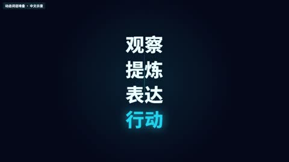](../../docs/template-gallery/demos/remotion/kinetic-word-stack.mp4)

- [本地效果演示 1 · 16:9](../../docs/template-gallery/demos/remotion/kinetic-word-stack.mp4)：原注册动画的中文参数演示；静音；示例文字与数值不是实际业务结果

**2. 适用内容**

- 口播重点词与章节
- 旅行视频地点或段落标题

- 长段字幕不直接塞入大标题
- 按实际画幅重新检查安全区

**3. 所需素材**

- 中文文案与颜色参数
- 按本条素材确认的时间长度
- 对应画幅的安全区检查

**4. 可改参数与限制**

按已核对的字段与限制修改；尚未核对的能力会明确标注。

<details>
<summary>查看参数、限制与来源依据</summary>

- 背景色（backgroundColor）：文字，有默认值或须提供。
- 强调色（accentColor）：文字，有默认值或须提供。
- 文字色（textColor）：文字，有默认值或须提供。
- 词组列表（words）：文字列表，有默认值或须提供。

- 以上是源码实际暴露的输入，不代表文字长度、列表数量和所有参数组合已完成测试；换内容后须检查排版与完整动画。
- 当前目录演示画幅为 16:9；尺寸与总帧数由 Composition 注册项控制，不能把效果内部 duration 等输入当作自动更改导出长度。

参数依据：[KineticWordStack.tsx](../../extensions/remotion-vd44/src/vendor/rendercomp/components/kinetic-word-stack/KineticWordStack.tsx) · [Root.tsx](../../extensions/remotion-vd44/src/vendor/rendercomp/Root.tsx)

</details>

**5. 怎样交给 AI 使用**

<details>
<summary>复制本模板的使用提示词</summary>

```text
请使用 AI Cut 模板目录中的「动态词语堆叠」（编号 remotion-kinetic-word-stack）。
我的内容或原片：[填写]；输出比例：[填写]；需要强调的内容：[填写]。
先核对本条来源、当前状态、素材和参数合同；使用我自己的获授权素材，保留原声原意。
按照本条已支持的参数范围做短预览，确认文字、动作和声音的时间一致，再放入剪辑工程。
若原包、依赖或素材缺失，说明缺什么；遇到费用先告诉我。不要将示例人物或示例数据当成我的内容。
```

</details>

**6. 当前能否使用**

- 代码已入库 · 准备环境后适配
- 本仓库包含相应代码；需准备 Remotion 运行环境及本条素材，参数修改后重新预览检查。
- 登记基线版本：f648980e528defb7594e24c6447055f0540f340b+zh-gallery.1。新输入、新电脑和其他变体须另行验证。

<details>
<summary>查看原始检查范围与接入记录</summary>

- 55项真实Remotion渲染；每项完整解码、帧数、比例、静音及2 MB限额通过；实际查看每项18%/52%/82%编码帧联系表。不是逐帧连续观看，不代表其他画幅、真人合成、用户审美认可或最终视频QA。

</details>

**7. 来源与许可**

- MIT（模板源码）；Remotion 运行时与字体许可分别适用

[原始来源](https://github.com/RenderComp/free-remotion-templates/tree/f648980e528defb7594e24c6447055f0540f340b)

---

<a id="remotion-pixel-typewriter-quote"></a>

### 像素打字引语

`remotion-pixel-typewriter-quote` · 标题与重点字 · 文字与标题 · **代码已入库 · 准备环境后适配**

像素风格逐字输入引语；中文演示层使用 NotoSansSC 补字，保留原动画时序；原版像素字库只覆盖英文。

**1. 效果预览**

[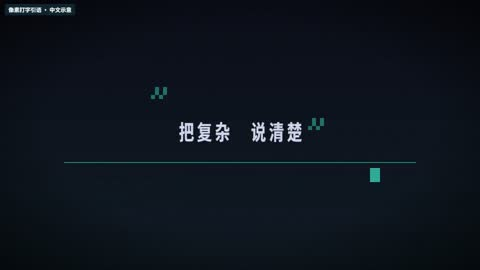](../../docs/template-gallery/demos/remotion/pixel-typewriter-quote.mp4)

- [本地效果演示 1 · 16:9](../../docs/template-gallery/demos/remotion/pixel-typewriter-quote.mp4)：原注册动画的中文参数演示；静音；示例文字与数值不是实际业务结果

**2. 适用内容**

- 口播重点词与章节
- 旅行视频地点或段落标题

- 长段字幕不直接塞入大标题
- 按实际画幅重新检查安全区

**3. 所需素材**

- 中文文案与颜色参数
- 按本条素材确认的时间长度
- 对应画幅的安全区检查

**4. 可改参数与限制**

按已核对的字段与限制修改；尚未核对的能力会明确标注。

<details>
<summary>查看参数、限制与来源依据</summary>

- 引用文字（quote）：文字，有默认值或须提供。
- 署名（attribution）：文字，有默认值或须提供。
- 背景色（backgroundColor）：文字，有默认值或须提供。
- ink颜色（inkColor）：文字，有默认值或须提供。
- 强调色（accentColor）：文字，有默认值或须提供。
- 逐帧字符数（cps）：数字，有默认值或须提供。

- 以上是源码实际暴露的输入，不代表文字长度、列表数量和所有参数组合已完成测试；换内容后须检查排版与完整动画。
- 当前目录演示画幅为 16:9；尺寸与总帧数由 Composition 注册项控制，不能把效果内部 duration 等输入当作自动更改导出长度。
- 源码注明使用英文点阵字形；中文输入需要单独适配，不能由其他中文 Demo 推断本项支持。

参数依据：[PixelTypewriterQuote.tsx](../../extensions/remotion-vd44/src/vendor/rendercomp/components/pixel-typewriter-quote/PixelTypewriterQuote.tsx) · [Root.tsx](../../extensions/remotion-vd44/src/vendor/rendercomp/Root.tsx)

</details>

**5. 怎样交给 AI 使用**

<details>
<summary>复制本模板的使用提示词</summary>

```text
请使用 AI Cut 模板目录中的「像素打字引语」（编号 remotion-pixel-typewriter-quote）。
我的内容或原片：[填写]；输出比例：[填写]；需要强调的内容：[填写]。
先核对本条来源、当前状态、素材和参数合同；使用我自己的获授权素材，保留原声原意。
按照本条已支持的参数范围做短预览，确认文字、动作和声音的时间一致，再放入剪辑工程。
若原包、依赖或素材缺失，说明缺什么；遇到费用先告诉我。不要将示例人物或示例数据当成我的内容。
```

</details>

**6. 当前能否使用**

- 代码已入库 · 准备环境后适配
- 本仓库包含相应代码；需准备 Remotion 运行环境及本条素材，参数修改后重新预览检查。
- 登记基线版本：f648980e528defb7594e24c6447055f0540f340b+zh-gallery.1。新输入、新电脑和其他变体须另行验证。

<details>
<summary>查看原始检查范围与接入记录</summary>

- 55项真实Remotion渲染；每项完整解码、帧数、比例、静音及2 MB限额通过；实际查看每项18%/52%/82%编码帧联系表。不是逐帧连续观看，不代表其他画幅、真人合成、用户审美认可或最终视频QA。

</details>

**7. 来源与许可**

- MIT（模板源码）；Remotion 运行时与字体许可分别适用

[原始来源](https://github.com/RenderComp/free-remotion-templates/tree/f648980e528defb7594e24c6447055f0540f340b)

---

<a id="remotion-scramble-text"></a>

### 乱序文字归位

`remotion-scramble-text` · 标题与重点字 · 文字与标题 · **代码已入库 · 准备环境后适配**

字符变化后组成目标标题

**1. 效果预览**

[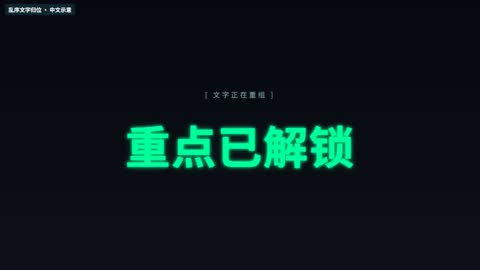](../../docs/template-gallery/demos/remotion/scramble-text.mp4)

- [本地效果演示 1 · 16:9](../../docs/template-gallery/demos/remotion/scramble-text.mp4)：原注册动画的中文参数演示；静音；示例文字与数值不是实际业务结果

**2. 适用内容**

- 口播重点词与章节
- 旅行视频地点或段落标题

- 长段字幕不直接塞入大标题
- 按实际画幅重新检查安全区

**3. 所需素材**

- 中文文案与颜色参数
- 按本条素材确认的时间长度
- 对应画幅的安全区检查

**4. 可改参数与限制**

按已核对的字段与限制修改；尚未核对的能力会明确标注。

<details>
<summary>查看参数、限制与来源依据</summary>

- 正文（text）：文字，有默认值或须提供。
- 标签（label）：文字，可省略。
- 背景（background）：文字，有默认值或须提供。
- 文字色（textColor）：文字，有默认值或须提供。
- 标签颜色（labelColor）：文字，有默认值或须提供。
- 扰动帧数（scrambleDuration）：数字，有默认值或须提供。
- 扰动字符集（charset）：文字，有默认值或须提供。

- 以上是源码实际暴露的输入，不代表文字长度、列表数量和所有参数组合已完成测试；换内容后须检查排版与完整动画。
- 当前目录演示画幅为 16:9；尺寸与总帧数由 Composition 注册项控制，不能把效果内部 duration 等输入当作自动更改导出长度。

参数依据：[ScrambleText.tsx](../../extensions/remotion-vd44/src/vendor/rendercomp/components/scramble-text/ScrambleText.tsx) · [Root.tsx](../../extensions/remotion-vd44/src/vendor/rendercomp/Root.tsx)

</details>

**5. 怎样交给 AI 使用**

<details>
<summary>复制本模板的使用提示词</summary>

```text
请使用 AI Cut 模板目录中的「乱序文字归位」（编号 remotion-scramble-text）。
我的内容或原片：[填写]；输出比例：[填写]；需要强调的内容：[填写]。
先核对本条来源、当前状态、素材和参数合同；使用我自己的获授权素材，保留原声原意。
按照本条已支持的参数范围做短预览，确认文字、动作和声音的时间一致，再放入剪辑工程。
若原包、依赖或素材缺失，说明缺什么；遇到费用先告诉我。不要将示例人物或示例数据当成我的内容。
```

</details>

**6. 当前能否使用**

- 代码已入库 · 准备环境后适配
- 本仓库包含相应代码；需准备 Remotion 运行环境及本条素材，参数修改后重新预览检查。
- 登记基线版本：f648980e528defb7594e24c6447055f0540f340b+zh-gallery.1。新输入、新电脑和其他变体须另行验证。

<details>
<summary>查看原始检查范围与接入记录</summary>

- 55项真实Remotion渲染；每项完整解码、帧数、比例、静音及2 MB限额通过；实际查看每项18%/52%/82%编码帧联系表。不是逐帧连续观看，不代表其他画幅、真人合成、用户审美认可或最终视频QA。

</details>

**7. 来源与许可**

- MIT（模板源码）；Remotion 运行时与字体许可分别适用

[原始来源](https://github.com/RenderComp/free-remotion-templates/tree/f648980e528defb7594e24c6447055f0540f340b)

---

<a id="remotion-text-mask-reveal"></a>

### 文字遮罩揭示

`remotion-text-mask-reveal` · 标题与重点字 · 文字与标题 · **代码已入库 · 准备环境后适配**

文字从遮罩边界内滑出

**1. 效果预览**

[](../../docs/template-gallery/demos/remotion/text-mask-reveal.mp4)

- [本地效果演示 1 · 16:9](../../docs/template-gallery/demos/remotion/text-mask-reveal.mp4)：原注册动画的中文参数演示；静音；示例文字与数值不是实际业务结果

**2. 适用内容**

- 口播重点词与章节
- 旅行视频地点或段落标题

- 长段字幕不直接塞入大标题
- 按实际画幅重新检查安全区

**3. 所需素材**

- 中文文案与颜色参数
- 按本条素材确认的时间长度
- 对应画幅的安全区检查

**4. 可改参数与限制**

按已核对的字段与限制修改；尚未核对的能力会明确标注。

<details>
<summary>查看参数、限制与来源依据</summary>

- 背景色（backgroundColor）：文字，有默认值或须提供。
- 强调色（accentColor）：文字，有默认值或须提供。
- 文字色（textColor）：文字，有默认值或须提供。
- 文字行（lines）：文字列表，有默认值或须提供。

- 以上是源码实际暴露的输入，不代表文字长度、列表数量和所有参数组合已完成测试；换内容后须检查排版与完整动画。
- 当前目录演示画幅为 16:9；尺寸与总帧数由 Composition 注册项控制，不能把效果内部 duration 等输入当作自动更改导出长度。

参数依据：[TextMaskReveal.tsx](../../extensions/remotion-vd44/src/vendor/rendercomp/components/text-mask-reveal/TextMaskReveal.tsx) · [Root.tsx](../../extensions/remotion-vd44/src/vendor/rendercomp/Root.tsx)

</details>

**5. 怎样交给 AI 使用**

<details>
<summary>复制本模板的使用提示词</summary>

```text
请使用 AI Cut 模板目录中的「文字遮罩揭示」（编号 remotion-text-mask-reveal）。
我的内容或原片：[填写]；输出比例：[填写]；需要强调的内容：[填写]。
先核对本条来源、当前状态、素材和参数合同；使用我自己的获授权素材，保留原声原意。
按照本条已支持的参数范围做短预览，确认文字、动作和声音的时间一致，再放入剪辑工程。
若原包、依赖或素材缺失，说明缺什么；遇到费用先告诉我。不要将示例人物或示例数据当成我的内容。
```

</details>

**6. 当前能否使用**

- 代码已入库 · 准备环境后适配
- 本仓库包含相应代码；需准备 Remotion 运行环境及本条素材，参数修改后重新预览检查。
- 登记基线版本：f648980e528defb7594e24c6447055f0540f340b+zh-gallery.1。新输入、新电脑和其他变体须另行验证。

<details>
<summary>查看原始检查范围与接入记录</summary>

- 55项真实Remotion渲染；每项完整解码、帧数、比例、静音及2 MB限额通过；实际查看每项18%/52%/82%编码帧联系表。不是逐帧连续观看，不代表其他画幅、真人合成、用户审美认可或最终视频QA。

</details>

**7. 来源与许可**

- MIT（模板源码）；Remotion 运行时与字体许可分别适用

[原始来源](https://github.com/RenderComp/free-remotion-templates/tree/f648980e528defb7594e24c6447055f0540f340b)

---

<a id="remotion-typewriter"></a>

### 打字机

`remotion-typewriter` · 标题与重点字 · 文字与标题 · **代码已入库 · 准备环境后适配**

逐字输入并显示光标

**1. 效果预览**

[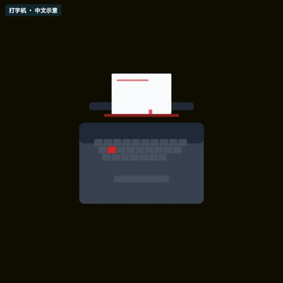](../../docs/template-gallery/demos/remotion/typewriter.mp4)

- [本地效果演示 1 · 1:1](../../docs/template-gallery/demos/remotion/typewriter.mp4)：原注册动画的中文参数演示；静音；示例文字与数值不是实际业务结果

**2. 适用内容**

- 口播重点词与章节
- 旅行视频地点或段落标题

- 长段字幕不直接塞入大标题
- 按实际画幅重新检查安全区

**3. 所需素材**

- 中文文案与颜色参数
- 按本条素材确认的时间长度
- 对应画幅的安全区检查

**4. 可改参数与限制**

按已核对的字段与限制修改；尚未核对的能力会明确标注。

<details>
<summary>查看参数、限制与来源依据</summary>

- 背景色（backgroundColor）：文字，有默认值或须提供。
- machine颜色（machineColor）：文字，有默认值或须提供。
- machineDark颜色（machineDarkColor）：文字，有默认值或须提供。
- key颜色（keyColor）：文字，有默认值或须提供。
- ribbon颜色（ribbonColor）：文字，有默认值或须提供。
- paper颜色（paperColor）：文字，有默认值或须提供。
- 文字色（textColor）：文字，有默认值或须提供。
- sub颜色（subColor）：文字，有默认值或须提供。
- 显示文字（messageText）：文字，有默认值或须提供。
- 辅助文字（subText）：文字，有默认值或须提供。

- 以上是源码实际暴露的输入，不代表文字长度、列表数量和所有参数组合已完成测试；换内容后须检查排版与完整动画。
- 当前目录演示画幅为 1:1；尺寸与总帧数由 Composition 注册项控制，不能把效果内部 duration 等输入当作自动更改导出长度。

参数依据：[Typewriter.tsx](../../extensions/remotion-vd44/src/vendor/rendercomp/components/typewriter/Typewriter.tsx) · [Root.tsx](../../extensions/remotion-vd44/src/vendor/rendercomp/Root.tsx)

</details>

**5. 怎样交给 AI 使用**

<details>
<summary>复制本模板的使用提示词</summary>

```text
请使用 AI Cut 模板目录中的「打字机」（编号 remotion-typewriter）。
我的内容或原片：[填写]；输出比例：[填写]；需要强调的内容：[填写]。
先核对本条来源、当前状态、素材和参数合同；使用我自己的获授权素材，保留原声原意。
按照本条已支持的参数范围做短预览，确认文字、动作和声音的时间一致，再放入剪辑工程。
若原包、依赖或素材缺失，说明缺什么；遇到费用先告诉我。不要将示例人物或示例数据当成我的内容。
```

</details>

**6. 当前能否使用**

- 代码已入库 · 准备环境后适配
- 本仓库包含相应代码；需准备 Remotion 运行环境及本条素材，参数修改后重新预览检查。
- 登记基线版本：f648980e528defb7594e24c6447055f0540f340b+zh-gallery.1。新输入、新电脑和其他变体须另行验证。

<details>
<summary>查看原始检查范围与接入记录</summary>

- 55项真实Remotion渲染；每项完整解码、帧数、比例、静音及2 MB限额通过；实际查看每项18%/52%/82%编码帧联系表。不是逐帧连续观看，不代表其他画幅、真人合成、用户审美认可或最终视频QA。

</details>

**7. 来源与许可**

- MIT（模板源码）；Remotion 运行时与字体许可分别适用

[原始来源](https://github.com/RenderComp/free-remotion-templates/tree/f648980e528defb7594e24c6447055f0540f340b)

---

<a id="remotion-wave-text"></a>

### 波浪文字

`remotion-wave-text` · 标题与重点字 · 文字与标题 · **代码已入库 · 准备环境后适配**

文字按波形上下移动

**1. 效果预览**

[](../../docs/template-gallery/demos/remotion/wave-text.mp4)

- [本地效果演示 1 · 16:9](../../docs/template-gallery/demos/remotion/wave-text.mp4)：原注册动画的中文参数演示；静音；示例文字与数值不是实际业务结果

**2. 适用内容**

- 口播重点词与章节
- 旅行视频地点或段落标题

- 长段字幕不直接塞入大标题
- 按实际画幅重新检查安全区

**3. 所需素材**

- 中文文案与颜色参数
- 按本条素材确认的时间长度
- 对应画幅的安全区检查

**4. 可改参数与限制**

按已核对的字段与限制修改；尚未核对的能力会明确标注。

<details>
<summary>查看参数、限制与来源依据</summary>

- 正文（text）：文字，有默认值或须提供。
- 辅助文字（subText）：文字，可省略。
- 背景（background）：文字，有默认值或须提供。
- 文字色（textColor）：文字，有默认值或须提供。
- 辅助文字颜色（subTextColor）：文字，有默认值或须提供。
- 振幅（amplitude）：数字，有默认值或须提供。
- 波动速度（waveSpeed）：数字，有默认值或须提供。
- 波长（wavelength）：数字，有默认值或须提供。

- 以上是源码实际暴露的输入，不代表文字长度、列表数量和所有参数组合已完成测试；换内容后须检查排版与完整动画。
- 当前目录演示画幅为 16:9；尺寸与总帧数由 Composition 注册项控制，不能把效果内部 duration 等输入当作自动更改导出长度。

参数依据：[WaveText.tsx](../../extensions/remotion-vd44/src/vendor/rendercomp/components/wave-text/WaveText.tsx) · [Root.tsx](../../extensions/remotion-vd44/src/vendor/rendercomp/Root.tsx)

</details>

**5. 怎样交给 AI 使用**

<details>
<summary>复制本模板的使用提示词</summary>

```text
请使用 AI Cut 模板目录中的「波浪文字」（编号 remotion-wave-text）。
我的内容或原片：[填写]；输出比例：[填写]；需要强调的内容：[填写]。
先核对本条来源、当前状态、素材和参数合同；使用我自己的获授权素材，保留原声原意。
按照本条已支持的参数范围做短预览，确认文字、动作和声音的时间一致，再放入剪辑工程。
若原包、依赖或素材缺失，说明缺什么；遇到费用先告诉我。不要将示例人物或示例数据当成我的内容。
```

</details>

**6. 当前能否使用**

- 代码已入库 · 准备环境后适配
- 本仓库包含相应代码；需准备 Remotion 运行环境及本条素材，参数修改后重新预览检查。
- 登记基线版本：f648980e528defb7594e24c6447055f0540f340b+zh-gallery.1。新输入、新电脑和其他变体须另行验证。

<details>
<summary>查看原始检查范围与接入记录</summary>

- 55项真实Remotion渲染；每项完整解码、帧数、比例、静音及2 MB限额通过；实际查看每项18%/52%/82%编码帧联系表。不是逐帧连续观看，不代表其他画幅、真人合成、用户审美认可或最终视频QA。

</details>

**7. 来源与许可**

- MIT（模板源码）；Remotion 运行时与字体许可分别适用

[原始来源](https://github.com/RenderComp/free-remotion-templates/tree/f648980e528defb7594e24c6447055f0540f340b)

---

<a id="remotion-library-text-mask"></a>

### 文字镂空媒体演示

`remotion-library-text-mask` · 标题与重点字 · RemotionUI本地适配 · **代码已入库 · 准备环境后适配**

SVG文字镂空与渐变移动；演示使用合成渐变

**1. 效果预览**

[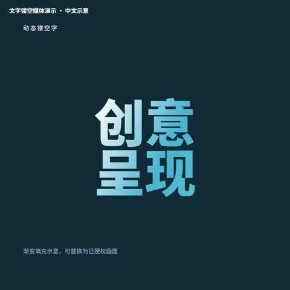](../../docs/template-gallery/demos/remotion/library-text-mask.mp4)

- [本地效果演示 1 · 1:1](../../docs/template-gallery/demos/remotion/library-text-mask.mp4)：原注册动画的中文参数演示；静音；示例文字与数值不是实际业务结果

**2. 适用内容**

- 可参数化的图形动画
- 按表达任务选择局部使用

- 真实素材合成与其他比例须另测
- 不声称演示等同于本条成片验收
- 此项演示渐变填充；真人镂空视频另见口播效果11

**3. 所需素材**

- 中文文案与颜色参数
- 按本条素材确认的时间长度
- 对应画幅的安全区检查

**4. 可改参数与限制**

按已核对的字段与限制修改；尚未核对的能力会明确标注。

<details>
<summary>查看参数、限制与来源依据</summary>

- 正文（text）：文字，可省略。
- 标题（title）：文字，可省略。
- 说明（note）：文字，可省略。
- 媒体类型（media）：TextMaskMedia，可省略。
- 媒体文件（src）：文字，可省略。
- 渐变色（gradient）：文字，可省略。
- 字体（fontFamily）：文字，可省略。

- 以上是源码实际暴露的输入，不代表文字长度、列表数量和所有参数组合已完成测试；换内容后须检查排版与完整动画。
- 当前目录演示画幅为 1:1；尺寸与总帧数由 Composition 注册项控制，不能把效果内部 duration 等输入当作自动更改导出长度。
- media 仅支持 gradient/video/image；video 或 image 需提供 src。src 使用 public 相对路径或已解析媒体 URL，不接受 Windows 磁盘绝对路径；原 Demo 的渐变测试不能代替新视频验证。

参数依据：[Demos.tsx](../../extensions/remotion-vd44/src/template-library/remotion-ui/Demos.tsx) · [LibraryRoot.tsx](../../extensions/remotion-vd44/src/template-library/LibraryRoot.tsx)

</details>

**5. 怎样交给 AI 使用**

<details>
<summary>复制本模板的使用提示词</summary>

```text
请使用 AI Cut 模板目录中的「文字镂空媒体演示」（编号 remotion-library-text-mask）。
我的内容或原片：[填写]；输出比例：[填写]；需要强调的内容：[填写]。
先核对本条来源、当前状态、素材和参数合同；使用我自己的获授权素材，保留原声原意。
按照本条已支持的参数范围做短预览，确认文字、动作和声音的时间一致，再放入剪辑工程。
若原包、依赖或素材缺失，说明缺什么；遇到费用先告诉我。不要将示例人物或示例数据当成我的内容。
```

</details>

**6. 当前能否使用**

- 代码已入库 · 准备环境后适配
- 本仓库包含相应代码；需准备 Remotion 运行环境及本条素材，参数修改后重新预览检查。
- 登记基线版本：0aecaca2b61a167992e1205d10e4da16d8a71331+zh-gallery.1。新输入、新电脑和其他变体须另行验证。

<details>
<summary>查看原始检查范围与接入记录</summary>

- 55项真实Remotion渲染；每项完整解码、帧数、比例、静音及2 MB限额通过；实际查看每项18%/52%/82%编码帧联系表。不是逐帧连续观看，不代表其他画幅、真人合成、用户审美认可或最终视频QA。

</details>

**7. 来源与许可**

- MIT（模板源码）；Remotion 运行时与字体许可分别适用

[原始来源](https://github.com/riaz37/remotion-ui/tree/0aecaca2b61a167992e1205d10e4da16d8a71331)

---

<a id="remotion-library-glass-zh"></a>

### 中文玻璃卡片示例

`remotion-library-glass-zh` · 标题与重点字 · 中文示例 · **代码已入库 · 准备环境后适配**

半透明玻璃下三分之一信息卡；已有基础模板的中文参数示例，不新增模板家族。

**1. 效果预览**

[](../../docs/template-gallery/demos/remotion/library-glass-zh.mp4)

- [本地效果演示 1 · 16:9](../../docs/template-gallery/demos/remotion/library-glass-zh.mp4)：原注册动画的中文参数演示；静音；示例文字与数值不是实际业务结果

**2. 适用内容**

- 可参数化的图形动画
- 按表达任务选择局部使用

- 真实素材合成与其他比例须另测
- 不声称演示等同于本条成片验收

**3. 所需素材**

- 中文文案与颜色参数
- 按本条素材确认的时间长度
- 对应画幅的安全区检查

**4. 可改参数与限制**

按已核对的字段与限制修改；尚未核对的能力会明确标注。

<details>
<summary>查看参数、限制与来源依据</summary>

- 背景色（backgroundColor）：文字，有默认值或须提供。
- 强调色（accentColor）：文字，有默认值或须提供。
- 文字色（textColor）：文字，有默认值或须提供。
- 姓名文字（nameText）：文字，有默认值或须提供。
- 身份文字（titleText）：文字，有默认值或须提供。

- 以上是源码实际暴露的输入，不代表文字长度、列表数量和所有参数组合已完成测试；换内容后须检查排版与完整动画。
- 当前目录演示画幅为 16:9；尺寸与总帧数由 Composition 注册项控制，不能把效果内部 duration 等输入当作自动更改导出长度。

参数依据：[LowerThirdGlassCard.tsx](../../extensions/remotion-vd44/src/vendor/rendercomp/components/lower-third-glass-card/LowerThirdGlassCard.tsx) · [LibraryRoot.tsx](../../extensions/remotion-vd44/src/template-library/LibraryRoot.tsx)

</details>

**5. 怎样交给 AI 使用**

<details>
<summary>复制本模板的使用提示词</summary>

```text
请使用 AI Cut 模板目录中的「中文玻璃卡片示例」（编号 remotion-library-glass-zh）。
我的内容或原片：[填写]；输出比例：[填写]；需要强调的内容：[填写]。
先核对本条来源、当前状态、素材和参数合同；使用我自己的获授权素材，保留原声原意。
按照本条已支持的参数范围做短预览，确认文字、动作和声音的时间一致，再放入剪辑工程。
若原包、依赖或素材缺失，说明缺什么；遇到费用先告诉我。不要将示例人物或示例数据当成我的内容。
```

</details>

**6. 当前能否使用**

- 代码已入库 · 准备环境后适配
- 本仓库包含相应代码；需准备 Remotion 运行环境及本条素材，参数修改后重新预览检查。
- 登记基线版本：f648980e528defb7594e24c6447055f0540f340b+zh-gallery.1。新输入、新电脑和其他变体须另行验证。

<details>
<summary>查看原始检查范围与接入记录</summary>

- 55项真实Remotion渲染；每项完整解码、帧数、比例、静音及2 MB限额通过；实际查看每项18%/52%/82%编码帧联系表。不是逐帧连续观看，不代表其他画幅、真人合成、用户审美认可或最终视频QA。

</details>

**7. 来源与许可**

- MIT（模板源码）；Remotion 运行时与字体许可分别适用

[原始来源](https://github.com/RenderComp/free-remotion-templates/tree/f648980e528defb7594e24c6447055f0540f340b)

---

<a id="presenter-effect-02"></a>

### 玻璃标签

`presenter-effect-02` · 标题与重点字 · 文字与标题 · **样片效果 · 需要源码适配**

半透明圆角玻璃标签进入画面，突出一个短标题。

**1. 效果预览**

[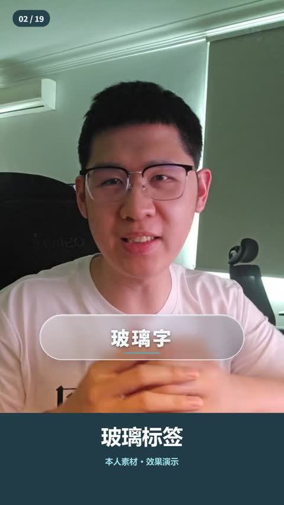](../../docs/template-gallery/demos/presenter/presenter-effect-02.mp4)

- [本人案例 1 · 9:16](../../docs/template-gallery/demos/presenter/presenter-effect-02.mp4)：本人素材中文无声演示，来自已渲染母版的对应效果片段。

**2. 适用内容**

- 强调一句关键词或术语

- 避免长段落和低对比背景

**3. 所需素材**

- 口播视频
- 短标题
- 品牌颜色

**4. 可改参数与限制**

按已核对的字段与限制修改；尚未核对的能力会明确标注。

<details>
<summary>查看参数、限制与来源依据</summary>

- 共同工程输入 sourceFile / alphaFile：原视频与严格同步的透明人像视频文件；透明人像按具体分支需要使用。
- clips：每段的 fromFrame、durationInFrames、sourceStart、playbackRate、kind、title；totalFrames：总帧数。
- 本条效果选择 kind=2；标题可由该段 title 提供，其余效果内容不能假定已参数化。

- 当前是样片效果分支，需要按新片适配；没有独立的通用 .motion 参数合同。
- 母版固定 1080×1920、30fps；品牌色 INK/ACCENT、Logo、小窗位置和部分文案在源码中固定，修改需调整代码并重新验证。
- 玻璃标签使用固定胶囊尺寸、位置与渐变；标签标题按字长缩放，超长文案仍需重新检查。

参数依据：[Showcase.tsx](../../extensions/remotion-vd44/src/template-library/talking-head-effects/Showcase.tsx) · [GraphicLayers.tsx](../../extensions/remotion-vd44/src/template-library/talking-head-effects/GraphicLayers.tsx) · [index.tsx](../../extensions/remotion-vd44/src/template-library/talking-head-effects/index.tsx)

</details>

**5. 怎样交给 AI 使用**

<details>
<summary>复制本模板的使用提示词</summary>

```text
请使用 AI Cut 模板目录中的「玻璃标签」（编号 presenter-effect-02）。
我的内容或原片：[填写]；输出比例：[填写]；需要强调的内容：[填写]。
先核对本条来源、当前状态、素材和参数合同；使用我自己的获授权素材，保留原声原意。
按照本条已支持的参数范围做短预览，确认文字、动作和声音的时间一致，再放入剪辑工程。
若原包、依赖或素材缺失，说明缺什么；遇到费用先告诉我。不要将示例人物或示例数据当成我的内容。
```

</details>

**6. 当前能否使用**

- 样片效果 · 需要源码适配
- 当前为特定样片的效果分支，颜色、素材与时间逻辑尚有固定实现；不视为已通用化 .motion 包。
- 登记基线版本：1.0.0。新输入、新电脑和其他变体须另行验证。

<details>
<summary>查看原始检查范围与接入记录</summary>

- 已核对实际效果编号及母版帧区间，完整解码，检查尺寸、帧数、文件大小，并实际审看起中末联系表；无新音频，不代表逐帧连续观看或完整参考复刻。

</details>

**7. 来源与许可**

- MIT（原创代码）；演示肖像仅按本人本次授权展示，非素材再分发授权；Remotion 引擎另有许可

[原始来源](https://github.com/Isaac3113/ai-cut/tree/main/extensions/remotion-vd44/src/template-library/talking-head-effects)

---

<a id="presenter-effect-11"></a>

### 视频镂空字

`presenter-effect-11` · 标题与重点字 · 文字与标题 · **样片效果 · 需要源码适配**

真人视频透过大型中文字显示，并保留圆形人物小窗。

**1. 效果预览**

[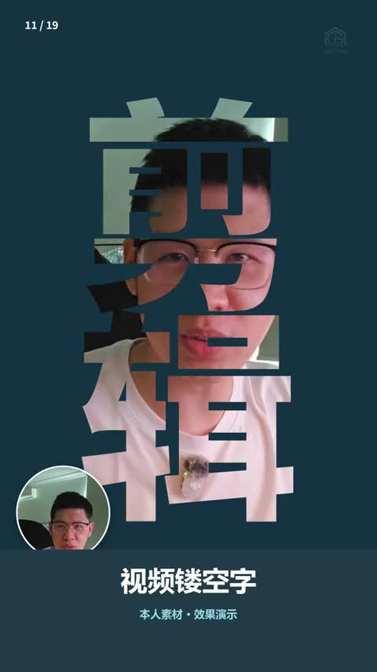](../../docs/template-gallery/demos/presenter/presenter-effect-11.mp4)

- [本人案例 1 · 9:16](../../docs/template-gallery/demos/presenter/presenter-effect-11.mp4)：本人素材中文无声演示，来自已渲染母版的对应效果片段。

**2. 适用内容**

- 章节主题或短词视觉强调

- 长句和细笔画会降低视频辨识度

**3. 所需素材**

- 口播视频
- 粗体中文短词
- 人物小窗

**4. 可改参数与限制**

按已核对的字段与限制修改；尚未核对的能力会明确标注。

<details>
<summary>查看参数、限制与来源依据</summary>

- 共同工程输入 sourceFile / alphaFile：原视频与严格同步的透明人像视频文件；透明人像按具体分支需要使用。
- clips：每段的 fromFrame、durationInFrames、sourceStart、playbackRate、kind、title；totalFrames：总帧数。
- 本条效果选择 kind=11；标题可由该段 title 提供，其余效果内容不能假定已参数化。

- 当前是样片效果分支，需要按新片适配；没有独立的通用 .motion 参数合同。
- 母版固定 1080×1920、30fps；品牌色 INK/ACCENT、Logo、小窗位置和部分文案在源码中固定，修改需调整代码并重新验证。
- 大字遮罩“剪”“辑”固定在代码，改词需重新调整字号、字形和人像小窗。

参数依据：[Showcase.tsx](../../extensions/remotion-vd44/src/template-library/talking-head-effects/Showcase.tsx) · [GraphicLayers.tsx](../../extensions/remotion-vd44/src/template-library/talking-head-effects/GraphicLayers.tsx) · [index.tsx](../../extensions/remotion-vd44/src/template-library/talking-head-effects/index.tsx)

</details>

**5. 怎样交给 AI 使用**

<details>
<summary>复制本模板的使用提示词</summary>

```text
请使用 AI Cut 模板目录中的「视频镂空字」（编号 presenter-effect-11）。
我的内容或原片：[填写]；输出比例：[填写]；需要强调的内容：[填写]。
先核对本条来源、当前状态、素材和参数合同；使用我自己的获授权素材，保留原声原意。
按照本条已支持的参数范围做短预览，确认文字、动作和声音的时间一致，再放入剪辑工程。
若原包、依赖或素材缺失，说明缺什么；遇到费用先告诉我。不要将示例人物或示例数据当成我的内容。
```

</details>

**6. 当前能否使用**

- 样片效果 · 需要源码适配
- 当前为特定样片的效果分支，颜色、素材与时间逻辑尚有固定实现；不视为已通用化 .motion 包。
- 登记基线版本：1.0.0。新输入、新电脑和其他变体须另行验证。

<details>
<summary>查看原始检查范围与接入记录</summary>

- 已核对实际效果编号及母版帧区间，完整解码，检查尺寸、帧数、文件大小，并实际审看起中末联系表；无新音频，不代表逐帧连续观看或完整参考复刻。

</details>

**7. 来源与许可**

- MIT（原创代码）；演示肖像仅按本人本次授权展示，非素材再分发授权；Remotion 引擎另有许可

[原始来源](https://github.com/Isaac3113/ai-cut/tree/main/extensions/remotion-vd44/src/template-library/talking-head-effects)

---

<a id="presenter-effect-12"></a>

### 手绘涂鸦

`presenter-effect-12` · 标题与重点字 · 装饰与强调 · **样片效果 · 需要源码适配**

线条、星形与箭头逐步绘出，围绕人物形成手绘强调。

**1. 效果预览**

[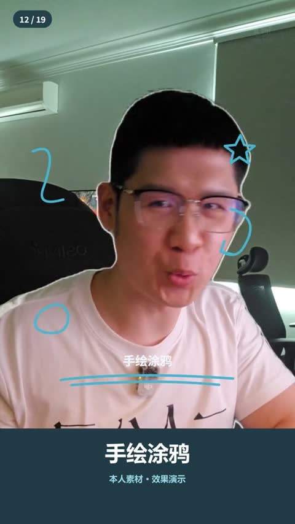](../../docs/template-gallery/demos/presenter/presenter-effect-12.mp4)

- [本人案例 1 · 9:16](../../docs/template-gallery/demos/presenter/presenter-effect-12.mp4)：本人素材中文无声演示，来自已渲染母版的对应效果片段。

**2. 适用内容**

- 提醒重点或营造轻松节奏

- 避免箭头指向错误对象或遮住字幕

**3. 所需素材**

- 口播视频
- 短标题
- 强调位置

**4. 可改参数与限制**

按已核对的字段与限制修改；尚未核对的能力会明确标注。

<details>
<summary>查看参数、限制与来源依据</summary>

- 共同工程输入 sourceFile / alphaFile：原视频与严格同步的透明人像视频文件；透明人像按具体分支需要使用。
- clips：每段的 fromFrame、durationInFrames、sourceStart、playbackRate、kind、title；totalFrames：总帧数。
- 本条效果选择 kind=12；标题可由该段 title 提供，其余效果内容不能假定已参数化。

- 当前是样片效果分支，需要按新片适配；没有独立的通用 .motion 参数合同。
- 母版固定 1080×1920、30fps；品牌色 INK/ACCENT、Logo、小窗位置和部分文案在源码中固定，修改需调整代码并重新验证。
- 涂鸦路径固定在 GraphicLayers；本人轮廓另用同源透明人像叠加，新素材需检查线条是否遮脸。

参数依据：[Showcase.tsx](../../extensions/remotion-vd44/src/template-library/talking-head-effects/Showcase.tsx) · [GraphicLayers.tsx](../../extensions/remotion-vd44/src/template-library/talking-head-effects/GraphicLayers.tsx) · [index.tsx](../../extensions/remotion-vd44/src/template-library/talking-head-effects/index.tsx)

</details>

**5. 怎样交给 AI 使用**

<details>
<summary>复制本模板的使用提示词</summary>

```text
请使用 AI Cut 模板目录中的「手绘涂鸦」（编号 presenter-effect-12）。
我的内容或原片：[填写]；输出比例：[填写]；需要强调的内容：[填写]。
先核对本条来源、当前状态、素材和参数合同；使用我自己的获授权素材，保留原声原意。
按照本条已支持的参数范围做短预览，确认文字、动作和声音的时间一致，再放入剪辑工程。
若原包、依赖或素材缺失，说明缺什么；遇到费用先告诉我。不要将示例人物或示例数据当成我的内容。
```

</details>

**6. 当前能否使用**

- 样片效果 · 需要源码适配
- 当前为特定样片的效果分支，颜色、素材与时间逻辑尚有固定实现；不视为已通用化 .motion 包。
- 登记基线版本：1.0.0。新输入、新电脑和其他变体须另行验证。

<details>
<summary>查看原始检查范围与接入记录</summary>

- 已核对实际效果编号及母版帧区间，完整解码，检查尺寸、帧数、文件大小，并实际审看起中末联系表；无新音频，不代表逐帧连续观看或完整参考复刻。

</details>

**7. 来源与许可**

- MIT（原创代码）；演示肖像仅按本人本次授权展示，非素材再分发授权；Remotion 引擎另有许可

[原始来源](https://github.com/Isaac3113/ai-cut/tree/main/extensions/remotion-vd44/src/template-library/talking-head-effects)

---

<a id="presenter-effect-13"></a>

### 标题墙

`presenter-effect-13` · 标题与重点字 · 文字与标题 · **样片效果 · 需要源码适配**

重复大字在人物后方交错移动，形成动态文字墙。

**1. 效果预览**

[](../../docs/template-gallery/demos/presenter/presenter-effect-13.mp4)

- [本人案例 1 · 9:16](../../docs/template-gallery/demos/presenter/presenter-effect-13.mp4)：本人素材中文无声演示，来自已渲染母版的对应效果片段。

**2. 适用内容**

- 强化主题词或品牌关键词

- 避免长句与高密度信息同时出现

**3. 所需素材**

- 同步人物透明视频
- 短主题词

**4. 可改参数与限制**

按已核对的字段与限制修改；尚未核对的能力会明确标注。

<details>
<summary>查看参数、限制与来源依据</summary>

- 共同工程输入 sourceFile / alphaFile：原视频与严格同步的透明人像视频文件；透明人像按具体分支需要使用。
- clips：每段的 fromFrame、durationInFrames、sourceStart、playbackRate、kind、title；totalFrames：总帧数。
- 本条效果选择 kind=13；标题可由该段 title 提供，其余效果内容不能假定已参数化。

- 当前是样片效果分支，需要按新片适配；没有独立的通用 .motion 参数合同。
- 母版固定 1080×1920、30fps；品牌色 INK/ACCENT、Logo、小窗位置和部分文案在源码中固定，修改需调整代码并重新验证。
- 背景标题墙的“剪辑/特效”、行列数与颜色固定在源码；换主题需改文字并检查前景人像覆盖。

参数依据：[Showcase.tsx](../../extensions/remotion-vd44/src/template-library/talking-head-effects/Showcase.tsx) · [GraphicLayers.tsx](../../extensions/remotion-vd44/src/template-library/talking-head-effects/GraphicLayers.tsx) · [index.tsx](../../extensions/remotion-vd44/src/template-library/talking-head-effects/index.tsx)

</details>

**5. 怎样交给 AI 使用**

<details>
<summary>复制本模板的使用提示词</summary>

```text
请使用 AI Cut 模板目录中的「标题墙」（编号 presenter-effect-13）。
我的内容或原片：[填写]；输出比例：[填写]；需要强调的内容：[填写]。
先核对本条来源、当前状态、素材和参数合同；使用我自己的获授权素材，保留原声原意。
按照本条已支持的参数范围做短预览，确认文字、动作和声音的时间一致，再放入剪辑工程。
若原包、依赖或素材缺失，说明缺什么；遇到费用先告诉我。不要将示例人物或示例数据当成我的内容。
```

</details>

**6. 当前能否使用**

- 样片效果 · 需要源码适配
- 当前为特定样片的效果分支，颜色、素材与时间逻辑尚有固定实现；不视为已通用化 .motion 包。
- 登记基线版本：1.0.0。新输入、新电脑和其他变体须另行验证。

<details>
<summary>查看原始检查范围与接入记录</summary>

- 已核对实际效果编号及母版帧区间，完整解码，检查尺寸、帧数、文件大小，并实际审看起中末联系表；无新音频，不代表逐帧连续观看或完整参考复刻。

</details>

**7. 来源与许可**

- MIT（原创代码）；演示肖像仅按本人本次授权展示，非素材再分发授权；Remotion 引擎另有许可

[原始来源](https://github.com/Isaac3113/ai-cut/tree/main/extensions/remotion-vd44/src/template-library/talking-head-effects)

---

<a id="presenter-effect-16"></a>

### 环绕文字

`presenter-effect-16` · 标题与重点字 · 装饰与强调 · **样片效果 · 需要源码适配**

三张中文词卡沿椭圆轨迹环绕人物，并表现前后遮挡。

**1. 效果预览**

[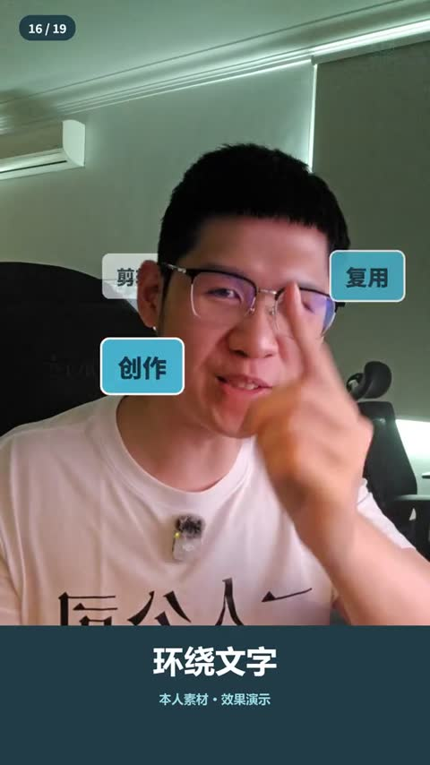](../../docs/template-gallery/demos/presenter/presenter-effect-16.mp4)

- [本人案例 1 · 9:16](../../docs/template-gallery/demos/presenter/presenter-effect-16.mp4)：本人素材中文无声演示，来自已渲染母版的对应效果片段。

**2. 适用内容**

- 展示围绕核心人物的几个关键词

- 避免词卡盖脸或把并列关系暗示为先后步骤

**3. 所需素材**

- 同步人物透明视频
- 三个短关键词

**4. 可改参数与限制**

按已核对的字段与限制修改；尚未核对的能力会明确标注。

<details>
<summary>查看参数、限制与来源依据</summary>

- 共同工程输入 sourceFile / alphaFile：原视频与严格同步的透明人像视频文件；透明人像按具体分支需要使用。
- clips：每段的 fromFrame、durationInFrames、sourceStart、playbackRate、kind、title；totalFrames：总帧数。
- 本条效果选择 kind=16；标题可由该段 title 提供，其余效果内容不能假定已参数化。

- 当前是样片效果分支，需要按新片适配；没有独立的通用 .motion 参数合同。
- 母版固定 1080×1920、30fps；品牌色 INK/ACCENT、Logo、小窗位置和部分文案在源码中固定，修改需调整代码并重新验证。
- 绕人文字“创作、剪辑、复用”和轨道布局固定在代码；替换文字/人像需重新适配遮挡。

参数依据：[Showcase.tsx](../../extensions/remotion-vd44/src/template-library/talking-head-effects/Showcase.tsx) · [GraphicLayers.tsx](../../extensions/remotion-vd44/src/template-library/talking-head-effects/GraphicLayers.tsx) · [index.tsx](../../extensions/remotion-vd44/src/template-library/talking-head-effects/index.tsx)

</details>

**5. 怎样交给 AI 使用**

<details>
<summary>复制本模板的使用提示词</summary>

```text
请使用 AI Cut 模板目录中的「环绕文字」（编号 presenter-effect-16）。
我的内容或原片：[填写]；输出比例：[填写]；需要强调的内容：[填写]。
先核对本条来源、当前状态、素材和参数合同；使用我自己的获授权素材，保留原声原意。
按照本条已支持的参数范围做短预览，确认文字、动作和声音的时间一致，再放入剪辑工程。
若原包、依赖或素材缺失，说明缺什么；遇到费用先告诉我。不要将示例人物或示例数据当成我的内容。
```

</details>

**6. 当前能否使用**

- 样片效果 · 需要源码适配
- 当前为特定样片的效果分支，颜色、素材与时间逻辑尚有固定实现；不视为已通用化 .motion 包。
- 登记基线版本：1.0.0。新输入、新电脑和其他变体须另行验证。

<details>
<summary>查看原始检查范围与接入记录</summary>

- 已核对实际效果编号及母版帧区间，完整解码，检查尺寸、帧数、文件大小，并实际审看起中末联系表；无新音频，不代表逐帧连续观看或完整参考复刻。

</details>

**7. 来源与许可**

- MIT（原创代码）；演示肖像仅按本人本次授权展示，非素材再分发授权；Remotion 引擎另有许可

[原始来源](https://github.com/Isaac3113/ai-cut/tree/main/extensions/remotion-vd44/src/template-library/talking-head-effects)

---

<a id="presenter-effect-19"></a>

### 贴纸轮播

`presenter-effect-19` · 标题与重点字 · 装饰与强调 · **样片效果 · 需要源码适配**

五枚原创图标贴纸沿椭圆轨道轮转，并改变前后大小。

**1. 效果预览**

[](../../docs/template-gallery/demos/presenter/presenter-effect-19.mp4)

- [本人案例 1 · 9:16](../../docs/template-gallery/demos/presenter/presenter-effect-19.mp4)：本人素材中文无声演示，来自已渲染母版的对应效果片段。

**2. 适用内容**

- 串联几个创作主题或轻量装饰

- 避免遮挡关键内容与连续无意义转动

**3. 所需素材**

- 口播视频
- 授权贴纸或原创图标

**4. 可改参数与限制**

按已核对的字段与限制修改；尚未核对的能力会明确标注。

<details>
<summary>查看参数、限制与来源依据</summary>

- 共同工程输入 sourceFile / alphaFile：原视频与严格同步的透明人像视频文件；透明人像按具体分支需要使用。
- clips：每段的 fromFrame、durationInFrames、sourceStart、playbackRate、kind、title；totalFrames：总帧数。
- 本条效果选择 kind=19；标题可由该段 title 提供，其余效果内容不能假定已参数化。

- 当前是样片效果分支，需要按新片适配；没有独立的通用 .motion 参数合同。
- 母版固定 1080×1920、30fps；品牌色 INK/ACCENT、Logo、小窗位置和部分文案在源码中固定，修改需调整代码并重新验证。
- 轮播使用源码绘制的五个贴纸图标及固定轨道；替换图标、数量与轨道需适配代码。

参数依据：[Showcase.tsx](../../extensions/remotion-vd44/src/template-library/talking-head-effects/Showcase.tsx) · [GraphicLayers.tsx](../../extensions/remotion-vd44/src/template-library/talking-head-effects/GraphicLayers.tsx) · [index.tsx](../../extensions/remotion-vd44/src/template-library/talking-head-effects/index.tsx)

</details>

**5. 怎样交给 AI 使用**

<details>
<summary>复制本模板的使用提示词</summary>

```text
请使用 AI Cut 模板目录中的「贴纸轮播」（编号 presenter-effect-19）。
我的内容或原片：[填写]；输出比例：[填写]；需要强调的内容：[填写]。
先核对本条来源、当前状态、素材和参数合同；使用我自己的获授权素材，保留原声原意。
按照本条已支持的参数范围做短预览，确认文字、动作和声音的时间一致，再放入剪辑工程。
若原包、依赖或素材缺失，说明缺什么；遇到费用先告诉我。不要将示例人物或示例数据当成我的内容。
```

</details>

**6. 当前能否使用**

- 样片效果 · 需要源码适配
- 当前为特定样片的效果分支，颜色、素材与时间逻辑尚有固定实现；不视为已通用化 .motion 包。
- 登记基线版本：1.0.0。新输入、新电脑和其他变体须另行验证。

<details>
<summary>查看原始检查范围与接入记录</summary>

- 已核对实际效果编号及母版帧区间，完整解码，检查尺寸、帧数、文件大小，并实际审看起中末联系表；无新音频，不代表逐帧连续观看或完整参考复刻。

</details>

**7. 来源与许可**

- MIT（原创代码）；演示肖像仅按本人本次授权展示，非素材再分发授权；Remotion 引擎另有许可

[原始来源](https://github.com/Isaac3113/ai-cut/tree/main/extensions/remotion-vd44/src/template-library/talking-head-effects)

---
