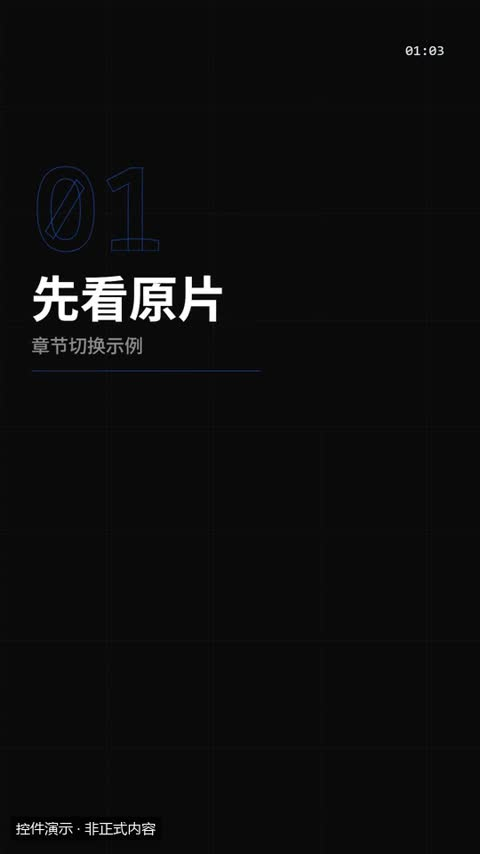
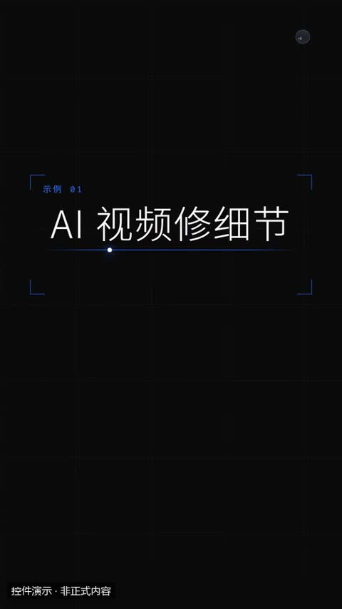
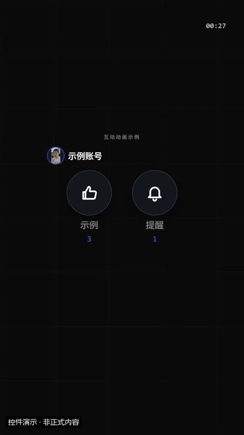
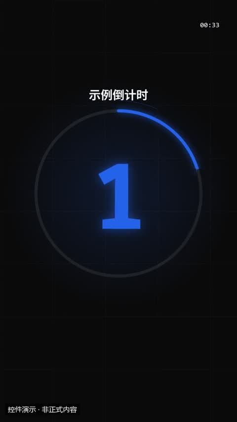
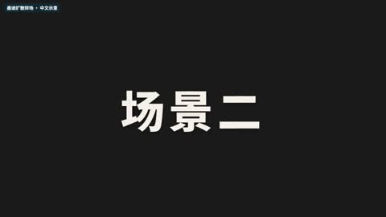
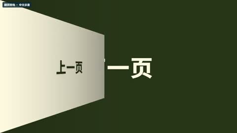

# 转场与片尾 · 特效模板详细说明

[返回全部分类](../README.zh-CN.md) · [学习自动剪辑](../../docs/NOTION_GUIDE.zh-CN.md) · [在线筛选与播放](https://aicut.agi-top.com)

本页 17 个目录条目；每项固定七段，参数依据与使用状态独立标注。先准备自己的合法素材，再按对应版本检查依赖和预览。

[章节卡](#mg-control-chapter) · [片头](#mg-control-intro) · [片尾](#mg-control-outro) · [关注 / 三连](#mg-control-subscribe) · [倒计时](#mg-control-countdown) · [镜头震动](#remotion-camera-shake) · [卡片翻面转场](#remotion-card-flip-transition) · [圆形擦除转场](#remotion-transition-circle-wipe) · [墨迹扩散转场](#remotion-ink-spread-transition) · [翻页转场](#remotion-flip-page-transition) · [像素马赛克转场](#remotion-pixel-mosaic-transition) · [滑动擦除转场](#remotion-slide-wipe) · [快速甩镜](#remotion-whip-pan) · [通用结束卡](#remotion-end-card) · [冲击缩放](#presenter-effect-03) · [拉远揭幕](#presenter-effect-06) · [数字推近](#presenter-effect-17)

<a id="mg-control-chapter"></a>

### 章节卡

`mg-control-chapter` · 转场与片尾 · 基础讲解 · **已有控件演示 · 需自备授权原包**

长视频分段：编号 + 段名

**1. 效果预览**

[](../../docs/template-gallery/demos/motiongit/chapter.mp4)

- [本地效果演示 1 · 规格见演示](../../docs/template-gallery/demos/motiongit/chapter.mp4)：官方控件真实渲染；使用中文示例文案或示例数据。6秒静音控件演示；保留模板原生标记与组内时码，角标不是本文件播放计时。低位演示身份标为本目录后处理添加。

**2. 适用内容**

- 长视频分段：编号 + 段名

- 不替代原始证据；重点字不能改变原话的限定条件。

**3. 所需素材**

- 短标题或重点词
- 清楚的解释关系
- 真实数值或标明示例的数据

**4. 可改参数与限制**

按已核对的字段与限制修改；尚未核对的能力会明确标注。

<details>
<summary>查看参数、限制与来源依据</summary>

- no（no）：文字，必填；最短长度 1；最多可见字符 4。
- name（name）：文字，必填；最短长度 1；最多可见字符 14。
- sub（sub）：文字，可选；最多可见字符 30。
- 动画变体（variant）：outline / center / wipe。
- 段落时间（t0、t1）与动作提示时间（cues）按剪后的真实讲解设置；主题色由时间轴 theme 配置，不是每个控件任意独立的配色合同。

- 这些范围来自已登记版本的公开参数合同；更换个人包或版本后须重新核对，不自动沿用到所有官网模板。
- 每个控件目前只展示一个代表变体；可选枚举、允许数量和颜色参数不等于所有组合都已实测。
- 导出前仍需校验参数、真实素材、语音时长与排版；不从示例数据推断实际业务结果。

参数依据：[motiongit-controls.json](../../templates/motiongit-controls.json) · [render_motiongit_gallery.py](../../scripts/render_motiongit_gallery.py) · [render_motiongit_gallery_data.py](../../scripts/render_motiongit_gallery_data.py)

</details>

**5. 怎样交给 AI 使用**

<details>
<summary>复制本模板的使用提示词</summary>

```text
请使用 AI Cut 模板目录中的「章节卡」（编号 mg-control-chapter）。
我的内容或原片：[填写]；输出比例：[填写]；需要强调的内容：[填写]。
先核对本条来源、当前状态、素材和参数合同；使用我自己的获授权素材，保留原声原意。
按照本条已支持的参数范围做短预览，确认文字、动作和声音的时间一致，再放入剪辑工程。
若原包、依赖或素材缺失，说明缺什么；遇到费用先告诉我。不要将示例人物或示例数据当成我的内容。
```

</details>

**6. 当前能否使用**

- 已有控件演示 · 需自备授权原包
- 本仓库提供目录与已渲染演示，未附送个人 .motion 原包；学员须使用自己合法取得的对应包。
- 登记基线版本：0.3.0 (package2.7.17-alpha.2)。新输入、新电脑和其他变体须另行验证。

<details>
<summary>查看原始检查范围与接入记录</summary>

- 一个代表变体已由官方 helper 渲染；静音小样完整解码，并已查看实际导出抽帧。其他两个变体仅登记，未渲染；不代表连续观看或用户审美认可。

</details>

**7. 来源与许可**

- MotionGit 个人授权模板包，以原包授权为准；仅包含自有素材及明确示例数据的渲染演示，不分发受保护代码。

[原始来源](https://motiongit.com/@adunext/template-01-integrated-portrait)

---

<a id="mg-control-intro"></a>

### 片头

`mg-control-intro` · 转场与片尾 · 品牌与行动 · **已有控件演示 · 需自备授权原包**

视频开头的节目标题卡：标题 + 副标题 + 可选期数/日期。电影感开场、系列节目、栏目包装

**1. 效果预览**

[](../../docs/template-gallery/demos/motiongit/intro.mp4)

- [本地效果演示 1 · 规格见演示](../../docs/template-gallery/demos/motiongit/intro.mp4)：官方控件真实渲染；使用中文示例文案或示例数据。6秒静音控件演示；保留模板原生标记与组内时码，角标不是本文件播放计时。低位演示身份标为本目录后处理添加。

**2. 适用内容**

- 视频开头的节目标题卡：标题 + 副标题 + 可选期数/日期。电影感开场、系列节目、栏目包装

- 只在需要品牌开场或行动引导时使用；示例价格与互动数不能当成事实。

**3. 所需素材**

- 品牌名称或有权使用的 Logo
- 明确的行动引导或章节信息

**4. 可改参数与限制**

按已核对的字段与限制修改；尚未核对的能力会明确标注。

<details>
<summary>查看参数、限制与来源依据</summary>

- 标题（title）：文字，必填；最短长度 1；最多可见字符 14。
- 副标题（subtitle）：文字，可选；最多可见字符 28。
- 期数/日期（如 EP.07、第 3 期）（episode）：文字，可选；最多可见字符 12。
- 动画变体（variant）：cinema / bold / minimal。
- 段落时间（t0、t1）与动作提示时间（cues）按剪后的真实讲解设置；主题色由时间轴 theme 配置，不是每个控件任意独立的配色合同。

- 这些范围来自已登记版本的公开参数合同；更换个人包或版本后须重新核对，不自动沿用到所有官网模板。
- 每个控件目前只展示一个代表变体；可选枚举、允许数量和颜色参数不等于所有组合都已实测。
- 导出前仍需校验参数、真实素材、语音时长与排版；不从示例数据推断实际业务结果。

参数依据：[motiongit-controls.json](../../templates/motiongit-controls.json) · [render_motiongit_gallery.py](../../scripts/render_motiongit_gallery.py) · [render_motiongit_gallery_data.py](../../scripts/render_motiongit_gallery_data.py)

</details>

**5. 怎样交给 AI 使用**

<details>
<summary>复制本模板的使用提示词</summary>

```text
请使用 AI Cut 模板目录中的「片头」（编号 mg-control-intro）。
我的内容或原片：[填写]；输出比例：[填写]；需要强调的内容：[填写]。
先核对本条来源、当前状态、素材和参数合同；使用我自己的获授权素材，保留原声原意。
按照本条已支持的参数范围做短预览，确认文字、动作和声音的时间一致，再放入剪辑工程。
若原包、依赖或素材缺失，说明缺什么；遇到费用先告诉我。不要将示例人物或示例数据当成我的内容。
```

</details>

**6. 当前能否使用**

- 已有控件演示 · 需自备授权原包
- 本仓库提供目录与已渲染演示，未附送个人 .motion 原包；学员须使用自己合法取得的对应包。
- 登记基线版本：0.3.0 (package2.7.17-alpha.2)。新输入、新电脑和其他变体须另行验证。

<details>
<summary>查看原始检查范围与接入记录</summary>

- 一个代表变体已由官方 helper 渲染；静音小样完整解码，并已查看实际导出抽帧。其他两个变体仅登记，未渲染；不代表连续观看或用户审美认可。

</details>

**7. 来源与许可**

- MotionGit 个人授权模板包，以原包授权为准；仅包含自有素材及明确示例数据的渲染演示，不分发受保护代码。

[原始来源](https://motiongit.com/@adunext/template-01-integrated-portrait)

---

<a id="mg-control-outro"></a>

### 片尾

`mg-control-outro` · 转场与片尾 · 品牌与行动 · **已有控件演示 · 需自备授权原包**

视频结尾：感谢语 + 1–3 个下一步（推荐视频、下期预告、关注/链接文字），可带头像

**1. 效果预览**

[](../../docs/template-gallery/demos/motiongit/outro.mp4)

- [本地效果演示 1 · 规格见演示](../../docs/template-gallery/demos/motiongit/outro.mp4)：官方控件真实渲染；使用本人授权素材。6秒静音控件演示；保留模板原生标记与组内时码，角标不是本文件播放计时。低位演示身份标为本目录后处理添加。

**2. 适用内容**

- 视频结尾：感谢语 + 1–3 个下一步（推荐视频、下期预告、关注/链接文字），可带头像

- 只在需要品牌开场或行动引导时使用；示例价格与互动数不能当成事实。

**3. 所需素材**

- 品牌名称或有权使用的 Logo
- 明确的行动引导或章节信息

**4. 可改参数与限制**

按已核对的字段与限制修改；尚未核对的能力会明确标注。

<details>
<summary>查看参数、限制与来源依据</summary>

- 感谢语（thanks）：文字，必填；最短长度 1；最多可见字符 10。
- 感谢语下方小字（sub）：文字，可选；最多可见字符 24。
- 下一步（endcard 前两项做推荐位，next 第一项做预告卡）（items）：列表，必填；至少项数 1；最多项数 3。
- 正文（items[].text）：文字，必填；最短长度 1；最多可见字符 14。
- 推荐位/预告卡画面（可省略）（items[].src）：文字，可选。
- 头像（可省略）（avatar）：文字，可选。
- 频道名（name）：文字，可选；最多可见字符 12。
- endcard 关注按钮文字（默认 关注）（follow）：文字，可选；最多可见字符 6。
- 动画变体（variant）：endcard / thanks / next。
- 段落时间（t0、t1）与动作提示时间（cues）按剪后的真实讲解设置；主题色由时间轴 theme 配置，不是每个控件任意独立的配色合同。

- 这些范围来自已登记版本的公开参数合同；更换个人包或版本后须重新核对，不自动沿用到所有官网模板。
- 每个控件目前只展示一个代表变体；可选枚举、允许数量和颜色参数不等于所有组合都已实测。
- 导出前仍需校验参数、真实素材、语音时长与排版；不从示例数据推断实际业务结果。

参数依据：[motiongit-controls.json](../../templates/motiongit-controls.json) · [render_motiongit_gallery.py](../../scripts/render_motiongit_gallery.py) · [render_motiongit_gallery_data.py](../../scripts/render_motiongit_gallery_data.py)

</details>

**5. 怎样交给 AI 使用**

<details>
<summary>复制本模板的使用提示词</summary>

```text
请使用 AI Cut 模板目录中的「片尾」（编号 mg-control-outro）。
我的内容或原片：[填写]；输出比例：[填写]；需要强调的内容：[填写]。
先核对本条来源、当前状态、素材和参数合同；使用我自己的获授权素材，保留原声原意。
按照本条已支持的参数范围做短预览，确认文字、动作和声音的时间一致，再放入剪辑工程。
若原包、依赖或素材缺失，说明缺什么；遇到费用先告诉我。不要将示例人物或示例数据当成我的内容。
```

</details>

**6. 当前能否使用**

- 已有控件演示 · 需自备授权原包
- 本仓库提供目录与已渲染演示，未附送个人 .motion 原包；学员须使用自己合法取得的对应包。
- 登记基线版本：0.3.0 (package2.7.17-alpha.2)。新输入、新电脑和其他变体须另行验证。

<details>
<summary>查看原始检查范围与接入记录</summary>

- 一个代表变体已由官方 helper 渲染；静音小样完整解码，并已查看实际导出抽帧。其他两个变体仅登记，未渲染；不代表连续观看或用户审美认可。

</details>

**7. 来源与许可**

- MotionGit 个人授权模板包，以原包授权为准；仅包含自有素材及明确示例数据的渲染演示，不分发受保护代码。

[原始来源](https://motiongit.com/@adunext/template-01-integrated-portrait)

---

<a id="mg-control-subscribe"></a>

### 关注 / 三连

`mg-control-subscribe` · 转场与片尾 · 品牌与行动 · **已有控件演示 · 需自备授权原包**

求关注、求三连、开铃铛：按钮依次被光标点亮，图标弹跳、数字 +1。items 可自定义 2–3 个按钮

**1. 效果预览**

[](../../docs/template-gallery/demos/motiongit/subscribe.mp4)

- [本地效果演示 1 · 规格见演示](../../docs/template-gallery/demos/motiongit/subscribe.mp4)：官方控件真实渲染；使用本人授权素材。6秒静音控件演示；保留模板原生标记与组内时码，角标不是本文件播放计时。低位演示身份标为本目录后处理添加。

**2. 适用内容**

- 求关注、求三连、开铃铛：按钮依次被光标点亮，图标弹跳、数字 +1。items 可自定义 2–3 个按钮

- 只在需要品牌开场或行动引导时使用；示例价格与互动数不能当成事实。

**3. 所需素材**

- 品牌名称或有权使用的 Logo
- 明确的行动引导或章节信息

**4. 可改参数与限制**

按已核对的字段与限制修改；尚未核对的能力会明确标注。

<details>
<summary>查看参数、限制与来源依据</summary>

- kicker（kicker）：文字，可选；最多可见字符 20。
- 按钮（省略用默认：三连 / 关注 / 订阅 + 铃铛）（items）：列表，可选；至少项数 1；最多项数 3。
- 标签（items[].label）：文字，必填；最短长度 1；最多可见字符 6。
- icon（items[].icon）：文字，必填；使用合同规定的 82 个枚举值之一。
- 当前计数（点亮后 +1，示意）（items[].count）：integer，可选；最小 0；最大 9999998。
- 频道名（name）：文字，可选；最多可见字符 12。
- 头像（可省略）（avatar）：文字，可选。
- 点击后文字（默认 已关注 / 已订阅）（done）：文字，可选；最多可见字符 6。
- 动画变体（variant）：triple / follow / bell。
- 段落时间（t0、t1）与动作提示时间（cues）按剪后的真实讲解设置；主题色由时间轴 theme 配置，不是每个控件任意独立的配色合同。

- 这些范围来自已登记版本的公开参数合同；更换个人包或版本后须重新核对，不自动沿用到所有官网模板。
- 每个控件目前只展示一个代表变体；可选枚举、允许数量和颜色参数不等于所有组合都已实测。
- 导出前仍需校验参数、真实素材、语音时长与排版；不从示例数据推断实际业务结果。

参数依据：[motiongit-controls.json](../../templates/motiongit-controls.json) · [render_motiongit_gallery.py](../../scripts/render_motiongit_gallery.py) · [render_motiongit_gallery_data.py](../../scripts/render_motiongit_gallery_data.py)

</details>

**5. 怎样交给 AI 使用**

<details>
<summary>复制本模板的使用提示词</summary>

```text
请使用 AI Cut 模板目录中的「关注 / 三连」（编号 mg-control-subscribe）。
我的内容或原片：[填写]；输出比例：[填写]；需要强调的内容：[填写]。
先核对本条来源、当前状态、素材和参数合同；使用我自己的获授权素材，保留原声原意。
按照本条已支持的参数范围做短预览，确认文字、动作和声音的时间一致，再放入剪辑工程。
若原包、依赖或素材缺失，说明缺什么；遇到费用先告诉我。不要将示例人物或示例数据当成我的内容。
```

</details>

**6. 当前能否使用**

- 已有控件演示 · 需自备授权原包
- 本仓库提供目录与已渲染演示，未附送个人 .motion 原包；学员须使用自己合法取得的对应包。
- 登记基线版本：0.3.0 (package2.7.17-alpha.2)。新输入、新电脑和其他变体须另行验证。

<details>
<summary>查看原始检查范围与接入记录</summary>

- 一个代表变体已由官方 helper 渲染；静音小样完整解码，并已查看实际导出抽帧。其他两个变体仅登记，未渲染；不代表连续观看或用户审美认可。

</details>

**7. 来源与许可**

- MotionGit 个人授权模板包，以原包授权为准；仅包含自有素材及明确示例数据的渲染演示，不分发受保护代码。

[原始来源](https://motiongit.com/@adunext/template-01-integrated-portrait)

---

<a id="mg-control-countdown"></a>

### 倒计时

`mg-control-countdown` · 转场与片尾 · 品牌与行动 · **已有控件演示 · 需自备授权原包**

3–10 秒倒数：开奖、开播、限时、揭晓前的紧张感；归零时爆开出现结束语

**1. 效果预览**

[](../../docs/template-gallery/demos/motiongit/countdown.mp4)

- [本地效果演示 1 · 规格见演示](../../docs/template-gallery/demos/motiongit/countdown.mp4)：官方控件真实渲染；使用中文示例文案或示例数据。6秒静音控件演示；保留模板原生标记与组内时码，角标不是本文件播放计时。低位演示身份标为本目录后处理添加。

**2. 适用内容**

- 3–10 秒倒数：开奖、开播、限时、揭晓前的紧张感；归零时爆开出现结束语

- 只在需要品牌开场或行动引导时使用；示例价格与互动数不能当成事实。

**3. 所需素材**

- 品牌名称或有权使用的 Logo
- 明确的行动引导或章节信息

**4. 可改参数与限制**

按已核对的字段与限制修改；尚未核对的能力会明确标注。

<details>
<summary>查看参数、限制与来源依据</summary>

- 从几开始（from）：integer，必填；最小 3；最大 10。
- 上方说明（label）：文字，可选；最多可见字符 18。
- 归零后的文字（默认 GO）（end）：文字，可选；最多可见字符 8。
- 动画变体（variant）：ring / flip / slam。
- 段落时间（t0、t1）与动作提示时间（cues）按剪后的真实讲解设置；主题色由时间轴 theme 配置，不是每个控件任意独立的配色合同。

- 这些范围来自已登记版本的公开参数合同；更换个人包或版本后须重新核对，不自动沿用到所有官网模板。
- 每个控件目前只展示一个代表变体；可选枚举、允许数量和颜色参数不等于所有组合都已实测。
- 导出前仍需校验参数、真实素材、语音时长与排版；不从示例数据推断实际业务结果。

参数依据：[motiongit-controls.json](../../templates/motiongit-controls.json) · [render_motiongit_gallery.py](../../scripts/render_motiongit_gallery.py) · [render_motiongit_gallery_data.py](../../scripts/render_motiongit_gallery_data.py)

</details>

**5. 怎样交给 AI 使用**

<details>
<summary>复制本模板的使用提示词</summary>

```text
请使用 AI Cut 模板目录中的「倒计时」（编号 mg-control-countdown）。
我的内容或原片：[填写]；输出比例：[填写]；需要强调的内容：[填写]。
先核对本条来源、当前状态、素材和参数合同；使用我自己的获授权素材，保留原声原意。
按照本条已支持的参数范围做短预览，确认文字、动作和声音的时间一致，再放入剪辑工程。
若原包、依赖或素材缺失，说明缺什么；遇到费用先告诉我。不要将示例人物或示例数据当成我的内容。
```

</details>

**6. 当前能否使用**

- 已有控件演示 · 需自备授权原包
- 本仓库提供目录与已渲染演示，未附送个人 .motion 原包；学员须使用自己合法取得的对应包。
- 登记基线版本：0.3.0 (package2.7.17-alpha.2)。新输入、新电脑和其他变体须另行验证。

<details>
<summary>查看原始检查范围与接入记录</summary>

- 一个代表变体已由官方 helper 渲染；静音小样完整解码，并已查看实际导出抽帧。其他两个变体仅登记，未渲染；不代表连续观看或用户审美认可。

</details>

**7. 来源与许可**

- MotionGit 个人授权模板包，以原包授权为准；仅包含自有素材及明确示例数据的渲染演示，不分发受保护代码。

[原始来源](https://motiongit.com/@adunext/template-01-integrated-portrait)

---

<a id="remotion-camera-shake"></a>

### 镜头震动

`remotion-camera-shake` · 转场与片尾 · 转场 · **代码已入库 · 准备环境后适配**

短促镜头抖动基础

**1. 效果预览**

[](../../docs/template-gallery/demos/remotion/camera-shake.mp4)

- [本地效果演示 1 · 16:9](../../docs/template-gallery/demos/remotion/camera-shake.mp4)：原注册动画的中文参数演示；静音；示例文字与数值不是实际业务结果

**2. 适用内容**

- 语义转折或明确换场
- 旅行地点与时间转换

- 不要在一句话尚未说完时强切
- 不将演示色块当成已接入的真实素材

**3. 所需素材**

- 中文文案与颜色参数
- 按本条素材确认的时间长度
- 对应画幅的安全区检查

**4. 可改参数与限制**

按已核对的字段与限制修改；尚未核对的能力会明确标注。

<details>
<summary>查看参数、限制与来源依据</summary>

- 标题（title）：文字，有默认值或须提供。
- 副标题（subtitle）：文字，可省略。
- 背景（background）：文字，有默认值或须提供。
- 文字色（textColor）：文字，有默认值或须提供。
- 强调色（accentColor）：文字，有默认值或须提供。
- 最大抖动量（maxIntensity）：数字，可省略。
- 冲击时间（impactAt）：数字，可省略。
- 抖动时长（shakeDuration）：数字，可省略。

- 以上是源码实际暴露的输入，不代表文字长度、列表数量和所有参数组合已完成测试；换内容后须检查排版与完整动画。
- 当前目录演示画幅为 16:9；尺寸与总帧数由 Composition 注册项控制，不能把效果内部 duration 等输入当作自动更改导出长度。

参数依据：[CameraShake.tsx](../../extensions/remotion-vd44/src/vendor/rendercomp/components/camera-shake/CameraShake.tsx) · [Root.tsx](../../extensions/remotion-vd44/src/vendor/rendercomp/Root.tsx)

</details>

**5. 怎样交给 AI 使用**

<details>
<summary>复制本模板的使用提示词</summary>

```text
请使用 AI Cut 模板目录中的「镜头震动」（编号 remotion-camera-shake）。
我的内容或原片：[填写]；输出比例：[填写]；需要强调的内容：[填写]。
先核对本条来源、当前状态、素材和参数合同；使用我自己的获授权素材，保留原声原意。
按照本条已支持的参数范围做短预览，确认文字、动作和声音的时间一致，再放入剪辑工程。
若原包、依赖或素材缺失，说明缺什么；遇到费用先告诉我。不要将示例人物或示例数据当成我的内容。
```

</details>

**6. 当前能否使用**

- 代码已入库 · 准备环境后适配
- 本仓库包含相应代码；需准备 Remotion 运行环境及本条素材，参数修改后重新预览检查。
- 登记基线版本：f648980e528defb7594e24c6447055f0540f340b+zh-gallery.1。新输入、新电脑和其他变体须另行验证。

<details>
<summary>查看原始检查范围与接入记录</summary>

- 55项真实Remotion渲染；每项完整解码、帧数、比例、静音及2 MB限额通过；实际查看每项18%/52%/82%编码帧联系表。不是逐帧连续观看，不代表其他画幅、真人合成、用户审美认可或最终视频QA。

</details>

**7. 来源与许可**

- MIT（模板源码）；Remotion 运行时与字体许可分别适用

[原始来源](https://github.com/RenderComp/free-remotion-templates/tree/f648980e528defb7594e24c6447055f0540f340b)

---

<a id="remotion-card-flip-transition"></a>

### 卡片翻面转场

`remotion-card-flip-transition` · 转场与片尾 · 转场 · **代码已入库 · 准备环境后适配**

画面按卡片方式翻转

**1. 效果预览**

[](../../docs/template-gallery/demos/remotion/card-flip-transition.mp4)

- [本地效果演示 1 · 16:9](../../docs/template-gallery/demos/remotion/card-flip-transition.mp4)：原注册动画的中文参数演示；静音；示例文字与数值不是实际业务结果

**2. 适用内容**

- 语义转折或明确换场
- 旅行地点与时间转换

- 不要在一句话尚未说完时强切
- 不将演示色块当成已接入的真实素材

**3. 所需素材**

- 中文文案与颜色参数
- 按本条素材确认的时间长度
- 对应画幅的安全区检查

**4. 可改参数与限制**

按已核对的字段与限制修改；尚未核对的能力会明确标注。

<details>
<summary>查看参数、限制与来源依据</summary>

- 前景颜色（colorBefore）：文字，有默认值或须提供。
- 后景颜色（colorAfter）：文字，有默认值或须提供。
- 前景标签（labelBefore）：文字，有默认值或须提供。
- 后景标签（labelAfter）：文字，有默认值或须提供。
- 文字色（textColor）：文字，有默认值或须提供。
- 转场底色（backdropColor）：文字，可省略。

- 以上是源码实际暴露的输入，不代表文字长度、列表数量和所有参数组合已完成测试；换内容后须检查排版与完整动画。
- 当前目录演示画幅为 16:9；尺寸与总帧数由 Composition 注册项控制，不能把效果内部 duration 等输入当作自动更改导出长度。

参数依据：[CardFlipTransition.tsx](../../extensions/remotion-vd44/src/vendor/rendercomp/components/card-flip-transition/CardFlipTransition.tsx) · [Root.tsx](../../extensions/remotion-vd44/src/vendor/rendercomp/Root.tsx)

</details>

**5. 怎样交给 AI 使用**

<details>
<summary>复制本模板的使用提示词</summary>

```text
请使用 AI Cut 模板目录中的「卡片翻面转场」（编号 remotion-card-flip-transition）。
我的内容或原片：[填写]；输出比例：[填写]；需要强调的内容：[填写]。
先核对本条来源、当前状态、素材和参数合同；使用我自己的获授权素材，保留原声原意。
按照本条已支持的参数范围做短预览，确认文字、动作和声音的时间一致，再放入剪辑工程。
若原包、依赖或素材缺失，说明缺什么；遇到费用先告诉我。不要将示例人物或示例数据当成我的内容。
```

</details>

**6. 当前能否使用**

- 代码已入库 · 准备环境后适配
- 本仓库包含相应代码；需准备 Remotion 运行环境及本条素材，参数修改后重新预览检查。
- 登记基线版本：f648980e528defb7594e24c6447055f0540f340b+zh-gallery.1。新输入、新电脑和其他变体须另行验证。

<details>
<summary>查看原始检查范围与接入记录</summary>

- 55项真实Remotion渲染；每项完整解码、帧数、比例、静音及2 MB限额通过；实际查看每项18%/52%/82%编码帧联系表。不是逐帧连续观看，不代表其他画幅、真人合成、用户审美认可或最终视频QA。

</details>

**7. 来源与许可**

- MIT（模板源码）；Remotion 运行时与字体许可分别适用

[原始来源](https://github.com/RenderComp/free-remotion-templates/tree/f648980e528defb7594e24c6447055f0540f340b)

---

<a id="remotion-transition-circle-wipe"></a>

### 圆形擦除转场

`remotion-transition-circle-wipe` · 转场与片尾 · 转场 · **代码已入库 · 准备环境后适配**

圆形遮罩由中心扩张

**1. 效果预览**

[](../../docs/template-gallery/demos/remotion/transition-circle-wipe.mp4)

- [本地效果演示 1 · 16:9](../../docs/template-gallery/demos/remotion/transition-circle-wipe.mp4)：原注册动画的中文参数演示；静音；示例文字与数值不是实际业务结果

**2. 适用内容**

- 语义转折或明确换场
- 旅行地点与时间转换

- 不要在一句话尚未说完时强切
- 不将演示色块当成已接入的真实素材

**3. 所需素材**

- 中文文案与颜色参数
- 按本条素材确认的时间长度
- 对应画幅的安全区检查

**4. 可改参数与限制**

按已核对的字段与限制修改；尚未核对的能力会明确标注。

<details>
<summary>查看参数、限制与来源依据</summary>

- 背景色（backgroundColor）：文字，有默认值或须提供。
- 强调色（accentColor）：文字，有默认值或须提供。
- 文字色（textColor）：文字，有默认值或须提供。
- 起始标签（fromLabel）：文字，有默认值或须提供。
- 结束标签（toLabel）：文字，有默认值或须提供。

- 以上是源码实际暴露的输入，不代表文字长度、列表数量和所有参数组合已完成测试；换内容后须检查排版与完整动画。
- 当前目录演示画幅为 16:9；尺寸与总帧数由 Composition 注册项控制，不能把效果内部 duration 等输入当作自动更改导出长度。

参数依据：[TransitionCircleWipe.tsx](../../extensions/remotion-vd44/src/vendor/rendercomp/components/transition-circle-wipe/TransitionCircleWipe.tsx) · [Root.tsx](../../extensions/remotion-vd44/src/vendor/rendercomp/Root.tsx)

</details>

**5. 怎样交给 AI 使用**

<details>
<summary>复制本模板的使用提示词</summary>

```text
请使用 AI Cut 模板目录中的「圆形擦除转场」（编号 remotion-transition-circle-wipe）。
我的内容或原片：[填写]；输出比例：[填写]；需要强调的内容：[填写]。
先核对本条来源、当前状态、素材和参数合同；使用我自己的获授权素材，保留原声原意。
按照本条已支持的参数范围做短预览，确认文字、动作和声音的时间一致，再放入剪辑工程。
若原包、依赖或素材缺失，说明缺什么；遇到费用先告诉我。不要将示例人物或示例数据当成我的内容。
```

</details>

**6. 当前能否使用**

- 代码已入库 · 准备环境后适配
- 本仓库包含相应代码；需准备 Remotion 运行环境及本条素材，参数修改后重新预览检查。
- 登记基线版本：f648980e528defb7594e24c6447055f0540f340b+zh-gallery.1。新输入、新电脑和其他变体须另行验证。

<details>
<summary>查看原始检查范围与接入记录</summary>

- 55项真实Remotion渲染；每项完整解码、帧数、比例、静音及2 MB限额通过；实际查看每项18%/52%/82%编码帧联系表。不是逐帧连续观看，不代表其他画幅、真人合成、用户审美认可或最终视频QA。

</details>

**7. 来源与许可**

- MIT（模板源码）；Remotion 运行时与字体许可分别适用

[原始来源](https://github.com/RenderComp/free-remotion-templates/tree/f648980e528defb7594e24c6447055f0540f340b)

---

<a id="remotion-ink-spread-transition"></a>

### 墨迹扩散转场

`remotion-ink-spread-transition` · 转场与片尾 · 转场 · **代码已入库 · 准备环境后适配**

墨迹扩散覆盖画面

**1. 效果预览**

[](../../docs/template-gallery/demos/remotion/ink-spread-transition.mp4)

- [本地效果演示 1 · 16:9](../../docs/template-gallery/demos/remotion/ink-spread-transition.mp4)：原注册动画的中文参数演示；静音；示例文字与数值不是实际业务结果

**2. 适用内容**

- 语义转折或明确换场
- 旅行地点与时间转换

- 不要在一句话尚未说完时强切
- 不将演示色块当成已接入的真实素材

**3. 所需素材**

- 中文文案与颜色参数
- 按本条素材确认的时间长度
- 对应画幅的安全区检查

**4. 可改参数与限制**

按已核对的字段与限制修改；尚未核对的能力会明确标注。

<details>
<summary>查看参数、限制与来源依据</summary>

- 前景颜色（colorBefore）：文字，有默认值或须提供。
- 后景颜色（colorAfter）：文字，有默认值或须提供。
- 前景标签（labelBefore）：文字，有默认值或须提供。
- 后景标签（labelAfter）：文字，有默认值或须提供。
- 文字色（textColor）：文字，有默认值或须提供。

- 以上是源码实际暴露的输入，不代表文字长度、列表数量和所有参数组合已完成测试；换内容后须检查排版与完整动画。
- 当前目录演示画幅为 16:9；尺寸与总帧数由 Composition 注册项控制，不能把效果内部 duration 等输入当作自动更改导出长度。

参数依据：[InkSpreadTransition.tsx](../../extensions/remotion-vd44/src/vendor/rendercomp/components/ink-spread-transition/InkSpreadTransition.tsx) · [Root.tsx](../../extensions/remotion-vd44/src/vendor/rendercomp/Root.tsx)

</details>

**5. 怎样交给 AI 使用**

<details>
<summary>复制本模板的使用提示词</summary>

```text
请使用 AI Cut 模板目录中的「墨迹扩散转场」（编号 remotion-ink-spread-transition）。
我的内容或原片：[填写]；输出比例：[填写]；需要强调的内容：[填写]。
先核对本条来源、当前状态、素材和参数合同；使用我自己的获授权素材，保留原声原意。
按照本条已支持的参数范围做短预览，确认文字、动作和声音的时间一致，再放入剪辑工程。
若原包、依赖或素材缺失，说明缺什么；遇到费用先告诉我。不要将示例人物或示例数据当成我的内容。
```

</details>

**6. 当前能否使用**

- 代码已入库 · 准备环境后适配
- 本仓库包含相应代码；需准备 Remotion 运行环境及本条素材，参数修改后重新预览检查。
- 登记基线版本：f648980e528defb7594e24c6447055f0540f340b+zh-gallery.1。新输入、新电脑和其他变体须另行验证。

<details>
<summary>查看原始检查范围与接入记录</summary>

- 55项真实Remotion渲染；每项完整解码、帧数、比例、静音及2 MB限额通过；实际查看每项18%/52%/82%编码帧联系表。不是逐帧连续观看，不代表其他画幅、真人合成、用户审美认可或最终视频QA。

</details>

**7. 来源与许可**

- MIT（模板源码）；Remotion 运行时与字体许可分别适用

[原始来源](https://github.com/RenderComp/free-remotion-templates/tree/f648980e528defb7594e24c6447055f0540f340b)

---

<a id="remotion-flip-page-transition"></a>

### 翻页转场

`remotion-flip-page-transition` · 转场与片尾 · 转场 · **代码已入库 · 准备环境后适配**

页面翻动切换场景

**1. 效果预览**

[](../../docs/template-gallery/demos/remotion/flip-page-transition.mp4)

- [本地效果演示 1 · 16:9](../../docs/template-gallery/demos/remotion/flip-page-transition.mp4)：原注册动画的中文参数演示；静音；示例文字与数值不是实际业务结果

**2. 适用内容**

- 语义转折或明确换场
- 旅行地点与时间转换

- 不要在一句话尚未说完时强切
- 不将演示色块当成已接入的真实素材

**3. 所需素材**

- 中文文案与颜色参数
- 按本条素材确认的时间长度
- 对应画幅的安全区检查

**4. 可改参数与限制**

按已核对的字段与限制修改；尚未核对的能力会明确标注。

<details>
<summary>查看参数、限制与来源依据</summary>

- 前景颜色（colorBefore）：文字，有默认值或须提供。
- 后景颜色（colorAfter）：文字，有默认值或须提供。
- 前景标签（labelBefore）：文字，有默认值或须提供。
- 后景标签（labelAfter）：文字，有默认值或须提供。
- 文字色（textColor）：文字，有默认值或须提供。

- 以上是源码实际暴露的输入，不代表文字长度、列表数量和所有参数组合已完成测试；换内容后须检查排版与完整动画。
- 当前目录演示画幅为 16:9；尺寸与总帧数由 Composition 注册项控制，不能把效果内部 duration 等输入当作自动更改导出长度。

参数依据：[FlipPageTransition.tsx](../../extensions/remotion-vd44/src/vendor/rendercomp/components/flip-page-transition/FlipPageTransition.tsx) · [Root.tsx](../../extensions/remotion-vd44/src/vendor/rendercomp/Root.tsx)

</details>

**5. 怎样交给 AI 使用**

<details>
<summary>复制本模板的使用提示词</summary>

```text
请使用 AI Cut 模板目录中的「翻页转场」（编号 remotion-flip-page-transition）。
我的内容或原片：[填写]；输出比例：[填写]；需要强调的内容：[填写]。
先核对本条来源、当前状态、素材和参数合同；使用我自己的获授权素材，保留原声原意。
按照本条已支持的参数范围做短预览，确认文字、动作和声音的时间一致，再放入剪辑工程。
若原包、依赖或素材缺失，说明缺什么；遇到费用先告诉我。不要将示例人物或示例数据当成我的内容。
```

</details>

**6. 当前能否使用**

- 代码已入库 · 准备环境后适配
- 本仓库包含相应代码；需准备 Remotion 运行环境及本条素材，参数修改后重新预览检查。
- 登记基线版本：f648980e528defb7594e24c6447055f0540f340b+zh-gallery.1。新输入、新电脑和其他变体须另行验证。

<details>
<summary>查看原始检查范围与接入记录</summary>

- 55项真实Remotion渲染；每项完整解码、帧数、比例、静音及2 MB限额通过；实际查看每项18%/52%/82%编码帧联系表。不是逐帧连续观看，不代表其他画幅、真人合成、用户审美认可或最终视频QA。

</details>

**7. 来源与许可**

- MIT（模板源码）；Remotion 运行时与字体许可分别适用

[原始来源](https://github.com/RenderComp/free-remotion-templates/tree/f648980e528defb7594e24c6447055f0540f340b)

---

<a id="remotion-pixel-mosaic-transition"></a>

### 像素马赛克转场

`remotion-pixel-mosaic-transition` · 转场与片尾 · 转场 · **代码已入库 · 准备环境后适配**

画面拆成像素块再组合

**1. 效果预览**

[](../../docs/template-gallery/demos/remotion/pixel-mosaic-transition.mp4)

- [本地效果演示 1 · 16:9](../../docs/template-gallery/demos/remotion/pixel-mosaic-transition.mp4)：原注册动画的中文参数演示；静音；示例文字与数值不是实际业务结果

**2. 适用内容**

- 语义转折或明确换场
- 旅行地点与时间转换

- 不要在一句话尚未说完时强切
- 不将演示色块当成已接入的真实素材

**3. 所需素材**

- 中文文案与颜色参数
- 按本条素材确认的时间长度
- 对应画幅的安全区检查

**4. 可改参数与限制**

按已核对的字段与限制修改；尚未核对的能力会明确标注。

<details>
<summary>查看参数、限制与来源依据</summary>

- 背景色（backgroundColor）：文字，有默认值或须提供。
- screenA颜色（screenAColor）：文字，有默认值或须提供。
- screenAAccent（screenAAccent）：文字，有默认值或须提供。
- screenB颜色（screenBColor）：文字，有默认值或须提供。
- screenBAccent（screenBAccent）：文字，有默认值或须提供。
- 最大像素格（maxCell）：数字，有默认值或须提供。
- 抖色透明度（ditherOpacity）：数字，有默认值或须提供。

- 以上是源码实际暴露的输入，不代表文字长度、列表数量和所有参数组合已完成测试；换内容后须检查排版与完整动画。
- 当前目录演示画幅为 16:9；尺寸与总帧数由 Composition 注册项控制，不能把效果内部 duration 等输入当作自动更改导出长度。

参数依据：[PixelMosaicTransition.tsx](../../extensions/remotion-vd44/src/vendor/rendercomp/components/pixel-mosaic-transition/PixelMosaicTransition.tsx) · [Root.tsx](../../extensions/remotion-vd44/src/vendor/rendercomp/Root.tsx)

</details>

**5. 怎样交给 AI 使用**

<details>
<summary>复制本模板的使用提示词</summary>

```text
请使用 AI Cut 模板目录中的「像素马赛克转场」（编号 remotion-pixel-mosaic-transition）。
我的内容或原片：[填写]；输出比例：[填写]；需要强调的内容：[填写]。
先核对本条来源、当前状态、素材和参数合同；使用我自己的获授权素材，保留原声原意。
按照本条已支持的参数范围做短预览，确认文字、动作和声音的时间一致，再放入剪辑工程。
若原包、依赖或素材缺失，说明缺什么；遇到费用先告诉我。不要将示例人物或示例数据当成我的内容。
```

</details>

**6. 当前能否使用**

- 代码已入库 · 准备环境后适配
- 本仓库包含相应代码；需准备 Remotion 运行环境及本条素材，参数修改后重新预览检查。
- 登记基线版本：f648980e528defb7594e24c6447055f0540f340b+zh-gallery.1。新输入、新电脑和其他变体须另行验证。

<details>
<summary>查看原始检查范围与接入记录</summary>

- 55项真实Remotion渲染；每项完整解码、帧数、比例、静音及2 MB限额通过；实际查看每项18%/52%/82%编码帧联系表。不是逐帧连续观看，不代表其他画幅、真人合成、用户审美认可或最终视频QA。

</details>

**7. 来源与许可**

- MIT（模板源码）；Remotion 运行时与字体许可分别适用

[原始来源](https://github.com/RenderComp/free-remotion-templates/tree/f648980e528defb7594e24c6447055f0540f340b)

---

<a id="remotion-slide-wipe"></a>

### 滑动擦除转场

`remotion-slide-wipe` · 转场与片尾 · 转场 · **代码已入库 · 准备环境后适配**

面板滑动切换场景

**1. 效果预览**

[](../../docs/template-gallery/demos/remotion/slide-wipe.mp4)

- [本地效果演示 1 · 16:9](../../docs/template-gallery/demos/remotion/slide-wipe.mp4)：原注册动画的中文参数演示；静音；示例文字与数值不是实际业务结果

**2. 适用内容**

- 语义转折或明确换场
- 旅行地点与时间转换

- 不要在一句话尚未说完时强切
- 不将演示色块当成已接入的真实素材

**3. 所需素材**

- 中文文案与颜色参数
- 按本条素材确认的时间长度
- 对应画幅的安全区检查

**4. 可改参数与限制**

按已核对的字段与限制修改；尚未核对的能力会明确标注。

<details>
<summary>查看参数、限制与来源依据</summary>

- 前景颜色（colorBefore）：文字，有默认值或须提供。
- 后景颜色（colorAfter）：文字，有默认值或须提供。
- 前景标签（labelBefore）：文字，有默认值或须提供。
- 后景标签（labelAfter）：文字，有默认值或须提供。
- 文字色（textColor）：文字，有默认值或须提供。
- 转场底色（backdropColor）：文字，可省略。

- 以上是源码实际暴露的输入，不代表文字长度、列表数量和所有参数组合已完成测试；换内容后须检查排版与完整动画。
- 当前目录演示画幅为 16:9；尺寸与总帧数由 Composition 注册项控制，不能把效果内部 duration 等输入当作自动更改导出长度。

参数依据：[SlideWipe.tsx](../../extensions/remotion-vd44/src/vendor/rendercomp/components/slide-wipe/SlideWipe.tsx) · [Root.tsx](../../extensions/remotion-vd44/src/vendor/rendercomp/Root.tsx)

</details>

**5. 怎样交给 AI 使用**

<details>
<summary>复制本模板的使用提示词</summary>

```text
请使用 AI Cut 模板目录中的「滑动擦除转场」（编号 remotion-slide-wipe）。
我的内容或原片：[填写]；输出比例：[填写]；需要强调的内容：[填写]。
先核对本条来源、当前状态、素材和参数合同；使用我自己的获授权素材，保留原声原意。
按照本条已支持的参数范围做短预览，确认文字、动作和声音的时间一致，再放入剪辑工程。
若原包、依赖或素材缺失，说明缺什么；遇到费用先告诉我。不要将示例人物或示例数据当成我的内容。
```

</details>

**6. 当前能否使用**

- 代码已入库 · 准备环境后适配
- 本仓库包含相应代码；需准备 Remotion 运行环境及本条素材，参数修改后重新预览检查。
- 登记基线版本：f648980e528defb7594e24c6447055f0540f340b+zh-gallery.1。新输入、新电脑和其他变体须另行验证。

<details>
<summary>查看原始检查范围与接入记录</summary>

- 55项真实Remotion渲染；每项完整解码、帧数、比例、静音及2 MB限额通过；实际查看每项18%/52%/82%编码帧联系表。不是逐帧连续观看，不代表其他画幅、真人合成、用户审美认可或最终视频QA。

</details>

**7. 来源与许可**

- MIT（模板源码）；Remotion 运行时与字体许可分别适用

[原始来源](https://github.com/RenderComp/free-remotion-templates/tree/f648980e528defb7594e24c6447055f0540f340b)

---

<a id="remotion-whip-pan"></a>

### 快速甩镜

`remotion-whip-pan` · 转场与片尾 · 转场 · **代码已入库 · 准备环境后适配**

快速横移与模糊转场

**1. 效果预览**

[](../../docs/template-gallery/demos/remotion/whip-pan.mp4)

- [本地效果演示 1 · 16:9](../../docs/template-gallery/demos/remotion/whip-pan.mp4)：原注册动画的中文参数演示；静音；示例文字与数值不是实际业务结果

**2. 适用内容**

- 语义转折或明确换场
- 旅行地点与时间转换

- 不要在一句话尚未说完时强切
- 不将演示色块当成已接入的真实素材

**3. 所需素材**

- 中文文案与颜色参数
- 按本条素材确认的时间长度
- 对应画幅的安全区检查

**4. 可改参数与限制**

按已核对的字段与限制修改；尚未核对的能力会明确标注。

<details>
<summary>查看参数、限制与来源依据</summary>

- 场景列表（scenes）：WhipPanScene[]，有默认值或须提供。
- 向左移动开关（panLeft）：开关，可省略。
- 最大模糊量（maxBlur）：数字，可省略。
- 背景（scenes[].background）：文字，有默认值或须提供。
- 标题（scenes[].title）：文字，有默认值或须提供。
- 副标题（scenes[].subtitle）：文字，可省略。
- 文字色（scenes[].textColor）：文字，可省略。

- 以上是源码实际暴露的输入，不代表文字长度、列表数量和所有参数组合已完成测试；换内容后须检查排版与完整动画。
- 当前目录演示画幅为 16:9；尺寸与总帧数由 Composition 注册项控制，不能把效果内部 duration 等输入当作自动更改导出长度。

参数依据：[WhipPan.tsx](../../extensions/remotion-vd44/src/vendor/rendercomp/components/whip-pan/WhipPan.tsx) · [Root.tsx](../../extensions/remotion-vd44/src/vendor/rendercomp/Root.tsx)

</details>

**5. 怎样交给 AI 使用**

<details>
<summary>复制本模板的使用提示词</summary>

```text
请使用 AI Cut 模板目录中的「快速甩镜」（编号 remotion-whip-pan）。
我的内容或原片：[填写]；输出比例：[填写]；需要强调的内容：[填写]。
先核对本条来源、当前状态、素材和参数合同；使用我自己的获授权素材，保留原声原意。
按照本条已支持的参数范围做短预览，确认文字、动作和声音的时间一致，再放入剪辑工程。
若原包、依赖或素材缺失，说明缺什么；遇到费用先告诉我。不要将示例人物或示例数据当成我的内容。
```

</details>

**6. 当前能否使用**

- 代码已入库 · 准备环境后适配
- 本仓库包含相应代码；需准备 Remotion 运行环境及本条素材，参数修改后重新预览检查。
- 登记基线版本：f648980e528defb7594e24c6447055f0540f340b+zh-gallery.1。新输入、新电脑和其他变体须另行验证。

<details>
<summary>查看原始检查范围与接入记录</summary>

- 55项真实Remotion渲染；每项完整解码、帧数、比例、静音及2 MB限额通过；实际查看每项18%/52%/82%编码帧联系表。不是逐帧连续观看，不代表其他画幅、真人合成、用户审美认可或最终视频QA。

</details>

**7. 来源与许可**

- MIT（模板源码）；Remotion 运行时与字体许可分别适用

[原始来源](https://github.com/RenderComp/free-remotion-templates/tree/f648980e528defb7594e24c6447055f0540f340b)

---

<a id="remotion-end-card"></a>

### 通用结束卡

`remotion-end-card` · 转场与片尾 · 社交与界面 · **代码已入库 · 准备环境后适配**

通用CTA结束卡；不替换用户固定片尾

**1. 效果预览**

[](../../docs/template-gallery/demos/remotion/end-card.mp4)

- [本地效果演示 1 · 16:9](../../docs/template-gallery/demos/remotion/end-card.mp4)：原注册动画的中文参数演示；静音；示例文字与数值不是实际业务结果

**2. 适用内容**

- 人物介绍与界面示意
- 对比、对话或行动提示

- 虚构对话与界面不能当成客户见证
- 未接入真人的图形人物不得冒充用户
- 只作模板展示，不能自动覆盖用户固定结尾模板

**3. 所需素材**

- 中文文案与颜色参数
- 按本条素材确认的时间长度
- 对应画幅的安全区检查

**4. 可改参数与限制**

按已核对的字段与限制修改；尚未核对的能力会明确标注。

<details>
<summary>查看参数、限制与来源依据</summary>

- 标题（title）：文字，有默认值或须提供。
- 副标题（subtitle）：文字，有默认值或须提供。
- 行动提示（ctaText）：文字，有默认值或须提供。
- 背景（background）：文字，有默认值或须提供。
- 标题色（titleColor）：文字，有默认值或须提供。
- 强调色（accentColor）：文字，有默认值或须提供。

- 以上是源码实际暴露的输入，不代表文字长度、列表数量和所有参数组合已完成测试；换内容后须检查排版与完整动画。
- 当前目录演示画幅为 16:9；尺寸与总帧数由 Composition 注册项控制，不能把效果内部 duration 等输入当作自动更改导出长度。

参数依据：[EndCard.tsx](../../extensions/remotion-vd44/src/vendor/rendercomp/components/end-card/EndCard.tsx) · [Root.tsx](../../extensions/remotion-vd44/src/vendor/rendercomp/Root.tsx)

</details>

**5. 怎样交给 AI 使用**

<details>
<summary>复制本模板的使用提示词</summary>

```text
请使用 AI Cut 模板目录中的「通用结束卡」（编号 remotion-end-card）。
我的内容或原片：[填写]；输出比例：[填写]；需要强调的内容：[填写]。
先核对本条来源、当前状态、素材和参数合同；使用我自己的获授权素材，保留原声原意。
按照本条已支持的参数范围做短预览，确认文字、动作和声音的时间一致，再放入剪辑工程。
若原包、依赖或素材缺失，说明缺什么；遇到费用先告诉我。不要将示例人物或示例数据当成我的内容。
```

</details>

**6. 当前能否使用**

- 代码已入库 · 准备环境后适配
- 本仓库包含相应代码；需准备 Remotion 运行环境及本条素材，参数修改后重新预览检查。
- 登记基线版本：f648980e528defb7594e24c6447055f0540f340b+zh-gallery.1。新输入、新电脑和其他变体须另行验证。

<details>
<summary>查看原始检查范围与接入记录</summary>

- 55项真实Remotion渲染；每项完整解码、帧数、比例、静音及2 MB限额通过；实际查看每项18%/52%/82%编码帧联系表。不是逐帧连续观看，不代表其他画幅、真人合成、用户审美认可或最终视频QA。

</details>

**7. 来源与许可**

- MIT（模板源码）；Remotion 运行时与字体许可分别适用

[原始来源](https://github.com/RenderComp/free-remotion-templates/tree/f648980e528defb7594e24c6447055f0540f340b)

---

<a id="presenter-effect-03"></a>

### 冲击缩放

`presenter-effect-03` · 转场与片尾 · 镜头与转场 · **样片效果 · 需要源码适配**

同一镜头快速推近、模糊并回拉，配合扩散边框。

**1. 效果预览**

[](../../docs/template-gallery/demos/presenter/presenter-effect-03.mp4)

- [本人案例 1 · 9:16](../../docs/template-gallery/demos/presenter/presenter-effect-03.mp4)：本人素材中文无声演示，来自已渲染母版的对应效果片段。

**2. 适用内容**

- 段落转折或短促强调

- 不是两个场景间的真正穿越；避免频繁使用

**3. 所需素材**

- 口播视频
- 推近焦点和切点

**4. 可改参数与限制**

按已核对的字段与限制修改；尚未核对的能力会明确标注。

<details>
<summary>查看参数、限制与来源依据</summary>

- 共同工程输入 sourceFile / alphaFile：原视频与严格同步的透明人像视频文件；透明人像按具体分支需要使用。
- clips：每段的 fromFrame、durationInFrames、sourceStart、playbackRate、kind、title；totalFrames：总帧数。
- 本条效果选择 kind=3；标题可由该段 title 提供，其余效果内容不能假定已参数化。

- 当前是样片效果分支，需要按新片适配；没有独立的通用 .motion 参数合同。
- 母版固定 1080×1920、30fps；品牌色 INK/ACCENT、Logo、小窗位置和部分文案在源码中固定，修改需调整代码并重新验证。
- 缩放中心为固定人脸附近位置；换人或换镜头必须重新定位，避免放大到错误区域。

参数依据：[Showcase.tsx](../../extensions/remotion-vd44/src/template-library/talking-head-effects/Showcase.tsx) · [GraphicLayers.tsx](../../extensions/remotion-vd44/src/template-library/talking-head-effects/GraphicLayers.tsx) · [index.tsx](../../extensions/remotion-vd44/src/template-library/talking-head-effects/index.tsx)

</details>

**5. 怎样交给 AI 使用**

<details>
<summary>复制本模板的使用提示词</summary>

```text
请使用 AI Cut 模板目录中的「冲击缩放」（编号 presenter-effect-03）。
我的内容或原片：[填写]；输出比例：[填写]；需要强调的内容：[填写]。
先核对本条来源、当前状态、素材和参数合同；使用我自己的获授权素材，保留原声原意。
按照本条已支持的参数范围做短预览，确认文字、动作和声音的时间一致，再放入剪辑工程。
若原包、依赖或素材缺失，说明缺什么；遇到费用先告诉我。不要将示例人物或示例数据当成我的内容。
```

</details>

**6. 当前能否使用**

- 样片效果 · 需要源码适配
- 当前为特定样片的效果分支，颜色、素材与时间逻辑尚有固定实现；不视为已通用化 .motion 包。
- 登记基线版本：1.0.0。新输入、新电脑和其他变体须另行验证。

<details>
<summary>查看原始检查范围与接入记录</summary>

- 已核对实际效果编号及母版帧区间，完整解码，检查尺寸、帧数、文件大小，并实际审看起中末联系表；无新音频，不代表逐帧连续观看或完整参考复刻。

</details>

**7. 来源与许可**

- MIT（原创代码）；演示肖像仅按本人本次授权展示，非素材再分发授权；Remotion 引擎另有许可

[原始来源](https://github.com/Isaac3113/ai-cut/tree/main/extensions/remotion-vd44/src/template-library/talking-head-effects)

---

<a id="presenter-effect-06"></a>

### 拉远揭幕

`presenter-effect-06` · 转场与片尾 · 镜头与转场 · **样片效果 · 需要源码适配**

口播画面逐步缩小，显露带标题栏的悬浮窗口。

**1. 效果预览**

[](../../docs/template-gallery/demos/presenter/presenter-effect-06.mp4)

- [本人案例 1 · 9:16](../../docs/template-gallery/demos/presenter/presenter-effect-06.mp4)：本人素材中文无声演示，来自已渲染母版的对应效果片段。

**2. 适用内容**

- 从讲述过渡到内容预览

- 小窗口内的重要文字要另行放大

**3. 所需素材**

- 口播视频
- 窗口标题
- 背景颜色

**4. 可改参数与限制**

按已核对的字段与限制修改；尚未核对的能力会明确标注。

<details>
<summary>查看参数、限制与来源依据</summary>

- 共同工程输入 sourceFile / alphaFile：原视频与严格同步的透明人像视频文件；透明人像按具体分支需要使用。
- clips：每段的 fromFrame、durationInFrames、sourceStart、playbackRate、kind、title；totalFrames：总帧数。
- 本条效果选择 kind=6；标题可由该段 title 提供，其余效果内容不能假定已参数化。

- 当前是样片效果分支，需要按新片适配；没有独立的通用 .motion 参数合同。
- 母版固定 1080×1920、30fps；品牌色 INK/ACCENT、Logo、小窗位置和部分文案在源码中固定，修改需调整代码并重新验证。
- 播放器舞台和窗口尺寸按当前样片设计；“特效预览.mp4”等显示文字固定在代码。

参数依据：[Showcase.tsx](../../extensions/remotion-vd44/src/template-library/talking-head-effects/Showcase.tsx) · [GraphicLayers.tsx](../../extensions/remotion-vd44/src/template-library/talking-head-effects/GraphicLayers.tsx) · [index.tsx](../../extensions/remotion-vd44/src/template-library/talking-head-effects/index.tsx)

</details>

**5. 怎样交给 AI 使用**

<details>
<summary>复制本模板的使用提示词</summary>

```text
请使用 AI Cut 模板目录中的「拉远揭幕」（编号 presenter-effect-06）。
我的内容或原片：[填写]；输出比例：[填写]；需要强调的内容：[填写]。
先核对本条来源、当前状态、素材和参数合同；使用我自己的获授权素材，保留原声原意。
按照本条已支持的参数范围做短预览，确认文字、动作和声音的时间一致，再放入剪辑工程。
若原包、依赖或素材缺失，说明缺什么；遇到费用先告诉我。不要将示例人物或示例数据当成我的内容。
```

</details>

**6. 当前能否使用**

- 样片效果 · 需要源码适配
- 当前为特定样片的效果分支，颜色、素材与时间逻辑尚有固定实现；不视为已通用化 .motion 包。
- 登记基线版本：1.0.0。新输入、新电脑和其他变体须另行验证。

<details>
<summary>查看原始检查范围与接入记录</summary>

- 已核对实际效果编号及母版帧区间，完整解码，检查尺寸、帧数、文件大小，并实际审看起中末联系表；无新音频，不代表逐帧连续观看或完整参考复刻。

</details>

**7. 来源与许可**

- MIT（原创代码）；演示肖像仅按本人本次授权展示，非素材再分发授权；Remotion 引擎另有许可

[原始来源](https://github.com/Isaac3113/ai-cut/tree/main/extensions/remotion-vd44/src/template-library/talking-head-effects)

---

<a id="presenter-effect-17"></a>

### 数字推近

`presenter-effect-17` · 转场与片尾 · 镜头与转场 · **样片效果 · 需要源码适配**

围绕人物焦点逐步放大原画面，叠加构图框。

**1. 效果预览**

[](../../docs/template-gallery/demos/presenter/presenter-effect-17.mp4)

- [本人案例 1 · 9:16](../../docs/template-gallery/demos/presenter/presenter-effect-17.mp4)：本人素材中文无声演示，来自已渲染母版的对应效果片段。

**2. 适用内容**

- 强调一句原声重点

- 低清晰度素材不宜过度放大

**3. 所需素材**

- 口播视频
- 焦点坐标
- 目标倍率

**4. 可改参数与限制**

按已核对的字段与限制修改；尚未核对的能力会明确标注。

<details>
<summary>查看参数、限制与来源依据</summary>

- 共同工程输入 sourceFile / alphaFile：原视频与严格同步的透明人像视频文件；透明人像按具体分支需要使用。
- clips：每段的 fromFrame、durationInFrames、sourceStart、playbackRate、kind、title；totalFrames：总帧数。
- 本条效果选择 kind=17；标题可由该段 title 提供，其余效果内容不能假定已参数化。

- 当前是样片效果分支，需要按新片适配；没有独立的通用 .motion 参数合同。
- 母版固定 1080×1920、30fps；品牌色 INK/ACCENT、Logo、小窗位置和部分文案在源码中固定，修改需调整代码并重新验证。
- 镜头放大中心与白框固定在代码，换素材须重新定位。

参数依据：[Showcase.tsx](../../extensions/remotion-vd44/src/template-library/talking-head-effects/Showcase.tsx) · [GraphicLayers.tsx](../../extensions/remotion-vd44/src/template-library/talking-head-effects/GraphicLayers.tsx) · [index.tsx](../../extensions/remotion-vd44/src/template-library/talking-head-effects/index.tsx)

</details>

**5. 怎样交给 AI 使用**

<details>
<summary>复制本模板的使用提示词</summary>

```text
请使用 AI Cut 模板目录中的「数字推近」（编号 presenter-effect-17）。
我的内容或原片：[填写]；输出比例：[填写]；需要强调的内容：[填写]。
先核对本条来源、当前状态、素材和参数合同；使用我自己的获授权素材，保留原声原意。
按照本条已支持的参数范围做短预览，确认文字、动作和声音的时间一致，再放入剪辑工程。
若原包、依赖或素材缺失，说明缺什么；遇到费用先告诉我。不要将示例人物或示例数据当成我的内容。
```

</details>

**6. 当前能否使用**

- 样片效果 · 需要源码适配
- 当前为特定样片的效果分支，颜色、素材与时间逻辑尚有固定实现；不视为已通用化 .motion 包。
- 登记基线版本：1.0.0。新输入、新电脑和其他变体须另行验证。

<details>
<summary>查看原始检查范围与接入记录</summary>

- 已核对实际效果编号及母版帧区间，完整解码，检查尺寸、帧数、文件大小，并实际审看起中末联系表；无新音频，不代表逐帧连续观看或完整参考复刻。

</details>

**7. 来源与许可**

- MIT（原创代码）；演示肖像仅按本人本次授权展示，非素材再分发授权；Remotion 引擎另有许可

[原始来源](https://github.com/Isaac3113/ai-cut/tree/main/extensions/remotion-vd44/src/template-library/talking-head-effects)

---
