# 视觉与背景 · 特效模板详细说明

[返回全部分类](../README.zh-CN.md) · [学习自动剪辑](../../docs/NOTION_GUIDE.zh-CN.md) · [在线筛选与播放](https://aicut.agi-top.com)

本页 32 个目录条目；每项固定七段，参数依据与使用状态独立标注。先准备自己的合法素材，再按对应版本检查依赖和预览。

[酷炫科技风](#mg-style-385712) · [半调网点 · 人像标题](#mg-style-381814) · [照片马赛克 · 拼图揭幕](#mg-style-460349) · [几何拼贴 · 动态海报](#mg-style-907345) · [笔触重绘 · 艺术照片](#mg-style-328828) · [信号故障 · 照片转场](#mg-style-638039) · [双重曝光 · 人像叠影](#mg-style-800829) · [空间画廊 · 回忆相册](#mg-style-743702) · [镜像万花筒 · 照片变幻](#mg-style-551805) · [DeepSeek 鲸鱼粒子聚合](#mg-style-404937) · [DeepSeek 粒子形变](#mg-style-380710) · [DeepSeek 词语粒子](#mg-style-941301) · [光带文字](#mg-style-872) · [面板擦除 · WIPE PACK](#mg-style-878) · [DEEP STAGE 开场点火标题](#mg-style-921052) · [DEEP STAGE 媒体素材墙](#mg-style-430770) · [DEEP STAGE 收尾锁版](#mg-style-581039) · [3D 吉祥物手把手教程](#mg-style-887145) · [光球合成](#mg-control-fusion) · [贴纸](#mg-control-sticker) · [表情飘赞](#mg-control-emoji) · [庆祝特效](#mg-control-confetti) · [画面装饰框](#mg-control-frame) · [散景光圈背景](#remotion-bokeh-circles) · [烟花爆开](#remotion-fireworks-burst) · [网格波浪循环](#remotion-loop-grid-wave) · [视差平移](#remotion-parallax-pan) · [铅笔绘制](#remotion-pencil-draw) · [像素瀑布循环](#remotion-pixel-waterfall-cycle) · [粒子雪花](#remotion-particle-snow) · [星空穿行背景](#remotion-starfield) · [前后环绕卡片演示](#remotion-library-orbit)

<a id="mg-style-385712"></a>

### 酷炫科技风

`mg-style-385712` · 视觉与背景 · 科技视觉（非口播默认） · **官方参考 · 先取得并核对原包**

金属立体字、光效与空间动效；中英横屏、中文竖屏，新增英文竖屏基础表达 B1–B4，支持人脸居中与圆形署名。

**1. 效果预览**

[](https://motiontemplates.github.io/385712/assets/demo.mp4)

- [官方示例 1 · 16:9](https://motiontemplates.github.io/385712/assets/demo.mp4)：官方目录演示；文件不保证对应所列最新版本，未逐条播放验收。
- [官方示例 2 · 9:16](https://media.openaicut.com/previews/626/0.2.9-open-beta-zh-11eae4868d37.mp4)：酷炫科技风 · 中文竖屏；目录版本 0.2.38-open-beta，Demo 文件版本可能不同，未本机实测。

**2. 适用内容**

- 科技主题的短标题、空间动效与章节强调；需先确认其视觉风格与内容匹配

- 不要因内容提到 AI 就全片套用科技装饰；先检查人像、字幕与操作界面可读性。
- 横屏公开版与官网竖屏版版本不同，不能把额外 Demo 当作横竖共用参数或当前版本实测。

**3. 所需素材**

- 公开目录未列具体输入；制作前须读取本条包的 guide、素材槽和运行契约，不能从 Demo 猜参数。

**4. 可改参数与限制**

按已核对的字段与限制修改；尚未核对的能力会明确标注。

<details>
<summary>查看参数、限制与来源依据</summary>

- 已登记变体：酷炫科技风 · 中文竖屏；登记不等于每个变体已实测。

- 文字容量、素材数量、颜色、时长和画幅的可调范围，按对应版本的实际合同核对；演示规格不等于任意规格都受支持。

</details>

**5. 怎样交给 AI 使用**

<details>
<summary>复制本模板的使用提示词</summary>

```text
请使用 AI Cut 模板目录中的「酷炫科技风」（编号 mg-style-385712）。
我的内容或原片：[填写]；输出比例：[填写]；需要强调的内容：[填写]。
先核对本条来源、当前状态、素材和参数合同；使用我自己的获授权素材，保留原声原意。
按照本条已支持的参数范围做短预览，确认文字、动作和声音的时间一致，再放入剪辑工程。
若原包、依赖或素材缺失，说明缺什么；遇到费用先告诉我。不要将示例人物或示例数据当成我的内容。
```

</details>

**6. 当前能否使用**

- 官方参考 · 先取得并核对原包
- 可取得状态：以官网当前页面为准
- 登记基线版本：0.2.7-open-beta。新输入、新电脑和其他变体须另行验证。

<details>
<summary>查看原始检查范围与接入记录</summary>

- 官方目录提供 Demo 链接；本次核对了来源字段与链接完整性，未逐条播放、验证下载权限、运行或整套成片。

</details>

**7. 来源与许可**

- 公开 GitHub 0.2.7-open-beta 代码的 LICENSE 为 MIT；字体、音乐、演示人物与其他素材另核，官网个人版须核对随包许可。

[原始来源](https://motiongit.com/@adunext/385712) · [上游技术资料](https://github.com/motiontemplates/385712)

---

<a id="mg-style-381814"></a>

### 半调网点 · 人像标题

`mg-style-381814` · 视觉与背景 · 视觉与场景动效（非口播默认） · **官方参考 · 先取得并核对原包**

三张人像化为流动的双色网点，散开后重新汇聚成标题，适合人像与主题开场。

**1. 效果预览**

[](https://media.openaicut.com/previews/615/draft-zh-87b41df4a38a.mp4)

- [官方示例 1 · 16:9](https://media.openaicut.com/previews/615/draft-zh-87b41df4a38a.mp4)：官方目录演示；文件不保证对应所列最新版本，未逐条播放验收。

**2. 适用内容**

- 人物与主题标题的短开场

- 此分类不默认应用于整条口播；只在内容需要时选择，避免装饰遮住讲解、UI 和字幕。

**3. 所需素材**

- 提供自己有权使用的照片、短标题或署名。这个模板面向当前横屏视觉场景；画幅或照片结构变化需要另行适配设计。

**4. 可改参数与限制**

按已核对的字段与限制修改；尚未核对的能力会明确标注。

<details>
<summary>查看参数、限制与来源依据</summary>

- 尚未核对可替换参数合同；请先读原模板的 guide/schema 或源码。不能根据 Demo 推断能任意换颜色、数量、比例或时长。

- 文字容量、素材数量、颜色、时长和画幅的可调范围，按对应版本的实际合同核对；演示规格不等于任意规格都受支持。

</details>

**5. 怎样交给 AI 使用**

<details>
<summary>复制本模板的使用提示词</summary>

```text
请使用 AI Cut 模板目录中的「半调网点 · 人像标题」（编号 mg-style-381814）。
我的内容或原片：[填写]；输出比例：[填写]；需要强调的内容：[填写]。
先核对本条来源、当前状态、素材和参数合同；使用我自己的获授权素材，保留原声原意。
按照本条已支持的参数范围做短预览，确认文字、动作和声音的时间一致，再放入剪辑工程。
若原包、依赖或素材缺失，说明缺什么；遇到费用先告诉我。不要将示例人物或示例数据当成我的内容。
```

</details>

**6. 当前能否使用**

- 官方参考 · 先取得并核对原包
- 可取得状态：以官网当前页面为准
- 登记基线版本：2.6.6。新输入、新电脑和其他变体须另行验证。

<details>
<summary>查看原始检查范围与接入记录</summary>

- 官方目录提供 Demo 链接；本次核对了来源字段与链接完整性，未逐条播放、验证下载权限、运行或整套成片。

</details>

**7. 来源与许可**

- 目录声明开源；代码、字体与素材许可须逐包核对，本索引未逐包审定。

[原始来源](https://motiongit.com/@prism-studio/visual-art-a-halftone) · [上游技术资料](https://github.com/motiontemplates/381814)

---

<a id="mg-style-460349"></a>

### 照片马赛克 · 拼图揭幕

`mg-style-460349` · 视觉与背景 · 视觉与场景动效（非口播默认） · **官方参考 · 先取得并核对原包**

多张照片组成主视觉，从局部照片拉远揭示完整马赛克，适合集体回忆与拼图揭幕。

**1. 效果预览**

[](https://media.openaicut.com/previews/616/draft-zh-3c3bc74e9591.mp4)

- [官方示例 1 · 16:9](https://media.openaicut.com/previews/616/draft-zh-3c3bc74e9591.mp4)：官方目录演示；文件不保证对应所列最新版本，未逐条播放验收。

**2. 适用内容**

- 集体回忆、照片拼图与主视觉揭幕

- 此分类不默认应用于整条口播；只在内容需要时选择，避免装饰遮住讲解、UI 和字幕。

**3. 所需素材**

- 提供自己有权使用的照片、短标题或署名。这个模板面向当前横屏视觉场景；画幅或照片结构变化需要另行适配设计。

**4. 可改参数与限制**

按已核对的字段与限制修改；尚未核对的能力会明确标注。

<details>
<summary>查看参数、限制与来源依据</summary>

- 尚未核对可替换参数合同；请先读原模板的 guide/schema 或源码。不能根据 Demo 推断能任意换颜色、数量、比例或时长。

- 文字容量、素材数量、颜色、时长和画幅的可调范围，按对应版本的实际合同核对；演示规格不等于任意规格都受支持。

</details>

**5. 怎样交给 AI 使用**

<details>
<summary>复制本模板的使用提示词</summary>

```text
请使用 AI Cut 模板目录中的「照片马赛克 · 拼图揭幕」（编号 mg-style-460349）。
我的内容或原片：[填写]；输出比例：[填写]；需要强调的内容：[填写]。
先核对本条来源、当前状态、素材和参数合同；使用我自己的获授权素材，保留原声原意。
按照本条已支持的参数范围做短预览，确认文字、动作和声音的时间一致，再放入剪辑工程。
若原包、依赖或素材缺失，说明缺什么；遇到费用先告诉我。不要将示例人物或示例数据当成我的内容。
```

</details>

**6. 当前能否使用**

- 官方参考 · 先取得并核对原包
- 可取得状态：以官网当前页面为准
- 登记基线版本：2.6.4。新输入、新电脑和其他变体须另行验证。

<details>
<summary>查看原始检查范围与接入记录</summary>

- 官方目录提供 Demo 链接；本次核对了来源字段与链接完整性，未逐条播放、验证下载权限、运行或整套成片。

</details>

**7. 来源与许可**

- 目录声明开源；代码、字体与素材许可须逐包核对，本索引未逐包审定。

[原始来源](https://motiongit.com/@prism-studio/visual-art-b-mosaic) · [上游技术资料](https://github.com/motiontemplates/460349)

---

<a id="mg-style-907345"></a>

### 几何拼贴 · 动态海报

`mg-style-907345` · 视觉与背景 · 视觉与场景动效（非口播默认） · **官方参考 · 先取得并核对原包**

将四张照片裁成几何形状，在三组包豪斯动态海报中重组，适合活动与视觉主题展示。

**1. 效果预览**

[](https://media.openaicut.com/previews/617/draft-zh-d014a696e0ba.mp4)

- [官方示例 1 · 16:9](https://media.openaicut.com/previews/617/draft-zh-d014a696e0ba.mp4)：官方目录演示；文件不保证对应所列最新版本，未逐条播放验收。

**2. 适用内容**

- 活动照片、视觉主题与动态海报

- 此分类不默认应用于整条口播；只在内容需要时选择，避免装饰遮住讲解、UI 和字幕。

**3. 所需素材**

- 提供自己有权使用的照片、短标题或署名。这个模板面向当前横屏视觉场景；画幅或照片结构变化需要另行适配设计。

**4. 可改参数与限制**

按已核对的字段与限制修改；尚未核对的能力会明确标注。

<details>
<summary>查看参数、限制与来源依据</summary>

- 尚未核对可替换参数合同；请先读原模板的 guide/schema 或源码。不能根据 Demo 推断能任意换颜色、数量、比例或时长。

- 文字容量、素材数量、颜色、时长和画幅的可调范围，按对应版本的实际合同核对；演示规格不等于任意规格都受支持。

</details>

**5. 怎样交给 AI 使用**

<details>
<summary>复制本模板的使用提示词</summary>

```text
请使用 AI Cut 模板目录中的「几何拼贴 · 动态海报」（编号 mg-style-907345）。
我的内容或原片：[填写]；输出比例：[填写]；需要强调的内容：[填写]。
先核对本条来源、当前状态、素材和参数合同；使用我自己的获授权素材，保留原声原意。
按照本条已支持的参数范围做短预览，确认文字、动作和声音的时间一致，再放入剪辑工程。
若原包、依赖或素材缺失，说明缺什么；遇到费用先告诉我。不要将示例人物或示例数据当成我的内容。
```

</details>

**6. 当前能否使用**

- 官方参考 · 先取得并核对原包
- 可取得状态：以官网当前页面为准
- 登记基线版本：2.6.4。新输入、新电脑和其他变体须另行验证。

<details>
<summary>查看原始检查范围与接入记录</summary>

- 官方目录提供 Demo 链接；本次核对了来源字段与链接完整性，未逐条播放、验证下载权限、运行或整套成片。

</details>

**7. 来源与许可**

- 目录声明开源；代码、字体与素材许可须逐包核对，本索引未逐包审定。

[原始来源](https://motiongit.com/@prism-studio/visual-art-c-collage) · [上游技术资料](https://github.com/motiontemplates/907345)

---

<a id="mg-style-328828"></a>

### 笔触重绘 · 艺术照片

`mg-style-328828` · 视觉与背景 · 视觉与场景动效（非口播默认） · **官方参考 · 先取得并核对原包**

用三层定向笔触重绘照片，与原图对照后呈现署名标题，适合摄影与艺术展示。

**1. 效果预览**

[](https://media.openaicut.com/previews/618/draft-zh-9a122d6aac1e.mp4)

- [官方示例 1 · 16:9](https://media.openaicut.com/previews/618/draft-zh-9a122d6aac1e.mp4)：官方目录演示；文件不保证对应所列最新版本，未逐条播放验收。

**2. 适用内容**

- 摄影作品、艺术照片与原图对照

- 此分类不默认应用于整条口播；只在内容需要时选择，避免装饰遮住讲解、UI 和字幕。

**3. 所需素材**

- 提供自己有权使用的照片、短标题或署名。这个模板面向当前横屏视觉场景；画幅或照片结构变化需要另行适配设计。

**4. 可改参数与限制**

按已核对的字段与限制修改；尚未核对的能力会明确标注。

<details>
<summary>查看参数、限制与来源依据</summary>

- 尚未核对可替换参数合同；请先读原模板的 guide/schema 或源码。不能根据 Demo 推断能任意换颜色、数量、比例或时长。

- 文字容量、素材数量、颜色、时长和画幅的可调范围，按对应版本的实际合同核对；演示规格不等于任意规格都受支持。

</details>

**5. 怎样交给 AI 使用**

<details>
<summary>复制本模板的使用提示词</summary>

```text
请使用 AI Cut 模板目录中的「笔触重绘 · 艺术照片」（编号 mg-style-328828）。
我的内容或原片：[填写]；输出比例：[填写]；需要强调的内容：[填写]。
先核对本条来源、当前状态、素材和参数合同；使用我自己的获授权素材，保留原声原意。
按照本条已支持的参数范围做短预览，确认文字、动作和声音的时间一致，再放入剪辑工程。
若原包、依赖或素材缺失，说明缺什么；遇到费用先告诉我。不要将示例人物或示例数据当成我的内容。
```

</details>

**6. 当前能否使用**

- 官方参考 · 先取得并核对原包
- 可取得状态：以官网当前页面为准
- 登记基线版本：2.6.4。新输入、新电脑和其他变体须另行验证。

<details>
<summary>查看原始检查范围与接入记录</summary>

- 官方目录提供 Demo 链接；本次核对了来源字段与链接完整性，未逐条播放、验证下载权限、运行或整套成片。

</details>

**7. 来源与许可**

- 目录声明开源；代码、字体与素材许可须逐包核对，本索引未逐包审定。

[原始来源](https://motiongit.com/@prism-studio/visual-art-d-brushwork) · [上游技术资料](https://github.com/motiontemplates/328828)

---

<a id="mg-style-638039"></a>

### 信号故障 · 照片转场

`mg-style-638039` · 视觉与背景 · 视觉与场景动效（非口播默认） · **官方参考 · 先取得并核对原包**

用像素排序、RGB 分离和扫描线改造照片，并以 CRT 关机效果收尾，适合科技视觉片段。

**1. 效果预览**

[](https://media.openaicut.com/previews/619/draft-zh-567d566f31a3.mp4)

- [官方示例 1 · 16:9](https://media.openaicut.com/previews/619/draft-zh-567d566f31a3.mp4)：官方目录演示；文件不保证对应所列最新版本，未逐条播放验收。

**2. 适用内容**

- 与内容相关的信号故障或科技照片转场

- 此分类不默认应用于整条口播；只在内容需要时选择，避免装饰遮住讲解、UI 和字幕。

**3. 所需素材**

- 提供自己有权使用的照片、短标题或署名。这个模板面向当前横屏视觉场景；画幅或照片结构变化需要另行适配设计。

**4. 可改参数与限制**

按已核对的字段与限制修改；尚未核对的能力会明确标注。

<details>
<summary>查看参数、限制与来源依据</summary>

- 尚未核对可替换参数合同；请先读原模板的 guide/schema 或源码。不能根据 Demo 推断能任意换颜色、数量、比例或时长。

- 文字容量、素材数量、颜色、时长和画幅的可调范围，按对应版本的实际合同核对；演示规格不等于任意规格都受支持。

</details>

**5. 怎样交给 AI 使用**

<details>
<summary>复制本模板的使用提示词</summary>

```text
请使用 AI Cut 模板目录中的「信号故障 · 照片转场」（编号 mg-style-638039）。
我的内容或原片：[填写]；输出比例：[填写]；需要强调的内容：[填写]。
先核对本条来源、当前状态、素材和参数合同；使用我自己的获授权素材，保留原声原意。
按照本条已支持的参数范围做短预览，确认文字、动作和声音的时间一致，再放入剪辑工程。
若原包、依赖或素材缺失，说明缺什么；遇到费用先告诉我。不要将示例人物或示例数据当成我的内容。
```

</details>

**6. 当前能否使用**

- 官方参考 · 先取得并核对原包
- 可取得状态：以官网当前页面为准
- 登记基线版本：2.6.4。新输入、新电脑和其他变体须另行验证。

<details>
<summary>查看原始检查范围与接入记录</summary>

- 官方目录提供 Demo 链接；本次核对了来源字段与链接完整性，未逐条播放、验证下载权限、运行或整套成片。

</details>

**7. 来源与许可**

- 目录声明开源；代码、字体与素材许可须逐包核对，本索引未逐包审定。

[原始来源](https://motiongit.com/@prism-studio/visual-art-e-glitch) · [上游技术资料](https://github.com/motiontemplates/638039)

---

<a id="mg-style-800829"></a>

### 双重曝光 · 人像叠影

`mg-style-800829` · 视觉与背景 · 视觉与场景动效（非口播默认） · **官方参考 · 先取得并核对原包**

以风景填充人像剪影，双层画面反向漂移，标题从薄雾显现，适合诗意人像叠影。

**1. 效果预览**

[](https://media.openaicut.com/previews/620/draft-zh-eb40eb882b43.mp4)

- [官方示例 1 · 16:9](https://media.openaicut.com/previews/620/draft-zh-eb40eb882b43.mp4)：官方目录演示；文件不保证对应所列最新版本，未逐条播放验收。

**2. 适用内容**

- 人物故事与风景意象的诗意叠影

- 此分类不默认应用于整条口播；只在内容需要时选择，避免装饰遮住讲解、UI 和字幕。

**3. 所需素材**

- 提供自己有权使用的照片、短标题或署名。这个模板面向当前横屏视觉场景；画幅或照片结构变化需要另行适配设计。

**4. 可改参数与限制**

按已核对的字段与限制修改；尚未核对的能力会明确标注。

<details>
<summary>查看参数、限制与来源依据</summary>

- 尚未核对可替换参数合同；请先读原模板的 guide/schema 或源码。不能根据 Demo 推断能任意换颜色、数量、比例或时长。

- 文字容量、素材数量、颜色、时长和画幅的可调范围，按对应版本的实际合同核对；演示规格不等于任意规格都受支持。

</details>

**5. 怎样交给 AI 使用**

<details>
<summary>复制本模板的使用提示词</summary>

```text
请使用 AI Cut 模板目录中的「双重曝光 · 人像叠影」（编号 mg-style-800829）。
我的内容或原片：[填写]；输出比例：[填写]；需要强调的内容：[填写]。
先核对本条来源、当前状态、素材和参数合同；使用我自己的获授权素材，保留原声原意。
按照本条已支持的参数范围做短预览，确认文字、动作和声音的时间一致，再放入剪辑工程。
若原包、依赖或素材缺失，说明缺什么；遇到费用先告诉我。不要将示例人物或示例数据当成我的内容。
```

</details>

**6. 当前能否使用**

- 官方参考 · 先取得并核对原包
- 可取得状态：以官网当前页面为准
- 登记基线版本：2.6.4。新输入、新电脑和其他变体须另行验证。

<details>
<summary>查看原始检查范围与接入记录</summary>

- 官方目录提供 Demo 链接；本次核对了来源字段与链接完整性，未逐条播放、验证下载权限、运行或整套成片。

</details>

**7. 来源与许可**

- 目录声明开源；代码、字体与素材许可须逐包核对，本索引未逐包审定。

[原始来源](https://motiongit.com/@prism-studio/visual-art-f-double) · [上游技术资料](https://github.com/motiontemplates/800829)

---

<a id="mg-style-743702"></a>

### 空间画廊 · 回忆相册

`mg-style-743702` · 视觉与背景 · 视觉与场景动效（非口播默认） · **官方参考 · 先取得并核对原包**

穿行带有文字说明的立体照片画廊，最后推进主照片并揭示全屏标题，适合回忆与作品集。

**1. 效果预览**

[](https://media.openaicut.com/previews/621/draft-zh-13dffcc71ff3.mp4)

- [官方示例 1 · 16:9](https://media.openaicut.com/previews/621/draft-zh-13dffcc71ff3.mp4)：官方目录演示；文件不保证对应所列最新版本，未逐条播放验收。

**2. 适用内容**

- 回忆相册、作品集与带说明的照片展陈

- 此分类不默认应用于整条口播；只在内容需要时选择，避免装饰遮住讲解、UI 和字幕。

**3. 所需素材**

- 提供自己有权使用的照片、短标题或署名。这个模板面向当前横屏视觉场景；画幅或照片结构变化需要另行适配设计。

**4. 可改参数与限制**

按已核对的字段与限制修改；尚未核对的能力会明确标注。

<details>
<summary>查看参数、限制与来源依据</summary>

- 尚未核对可替换参数合同；请先读原模板的 guide/schema 或源码。不能根据 Demo 推断能任意换颜色、数量、比例或时长。

- 文字容量、素材数量、颜色、时长和画幅的可调范围，按对应版本的实际合同核对；演示规格不等于任意规格都受支持。

</details>

**5. 怎样交给 AI 使用**

<details>
<summary>复制本模板的使用提示词</summary>

```text
请使用 AI Cut 模板目录中的「空间画廊 · 回忆相册」（编号 mg-style-743702）。
我的内容或原片：[填写]；输出比例：[填写]；需要强调的内容：[填写]。
先核对本条来源、当前状态、素材和参数合同；使用我自己的获授权素材，保留原声原意。
按照本条已支持的参数范围做短预览，确认文字、动作和声音的时间一致，再放入剪辑工程。
若原包、依赖或素材缺失，说明缺什么；遇到费用先告诉我。不要将示例人物或示例数据当成我的内容。
```

</details>

**6. 当前能否使用**

- 官方参考 · 先取得并核对原包
- 可取得状态：以官网当前页面为准
- 登记基线版本：2.6.4。新输入、新电脑和其他变体须另行验证。

<details>
<summary>查看原始检查范围与接入记录</summary>

- 官方目录提供 Demo 链接；本次核对了来源字段与链接完整性，未逐条播放、验证下载权限、运行或整套成片。

</details>

**7. 来源与许可**

- 目录声明开源；代码、字体与素材许可须逐包核对，本索引未逐包审定。

[原始来源](https://motiongit.com/@prism-studio/visual-art-g-gallery) · [上游技术资料](https://github.com/motiontemplates/743702)

---

<a id="mg-style-551805"></a>

### 镜像万花筒 · 照片变幻

`mg-style-551805` · 视觉与背景 · 视觉与场景动效（非口播默认） · **官方参考 · 先取得并核对原包**

将两张照片镜像成旋转的十二分段万花筒，经扩张圆环转场再展开原图，适合视觉主题片。

**1. 效果预览**

[](https://media.openaicut.com/previews/622/draft-zh-3a7bf4639a39.mp4)

- [官方示例 1 · 16:9](https://media.openaicut.com/previews/622/draft-zh-3a7bf4639a39.mp4)：官方目录演示；文件不保证对应所列最新版本，未逐条播放验收。

**2. 适用内容**

- 明确需要镜像与抽象变幻的视觉主题片

- 此分类不默认应用于整条口播；只在内容需要时选择，避免装饰遮住讲解、UI 和字幕。

**3. 所需素材**

- 提供自己有权使用的照片、短标题或署名。这个模板面向当前横屏视觉场景；画幅或照片结构变化需要另行适配设计。

**4. 可改参数与限制**

按已核对的字段与限制修改；尚未核对的能力会明确标注。

<details>
<summary>查看参数、限制与来源依据</summary>

- 尚未核对可替换参数合同；请先读原模板的 guide/schema 或源码。不能根据 Demo 推断能任意换颜色、数量、比例或时长。

- 文字容量、素材数量、颜色、时长和画幅的可调范围，按对应版本的实际合同核对；演示规格不等于任意规格都受支持。

</details>

**5. 怎样交给 AI 使用**

<details>
<summary>复制本模板的使用提示词</summary>

```text
请使用 AI Cut 模板目录中的「镜像万花筒 · 照片变幻」（编号 mg-style-551805）。
我的内容或原片：[填写]；输出比例：[填写]；需要强调的内容：[填写]。
先核对本条来源、当前状态、素材和参数合同；使用我自己的获授权素材，保留原声原意。
按照本条已支持的参数范围做短预览，确认文字、动作和声音的时间一致，再放入剪辑工程。
若原包、依赖或素材缺失，说明缺什么；遇到费用先告诉我。不要将示例人物或示例数据当成我的内容。
```

</details>

**6. 当前能否使用**

- 官方参考 · 先取得并核对原包
- 可取得状态：以官网当前页面为准
- 登记基线版本：2.6.4。新输入、新电脑和其他变体须另行验证。

<details>
<summary>查看原始检查范围与接入记录</summary>

- 官方目录提供 Demo 链接；本次核对了来源字段与链接完整性，未逐条播放、验证下载权限、运行或整套成片。

</details>

**7. 来源与许可**

- 目录声明开源；代码、字体与素材许可须逐包核对，本索引未逐包审定。

[原始来源](https://motiongit.com/@prism-studio/visual-art-h-kaleido) · [上游技术资料](https://github.com/motiontemplates/551805)

---

<a id="mg-style-404937"></a>

### DeepSeek 鲸鱼粒子聚合

`mg-style-404937` · 视觉与背景 · 视觉与场景动效（非口播默认） · **官方参考 · 先取得并核对原包**

粒子从散落聚合成品牌鲸鱼 Logo，适合片头、品牌露出或章节转场。

**1. 效果预览**

[](https://media.openaicut.com/previews/628/1.1.0-e0d9c9e4a5b8.mp4)

- [官方示例 1 · 16:9](https://media.openaicut.com/previews/628/1.1.0-e0d9c9e4a5b8.mp4)：官方目录演示；文件不保证对应所列最新版本，未逐条播放验收。

**2. 适用内容**

- 已确认品牌授权的鲸鱼 Logo 粒子聚合参考

- 此分类不默认应用于整条口播；只在内容需要时选择，避免装饰遮住讲解、UI 和字幕。
- DeepSeek 品牌与鲸鱼标识不因模板代码许可而成为本项目自有或可任意替换的品牌资产。

**3. 所需素材**

- 底部文字 · 一到两个词，如品牌名或口号；不超过 24 个字符。 主色 · 填十六进制颜色，如 #70C9E8；建议与品牌色接近。

**4. 可改参数与限制**

按已核对的字段与限制修改；尚未核对的能力会明确标注。

<details>
<summary>查看参数、限制与来源依据</summary>

- 尚未核对可替换参数合同；请先读原模板的 guide/schema 或源码。不能根据 Demo 推断能任意换颜色、数量、比例或时长。

- 文字容量、素材数量、颜色、时长和画幅的可调范围，按对应版本的实际合同核对；演示规格不等于任意规格都受支持。

</details>

**5. 怎样交给 AI 使用**

<details>
<summary>复制本模板的使用提示词</summary>

```text
请使用 AI Cut 模板目录中的「DeepSeek 鲸鱼粒子聚合」（编号 mg-style-404937）。
我的内容或原片：[填写]；输出比例：[填写]；需要强调的内容：[填写]。
先核对本条来源、当前状态、素材和参数合同；使用我自己的获授权素材，保留原声原意。
按照本条已支持的参数范围做短预览，确认文字、动作和声音的时间一致，再放入剪辑工程。
若原包、依赖或素材缺失，说明缺什么；遇到费用先告诉我。不要将示例人物或示例数据当成我的内容。
```

</details>

**6. 当前能否使用**

- 官方参考 · 先取得并核对原包
- 可取得状态：以官网当前页面为准
- 登记基线版本：1.1.0。新输入、新电脑和其他变体须另行验证。

<details>
<summary>查看原始检查范围与接入记录</summary>

- 官方目录提供 Demo 链接；本次核对了来源字段与链接完整性，未逐条播放、验证下载权限、运行或整套成片。

</details>

**7. 来源与许可**

- 目录声明开源；代码、字体与素材许可须逐包核对，本索引未逐包审定。

[原始来源](https://motiongit.com/@thepandaq/deepseek-whale-assemble) · [上游技术资料](https://github.com/motiontemplates/404937)

---

<a id="mg-style-380710"></a>

### DeepSeek 粒子形变

`mg-style-380710` · 视觉与背景 · 视觉与场景动效（非口播默认） · **官方参考 · 先取得并核对原包**

同一批粒子在四种三维形状间形变，适合科技感转场、概念串联或片尾。

**1. 效果预览**

[](https://media.openaicut.com/previews/629/1.1.0-0892fa4bf82d.mp4)

- [官方示例 1 · 16:9](https://media.openaicut.com/previews/629/1.1.0-0892fa4bf82d.mp4)：官方目录演示；文件不保证对应所列最新版本，未逐条播放验收。

**2. 适用内容**

- 科技概念或章节之间的粒子形变衔接

- 此分类不默认应用于整条口播；只在内容需要时选择，避免装饰遮住讲解、UI 和字幕。
- 模板标题含第三方品牌；先核对具体实现和素材许可，不推断拥有品牌授权。

**3. 所需素材**

- 公开目录未列具体输入；制作前须读取本条包的 guide、素材槽和运行契约，不能从 Demo 猜参数。

**4. 可改参数与限制**

按已核对的字段与限制修改；尚未核对的能力会明确标注。

<details>
<summary>查看参数、限制与来源依据</summary>

- 尚未核对可替换参数合同；请先读原模板的 guide/schema 或源码。不能根据 Demo 推断能任意换颜色、数量、比例或时长。

- 文字容量、素材数量、颜色、时长和画幅的可调范围，按对应版本的实际合同核对；演示规格不等于任意规格都受支持。

</details>

**5. 怎样交给 AI 使用**

<details>
<summary>复制本模板的使用提示词</summary>

```text
请使用 AI Cut 模板目录中的「DeepSeek 粒子形变」（编号 mg-style-380710）。
我的内容或原片：[填写]；输出比例：[填写]；需要强调的内容：[填写]。
先核对本条来源、当前状态、素材和参数合同；使用我自己的获授权素材，保留原声原意。
按照本条已支持的参数范围做短预览，确认文字、动作和声音的时间一致，再放入剪辑工程。
若原包、依赖或素材缺失，说明缺什么；遇到费用先告诉我。不要将示例人物或示例数据当成我的内容。
```

</details>

**6. 当前能否使用**

- 官方参考 · 先取得并核对原包
- 可取得状态：以官网当前页面为准
- 登记基线版本：1.1.0。新输入、新电脑和其他变体须另行验证。

<details>
<summary>查看原始检查范围与接入记录</summary>

- 官方目录提供 Demo 链接；本次核对了来源字段与链接完整性，未逐条播放、验证下载权限、运行或整套成片。

</details>

**7. 来源与许可**

- 目录声明开源；代码、字体与素材许可须逐包核对，本索引未逐包审定。

[原始来源](https://motiongit.com/@thepandaq/deepseek-form-morph) · [上游技术资料](https://github.com/motiontemplates/380710)

---

<a id="mg-style-941301"></a>

### DeepSeek 词语粒子

`mg-style-941301` · 视觉与背景 · 视觉与场景动效（非口播默认） · **官方参考 · 先取得并核对原包**

粒子按顺序拼出四个关键词，适合概念介绍、能力列表与口号式开场。

**1. 效果预览**

[](https://media.openaicut.com/previews/630/1.1.0-7b16186bd6b2.mp4)

- [官方示例 1 · 16:9](https://media.openaicut.com/previews/630/1.1.0-7b16186bd6b2.mp4)：官方目录演示；文件不保证对应所列最新版本，未逐条播放验收。

**2. 适用内容**

- 四个关键词、概念或能力列表的粒子表达

- 此分类不默认应用于整条口播；只在内容需要时选择，避免装饰遮住讲解、UI 和字幕。
- 模板标题含第三方品牌；先核对具体实现和素材许可，不推断拥有品牌授权。

**3. 所需素材**

- 公开目录未列具体输入；制作前须读取本条包的 guide、素材槽和运行契约，不能从 Demo 猜参数。

**4. 可改参数与限制**

按已核对的字段与限制修改；尚未核对的能力会明确标注。

<details>
<summary>查看参数、限制与来源依据</summary>

- 尚未核对可替换参数合同；请先读原模板的 guide/schema 或源码。不能根据 Demo 推断能任意换颜色、数量、比例或时长。

- 文字容量、素材数量、颜色、时长和画幅的可调范围，按对应版本的实际合同核对；演示规格不等于任意规格都受支持。

</details>

**5. 怎样交给 AI 使用**

<details>
<summary>复制本模板的使用提示词</summary>

```text
请使用 AI Cut 模板目录中的「DeepSeek 词语粒子」（编号 mg-style-941301）。
我的内容或原片：[填写]；输出比例：[填写]；需要强调的内容：[填写]。
先核对本条来源、当前状态、素材和参数合同；使用我自己的获授权素材，保留原声原意。
按照本条已支持的参数范围做短预览，确认文字、动作和声音的时间一致，再放入剪辑工程。
若原包、依赖或素材缺失，说明缺什么；遇到费用先告诉我。不要将示例人物或示例数据当成我的内容。
```

</details>

**6. 当前能否使用**

- 官方参考 · 先取得并核对原包
- 可取得状态：以官网当前页面为准
- 登记基线版本：1.1.0。新输入、新电脑和其他变体须另行验证。

<details>
<summary>查看原始检查范围与接入记录</summary>

- 官方目录提供 Demo 链接；本次核对了来源字段与链接完整性，未逐条播放、验证下载权限、运行或整套成片。

</details>

**7. 来源与许可**

- 目录声明开源；代码、字体与素材许可须逐包核对，本索引未逐包审定。

[原始来源](https://motiongit.com/@thepandaq/deepseek-word-morph) · [上游技术资料](https://github.com/motiontemplates/941301)

---

<a id="mg-style-872"></a>

### 光带文字

`mg-style-872` · 视觉与背景 · 视觉与场景动效（非口播默认） · **官方参考 · 先取得并核对原包**

光之丝带汇聚成一个词：丝带流动、粒子成字、光带扫过，再散回丝带。

**1. 效果预览**

[](https://media.openaicut.com/previews/872/1.0.0-08a812711d78.mp4)

- [官方示例 1 · 16:9](https://media.openaicut.com/previews/872/1.0.0-08a812711d78.mp4)：官方目录演示；文件不保证对应所列最新版本，未逐条播放验收。

**2. 适用内容**

- 单个词的光带聚合与散开

- 此分类不默认应用于整条口播；只在内容需要时选择，避免装饰遮住讲解、UI 和字幕。

**3. 所需素材**

- 公开目录未列具体输入；制作前须读取本条包的 guide、素材槽和运行契约，不能从 Demo 猜参数。

**4. 可改参数与限制**

按已核对的字段与限制修改；尚未核对的能力会明确标注。

<details>
<summary>查看参数、限制与来源依据</summary>

- 尚未核对可替换参数合同；请先读原模板的 guide/schema 或源码。不能根据 Demo 推断能任意换颜色、数量、比例或时长。

- 文字容量、素材数量、颜色、时长和画幅的可调范围，按对应版本的实际合同核对；演示规格不等于任意规格都受支持。

</details>

**5. 怎样交给 AI 使用**

<details>
<summary>复制本模板的使用提示词</summary>

```text
请使用 AI Cut 模板目录中的「光带文字」（编号 mg-style-872）。
我的内容或原片：[填写]；输出比例：[填写]；需要强调的内容：[填写]。
先核对本条来源、当前状态、素材和参数合同；使用我自己的获授权素材，保留原声原意。
按照本条已支持的参数范围做短预览，确认文字、动作和声音的时间一致，再放入剪辑工程。
若原包、依赖或素材缺失，说明缺什么；遇到费用先告诉我。不要将示例人物或示例数据当成我的内容。
```

</details>

**6. 当前能否使用**

- 官方参考 · 先取得并核对原包
- 可取得状态：以官网当前页面为准
- 登记基线版本：1.0.0。新输入、新电脑和其他变体须另行验证。

<details>
<summary>查看原始检查范围与接入记录</summary>

- 官方目录提供 Demo 链接；本次核对了来源字段与链接完整性，未逐条播放、验证下载权限、运行或整套成片。

</details>

**7. 来源与许可**

- 目录声明开源；代码、字体与素材许可须逐包核对，本索引未逐包审定。

[原始来源](https://motiongit.com/@thepandaq/light-ribbon-word)

---

<a id="mg-style-878"></a>

### 面板擦除 · WIPE PACK

`mg-style-878` · 视觉与背景 · 视觉与场景动效（非口播默认） · **官方参考 · 先取得并核对原包**

四套面板擦除过场：竖条合拢、横条下压、纸色竖条、墨色竖条；8 秒转场包，可用于场景切换与章节过渡。

**1. 效果预览**

[](https://media.openaicut.com/previews/878/1.0.0-zh-be7dc794ab1a.mp4)

- [官方示例 1 · 16:9](https://media.openaicut.com/previews/878/1.0.0-zh-be7dc794ab1a.mp4)：官方目录演示；文件不保证对应所列最新版本，未逐条播放验收。

**2. 适用内容**

- 场景切换、章节之间的面板擦除过场

- 此分类不默认应用于整条口播；只在内容需要时选择，避免装饰遮住讲解、UI 和字幕。

**3. 所需素材**

- 公开目录未列具体输入；制作前须读取本条包的 guide、素材槽和运行契约，不能从 Demo 猜参数。

**4. 可改参数与限制**

按已核对的字段与限制修改；尚未核对的能力会明确标注。

<details>
<summary>查看参数、限制与来源依据</summary>

- 尚未核对可替换参数合同；请先读原模板的 guide/schema 或源码。不能根据 Demo 推断能任意换颜色、数量、比例或时长。

- 文字容量、素材数量、颜色、时长和画幅的可调范围，按对应版本的实际合同核对；演示规格不等于任意规格都受支持。

</details>

**5. 怎样交给 AI 使用**

<details>
<summary>复制本模板的使用提示词</summary>

```text
请使用 AI Cut 模板目录中的「面板擦除 · WIPE PACK」（编号 mg-style-878）。
我的内容或原片：[填写]；输出比例：[填写]；需要强调的内容：[填写]。
先核对本条来源、当前状态、素材和参数合同；使用我自己的获授权素材，保留原声原意。
按照本条已支持的参数范围做短预览，确认文字、动作和声音的时间一致，再放入剪辑工程。
若原包、依赖或素材缺失，说明缺什么；遇到费用先告诉我。不要将示例人物或示例数据当成我的内容。
```

</details>

**6. 当前能否使用**

- 官方参考 · 先取得并核对原包
- 可取得状态：以官网当前页面为准
- 登记基线版本：1.0.0。新输入、新电脑和其他变体须另行验证。

<details>
<summary>查看原始检查范围与接入记录</summary>

- 官方目录提供 Demo 链接；本次核对了来源字段与链接完整性，未逐条播放、验证下载权限、运行或整套成片。

</details>

**7. 来源与许可**

- 目录声明开源；代码、字体与素材许可须逐包核对，本索引未逐包审定。

[原始来源](https://motiongit.com/@thepandaq/collage-wipe)

---

<a id="mg-style-921052"></a>

### DEEP STAGE 开场点火标题

`mg-style-921052` · 视觉与背景 · 视觉与场景动效（非口播默认） · **官方参考 · 先取得并核对原包**

深色立体舞台开场：地平线点火、地面透视网格生长、远景屏幕墙点亮，两段主标题落下（金属渐变），最后落到副标题与角标。10 秒片头动效，可换品牌、标题、副标题与主色。

**1. 效果预览**

[](https://media.openaicut.com/previews/879/1.0.0-8e74030d1901.mp4)

- [官方示例 1 · 16:9](https://media.openaicut.com/previews/879/1.0.0-8e74030d1901.mp4)：官方目录演示；文件不保证对应所列最新版本，未逐条播放验收。

**2. 适用内容**

- 深色舞台与主副标题的短开场

- 此分类不默认应用于整条口播；只在内容需要时选择，避免装饰遮住讲解、UI 和字幕。

**3. 所需素材**

- 公开目录未列具体输入；制作前须读取本条包的 guide、素材槽和运行契约，不能从 Demo 猜参数。

**4. 可改参数与限制**

按已核对的字段与限制修改；尚未核对的能力会明确标注。

<details>
<summary>查看参数、限制与来源依据</summary>

- 尚未核对可替换参数合同；请先读原模板的 guide/schema 或源码。不能根据 Demo 推断能任意换颜色、数量、比例或时长。

- 文字容量、素材数量、颜色、时长和画幅的可调范围，按对应版本的实际合同核对；演示规格不等于任意规格都受支持。

</details>

**5. 怎样交给 AI 使用**

<details>
<summary>复制本模板的使用提示词</summary>

```text
请使用 AI Cut 模板目录中的「DEEP STAGE 开场点火标题」（编号 mg-style-921052）。
我的内容或原片：[填写]；输出比例：[填写]；需要强调的内容：[填写]。
先核对本条来源、当前状态、素材和参数合同；使用我自己的获授权素材，保留原声原意。
按照本条已支持的参数范围做短预览，确认文字、动作和声音的时间一致，再放入剪辑工程。
若原包、依赖或素材缺失，说明缺什么；遇到费用先告诉我。不要将示例人物或示例数据当成我的内容。
```

</details>

**6. 当前能否使用**

- 官方参考 · 先取得并核对原包
- 可取得状态：以官网当前页面为准
- 登记基线版本：1.0.0。新输入、新电脑和其他变体须另行验证。

<details>
<summary>查看原始检查范围与接入记录</summary>

- 官方目录提供 Demo 链接；本次核对了来源字段与链接完整性，未逐条播放、验证下载权限、运行或整套成片。

</details>

**7. 来源与许可**

- 目录声明开源；代码、字体与素材许可须逐包核对，本索引未逐包审定。

[原始来源](https://motiongit.com/@thepandaq/deep-stage-title-ignition)

---

<a id="mg-style-430770"></a>

### DEEP STAGE 媒体素材墙

`mg-style-430770` · 视觉与背景 · 视觉与场景动效（非口播默认） · **官方参考 · 先取得并核对原包**

媒体素材墙动效：六宫格（2×3）在 3D 空间逐张落位，每格独立纵深与旋转，落位后极缓慢浮动，镜头持续后拉。10 秒，适合素材盘点与 B-roll 讲解。

**1. 效果预览**

[](https://media.openaicut.com/previews/883/1.0.0-a30bac716f4b.mp4)

- [官方示例 1 · 16:9](https://media.openaicut.com/previews/883/1.0.0-a30bac716f4b.mp4)：官方目录演示；文件不保证对应所列最新版本，未逐条播放验收。

**2. 适用内容**

- 六宫格素材盘点、案例素材与 B-roll 讲解

- 此分类不默认应用于整条口播；只在内容需要时选择，避免装饰遮住讲解、UI 和字幕。

**3. 所需素材**

- 公开目录未列具体输入；制作前须读取本条包的 guide、素材槽和运行契约，不能从 Demo 猜参数。

**4. 可改参数与限制**

按已核对的字段与限制修改；尚未核对的能力会明确标注。

<details>
<summary>查看参数、限制与来源依据</summary>

- 尚未核对可替换参数合同；请先读原模板的 guide/schema 或源码。不能根据 Demo 推断能任意换颜色、数量、比例或时长。

- 文字容量、素材数量、颜色、时长和画幅的可调范围，按对应版本的实际合同核对；演示规格不等于任意规格都受支持。

</details>

**5. 怎样交给 AI 使用**

<details>
<summary>复制本模板的使用提示词</summary>

```text
请使用 AI Cut 模板目录中的「DEEP STAGE 媒体素材墙」（编号 mg-style-430770）。
我的内容或原片：[填写]；输出比例：[填写]；需要强调的内容：[填写]。
先核对本条来源、当前状态、素材和参数合同；使用我自己的获授权素材，保留原声原意。
按照本条已支持的参数范围做短预览，确认文字、动作和声音的时间一致，再放入剪辑工程。
若原包、依赖或素材缺失，说明缺什么；遇到费用先告诉我。不要将示例人物或示例数据当成我的内容。
```

</details>

**6. 当前能否使用**

- 官方参考 · 先取得并核对原包
- 可取得状态：以官网当前页面为准
- 登记基线版本：1.0.0。新输入、新电脑和其他变体须另行验证。

<details>
<summary>查看原始检查范围与接入记录</summary>

- 官方目录提供 Demo 链接；本次核对了来源字段与链接完整性，未逐条播放、验证下载权限、运行或整套成片。

</details>

**7. 来源与许可**

- 目录声明开源；代码、字体与素材许可须逐包核对，本索引未逐包审定。

[原始来源](https://motiongit.com/@thepandaq/deep-stage-media-wall)

---

<a id="mg-style-581039"></a>

### DEEP STAGE 收尾锁版

`mg-style-581039` · 视觉与背景 · 视觉与场景动效（非口播默认） · **官方参考 · 先取得并核对原包**

收尾锁版动效：屏幕退向纵深，logo 描边锁定，字标、副标、规格行与版本胶囊依次落位，一道横扫光掠过，结尾稳定呼吸。8 秒，适合片尾与版本标识。

**1. 效果预览**

[](https://media.openaicut.com/previews/884/1.0.0-651f2839086d.mp4)

- [官方示例 1 · 16:9](https://media.openaicut.com/previews/884/1.0.0-651f2839086d.mp4)：官方目录演示；文件不保证对应所列最新版本，未逐条播放验收。

**2. 适用内容**

- 品牌收束与版本标识的片尾参考

- 此分类不默认应用于整条口播；只在内容需要时选择，避免装饰遮住讲解、UI 和字幕。
- 本用户已有固定视频片尾；此条作为参考，不自动替换用户片尾。

**3. 所需素材**

- 公开目录未列具体输入；制作前须读取本条包的 guide、素材槽和运行契约，不能从 Demo 猜参数。

**4. 可改参数与限制**

按已核对的字段与限制修改；尚未核对的能力会明确标注。

<details>
<summary>查看参数、限制与来源依据</summary>

- 尚未核对可替换参数合同；请先读原模板的 guide/schema 或源码。不能根据 Demo 推断能任意换颜色、数量、比例或时长。

- 文字容量、素材数量、颜色、时长和画幅的可调范围，按对应版本的实际合同核对；演示规格不等于任意规格都受支持。

</details>

**5. 怎样交给 AI 使用**

<details>
<summary>复制本模板的使用提示词</summary>

```text
请使用 AI Cut 模板目录中的「DEEP STAGE 收尾锁版」（编号 mg-style-581039）。
我的内容或原片：[填写]；输出比例：[填写]；需要强调的内容：[填写]。
先核对本条来源、当前状态、素材和参数合同；使用我自己的获授权素材，保留原声原意。
按照本条已支持的参数范围做短预览，确认文字、动作和声音的时间一致，再放入剪辑工程。
若原包、依赖或素材缺失，说明缺什么；遇到费用先告诉我。不要将示例人物或示例数据当成我的内容。
```

</details>

**6. 当前能否使用**

- 官方参考 · 先取得并核对原包
- 可取得状态：以官网当前页面为准
- 登记基线版本：1.0.0。新输入、新电脑和其他变体须另行验证。

<details>
<summary>查看原始检查范围与接入记录</summary>

- 官方目录提供 Demo 链接；本次核对了来源字段与链接完整性，未逐条播放、验证下载权限、运行或整套成片。

</details>

**7. 来源与许可**

- 目录声明开源；代码、字体与素材许可须逐包核对，本索引未逐包审定。

[原始来源](https://motiongit.com/@thepandaq/deep-stage-outro-lockup)

---

<a id="mg-style-887145"></a>

### 3D 吉祥物手把手教程

`mg-style-887145` · 视觉与背景 · 视觉与场景动效（非口播默认） · **官方参考 · 先取得并核对原包**

把网页或 App 的一段操作流程（注册、下单、设置等），做成 3D 小宠物带着一步步点、打字、指重点的横屏教程视频

**1. 效果预览**

[](https://media.openaicut.com/previews/895/1.0.0-zh-a15d0b9cfbab.mp4)

- [官方示例 1 · 16:9](https://media.openaicut.com/previews/895/1.0.0-zh-a15d0b9cfbab.mp4)：官方目录演示；文件不保证对应所列最新版本，未逐条播放验收。

**2. 适用内容**

- 网页或 App 操作步骤的吉祥物教程候选；官方归 art，不据分类误认为普通口播

- 此分类不默认应用于整条口播；只在内容需要时选择，避免装饰遮住讲解、UI 和字幕。
- 吉祥物和截图重演不是同步真人录屏；必要时仍需真实操作证据，不能用动画证明实际操作成功。

**3. 所需素材**

- 透明 PNG 产品 Logo、产品首页截图，以及按真实操作顺序提供的每一步界面截图。
- 官方建议首页截图为 16:10、宽度 1880 像素以上；截图应去除真实手机号、账号与二维码。
- 可选透明品牌字标；开场标题、每步大字和字幕、片尾标语按随包字数容量编排。
- 自带音乐需给节拍速度及第一拍位置；未提供时官方说明可使用模板生成节拍。

**4. 可改参数与限制**

按已核对的字段与限制修改；尚未核对的能力会明确标注。

<details>
<summary>查看参数、限制与来源依据</summary>

- 尚未核对可替换参数合同；请先读原模板的 guide/schema 或源码。不能根据 Demo 推断能任意换颜色、数量、比例或时长。

- 文字容量、素材数量、颜色、时长和画幅的可调范围，按对应版本的实际合同核对；演示规格不等于任意规格都受支持。

</details>

**5. 怎样交给 AI 使用**

<details>
<summary>复制本模板的使用提示词</summary>

```text
请使用 AI Cut 模板目录中的「3D 吉祥物手把手教程」（编号 mg-style-887145）。
我的内容或原片：[填写]；输出比例：[填写]；需要强调的内容：[填写]。
先核对本条来源、当前状态、素材和参数合同；使用我自己的获授权素材，保留原声原意。
按照本条已支持的参数范围做短预览，确认文字、动作和声音的时间一致，再放入剪辑工程。
若原包、依赖或素材缺失，说明缺什么；遇到费用先告诉我。不要将示例人物或示例数据当成我的内容。
```

</details>

**6. 当前能否使用**

- 官方参考 · 先取得并核对原包
- 可取得状态：以官网当前页面为准
- 登记基线版本：1.0.0。新输入、新电脑和其他变体须另行验证。

<details>
<summary>查看原始检查范围与接入记录</summary>

- 官方目录提供 Demo 链接；本次核对了来源字段与链接完整性，未逐条播放、验证下载权限、运行或整套成片。

</details>

**7. 来源与许可**

- 目录声明开源；代码、字体与素材许可须逐包核对，本索引未逐包审定。

[原始来源](https://motiongit.com/@xkkiss12/mascot-tutorial-3d)

---

<a id="mg-control-fusion"></a>

### 光球合成

`mg-control-fusion` · 视觉与背景 · 基础讲解 · **已有控件演示 · 需自备授权原包**

A × B 合在一起得到结果 C

**1. 效果预览**

[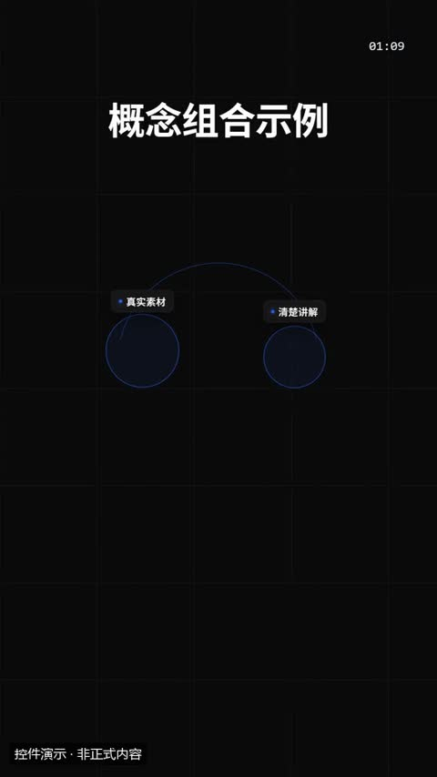](../../docs/template-gallery/demos/motiongit/fusion.mp4)

- [本地效果演示 1 · 规格见演示](../../docs/template-gallery/demos/motiongit/fusion.mp4)：官方控件真实渲染；使用中文示例文案或示例数据。6秒静音控件演示；保留模板原生标记与组内时码，角标不是本文件播放计时。低位演示身份标为本目录后处理添加。

**2. 适用内容**

- A × B 合在一起得到结果 C

- 不替代原始证据；重点字不能改变原话的限定条件。

**3. 所需素材**

- 短标题或重点词
- 清楚的解释关系
- 真实数值或标明示例的数据

**4. 可改参数与限制**

按已核对的字段与限制修改；尚未核对的能力会明确标注。

<details>
<summary>查看参数、限制与来源依据</summary>

- line（line）：文字，可选；最多可见字符 16。
- a（a）：文字，必填；最短长度 1；最多可见字符 12。
- b（b）：文字，必填；最短长度 1；最多可见字符 12。
- result（result）：文字，必填；最短长度 1；最多可见字符 18。
- 动画变体（variant）：orbs / orbit / collide。
- 段落时间（t0、t1）与动作提示时间（cues）按剪后的真实讲解设置；主题色由时间轴 theme 配置，不是每个控件任意独立的配色合同。

- 这些范围来自已登记版本的公开参数合同；更换个人包或版本后须重新核对，不自动沿用到所有官网模板。
- 每个控件目前只展示一个代表变体；可选枚举、允许数量和颜色参数不等于所有组合都已实测。
- 导出前仍需校验参数、真实素材、语音时长与排版；不从示例数据推断实际业务结果。

参数依据：[motiongit-controls.json](../../templates/motiongit-controls.json) · [render_motiongit_gallery.py](../../scripts/render_motiongit_gallery.py) · [render_motiongit_gallery_data.py](../../scripts/render_motiongit_gallery_data.py)

</details>

**5. 怎样交给 AI 使用**

<details>
<summary>复制本模板的使用提示词</summary>

```text
请使用 AI Cut 模板目录中的「光球合成」（编号 mg-control-fusion）。
我的内容或原片：[填写]；输出比例：[填写]；需要强调的内容：[填写]。
先核对本条来源、当前状态、素材和参数合同；使用我自己的获授权素材，保留原声原意。
按照本条已支持的参数范围做短预览，确认文字、动作和声音的时间一致，再放入剪辑工程。
若原包、依赖或素材缺失，说明缺什么；遇到费用先告诉我。不要将示例人物或示例数据当成我的内容。
```

</details>

**6. 当前能否使用**

- 已有控件演示 · 需自备授权原包
- 本仓库提供目录与已渲染演示，未附送个人 .motion 原包；学员须使用自己合法取得的对应包。
- 登记基线版本：0.3.0 (package2.7.17-alpha.2)。新输入、新电脑和其他变体须另行验证。

<details>
<summary>查看原始检查范围与接入记录</summary>

- 一个代表变体已由官方 helper 渲染；静音小样完整解码，并已查看实际导出抽帧。其他两个变体仅登记，未渲染；不代表连续观看或用户审美认可。

</details>

**7. 来源与许可**

- MotionGit 个人授权模板包，以原包授权为准；仅包含自有素材及明确示例数据的渲染演示，不分发受保护代码。

[原始来源](https://motiongit.com/@adunext/template-01-integrated-portrait)

---

<a id="mg-control-sticker"></a>

### 贴纸

`mg-control-sticker` · 视觉与背景 · 叠加标注与装饰 · **已有控件演示 · 需自备授权原包**

给一句话盖个情绪章：「绝了」「重点」「NEW」「必看」，或一个图标贴纸。位置 x/y 可选（默认右上），不压口播卡和字幕

**1. 效果预览**

[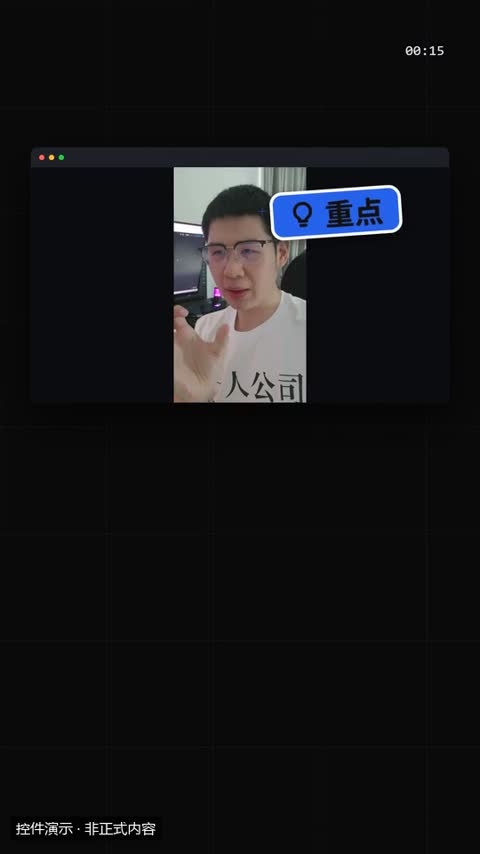](../../docs/template-gallery/demos/motiongit/sticker.mp4)

- [本地效果演示 1 · 规格见演示](../../docs/template-gallery/demos/motiongit/sticker.mp4)：官方控件真实渲染；使用本人授权素材。6秒静音控件演示；保留模板原生标记与组内时码，角标不是本文件播放计时。低位演示身份标为本目录后处理添加。

**2. 适用内容**

- 给一句话盖个情绪章：「绝了」「重点」「NEW」「必看」，或一个图标贴纸。位置 x/y 可选（默认右上），不压口播卡和字幕

- 避开脸部、字幕与关键证据；装饰不应抢走讲解重点。

**3. 所需素材**

- 叠加底图或视频
- 短标签及标注位置

**4. 可改参数与限制**

按已核对的字段与限制修改；尚未核对的能力会明确标注。

<details>
<summary>查看参数、限制与来源依据</summary>

- 贴纸文字（短）（text）：文字，可选；最多可见字符 6。
- 图标（可与文字同时用；都不给时为星星）（icon）：文字，可选；使用合同规定的 82 个枚举值之一。
- 中心横向位置（画面比例）（x）：数字，可选；最小 0；最大 1。
- 中心纵向位置（画面比例）（y）：数字，可选；最小 0；最大 1。
- 倾斜角度（度）（rot）：数字，可选；最小 -30；最大 30。
- 动画变体（variant）：pop / badge / burst。
- 段落时间（t0、t1）与动作提示时间（cues）按剪后的真实讲解设置；主题色由时间轴 theme 配置，不是每个控件任意独立的配色合同。

- 这些范围来自已登记版本的公开参数合同；更换个人包或版本后须重新核对，不自动沿用到所有官网模板。
- 每个控件目前只展示一个代表变体；可选枚举、允许数量和颜色参数不等于所有组合都已实测。
- 导出前仍需校验参数、真实素材、语音时长与排版；不从示例数据推断实际业务结果。

参数依据：[motiongit-controls.json](../../templates/motiongit-controls.json) · [render_motiongit_gallery.py](../../scripts/render_motiongit_gallery.py) · [render_motiongit_gallery_data.py](../../scripts/render_motiongit_gallery_data.py)

</details>

**5. 怎样交给 AI 使用**

<details>
<summary>复制本模板的使用提示词</summary>

```text
请使用 AI Cut 模板目录中的「贴纸」（编号 mg-control-sticker）。
我的内容或原片：[填写]；输出比例：[填写]；需要强调的内容：[填写]。
先核对本条来源、当前状态、素材和参数合同；使用我自己的获授权素材，保留原声原意。
按照本条已支持的参数范围做短预览，确认文字、动作和声音的时间一致，再放入剪辑工程。
若原包、依赖或素材缺失，说明缺什么；遇到费用先告诉我。不要将示例人物或示例数据当成我的内容。
```

</details>

**6. 当前能否使用**

- 已有控件演示 · 需自备授权原包
- 本仓库提供目录与已渲染演示，未附送个人 .motion 原包；学员须使用自己合法取得的对应包。
- 登记基线版本：0.3.0 (package2.7.17-alpha.2)。新输入、新电脑和其他变体须另行验证。

<details>
<summary>查看原始检查范围与接入记录</summary>

- 一个代表变体已由官方 helper 渲染；静音小样完整解码，并已查看实际导出抽帧。其他两个变体仅登记，未渲染；不代表连续观看或用户审美认可。

</details>

**7. 来源与许可**

- MotionGit 个人授权模板包，以原包授权为准；仅包含自有素材及明确示例数据的渲染演示，不分发受保护代码。

[原始来源](https://motiongit.com/@adunext/template-01-integrated-portrait)

---

<a id="mg-control-emoji"></a>

### 表情飘赞

`mg-control-emoji` · 视觉与背景 · 叠加标注与装饰 · **已有控件演示 · 需自备授权原包**

情绪时刻的一阵表情：点赞、比心、火、笑。icon 用图标名（彩色圆泡），或 text 填 1–2 个 emoji 字符；n 为数量

**1. 效果预览**

[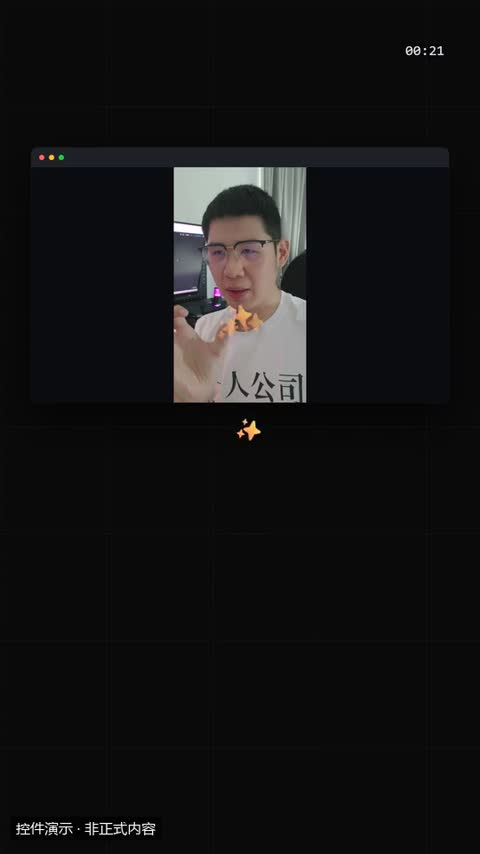](../../docs/template-gallery/demos/motiongit/emoji.mp4)

- [本地效果演示 1 · 规格见演示](../../docs/template-gallery/demos/motiongit/emoji.mp4)：官方控件真实渲染；使用本人授权素材。6秒静音控件演示；保留模板原生标记与组内时码，角标不是本文件播放计时。低位演示身份标为本目录后处理添加。

**2. 适用内容**

- 情绪时刻的一阵表情：点赞、比心、火、笑。icon 用图标名（彩色圆泡），或 text 填 1–2 个 emoji 字符；n 为数量

- 避开脸部、字幕与关键证据；装饰不应抢走讲解重点。

**3. 所需素材**

- 叠加底图或视频
- 短标签及标注位置

**4. 可改参数与限制**

按已核对的字段与限制修改；尚未核对的能力会明确标注。

<details>
<summary>查看参数、限制与来源依据</summary>

- 图标（默认 heart）（icon）：文字，可选；使用合同规定的 82 个枚举值之一。
- emoji 字符（填了就不用 icon）（text）：文字，可选；最多可见字符 2。
- 数量（n）：integer，可选；最小 3；最大 40。
- float / burst：起点横向位置（画面比例）（x）：数字，可选；最小 0；最大 1。
- burst：喷射中心纵向位置（画面比例）（y）：数字，可选；最小 0；最大 1。
- 动画变体（variant）：float / rain / burst。
- 段落时间（t0、t1）与动作提示时间（cues）按剪后的真实讲解设置；主题色由时间轴 theme 配置，不是每个控件任意独立的配色合同。

- 这些范围来自已登记版本的公开参数合同；更换个人包或版本后须重新核对，不自动沿用到所有官网模板。
- 每个控件目前只展示一个代表变体；可选枚举、允许数量和颜色参数不等于所有组合都已实测。
- 导出前仍需校验参数、真实素材、语音时长与排版；不从示例数据推断实际业务结果。

参数依据：[motiongit-controls.json](../../templates/motiongit-controls.json) · [render_motiongit_gallery.py](../../scripts/render_motiongit_gallery.py) · [render_motiongit_gallery_data.py](../../scripts/render_motiongit_gallery_data.py)

</details>

**5. 怎样交给 AI 使用**

<details>
<summary>复制本模板的使用提示词</summary>

```text
请使用 AI Cut 模板目录中的「表情飘赞」（编号 mg-control-emoji）。
我的内容或原片：[填写]；输出比例：[填写]；需要强调的内容：[填写]。
先核对本条来源、当前状态、素材和参数合同；使用我自己的获授权素材，保留原声原意。
按照本条已支持的参数范围做短预览，确认文字、动作和声音的时间一致，再放入剪辑工程。
若原包、依赖或素材缺失，说明缺什么；遇到费用先告诉我。不要将示例人物或示例数据当成我的内容。
```

</details>

**6. 当前能否使用**

- 已有控件演示 · 需自备授权原包
- 本仓库提供目录与已渲染演示，未附送个人 .motion 原包；学员须使用自己合法取得的对应包。
- 登记基线版本：0.3.0 (package2.7.17-alpha.2)。新输入、新电脑和其他变体须另行验证。

<details>
<summary>查看原始检查范围与接入记录</summary>

- 一个代表变体已由官方 helper 渲染；静音小样完整解码，并已查看实际导出抽帧。其他两个变体仅登记，未渲染；不代表连续观看或用户审美认可。

</details>

**7. 来源与许可**

- MotionGit 个人授权模板包，以原包授权为准；仅包含自有素材及明确示例数据的渲染演示，不分发受保护代码。

[原始来源](https://motiongit.com/@adunext/template-01-integrated-portrait)

---

<a id="mg-control-confetti"></a>

### 庆祝特效

`mg-control-confetti` · 视觉与背景 · 叠加标注与装饰 · **已有控件演示 · 需自备授权原包**

里程碑、达成、好消息、结尾致谢：彩纸 / 烟花，可选一句短字居中弹出。每个 cue 一波（最多 3 波）

**1. 效果预览**

[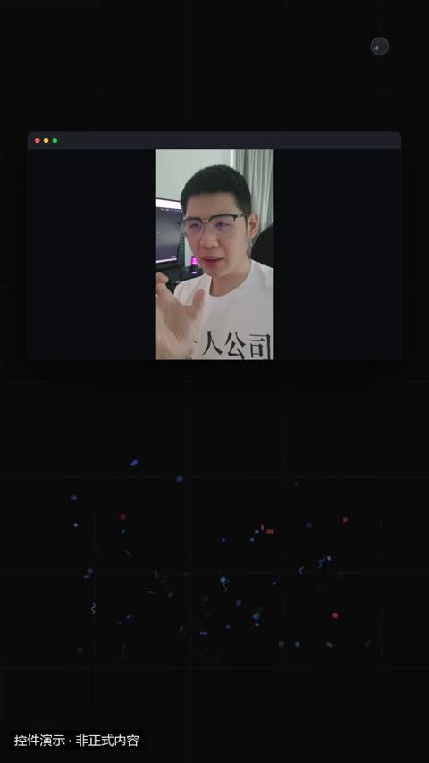](../../docs/template-gallery/demos/motiongit/confetti.mp4)

- [本地效果演示 1 · 规格见演示](../../docs/template-gallery/demos/motiongit/confetti.mp4)：官方控件真实渲染；使用本人授权素材。6秒静音控件演示；保留模板原生标记与组内时码，角标不是本文件播放计时。低位演示身份标为本目录后处理添加。

**2. 适用内容**

- 里程碑、达成、好消息、结尾致谢：彩纸 / 烟花，可选一句短字居中弹出。每个 cue 一波（最多 3 波）

- 避开脸部、字幕与关键证据；装饰不应抢走讲解重点。

**3. 所需素材**

- 叠加底图或视频
- 短标签及标注位置

**4. 可改参数与限制**

按已核对的字段与限制修改；尚未核对的能力会明确标注。

<details>
<summary>查看参数、限制与来源依据</summary>

- 居中短字（可省略）（text）：文字，可选；最多可见字符 8。
- 动画变体（variant）：cannons / rain / fireworks。
- 段落时间（t0、t1）与动作提示时间（cues）按剪后的真实讲解设置；主题色由时间轴 theme 配置，不是每个控件任意独立的配色合同。

- 这些范围来自已登记版本的公开参数合同；更换个人包或版本后须重新核对，不自动沿用到所有官网模板。
- 每个控件目前只展示一个代表变体；可选枚举、允许数量和颜色参数不等于所有组合都已实测。
- 导出前仍需校验参数、真实素材、语音时长与排版；不从示例数据推断实际业务结果。

参数依据：[motiongit-controls.json](../../templates/motiongit-controls.json) · [render_motiongit_gallery.py](../../scripts/render_motiongit_gallery.py) · [render_motiongit_gallery_data.py](../../scripts/render_motiongit_gallery_data.py)

</details>

**5. 怎样交给 AI 使用**

<details>
<summary>复制本模板的使用提示词</summary>

```text
请使用 AI Cut 模板目录中的「庆祝特效」（编号 mg-control-confetti）。
我的内容或原片：[填写]；输出比例：[填写]；需要强调的内容：[填写]。
先核对本条来源、当前状态、素材和参数合同；使用我自己的获授权素材，保留原声原意。
按照本条已支持的参数范围做短预览，确认文字、动作和声音的时间一致，再放入剪辑工程。
若原包、依赖或素材缺失，说明缺什么；遇到费用先告诉我。不要将示例人物或示例数据当成我的内容。
```

</details>

**6. 当前能否使用**

- 已有控件演示 · 需自备授权原包
- 本仓库提供目录与已渲染演示，未附送个人 .motion 原包；学员须使用自己合法取得的对应包。
- 登记基线版本：0.3.0 (package2.7.17-alpha.2)。新输入、新电脑和其他变体须另行验证。

<details>
<summary>查看原始检查范围与接入记录</summary>

- 一个代表变体已由官方 helper 渲染；静音小样完整解码，并已查看实际导出抽帧。其他两个变体仅登记，未渲染；不代表连续观看或用户审美认可。

</details>

**7. 来源与许可**

- MotionGit 个人授权模板包，以原包授权为准；仅包含自有素材及明确示例数据的渲染演示，不分发受保护代码。

[原始来源](https://motiongit.com/@adunext/template-01-integrated-portrait)

---

<a id="mg-control-frame"></a>

### 画面装饰框

`mg-control-frame` · 视觉与背景 · 叠加标注与装饰 · **已有控件演示 · 需自备授权原包**

给整段画面加氛围：拍摄感取景框、录制中、霓虹边框。框住内容区（避开口播卡与字幕），可整段常驻

**1. 效果预览**

[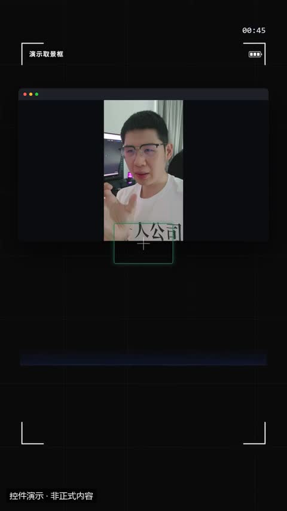](../../docs/template-gallery/demos/motiongit/frame.mp4)

- [本地效果演示 1 · 规格见演示](../../docs/template-gallery/demos/motiongit/frame.mp4)：官方控件真实渲染；使用本人授权素材。6秒静音控件演示；保留模板原生标记与组内时码，角标不是本文件播放计时。低位演示身份标为本目录后处理添加。

**2. 适用内容**

- 给整段画面加氛围：拍摄感取景框、录制中、霓虹边框。框住内容区（避开口播卡与字幕），可整段常驻

- 避开脸部、字幕与关键证据；装饰不应抢走讲解重点。

**3. 所需素材**

- 叠加底图或视频
- 短标签及标注位置

**4. 可改参数与限制**

按已核对的字段与限制修改；尚未核对的能力会明确标注。

<details>
<summary>查看参数、限制与来源依据</summary>

- 角落 / 上边框小字（可省略）（label）：文字，可选；最多可见字符 14。
- 动画变体（variant）：viewfinder / rec / glow。
- 段落时间（t0、t1）与动作提示时间（cues）按剪后的真实讲解设置；主题色由时间轴 theme 配置，不是每个控件任意独立的配色合同。

- 这些范围来自已登记版本的公开参数合同；更换个人包或版本后须重新核对，不自动沿用到所有官网模板。
- 每个控件目前只展示一个代表变体；可选枚举、允许数量和颜色参数不等于所有组合都已实测。
- 导出前仍需校验参数、真实素材、语音时长与排版；不从示例数据推断实际业务结果。

参数依据：[motiongit-controls.json](../../templates/motiongit-controls.json) · [render_motiongit_gallery.py](../../scripts/render_motiongit_gallery.py) · [render_motiongit_gallery_data.py](../../scripts/render_motiongit_gallery_data.py)

</details>

**5. 怎样交给 AI 使用**

<details>
<summary>复制本模板的使用提示词</summary>

```text
请使用 AI Cut 模板目录中的「画面装饰框」（编号 mg-control-frame）。
我的内容或原片：[填写]；输出比例：[填写]；需要强调的内容：[填写]。
先核对本条来源、当前状态、素材和参数合同；使用我自己的获授权素材，保留原声原意。
按照本条已支持的参数范围做短预览，确认文字、动作和声音的时间一致，再放入剪辑工程。
若原包、依赖或素材缺失，说明缺什么；遇到费用先告诉我。不要将示例人物或示例数据当成我的内容。
```

</details>

**6. 当前能否使用**

- 已有控件演示 · 需自备授权原包
- 本仓库提供目录与已渲染演示，未附送个人 .motion 原包；学员须使用自己合法取得的对应包。
- 登记基线版本：0.3.0 (package2.7.17-alpha.2)。新输入、新电脑和其他变体须另行验证。

<details>
<summary>查看原始检查范围与接入记录</summary>

- 一个代表变体已由官方 helper 渲染；静音小样完整解码，并已查看实际导出抽帧。其他两个变体仅登记，未渲染；不代表连续观看或用户审美认可。

</details>

**7. 来源与许可**

- MotionGit 个人授权模板包，以原包授权为准；仅包含自有素材及明确示例数据的渲染演示，不分发受保护代码。

[原始来源](https://motiongit.com/@adunext/template-01-integrated-portrait)

---

<a id="remotion-bokeh-circles"></a>

### 散景光圈背景

`remotion-bokeh-circles` · 视觉与背景 · 循环与背景 · **代码已入库 · 准备环境后适配**

柔焦圆形漂浮背景

**1. 效果预览**

[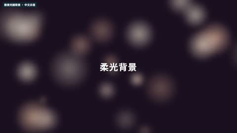](../../docs/template-gallery/demos/remotion/bokeh-circles.mp4)

- [本地效果演示 1 · 16:9](../../docs/template-gallery/demos/remotion/bokeh-circles.mp4)：原注册动画的中文参数演示；静音；示例文字与数值不是实际业务结果

**2. 适用内容**

- 标题背板与氛围衬底
- 有意使用的图形过场

- 不要替代有证据价值的实拍画面
- 背景运动不能干扰正文阅读

**3. 所需素材**

- 中文文案与颜色参数
- 按本条素材确认的时间长度
- 对应画幅的安全区检查

**4. 可改参数与限制**

按已核对的字段与限制修改；尚未核对的能力会明确标注。

<details>
<summary>查看参数、限制与来源依据</summary>

- 颜色列表（colors）：文字列表，有默认值或须提供。
- 底色（baseColor）：文字，有默认值或须提供。
- 数量（count）：数字，有默认值或须提供。
- 标签（label）：文字，可省略。
- 标签颜色（labelColor）：文字，可省略。

- 以上是源码实际暴露的输入，不代表文字长度、列表数量和所有参数组合已完成测试；换内容后须检查排版与完整动画。
- 当前目录演示画幅为 16:9；尺寸与总帧数由 Composition 注册项控制，不能把效果内部 duration 等输入当作自动更改导出长度。

参数依据：[BokehCircles.tsx](../../extensions/remotion-vd44/src/vendor/rendercomp/components/bokeh-circles/BokehCircles.tsx) · [Root.tsx](../../extensions/remotion-vd44/src/vendor/rendercomp/Root.tsx)

</details>

**5. 怎样交给 AI 使用**

<details>
<summary>复制本模板的使用提示词</summary>

```text
请使用 AI Cut 模板目录中的「散景光圈背景」（编号 remotion-bokeh-circles）。
我的内容或原片：[填写]；输出比例：[填写]；需要强调的内容：[填写]。
先核对本条来源、当前状态、素材和参数合同；使用我自己的获授权素材，保留原声原意。
按照本条已支持的参数范围做短预览，确认文字、动作和声音的时间一致，再放入剪辑工程。
若原包、依赖或素材缺失，说明缺什么；遇到费用先告诉我。不要将示例人物或示例数据当成我的内容。
```

</details>

**6. 当前能否使用**

- 代码已入库 · 准备环境后适配
- 本仓库包含相应代码；需准备 Remotion 运行环境及本条素材，参数修改后重新预览检查。
- 登记基线版本：f648980e528defb7594e24c6447055f0540f340b+zh-gallery.1。新输入、新电脑和其他变体须另行验证。

<details>
<summary>查看原始检查范围与接入记录</summary>

- 55项真实Remotion渲染；每项完整解码、帧数、比例、静音及2 MB限额通过；实际查看每项18%/52%/82%编码帧联系表。不是逐帧连续观看，不代表其他画幅、真人合成、用户审美认可或最终视频QA。

</details>

**7. 来源与许可**

- MIT（模板源码）；Remotion 运行时与字体许可分别适用

[原始来源](https://github.com/RenderComp/free-remotion-templates/tree/f648980e528defb7594e24c6447055f0540f340b)

---

<a id="remotion-fireworks-burst"></a>

### 烟花爆开

`remotion-fireworks-burst` · 视觉与背景 · 循环与背景 · **代码已入库 · 准备环境后适配**

放射粒子爆开

**1. 效果预览**

[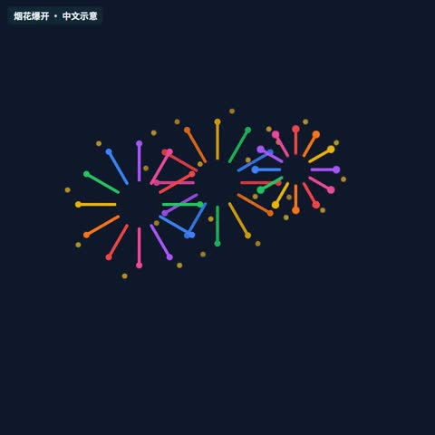](../../docs/template-gallery/demos/remotion/fireworks-burst.mp4)

- [本地效果演示 1 · 1:1](../../docs/template-gallery/demos/remotion/fireworks-burst.mp4)：原注册动画的中文参数演示；静音；示例文字与数值不是实际业务结果

**2. 适用内容**

- 标题背板与氛围衬底
- 有意使用的图形过场

- 不要替代有证据价值的实拍画面
- 背景运动不能干扰正文阅读

**3. 所需素材**

- 中文文案与颜色参数
- 按本条素材确认的时间长度
- 对应画幅的安全区检查

**4. 可改参数与限制**

按已核对的字段与限制修改；尚未核对的能力会明确标注。

<details>
<summary>查看参数、限制与来源依据</summary>

- 背景色（backgroundColor）：文字，有默认值或须提供。
- 烟花配色（burstColors）：文字列表，有默认值或须提供。
- trail颜色（trailColor）：文字，有默认值或须提供。
- spark颜色（sparkColor）：文字，有默认值或须提供。
- 文字色（textColor）：文字，有默认值或须提供。
- sub颜色（subColor）：文字，有默认值或须提供。
- 显示文字（messageText）：文字，有默认值或须提供。
- 辅助文字（subText）：文字，有默认值或须提供。

- 以上是源码实际暴露的输入，不代表文字长度、列表数量和所有参数组合已完成测试；换内容后须检查排版与完整动画。
- 当前目录演示画幅为 1:1；尺寸与总帧数由 Composition 注册项控制，不能把效果内部 duration 等输入当作自动更改导出长度。

参数依据：[FireworksBurst.tsx](../../extensions/remotion-vd44/src/vendor/rendercomp/components/fireworks-burst/FireworksBurst.tsx) · [Root.tsx](../../extensions/remotion-vd44/src/vendor/rendercomp/Root.tsx)

</details>

**5. 怎样交给 AI 使用**

<details>
<summary>复制本模板的使用提示词</summary>

```text
请使用 AI Cut 模板目录中的「烟花爆开」（编号 remotion-fireworks-burst）。
我的内容或原片：[填写]；输出比例：[填写]；需要强调的内容：[填写]。
先核对本条来源、当前状态、素材和参数合同；使用我自己的获授权素材，保留原声原意。
按照本条已支持的参数范围做短预览，确认文字、动作和声音的时间一致，再放入剪辑工程。
若原包、依赖或素材缺失，说明缺什么；遇到费用先告诉我。不要将示例人物或示例数据当成我的内容。
```

</details>

**6. 当前能否使用**

- 代码已入库 · 准备环境后适配
- 本仓库包含相应代码；需准备 Remotion 运行环境及本条素材，参数修改后重新预览检查。
- 登记基线版本：f648980e528defb7594e24c6447055f0540f340b+zh-gallery.1。新输入、新电脑和其他变体须另行验证。

<details>
<summary>查看原始检查范围与接入记录</summary>

- 55项真实Remotion渲染；每项完整解码、帧数、比例、静音及2 MB限额通过；实际查看每项18%/52%/82%编码帧联系表。不是逐帧连续观看，不代表其他画幅、真人合成、用户审美认可或最终视频QA。

</details>

**7. 来源与许可**

- MIT（模板源码）；Remotion 运行时与字体许可分别适用

[原始来源](https://github.com/RenderComp/free-remotion-templates/tree/f648980e528defb7594e24c6447055f0540f340b)

---

<a id="remotion-loop-grid-wave"></a>

### 网格波浪循环

`remotion-loop-grid-wave` · 视觉与背景 · 循环与背景 · **代码已入库 · 准备环境后适配**

网格按波形循环变化

**1. 效果预览**

[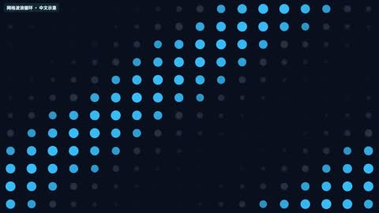](../../docs/template-gallery/demos/remotion/loop-grid-wave.mp4)

- [本地效果演示 1 · 16:9](../../docs/template-gallery/demos/remotion/loop-grid-wave.mp4)：原注册动画的中文参数演示；静音；示例文字与数值不是实际业务结果

**2. 适用内容**

- 标题背板与氛围衬底
- 有意使用的图形过场

- 不要替代有证据价值的实拍画面
- 背景运动不能干扰正文阅读

**3. 所需素材**

- 中文文案与颜色参数
- 按本条素材确认的时间长度
- 对应画幅的安全区检查

**4. 可改参数与限制**

按已核对的字段与限制修改；尚未核对的能力会明确标注。

<details>
<summary>查看参数、限制与来源依据</summary>

- 背景色（backgroundColor）：文字，有默认值或须提供。
- dot颜色（dotColor）：文字，有默认值或须提供。
- 强调色（accentColor）：文字，有默认值或须提供。
- 振幅（amplitude）：数字，有默认值或须提供。
- 速度（speed）：数字，有默认值或须提供。

- 以上是源码实际暴露的输入，不代表文字长度、列表数量和所有参数组合已完成测试；换内容后须检查排版与完整动画。
- 当前目录演示画幅为 16:9；尺寸与总帧数由 Composition 注册项控制，不能把效果内部 duration 等输入当作自动更改导出长度。

参数依据：[LoopGridWave.tsx](../../extensions/remotion-vd44/src/vendor/rendercomp/components/loop-grid-wave/LoopGridWave.tsx) · [Root.tsx](../../extensions/remotion-vd44/src/vendor/rendercomp/Root.tsx)

</details>

**5. 怎样交给 AI 使用**

<details>
<summary>复制本模板的使用提示词</summary>

```text
请使用 AI Cut 模板目录中的「网格波浪循环」（编号 remotion-loop-grid-wave）。
我的内容或原片：[填写]；输出比例：[填写]；需要强调的内容：[填写]。
先核对本条来源、当前状态、素材和参数合同；使用我自己的获授权素材，保留原声原意。
按照本条已支持的参数范围做短预览，确认文字、动作和声音的时间一致，再放入剪辑工程。
若原包、依赖或素材缺失，说明缺什么；遇到费用先告诉我。不要将示例人物或示例数据当成我的内容。
```

</details>

**6. 当前能否使用**

- 代码已入库 · 准备环境后适配
- 本仓库包含相应代码；需准备 Remotion 运行环境及本条素材，参数修改后重新预览检查。
- 登记基线版本：f648980e528defb7594e24c6447055f0540f340b+zh-gallery.1。新输入、新电脑和其他变体须另行验证。

<details>
<summary>查看原始检查范围与接入记录</summary>

- 55项真实Remotion渲染；每项完整解码、帧数、比例、静音及2 MB限额通过；实际查看每项18%/52%/82%编码帧联系表。不是逐帧连续观看，不代表其他画幅、真人合成、用户审美认可或最终视频QA。

</details>

**7. 来源与许可**

- MIT（模板源码）；Remotion 运行时与字体许可分别适用

[原始来源](https://github.com/RenderComp/free-remotion-templates/tree/f648980e528defb7594e24c6447055f0540f340b)

---

<a id="remotion-parallax-pan"></a>

### 视差平移

`remotion-parallax-pan` · 视觉与背景 · 循环与背景 · **代码已入库 · 准备环境后适配**

多层图形以不同速度移动

**1. 效果预览**

[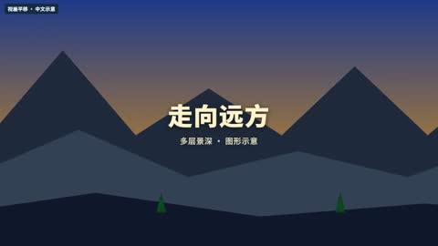](../../docs/template-gallery/demos/remotion/parallax-pan.mp4)

- [本地效果演示 1 · 16:9](../../docs/template-gallery/demos/remotion/parallax-pan.mp4)：原注册动画的中文参数演示；静音；示例文字与数值不是实际业务结果

**2. 适用内容**

- 标题背板与氛围衬底
- 有意使用的图形过场

- 不要替代有证据价值的实拍画面
- 背景运动不能干扰正文阅读

**3. 所需素材**

- 中文文案与颜色参数
- 按本条素材确认的时间长度
- 对应画幅的安全区检查

**4. 可改参数与限制**

按已核对的字段与限制修改；尚未核对的能力会明确标注。

<details>
<summary>查看参数、限制与来源依据</summary>

- 标题（title）：文字，有默认值或须提供。
- 副标题（subtitle）：文字，可省略。
- skyTop（skyTop）：文字，有默认值或须提供。
- skyBottom（skyBottom）：文字，有默认值或须提供。
- mountain颜色（mountainColor）：文字，有默认值或须提供。
- hill颜色（hillColor）：文字，有默认值或须提供。
- ground颜色（groundColor）：文字，有默认值或须提供。
- 文字色（textColor）：文字，有默认值或须提供。
- 平移距离（panDistance）：数字，可省略。

- 以上是源码实际暴露的输入，不代表文字长度、列表数量和所有参数组合已完成测试；换内容后须检查排版与完整动画。
- 当前目录演示画幅为 16:9；尺寸与总帧数由 Composition 注册项控制，不能把效果内部 duration 等输入当作自动更改导出长度。

参数依据：[ParallaxPan.tsx](../../extensions/remotion-vd44/src/vendor/rendercomp/components/parallax-pan/ParallaxPan.tsx) · [Root.tsx](../../extensions/remotion-vd44/src/vendor/rendercomp/Root.tsx)

</details>

**5. 怎样交给 AI 使用**

<details>
<summary>复制本模板的使用提示词</summary>

```text
请使用 AI Cut 模板目录中的「视差平移」（编号 remotion-parallax-pan）。
我的内容或原片：[填写]；输出比例：[填写]；需要强调的内容：[填写]。
先核对本条来源、当前状态、素材和参数合同；使用我自己的获授权素材，保留原声原意。
按照本条已支持的参数范围做短预览，确认文字、动作和声音的时间一致，再放入剪辑工程。
若原包、依赖或素材缺失，说明缺什么；遇到费用先告诉我。不要将示例人物或示例数据当成我的内容。
```

</details>

**6. 当前能否使用**

- 代码已入库 · 准备环境后适配
- 本仓库包含相应代码；需准备 Remotion 运行环境及本条素材，参数修改后重新预览检查。
- 登记基线版本：f648980e528defb7594e24c6447055f0540f340b+zh-gallery.1。新输入、新电脑和其他变体须另行验证。

<details>
<summary>查看原始检查范围与接入记录</summary>

- 55项真实Remotion渲染；每项完整解码、帧数、比例、静音及2 MB限额通过；实际查看每项18%/52%/82%编码帧联系表。不是逐帧连续观看，不代表其他画幅、真人合成、用户审美认可或最终视频QA。

</details>

**7. 来源与许可**

- MIT（模板源码）；Remotion 运行时与字体许可分别适用

[原始来源](https://github.com/RenderComp/free-remotion-templates/tree/f648980e528defb7594e24c6447055f0540f340b)

---

<a id="remotion-pencil-draw"></a>

### 铅笔绘制

`remotion-pencil-draw` · 视觉与背景 · 循环与背景 · **代码已入库 · 准备环境后适配**

铅笔沿星形路径绘制

**1. 效果预览**

[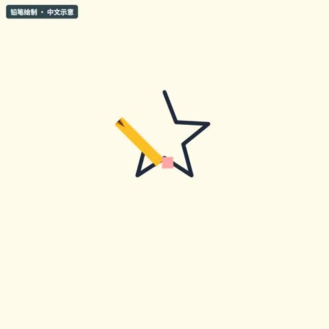](../../docs/template-gallery/demos/remotion/pencil-draw.mp4)

- [本地效果演示 1 · 1:1](../../docs/template-gallery/demos/remotion/pencil-draw.mp4)：原注册动画的中文参数演示；静音；示例文字与数值不是实际业务结果

**2. 适用内容**

- 标题背板与氛围衬底
- 有意使用的图形过场

- 不要替代有证据价值的实拍画面
- 背景运动不能干扰正文阅读

**3. 所需素材**

- 中文文案与颜色参数
- 按本条素材确认的时间长度
- 对应画幅的安全区检查

**4. 可改参数与限制**

按已核对的字段与限制修改；尚未核对的能力会明确标注。

<details>
<summary>查看参数、限制与来源依据</summary>

- 背景色（backgroundColor）：文字，有默认值或须提供。
- pencil颜色（pencilColor）：文字，有默认值或须提供。
- 线条颜色（lineColor）：文字，有默认值或须提供。
- eraser颜色（eraserColor）：文字，有默认值或须提供。
- 文字色（textColor）：文字，有默认值或须提供。
- sub颜色（subColor）：文字，有默认值或须提供。
- 显示文字（messageText）：文字，有默认值或须提供。
- 辅助文字（subText）：文字，有默认值或须提供。

- 以上是源码实际暴露的输入，不代表文字长度、列表数量和所有参数组合已完成测试；换内容后须检查排版与完整动画。
- 当前目录演示画幅为 1:1；尺寸与总帧数由 Composition 注册项控制，不能把效果内部 duration 等输入当作自动更改导出长度。

参数依据：[PencilDraw.tsx](../../extensions/remotion-vd44/src/vendor/rendercomp/components/pencil-draw/PencilDraw.tsx) · [Root.tsx](../../extensions/remotion-vd44/src/vendor/rendercomp/Root.tsx)

</details>

**5. 怎样交给 AI 使用**

<details>
<summary>复制本模板的使用提示词</summary>

```text
请使用 AI Cut 模板目录中的「铅笔绘制」（编号 remotion-pencil-draw）。
我的内容或原片：[填写]；输出比例：[填写]；需要强调的内容：[填写]。
先核对本条来源、当前状态、素材和参数合同；使用我自己的获授权素材，保留原声原意。
按照本条已支持的参数范围做短预览，确认文字、动作和声音的时间一致，再放入剪辑工程。
若原包、依赖或素材缺失，说明缺什么；遇到费用先告诉我。不要将示例人物或示例数据当成我的内容。
```

</details>

**6. 当前能否使用**

- 代码已入库 · 准备环境后适配
- 本仓库包含相应代码；需准备 Remotion 运行环境及本条素材，参数修改后重新预览检查。
- 登记基线版本：f648980e528defb7594e24c6447055f0540f340b+zh-gallery.1。新输入、新电脑和其他变体须另行验证。

<details>
<summary>查看原始检查范围与接入记录</summary>

- 55项真实Remotion渲染；每项完整解码、帧数、比例、静音及2 MB限额通过；实际查看每项18%/52%/82%编码帧联系表。不是逐帧连续观看，不代表其他画幅、真人合成、用户审美认可或最终视频QA。

</details>

**7. 来源与许可**

- MIT（模板源码）；Remotion 运行时与字体许可分别适用

[原始来源](https://github.com/RenderComp/free-remotion-templates/tree/f648980e528defb7594e24c6447055f0540f340b)

---

<a id="remotion-pixel-waterfall-cycle"></a>

### 像素瀑布循环

`remotion-pixel-waterfall-cycle` · 视觉与背景 · 循环与背景 · **代码已入库 · 准备环境后适配**

竖屏像素图形循环

**1. 效果预览**

[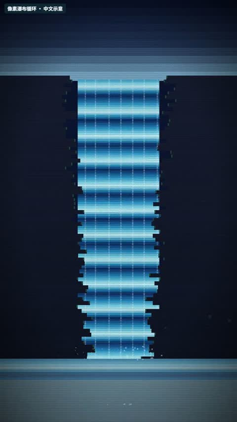](../../docs/template-gallery/demos/remotion/pixel-waterfall-cycle.mp4)

- [本地效果演示 1 · 9:16](../../docs/template-gallery/demos/remotion/pixel-waterfall-cycle.mp4)：原注册动画的中文参数演示；静音；示例文字与数值不是实际业务结果

**2. 适用内容**

- 标题背板与氛围衬底
- 有意使用的图形过场

- 不要替代有证据价值的实拍画面
- 背景运动不能干扰正文阅读

**3. 所需素材**

- 中文文案与颜色参数
- 按本条素材确认的时间长度
- 对应画幅的安全区检查

**4. 可改参数与限制**

按已核对的字段与限制修改；尚未核对的能力会明确标注。

<details>
<summary>查看参数、限制与来源依据</summary>

- 背景色（backgroundColor）：文字，有默认值或须提供。
- 强调色（accentColor）：文字，有默认值或须提供。
- cliff颜色（cliffColor）：文字，有默认值或须提供。
- 循环速度（cycleSpeed）：数字，有默认值或须提供。
- 雾气开关（showMist）：开关，有默认值或须提供。

- 以上是源码实际暴露的输入，不代表文字长度、列表数量和所有参数组合已完成测试；换内容后须检查排版与完整动画。
- 当前目录演示画幅为 9:16；尺寸与总帧数由 Composition 注册项控制，不能把效果内部 duration 等输入当作自动更改导出长度。

参数依据：[PixelWaterfallCycle.tsx](../../extensions/remotion-vd44/src/vendor/rendercomp/components/pixel-waterfall-cycle/PixelWaterfallCycle.tsx) · [Root.tsx](../../extensions/remotion-vd44/src/vendor/rendercomp/Root.tsx)

</details>

**5. 怎样交给 AI 使用**

<details>
<summary>复制本模板的使用提示词</summary>

```text
请使用 AI Cut 模板目录中的「像素瀑布循环」（编号 remotion-pixel-waterfall-cycle）。
我的内容或原片：[填写]；输出比例：[填写]；需要强调的内容：[填写]。
先核对本条来源、当前状态、素材和参数合同；使用我自己的获授权素材，保留原声原意。
按照本条已支持的参数范围做短预览，确认文字、动作和声音的时间一致，再放入剪辑工程。
若原包、依赖或素材缺失，说明缺什么；遇到费用先告诉我。不要将示例人物或示例数据当成我的内容。
```

</details>

**6. 当前能否使用**

- 代码已入库 · 准备环境后适配
- 本仓库包含相应代码；需准备 Remotion 运行环境及本条素材，参数修改后重新预览检查。
- 登记基线版本：f648980e528defb7594e24c6447055f0540f340b+zh-gallery.1。新输入、新电脑和其他变体须另行验证。

<details>
<summary>查看原始检查范围与接入记录</summary>

- 55项真实Remotion渲染；每项完整解码、帧数、比例、静音及2 MB限额通过；实际查看每项18%/52%/82%编码帧联系表。不是逐帧连续观看，不代表其他画幅、真人合成、用户审美认可或最终视频QA。

</details>

**7. 来源与许可**

- MIT（模板源码）；Remotion 运行时与字体许可分别适用

[原始来源](https://github.com/RenderComp/free-remotion-templates/tree/f648980e528defb7594e24c6447055f0540f340b)

---

<a id="remotion-particle-snow"></a>

### 粒子雪花

`remotion-particle-snow` · 视觉与背景 · 循环与背景 · **代码已入库 · 准备环境后适配**

图形粒子持续飘落

**1. 效果预览**

[](../../docs/template-gallery/demos/remotion/particle-snow.mp4)

- [本地效果演示 1 · 1:1](../../docs/template-gallery/demos/remotion/particle-snow.mp4)：原注册动画的中文参数演示；静音；示例文字与数值不是实际业务结果

**2. 适用内容**

- 标题背板与氛围衬底
- 有意使用的图形过场

- 不要替代有证据价值的实拍画面
- 背景运动不能干扰正文阅读

**3. 所需素材**

- 中文文案与颜色参数
- 按本条素材确认的时间长度
- 对应画幅的安全区检查

**4. 可改参数与限制**

按已核对的字段与限制修改；尚未核对的能力会明确标注。

<details>
<summary>查看参数、限制与来源依据</summary>

- 背景色（backgroundColor）：文字，有默认值或须提供。
- snow颜色（snowColor）：文字，有默认值或须提供。
- 强调色（accentColor）：文字，有默认值或须提供。
- 雪花数量（flakeCount）：数字，有默认值或须提供。
- 标题（title）：文字，有默认值或须提供。
- 副标题（subtitle）：文字，有默认值或须提供。
- 文字色（textColor）：文字，有默认值或须提供。

- 以上是源码实际暴露的输入，不代表文字长度、列表数量和所有参数组合已完成测试；换内容后须检查排版与完整动画。
- 当前目录演示画幅为 1:1；尺寸与总帧数由 Composition 注册项控制，不能把效果内部 duration 等输入当作自动更改导出长度。

参数依据：[ParticleSnow.tsx](../../extensions/remotion-vd44/src/vendor/rendercomp/components/particle-snow/ParticleSnow.tsx) · [Root.tsx](../../extensions/remotion-vd44/src/vendor/rendercomp/Root.tsx)

</details>

**5. 怎样交给 AI 使用**

<details>
<summary>复制本模板的使用提示词</summary>

```text
请使用 AI Cut 模板目录中的「粒子雪花」（编号 remotion-particle-snow）。
我的内容或原片：[填写]；输出比例：[填写]；需要强调的内容：[填写]。
先核对本条来源、当前状态、素材和参数合同；使用我自己的获授权素材，保留原声原意。
按照本条已支持的参数范围做短预览，确认文字、动作和声音的时间一致，再放入剪辑工程。
若原包、依赖或素材缺失，说明缺什么；遇到费用先告诉我。不要将示例人物或示例数据当成我的内容。
```

</details>

**6. 当前能否使用**

- 代码已入库 · 准备环境后适配
- 本仓库包含相应代码；需准备 Remotion 运行环境及本条素材，参数修改后重新预览检查。
- 登记基线版本：f648980e528defb7594e24c6447055f0540f340b+zh-gallery.1。新输入、新电脑和其他变体须另行验证。

<details>
<summary>查看原始检查范围与接入记录</summary>

- 55项真实Remotion渲染；每项完整解码、帧数、比例、静音及2 MB限额通过；实际查看每项18%/52%/82%编码帧联系表。不是逐帧连续观看，不代表其他画幅、真人合成、用户审美认可或最终视频QA。

</details>

**7. 来源与许可**

- MIT（模板源码）；Remotion 运行时与字体许可分别适用

[原始来源](https://github.com/RenderComp/free-remotion-templates/tree/f648980e528defb7594e24c6447055f0540f340b)

---

<a id="remotion-starfield"></a>

### 星空穿行背景

`remotion-starfield` · 视觉与背景 · 循环与背景 · **代码已入库 · 准备环境后适配**

星点向外运动的空间背景

**1. 效果预览**

[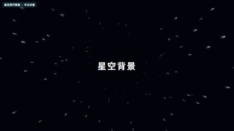](../../docs/template-gallery/demos/remotion/starfield.mp4)

- [本地效果演示 1 · 16:9](../../docs/template-gallery/demos/remotion/starfield.mp4)：原注册动画的中文参数演示；静音；示例文字与数值不是实际业务结果

**2. 适用内容**

- 标题背板与氛围衬底
- 有意使用的图形过场

- 不要替代有证据价值的实拍画面
- 背景运动不能干扰正文阅读

**3. 所需素材**

- 中文文案与颜色参数
- 按本条素材确认的时间长度
- 对应画幅的安全区检查

**4. 可改参数与限制**

按已核对的字段与限制修改；尚未核对的能力会明确标注。

<details>
<summary>查看参数、限制与来源依据</summary>

- 数量（count）：数字，有默认值或须提供。
- star颜色（starColor）：文字，有默认值或须提供。
- 底色（baseColor）：文字，有默认值或须提供。
- 星空运动速度（warpSpeed）：数字，有默认值或须提供。
- 标签（label）：文字，可省略。
- 标签颜色（labelColor）：文字，可省略。

- 以上是源码实际暴露的输入，不代表文字长度、列表数量和所有参数组合已完成测试；换内容后须检查排版与完整动画。
- 当前目录演示画幅为 16:9；尺寸与总帧数由 Composition 注册项控制，不能把效果内部 duration 等输入当作自动更改导出长度。

参数依据：[Starfield.tsx](../../extensions/remotion-vd44/src/vendor/rendercomp/components/starfield/Starfield.tsx) · [Root.tsx](../../extensions/remotion-vd44/src/vendor/rendercomp/Root.tsx)

</details>

**5. 怎样交给 AI 使用**

<details>
<summary>复制本模板的使用提示词</summary>

```text
请使用 AI Cut 模板目录中的「星空穿行背景」（编号 remotion-starfield）。
我的内容或原片：[填写]；输出比例：[填写]；需要强调的内容：[填写]。
先核对本条来源、当前状态、素材和参数合同；使用我自己的获授权素材，保留原声原意。
按照本条已支持的参数范围做短预览，确认文字、动作和声音的时间一致，再放入剪辑工程。
若原包、依赖或素材缺失，说明缺什么；遇到费用先告诉我。不要将示例人物或示例数据当成我的内容。
```

</details>

**6. 当前能否使用**

- 代码已入库 · 准备环境后适配
- 本仓库包含相应代码；需准备 Remotion 运行环境及本条素材，参数修改后重新预览检查。
- 登记基线版本：f648980e528defb7594e24c6447055f0540f340b+zh-gallery.1。新输入、新电脑和其他变体须另行验证。

<details>
<summary>查看原始检查范围与接入记录</summary>

- 55项真实Remotion渲染；每项完整解码、帧数、比例、静音及2 MB限额通过；实际查看每项18%/52%/82%编码帧联系表。不是逐帧连续观看，不代表其他画幅、真人合成、用户审美认可或最终视频QA。

</details>

**7. 来源与许可**

- MIT（模板源码）；Remotion 运行时与字体许可分别适用

[原始来源](https://github.com/RenderComp/free-remotion-templates/tree/f648980e528defb7594e24c6447055f0540f340b)

---

<a id="remotion-library-orbit"></a>

### 前后环绕卡片演示

`remotion-library-orbit` · 视觉与背景 · RemotionUI本地适配 · **代码已入库 · 准备环境后适配**

卡片绕原创几何示意人物前后运动；没有真人抠像输入

**1. 效果预览**

[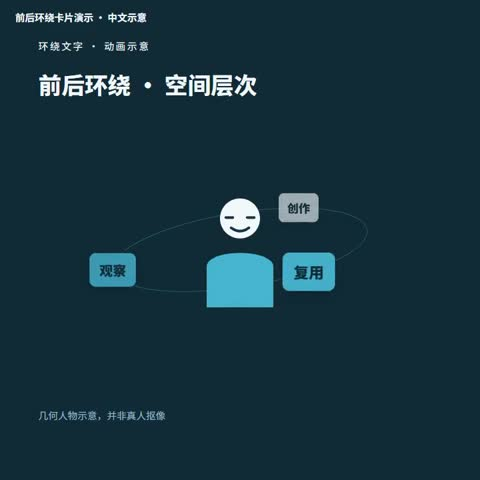](../../docs/template-gallery/demos/remotion/library-orbit.mp4)

- [本地效果演示 1 · 1:1](../../docs/template-gallery/demos/remotion/library-orbit.mp4)：原注册动画的中文参数演示；静音；示例文字与数值不是实际业务结果

**2. 适用内容**

- 可参数化的图形动画
- 按表达任务选择局部使用

- 真实素材合成与其他比例须另测
- 不声称演示等同于本条成片验收
- 此项为几何人物占位；本人环绕效果另见口播效果16

**3. 所需素材**

- 中文文案与颜色参数
- 按本条素材确认的时间长度
- 对应画幅的安全区检查

**4. 可改参数与限制**

按已核对的字段与限制修改；尚未核对的能力会明确标注。

<details>
<summary>查看参数、限制与来源依据</summary>

- 标签列表（labels）：文字列表，可省略。
- 标题（title）：文字，可省略。
- 说明（note）：文字，可省略。
- 运动周期帧数（periodInFrames）：数字，可省略。

- 以上是源码实际暴露的输入，不代表文字长度、列表数量和所有参数组合已完成测试；换内容后须检查排版与完整动画。
- 当前目录演示画幅为 1:1；尺寸与总帧数由 Composition 注册项控制，不能把效果内部 duration 等输入当作自动更改导出长度。
- labels 必须为非空文字列表；当前中心人物为几何示意图，换真人需另行适配人像与前后层次。

参数依据：[Demos.tsx](../../extensions/remotion-vd44/src/template-library/remotion-ui/Demos.tsx) · [LibraryRoot.tsx](../../extensions/remotion-vd44/src/template-library/LibraryRoot.tsx)

</details>

**5. 怎样交给 AI 使用**

<details>
<summary>复制本模板的使用提示词</summary>

```text
请使用 AI Cut 模板目录中的「前后环绕卡片演示」（编号 remotion-library-orbit）。
我的内容或原片：[填写]；输出比例：[填写]；需要强调的内容：[填写]。
先核对本条来源、当前状态、素材和参数合同；使用我自己的获授权素材，保留原声原意。
按照本条已支持的参数范围做短预览，确认文字、动作和声音的时间一致，再放入剪辑工程。
若原包、依赖或素材缺失，说明缺什么；遇到费用先告诉我。不要将示例人物或示例数据当成我的内容。
```

</details>

**6. 当前能否使用**

- 代码已入库 · 准备环境后适配
- 本仓库包含相应代码；需准备 Remotion 运行环境及本条素材，参数修改后重新预览检查。
- 登记基线版本：0aecaca2b61a167992e1205d10e4da16d8a71331+zh-gallery.1。新输入、新电脑和其他变体须另行验证。

<details>
<summary>查看原始检查范围与接入记录</summary>

- 55项真实Remotion渲染；每项完整解码、帧数、比例、静音及2 MB限额通过；实际查看每项18%/52%/82%编码帧联系表。不是逐帧连续观看，不代表其他画幅、真人合成、用户审美认可或最终视频QA。

</details>

**7. 来源与许可**

- MIT（模板源码）；Remotion 运行时与字体许可分别适用

[原始来源](https://github.com/riaz37/remotion-ui/tree/0aecaca2b61a167992e1205d10e4da16d8a71331)

---

## 附加预告 · 不计入上述条目

<a id="mg-preview-3d-book"></a>

### 3D书 · 阿杜和那个影响了

`mg-preview-3d-book` · 视觉与背景 · 预告（不计入主清单） · **官方预告 · 待开放/核对**

以立体书页、真实照片、翻页镜头和双语字幕串联个人经历，展示可用于回忆与叙事讲解的书本舞台。Demo 使用第8版完整成片。

**1. 效果预览**

[](https://github.com/motiontemplates/all/releases/download/demo-batch-two-2026-10-21/3d-book-demo-6dc0bd1a0e5bc9e8.mp4)

- [官方示例 1 · 16:9](https://github.com/motiontemplates/all/releases/download/demo-batch-two-2026-10-21/3d-book-demo-6dc0bd1a0e5bc9e8.mp4)：官方 3D 书预告，目录注明 Demo 使用第 8 版完整成片；不是已取得的可运行模板。

**2. 适用内容**

- 以立体书页、真实照片、翻页镜头和双语字幕串联个人经历，展示可用于回忆与叙事讲解的书本舞台。Demo 使用第8版完整成片。

**3. 所需素材**

- 来源尚未提供完整素材要求；取得制作指南后逐项核对，不从 Demo 猜测。

**4. 可改参数与限制**

按已核对的字段与限制修改；尚未核对的能力会明确标注。

<details>
<summary>查看参数、限制与来源依据</summary>

- 尚未核对可替换参数合同；请先读原模板的 guide/schema 或源码。不能根据 Demo 推断能任意换颜色、数量、比例或时长。

- 文字容量、素材数量、颜色、时长和画幅的可调范围，按对应版本的实际合同核对；演示规格不等于任意规格都受支持。

</details>

**5. 怎样交给 AI 使用**

<details>
<summary>复制本模板的使用提示词</summary>

```text
请使用 AI Cut 模板目录中的「3D书 · 阿杜和那个影响了」（编号 mg-preview-3d-book）。
我的内容或原片：[填写]；输出比例：[填写]；需要强调的内容：[填写]。
先核对本条来源、当前状态、素材和参数合同；使用我自己的获授权素材，保留原声原意。
按照本条已支持的参数范围做短预览，确认文字、动作和声音的时间一致，再放入剪辑工程。
若原包、依赖或素材缺失，说明缺什么；遇到费用先告诉我。不要将示例人物或示例数据当成我的内容。
```

</details>

**6. 当前能否使用**

- 官方预告 · 待开放/核对
- 可取得状态：官方目录标记 coming-soon；以官网后续状态为准
- 登记基线版本：未登记；以来源为准。新输入、新电脑和其他变体须另行验证。

<details>
<summary>查看原始检查范围与接入记录</summary>

- 目录中仅为 previewOnly 演示，没有主模板条目；未取得包、运行或连续观看。

</details>

**7. 来源与许可**

- 演示链接不是模板或素材复用授权；具体许可证未核定。

[原始来源](https://github.com/motiontemplates/all/tree/21537c6f49aa9504496d20c14bf597f7eac229f4)
